# Page: Home

<details>
<summary>Relevant source files</summary>

The following files were used as context for generating this wiki page:

- [README.md](https://github.com/pallets/flask/blob/258d68b6ff5e2244386540f48b48bab90d6ab827/README.md)
</details>

# Home

Flask is a lightweight web application framework for Python based on the WSGI standard. It is designed for rapid development and simplicity, allowing developers to build complex applications starting from a minimal core. Initially a wrapper for Werkzeug and Jinja, it has grown into one of Python's most popular web frameworks.

Sources: [README.md:5-9](https://github.com/pallets/flask/blob/258d68b6ff5e2244386540f48b48bab90d6ab827/README.md#L5-L9)

## Core Philosophy

Flask's design is intentionally unopinionated. It provides suggestions for how to structure an application but does not enforce a specific project layout or require particular dependencies. This flexibility empowers developers to select their preferred tools and libraries. The framework's functionality can be extended through a rich ecosystem of community-provided extensions.

Sources: [README.md:10-14](https://github.com/pallets/flask/blob/258d68b6ff5e2244386540f48b48bab90d6ab827/README.md#L10-L14)

### Key Characteristics

| Feature | Description |
| :--- | :--- |
| **Lightweight** | Designed to be simple and easy to get started with. |
| **Scalable** | Capable of scaling up to complex applications. |
| **Unopinionated** | Does not enforce project layout or dependencies. |
| **Extensible** | A large number of community extensions are available to add functionality. |

Sources: [README.md:5-14](https://github.com/pallets/flask/blob/258d68b6ff5e2244386540f48b48bab90d6ab827/README.md#L5-L14)

## Core Dependencies

Flask is built upon two key libraries from the Pallets project: Werkzeug and Jinja.

*   **Werkzeug**: A comprehensive WSGI utility library that provides request, response, and utility functions.
*   **Jinja**: A powerful and modern templating engine for Python.

Sources: [README.md:7-8](https://github.com/pallets/flask/blob/258d68b6ff5e2244386540f48b48bab90d6ab827/README.md#L7-L8)

The relationship between these components can be visualized as follows:

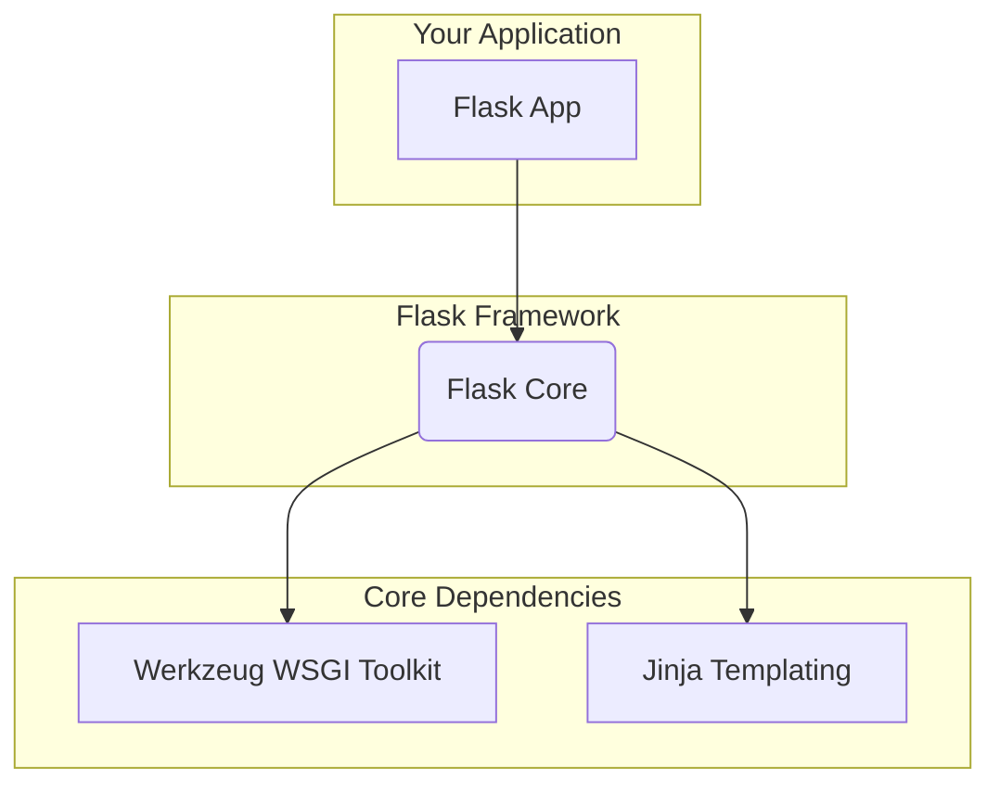
*Diagram illustrating Flask's core dependencies.*
Sources: [README.md:7-8](https://github.com/pallets/flask/blob/258d68b6ff5e2244386540f48b48bab90d6ab827/README.md#L7-L8)

## Getting Started: A Simple Example

Creating a basic "Hello, World!" application in Flask requires only a few lines of code.

### 1. Create the Application File

Save the following code in a file named `app.py`.

```python
# save this as app.py
from flask import Flask

app = Flask(__name__)

@app.route("/")
def hello():
    return "Hello, World!"
```
*Sources: [README.md:23-31](https://github.com/pallets/flask/blob/258d68b6ff5e2244386540f48b48bab90d6ab827/README.md#L23-L31)*

This code snippet performs the following actions:
1.  Imports the `Flask` class.
2.  Creates an instance of the Flask application.
3.  Uses the `@app.route("/")` decorator to associate the root URL (`/`) with the `hello()` function.
4.  The `hello()` function returns the string "Hello, World!" as the response.

### 2. Run the Development Server

Execute the following command in your terminal to start the built-in development server:

```
$ flask run
  * Running on http://127.0.0.1:5000/ (Press CTRL+C to quit)
```
*Sources: [README.md:34-36](https://github.com/pallets/flask/blob/258d68b6ff5e2244386540f48b48bab90d6ab827/README.md#L34-L36)*

The server will be accessible at `http://127.0.0.1:5000/`.

### Request-Response Flow

The following diagram illustrates the sequence of events when a user accesses the running application.

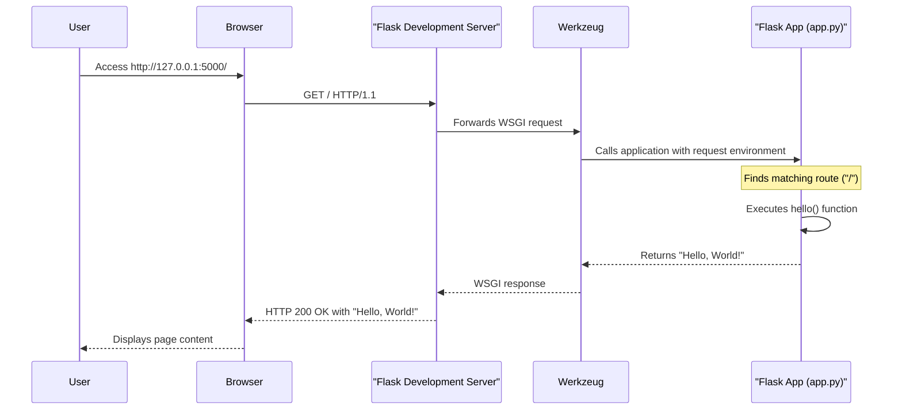
*Sequence diagram of a simple request.*
Sources: [README.md:22-36](https://github.com/pallets/flask/blob/258d68b6ff5e2244386540f48b48bab90d6ab827/README.md#L22-L36)

## Community and Support

Flask is developed and maintained by the Pallets organization. The community is a vital part of the project's growth and sustainability.

### Donations

Financial contributions help the maintainers dedicate more time to the project and support the community. Donations can be made via the Pallets project website.

Sources: [README.md:40-45](https://github.com/pallets/flask/blob/258d68b6ff5e2244386540f48b48bab90d6ab827/README.md#L40-L45)

### Contributing

There are many ways to contribute to the Flask project, including:
*   Reporting issues
*   Requesting features
*   Asking or answering questions
*   Submitting pull requests

Detailed contribution guidelines are available in the project's documentation.

Sources: [README.md:49-53](https://github.com/pallets/flask/blob/258d68b6ff5e2244386540f48b48bab90d6ab827/README.md#L49-L53)

# Page: Architecture Overview

<details>
<summary>Relevant source files</summary>

The following files were used as context for generating this wiki page:

- [src/flask/app.py](https://github.com/pallets/flask/blob/258d68b6ff5e2244386540f48b48bab90d6ab827/src/flask/app.py)
- [src/flask/sansio/app.py](https://github.com/pallets/flask/blob/258d68b6ff5e2244386540f48b48bab90d6ab827/src/flask/sansio/app.py)
- [README.md](https://github.com/pallets/flask/blob/258d68b6ff5e2244386540f48b48bab90d6ab827/README.md)
- [src/flask/__init__.py](https://github.com/pallets/flask/blob/258d68b6ff5e2244386540f48b48bab90d6ab827/src/flask/__init__.py)
- [src/flask/__main__.py](https://github.com/pallets/flask/blob/258d68b6ff5e2244386540f48b48bab90d6ab827/src/flask/__main__.py)
- [src/flask/debughelpers.py](https://github.com/pallets/flask/blob/258d68b6ff5e2244386540f48b48bab90d6ab827/src/flask/debughelpers.py)
</details>

# Architecture Overview

Flask is a lightweight WSGI web application framework designed for rapid development and scalability. Its architecture is centered around a core `Flask` application object that acts as a central registry for views, URL rules, and configuration. It is built upon the Werkzeug library for WSGI utilities and the Jinja templating engine. Flask's design philosophy is to provide a solid foundation while allowing developers the flexibility to choose libraries and extensions for more complex needs.

The core of a Flask application is the `Flask` class, which is the WSGI application itself. When a request comes in from a WSGI server, it is handled by the `Flask` instance, which dispatches it through a well-defined lifecycle involving request preprocessing, routing, view execution, response processing, and context teardown.

Sources: [README.md:5-9](https://github.com/pallets/flask/blob/258d68b6ff5e2244386540f48b48bab90d6ab827/README.md#L5-L9), [src/flask/app.py:109-113](https://github.com/pallets/flask/blob/258d68b6ff5e2244386540f48b48bab90d6ab827/src/flask/app.py#L109-L113), [src/flask/app.py:1618-1625](https://github.com/pallets/flask/blob/258d68b6ff5e2244386540f48b48bab90d6ab827/src/flask/app.py#L1618-L1625)

## Core Components

The Flask framework is composed of several key components that work together to handle web requests.

| File/Module | Purpose |
| --- | --- |
| `src/flask/app.py` | Defines the `Flask` class, the main WSGI application object. It orchestrates the request handling lifecycle. |
| `src/flask/sansio/app.py` | Defines the `App` class, a "Sans-IO" base class for `Flask`. It manages configuration, blueprints, URL rules, and other non-network-specific logic. |
| `src/flask/ctx.py` | Implements the application and request context management. (Referenced in `app.py`) |
| `src/flask/globals.py` | Provides the global context-local proxies like `current_app`, `request`, `g`, and `session`. (Referenced in `app.py`) |
| `src/flask/blueprints.py` | Provides the `Blueprint` class for building modular applications. (Referenced in `sansio/app.py`) |
| `src/flask/routing.py` | Manages URL routing, matching request URLs to view functions. (Referenced in `app.py` and `sansio/app.py`) |
| `src/flask/templating.py` | Integrates the Jinja2 templating engine. (Referenced in `app.py`) |
| `src/flask/cli.py` | Provides the command-line interface, including the `flask run` command. (Referenced in `app.py` and `__main__.py`) |
| `src/flask/__init__.py` | Exposes the public API of the Flask framework, making key classes and functions available for import. |
| `src/flask/__main__.py` | The entry point for running Flask applications from the command line using `python -m flask`. |

### The Application Object

The central component of any Flask application is an instance of the `Flask` class. This object inherits from `flask.sansio.app.App`, which in turn inherits from `flask.sansio.scaffold.Scaffold`. This inheritance structure separates the WSGI-specific logic (`Flask`) from the core application structure and setup logic (`App` and `Scaffold`).

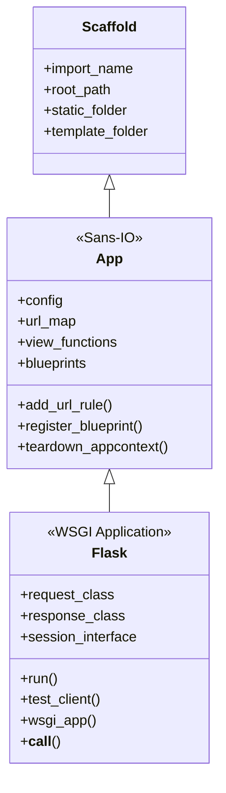
*   **`Scaffold`**: Provides basic functionality related to the application's name and path, such as locating the root path and template/static folders.
*   **`App`**: A "Sans-IO" (without input/output) class that contains the core logic not tied to a specific web protocol. This includes configuration management, blueprint registration, URL rule handling, and managing teardown functions.
*   **`Flask`**: The main WSGI application class. It extends `App` with WSGI-specific functionality, including the request/response cycle, context management, the development server (`run`), and test clients.

Sources: [src/flask/app.py:109](https://github.com/pallets/flask/blob/258d68b6ff5e2244386540f48b48bab90d6ab827/src/flask/app.py#L109), [src/flask/sansio/app.py:59](https://github.com/pallets/flask/blob/258d68b6ff5e2244386540f48b48bab90d6ab827/src/flask/sansio/app.py#L59)

### Configuration

Application configuration is managed through the `app.config` attribute, which is an instance of `flask.config.Config`. This object is a dictionary-like object that can be populated in various ways.

The `Flask` class defines a `default_config` dictionary with default values for common settings.

#### Default Configuration
| Key | Default Value | Description |
|---|---|---|
| `DEBUG` | `None` (derived from `FLASK_DEBUG` env var) | Enables or disables debug mode. |
| `TESTING` | `False` | Enables test mode. |
| `SECRET_KEY` | `None` | A secret key for signing session cookies. |
| `PERMANENT_SESSION_LIFETIME` | `timedelta(days=31)` | The lifetime of a permanent session. |
| `SERVER_NAME` | `None` | The name and port of the server. |
| `APPLICATION_ROOT` | `/` | The root path of the application. |
| `SESSION_COOKIE_NAME` | `session` | The name of the session cookie. |
| `MAX_CONTENT_LENGTH` | `None` | Maximum request body size. |
| `SEND_FILE_MAX_AGE_DEFAULT` | `None` | Default cache max-age for `send_file`. |
| `TRAP_HTTP_EXCEPTIONS` | `False` | If `True`, HTTP exceptions are re-raised. |
| `PREFERRED_URL_SCHEME` | `http` | The preferred URL scheme for external URLs. |

The `make_config` method initializes the config object, setting the root path for loading files and applying the default values.

Sources: [src/flask/app.py:206-238](https://github.com/pallets/flask/blob/258d68b6ff5e2244386540f48b48bab90d6ab827/src/flask/app.py#L206-L238), [src/flask/sansio/app.py:193](https://github.com/pallets/flask/blob/258d68b6ff5e2244386540f48b48bab90d6ab827/src/flask/sansio/app.py#L193), [src/flask/sansio/app.py:479-493](https://github.com/pallets/flask/blob/258d68b6ff5e2244386540f48b48bab90d6ab827/src/flask/sansio/app.py#L479-L493)

### Request Lifecycle

When a WSGI server receives a request, it calls the `Flask` application object. This triggers a sequence of operations to generate a response.

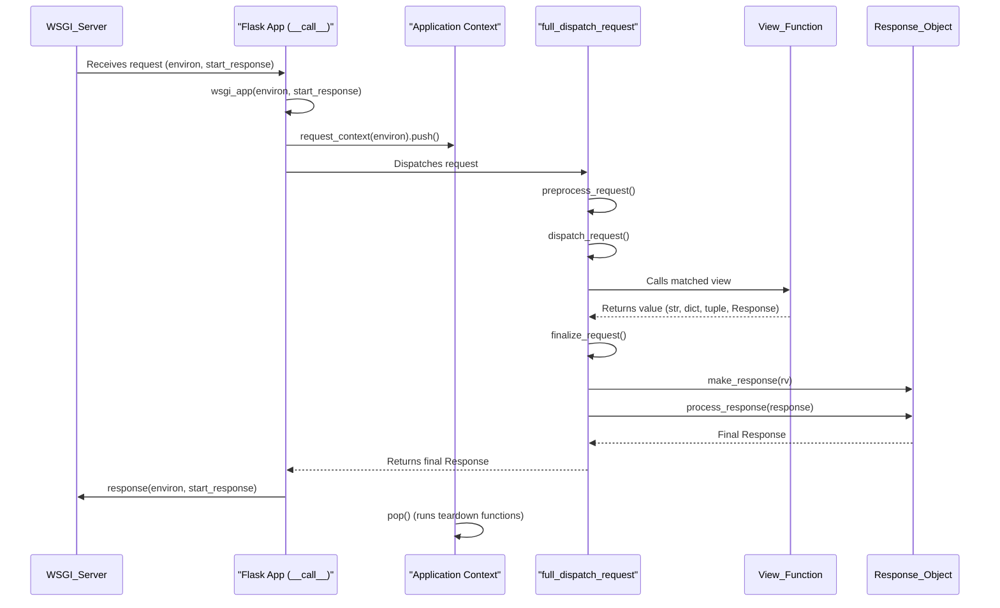

1.  **WSGI Entry Point**: The WSGI server calls the `Flask` instance via its `__call__` method, which in turn calls `wsgi_app`.
    `Sources: [src/flask/app.py:1618-1625](https://github.com/pallets/flask/blob/258d68b6ff5e2244386540f48b48bab90d6ab827/src/flask/app.py#L1618-L1625)`
2.  **Context Creation**: A request context (`AppContext`) is created from the WSGI `environ` and pushed. This makes global objects like `request` and `session` available.
    `Sources: [src/flask/app.py:1592-1597](https://github.com/pallets/flask/blob/258d68b6ff5e2244386540f48b48bab90d6ab827/src/flask/app.py#L1592-L1597)`
3.  **Request Dispatch**: `full_dispatch_request` is called to handle the main logic.
    `Sources: [src/flask/app.py:992-1019](https://github.com/pallets/flask/blob/258d68b6ff5e2244386540f48b48bab90d6ab827/src/flask/app.py#L992-L1019)`
4.  **Preprocessing**: `preprocess_request` runs all `before_request` functions. If any of these functions return a value, it is treated as the response, and the process short-circuits.
    `Sources: [src/flask/app.py:1366-1392](https://github.com/pallets/flask/blob/258d68b6ff5e2244386540f48b48bab90d6ab827/src/flask/app.py#L1366-L1392)`
5.  **View Dispatch**: `dispatch_request` matches the URL rule and calls the corresponding view function.
    `Sources: [src/flask/app.py:966-990](https://github.com/pallets/flask/blob/258d68b6ff5e2244386540f48b48bab90d6ab827/src/flask/app.py#L966-L990)`
6.  **Response Creation**: The return value from the view function is passed to `make_response` to convert it into a `Response` object. Flask can handle various return types, including strings, dictionaries (which are converted to JSON), and tuples `(body, status, headers)`.
    `Sources: [src/flask/app.py:1224-1364](https://github.com/pallets/flask/blob/258d68b6ff5e2244386540f48b48bab90d6ab827/src/flask/app.py#L1224-L1364)`
7.  **Postprocessing**: `finalize_request` calls `process_response`, which runs all `after_request` functions. These can modify the response object. Finally, the session is saved if it has been modified.
    `Sources: [src/flask/app.py:1021-1051](https://github.com/pallets/flask/blob/258d68b6ff5e2244386540f48b48bab90d6ab827/src/flask/app.py#L1021-L1051), [src/flask/app.py:1394-1418](https://github.com/pallets/flask/blob/258d68b6ff5e2244386540f48b48bab90d6ab827/src/flask/app.py#L1394-L1418)`
8.  **Context Teardown**: The `finally` block in `wsgi_app` ensures that the request context is popped, which triggers all `teardown_request` and `teardown_appcontext` functions.
    `Sources: [src/flask/app.py:1616](https://github.com/pallets/flask/blob/258d68b6ff5e2244386540f48b48bab90d6ab827/src/flask/app.py#L1616), [src/flask/app.py:1420-1451](https://github.com/pallets/flask/blob/258d68b6ff5e2244386540f48b48bab90d6ab827/src/flask/app.py#L1420-L1451), [src/flask/app.py:1453-1479](https://github.com/pallets/flask/blob/258d68b6ff5e2244386540f48b48bab90d6ab827/src/flask/app.py#L1453-L1479)`

### Error Handling

Flask has a robust error handling mechanism. When an exception occurs during request dispatch, it is caught and processed.

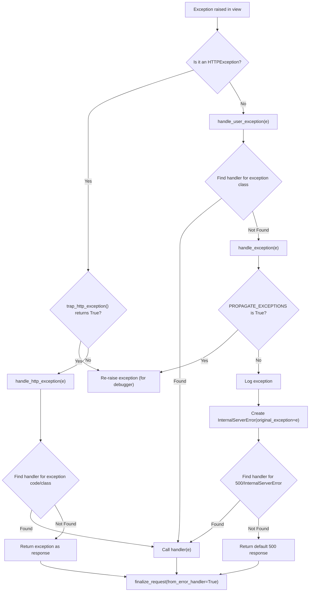

-   **`handle_user_exception`**: Catches non-HTTP exceptions. It looks for a registered error handler for the specific exception class. If none is found, the exception is passed to `handle_exception`.
    `Sources: [src/flask/app.py:865-895](https://github.com/pallets/flask/blob/258d68b6ff5e2244386540f48b48bab90d6ab827/src/flask/app.py#L865-L895)`
-   **`handle_http_exception`**: Handles `werkzeug.exceptions.HTTPException` subclasses. It looks for an error handler registered for the specific HTTP status code or the exception class. If none is found, the exception itself is returned as the response.
    `Sources: [src/flask/app.py:830-863](https://github.com/pallets/flask/blob/258d68b6ff5e2244386540f48b48bab90d6ab827/src/flask/app.py#L830-L863)`
-   **`handle_exception`**: This is the final fallback for unhandled exceptions. It logs the error and always generates a 500 Internal Server Error response. It will use a registered handler for `500` or `InternalServerError` if available. If `PROPAGATE_EXCEPTIONS` is enabled (as in debug or testing mode), it re-raises the exception.
    `Sources: [src/flask/app.py:897-949](https://github.com/pallets/flask/blob/258d68b6ff5e2244386540f48b48bab90d6ab827/src/flask/app.py#L897-L949)`

### Command-Line Interface

Flask integrates with the Click library to provide a command-line interface. The entry point is defined in `src/flask/__main__.py`, which simply calls `cli.main`. The `Flask` app object creates a `cli.AppGroup` instance at `self.cli`, allowing developers and extensions to register custom commands. The built-in `flask run` command uses this system to start the development server.

`app.run()` is a helper to start a development server, but it is recommended to use the `flask run` command instead. The `run` method contains a check to prevent it from running when invoked from the CLI, to avoid starting two servers.

Sources: [src/flask/__main__.py:1-3](https://github.com/pallets/flask/blob/258d68b6ff5e2244386540f48b48bab90d6ab827/src/flask/__main__.py#L1-L3), [src/flask/app.py:336-345](https://github.com/pallets/flask/blob/258d68b6ff5e2244386540f48b48bab90d6ab827/src/flask/app.py#L336-L345), [src/flask/app.py:632-754](https://github.com/pallets/flask/blob/258d68b6ff5e2244386540f48b48bab90d6ab827/src/flask/app.py#L632-L754)

## Edge Cases and Gotchas

-   **`__name__` vs. Hardcoded Name**: When creating a `Flask` instance, using `__name__` is correct for single-module applications. For packages, it's recommended to hardcode the package name (e.g., `'yourapplication'`) to ensure extensions can correctly locate resources and improve debugging.
    `Sources: [src/flask/app.py:130-154](https://github.com/pallets/flask/blob/258d68b6ff5e2244386540f48b48bab90d6ab827/src/flask/app.py#L130-L154)`
-   **`app.run()` in Production**: The `app.run()` method is for development only and is not suitable for production due to its lack of security and performance. The documentation explicitly warns against its use in a production setting.
    `Sources: [src/flask/app.py:642-644](https://github.com/pallets/flask/blob/258d68b6ff5e2244386540f48b48bab90d6ab827/src/flask/app.py#L642-L644)`
-   **Setup After First Request**: Calling setup methods (like `add_url_rule`, `register_blueprint`, etc.) after the first request has been handled will raise an `AssertionError`. All application setup must be completed before the app starts serving requests.
    `Sources: [src/flask/sansio/app.py:410-420](https://github.com/pallets/flask/blob/258d68b6ff5e2244386540f48b48bab90d6ab827/src/flask/sansio/app.py#L410-L420)`
-   **Routing Redirects with Form Data**: In debug mode, if a routing redirect (e.g., for a missing trailing slash) would cause a browser to drop POST data (by using a 302 redirect instead of 307/308), Flask will raise a `FormDataRoutingRedirect` exception to warn the developer.
    `Sources: [src/flask/app.py:578-588](https://github.com/pallets/flask/blob/258d68b6ff5e2244386540f48b48bab90d6ab827/src/flask/app.py#L578-L588), [src/flask/debughelpers.py:50-78](https://github.com/pallets/flask/blob/258d68b6ff5e2244386540f48b48bab90d6ab827/src/flask/debughelpers.py#L50-L78)`
-   **Teardown Function Execution Order**: Functions registered with `after_request`, `teardown_request`, and `teardown_appcontext` are executed in the reverse order of their registration.
    `Sources: [src/flask/app.py:1412](https://github.com/pallets/flask/blob/258d68b6ff5e2244386540f48b48bab90d6ab827/src/flask/app.py#L1412), [src/flask/app.py:1444](https://github.com/pallets/flask/blob/258d68b6ff5e2244386540f48b48bab90d6ab827/src/flask/app.py#L1444), [src/flask/app.py:1472](https://github.com/pallets/flask/blob/258d68b6ff5e2244386540f48b48bab90d6ab827/src/flask/app.py#L1472)`
-   **`should_ignore_error` Deprecation**: The `should_ignore_error` method is deprecated as of Flask 3.2. Error handling should be done within teardown handlers themselves.
    `Sources: [src/flask/sansio/app.py:925-934](https://github.com/pallets/flask/blob/258d68b6ff5e2244386540f48b48bab90d6ab827/src/flask/sansio/app.py#L925-L934)`
-   **Async Support**: Flask supports `async` view functions. It uses `asgiref.sync.async_to_sync` to run coroutine functions in a synchronous WSGI environment. This requires installing Flask with the `[async]` extra.
    `Sources: [src/flask/app.py:1079-1100](https://github.com/pallets/flask/blob/258d68b6ff5e2244386540f48b48bab90d6ab827/src/flask/app.py#L1079-L1100)`

## Other files in this area
### src/flask/__init__.py
This file serves as the main entry point for the Flask package, defining its public API. It aggregates key components from various internal modules, making them directly accessible under the `flask` namespace (e.g., `flask.Flask`, `flask.request`). Architecturally, it establishes the user-facing surface of the framework, hiding the internal module structure.

The file contains no logic itself; it only re-exports names from other modules within the package.

**Exports:**

*   **Application and Blueprints:**
    *   `Flask`: The main application class. (Sources: [src/flask/__init__.py:2](https://github.com/pallets/flask/blob/258d68b6ff5e2244386540f48b48bab90d6ab827/src/flask/__init__.py#L2))
    *   `Blueprint`: A class for building modular application components. (Sources: [src/flask/__init__.py:3](https://github.com/pallets/flask/blob/258d68b6ff5e2244386540f48b48bab90d6ab827/src/flask/__init__.py#L3))
*   **Configuration:**
    *   `Config`: A dictionary-like object for application configuration. (Sources: [src/flask/__init__.py:4](https://github.com/pallets/flask/blob/258d68b6ff5e2244386540f48b48bab90d6ab827/src/flask/__init__.py#L4))
*   **Context Management:**
    *   `after_this_request`: A function to register a function to be called after the current request. (Sources: [src/flask/__init__.py:5](https://github.com/pallets/flask/blob/258d68b6ff5e2244386540f48b48bab90d6ab827/src/flask/__init__.py#L5))
    *   `copy_current_request_context`: A function to create a copy of the current request context for use in a different coroutine or thread. (Sources: [src/flask/__init__.py:6](https://github.com/pallets/flask/blob/258d68b6ff5e2244386540f48b48bab90d6ab827/src/flask/__init__.py#L6))
    *   `has_app_context`: Checks if an application context is active. (Sources: [src/flask/__init__.py:7](https://github.com/pallets/flask/blob/258d68b6ff5e2244386540f48b48bab90d6ab827/src/flask/__init__.py#L7))
    *   `has_request_context`: Checks if a request context is active. (Sources: [src/flask/__init__.py:8](https://github.com/pallets/flask/blob/258d68b6ff5e2244386540f48b48bab90d6ab827/src/flask/__init__.py#L8))
*   **Context-Local Globals:**
    *   `current_app`: A proxy to the active application object. (Sources: [src/flask/__init__.py:9](https://github.com/pallets/flask/blob/258d68b6ff5e2244386540f48b48bab90d6ab827/src/flask/__init__.py#L9))
    *   `g`: An object for storing data during an application context. (Sources: [src/flask/__init__.py:10](https://github.com/pallets/flask/blob/258d68b6ff5e2244386540f48b48bab90d6ab827/src/flask/__init__.py#L10))
    *   `request`: A proxy to the active request object. (Sources: [src/flask/__init__.py:11](https://github.com/pallets/flask/blob/258d68b6ff5e2244386540f48b48bab90d6ab827/src/flask/__init__.py#L11))
    *   `session`: A proxy to the user session object. (Sources: [src/flask/__init__.py:12](https://github.com/pallets/flask/blob/258d68b6ff5e2244386540f48b48bab90d6ab827/src/flask/__init__.py#L12))
*   **Helpers and Utilities:**
    *   `abort`: Aborts a request with an HTTP error code. (Sources: [src/flask/__init__.py:13](https://github.com/pallets/flask/blob/258d68b6ff5e2244386540f48b48bab90d6ab827/src/flask/__init__.py#L13))
    *   `flash`: Flashes a message to the next request. (Sources: [src/flask/__init__.py:14](https://github.com/pallets/flask/blob/258d68b6ff5e2244386540f48b48bab90d6ab827/src/flask/__init__.py#L14))
    *   `get_flashed_messages`: Retrieves flashed messages. (Sources: [src/flask/__init__.py:15](https://github.com/pallets/flask/blob/258d68b6ff5e2244386540f48b48bab90d6ab827/src/flask/__init__.py#L15))
    *   `get_template_attribute`: Loads a macro or variable from a template. (Sources: [src/flask/__init__.py:16](https://github.com/pallets/flask/blob/258d68b6ff5e2244386540f48b48bab90d6ab827/src/flask/__init__.py#L16))
    *   `make_response`: Creates a response object. (Sources: [src/flask/__init__.py:17](https://github.com/pallets/flask/blob/258d68b6ff5e2244386540f48b48bab90d6ab827/src/flask/__init__.py#L17))
    *   `redirect`: Returns a response that redirects the client. (Sources: [src/flask/__init__.py:18](https://github.com/pallets/flask/blob/258d68b6ff5e2244386540f48b48bab90d6ab827/src/flask/__init__.py#L18))
    *   `send_file`: Sends a file to the client. (Sources: [src/flask/__init__.py:19](https://github.com/pallets/flask/blob/258d68b6ff5e2244386540f48b48bab90d6ab827/src/flask/__init__.py#L19))
    *   `send_from_directory`: Sends a file from a directory. (Sources: [src/flask/__init__.py:20](https://github.com/pallets/flask/blob/258d68b6ff5e2244386540f48b48bab90d6ab827/src/flask/__init__.py#L20))
    *   `stream_with_context`: Wraps a generator to stream a response while maintaining the request context. (Sources: [src/flask/__init__.py:21](https://github.com/pallets/flask/blob/258d68b6ff5e2244386540f48b48bab90d6ab827/src/flask/__init__.py#L21))
    *   `url_for`: Generates a URL for a given endpoint. (Sources: [src/flask/__init__.py:22](https://github.com/pallets/flask/blob/258d68b6ff5e2244386540f48b48bab90d6ab827/src/flask/__init__.py#L22))
*   **JSON Support:**
    *   `json`: The `json` module itself, for direct access. (Sources: [src/flask/__init__.py:1](https://github.com/pallets/flask/blob/258d68b6ff5e2244386540f48b48bab90d6ab827/src/flask/__init__.py#L1))
    *   `jsonify`: Creates a JSON response. (Sources: [src/flask/__init__.py:23](https://github.com/pallets/flask/blob/258d68b6ff5e2244386540f48b48bab90d6ab827/src/flask/__init__.py#L23))
*   **Signals:**
    *   `appcontext_popped`, `appcontext_pushed`, `appcontext_tearing_down` (Sources: [src/flask/__init__.py:24-26](https://github.com/pallets/flask/blob/258d68b6ff5e2244386540f48b48bab90d6ab827/src/flask/__init__.py#L24-L26))
    *   `before_render_template`, `template_rendered` (Sources: [src/flask/__init__.py:27, 33]())
    *   `got_request_exception` (Sources: [src/flask/__init__.py:28](https://github.com/pallets/flask/blob/258d68b6ff5e2244386540f48b48bab90d6ab827/src/flask/__init__.py#L28))
    *   `message_flashed` (Sources: [src/flask/__init__.py:29](https://github.com/pallets/flask/blob/258d68b6ff5e2244386540f48b48bab90d6ab827/src/flask/__init__.py#L29))
    *   `request_finished`, `request_started`, `request_tearing_down` (Sources: [src/flask/__init__.py:30-32](https://github.com/pallets/flask/blob/258d68b6ff5e2244386540f48b48bab90d6ab827/src/flask/__init__.py#L30-L32))
*   **Templating:**
    *   `render_template`, `render_template_string` (Sources: [src/flask/__init__.py:34-35](https://github.com/pallets/flask/blob/258d68b6ff5e2244386540f48b48bab90d6ab827/src/flask/__init__.py#L34-L35))
    *   `stream_template`, `stream_template_string` (Sources: [src/flask/__init__.py:36-37](https://github.com/pallets/flask/blob/258d68b6ff5e2244386540f48b48bab90d6ab827/src/flask/__init__.py#L36-L37))
*   **Wrappers:**
    *   `Request`: The incoming request object wrapper. (Sources: [src/flask/__init__.py:38](https://github.com/pallets/flask/blob/258d68b6ff5e2244386540f48b48bab90d6ab827/src/flask/__init__.py#L38))
    *   `Response`: The outgoing response object wrapper. (Sources: [src/flask/__init__.py:39](https://github.com/pallets/flask/blob/258d68b6ff5e2244386540f48b48bab90d6ab827/src/flask/__init__.py#L39))

**Potential Misconceptions:**

A new engineer might mistakenly assume that the implementations for all public Flask APIs (like `Flask`, `request`, `render_template`) reside within this `__init__.py` file. In reality, this file contains no implementation logic; it solely imports these components from their respective submodules (`.app`, `.globals`, `.templating`, etc.). To understand the implementation of a specific component, one must first trace its origin from this file to the correct source module. (Sources: [src/flask/__init__.py:1-39](https://github.com/pallets/flask/blob/258d68b6ff5e2244386540f48b48bab90d6ab827/src/flask/__init__.py#L1-L39))


# Page: Installation and Quickstart

<details>
<summary>Relevant source files</summary>

The following files were used as context for generating this wiki page:

- [pyproject.toml](https://github.com/pallets/flask/blob/258d68b6ff5e2244386540f48b48bab90d6ab827/pyproject.toml)
- [README.md](https://github.com/pallets/flask/blob/258d68b6ff5e2244386540f48b48bab90d6ab827/README.md)
</details>

# Installation and Quickstart

Flask is a lightweight WSGI web application framework designed for a quick and easy start, while also being scalable for complex applications. It serves as a wrapper around the Werkzeug WSGI toolkit and the Jinja templating engine. Flask is highly unopinionated, allowing developers to choose their preferred tools and libraries, with a rich ecosystem of community-provided extensions for adding functionality.

This guide covers the basic installation of Flask and provides a simple "Hello, World!" example to get a development server running.

Sources: [README.md:5-14](https://github.com/pallets/flask/blob/258d68b6ff5e2244386540f48b48bab90d6ab827/README.md#L5-L14)

## Installation

Flask and its dependencies can be installed from PyPI using a package manager like `pip`.

```shell
pip install Flask
```

### System Requirements

-   **Python:** Version 3.10 or newer is required.

Sources: [pyproject.toml:22](https://github.com/pallets/flask/blob/258d68b6ff5e2244386540f48b48bab90d6ab827/pyproject.toml#L22)

### Core Dependencies

Flask has a set of core dependencies that are automatically installed with it. These libraries provide the fundamental functionality for building a web application.

| Package      | Minimum Version | Description                                      |
|--------------|-----------------|--------------------------------------------------|
| `blinker`    | `>=1.9.0`       | A fast dispatching system for in-process signals.|
| `click`      | `>=8.1.3`       | A package for creating command-line interfaces.  |
| `itsdangerous`| `>=2.2.0`       | Safely serializes data for trusted contexts.     |
| `jinja2`     | `>=3.1.2`       | A modern and designer-friendly templating language.|
| `markupsafe` | `>=2.1.1`       | Safely handles markup and string formatting.     |
| `werkzeug`   | `>=3.1.0`       | A comprehensive WSGI web application library.    |

Sources: [pyproject.toml:23-30](https://github.com/pallets/flask/blob/258d68b6ff5e2244386540f48b48bab90d6ab827/pyproject.toml#L23-L30)

The relationship between Flask and its core dependencies can be visualized as follows:

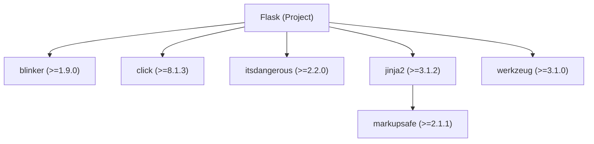
Sources: [pyproject.toml:23-30](https://github.com/pallets/flask/blob/258d68b6ff5e2244386540f48b48bab90d6ab827/pyproject.toml#L23-L30)

## Quickstart: A Minimal Application

A minimal Flask application involves creating an instance of the `Flask` class and defining a route that returns a response.

```python
# save this as app.py
from flask import Flask

app = Flask(__name__)

@app.route("/")
def hello():
    return "Hello, World!"
```
Sources: [README.md:22-31](https://github.com/pallets/flask/blob/258d68b6ff5e2244386540f48b48bab90d6ab827/README.md#L22-L31), [src/flask/app.py](https://github.com/pallets/flask/blob/258d68b6ff5e2244386540f48b48bab90d6ab827/src/flask/app.py)

### Running the Application

The Flask development server can be started using the `flask run` command in your terminal.

```shell
$ flask run
  * Running on http://127.0.0.1:5000/ (Press CTRL+C to quit)
```
Sources: [README.md:34-36](https://github.com/pallets/flask/blob/258d68b6ff5e2244386540f48b48bab90d6ab827/README.md#L34-L36)

This command discovers the `app` instance in the `app.py` file and runs it using a local development server provided by Werkzeug. By default, the server is accessible at `http://127.0.0.1:5000/`.

## The `flask` Command-Line Interface

The `flask` command is made available through a script entry point defined in the project's packaging configuration. This entry point links the command to the `main` function within the `flask.cli` module.

```toml
[project.scripts]
flask = "flask.cli:main"
```
Sources: [pyproject.toml:82-83](https://github.com/pallets/flask/blob/258d68b6ff5e2244386540f48b48bab90d6ab827/pyproject.toml#L82-L83)

The `flask run` command initiates a series of actions to serve the application:

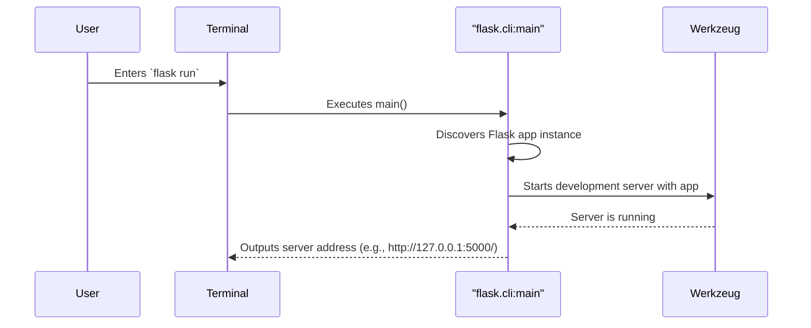
Sources: [pyproject.toml:83](https://github.com/pallets/flask/blob/258d68b6ff5e2244386540f48b48bab90d6ab827/pyproject.toml#L83), [README.md:34](https://github.com/pallets/flask/blob/258d68b6ff5e2244386540f48b48bab90d6ab827/README.md#L34), [src/flask/cli.py](https://github.com/pallets/flask/blob/258d68b6ff5e2244386540f48b48bab90d6ab827/src/flask/cli.py)

## Optional Features

Flask provides optional features that can be installed separately to add specific functionality. These are defined as optional dependencies.

| Feature                 | Installation Command      | Required Package | Description                                    |
|-------------------------|---------------------------|------------------|------------------------------------------------|
| Asynchronous Support    | `pip install 'Flask[async]'` | `asgiref>=3.2`   | Enables support for async views and functions. |
| `.env` File Support     | `pip install 'Flask[dotenv]'` | `python-dotenv`  | Automatically loads environment variables from `.env` and `.flaskenv` files at startup. |

Sources: [pyproject.toml:32-34](https://github.com/pallets/flask/blob/258d68b6ff5e2244386540f48b48bab90d6ab827/pyproject.toml#L32-L34)

### Asynchronous Support

To enable support for `async` and `await` in your views, you can install the `async` extra. This installs the `asgiref` library, which provides ASGI compatibility helpers.

```shell
pip install 'Flask[async]'
```
Sources: [pyproject.toml:33](https://github.com/pallets/flask/blob/258d68b6ff5e2244386540f48b48bab90d6ab827/pyproject.toml#L33)

### Environment Variables with `dotenv`

Flask can automatically load environment variables from a `.env` file when the `flask` command is run. This is useful for setting configuration without modifying the environment manually. This functionality is enabled by installing the `dotenv` extra.

```shell
pip install 'Flask[dotenv]'
```
Sources: [pyproject.toml:34](https://github.com/pallets/flask/blob/258d68b6ff5e2244386540f48b48bab90d6ab827/pyproject.toml#L34)

# Page: Tutorial: Building a Blog (Flaskr)

<details>
<summary>Relevant source files</summary>

The following files were used as context for generating this wiki page:

- [examples/tutorial/README.rst](https://github.com/pallets/flask/blob/258d68b6ff5e2244386540f48b48bab90d6ab827/examples/tutorial/README.rst)
- [examples/tutorial/flaskr/__init__.py](https://github.com/pallets/flask/blob/258d68b6ff5e2244386540f48b48bab90d6ab827/examples/tutorial/flaskr/__init__.py)
- [examples/tutorial/flaskr/blog.py](https://github.com/pallets/flask/blob/258d68b6ff5e2244386540f48b48bab90d6ab827/examples/tutorial/flaskr/blog.py)
- [examples/tutorial/flaskr/auth.py](https://github.com/pallets/flask/blob/258d68b6ff5e2244386540f48b48bab90d6ab827/examples/tutorial/flaskr/auth.py)
- [examples/tutorial/pyproject.toml](https://github.com/pallets/flask/blob/258d68b6ff5e2244386540f48b48bab90d6ab827/examples/tutorial/pyproject.toml)
</details>

# Tutorial: Building a Blog (Flaskr)

Flaskr is the basic blog application built as part of the official Flask tutorial. It demonstrates core Flask concepts and project structure, including application factories, blueprints, user authentication, and database interaction. The application provides functionalities for users to register, log in, create, edit, and delete their own blog posts.

This document provides a technical overview of the Flaskr application's architecture, components, and setup, based on the source code provided in the Flask repository.

Sources: [examples/tutorial/README.rst:4](https://github.com/pallets/flask/blob/258d68b6ff5e2244386540f48b48bab90d6ab827/examples/tutorial/README.rst#L4), [examples/tutorial/pyproject.toml:4](https://github.com/pallets/flask/blob/258d68b6ff5e2244386540f48b48bab90d6ab827/examples/tutorial/pyproject.toml#L4)

## Project Setup and Execution

This section covers the installation, execution, and testing of the Flaskr application.

### Installation

To install Flaskr, a virtual environment is required. The application and its dependencies can then be installed in editable mode.

1.  **Clone the repository and navigate to the tutorial directory**:
    ```bash
    git clone https://github.com/pallets/flask
    cd flask/examples/tutorial
    ```
    Sources: [examples/tutorial/README.rst:16-22](https://github.com/pallets/flask/blob/258d68b6ff5e2244386540f48b48bab90d6ab827/examples/tutorial/README.rst#L16-L22)

2.  **Create and activate a virtual environment**:
    *   On macOS/Linux:
        ```bash
        python3 -m venv .venv
        . .venv/bin/activate
        ```
    *   On Windows:
        ```bash
        py -3 -m venv .venv
        .venv\Scripts\activate.bat
        ```
    Sources: [examples/tutorial/README.rst:24-32](https://github.com/pallets/flask/blob/258d68b6ff5e2244386540f48b48bab90d6ab827/examples/tutorial/README.rst#L24-L32)

3.  **Install the package**:
    ```bash
    pip install -e .
    ```
    This command installs the project in editable mode based on the `pyproject.toml` configuration. The core dependency is `flask`.
    Sources: [examples/tutorial/README.rst:34-36](https://github.com/pallets/flask/blob/258d68b6ff5e2244386540f48b48bab90d6ab827/examples/tutorial/README.rst#L34-L36), [examples/tutorial/pyproject.toml:9-11](https://github.com/pallets/flask/blob/258d68b6ff5e2244386540f48b48bab90d6ab827/examples/tutorial/pyproject.toml#L9-L11)

### Running the Application

The application is run using the `flask` command-line interface.

1.  **Initialize the database**:
    ```bash
    flask --app flaskr init-db
    ```
2.  **Run the development server**:
    ```bash
    flask --app flaskr run --debug
    ```
The application will be available at `http://127.0.0.1:5000`.

Sources: [examples/tutorial/README.rst:50-53](https://github.com/pallets/flask/blob/258d68b6ff5e2244386540f48b48bab90d6ab827/examples/tutorial/README.rst#L50-L53)

### Testing the Application

The project is configured to use `pytest` for testing and `coverage.py` for code coverage analysis.

1.  **Install test dependencies**:
    ```bash
    pip install '.[test]'
    ```
    This installs `pytest` as defined in the `[project.optional-dependencies]` section of `pyproject.toml`.
    Sources: [examples/tutorial/README.rst:60-61](https://github.com/pallets/flask/blob/258d68b6ff5e2244386540f48b48bab90d6ab827/examples/tutorial/README.rst#L60-L61), [examples/tutorial/pyproject.toml:16-17](https://github.com/pallets/flask/blob/258d68b6ff5e2244386540f48b48bab90d6ab827/examples/tutorial/pyproject.toml#L16-L17)

2.  **Run tests**:
    ```bash
    pytest
    ```
    `pytest` is configured to find tests in the `tests` directory.
    Sources: [examples/tutorial/README.rst:62](https://github.com/pallets/flask/blob/258d68b6ff5e2244386540f48b48bab90d6ab827/examples/tutorial/README.rst#L62), [examples/tutorial/pyproject.toml:32](https://github.com/pallets/flask/blob/258d68b6ff5e2244386540f48b48bab90d6ab827/examples/tutorial/pyproject.toml#L32)

3.  **Run tests with a coverage report**:
    ```bash
    coverage run -m pytest
    coverage report
    coverage html
    ```
    Coverage is configured to measure the `flaskr` and `tests` source directories and to report on branch coverage.
    Sources: [examples/tutorial/README.rst:64-68](https://github.com/pallets/flask/blob/258d68b6ff5e2244386540f48b48bab90d6ab827/examples/tutorial/README.rst#L64-L68), [examples/tutorial/pyproject.toml:35-38](https://github.com/pallets/flask/blob/258d68b6ff5e2244386540f48b48bab90d6ab827/examples/tutorial/pyproject.toml#L35-L38)

## Application Architecture

Flaskr uses the application factory pattern and blueprints to structure the code into modular components.

### Application Factory (`create_app`)

The application instance is created and configured within the `create_app` function, which serves as the application factory.

Sources: [examples/tutorial/flaskr/__init__.py:6-48](https://github.com/pallets/flask/blob/258d68b6ff5e2244386540f48b48bab90d6ab827/examples/tutorial/flaskr/__init__.py#L6-L48)

Key responsibilities of `create_app`:
*   **Initialization**: Creates a `Flask` app instance with `instance_relative_config=True`, which means configuration files can be loaded from the `instance` folder.
    Sources: [examples/tutorial/flaskr/__init__.py:8](https://github.com/pallets/flask/blob/258d68b6ff5e2244386540f48b48bab90d6ab827/examples/tutorial/flaskr/__init__.py#L8)
*   **Default Configuration**: Sets default configuration values for `SECRET_KEY` and `DATABASE`. The database is located in the instance folder.
    Sources: [examples/tutorial/flaskr/__init__.py:9-14](https://github.com/pallets/flask/blob/258d68b6ff5e2244386540f48b48bab90d6ab827/examples/tutorial/flaskr/__init__.py#L9-L14)
*   **Configuration Loading**:
    *   If no `test_config` is provided, it loads configuration from `config.py` in the instance folder, if it exists (`silent=True`).
    *   If `test_config` is provided, it updates the app configuration with it.
    Sources: [examples/tutorial/flaskr/__init__.py:16-21](https://github.com/pallets/flask/blob/258d68b6ff5e2244386540f48b48bab90d6ab827/examples/tutorial/flaskr/__init__.py#L16-L21)
*   **Instance Folder**: Ensures the instance folder exists using `os.makedirs`.
    Sources: [examples/tutorial/flaskr/__init__.py:24](https://github.com/pallets/flask/blob/258d68b6ff5e2244386540f48b48bab90d6ab827/examples/tutorial/flaskr/__init__.py#L24)
*   **Component Registration**:
    *   Initializes database commands by calling `db.init_app(app)`.
    *   Registers the `auth` and `blog` blueprints.
    Sources: [examples/tutorial/flaskr/__init__.py:31-40](https://github.com/pallets/flask/blob/258d68b6ff5e2244386540f48b48bab90d6ab827/examples/tutorial/flaskr/__init__.py#L31-L40)
*   **URL Rule**: Maps the root URL `/` to the `index` endpoint, which corresponds to `blog.index`.
    Sources: [examples/tutorial/flaskr/__init__.py:42-46](https://github.com/pallets/flask/blob/258d68b6ff5e2244386540f48b48bab90d6ab827/examples/tutorial/flaskr/__init__.py#L42-L46)

### Blueprints

The application is divided into two main blueprints: `auth` for user authentication and `blog` for post management.

| Blueprint | File | URL Prefix | Description |
| :-------- | :--- | :--------- | :---------- |
| `auth`    | `auth.py` | `/auth`    | Handles user registration, login, and logout. |
| `blog`    | `blog.py` | (none)     | Handles creating, viewing, updating, and deleting blog posts. |

Sources: [examples/tutorial/flaskr/auth.py:16](https://github.com/pallets/flask/blob/258d68b6ff5e2244386540f48b48bab90d6ab827/examples/tutorial/flaskr/auth.py#L16), [examples/tutorial/flaskr/blog.py:13](https://github.com/pallets/flask/blob/258d68b6ff5e2244386540f48b48bab90d6ab827/examples/tutorial/flaskr/blog.py#L13), [examples/tutorial/flaskr/__init__.py:39-40](https://github.com/pallets/flask/blob/258d68b6ff5e2244386540f48b48bab90d6ab827/examples/tutorial/flaskr/__init__.py#L39-L40)

### Architecture Diagram

The following diagram illustrates the high-level structure of the Flaskr application.

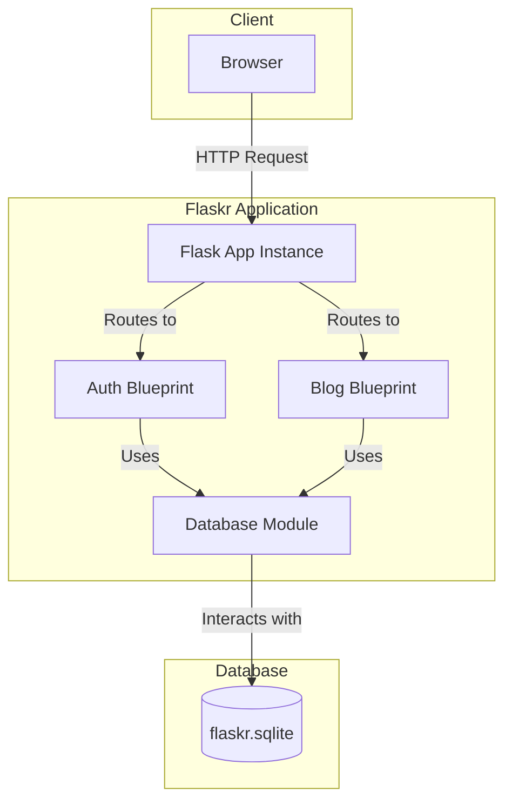

## Authentication Module (`auth`)

The `auth` blueprint manages all user authentication logic.

Sources: [examples/tutorial/flaskr/auth.py](https://github.com/pallets/flask/blob/258d68b6ff5e2244386540f48b48bab90d6ab827/examples/tutorial/flaskr/auth.py)

### User Session Management

A user's session is managed via the Flask `session` object.

*   **`load_logged_in_user`**: This function is registered with `@bp.before_app_request` to run before every request. It checks if a `user_id` exists in the session. If it does, it fetches the corresponding user from the database and stores it in `g.user`. Otherwise, `g.user` is set to `None`.
    Sources: [examples/tutorial/flaskr/auth.py:32-43](https://github.com/pallets/flask/blob/258d68b6ff5e2244386540f48b48bab90d6ab827/examples/tutorial/flaskr/auth.py#L32-L43)
*   **`login_required` Decorator**: This decorator can be applied to views that require an authenticated user. It checks if `g.user` is `None` and, if so, redirects the user to the login page.
    Sources: [examples/tutorial/flaskr/auth.py:19-29](https://github.com/pallets/flask/blob/258d68b6ff5e2244386540f48b48bab90d6ab827/examples/tutorial/flaskr/auth.py#L19-L29)

### Endpoints

| Route | Methods | Function | Description |
| :---- | :------ | :------- | :---------- |
| `/auth/register` | `GET`, `POST` | `register()` | Registers a new user. Validates that username and password are provided and that the username is not already taken. Passwords are hashed using `werkzeug.security.generate_password_hash`. |
| `/auth/login` | `GET`, `POST` | `login()` | Logs in a registered user. Verifies username and password using `werkzeug.security.check_password_hash`. On success, it clears the session and stores the user's ID in `session["user_id"]`. |
| `/auth/logout` | `GET` | `logout()` | Logs the user out by clearing the session. |

Sources: [examples/tutorial/flaskr/auth.py:46-116](https://github.com/pallets/flask/blob/258d68b6ff5e2244386540f48b48bab90d6ab827/examples/tutorial/flaskr/auth.py#L46-L116)

### Login Flow Diagram

This diagram shows the sequence of events during a user login.

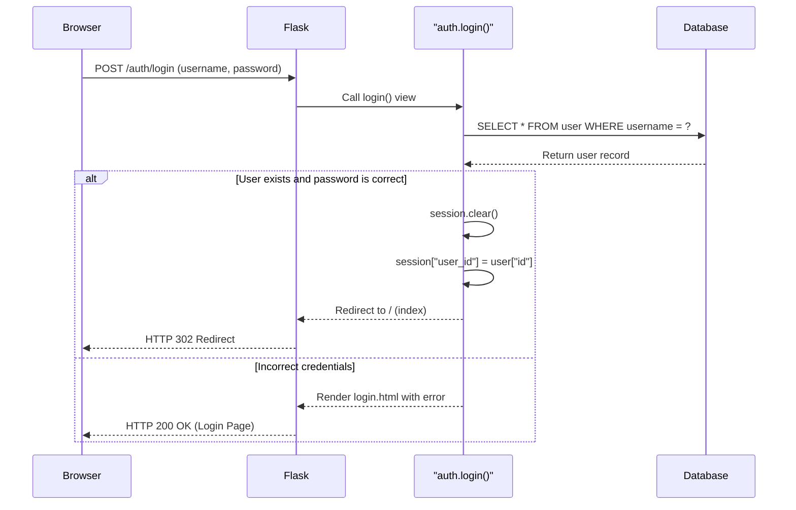
Sources: [examples/tutorial/flaskr/auth.py:84-109](https://github.com/pallets/flask/blob/258d68b6ff5e2244386540f48b48bab90d6ab827/examples/tutorial/flaskr/auth.py#L84-L109)

## Blog Module (`blog`)

The `blog` blueprint handles all CRUD operations for blog posts.

Sources: [examples/tutorial/flaskr/blog.py](https://github.com/pallets/flask/blob/258d68b6ff5e2244386540f48b48bab90d6ab827/examples/tutorial/flaskr/blog.py)

### Endpoints

All endpoints for creating, updating, and deleting posts are protected by the `@login_required` decorator.

| Route | Methods | Function | Description |
| :---- | :------ | :------- | :---------- |
| `/` | `GET` | `index()` | Displays all blog posts, ordered by creation date (most recent first). |
| `/create` | `GET`, `POST` | `create()` | Displays a form to create a new post (`GET`) or saves the new post to the database (`POST`). Requires a title. |
| `/<int:id>/update` | `GET`, `POST` | `update(id)` | Displays a form to edit an existing post (`GET`) or saves the changes (`POST`). The user must be the author of the post. |
| `/<int:id>/delete` | `POST` | `delete(id)` | Deletes a post. The user must be the author of the post. |

Sources: [examples/tutorial/flaskr/blog.py:16-125](https://github.com/pallets/flask/blob/258d68b6ff5e2244386540f48b48bab90d6ab827/examples/tutorial/flaskr/blog.py#L16-L125)

### Data Access Helper (`get_post`)

The `get_post(id, check_author=True)` function is a helper used by the `update` and `delete` views to fetch a post and its author from the database.

*   It retrieves a post by its `id`.
*   If the post does not exist, it aborts with a `404 Not Found` error.
*   If `check_author` is `True` (the default), it verifies that the `author_id` of the post matches the ID of the logged-in user (`g.user["id"]`). If they do not match, it aborts with a `403 Forbidden` error.

Sources: [examples/tutorial/flaskr/blog.py:28-57](https://github.com/pallets/flask/blob/258d68b6ff5e2244386540f48b48bab90d6ab827/examples/tutorial/flaskr/blog.py#L28-L57)

### Create Post Flow Diagram

This diagram illustrates the process of creating a new blog post.

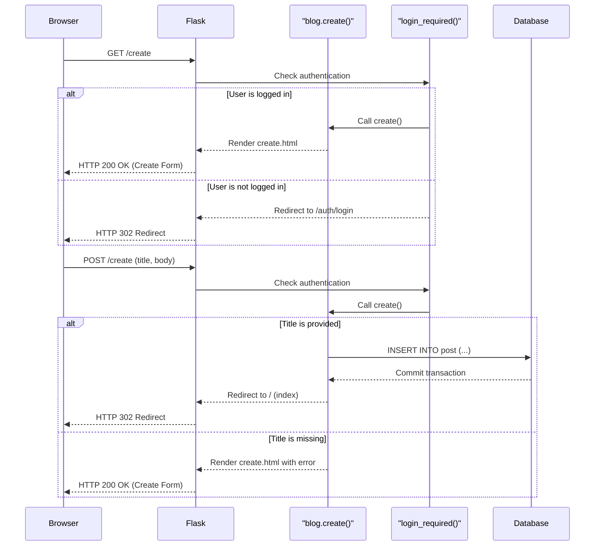
Sources: [examples/tutorial/flaskr/blog.py:60-83](https://github.com/pallets/flask/blob/258d68b6ff5e2244386540f48b48bab90d6ab827/examples/tutorial/flaskr/blog.py#L60-L83), [examples/tutorial/flaskr/auth.py:19-29](https://github.com/pallets/flask/blob/258d68b6ff5e2244386540f48b48bab90d6ab827/examples/tutorial/flaskr/auth.py#L19-L29)

## Project Configuration

Project metadata, dependencies, and tool configurations are defined in `pyproject.toml`.

Sources: [examples/tutorial/pyproject.toml](https://github.com/pallets/flask/blob/258d68b6ff5e2244386540f48b48bab90d6ab827/examples/tutorial/pyproject.toml)

### Project Metadata

| Key | Value | Source |
| :-- | :---- | :----- |
| `name` | `"flaskr"` | [examples/tutorial/pyproject.toml:2](https://github.com/pallets/flask/blob/258d68b6ff5e2244386540f48b48bab90d6ab827/examples/tutorial/pyproject.toml#L2) |
| `version` | `"1.0.0"` | [examples/tutorial/pyproject.toml:3](https://github.com/pallets/flask/blob/258d68b6ff5e2244386540f48b48bab90d6ab827/examples/tutorial/pyproject.toml#L3) |
| `description` | `"The basic blog app built in the Flask tutorial."` | [examples/tutorial/pyproject.toml:4](https://github.com/pallets/flask/blob/258d68b6ff5e2244386540f48b48bab90d6ab827/examples/tutorial/pyproject.toml#L4) |
| `dependencies` | `["flask"]` | [examples/tutorial/pyproject.toml:9-11](https://github.com/pallets/flask/blob/258d68b6ff5e2244386540f48b48bab90d6ab827/examples/tutorial/pyproject.toml#L9-L11) |
| `optional-dependencies.test` | `["pytest"]` | [examples/tutorial/pyproject.toml:16-17](https://github.com/pallets/flask/blob/258d68b6ff5e2244386540f48b48bab90d6ab827/examples/tutorial/pyproject.toml#L16-L17) |

### Build and Test Tooling

| Tool | Configuration | Source |
| :--- | :------------ | :----- |
| **Build System** | Uses `flit_core` as the build backend. | [examples/tutorial/pyproject.toml:19-21](https://github.com/pallets/flask/blob/258d68b6ff5e2244386540f48b48bab90d6ab827/examples/tutorial/pyproject.toml#L19-L21) |
| **pytest** | Test path is `["tests"]`. Warnings are treated as errors (`filterwarnings = ["error"]`). | [examples/tutorial/pyproject.toml:31-34](https://github.com/pallets/flask/blob/258d68b6ff5e2244386540f48b48bab90d6ab827/examples/tutorial/pyproject.toml#L31-L34) |
| **coverage.py** | Branch coverage is enabled (`branch = true`). Source files are located in `["flaskr", "tests"]`. | [examples/tutorial/pyproject.toml:35-38](https://github.com/pallets/flask/blob/258d68b6ff5e2244386540f48b48bab90d6ab827/examples/tutorial/pyproject.toml#L35-L38) |

# Page: The Flask Application Object

<details>
<summary>Relevant source files</summary>

The following files were used as context for generating this wiki page:

- [src/flask/app.py](https://github.com/pallets/flask/blob/258d68b6ff5e2244386540f48b48bab90d6ab827/src/flask/app.py)
- [src/flask/sansio/app.py](https://github.com/pallets/flask/blob/258d68b6ff5e2244386540f48b48bab90d6ab827/src/flask/sansio/app.py)
</details>

# The Flask Application Object

The `Flask` object is the central component of any Flask-based web application. It implements a WSGI (Web Server Gateway Interface) application and serves as the primary registry for view functions, URL rules, template configurations, and extensions. The `Flask` class, defined in `src/flask/app.py`, inherits from the `App` class in `src/flask/sansio/app.py`, which provides the core application structure and logic independent of the WSGI protocol. This separation allows `Flask` to focus on the WSGI-specific implementation, such as request and response handling, while `App` manages configuration, routing, and blueprint registration.

Upon instantiation, the `Flask` object requires an `import_name`, which it uses to determine the application's root path for locating resources like templates and static files. It configures itself with a set of default values, which can be overridden by loading configuration from files or environment variables. The object is responsible for the entire request-response lifecycle, from receiving the WSGI environment to dispatching the request to the correct view function and sending the final response back to the server.

Sources: [src/flask/app.py:109-114](https://github.com/pallets/flask/blob/258d68b6ff5e2244386540f48b48bab90d6ab827/src/flask/app.py#L109-L114), [src/flask/sansio/app.py:59-63](https://github.com/pallets/flask/blob/258d68b6ff5e2244386540f48b48bab90d6ab827/src/flask/sansio/app.py#L59-L63)

## Initialization and Configuration

The application object is configured upon creation. This involves setting up paths, loading configuration, initializing the routing map, and preparing for request handling.

### Constructor

The `Flask` application is instantiated with several parameters that define its core behavior and resource locations.

```python
class Flask(App):
    def __init__(
        self,
        import_name: str,
        static_url_path: str | None = None,
        static_folder: str | os.PathLike[str] | None = "static",
        static_host: str | None = None,
        host_matching: bool = False,
        subdomain_matching: bool = False,
        template_folder: str | os.PathLike[str] | None = "templates",
        instance_path: str | None = None,
        instance_relative_config: bool = False,
        root_path: str | None = None,
    ):
        # ...
```

Sources: [src/flask/app.py:310-322](https://github.com/pallets/flask/blob/258d68b6ff5e2244386540f48b48bab90d6ab827/src/flask/app.py#L310-L322)

Key initialization steps include:
1.  **Parent Initialization**: The `super().__init__()` call initializes the base `App` class, which sets up paths (`root_path`, `static_folder`, etc.) and basic structures.
2.  **CLI Setup**: A Click command group, `self.cli`, is created to register command-line interface commands for the application. Its name is set to `self.name`.
3.  **Static Route**: If a `static_folder` is configured (`self.has_static_folder` is true), a URL rule is automatically added to serve static files. The rule is constructed using `self.static_url_path` and defaults to `/static/<path:filename>`.

Sources: [src/flask/app.py:323-334](https://github.com/pallets/flask/blob/258d68b6ff5e2244386540f48b48bab90d6ab827/src/flask/app.py#L323-L334), [src/flask/app.py:340-345](https://github.com/pallets/flask/blob/258d68b6ff5e2244386540f48b48bab90d6ab827/src/flask/app.py#L340-L345), [src/flask/app.py:351-363](https://github.com/pallets/flask/blob/258d68b6ff5e2244386540f48b48bab90d6ab827/src/flask/app.py#L351-L363)

### Configuration Loading

The application's configuration is stored in the `self.config` attribute, which is an instance of `self.config_class` (defaulting to `flask.Config`). This object is created by the `make_config` method during initialization.

The `make_config` method establishes the root path for configuration files. If `instance_relative_config` is `True`, the `instance_path` is used; otherwise, the application's `root_path` is used. It loads default configuration values from `self.default_config`.

Sources: [src/flask/sansio/app.py:193](https://github.com/pallets/flask/blob/258d68b6ff5e2244386540f48b48bab90d6ab827/src/flask/sansio/app.py#L193), [src/flask/sansio/app.py:316](https://github.com/pallets/flask/blob/258d68b6ff5e2244386540f48b48bab90d6ab827/src/flask/sansio/app.py#L316), [src/flask/sansio/app.py:479-493](https://github.com/pallets/flask/blob/258d68b6ff5e2244386540f48b48bab90d6ab827/src/flask/sansio/app.py#L479-L493)

The default configuration values are defined in `Flask.default_config`:

| Key | Default Value | Description |
| --- | --- | --- |
| `DEBUG` | `None` | Enables or disables debug mode. |
| `TESTING` | `False` | Enables or disables test mode. |
| `PROPAGATE_EXCEPTIONS` | `None` | If set, exceptions are re-raised instead of being handled by the app. |
| `SECRET_KEY` | `None` | A secret key for signing session cookies. |
| `PERMANENT_SESSION_LIFETIME` | `timedelta(days=31)` | The lifetime of a permanent session. |
| `SESSION_COOKIE_NAME` | `"session"` | The name of the session cookie. |
| `MAX_CONTENT_LENGTH` | `None` | The maximum size of incoming request data. |
| `SEND_FILE_MAX_AGE_DEFAULT` | `None` | Default cache control max-age for `send_file`. |
| `TRAP_HTTP_EXCEPTIONS` | `False` | If set, HTTP exceptions are re-raised. |
| `PREFERRED_URL_SCHEME` | `"http"` | The URL scheme to use for external URLs when not in a request. |
| `TEMPLATES_AUTO_RELOAD` | `None` | Whether to reload templates when they change. |
| `PROVIDE_AUTOMATIC_OPTIONS` | `True` | Whether to automatically handle `OPTIONS` requests. |

Sources: [src/flask/app.py:206-238](https://github.com/pallets/flask/blob/258d68b6ff5e2244386540f48b48bab90d6ab827/src/flask/app.py#L206-L238)

### Core Component Classes

The `Flask` object uses several classes for its core components, which can be subclassed for custom behavior.

| Attribute | Default Class | Purpose | Source |
| --- | --- | --- | --- |
| `request_class` | `flask.Request` | The class for request objects. | [src/flask/app.py:242](https://github.com/pallets/flask/blob/258d68b6ff5e2244386540f48b48bab90d6ab827/src/flask/app.py#L242) |
| `response_class` | `flask.Response` | The class for response objects. | [src/flask/app.py:246](https://github.com/pallets/flask/blob/258d68b6ff5e2244386540f48b48bab90d6ab827/src/flask/app.py#L246) |
| `session_interface` | `SecureCookieSessionInterface` | The object that handles session storage. | [src/flask/app.py:252](https://github.com/pallets/flask/blob/258d68b6ff5e2244386540f48b48bab90d6ab827/src/flask/app.py#L252) |
| `config_class` | `flask.Config` | The class for the configuration dictionary. | [src/flask/sansio/app.py:193](https://github.com/pallets/flask/blob/258d68b6ff5e2244386540f48b48bab90d6ab827/src/flask/sansio/app.py#L193) |
| `json_provider_class` | `DefaultJSONProvider` | The class that provides JSON serialization. | [src/flask/sansio/app.py:227](https://github.com/pallets/flask/blob/258d68b6ff5e2244386540f48b48bab90d6ab827/src/flask/sansio/app.py#L227) |
| `url_map_class` | `werkzeug.routing.Map` | The class for the URL rule map. | [src/flask/sansio/app.py:260](https://github.com/pallets/flask/blob/258d68b6ff5e2244386540f48b48bab90d6ab827/src/flask/sansio/app.py#L260) |
| `url_rule_class` | `werkzeug.routing.Rule` | The class for individual URL rules. | [src/flask/sansio/app.py:254](https://github.com/pallets/flask/blob/258d68b6ff5e2244386540f48b48bab90d6ab827/src/flask/sansio/app.py#L254) |
| `jinja_environment` | `flask.templating.Environment` | The class for the Jinja2 template environment. | [src/flask/sansio/app.py:169](https://github.com/pallets/flask/blob/258d68b6ff5e2244386540f48b48bab90d6ab827/src/flask/sansio/app.py#L169) |

## Routing System

The routing system maps incoming request URLs to the Python functions that should handle them.

### URL Rule Registration

URL rules are added to the application using the `add_url_rule()` method, which is often used indirectly via the `@app.route()` decorator.

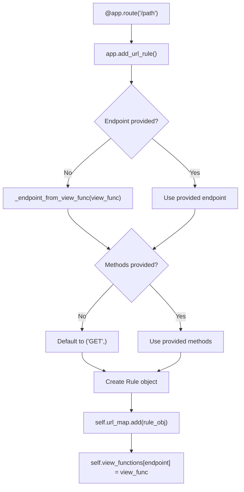
This diagram shows the logic within `add_url_rule`. It determines the endpoint, sets HTTP methods, creates a `Rule` object, adds it to the application's `url_map`, and associates the endpoint with the view function.

Sources: [src/flask/sansio/app.py:602-659](https://github.com/pallets/flask/blob/258d68b6ff5e2244386540f48b48bab90d6ab827/src/flask/sansio/app.py#L602-L659)

### URL Generation

The `url_for()` method generates a URL for a given endpoint. Its behavior depends on whether it's called within an active request context.

*   **Inside a request context**: It uses the context's `url_adapter` to build a URL. Endpoints starting with a `.` are treated as relative to the current blueprint. By default, it generates relative URLs unless `_external=True` is passed.
*   **Outside a request context**: It attempts to create a `url_adapter`. This requires the `SERVER_NAME` configuration variable to be set. It generates external URLs by default.

The method also handles special arguments like `_anchor` (for URL fragments), `_method`, and `_scheme`. If a `BuildError` occurs, it calls `handle_url_build_error`.

Sources: [src/flask/app.py:1102-1222](https://github.com/pallets/flask/blob/258d68b6ff5e2244386540f48b48bab90d6ab827/src/flask/app.py#L1102-L1222)

## Request Lifecycle

The `Flask` object processes requests through a well-defined lifecycle, from receiving the WSGI call to finalizing the response.

### WSGI Entry Point

The application's entry point for a WSGI server is the `__call__` method, which simply delegates to `wsgi_app`. This design allows developers to wrap `wsgi_app` with middleware without replacing the `Flask` instance itself.

The `wsgi_app` method orchestrates the entire request handling process within a `try...finally` block to ensure that the application context is properly torn down.

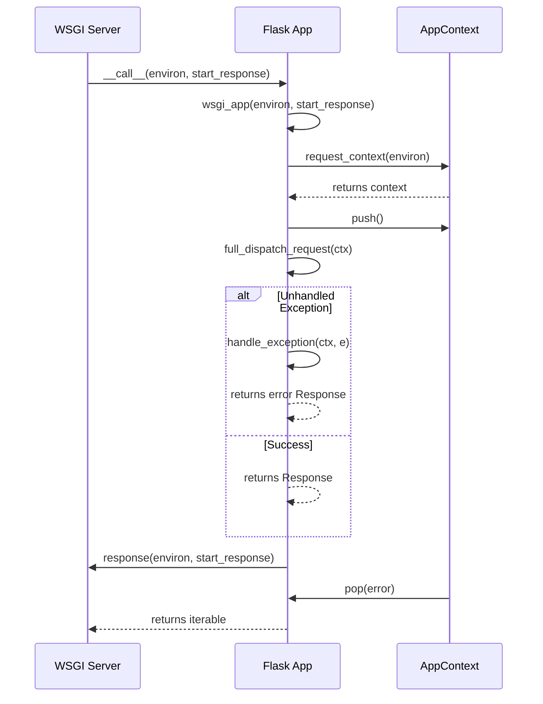
This sequence shows how `wsgi_app` creates and manages the application context, dispatches the request, handles potential exceptions, and ensures context teardown.

Sources: [src/flask/app.py:1566-1616](https://github.com/pallets/flask/blob/258d68b6ff5e2244386540f48b48bab90d6ab827/src/flask/app.py#L1566-L1616), [src/flask/app.py:1618-1625](https://github.com/pallets/flask/blob/258d68b6ff5e2244386540f48b48bab90d6ab827/src/flask/app.py#L1618-L1625)

### Request Dispatching Flow

The `full_dispatch_request` method is the core of the request handling logic.

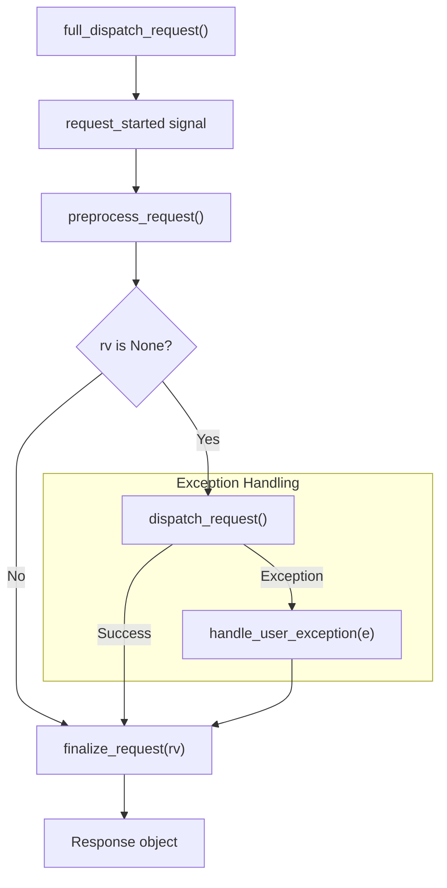
1.  The `request_started` signal is sent.
2.  `preprocess_request()` is called, which executes all `before_request` functions. If any of these functions return a value, the request is short-circuited, and that value is used to generate the response.
3.  If `preprocess_request()` returns `None`, `dispatch_request()` is called. This finds the matching URL rule and executes the corresponding view function.
4.  Any exception during this process is caught and passed to `handle_user_exception()`.
5.  The return value from the view or the exception handler is passed to `finalize_request()`.

Sources: [src/flask/app.py:992-1019](https://github.com/pallets/flask/blob/258d68b6ff5e2244386540f48b48bab90d6ab827/src/flask/app.py#L992-L1019)

### Response Generation

The `make_response()` method converts the return value from a view function into a `Response` object. It handles various return types.

| Return Type | `make_response` Behavior |
| --- | --- |
| `str`, `bytes`, `bytearray` | Creates a `Response` object with the value as the body. |
| `dict`, `list` | The value is serialized to JSON to create the response body. |
| `iterator` or `generator` | Creates a streaming response. |
| `tuple` | Interpreted as `(body, status, headers)`, `(body, status)`, or `(body, headers)`. |
| `Response` instance | The object is returned unchanged (or coerced if it's a different `Response` subclass). |
| WSGI callable | The callable is executed as a WSGI application to generate the response. |

If a view function returns `None` or does not have a return statement, a `TypeError` is raised.

Sources: [src/flask/app.py:1224-1364](https://github.com/pallets/flask/blob/258d68b6ff5e2244386540f48b48bab90d6ab827/src/flask/app.py#L1224-L1364)

After the response object is created, `finalize_request` calls `process_response`, which executes `after_request` functions and saves the session if it has been modified.

Sources: [src/flask/app.py:1021-1051](https://github.com/pallets/flask/blob/258d68b6ff5e2244386540f48b48bab90d6ab827/src/flask/app.py#L1021-L1051), [src/flask/app.py:1394-1418](https://github.com/pallets/flask/blob/258d68b6ff5e2244386540f48b48bab90d6ab827/src/flask/app.py#L1394-L1418)

## Exception and Error Handling

Flask has a robust system for handling exceptions that occur during request processing.

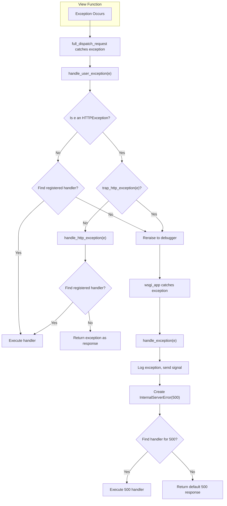

The key methods involved are:
-   `handle_user_exception`: The primary handler for exceptions from views. It distinguishes between `HTTPException` and other exceptions.
-   `handle_http_exception`: Finds and executes a handler registered for a specific HTTP status code or exception class.
-   `handle_exception`: The last resort for unhandled exceptions. It logs the error, sends the `got_request_exception` signal, and always generates a 500 Internal Server Error response. It may use a registered handler for `500` or `InternalServerError`.

Sources: [src/flask/app.py:830-948](https://github.com/pallets/flask/blob/258d68b6ff5e2244386540f48b48bab90d6ab827/src/flask/app.py#L830-L948), [src/flask/app.py:865-895](https://github.com/pallets/flask/blob/258d68b6ff5e2244386540f48b48bab90d6ab827/src/flask/app.py#L865-L895)

### Teardown Callbacks

Teardown functions are guaranteed to run at the end of a context's life, even if an unhandled exception occurred.
-   `do_teardown_request()`: Executes functions registered with `@teardown_request`. Called when the request context is popped.
-   `do_teardown_appcontext()`: Executes functions registered with `@teardown_appcontext`. Called when the application context is popped.

Both functions receive the unhandled exception object (or `None`) as an argument.

Sources: [src/flask/app.py:1420-1452](https://github.com/pallets/flask/blob/258d68b6ff5e2244386540f48b48bab90d6ab827/src/flask/app.py#L1420-L1452), [src/flask/app.py:1453-1479](https://github.com/pallets/flask/blob/258d68b6ff5e2244386540f48b48bab90d6ab827/src/flask/app.py#L1453-L1479)

## Templating

Flask integrates with the Jinja2 templating engine to render dynamic HTML.

The Jinja2 environment is created by `create_jinja_environment()` the first time the `jinja_env` property is accessed. This method configures default settings, such as `autoescape` and `auto_reload`, and injects several global functions and objects into the template context.

Default globals available in all templates include:
-   `url_for`
-   `get_flashed_messages`
-   `config`
-   `request`
-   `session`
-   `g`

Sources: [src/flask/app.py:469-507](https://github.com/pallets/flask/blob/258d68b6ff5e2244386540f48b48bab90d6ab827/src/flask/app.py#L469-L507), [src/flask/sansio/app.py:466-474](https://github.com/pallets/flask/blob/258d68b6ff5e2244386540f48b48bab90d6ab827/src/flask/sansio/app.py#L466-L474)

Developers can add custom filters, tests, and globals to the Jinja environment using decorators:
-   `@app.template_filter()`
-   `@app.template_test()`
-   `@app.template_global()`

Sources: [src/flask/sansio/app.py:660-822](https://github.com/pallets/flask/blob/258d68b6ff5e2244386540f48b48bab90d6ab827/src/flask/sansio/app.py#L660-L822)

## Development and Testing

The `Flask` object provides built-in utilities to aid in development and testing.

### Development Server

The `app.run()` method starts a local development server using `werkzeug.serving.run_simple`. It is not suitable for production use. Key parameters include `host`, `port`, and `debug`. When `debug` is `True`, it enables the interactive debugger and automatic code reloading. This method is designed to be called from a script's main execution block (e.g., `if __name__ == "__main__":`). It will print a warning and exit if it detects it's being run from the `flask` CLI command to prevent conflicts.

Sources: [src/flask/app.py:632-754](https://github.com/pallets/flask/blob/258d68b6ff5e2244386540f48b48bab90d6ab827/src/flask/app.py#L632-L754)

### Testing Utilities

-   `test_client()`: Returns an instance of `test_client_class` (defaults to `FlaskClient`) for simulating requests to the application without running a live server. It's essential to set `app.testing = True` to propagate exceptions to the test client.
-   `test_cli_runner()`: Returns an instance of `test_cli_runner_class` (defaults to `FlaskCliRunner`) for testing custom `flask` CLI commands.
-   `test_request_context()`: Creates an application and request context from provided arguments (like path, method, data). This is useful for testing code that depends on an active request context without making a full request.

Sources: [src/flask/app.py:755-811](https://github.com/pallets/flask/blob/258d68b6ff5e2244386540f48b48bab90d6ab827/src/flask/app.py#L755-L811), [src/flask/app.py:813-828](https://github.com/pallets/flask/blob/258d68b6ff5e2244386540f48b48bab90d6ab827/src/flask/app.py#L813-L828), [src/flask/app.py:1517-1564](https://github.com/pallets/flask/blob/258d68b6ff5e2244386540f48b48bab90d6ab827/src/flask/app.py#L1517-L1564)

# Page: Request-Response Lifecycle

<details>
<summary>Relevant source files</summary>

The following files were used as context for generating this wiki page:

- [src/flask/app.py](https://github.com/pallets/flask/blob/258d68b6ff5e2244386540f48b48bab90d6ab827/src/flask/app.py)
- [src/flask/ctx.py](https://github.com/pallets/flask/blob/258d68b6ff5e2244386540f48b48bab90d6ab827/src/flask/ctx.py)
- [src/flask/wrappers.py](https://github.com/pallets/flask/blob/258d68b6ff5e2244386540f48b48bab90d6ab827/src/flask/wrappers.py)
</details>

# Request-Response Lifecycle

The Flask request-response lifecycle describes the sequence of operations that occur from the moment a WSGI server passes a request to a Flask application to the moment a response is sent back. This process is orchestrated by the central `Flask` application object and relies heavily on a system of contexts to make request-specific information globally accessible in a thread-safe manner. The entire lifecycle is designed to be extensible through hooks like request pre/post-processors, teardown functions, and error handlers.

At its core, the lifecycle involves creating an `AppContext` from the incoming WSGI environment, pushing this context to make it active, dispatching the request to the appropriate view function, converting the view's return value into a `Response` object, and finally tearing down the context.

## Overall Lifecycle Flow

The following diagram illustrates the high-level flow of a request through the Flask application.

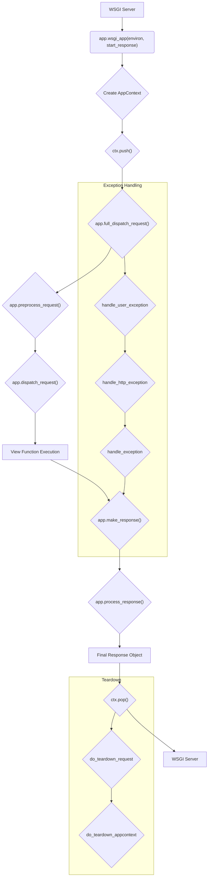
This diagram shows the main path from the WSGI entry point, through context management, request dispatching, and finally context teardown before returning to the server.

## 1. WSGI Entry Point

The lifecycle begins when a WSGI-compliant server invokes the Flask application object as a callable. This call is handled by the `Flask.__call__` method, which in turn calls `Flask.wsgi_app`.

`Sources: [src/flask/app.py:1618-1625](https://github.com/pallets/flask/blob/258d68b6ff5e2244386540f48b48bab90d6ab827/src/flask/app.py#L1618-L1625)`

The `wsgi_app` method is the primary entry point for a request. Its main responsibilities are:
1.  Creating an `AppContext` from the WSGI `environ` dictionary.
2.  Wrapping the entire request handling process in a `try...finally` block to ensure that the context is properly torn down, even if an error occurs.
3.  Pushing the context to make it active.
4.  Calling `full_dispatch_request` to handle the request.
5.  Handling any exceptions that propagate up to this level.
6.  Popping the context in the `finally` block.

`Sources: [src/flask/app.py:1566-1616](https://github.com/pallets/flask/blob/258d68b6ff5e2244386540f48b48bab90d6ab827/src/flask/app.py#L1566-L1616)`

## 2. Context Management

Flask's context mechanism allows view functions and other handlers to access objects like the current application (`current_app`) and the current request (`request`) without passing them as arguments.

### AppContext Creation and Pushing

The `wsgi_app` method creates an `AppContext` using `self.request_context(environ)`. This context object encapsulates all application- and request-specific state.

`Sources: [src/flask/app.py:1592-1592](https://github.com/pallets/flask/blob/258d68b6ff5e2244386540f48b48bab90d6ab827/src/flask/app.py#L1592-L1592), [src/flask/ctx.py:340-348](https://github.com/pallets/flask/blob/258d68b6ff5e2244386540f48b48bab90d6ab827/src/flask/ctx.py#L340-L348)`

Once created, the context is pushed via `ctx.push()`. This action performs several key operations:
1.  It sets the newly created context as the active context for the current thread or coroutine using a `contextvars.Token`.
2.  It sends the `appcontext_pushed` signal.
3.  If it's a request context (contains a request object), it opens the session using the application's `session_interface`.
4.  It attempts to match the request's URL to a registered route using the `url_adapter`. The result (the matched rule and view arguments) or any `RoutingException` is stored on the `request` object.

`Sources: [src/flask/ctx.py:416-445](https://github.com/pallets/flask/blob/258d68b6ff5e2244386540f48b48bab90d6ab827/src/flask/ctx.py#L416-L445)`

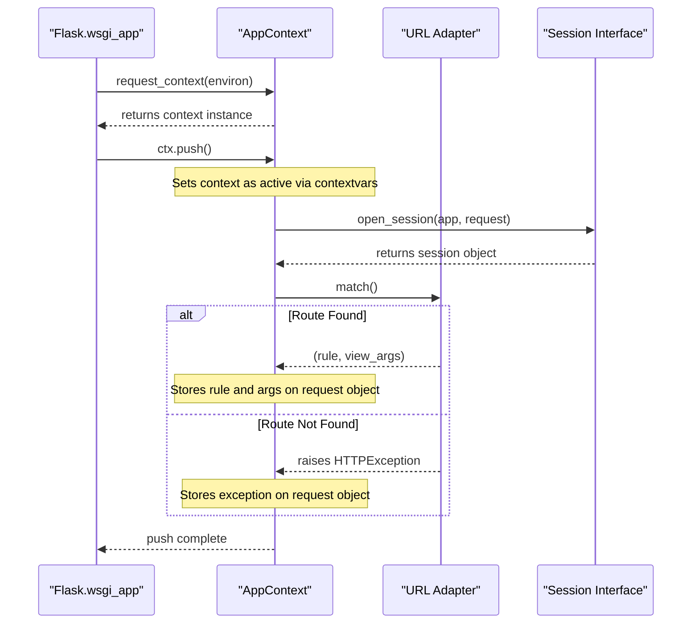

## 3. Request Dispatching

The `Flask.full_dispatch_request` method is the main engine for processing an incoming request after the context has been established.

`Sources: [src/flask/app.py:992-1019](https://github.com/pallets/flask/blob/258d68b6ff5e2244386540f48b48bab90d6ab827/src/flask/app.py#L992-L1019)`

### 3.1. Preprocessing

Before the view function is called, `full_dispatch_request` calls `self.preprocess_request()`. This method executes all functions registered with `@before_request` for both the application and the matched blueprint.

These functions are executed in order:
1.  Application-level `url_value_preprocessors`.
2.  Blueprint-level `url_value_preprocessors`.
3.  Application-level `before_request_funcs`.
4.  Blueprint-level `before_request_funcs`.

If any `before_request` function returns a value other than `None`, that value is treated as the response for the request, and the regular dispatching process is aborted.

`Sources: [src/flask/app.py:1366-1392](https://github.com/pallets/flask/blob/258d68b6ff5e2244386540f48b48bab90d6ab827/src/flask/app.py#L1366-L1392)`

### 3.2. View Dispatch

If no preprocessor returns a response, `self.dispatch_request()` is called. This method is responsible for executing the view function associated with the matched URL rule.

1.  It checks for and raises any `routing_exception` that occurred during URL matching.
2.  It handles `OPTIONS` requests automatically if `provide_automatic_options` is enabled for the rule.
3.  It retrieves the view function from the `app.view_functions` dictionary using the endpoint from the matched rule.
4.  It calls the view function, passing the URL variables from `request.view_args` as keyword arguments.
5.  It returns the value from the view function.

`Sources: [src/flask/app.py:966-990](https://github.com/pallets/flask/blob/258d68b6ff5e2244386540f48b48bab90d6ab827/src/flask/app.py#L966-L990)`

### 3.3. Response Creation

The return value from the view function (or a `before_request` handler) is passed to `self.finalize_request()`, which in turn calls `self.make_response()`. This method converts various types of return values into a `flask.Response` object.

`Sources: [src/flask/app.py:1021-1051](https://github.com/pallets/flask/blob/258d68b6ff5e2244386540f48b48bab90d6ab827/src/flask/app.py#L1021-L1051), [src/flask/app.py:1224-1364](https://github.com/pallets/flask/blob/258d68b6ff5e2244386540f48b48bab90d6ab827/src/flask/app.py#L1224-L1364)`

| Return Type | Conversion Logic | Source |
| :--- | :--- | :--- |
| `Response` object | Returned as-is. | `[src/flask/app.py:1314-1314](https://github.com/pallets/flask/blob/258d68b6ff5e2244386540f48b48bab90d6ab827/src/flask/app.py#L1314-L1314)` |
| `str`, `bytes`, `bytearray` | Used as the body of a new `Response` object. | `[src/flask/app.py:1315-1324](https://github.com/pallets/flask/blob/258d68b6ff5e2244386540f48b48bab90d6ab827/src/flask/app.py#L1315-L1324)` |
| `dict`, `list` | Serialized to JSON using `app.json.response(rv)`. | `[src/flask/app.py:1325-1326](https://github.com/pallets/flask/blob/258d68b6ff5e2244386540f48b48bab90d6ab827/src/flask/app.py#L1325-L1326)` |
| `tuple` | Interpreted as `(body, status, headers)`, `(body, status)`, or `(body, headers)`. The body is then processed according to the rules above. | `[src/flask/app.py:1285-1303](https://github.com/pallets/flask/blob/258d68b6ff5e2244386540f48b48bab90d6ab827/src/flask/app.py#L1285-L1303)` |
| `generator` or `iterator` | Converted to a streaming response. | `[src/flask/app.py:1315-1315](https://github.com/pallets/flask/blob/258d68b6ff5e2244386540f48b48bab90d6ab827/src/flask/app.py#L1315-L1315)` |
| WSGI callable | Coerced into a `Response` object. | `[src/flask/app.py:1327-1342](https://github.com/pallets/flask/blob/258d68b6ff5e2244386540f48b48bab90d6ab827/src/flask/app.py#L1327-L1342)` |

A `TypeError` is raised if the view function returns `None` or an unsupported type.

`Sources: [src/flask/app.py:1306-1311](https://github.com/pallets/flask/blob/258d68b6ff5e2244386540f48b48bab90d6ab827/src/flask/app.py#L1306-L1311), [src/flask/app.py:1343-1350](https://github.com/pallets/flask/blob/258d68b6ff5e2244386540f48b48bab90d6ab827/src/flask/app.py#L1343-L1350)`

### 3.4. Postprocessing

After a `Response` object is created, `finalize_request` calls `self.process_response()`. This method applies post-request modifications:
1.  It calls functions registered with `@after_this_request`.
2.  It calls functions registered with `@after_request` for the blueprint (in reverse order of registration).
3.  It calls functions registered with `@after_request` for the application (in reverse order of registration).
4.  It calls `session_interface.save_session()` to persist any changes to the session, typically by setting a `Set-Cookie` header on the response.

`Sources: [src/flask/app.py:1394-1418](https://github.com/pallets/flask/blob/258d68b6ff5e2244386540f48b48bab90d6ab827/src/flask/app.py#L1394-L1418), [src/flask/ctx.py:118-148](https://github.com/pallets/flask/blob/258d68b6ff5e2244386540f48b48bab90d6ab827/src/flask/ctx.py#L118-L148)`

Finally, the `request_finished` signal is sent before the finalized response is returned up the call stack.

`Sources: [src/flask/app.py:1042-1044](https://github.com/pallets/flask/blob/258d68b6ff5e2244386540f48b48bab90d6ab827/src/flask/app.py#L1042-L1044)`

## 4. Exception Handling

If an exception occurs at any point during `full_dispatch_request`, it is caught and passed to `self.handle_user_exception()`.

`Sources: [src/flask/app.py:1017-1018](https://github.com/pallets/flask/blob/258d68b6ff5e2244386540f48b48bab90d6ab827/src/flask/app.py#L1017-L1018)`

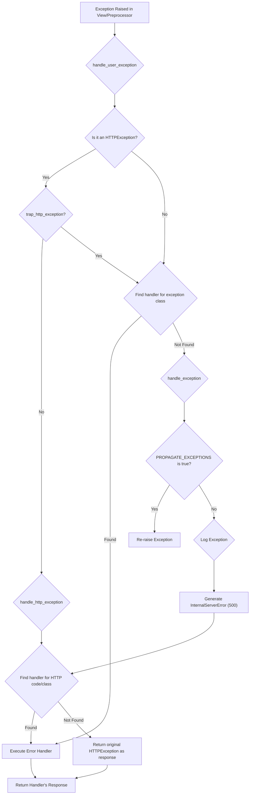

-   **`handle_user_exception`**: This is the first stop. It distinguishes between `HTTPException` subclasses and standard Python exceptions. `HTTPException`s are typically passed to `handle_http_exception` unless `TRAP_HTTP_EXCEPTIONS` is configured. For other exceptions, it searches for a registered error handler.
    `Sources: [src/flask/app.py:865-895](https://github.com/pallets/flask/blob/258d68b6ff5e2244386540f48b48bab90d6ab827/src/flask/app.py#L865-L895)`
-   **`handle_http_exception`**: This method specifically handles `HTTPException` instances. It looks for an error handler registered for the specific HTTP status code (e.g., 404) or for a parent class of the exception. If no handler is found, the exception itself is returned to be used as a response.
    `Sources: [src/flask/app.py:830-863](https://github.com/pallets/flask/blob/258d68b6ff5e2244386540f48b48bab90d6ab827/src/flask/app.py#L830-L863)`
-   **`handle_exception`**: This is the final fallback for unhandled exceptions or for exceptions raised within an error handler. It always results in a 500 Internal Server Error. It logs the exception, sends the `got_request_exception` signal, and then attempts to invoke an error handler for `InternalServerError` or status code 500. If `PROPAGATE_EXCEPTIONS` is true (as in debug or testing mode), it re-raises the exception instead of handling it.
    `Sources: [src/flask/app.py:897-948](https://github.com/pallets/flask/blob/258d68b6ff5e2244386540f48b48bab90d6ab827/src/flask/app.py#L897-L948)`

## 5. Teardown Phase

Regardless of whether the request was successful or an error occurred, the `finally` block in `wsgi_app` ensures that `ctx.pop()` is called.

`Sources: [src/flask/app.py:1616-1616](https://github.com/pallets/flask/blob/258d68b6ff5e2244386540f48b48bab90d6ab827/src/flask/app.py#L1616-L1616)`

The `pop` method orchestrates the teardown sequence:
1.  It decrements a push counter. Cleanup only occurs when the counter reaches zero.
2.  **Request Teardown**: If it is a request context, `app.do_teardown_request()` is called. This executes all functions registered with `@teardown_request` for the blueprint and then the application, in reverse order of registration. The exception that occurred during the request (if any) is passed to these functions.
3.  The `request_tearing_down` signal is sent.
4.  **App Context Teardown**: `app.do_teardown_appcontext()` is called. This executes all functions registered with `@teardown_appcontext`.
5.  The `appcontext_popped` signal is sent.
6.  The context is removed from the top of the context stack, restoring the previous context (if any).

`Sources: [src/flask/ctx.py:446-504](https://github.com/pallets/flask/blob/258d68b6ff5e2244386540f48b48bab90d6ab827/src/flask/ctx.py#L446-L504), [src/flask/app.py:1420-1451](https://github.com/pallets/flask/blob/258d68b6ff5e2244386540f48b48bab90d6ab827/src/flask/app.py#L1420-L1451), [src/flask/app.py:1453-1479](https://github.com/pallets/flask/blob/258d68b6ff5e2244386540f48b48bab90d6ab827/src/flask/app.py#L1453-L1479)`

## Key Component Summary

### `flask.app.Flask`
The central application object that orchestrates the entire lifecycle.

| Method | Description |
| :--- | :--- |
| `wsgi_app` | The main WSGI entry point. Manages context creation and teardown. |
| `full_dispatch_request` | Orchestrates the core request handling: preprocessing, dispatch, and finalization. |
| `dispatch_request` | Matches the URL and calls the appropriate view function. |
| `handle_exception` | Handles exceptions that are not caught by specific error handlers. |
| `make_response` | Converts a view's return value into a `Response` object. |
| `do_teardown_request` | Executes request teardown functions. |
| `do_teardown_appcontext` | Executes application context teardown functions. |

`Sources: [src/flask/app.py](https://github.com/pallets/flask/blob/258d68b6ff5e2244386540f48b48bab90d6ab827/src/flask/app.py)`

### `flask.ctx.AppContext`
Encapsulates all the per-request state.

| Method/Property | Description |
| :--- | :--- |
| `push()` | Pushes the context onto the stack, making it active. Performs URL matching. |
| `pop()` | Pops the context from the stack and runs all teardown functions. |
| `request` | The `Request` object for the current request. |
| `session` | The `Session` object for the current request. |
| `g` | A namespace object for storing data during a single application context. |

`Sources: [src/flask/ctx.py](https://github.com/pallets/flask/blob/258d68b6ff5e2244386540f48b48bab90d6ab827/src/flask/ctx.py)`

### `flask.wrappers.Request`
A subclass of `werkzeug.wrappers.Request` with Flask-specific additions.

| Attribute | Description |
| :--- | :--- |
| `url_rule` | The Werkzeug `Rule` object that matched the request. |
| `view_args` | A dictionary of the captured URL parameters. |
| `routing_exception` | The exception raised during URL matching, if any. |
| `endpoint` | The name of the matched endpoint (view function). |
| `blueprint` | The name of the blueprint that the matched endpoint belongs to. |

`Sources: [src/flask/wrappers.py:18-196](https://github.com/pallets/flask/blob/258d68b6ff5e2244386540f48b48bab90d6ab827/src/flask/wrappers.py#L18-L196)`

### `flask.wrappers.Response`
A subclass of `werkzeug.wrappers.Response` that defaults to an `text/html` mimetype.

| Attribute | Description |
| :--- | :--- |
| `default_mimetype` | Defaults to `"text/html"`. |
| `max_cookie_size` | Reads the `MAX_COOKIE_SIZE` value from the application config. |

`Sources: [src/flask/wrappers.py:222-257](https://github.com/pallets/flask/blob/258d68b6ff5e2244386540f48b48bab90d6ab827/src/flask/wrappers.py#L222-L257)`

# Page: Routing and URL Rules

<details>
<summary>Relevant source files</summary>

The following files were used as context for generating this wiki page:

- [src/flask/sansio/app.py](https://github.com/pallets/flask/blob/258d68b6ff5e2244386540f48b48bab90d6ab827/src/flask/sansio/app.py)
- [tests/test_basic.py](https://github.com/pallets/flask/blob/258d68b6ff5e2244386540f48b48bab90d6ab827/tests/test_basic.py)
- [tests/static/config.toml](https://github.com/pallets/flask/blob/258d68b6ff5e2244386540f48b48bab90d6ab827/tests/static/config.toml)
- [tests/test_apps/blueprintapp/__init__.py](https://github.com/pallets/flask/blob/258d68b6ff5e2244386540f48b48bab90d6ab827/tests/test_apps/blueprintapp/__init__.py)
- [tests/test_apps/blueprintapp/apps/__init__.py](https://github.com/pallets/flask/blob/258d68b6ff5e2244386540f48b48bab90d6ab827/tests/test_apps/blueprintapp/apps/__init__.py)
- [tests/test_apps/blueprintapp/apps/admin/__init__.py](https://github.com/pallets/flask/blob/258d68b6ff5e2244386540f48b48bab90d6ab827/tests/test_apps/blueprintapp/apps/admin/__init__.py)
- [tests/test_apps/blueprintapp/apps/frontend/__init__.py](https://github.com/pallets/flask/blob/258d68b6ff5e2244386540f48b48bab90d6ab827/tests/test_apps/blueprintapp/apps/frontend/__init__.py)
- [tests/test_apps/cliapp/__init__.py](https://github.com/pallets/flask/blob/258d68b6ff5e2244386540f48b48bab90d6ab827/tests/test_apps/cliapp/__init__.py)
</details>

# Routing and URL Rules

Routing in Flask is the mechanism that maps incoming request URLs to the specific view functions that should handle them. This system is built upon Werkzeug's routing module and provides a powerful yet intuitive way to define the URL structure of an application. The central `App` object manages a collection of URL rules in a `url_map`, which is used to dispatch requests to the correct endpoint and associated view function.

Flask offers several ways to define these rules, from the low-level `add_url_rule()` method to convenient decorators like `@app.route()`. For organizing larger applications, Flask supports "Blueprints," which allow routing rules to be defined in a modular and reusable way.

## Core Routing Mechanism

The foundation of Flask's routing system resides within the `App` object. It uses a `Map` object from Werkzeug to store and match URL rules.

Sources: [src/flask/sansio/app.py:387-402](https://github.com/pallets/flask/blob/258d68b6ff5e2244386540f48b48bab90d6ab827/src/flask/sansio/app.py#L387-L402)

### Key Components

| Component | Class | Description | Source |
| --- | --- | --- | --- |
| **URL Map** | `werkzeug.routing.Map` | The `app.url_map` attribute holds all URL rules for the application. It is responsible for matching request URLs to endpoints. | [src/flask/sansio/app.py:256-260, 402]() |
| **URL Rule** | `werkzeug.routing.Rule` | The `app.url_rule_class` defines the object used for individual URL rules. Each rule contains the path, endpoint, and associated HTTP methods. | [src/flask/sansio/app.py:250-254](https://github.com/pallets/flask/blob/258d68b6ff5e2244386540f48b48bab90d6ab827/src/flask/sansio/app.py#L250-L254) |
| **View Functions** | `dict` | The `app.view_functions` dictionary maps endpoint names to the Python functions that generate responses. | [src/flask/sansio/app.py:652, 658]() |

### The `add_url_rule()` Method

The primary method for adding a routing rule is `app.add_url_rule()`. Decorators like `@app.route()` are convenient wrappers around this method.

```python
def add_url_rule(
    self,
    rule: str,
    endpoint: str | None = None,
    view_func: ft.RouteCallable | None = None,
    provide_automatic_options: bool | None = None,
    **options: t.Any,
) -> None:
```
Sources: [src/flask/sansio/app.py:602-609](https://github.com/pallets/flask/blob/258d68b6ff5e2244386540f48b48bab90d6ab827/src/flask/sansio/app.py#L602-L609)

The following diagram illustrates the logic within `add_url_rule()`:

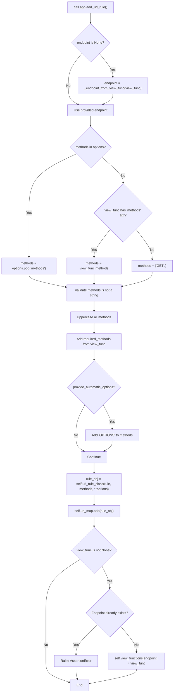
This flow shows how an endpoint name is determined, HTTP methods are collected and validated, automatic `OPTIONS` handling is configured, and the final rule is added to the `url_map` and linked to a view function.

Sources: [src/flask/sansio/app.py:602-659](https://github.com/pallets/flask/blob/258d68b6ff5e2244386540f48b48bab90d6ab827/src/flask/sansio/app.py#L602-L659)

## Decorators for Routing

While `add_url_rule()` is the underlying mechanism, decorators are the most common way to define routes.

### `@app.route()`

This decorator registers a view function for a given URL rule.

```python
@app.route("/", methods=["GET", "POST"])
def index():
    return "Hello World"
```
Sources: [tests/test_basic.py:33-35](https://github.com/pallets/flask/blob/258d68b6ff5e2244386540f48b48bab90d6ab827/tests/test_basic.py#L33-L35)

Multiple `@app.route()` decorators can be applied to the same function to bind it to multiple URLs.

```python
@app.route("/")
@app.route("/<test>/")
def index(test="a"):
    return test
```
Sources: [tests/test_basic.py:1851-1854](https://github.com/pallets/flask/blob/258d68b6ff5e2244386540f48b48bab90d6ab827/tests/test_basic.py#L1851-L1854)

### HTTP Method Decorators

For convenience, decorators for specific HTTP methods are available, such as `@app.get()`, `@app.post()`, etc. These are shortcuts that provide the `methods` argument to `@app.route()` automatically.

```python
@app.get("/")
def hello():
    return "Hello"

# client.get("/").data == b"Hello"
```
Sources: [tests/test_basic.py:55-65](https://github.com/pallets/flask/blob/258d68b6ff5e2244386540f48b48bab90d6ab827/tests/test_basic.py#L55-L65)

### `@app.endpoint()`

This decorator associates a view function with an endpoint that has already been defined, for instance, through direct manipulation of the `url_map`.

```python
from werkzeug.routing import Rule
app.url_map.add(Rule("/bar", endpoint="bar"))

@app.endpoint("bar")
def bar():
    return "bar"
```
Sources: [tests/test_basic.py:214-225](https://github.com/pallets/flask/blob/258d68b6ff5e2244386540f48b48bab90d6ab827/tests/test_basic.py#L214-L225)

## URL Rule Configuration

### HTTP Methods

The `methods` argument for a rule is a list of HTTP methods the view function supports. If not specified, it defaults to `("GET",)`. `HEAD` and `OPTIONS` (if automatic options are enabled) are typically added automatically.

- If a request is made to a URL with an unsupported method, Flask returns a `405 Method Not Allowed` response.
- The `methods` argument must be a list or other iterable of strings; providing a single string like `"GET POST"` will raise a `TypeError`.

Sources: [src/flask/sansio/app.py:615-625](https://github.com/pallets/flask/blob/258d68b6ff5e2244386540f48b48bab90d6ab827/src/flask/sansio/app.py#L615-L625), [tests/test_basic.py:152-155](https://github.com/pallets/flask/blob/258d68b6ff5e2244386540f48b48bab90d6ab827/tests/test_basic.py#L152-L155)

### Automatic `OPTIONS` Handling

Flask can automatically handle `OPTIONS` requests, responding with the allowed methods for a given URL. This behavior is controlled by the `provide_automatic_options` parameter.

1.  **Default**: If `provide_automatic_options` is not specified for a rule, it is enabled if `OPTIONS` is not in the rule's `methods` and the `PROVIDE_AUTOMATIC_OPTIONS` app configuration is `True`.
2.  **Rule Level**: It can be explicitly set to `True` or `False` when defining a rule: `@app.get("/", provide_automatic_options=False)`.
3.  **View Function Level**: A `provide_automatic_options` attribute can be set on the view function itself.

This tiered control allows for fine-grained management of `OPTIONS` handling.

Sources: [src/flask/sansio/app.py:630-642](https://github.com/pallets/flask/blob/258d68b6ff5e2244386540f48b48bab90d6ab827/src/flask/sansio/app.py#L630-L642), [tests/test_basic.py:72-114](https://github.com/pallets/flask/blob/258d68b6ff5e2244386540f48b48bab90d6ab827/tests/test_basic.py#L72-L114)

### Host and Subdomain Matching

Flask can match routes based on the host or subdomain of the request. This is enabled via `App` constructor arguments.

| Parameter | Type | Default | Description |
| --- | --- | --- | --- |
| `host_matching` | `bool` | `False` | If `True`, rules can be matched against the full host. |
| `subdomain_matching` | `bool` | `False` | If `True`, rules can be matched against the subdomain part of the host. |

These features require the `SERVER_NAME` configuration variable to be set.

Example of a route with subdomain matching:
```python
app = flask.Flask(__name__, subdomain_matching=True)
app.config["SERVER_NAME"] = "localhost.localdomain"

@app.route("/", subdomain="test")
def test_index():
    return "test index"
```
A request to `http://test.localhost.localdomain/` would match this route.

Sources: [src/flask/sansio/app.py:285-286, 402-405](), [tests/test_basic.py:1780-1798](https://github.com/pallets/flask/blob/258d68b6ff5e2244386540f48b48bab90d6ab827/tests/test_basic.py#L1780-L1798)

## Modular Routing with Blueprints

Blueprints are Flask's solution for building modular applications. They allow you to define a collection of routes, templates, and static files that can be registered with an application, potentially multiple times and with different URL prefixes.

The test application in `tests/test_apps/blueprintapp` provides a clear example. It has two blueprints, `admin` and `frontend`.

-   **`admin` Blueprint**: Defined with a `url_prefix` of `/admin`. All routes within it will be prepended with `/admin`.
    Sources: [tests/test_apps/blueprintapp/apps/admin/__init__.py:4-10](https://github.com/pallets/flask/blob/258d68b6ff5e2244386540f48b48bab90d6ab827/tests/test_apps/blueprintapp/apps/admin/__init__.py#L4-L10)
-   **`frontend` Blueprint**: Defined without a `url_prefix`, so its routes are registered at the application root.
    Sources: [tests/test_apps/blueprintapp/apps/frontend/__init__.py:4-4](https://github.com/pallets/flask/blob/258d68b6ff5e2244386540f48b48bab90d6ab827/tests/test_apps/blueprintapp/apps/frontend/__init__.py#L4-L4)

These blueprints are then registered on the main app instance using `app.register_blueprint()`.

Sources: [tests/test_apps/blueprintapp/__init__.py:8-9](https://github.com/pallets/flask/blob/258d68b6ff5e2244386540f48b48bab90d6ab827/tests/test_apps/blueprintapp/__init__.py#L8-L9), [src/flask/sansio/app.py:567-593](https://github.com/pallets/flask/blob/258d68b6ff5e2244386540f48b48bab90d6ab827/src/flask/sansio/app.py#L567-L593)

The following diagram shows the relationship:
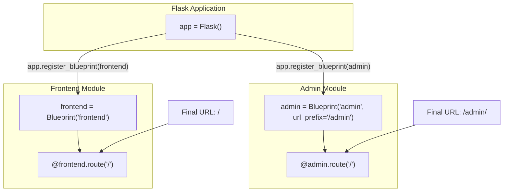

## URL Generation

Flask provides the `url_for()` function to build URLs for a specific endpoint, abstracting away the hardcoded URL paths. This makes changing the URL structure of an application much easier.

### URL Processors

Flask allows functions to be registered that can modify the values used for URL generation or pre-process values extracted from a URL.

-   `@app.url_defaults`: A decorator for a function that can inject default values into `url_for()` calls.
-   `@app.url_value_preprocessor`: A decorator for a function that is called before the view function. It can inspect and modify the values captured from the URL.

The test suite includes an example where these are used to manage a `lang_code` in the URL automatically.

Sources: [src/flask/sansio/app.py:957-977](https://github.com/pallets/flask/blob/258d68b6ff5e2244386540f48b48bab90d6ab827/src/flask/sansio/app.py#L957-L977), [tests/test_basic.py:1642-1669](https://github.com/pallets/flask/blob/258d68b6ff5e2244386540f48b48bab90d6ab827/tests/test_basic.py#L1642-L1669)

### Build Error Handling

If `url_for()` is called with an endpoint that doesn't exist or with incorrect parameters, it raises a `werkzeug.routing.BuildError`. This can be customized by adding handlers to the `app.url_build_error_handlers` list. These handlers can return a fallback URL or re-raise the error.

Sources: [src/flask/sansio/app.py:349-352, 978-1010](), [tests/test_basic.py:1370-1394](https://github.com/pallets/flask/blob/258d68b6ff5e2244386540f48b48bab90d6ab827/tests/test_basic.py#L1370-L1394)

## Request Dispatching Flow

The following sequence diagram shows the high-level flow from a client request to a view function response.

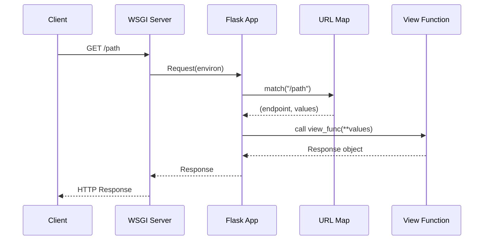

## Edge Cases and Gotchas

-   **Overwriting Endpoints**: Attempting to register a view function for an endpoint that is already in use will raise an `AssertionError`. This prevents accidental overwrites.
    Sources: [src/flask/sansio/app.py:653-657](https://github.com/pallets/flask/blob/258d68b6ff5e2244386540f48b48bab90d6ab827/src/flask/sansio/app.py#L653-L657)
-   **Setup After First Request**: Calling a setup method like `add_url_rule()` or `register_blueprint()` after the application has handled its first request is forbidden and will raise an `AssertionError`. All setup must be completed before the application starts serving requests.
    Sources: [src/flask/sansio/app.py:410-420](https://github.com/pallets/flask/blob/258d68b6ff5e2244386540f48b48bab90d6ab827/src/flask/sansio/app.py#L410-L420), [tests/test_basic.py:1704-1717](https://github.com/pallets/flask/blob/258d68b6ff5e2244386540f48b48bab90d6ab827/tests/test_basic.py#L1704-L1717)
-   **Redirects with POST**: In debug mode, if a POST request to a URL without a trailing slash (e.g., `/user`) is redirected to the canonical URL with a slash (`/user/`), Flask will raise an `AssertionError`. This is to warn the developer that form data may be lost during the redirect, as browsers might change the method to GET.
    Sources: [tests/test_basic.py:1719-1737](https://github.com/pallets/flask/blob/258d68b6ff5e2244386540f48b48bab90d6ab827/tests/test_basic.py#L1719-L1737)
-   **Unavailable Files**: The provided source files `tests/test_apps/blueprintapp/apps/__init__.py` and `tests/test_apps/cliapp/__init__.py` are empty and serve as package markers.
    Sources: [tests/test_apps/blueprintapp/apps/__init__.py](https://github.com/pallets/flask/blob/258d68b6ff5e2244386540f48b48bab90d6ab827/tests/test_apps/blueprintapp/apps/__init__.py), [tests/test_apps/cliapp/__init__.py](https://github.com/pallets/flask/blob/258d68b6ff5e2244386540f48b48bab90d6ab827/tests/test_apps/cliapp/__init__.py)

## Other files in this area

### tests/static/config.toml
This is a TOML configuration file located in a directory for static test assets. It does not directly implement routing or URL rules but is likely used in tests to configure a Flask application instance.

It defines two configuration variables:
- `TEST_KEY`: Set to the string `"foo"`. Sources: [tests/static/config.toml:1-1](https://github.com/pallets/flask/blob/258d68b6ff5e2244386540f48b48bab90d6ab827/tests/static/config.toml#L1-L1)
- `SECRET_KEY`: Set to the string `"config"`. Sources: [tests/static/config.toml:2-2](https://github.com/pallets/flask/blob/258d68b6ff5e2244386540f48b48bab90d6ab827/tests/static/config.toml#L2-L2)

A new engineer might find it unusual for a configuration file to be in a `static` directory, which typically holds assets served to users like CSS or images. In this context, it is a static file used as an input for tests that verify configuration loading.


# Page: View Functions

<details>
<summary>Relevant source files</summary>

The following files were used as context for generating this wiki page:

- [src/flask/sansio/app.py](https://github.com/pallets/flask/blob/258d68b6ff5e2244386540f48b48bab90d6ab827/src/flask/sansio/app.py)
- [tests/type_check/typing_route.py](https://github.com/pallets/flask/blob/258d68b6ff5e2244386540f48b48bab90d6ab827/tests/type_check/typing_route.py)
- [tests/test_apps/cliapp/app.py](https://github.com/pallets/flask/blob/258d68b6ff5e2244386540f48b48bab90d6ab827/tests/test_apps/cliapp/app.py)
- [tests/test_apps/cliapp/factory.py](https://github.com/pallets/flask/blob/258d68b6ff5e2244386540f48b48bab90d6ab827/tests/test_apps/cliapp/factory.py)
- [tests/test_apps/cliapp/importerrorapp.py](https://github.com/pallets/flask/blob/258d68b6ff5e2244386540f48b48bab90d6ab827/tests/test_apps/cliapp/importerrorapp.py)
- [tests/test_apps/cliapp/inner1/__init__.py](https://github.com/pallets/flask/blob/258d68b6ff5e2244386540f48b48bab90d6ab827/tests/test_apps/cliapp/inner1/__init__.py)
- [tests/test_apps/cliapp/inner1/inner2/__init__.py](https://github.com/pallets/flask/blob/258d68b6ff5e2244386540f48b48bab90d6ab827/tests/test_apps/cliapp/inner1/inner2/__init__.py)
- [tests/test_apps/cliapp/inner1/inner2/flask.py](https://github.com/pallets/flask/blob/258d68b6ff5e2244386540f48b48bab90d6ab827/tests/test_apps/cliapp/inner1/inner2/flask.py)
</details>

# View Functions

View functions are the core of a Flask application, responsible for handling incoming web requests and returning responses. A view function is a Python callable that is registered with the application to handle requests for a specific URL rule. When a request matches a rule, Flask invokes the corresponding view function, passing any variable parts from the URL as keyword arguments, and then converts the function's return value into a response object to send to the client.

Flask is flexible about what a view function can return. It can be a simple string of HTML, a tuple containing a response body and status code, or a pre-built `Response` object. This allows developers to tailor the response format to their specific needs, from returning simple text to complex JSON data or streaming content.

## Defining and Registering View Functions

View functions are associated with URL rules, which map URLs to endpoints. An endpoint is a unique identifier for a view function. There are two primary ways to register a view function: using the `@app.route()` decorator or by directly calling the `app.add_url_rule()` method.

### The `@app.route()` Decorator

The most common method for registering a view function is the `@app.route()` decorator. This decorator is a convenient wrapper around the `add_url_rule()` method.

```python
from flask import Flask

app = Flask(__name__)

@app.route("/str")
def hello_str() -> str:
    return "<p>Hello, World!</p>"
```
*Sources: [tests/type_check/typing_route.py:13-18](https://github.com/pallets/flask/blob/258d68b6ff5e2244386540f48b48bab90d6ab827/tests/type_check/typing_route.py#L13-L18)*

A single view function can be associated with multiple URL rules by stacking decorators.

```python
@app.route("/status")
@app.route("/status/<int:code>")
def tuple_status(code: int = 200) -> tuple[str, int]:
    return "hello", code
```
*Sources: [tests/type_check/typing_route.py:69-72](https://github.com/pallets/flask/blob/258d68b6ff5e2244386540f48b48bab90d6ab827/tests/type_check/typing_route.py#L69-L72)*

### The `add_url_rule()` Method

The `add_url_rule()` method is the underlying mechanism for route registration. It provides more explicit control over the registration process.

`add_url_rule(rule, endpoint=None, view_func=None, **options)`

| Parameter | Description |
| --- | --- |
| `rule` | The URL rule as a string. |
| `endpoint` | The endpoint for the registered rule. Flask can generate URLs for this endpoint. If `None`, the name of the `view_func` is used. |
| `view_func` | The view function to be called when the URL is matched. |
| `provide_automatic_options` | If `None` (the default), Flask automatically adds the `OPTIONS` method to the rule if it's not already present and the `PROVIDE_AUTOMATIC_OPTIONS` config is `True`. |
| `**options` | Additional options passed to the underlying `Rule` object, such as `methods`. |

*Sources: [src/flask/sansio/app.py:602-609](https://github.com/pallets/flask/blob/258d68b6ff5e2244386540f48b48bab90d6ab827/src/flask/sansio/app.py#L602-L609)*

The following diagram illustrates the internal logic of `add_url_rule()`:

```mermaid
graph TD
    A["start: add_url_rule()"] --> B{"endpoint is None?"};
    B -- Yes --> C["endpoint = _endpoint_from_view_func(view_func)"];
    B -- No --> D[Use provided endpoint];
    C --> D;
    D --> E{methods provided?};
    E -- No --> F{"view_func.methods exists?"};
    F -- Yes --> G["methods = view_func.methods"];
    F -- No --> H["methods = ('GET',)"];
    E -- Yes --> I[Use provided methods];
    G --> J[Normalize methods to uppercase set];
    H --> J;
    I --> J;
    J --> K{provide_automatic_options?};
    K -- Yes --> L[Add 'OPTIONS' to methods];
    K -- No --> M;
    L --> M;
    M --> N["rule_obj = url_rule_class(rule, methods, **options)"];
    N --> O["url_map.add(rule_obj)"];
    O --> P{"view_func is not None?"};
    P -- Yes --> Q{"Endpoint already exists?"};
    Q -- Yes --> R[Raise AssertionError];
    Q -- No --> S["view_functions[endpoint] = view_func"];
    S --> T[end];
    P -- No --> T;
    R --> T;
```
*Sources: [src/flask/sansio/app.py:602-659](https://github.com/pallets/flask/blob/258d68b6ff5e2244386540f48b48bab90d6ab827/src/flask/sansio/app.py#L602-L659)*

### Class-Based Views

For more structured and reusable code, Flask supports class-based views. A class-based view is a class that inherits from `flask.views.View` and implements a `dispatch_request()` method. This method acts as the view function.

To register a class-based view, use the `as_view()` class method, which returns a callable that can be passed to `add_url_rule()`.

```python
from flask.views import View
from flask.templating import render_template

class RenderTemplateView(View):
    def __init__(self: RenderTemplateView, template_name: str) -> None:
        self.template_name = template_name

    def dispatch_request(self: RenderTemplateView) -> str:
        return render_template(self.template_name)

app.add_url_rule(
    "/about",
    view_func=RenderTemplateView.as_view("about_page", template_name="about.html"),
)
```
*Sources: [tests/type_check/typing_route.py:101-112](https://github.com/pallets/flask/blob/258d68b6ff5e2244386540f48b48bab90d6ab827/tests/type_check/typing_route.py#L101-L112)*

## View Function Return Values

Flask is highly flexible regarding the return values from view functions. It automatically converts various types into a `Response` object.

| Return Type | Flask's Handling | Example |
| --- | --- | --- |
| `str` | The string becomes the response body with a `text/html` content type and a `200 OK` status. | `def v(): return "<h1>Hello</h1>"`<br/>*Sources: [tests/type_check/typing_route.py:16-18](https://github.com/pallets/flask/blob/258d68b6ff5e2244386540f48b48bab90d6ab827/tests/type_check/typing_route.py#L16-L18)* |
| `bytes` | The bytes become the response body with a default content type and a `200 OK` status. | `def v(): return b"<h1>Hello</h1>"`<br/>*Sources: [tests/type_check/typing_route.py:21-23](https://github.com/pallets/flask/blob/258d68b6ff5e2244386540f48b48bab90d6ab827/tests/type_check/typing_route.py#L21-L23)* |
| `dict`, `list`, `TypedDict` | The object is serialized to JSON using `jsonify()` and returned with an `application/json` content type. | `def v(): return {"status": "ok"}`<br/>*Sources: [tests/type_check/typing_route.py:31-33, 45-47]()* |
| `Response` | The `Response` object is used directly. | `def v(): return jsonify("Hello")`<br/>*Sources: [tests/type_check/typing_route.py:26-28](https://github.com/pallets/flask/blob/258d68b6ff5e2244386540f48b48bab90d6ab827/tests/type_check/typing_route.py#L26-L28)* |
| `tuple` | The tuple can contain `(body, status)`, `(body, headers)`, or `(body, status, headers)`. `status` can be an `int` or `http.HTTPStatus` enum. | `def v(): return "hello", 201`<br/>`def v(): return "hello", HTTPStatus.OK`<br/>*Sources: [tests/type_check/typing_route.py:71-72, 75-78]()* |
| `Iterator` or `Generator` | The iterator/generator is treated as a streaming response. Each yielded item is sent to the client. | `def v(): yield "data\n"`<br/>*Sources: [tests/type_check/typing_route.py:50-66](https://github.com/pallets/flask/blob/258d68b6ff5e2244386540f48b48bab90d6ab827/tests/type_check/typing_route.py#L50-L66)* |
| `async def` | Asynchronous view functions are supported and awaited by Flask. | `async def v(): return "Hello"`<br/>*Sources: [tests/type_check/typing_route.py:96-98](https://github.com/pallets/flask/blob/258d68b6ff5e2244386540f48b48bab90d6ab827/tests/type_check/typing_route.py#L96-L98)* |

## Application Instantiation Patterns

Before view functions can be registered, a Flask application instance must be created. The test suite demonstrates several common patterns for this.

| File | Pattern | Description |
| --- | --- | --- |
| `tests/test_apps/cliapp/app.py` | Direct Instantiation | A single, global `Flask` object is created in a module. `testapp = Flask("testapp")`. |
| `tests/test_apps/cliapp/factory.py` | Application Factory | A function `create_app()` is defined, which creates and returns a `Flask` instance. This is useful for creating multiple app instances with different configurations. |
| `tests/test_apps/cliapp/inner1/__init__.py` | Package Application | The `Flask` app is instantiated in the `__init__.py` of a package, making the package itself the application. |
| `tests/test_apps/cliapp/inner1/inner2/flask.py` | Nested Package Application | A Flask application is defined in a submodule within a nested package structure. |
| `tests/test_apps/cliapp/importerrorapp.py` | Failed Instantiation | This file demonstrates that if an `ImportError` occurs during module import, the application object is never created. |

*Sources: [tests/test_apps/cliapp/app.py](https://github.com/pallets/flask/blob/258d68b6ff5e2244386540f48b48bab90d6ab827/tests/test_apps/cliapp/app.py), [tests/test_apps/cliapp/factory.py](https://github.com/pallets/flask/blob/258d68b6ff5e2244386540f48b48bab90d6ab827/tests/test_apps/cliapp/factory.py), [tests/test_apps/cliapp/inner1/__init__.py](https://github.com/pallets/flask/blob/258d68b6ff5e2244386540f48b48bab90d6ab827/tests/test_apps/cliapp/inner1/__init__.py), [tests/test_apps/cliapp/inner1/inner2/flask.py](https://github.com/pallets/flask/blob/258d68b6ff5e2244386540f48b48bab90d6ab827/tests/test_apps/cliapp/inner1/inner2/flask.py), [tests/test_apps/cliapp/importerrorapp.py](https://github.com/pallets/flask/blob/258d68b6ff5e2244386540f48b48bab90d6ab827/tests/test_apps/cliapp/importerrorapp.py)*

## Edge Cases and Gotchas

- **Overwriting Endpoints**: Attempting to register a view function with an endpoint name that is already in use will raise an `AssertionError`. This prevents accidental route overwrites.
  *Sources: [src/flask/sansio/app.py:653-657](https://github.com/pallets/flask/blob/258d68b6ff5e2244386540f48b48bab90d6ab827/src/flask/sansio/app.py#L653-L657)*

- **Setup After First Request**: Calling setup methods like `add_url_rule()` or `@app.route()` after the application has handled its first request is forbidden and will raise an `AssertionError`. All setup must be completed before the application starts serving requests to ensure consistent behavior.
  *Sources: [src/flask/sansio/app.py:410-421](https://github.com/pallets/flask/blob/258d68b6ff5e2244386540f48b48bab90d6ab827/src/flask/sansio/app.py#L410-L421)*

- **Methods Argument Type**: The `methods` argument for a route must be an iterable of strings (e.g., `["GET", "POST"]`). Providing a single string like `methods="POST"` will raise a `TypeError`.
  *Sources: [src/flask/sansio/app.py:620-624](https://github.com/pallets/flask/blob/258d68b6ff5e2244386540f48b48bab90d6ab827/src/flask/sansio/app.py#L620-L624)*

- **Automatic Endpoint Naming**: If an `endpoint` is not explicitly provided to `add_url_rule()`, Flask will automatically generate one from the name of the view function.
  *Sources: [src/flask/sansio/app.py:610-611](https://github.com/pallets/flask/blob/258d68b6ff5e2244386540f48b48bab90d6ab827/src/flask/sansio/app.py#L610-L611)*

## Other files in this area

### tests/test_apps/cliapp/inner1/inner2/__init__.py

This file is an empty Python module. Its presence makes the `tests/test_apps/cliapp/inner1/inner2/` directory a Python package. This is likely part of a test setup to verify Flask's application discovery mechanisms, particularly for nested package structures, but it does not define any view functions itself.

The file is completely empty and therefore contains no exports, functions, or classes. A new engineer might be surprised that the file is intentionally blank; its sole purpose is to enable the directory to be treated as a package by Python's import system.

Sources: [tests/test_apps/cliapp/inner1/inner2/__init__.py:1-1](https://github.com/pallets/flask/blob/258d68b6ff5e2244386540f48b48bab90d6ab827/tests/test_apps/cliapp/inner1/inner2/__init__.py#L1-L1)


# Page: Class-Based Views

<details>
<summary>Relevant source files</summary>

The following files were used as context for generating this wiki page:

- [src/flask/views.py](https://github.com/pallets/flask/blob/258d68b6ff5e2244386540f48b48bab90d6ab827/src/flask/views.py)
- [tests/test_views.py](https://github.com/pallets/flask/blob/258d68b6ff5e2244386540f48b48bab90d6ab827/tests/test_views.py)
- [tests/test_apps/cliapp/multiapp.py](https://github.com/pallets/flask/blob/258d68b6ff5e2244386540f48b48bab90d6ab827/tests/test_apps/cliapp/multiapp.py)
- [tests/test_apps/helloworld/hello.py](https://github.com/pallets/flask/blob/258d68b6ff5e2244386540f48b48bab90d6ab827/tests/test_apps/helloworld/hello.py)
- [tests/test_apps/helloworld/wsgi.py](https://github.com/pallets/flask/blob/258d68b6ff5e2244386540f48b48bab90d6ab827/tests/test_apps/helloworld/wsgi.py)
- [tests/test_apps/subdomaintestmodule/__init__.py](https://github.com/pallets/flask/blob/258d68b6ff5e2244386540f48b48bab90d6ab827/tests/test_apps/subdomaintestmodule/__init__.py)
- [tests/test_converters.py](https://github.com/pallets/flask/blob/258d68b6ff5e2244386540f48b48bab90d6ab827/tests/test_converters.py)
- [tests/test_instance_config.py](https://github.com/pallets/flask/blob/258d68b6ff5e2244386540f48b48bab90d6ab827/tests/test_instance_config.py)
</details>

# Class-Based Views

Class-based views provide an alternative to function-based views for defining request handlers in a Flask application. They allow for structuring view logic within classes, which can improve code organization, reusability through inheritance, and customization. Flask provides two primary base classes for this purpose: `View` for generic class-based views and `MethodView` for views that map HTTP methods to class methods.

Sources: [src/flask/views.py](https://github.com/pallets/flask/blob/258d68b6ff5e2244386540f48b48bab90d6ab827/src/flask/views.py)

## Core Concepts

The central mechanism for class-based views is the `as_view()` class method. This method converts a view class into a standard Flask view function, which can then be registered with the application's URL routing system using `app.add_url_rule()`.

Sources: [src/flask/views.py:86-135](https://github.com/pallets/flask/blob/258d68b6ff5e2244386540f48b48bab90d6ab827/src/flask/views.py#L86-L135)

### `View` Class

The `View` class is the fundamental building block for creating generic class-based views. Subclasses are required to implement the `dispatch_request` method, which contains the logic to handle incoming requests and return a response.

Sources: [src/flask/views.py:16-83](https://github.com/pallets/flask/blob/258d68b6ff5e2244386540f48b48bab90d6ab827/src/flask/views.py#L16-L83)

#### Key Attributes

The behavior of a `View` can be configured through several class attributes:

| Attribute | Type | Description |
| --- | --- | --- |
| `methods` | `t.ClassVar[t.Collection[str] \| None]` | A collection of HTTP methods the view accepts (e.g., `["GET", "POST"]`). If not set, it defaults to `["GET", "HEAD", "OPTIONS"]`. |
| `provide_automatic_options` | `t.ClassVar[bool \| None]` | Controls whether Flask automatically handles `OPTIONS` requests for the view. Defaults to `True`. |
| `decorators` | `t.ClassVar[list[t.Callable[..., t.Any]]]` | A list of decorators to apply to the generated view function. The decorators are applied from bottom to top. |
| `init_every_request` | `t.ClassVar[bool]` | If `True` (the default), a new instance of the view class is created for each request. If `False`, a single instance is created when `as_view()` is called and reused for all subsequent requests. |

Sources: [src/flask/views.py:51-76](https://github.com/pallets/flask/blob/258d68b6ff5e2244386540f48b48bab90d6ab827/src/flask/views.py#L51-L76)

#### `as_view()` Method

The `as_view(name, *class_args, **class_kwargs)` method is a class method that generates a view function.

1.  **`name`**: A required string that is used as the endpoint name for URL generation.
2.  **`*class_args`, `**class_kwargs`**: Any additional arguments are passed to the class's `__init__` method during instantiation.

The method attaches several attributes from the class to the generated view function, including `methods`, `provide_automatic_options`, `__module__`, `__doc__`, and a reference to the view class itself as `view.view_class`.

Sources: [src/flask/views.py:86-135](https://github.com/pallets/flask/blob/258d68b6ff5e2244386540f48b48bab90d6ab827/src/flask/views.py#L86-L135)

#### Instantiation Logic

The `init_every_request` attribute dictates the view's lifecycle.

```mermaid
graph TD
    A[Request Received] --> B{init_every_request?};
    B -->|True| C["Instantiate View Class: self = cls(*args, **kwargs)"];
    C --> E["call self.dispatch_request(**url_vars)"];
    B -->|False| D["Use Pre-existing Instance (created at as_view() time)"];
    D --> E;
    E --> F[Return Response];
```
*   **`init_every_request = True` (Default)**: A new instance is created for every request. This is safer for storing request-specific data on `self` but has slightly more overhead.
    Sources: [src/flask/views.py:104-111](https://github.com/pallets/flask/blob/258d68b6ff5e2244386540f48b48bab90d6ab827/src/flask/views.py#L104-L111)
*   **`init_every_request = False`**: A single instance is created when `as_view()` is called and is reused across all requests. This is more efficient but requires using request-safe storage like `flask.g` for request-specific data.
    Sources: [src/flask/views.py:112-117](https://github.com/pallets/flask/blob/258d68b6ff5e2244386540f48b48bab90d6ab827/src/flask/views.py#L112-L117), [tests/test_views.py:257-272](https://github.com/pallets/flask/blob/258d68b6ff5e2244386540f48b48bab90d6ab827/tests/test_views.py#L257-L272)

### `MethodView` Class

`MethodView` is a subclass of `View` designed for building RESTful APIs. It dispatches incoming requests to methods on the class whose names match the lowercase HTTP method of the request (e.g., a `GET` request is handled by the `get()` method).

Sources: [src/flask/views.py:138-191](https://github.com/pallets/flask/blob/258d68b6ff5e2244386540f48b48bab90d6ab827/src/flask/views.py#L138-L191)

The following class diagram shows the inheritance relationship.

```mermaid
classDiagram
    class View {
        +list~t.Callable~ decorators
        +t.Collection~str~ methods
        +bool init_every_request
        +dispatch_request()
        +as_view(name) ft.RouteCallable
    }
    class MethodView {
        +dispatch_request()
    }
    View <|-- MethodView
```
Sources: [src/flask/views.py:16-191](https://github.com/pallets/flask/blob/258d68b6ff5e2244386540f48b48bab90d6ab827/src/flask/views.py#L16-L191)

#### Automatic Method Handling

`MethodView` automatically determines the `methods` it supports by inspecting its own and its base classes' methods. It looks for methods with names matching the set of standard HTTP methods: `get`, `post`, `head`, `options`, `delete`, `put`, `trace`, and `patch`.

This is handled in the `__init_subclass__` hook, which collects all method names, converts them to uppercase, and populates the `cls.methods` set.

Sources: [src/flask/views.py:11-13](https://github.com/pallets/flask/blob/258d68b6ff5e2244386540f48b48bab90d6ab827/src/flask/views.py#L11-L13), [src/flask/views.py:165-181](https://github.com/pallets/flask/blob/258d68b6ff5e2244386540f48b48bab90d6ab827/src/flask/views.py#L165-L181), [tests/test_views.py:219-236](https://github.com/pallets/flask/blob/258d68b6ff5e2244386540f48b48bab90d6ab827/tests/test_views.py#L219-L236)

#### Request Dispatch Flow

The `dispatch_request` method in `MethodView` implements the core routing logic.

```mermaid
sequenceDiagram
    participant C as Client
    participant F as "Flask App"
    participant V as "View Function (from as_view)"
    participant I as "MethodView Instance"
    participant M as "HTTP Method (e.g., get())"

    C->>F: Sends HTTP Request (e.g., GET /)
    F->>V: Calls generated view function
    V->>I: new MethodView()
    V->>I: dispatch_request(**kwargs)
    I->>I: handler = getattr(self, request.method.lower())
    alt HEAD request and no head() method
        I->>I: handler = getattr(self, "get")
    end
    I->>M: handler(**kwargs)
    M-->>I: Returns Response
    I-->>V: Returns Response
    V-->>F: Returns Response
    F-->>C: Sends HTTP Response
```
This diagram illustrates the process for a request when `init_every_request` is `True`.

A key feature is the special handling for `HEAD` requests: if an explicit `head()` method is not defined, `MethodView` will fall back to using the `get()` method.

Sources: [src/flask/views.py:182-191](https://github.com/pallets/flask/blob/258d68b6ff5e2244386540f48b48bab90d6ab827/src/flask/views.py#L182-L191), [tests/test_views.py:153-165](https://github.com/pallets/flask/blob/258d68b6ff5e2244386540f48b48bab90d6ab827/tests/test_views.py#L153-L165)

## Usage and Registration

Class-based views are registered with a Flask application using `app.add_url_rule()`. The `view_func` argument is set to the function generated by `YourView.as_view('endpoint_name')`.

**Example: `View`**
```python
class Hello(View):
    def dispatch_request(self, name):
        return f"Hello, {name}!"

app.add_url_rule(
    "/hello/<name>", view_func=Hello.as_view("hello")
)
```
Sources: [src/flask/views.py:27-35](https://github.com/pallets/flask/blob/258d68b6ff5e2244386540f48b48bab90d6ab827/src/flask/views.py#L27-L35)

**Example: `MethodView`**
```python
class CounterAPI(MethodView):
    def get(self):
        return str(session.get("counter", 0))

    def post(self):
        session["counter"] = session.get("counter", 0) + 1
        return redirect(url_for("counter"))

app.add_url_rule(
    "/counter", view_func=CounterAPI.as_view("counter")
)
```
Sources: [src/flask/views.py:152-162](https://github.com/pallets/flask/blob/258d68b6ff5e2244386540f48b48bab90d6ab827/src/flask/views.py#L152-L162)

## Edge Cases and Gotchas

### Decorator Application

Decorators listed in the `decorators` class attribute are applied to the view *function* generated by `as_view()`, not the class itself. The order of application is from the last element in the list to the first (bottom-to-top syntax equivalent).

Sources: [src/flask/views.py:40-42](https://github.com/pallets/flask/blob/258d68b6ff5e2244386540f48b48bab90d6ab827/src/flask/views.py#L40-L42), [src/flask/views.py:118-123](https://github.com/pallets/flask/blob/258d68b6ff5e2244386540f48b48bab90d6ab827/src/flask/views.py#L118-L123), [tests/test_views.py:81-100](https://github.com/pallets/flask/blob/258d68b6ff5e2244386540f48b48bab90d6ab827/tests/test_views.py#L81-L100)

### Overriding HTTP Methods in `MethodView`

While `MethodView` automatically discovers methods, you can explicitly set the `methods` class attribute to override this behavior. This is useful for disabling methods inherited from a parent class.

In the example below, `View` inherits from `GetView` and `OtherView` but explicitly sets `methods = ["GET"]`, thus disabling the `POST` method.

Sources: [tests/test_views.py:238-255](https://github.com/pallets/flask/blob/258d68b6ff5e2244386540f48b48bab90d6ab827/tests/test_views.py#L238-L255)

### View Class Patching for Tests

The `as_view()` method attaches the original view class to the generated function as the `view_class` attribute. This attribute can be replaced at runtime, which is a useful pattern for testing. One can define a view with specific behavior for a test and substitute it for the original view class before registering the URL rule.

Sources: [src/flask/views.py:124-129](https://github.com/pallets/flask/blob/258d68b6ff5e2244386540f48b48bab90d6ab827/src/flask/views.py#L124-L129), [tests/test_views.py:42-61](https://github.com/pallets/flask/blob/258d68b6ff5e2244386540f48b48bab90d6ab827/tests/test_views.py#L42-L61)

### `provide_automatic_options` Behavior

The `provide_automatic_options` class attribute on a `View` can override the application-level `PROVIDE_AUTOMATIC_OPTIONS` configuration. This allows for fine-grained control over which views handle `OPTIONS` requests automatically.

-   Setting `provide_automatic_options = False` on the view disables automatic `OPTIONS` handling for that view, even if it's enabled globally.
    Sources: [tests/test_views.py:102-116](https://github.com/pallets/flask/blob/258d68b6ff5e2244386540f48b48bab90d6ab827/tests/test_views.py#L102-L116)
-   Setting `provide_automatic_options = True` on the view enables it, even if disabled globally.
    Sources: [tests/test_views.py:118-135](https://github.com/pallets/flask/blob/258d68b6ff5e2244386540f48b48bab90d6ab827/tests/test_views.py#L118-L135)

## Ancillary Source File Analysis

The following files were provided as context but do not directly implement or demonstrate class-based views. They show other aspects of Flask applications where such views would be integrated.

| File | Description |
| --- | --- |
| `tests/test_apps/cliapp/multiapp.py` | Defines multiple Flask app instances (`app1`, `app2`), relevant for testing CLI commands in a multi-app context. |
| `tests/test_apps/helloworld/hello.py` | A minimal "Hello World" Flask app using a standard function-based view with the `@app.route` decorator. |
| `tests/test_apps/helloworld/wsgi.py` | A WSGI entrypoint file that imports the `app` object from `hello.py`. |
| `tests/test_apps/subdomaintestmodule/__init__.py` | Demonstrates the deprecated `Module` object, which was a precursor to Blueprints. |
| `tests/test_converters.py` | Contains tests for custom URL converters, a feature of Flask's routing system that can be used with both function-based and class-based views. |
| `tests/test_instance_config.py` | Contains tests related to Flask's instance folder path resolution, which is part of the application's core configuration and independent of the view implementation. |

Sources: [tests/test_apps/cliapp/multiapp.py](https://github.com/pallets/flask/blob/258d68b6ff5e2244386540f48b48bab90d6ab827/tests/test_apps/cliapp/multiapp.py), [tests/test_apps/helloworld/hello.py](https://github.com/pallets/flask/blob/258d68b6ff5e2244386540f48b48bab90d6ab827/tests/test_apps/helloworld/hello.py), [tests/test_apps/helloworld/wsgi.py](https://github.com/pallets/flask/blob/258d68b6ff5e2244386540f48b48bab90d6ab827/tests/test_apps/helloworld/wsgi.py), [tests/test_apps/subdomaintestmodule/__init__.py](https://github.com/pallets/flask/blob/258d68b6ff5e2244386540f48b48bab90d6ab827/tests/test_apps/subdomaintestmodule/__init__.py), [tests/test_converters.py](https://github.com/pallets/flask/blob/258d68b6ff5e2244386540f48b48bab90d6ab827/tests/test_converters.py), [tests/test_instance_config.py](https://github.com/pallets/flask/blob/258d68b6ff5e2244386540f48b48bab90d6ab827/tests/test_instance_config.py)

# Page: The Application Context

<details>
<summary>Relevant source files</summary>

The following files were used as context for generating this wiki page:

- [src/flask/ctx.py](https://github.com/pallets/flask/blob/258d68b6ff5e2244386540f48b48bab90d6ab827/src/flask/ctx.py)
- [tests/test_appctx.py](https://github.com/pallets/flask/blob/258d68b6ff5e2244386540f48b48bab90d6ab827/tests/test_appctx.py)
- [tests/test_json_tag.py](https://github.com/pallets/flask/blob/258d68b6ff5e2244386540f48b48bab90d6ab827/tests/test_json_tag.py)
- [tests/test_regression.py](https://github.com/pallets/flask/blob/258d68b6ff5e2244386540f48b48bab90d6ab827/tests/test_regression.py)
- [tests/test_request.py](https://github.com/pallets/flask/blob/258d68b6ff5e2244386540f48b48bab90d6ab827/tests/test_request.py)
- [tests/test_subclassing.py](https://github.com/pallets/flask/blob/258d68b6ff5e2244386540f48b48bab90d6ab827/tests/test_subclassing.py)
</details>

# The Application Context

The Flask application context provides a mechanism for sharing application-level data without passing objects around between functions. A context is created and "pushed" at the beginning of each request or CLI command, making application-specific information available via global proxies like `current_app` and `g`. When the request or command finishes, the context is "popped," and its resources are cleaned up.

There are two primary variations of the context: a general "app context" and a more specific "request context". A request context is an app context that also contains information about a specific HTTP request. The system is designed to ensure that resources are properly managed and that application state is available where needed, such as for URL generation or accessing configuration, while maintaining thread-safety.

Sources: [src/flask/ctx.py:260-269](https://github.com/pallets/flask/blob/258d68b6ff5e2244386540f48b48bab90d6ab827/src/flask/ctx.py#L260-L269)

## Core Components

### The `AppContext` Class

The `AppContext` class is the central component of the context system. It encapsulates all the data related to a specific application instance and, optionally, a request. It is not intended to be instantiated directly in application code, but rather through factory methods like `Flask.app_context()` and `Flask.test_request_context()`.

Key attributes of an `AppContext` instance include:

*   `app`: The `Flask` application instance this context belongs to.
*   `g`: A namespace object for storing user data during the context's lifetime.
*   `url_adapter`: A Werkzeug `MapAdapter` for URL matching and generation.
*   `_request`: The `Request` object if it is a request context.
*   `_session`: The session object, loaded on first access.

The `AppContext` acts as a context manager, using `__enter__` and `__exit__` to call its `push()` and `pop()` methods, respectively. This ensures that the context is correctly established and torn down when used in a `with` statement.

Sources: [src/flask/ctx.py:260-338](https://github.com/pallets/flask/blob/258d68b6ff5e2244386540f48b48bab90d6ab827/src/flask/ctx.py#L260-L338), [src/flask/ctx.py:506-517](https://github.com/pallets/flask/blob/258d68b6ff5e2244386540f48b48bab90d6ab827/src/flask/ctx.py#L506-L517)

```mermaid
classDiagram
    direction TD
    class AppContext {
        +app: Flask
        +g: _AppCtxGlobals
        +url_adapter: MapAdapter
        +request: Request
        +session: SessionMixin
        +has_request: bool
        +push(): void
        +pop(exc: BaseException): void
        +copy(): AppContext
        +match_request(): void
    }
    class _AppCtxGlobals {
        +get(name, default)
        +pop(name, default)
        +setdefault(name, default)
    }
    AppContext "1" *-- "1" _AppCtxGlobals : creates
```

### The Application Globals (`g`)

The `g` object, an instance of `_AppCtxGlobals`, serves as a temporary, per-context namespace for storing arbitrary data. It is created automatically when an app context is pushed and destroyed when it is popped. This is useful for holding resources like database connections that are needed across multiple functions during a single request or command.

The `_AppCtxGlobals` class provides a dict-like interface with methods such as:
*   `get(name, default)`
*   `pop(name, default)`
*   `setdefault(name, default)`
*   `__contains__(item)`
*   `__iter__()`

The class used for `g` can be customized by setting the `app.app_ctx_globals_class` attribute on the Flask application object.

Sources: [src/flask/ctx.py:30-117](https://github.com/pallets/flask/blob/258d68b6ff5e2244386540f48b48bab90d6ab827/src/flask/ctx.py#L30-L117), [tests/test_appctx.py:139-170](https://github.com/pallets/flask/blob/258d68b6ff5e2244386540f48b48bab90d6ab827/tests/test_appctx.py#L139-L170)

## Context Lifecycle

The lifecycle of an application context is managed by the `push()` and `pop()` methods. These are typically invoked via a `with` statement.

### Pushing the Context

When `push()` is called, the context becomes the active context for the current thread or coroutine.

The sequence of operations is as follows:
1.  A nested push counter (`_push_count`) is incremented.
2.  If this is the first push (`_cv_token` is `None`), the context is stored in a `contextvars` variable, and the `appcontext_pushed` signal is sent.
3.  If it is a request context (`_request` is not `None`):
    a. The session is opened by calling `app.session_interface.open_session()`.
    b. URL routing is performed via `url_adapter.match()`, populating `request.url_rule` and `request.view_args` or `request.routing_exception`.

```mermaid
sequenceDiagram
    participant C as Caller
    participant AC as AppContext
    participant CV as contextvars._cv_app
    participant Signal as appcontext_pushed
    participant SI as SessionInterface
    participant UA as URLAdapter

    C->>AC: push()
    Note over AC: _push_count++
    alt Not already pushed
        AC->>CV: set(self)
        CV-->>AC: token
        AC->>Signal: send(app)
        Signal-->>AC:
    end
    alt Is a request context
        AC->>SI: open_session(app, request)
        SI-->>AC: session
        AC->>UA: match()
        UA-->>AC: (rule, view_args) or HTTPException
    end
    AC-->>C:
```
Sources: [src/flask/ctx.py:416-445](https://github.com/pallets/flask/blob/258d68b6ff5e2244386540f48b48bab90d6ab827/src/flask/ctx.py#L416-L445)

### Popping the Context

When `pop()` is called, the context is removed, and cleanup functions are executed.

The teardown sequence is as follows:
1.  The nested push counter (`_push_count`) is decremented.
2.  If the counter is still greater than 0, the method returns, and the context remains active.
3.  If the counter reaches 0, the teardown process begins. All teardown functions are executed, and any exceptions they raise are collected.
4.  If it was a request context, `teardown_request` functions are called.
5.  The `teardown_appcontext` functions are always called.
6.  The `contextvars` variable is reset to its previous state.
7.  The `appcontext_popped` signal is sent.
8.  If any exceptions were collected during teardown, they are raised.

```mermaid
sequenceDiagram
    participant C as Caller
    participant AC as AppContext
    participant App as FlaskApp
    participant CV as contextvars._cv_app
    participant Signal as appcontext_popped

    C->>AC: pop(exc)
    Note over AC: _push_count--
    alt _push_count == 0
        alt Is a request context
            AC->>App: do_teardown_request(exc)
            App-->>AC:
        end
        AC->>App: do_teardown_appcontext(exc)
        App-->>AC:
        AC->>CV: reset(token)
        CV-->>AC:
        AC->>Signal: send(app)
        Signal-->>AC:
        Note over AC: Raise any collected errors
    end
    AC-->>C:
```
Sources: [src/flask/ctx.py:446-505](https://github.com/pallets/flask/blob/258d68b6ff5e2244386540f48b48bab90d6ab827/src/flask/ctx.py#L446-L505)

## Context-Bound Functionality

Many Flask features rely on an active application context to function correctly.

| Feature | Dependency on Context | Source |
| :--- | :--- | :--- |
| **URL Generation** | `flask.url_for()` needs access to the app's URL map and configuration like `SERVER_NAME`. It will raise a `RuntimeError` if called without an active context. | [tests/test_appctx.py:10-32](https://github.com/pallets/flask/blob/258d68b6ff5e2244386540f48b48bab90d6ab827/tests/test_appctx.py#L10-L32) |
| **Global Proxies** | `flask.current_app` and `flask.g` are proxies that resolve to the `app` and `g` attributes of the currently active `AppContext`. They are not usable outside a context. | [tests/test_appctx.py:39-44](https://github.com/pallets/flask/blob/258d68b6ff5e2244386540f48b48bab90d6ab827/tests/test_appctx.py#L39-L44) |
| **Request Configuration** | The `Request` object reads certain configuration values from the application when accessed within a context. Outside a context, it uses Werkzeug defaults. | [tests/test_request.py:25-41](https://github.com/pallets/flask/blob/258d68b6ff5e2244386540f48b48bab90d6ab827/tests/test_request.py#L25-L41) |
| **JSON Serialization** | When a request context is created, the app's configured JSON provider (`app.json`) is assigned to `request.json_module`, ensuring that request parsing and response serialization use consistent settings. | [src/flask/ctx.py:346-348](https://github.com/pallets/flask/blob/258d68b6ff5e2244386540f48b48bab90d6ab827/src/flask/ctx.py#L346-L348), [tests/test_json_tag.py](https://github.com/pallets/flask/blob/258d68b6ff5e2244386540f48b48bab90d6ab827/tests/test_json_tag.py) |

The following request-related configuration values are loaded from the app config when a context is active:

| Configuration Key | `Request` Attribute | Default (Werkzeug) |
| :--- | :--- | :--- |
| `MAX_CONTENT_LENGTH` | `max_content_length` | `None` |
| `MAX_FORM_MEMORY_SIZE` | `max_form_memory_size` | `500_000` |
| `MAX_FORM_PARTS` | `max_form_parts` | `1_000` |

Sources: [tests/test_request.py:25-41](https://github.com/pallets/flask/blob/258d68b6ff5e2244386540f48b48bab90d6ab827/tests/test_request.py#L25-L41)

## Teardown Behavior and Exception Handling

Flask's teardown mechanism is designed to be robust. Functions registered with `@app.teardown_appcontext` are guaranteed to run when the context is popped, even if an exception occurred during request handling.

The exception that caused the teardown (if any) is passed as an argument to each teardown function. If a teardown function itself raises an exception, it is collected, and the remaining teardown functions are still executed. On Python 3.11+, all collected exceptions are raised as an `ExceptionGroup`.

The teardown flow is illustrated below:

```mermaid
graph TD
    A[Context Exit] --> B{Request Context?};
    B -- Yes --> C["Execute @teardown_request functions"];
    B -- No --> D["Execute @teardown_appcontext functions"];
    C --> D;
    D --> E[Reset contextvars];
    E --> F[Send appcontext_popped signal];
    F --> G{Any exceptions collected?};
    G -- Yes --> H[Raise collected exceptions];
    G -- No --> I[End];
    H --> I;
```
Sources: [src/flask/ctx.py:486-505](https://github.com/pallets/flask/blob/258d68b6ff5e2244386540f48b48bab90d6ab827/src/flask/ctx.py#L486-L505), [tests/test_appctx.py:216-265](https://github.com/pallets/flask/blob/258d68b6ff5e2244386540f48b48bab90d6ab827/tests/test_appctx.py#L216-L265)

## Helper Functions

Several utility functions are provided to interact with the context system.

| Function | Description | Source |
| :--- | :--- | :--- |
| `has_app_context()` | Returns `True` if an application context is currently active. | [src/flask/ctx.py:235-258](https://github.com/pallets/flask/blob/258d68b6ff5e2244386540f48b48bab90d6ab827/src/flask/ctx.py#L235-L258) |
| `has_request_context()` | Returns `True` if a request context (an app context with request data) is active. | [src/flask/ctx.py:209-233](https://github.com/pallets/flask/blob/258d68b6ff5e2244386540f48b48bab90d6ab827/src/flask/ctx.py#L209-L233) |
| `after_this_request(f)` | A decorator to register a function to be called after the current request. It must be used within an active request context. | [src/flask/ctx.py:118-149](https://github.com/pallets/flask/blob/258d68b6ff5e2244386540f48b48bab90d6ab827/src/flask/ctx.py#L118-L149) |
| `copy_current_request_context(f)` | A decorator that wraps a function to run within a copy of the current request context. Useful for background tasks. | [src/flask/ctx.py:154-207](https://github.com/pallets/flask/blob/258d68b6ff5e2244386540f48b48bab90d6ab827/src/flask/ctx.py#L154-L207) |

## Related Modules and Integrations

The application context is fundamental to the operation of other parts of the framework.

*   **Testing**: The test client (`app.test_client()`) and `app.test_request_context()` work by pushing and popping contexts to simulate requests and other application interactions. This is visible in regression tests where `flask.abort` is used within a test client request. Sources: [tests/test_regression.py:20-30](https://github.com/pallets/flask/blob/258d68b6ff5e2244386540f48b48bab90d6ab827/tests/test_regression.py#L20-L30)
*   **Error Handling**: When an unhandled exception occurs, it is processed within the application context. This allows error handlers and methods like `app.log_exception` to access `current_app` and `g`. Customizing error logging by subclassing Flask relies on this behavior. Sources: [tests/test_subclassing.py:7-10](https://github.com/pallets/flask/blob/258d68b6ff5e2244386540f48b48bab90d6ab827/tests/test_subclassing.py#L7-L10)

## Edge Cases and Gotchas

*   **URL Generation**: Generating external URLs with `url_for(..., _external=True)` requires the `SERVER_NAME` configuration variable to be set. Without it, a `RuntimeError` is raised. Sources: [tests/test_appctx.py:11-12](https://github.com/pallets/flask/blob/258d68b6ff5e2244386540f48b48bab90d6ab827/tests/test_appctx.py#L11-L12), [tests/test_appctx.py:23-26](https://github.com/pallets/flask/blob/258d68b6ff5e2244386540f48b48bab90d6ab827/tests/test_appctx.py#L23-L26)
*   **Nested Contexts**: A context can be pushed multiple times. Teardown functions will only execute when the outermost `pop()` call occurs (i.e., when `_push_count` returns to zero). Sources: [src/flask/ctx.py:428-431](https://github.com/pallets/flask/blob/258d68b6ff5e2244386540f48b48bab90d6ab827/src/flask/ctx.py#L428-L431), [src/flask/ctx.py:481-484](https://github.com/pallets/flask/blob/258d68b6ff5e2244386540f48b48bab90d6ab827/src/flask/ctx.py#L481-L484)
*   **Background Tasks**: When using `copy_current_request_context`, care must be taken. The request body should be read before starting the background task to avoid race conditions. Modifying the session in the background task is discouraged as the response may have already been sent. Sources: [src/flask/ctx.py:159-173](https://github.com/pallets/flask/blob/258d68b6ff5e2244386540f48b48bab90d6ab827/src/flask/ctx.py#L159-L173)
*   **Deprecation**: The `RequestContext` class is an alias for `AppContext` and is deprecated. `AppContext` should be used instead. A `DeprecationWarning` is issued if `RequestContext` is accessed. Sources: [src/flask/ctx.py:531-538](https://github.com/pallets/flask/blob/258d68b6ff5e2244386540f48b48bab90d6ab827/src/flask/ctx.py#L531-L538)

# Page: The Request Context

<details>
<summary>Relevant source files</summary>

The following files were used as context for generating this wiki page:

- [src/flask/ctx.py](https://github.com/pallets/flask/blob/258d68b6ff5e2244386540f48b48bab90d6ab827/src/flask/ctx.py)
- [tests/test_reqctx.py](https://github.com/pallets/flask/blob/258d68b6ff5e2244386540f48b48bab90d6ab827/tests/test_reqctx.py)
</details>

# The Request Context

The Flask request context is a fundamental mechanism that provides view functions and other request-handling code with access to request-specific data. When a request is received or a CLI command is run, Flask pushes a context that makes objects like `current_app`, `g`, `request`, and `session` available. This context is managed on a stack and is tied to the lifecycle of a request or command.

There are two main types of contexts, though they are managed by the same class:
1.  **Application Context**: Contains application-specific information. It is created for both requests and CLI commands. It makes `current_app` and `g` available.
2.  **Request Context**: A more specific context that is created only when handling a request. It contains all the information from an application context, plus request-specific objects like `request` and `session`.

The `AppContext` class is the central component that manages both of these contexts.

Sources: [src/flask/ctx.py:260-265](https://github.com/pallets/flask/blob/258d68b6ff5e2244386540f48b48bab90d6ab827/src/flask/ctx.py#L260-L265)

## Core Components

### The `AppContext` Class

The `AppContext` class encapsulates all the per-request state. An instance of this class is created by the application for each request or CLI command. It can be created manually for testing using `app.test_request_context()` or for general use with `app.app_context()`.

Since Flask 3.2, `AppContext` has merged the functionality of the former `RequestContext`, and the name `RequestContext` is now a deprecated alias.

Sources: [src/flask/ctx.py:260-298](https://github.com/pallets/flask/blob/258d68b6ff5e2244386540f48b48bab90d6ab827/src/flask/ctx.py#L260-L298), [src/flask/ctx.py:531-538](https://github.com/pallets/flask/blob/258d68b6ff5e2244386540f48b48bab90d6ab827/src/flask/ctx.py#L531-L538)

The following diagram illustrates the structure of the `AppContext` and its relationship with the `_AppCtxGlobals` namespace object.

```mermaid
classDiagram
direction TD
AppContext "1" -- "1" _AppCtxGlobals : contains
AppContext : +Flask app
AppContext : +_AppCtxGlobals g
AppContext : +Request _request
AppContext : +SessionMixin _session
AppContext : +MapAdapter url_adapter
AppContext : +push()
AppContext : +pop()
AppContext : +copy()
AppContext : +request
AppContext : +session
_AppCtxGlobals : +get(name, default)
_AppCtxGlobals : +pop(name, default)
_AppCtxGlobals : +setdefault(name, default)
```

**Key Attributes**

| Attribute | Type | Description |
| --- | --- | --- |
| `app` | `Flask` | The application instance this context belongs to. |
| `g` | `_AppCtxGlobals` | A namespace object for storing arbitrary data during the context's life. Accessed via the `g` proxy. |
| `url_adapter` | `MapAdapter` \| `None` | The URL adapter for matching routes. Created from the app's URL map. |
| `_request` | `Request` \| `None` | The internal request object. Is `None` if it's only an app context. |
| `_session` | `SessionMixin` \| `None` | The internal session object. It is loaded on first access. |
| `_after_request_functions` | `list` | A list of functions to be called after the request, registered with `after_this_request`. |
| `_push_count` | `int` | A counter to track nested pushes of the same context. |

Sources: [src/flask/ctx.py:307-338](https://github.com/pallets/flask/blob/258d68b6ff5e2244386540f48b48bab90d6ab827/src/flask/ctx.py#L307-L338)

### The `_AppCtxGlobals` Namespace

The `g` object, an instance of `_AppCtxGlobals`, serves as a thread-safe, request-local namespace for developers to store arbitrary data during the life of a single application context. It is created automatically when an app context is pushed and is accessible via the `flask.g` proxy.

It provides a dict-like API for managing attributes.

| Method | Description |
| --- | --- |
| `get(name, default=None)` | Get an attribute by name, or a default value. |
| `pop(name, default=...)` | Get and remove an attribute by name. |
| `setdefault(name, default=None)` | Get an attribute, or set and return a default if not present. |
| `'key' in g` | Checks if an attribute is present. |
| `iter(g)` | Returns an iterator over attribute names. |

Sources: [src/flask/ctx.py:30-116](https://github.com/pallets/flask/blob/258d68b6ff5e2244386540f48b48bab90d6ab827/src/flask/ctx.py#L30-L116)

## Context Lifecycle

The lifecycle of a context is managed by "pushing" it to make it active and "popping" it to deactivate it. This is typically handled automatically by Flask when processing a request or can be managed manually using a `with` statement.

Sources: [src/flask/ctx.py:416-517](https://github.com/pallets/flask/blob/258d68b6ff5e2244386540f48b48bab90d6ab827/src/flask/ctx.py#L416-L517)

### Pushing and Popping Contexts

The `push()` method makes the context active, while `pop()` deactivates it and runs teardown logic. The `AppContext` class implements the context manager protocol (`__enter__` and `__exit__`), which calls `push()` and `pop()` respectively.

The following sequence diagram shows the key steps during the push and pop phases of a request context.

```mermaid
sequenceDiagram
    participant Client
    participant AppContext
    participant "contextvars (_cv_app)" as CV
    participant "Flask App" as App
    participant Signals

    Client->>AppContext: __enter__() / push()
    AppContext->>CV: _cv_app.set(self)
    AppContext->>Signals: appcontext_pushed.send(app)
    alt has request
        AppContext->>App: session_interface.open_session()
        AppContext->>AppContext: match_request()
    end
    AppContext-->>Client: self

    Note over Client: View function executes...

    Client->>AppContext: __exit__() / pop(exc)
    alt has request
        AppContext->>App: do_teardown_request(exc)
        AppContext->>AppContext: request.close()
    end
    AppContext->>App: do_teardown_appcontext(exc)
    AppContext->>CV: _cv_app.reset(token)
    AppContext->>Signals: appcontext_popped.send(app)
    AppContext-->>Client:
```

**Push Operations (`push()`):**
1.  The context's `_push_count` is incremented. If the context is already active, no further action is taken. `Sources: [src/flask/ctx.py:428-431](https://github.com/pallets/flask/blob/258d68b6ff5e2244386540f48b48bab90d6ab827/src/flask/ctx.py#L428-L431)`
2.  The context is stored in a `contextvars.ContextVar` named `_cv_app`, making it the current active context. `Sources: [src/flask/ctx.py:433](https://github.com/pallets/flask/blob/258d68b6ff5e2244386540f48b48bab90d6ab827/src/flask/ctx.py#L433)`
3.  The `appcontext_pushed` signal is sent. `Sources: [src/flask/ctx.py:434](https://github.com/pallets/flask/blob/258d68b6ff5e2244386540f48b48bab90d6ab827/src/flask/ctx.py#L434)`
4.  If it's a request context (`_request` is not `None`):
    *   The session is opened via `app.session_interface.open_session()`. `Sources: [src/flask/ctx.py:436-439](https://github.com/pallets/flask/blob/258d68b6ff5e2244386540f48b48bab90d6ab827/src/flask/ctx.py#L436-L439)`
    *   URL routing is performed by calling `match_request()`. `Sources: [src/flask/ctx.py:443-444](https://github.com/pallets/flask/blob/258d68b6ff5e2244386540f48b48bab90d6ab827/src/flask/ctx.py#L443-L444)`

**Pop Operations (`pop()`):**
1.  The `_push_count` is decremented. If it's still greater than 0, the context remains active, and no further action is taken. `Sources: [src/flask/ctx.py:481-484](https://github.com/pallets/flask/blob/258d68b6ff5e2244386540f48b48bab90d6ab827/src/flask/ctx.py#L481-L484)`
2.  If it's a request context, request teardown functions (registered with `@app.teardown_request`) are executed. `Sources: [src/flask/ctx.py:488-490](https://github.com/pallets/flask/blob/258d68b6ff5e2244386540f48b48bab90d6ab827/src/flask/ctx.py#L488-L490)`
3.  Application teardown functions (registered with `@app.teardown_appcontext`) are executed. `Sources: [src/flask/ctx.py:495-496](https://github.com/pallets/flask/blob/258d68b6ff5e2244386540f48b48bab90d6ab827/src/flask/ctx.py#L495-L496)`
4.  The `contextvars` token is reset, deactivating the context. `Sources: [src/flask/ctx.py:498](https://github.com/pallets/flask/blob/258d68b6ff5e2244386540f48b48bab90d6ab827/src/flask/ctx.py#L498)`
5.  The `appcontext_popped` signal is sent. `Sources: [src/flask/ctx.py:502](https://github.com/pallets/flask/blob/258d68b6ff5e2244386540f48b48bab90d6ab827/src/flask/ctx.py#L502)`
6.  Any exceptions collected during teardown are raised. `Sources: [src/flask/ctx.py:504](https://github.com/pallets/flask/blob/258d68b6ff5e2244386540f48b48bab90d6ab827/src/flask/ctx.py#L504)`

The teardown functions receive the exception that caused the context to unwind, if any. Tests confirm that teardown functions are called with `None` on a normal pop, and are still called correctly even if an exception was handled within the context.

Sources: [tests/test_reqctx.py:16-28](https://github.com/pallets/flask/blob/258d68b6ff5e2244386540f48b48bab90d6ab827/tests/test_reqctx.py#L16-L28), [tests/test_reqctx.py:47-61](https://github.com/pallets/flask/blob/258d68b6ff5e2244386540f48b48bab90d6ab827/tests/test_reqctx.py#L47-L61)

## Context-Bound Objects and Functions

### Accessing Request and Session

Within an active request context, the `request` and `session` objects are available.

-   **`AppContext.request`**: This property returns the current `Request` object. Accessing it when no request is in the context (i.e., in an app-only context) will raise a `RuntimeError`.
    Sources: [src/flask/ctx.py:371-379](https://github.com/pallets/flask/blob/258d68b6ff5e2244386540f48b48bab90d6ab827/src/flask/ctx.py#L371-L379)
-   **`AppContext.session`**: This property returns the current session object. The session is loaded lazily on first access by calling `_get_session()`. If no session is opened by the session interface, a `NullSession` is created. Accessing the session also raises a `RuntimeError` if not in a request context.
    Sources: [src/flask/ctx.py:381-403](https://github.com/pallets/flask/blob/258d68b6ff5e2244386540f48b48bab90d6ab827/src/flask/ctx.py#L381-L403)

### Helper Functions

Several top-level functions are provided to interact with the current context.

| Function | Description |
| --- | --- |
| `has_request_context()` | Returns `True` if a request context is active. |
| `has_app_context()` | Returns `True` if an application context is active. |
| `after_this_request(f)` | A decorator to register a function to be executed at the end of the current request. It must be called from within an active request context. |
| `copy_current_request_context(f)` | A decorator that wraps a function to run within a copy of the current request context. Useful for background tasks. |

Sources: [src/flask/ctx.py:118-257](https://github.com/pallets/flask/blob/258d68b6ff5e2244386540f48b48bab90d6ab827/src/flask/ctx.py#L118-L257)

## Advanced Usage

### Copying Contexts for Background Tasks

The `copy_current_request_context` decorator is designed for scenarios where you need to spawn a background task (e.g., in a separate thread or greenlet) that requires access to the request data. It works by creating a copy of the current `AppContext` and ensuring the decorated function runs within that copied context.

```mermaid
graph TD
    A[View Function] --> B{"@copy_current_request_context"};
    B --> C["Get current context (ctx)"];
    C --> D["ctx.copy() -> new_ctx"];
    D --> E["Define wrapper function"];
    E --> F["Return wrapper"];
    A --> G[Spawn background task with wrapper];
    subgraph "Background Task"
        H["wrapper(*args, **kwargs)"] --> I{"with new_ctx:"};
        I --> J["Push new_ctx"];
        J --> K["Run original decorated function"];
        K --> L["Pop new_ctx"];
    end
```
Sources: [src/flask/ctx.py:154-206](https://github.com/pallets/flask/blob/258d68b6ff5e2244386540f48b48bab90d6ab827/src/flask/ctx.py#L154-L206)

The test suite includes a test case demonstrating this with `greenlet`. A view function decorates a nested function `g` with `@copy_current_request_context`, and `g` is then run in a new greenlet. Inside `g`, it can successfully access `flask.request`, `flask.current_app`, and `flask.session` from the original request.

Sources: [tests/test_reqctx.py:179-202](https://github.com/pallets/flask/blob/258d68b6ff5e2244386540f48b48bab90d6ab827/tests/test_reqctx.py#L179-L202)

## Testing

The primary tool for testing code that relies on a request context is `app.test_request_context()`. It creates an `AppContext` that simulates a request, which can then be pushed to make the context active.

```python
# Example from tests/test_reqctx.py
def test_context_binding(app):
    @app.route("/")
    def index():
        return f"Hello {flask.request.args['name']}!"

    with app.test_request_context("/?name=World"):
        assert index() == "Hello World!"

    assert not flask.request
```
This test demonstrates creating a temporary request context with a specific path and query string. Inside the `with` block, `flask.request` is available. Once the block exits, the context is popped, and `flask.request` is no longer accessible.

Sources: [tests/test_reqctx.py:107-121](https://github.com/pallets/flask/blob/258d68b6ff5e2244386540f48b48bab90d6ab827/tests/test_reqctx.py#L107-L121)

You can also push and pop the context manually, which is useful for more complex test setups.

```python
# Example from tests/test_reqctx.py
def test_manual_context_binding(app):
    @app.route("/")
    def index():
        return f"Hello {flask.request.args['name']}!"

    ctx = app.test_request_context("/?name=World")
    ctx.push()
    assert index() == "Hello World!"
    ctx.pop()
    with pytest.raises(RuntimeError):
        index()
```
Sources: [tests/test_reqctx.py:135-146](https://github.com/pallets/flask/blob/258d68b6ff5e2244386540f48b48bab90d6ab827/tests/test_reqctx.py#L135-L146)

## Edge Cases and Gotchas

-   **Nested Pushes**: An `AppContext` can be pushed multiple times. The teardown logic will only run when the number of `pop()` calls matches the number of `push()` calls. This is managed by the `_push_count` attribute.
    Sources: [src/flask/ctx.py:334-337](https://github.com/pallets/flask/blob/258d68b6ff5e2244386540f48b48bab90d6ab827/src/flask/ctx.py#L334-L337), [src/flask/ctx.py:481-484](https://github.com/pallets/flask/blob/258d68b6ff5e2244386540f48b48bab90d6ab827/src/flask/ctx.py#L481-L484)
-   **Improper Popping**: Attempting to pop a context that is not pushed, or is not the currently active context, will raise a `RuntimeError`.
    Sources: [src/flask/ctx.py:465-479](https://github.com/pallets/flask/blob/258d68b6ff5e2244386540f48b48bab90d6ab827/src/flask/ctx.py#L465-L479)
-   **Context for Background Tasks**: When using `copy_current_request_context`, be aware of caveats. The request body (e.g., `request.form`) should be read before starting the background task to avoid race conditions. Modifying the session in the background task is risky as the session cookie may have already been sent in the response.
    Sources: [src/flask/ctx.py:159-173](https://github.com/pallets/flask/blob/258d68b6ff5e2244386540f48b48bab90d6ab827/src/flask/ctx.py#L159-L173)
-   **Session Initialization Failure**: If the session interface raises an exception during `open_session` (which happens during `AppContext.push`), the context is still properly popped, and global proxies like `flask.request` are cleaned up. This prevents a failed request from leaving the application in a broken state.
    Sources: [tests/test_reqctx.py:205-227](https://github.com/pallets/flask/blob/258d68b6ff5e2244386540f48b48bab90d6ab827/tests/test_reqctx.py#L205-L227)

## Deprecations

### RequestContext

As of Flask 3.2, `RequestContext` has been merged into `AppContext`. Using `RequestContext` will produce a `DeprecationWarning`. Developers should use `AppContext` instead.

```python
def __getattr__(name: str) -> t.Any:
    import warnings

    if name == "RequestContext":
        warnings.warn(
            "'RequestContext' has merged with 'AppContext', and will be removed"
            " in Flask 4.0. Use 'AppContext' instead.",
            DeprecationWarning,
            stacklevel=2,
        )
        return AppContext

    raise AttributeError(name)
```
Sources: [src/flask/ctx.py:528-540](https://github.com/pallets/flask/blob/258d68b6ff5e2244386540f48b48bab90d6ab827/src/flask/ctx.py#L528-L540)

# Page: The `g` Object

<details>
<summary>Relevant source files</summary>

The following files were used as context for generating this wiki page:

- [src/flask/globals.py](https://github.com/pallets/flask/blob/258d68b6ff5e2244386540f48b48bab90d6ab827/src/flask/globals.py)
- [src/flask/ctx.py](https://github.com/pallets/flask/blob/258d68b6ff5e2244386540f48b48bab90d6ab827/src/flask/ctx.py)
- [tests/test_appctx.py](https://github.com/pallets/flask/blob/258d68b6ff5e2244386540f48b48bab90d6ab827/tests/test_appctx.py)
</details>

# The `g` Object

The `g` object in Flask is a special, proxy object that provides a namespace for storing data during the lifetime of a single application context. It is a place to hold resources that are needed during the handling of a request or a CLI command, such as a database connection or user information. Since `g` is tied to the application context, its contents are reset at the end of each context, ensuring data isolation between requests or commands. It is accessible via the `flask.g` import.

## `g` as a Context-Local Proxy

`g` is not the data container itself, but a `werkzeug.local.LocalProxy` that points to the actual data container within the currently active application context.

*   **Definition**: The `g` proxy is defined in `src/flask/globals.py`. It is a `LocalProxy` that looks for the `g` attribute on the object stored in the `_cv_app` context variable.
    ```python
    g: _AppCtxGlobalsProxy = LocalProxy(  # type: ignore[assignment]
        _cv_app, "g", unbound_message=_no_app_msg
    )
    ```
    Sources: [`src/flask/globals.py:47-49`]()

*   **Proxy Target**: It proxies the `g` attribute of the current `AppContext` instance.
    Sources: [`src/flask/globals.py:40, 48`](), [`src/flask/ctx.py:312`]()

*   **Behavior**: When an attribute of `g` is accessed (e.g., `g.user`), the proxy retrieves the current `AppContext` from the context variable `_cv_app`, then accesses the `g` attribute on that context object. This attribute holds the actual `_AppCtxGlobals` instance where data is stored.

*   **Out-of-Context Access**: If `g` is accessed when no application context is active, a `RuntimeError` is raised with a helpful message explaining how to set up an app context.
    ```
    Working outside of application context.

    Attempted to use functionality that expected a current application to be set. To
    solve this, set up an app context using 'with app.app_context()'. See the
    documentation on app context for more information.
    ```
    Sources: [`src/flask/globals.py:33-39, 48`]()

The proxy mechanism is illustrated in the sequence diagram below.

```mermaid
sequenceDiagram
    participant UserCode as "User Code (e.g., view function)"
    participant gProxy as "flask.g (LocalProxy)"
    participant cv_app as "_cv_app (ContextVar)"
    participant AppCtx as "AppContext Instance"
    participant gObject as "_AppCtxGlobals Instance"

    UserCode->>gProxy: Access g.user
    gProxy->>cv_app: _cv_app.get()
    cv_app-->>gProxy: Returns current AppContext
    gProxy->>AppCtx: Access .g attribute
    AppCtx-->>gProxy: Returns _AppCtxGlobals instance
    gProxy->>gObject: Access .user attribute
    gObject-->>gProxy: Return value of 'user'
    gProxy-->>UserCode: Return value
```

## The `_AppCtxGlobals` Class

The actual object that stores data for `g` is an instance of the `_AppCtxGlobals` class by default, or a custom class provided by the user.

*   **Implementation**: This class is defined in `src/flask/ctx.py` and acts as a simple namespace object. It uses its internal `__dict__` to store arbitrary attributes.
    Sources: [`src/flask/ctx.py:30-116`]()

*   **Instantiation**: An instance of this class is created and assigned to `self.g` whenever a new `AppContext` is initialized.
    ```python
    class AppContext:
        def __init__(
            self,
            app: Flask,
            # ...
        ) -> None:
            # ...
            self.g: _AppCtxGlobals = app.app_ctx_globals_class()
            # ...
    ```
    Sources: [`src/flask/ctx.py:300-313`]()

*   **Customization**: The class used for `g` can be customized by setting the `app.app_ctx_globals_class` attribute on the Flask application object. This allows for `g` objects with default values or specific methods.
    ```python
    # tests/test_appctx.py
    class CustomRequestGlobals:
        def __init__(self):
            self.spam = "eggs"

    app.app_ctx_globals_class = CustomRequestGlobals
    with app.app_context():
        assert flask.render_template_string("{{ g.spam }}") == "eggs"
    ```
    Sources: [`tests/test_appctx.py:162-170`]()

### `_AppCtxGlobals` Methods

The `_AppCtxGlobals` class provides several dictionary-like methods for manipulating the stored data.

| Method                      | Description                                                                                             | Source                               |
| --------------------------- | ------------------------------------------------------------------------------------------------------- | ------------------------------------ |
| `get(name, default=None)`   | Get an attribute by name, or a default value if not present.                                            | [`src/flask/ctx.py:68-78`]()         |
| `pop(name, default=...)`    | Get and remove an attribute by name. Raises `KeyError` if not found and no default is provided.         | [`src/flask/ctx.py:79-92`]()         |
| `setdefault(name, default=None)` | Get an attribute's value if present, otherwise set it to `default` and return `default`.              | [`src/flask/ctx.py:93-104`]()        |
| `'key' in g`                | Checks if an attribute is present. Implemented via `__contains__`.                                      | [`src/flask/ctx.py:38-41, 105-107`]() |
| `iter(g)`                   | Returns an iterator over the attribute names. Implemented via `__iter__`.                               | [`src/flask/ctx.py:43-47, 108-110`]() |

These methods are demonstrated in the test suite.
Sources: [`tests/test_appctx.py:139-159`]()

### Representation

When `repr(g)` is called within an application context, it provides a helpful representation that includes the application's name.

```python
# tests/test_appctx.py
assert repr(flask.g) == "<flask.g of 'flask_test'>"
```
This is implemented in `_AppCtxGlobals.__repr__`.
Sources: [`src/flask/ctx.py:111-116`](), [`tests/test_appctx.py:158-159`]()

## Lifecycle and Scope

The `g` object's data is strictly tied to the lifecycle of the application context.

```mermaid
graph TD
    subgraph "Application Context"
        A["AppContext is pushed (e.g., `with app.app_context()` or request start)"] --> B{"`_AppCtxGlobals` instance is created and attached to `AppContext`"};
        B --> C["`g` proxy now points to this instance"];
        C --> D["User code reads/writes attributes on `g` (e.g., `g.db = ...`)"];
        D --> E["AppContext is popped (e.g., end of `with` block or request)"];
        E --> F["`_AppCtxGlobals` instance is destroyed"];
    end
    F --> G["`g` is unbound until next context push"];
```

1.  **Creation**: When an `AppContext` is created (e.g., via `app.app_context()`), it instantiates the class specified by `app.app_ctx_globals_class` and assigns it to its `g` attribute.
    Sources: [`src/flask/ctx.py:312`]()
2.  **Activation**: When the context is pushed using `app_ctx.push()` (which is called by the `with` statement), the context variable `_cv_app` is set to this `AppContext` instance. The `g` proxy now resolves to the `_AppCtxGlobals` object within this active context.
    Sources: [`src/flask/ctx.py:416-434, 506-508`]()
3.  **Teardown**: When the context is popped via `app_ctx.pop()`, teardown functions are executed, and the context variable `_cv_app` is reset. The `AppContext` and its associated `_AppCtxGlobals` object are garbage collected, and all data stored on `g` is lost. Accessing `g` will now raise a `RuntimeError` until a new context is pushed.
    Sources: [`src/flask/ctx.py:446-505, 510-516`]()

## Edge cases and gotchas

*   **Application Context vs. Request Context**: The `g` object is available whenever an *application context* is active. This is true during a request, but can also be true outside of a request, for example, in a CLI command that runs within `with app.app_context():`. This is different from the `request` object, which is only available in a request context. The function `has_app_context()` can be used to check for this.
    Sources: [`src/flask/ctx.py:235-257`]()
*   **Data is Not Request-Persistent**: The data on `g` is cleared at the end of each application context. It is not a way to store data that persists between requests. For that, use the `session` object or a database.
*   **Proxy Object**: Remember that `g` is a proxy. While it usually behaves identically to the object it proxies, `isinstance(g, _AppCtxGlobals)` will be false. To get the underlying object, you can use `g._get_current_object()`, though this is typically only needed for debugging or type checking.
    Sources: [`src/flask/globals.py:17-19, 47`]()

## Other files in this area

### src/flask/globals.py

This file defines the global, context-local proxy objects that are available to a Flask application, including `g`. These proxies provide access to the objects of the currently active application or request context.

The `g` object is created here as a `LocalProxy`. Sources: `src/flask/globals.py:6, 47-49`().

-   **Exports**:
    -   `g`: A `LocalProxy` to the `g` attribute of the active application context. If accessed outside of an application context, it raises a `RuntimeError` with a helpful message. Sources: `src/flask/globals.py:33-39, 47-49`().
    -   `current_app`: A `LocalProxy` to the active application object. Raises the same `RuntimeError` as `g` if accessed outside an application context. Sources: `src/flask/globals.py:44-46`().
    -   `app_ctx`: A `LocalProxy` to the active application context object itself. Sources: `src/flask/globals.py:41-43`().
    -   `request`: A `LocalProxy` to the active request object. If accessed outside of a request context, it raises a `RuntimeError`. Sources: `src/flask/globals.py:51-56, 57-59`().
    -   `session`: A `LocalProxy` to the active session object. Raises the same `RuntimeError` as `request` if accessed outside a request context. Sources: `src/flask/globals.py:60-62`().
    -   `__getattr__(name)`: A module-level function to handle deprecated attributes. Accessing `request_ctx` returns `app_ctx` and issues a `DeprecationWarning` that it will be removed in Flask 4.0. Accessing any other undefined attribute raises an `AttributeError`. Sources: `src/flask/globals.py:65-77`().

-   **Key Implementation Details**:
    -   All proxies are bound to a `ContextVar` named `flask.app_ctx`. This variable holds the current `AppContext`. Sources: `src/flask/globals.py:40`().
    -   The file defines several proxy-specific type hint classes (e.g., `_AppCtxGlobalsProxy`) to assist type checkers in understanding that the proxy objects behave like the objects they wrap. Sources: `src/flask/globals.py:17-31, 47`().

### src/flask/ctx.py

This file implements the application context (`AppContext`) and the class for the `g` object itself (`_AppCtxGlobals`). The `AppContext` is the container that holds the application-specific data for a given context, including the `g` object instance.

-   **Exports and Classes**:
    -   `_AppCtxGlobals`: This class serves as a namespace for storing data. The `g` proxy points to an instance of this class.
        -   It allows getting, setting, and deleting arbitrary attributes. Accessing or deleting a non-existent attribute raises an `AttributeError`. Sources: `src/flask/ctx.py:53-67`().
        -   It provides dictionary-like methods:
            -   `get(name, default=None)`: Retrieves an attribute, returning a default value if not found. Sources: `src/flask/ctx.py:68-78`().
            -   `pop(name, default=_sentinel)`: Retrieves and removes an attribute. If the attribute is not found and no default is provided, it raises a `KeyError`. Sources: `src/flask/ctx.py:79-91`().
            -   `setdefault(name, default=None)`: Returns the attribute's value if it exists, otherwise sets it to `default` and returns `default`. Sources: `src/flask/ctx.py:93-103`().
            -   `__contains__(item)`: Implements the `in` operator. Sources: `src/flask/ctx.py:105-107`().
            -   `__iter__()`: Allows iteration over attribute names. Sources: `src/flask/ctx.py:108-109`().
        -   Its `__repr__` shows the associated application's name when in an active context. Sources: `src/flask/ctx.py:111-115`().
    -   `AppContext`: Represents the application context.
        -   Upon initialization, it creates an instance of `_AppCtxGlobals` (or a custom class defined by `app.app_ctx_globals_class`) and assigns it to its `g` attribute. This is the instance that the global `g` proxy will access when this context is active. Sources: `src/flask/ctx.py:312-313`().
    -   `has_app_context()`: A function that returns `True` if an application context is currently active. Sources: `src/flask/ctx.py:235-258`().
    -   `__getattr__(name)`: A module-level function that provides backward compatibility for `RequestContext`, which has been merged into `AppContext`. Accessing `RequestContext` returns `AppContext` and issues a `DeprecationWarning`. Sources: `src/flask/ctx.py:528-540`().

-   **Surprising Behavior**:
    -   A new `_AppCtxGlobals` object is instantiated for each `AppContext`. This means that `g` is not a global singleton; its contents are specific to the life of a single application context (e.g., one request or one CLI command). Sources: `src/flask/ctx.py:312`().

### tests/test_appctx.py

This file contains tests for the application context functionality, which includes direct tests for the behavior of the `g` object.

-   **Behaviors Verified for `g`**:
    -   `test_app_ctx_globals_methods`: This test function explicitly verifies the dictionary-like API of the `g` object.
        -   `get()`: Confirms it returns `None` for missing keys and the specified default value otherwise. Sources: `tests/test_appctx.py:141-142`().
        -   `__contains__`: Confirms the `in` operator works correctly. Sources: `tests/test_appctx.py:143-146`().
        -   `setdefault()`: Confirms it sets a value only if the key is missing. Sources: `tests/test_appctx.py:147-150`().
        -   `pop()`: Confirms it removes and returns a value, raises `KeyError` on failure without a default, and returns the default when provided. Sources: `tests/test_appctx.py:151-155`().
        -   `__iter__`: Confirms that iterating over `g` yields its keys. Sources: `tests/test_appctx.py:156-157`().
        -   `__repr__`: Confirms the string representation is `<flask.g of 'flask_test'>`. Sources: `tests/test_appctx.py:158-159`().
    -   `test_custom_app_ctx_globals_class`: This test verifies that the class for the `g` object can be customized by setting `app.app_ctx_globals_class`. It creates a custom class with a default attribute and confirms that `g` is an instance of this class within the application context. Sources: `tests/test_appctx.py:162-170`().

-   **Other Verified Behaviors**:
    -   The file also tests the lifecycle of the application context, such as ensuring `current_app` is available (`test_app_context_provides_current_app`, Sources: `tests/test_appctx.py:40-44`()) and that teardown functions are called correctly (`test_app_tearing_down`, Sources: `tests/test_appctx.py:46-57`()). These tests indirectly confirm the lifecycle of `g`, which is tied to the application context.


# Page: Templating with Jinja2

<details>
<summary>Relevant source files</summary>

The following files were used as context for generating this wiki page:

- [src/flask/templating.py](https://github.com/pallets/flask/blob/258d68b6ff5e2244386540f48b48bab90d6ab827/src/flask/templating.py)
- [tests/test_templating.py](https://github.com/pallets/flask/blob/258d68b6ff5e2244386540f48b48bab90d6ab827/tests/test_templating.py)
</details>

# Templating with Jinja2

Flask uses the Jinja2 template engine to render dynamic HTML pages. This integration is designed to be flexible and powerful, allowing developers to separate application logic from presentation. The system provides functions to render templates from files or strings, supports a dispatching loader that searches for templates in the application and blueprint directories, and offers extensive customization through context processors, custom filters, tests, and globals.

The core of the integration lies in the `flask.templating` module, which provides the main rendering functions and the custom Jinja2 `Environment` and `DispatchingJinjaLoader` classes. These components work together within the application context to make data available to templates and to locate the correct template files.

## Core Rendering Functions

Flask provides four main functions for rendering templates, two for standard rendering and two for streaming.

| Function                 | Description                                                                                             | Source -
| `render_template()`        | Renders a template from a file. Can accept a list of template names and will render the first one that is found. | `Sources: [src/flask/templating.py:136-149](https://github.com/pallets/flask/blob/258d68b6ff5e2244386540f48b48bab90d6ab827/src/flask/templating.py#L136-L149), [tests/test_templating.py:428-441](https://github.com/pallets/flask/blob/258d68b6ff5e2244386540f48b48bab90d6ab827/tests/test_templating.py#L428-L441)` -
| `render_template_string()` | Renders a template from a given string.                                                                 | `Sources: [src/flask/templating.py:151-160](https://github.com/pallets/flask/blob/258d68b6ff5e2244386540f48b48bab90d6ab827/src/flask/templating.py#L151-L160), [tests/test_templating.py:24-31](https://github.com/pallets/flask/blob/258d68b6ff5e2244386540f48b48bab90d6ab827/tests/test_templating.py#L24-L31)` -
| `stream_template()`        | Renders a template from a file as a stream (iterator of strings). Added in version 2.2.                | `Sources: [src/flask/templating.py:181-197](https://github.com/pallets/flask/blob/258d68b6ff5e2244386540f48b48bab90d6ab827/src/flask/templating.py#L181-L197)` -
| `stream_template_string()` | Renders a template from a string as a stream. Added in version 2.2.                                      | `Sources: [src/flask/templating.py:200-212](https://github.com/pallets/flask/blob/258d68b6ff5e2244386540f48b48bab90d6ab827/src/flask/templating.py#L200-L212), [tests/test_templating.py:33-40](https://github.com/pallets/flask/blob/258d68b6ff5e2244386540f48b48bab90d6ab827/tests/test_templating.py#L33-L40)` -

### Rendering Flow

The rendering process for both standard and streaming functions follows a similar pattern.

```mermaid
sequenceDiagram
    participant View as "View Function"
    participant Flask as "flask.render_template()"
    participant AppCtx as "Application Context"
    participant JinjaEnv as "Jinja Environment"
    participant Signals as "Flask Signals"
    participant Template as "Jinja Template Object"

    View->>Flask: Call with template name and context
    Flask->>AppCtx: Get current app context
    AppCtx-->>Flask: Return context object
    Flask->>JinjaEnv: get_or_select_template(name)
    JinjaEnv-->>Flask: Return Template object
    Flask->>AppCtx: app.update_template_context(context)
    Flask->>Signals: before_render_template.send()
    Signals-->>Flask:
    Flask->>Template: render(context) or generate(context)
    Template-->>Flask: Return rendered string or iterator
    Flask->>Signals: template_rendered.send()
    Signals-->>Flask:
    Flask-->>View: Return rendered string or iterator
```

This diagram illustrates the sequence for `render_template`. The process involves:
1.  Getting the current application context (`app_ctx`).
2.  Using the application's Jinja environment (`app.jinja_env`) to find and load the template.
3.  Updating the template context with context processors.
4.  Sending the `before_render_template` signal.
5.  Calling the template's `render()` method.
6.  Sending the `template_rendered` signal.
7.  Returning the final rendered string.

The streaming versions (`stream_template`, `stream_template_string`) follow a similar flow but use the template's `generate()` method and wrap the output in a `stream_with_context` helper. The `template_rendered` signal is sent after the generator is exhausted.

Sources: [src/flask/templating.py:123-149, 163-179]()

## Jinja Environment and Template Loading

Flask configures a custom Jinja2 environment and loader to integrate seamlessly with its application and blueprint structure.

### `Environment` Class

Flask uses a subclass of `jinja2.Environment` called `flask.templating.Environment`. This custom class is aware of Flask's application structure, which allows it to prepend blueprint names to template paths if necessary. When initialized, it sets up a loader by calling `app.create_global_jinja_loader()` if one isn't provided in the options.

Sources: [src/flask/templating.py:36-47](https://github.com/pallets/flask/blob/258d68b6ff5e2244386540f48b48bab90d6ab827/src/flask/templating.py#L36-L47)

### `DispatchingJinjaLoader`

The default loader is `DispatchingJinjaLoader`. This loader is responsible for finding templates by searching through the application's template folder and then the template folders of all registered blueprints.

The search order is:
1.  The application's `jinja_loader`.
2.  The `jinja_loader` for each blueprint, in the order they are registered.

The loader has two modes for finding a template's source, controlled by the `EXPLAIN_TEMPLATE_LOADING` config setting.

*   **Fast Mode (`_get_source_fast`)**: This is the default. It iterates through the loaders and returns the source from the first one that finds the template. If no loader finds it, `jinja2.TemplateNotFound` is raised.
*   **Explained Mode (`_get_source_explained`)**: If `EXPLAIN_TEMPLATE_LOADING` is `True`, this mode is used. It tries every loader and records all attempts (both successful and unsuccessful). It then calls `explain_template_loading_attempts` to log a detailed report of the search process before returning the template or raising `TemplateNotFound`.

```mermaid
graph TD
    A["get_source(template)"] --> B{EXPLAIN_TEMPLATE_LOADING?};
    B -->|True| C["_get_source_explained()"];
    B -->|False| D["_get_source_fast()"];

    D --> E{"Iterate loaders (app, blueprints)"};
    E --> F{"loader.get_source()"};
    F -->|Success| G["Return (source, path, uptodate)"];
    F -->|TemplateNotFound| E;
    E --> H["Raise TemplateNotFound"];

    C --> I["attempts = []"];
    I --> J{"Iterate loaders (app, blueprints)"};
    J --> K{"loader.get_source()"};
    K -->|Success| L["Record success in attempts"];
    K -->|TemplateNotFound| M["Record failure in attempts"];
    L --> J;
    M --> J;
    J --> N["explain_template_loading_attempts()"];
    N --> O{Any success?};
    O -->|Yes| P["Return first successful result"];
    O -->|No| Q["Raise TemplateNotFound"];
```

Sources: [src/flask/templating.py:49-107](https://github.com/pallets/flask/blob/258d68b6ff5e2244386540f48b48bab90d6ab827/src/flask/templating.py#L49-L107), [tests/test_templating.py:488-522](https://github.com/pallets/flask/blob/258d68b6ff5e2244386540f48b48bab90d6ab827/tests/test_templating.py#L488-L522)

## Template Context

The context is the set of variables available within a template. Flask automatically injects several variables and provides mechanisms to add custom ones.

### Default Context

The `_default_template_ctx_processor` function is the default context processor. It adds the following objects to the context for faster access, replacing the proxies:
*   `g`: The application's global object for the current context (`app_ctx.g`).
*   `request`: The current request object (`ctx.request`), if a request context exists.

The `session` object is not replaced because accessing it is necessary to mark it as accessed.

Sources: [src/flask/templating.py:21-34](https://github.com/pallets/flask/blob/258d68b6ff5e2244386540f48b48bab90d6ab827/src/flask/templating.py#L21-L34), [tests/test_templating.py:53-69](https://github.com/pallets/flask/blob/258d68b6ff5e2244386540f48b48bab90d6ab827/tests/test_templating.py#L53-L69)

### Custom Context Processors

Developers can inject their own variables into the template context using the `@app.context_processor` decorator. This decorator registers a function that should return a dictionary of variables to be added to the context. These functions are called for every template rendering request.

```python
@app.context_processor
def inject_user():
    return dict(user=g.user)
```
The test suite demonstrates this by injecting a static value:
```python
@app.context_processor
def context_processor():
    return {"injected_value": 42}
```
This makes `injected_value` available in all templates.

Sources: [tests/test_templating.py:11-22](https://github.com/pallets/flask/blob/258d68b6ff5e2244386540f48b48bab90d6ab827/tests/test_templating.py#L11-L22)

## Customizing the Jinja Environment

Flask provides decorators and methods on the `app` object to easily add custom filters, tests, and globals to the Jinja environment.

| Feature  | Decorator                 | Method                      | Description                                     |
|----------|---------------------------|-----------------------------|-------------------------------------------------|
| Filters  | `@app.template_filter()`  | `app.add_template_filter()` | Adds a custom function to process variables.    |
| Tests    | `@app.template_test()`    | `app.add_template_test()`   | Adds a custom function to test variables.       |
| Globals  | `@app.template_global()`  | `app.add_template_global()` | Adds a global function or variable.             |

For all decorators, a name can be passed (e.g., `@app.template_filter("my_filter")`) to register the function under a different name in the template. If no name is provided, the function's name is used.

Sources: [tests/test_templating.py:123-185, 241-303, 359-403]()

## Signals

Two signals are dispatched during the template rendering process, allowing other parts of the application to react.

*   `before_render_template`: Sent right before the template is rendered. The `template` and `context` are passed as arguments.
*   `template_rendered`: Sent after the template is rendered (or after a streamed response is finished). It receives the same arguments.

Both signals are sent with `_async_wrapper=app.ensure_sync` to handle both sync and async applications.

Sources: [src/flask/templating.py:126-128, 130-132, 168-170, 174-176]()

## Configuration

| Key                        | Default | Description -
| `TEMPLATES_AUTO_RELOAD`    | `None`  | Controls whether the Jinja2 template cache is reloaded on every request. If `None`, it is enabled if `DEBUG` is `True`. -
| `EXPLAIN_TEMPLATE_LOADING` | `False` | If set to `True`, Flask will log debugging information about how it's attempting to locate templates. This is useful for troubleshooting `TemplateNotFound` errors. |

Sources: [src/flask/templating.py:60-62](https://github.com/pallets/flask/blob/258d68b6ff5e2244386540f48b48bab90d6ab827/src/flask/templating.py#L60-L62), [tests/test_templating.py:443-473, 511]()

## Edge Cases and Gotchas

*   **Template Auto-Reloading**: The `TEMPLATES_AUTO_RELOAD` config option determines if templates are reloaded on each request. Its behavior is tied to the `DEBUG` flag.
    *   If `DEBUG` is `True`, auto-reloading is **enabled** by default.
    *   You can explicitly disable it by setting `TEMPLATES_AUTO_RELOAD` to `False`, even in debug mode.
    *   If `DEBUG` is `False`, auto-reloading is **disabled** by default. You must explicitly set `TEMPLATES_AUTO_RELOAD` to `True` to enable it.
    Sources: [tests/test_templating.py:443-473](https://github.com/pallets/flask/blob/258d68b6ff5e2244386540f48b48bab90d6ab827/tests/test_templating.py#L443-L473)

*   **Iterable Template Names**: `render_template` and `stream_template` can accept a list of template names. It will try to render them in order and will use the first one that exists, ignoring any `TemplateNotFound` errors for preceding names in the list.
    Sources: [src/flask/templating.py:142-143](https://github.com/pallets/flask/blob/258d68b6ff5e2244386540f48b48bab90d6ab827/src/flask/templating.py#L142-L143), [tests/test_templating.py:423-441](https://github.com/pallets/flask/blob/258d68b6ff5e2244386540f48b48bab90d6ab827/tests/test_templating.py#L423-L441)

*   **Custom Jinja Environment**: An application can provide its own Jinja `Environment` subclass by setting the `jinja_environment` class attribute on a custom `Flask` app class. This allows for deep customization of the templating engine's behavior.
    Sources: [tests/test_templating.py:524-532](https://github.com/pallets/flask/blob/258d68b6ff5e2244386540f48b48bab90d6ab827/tests/test_templating.py#L524-L532)

*   **Auto-escaping**: Jinja2 automatically escapes variables by default to prevent XSS attacks. This is based on the file extension. For files like `.html`, `.xml`, `.xhtml`, escaping is on. For `.txt`, it is off. To render unescaped HTML, you must wrap it in `markupsafe.Markup`.
    Sources: [tests/test_templating.py:71-116](https://github.com/pallets/flask/blob/258d68b6ff5e2244386540f48b48bab90d6ab827/tests/test_templating.py#L71-L116)

# Page: Custom Template Filters, Tests, and Globals

<details>
<summary>Relevant source files</summary>

The following files were used as context for generating this wiki page:

- [src/flask/sansio/app.py](https://github.com/pallets/flask/blob/258d68b6ff5e2244386540f48b48bab90d6ab827/src/flask/sansio/app.py)
- [tests/test_templating.py](https://github.com/pallets/flask/blob/258d68b6ff5e2244386540f48b48bab90d6ab827/tests/test_templating.py)
</details>

# Custom Template Filters, Tests, and Globals

Flask provides a powerful and extensible templating system built on Jinja2. Developers can customize the templating environment by adding their own filters, tests, and global functions. These customizations allow for the encapsulation of common formatting logic and data transformations directly within the template layer, promoting cleaner view functions and more maintainable templates.

The Flask `App` object offers several methods to register these custom functions, either through decorators for convenience or direct method calls for more programmatic setup. These registration methods directly manipulate the application's Jinja environment (`jinja_env`).

## Registration Mechanisms

There are two primary ways to register custom functions with the Jinja environment in Flask: using decorators or calling the corresponding `add_` methods on the application instance.

*   **Decorators**: `app.template_filter()`, `app.template_test()`, and `app.template_global()` can be used to decorate a function, registering it with the Jinja environment. This is the most common and idiomatic approach.
*   **Direct Method Calls**: `app.add_template_filter()`, `app.add_template_test()`, and `app.add_template_global()` allow for registering a function programmatically without using a decorator.

The following diagram illustrates the registration flow for both approaches.

```mermaid
graph TD
    subgraph Decorator Approach
        A["@app.template_filter('my_filter')"] --> B(Function Definition);
    end
    subgraph Direct Method Approach
        C(Function Definition) --> D["app.add_template_filter(func, 'my_filter')"];
    end

    B --> E{Registration Logic};
    D --> E;
    E --> F["app.jinja_env.filters['my_filter'] = func"];
```
This diagram shows that both the decorator and the direct method call ultimately result in the same action: adding the function to the appropriate dictionary within the `jinja_env` object.

## Template Filters

Template filters are functions that can be applied to variables in a template, typically for formatting. They are registered to the `jinja_env.filters` dictionary.

### Using the `@template_filter` Decorator

The `@app.template_filter` decorator registers a function as a Jinja filter. The name of the filter in the template defaults to the function's name, but a custom name can be provided as an argument to the decorator.

The decorator can be used with or without parentheses if no custom name is provided.

*   **Without a name**: The filter is registered with the function's name.
*   **With a name**: The filter is registered with the provided name string.

The implementation checks if the first argument `name` is callable. If so, it registers the function directly and returns it. Otherwise, it returns a decorator that will register the decorated function with the given name.

Sources: [src/flask/sansio/app.py:660-693](https://github.com/pallets/flask/blob/258d68b6ff5e2244386540f48b48bab90d6ab827/src/flask/sansio/app.py#L660-L693)

**Example:**

The following test code demonstrates four ways to register a template filter using the decorator:
1.  `@app.template_filter()`: Decorator with parentheses, implicit name.
2.  `@app.template_filter`: Decorator without parentheses, implicit name.
3.  `@app.template_filter("my_reverse_custom_name_3")`: Decorator with a custom name as a positional argument.
4.  `@app.template_filter(name="my_reverse_custom_name_4")`: Decorator with a custom name as a keyword argument.

```python
def test_template_filter(app):
    @app.template_filter()
    def my_reverse(s):
        return s[::-1]

    assert "my_reverse" in app.jinja_env.filters.keys()
    assert app.jinja_env.filters["my_reverse"]("abcd") == "dcba"

    @app.template_filter
    def my_reverse_2(s):
        return s[::-1]

    assert "my_reverse_2" in app.jinja_env.filters.keys()

    @app.template_filter("my_reverse_custom_name_3")
    def my_reverse_3(s):
        return s[::-1]

    assert "my_reverse_custom_name_3" in app.jinja_env.filters.keys()

    @app.template_filter(name="my_reverse_custom_name_4")
    def my_reverse_4(s):
        return s[::-1]

    assert "my_reverse_custom_name_4" in app.jinja_env.filters.keys()
```
*Sources: [tests/test_templating.py:123-155](https://github.com/pallets/flask/blob/258d68b6ff5e2244386540f48b48bab90d6ab827/tests/test_templating.py#L123-L155)*

### Using the `add_template_filter` Method

The `add_template_filter` method provides a way to register a filter function directly. This is useful when the function is defined elsewhere or when registration needs to happen conditionally.

The method takes the function as the first argument and an optional `name` as the second. If no name is provided, the function's `__name__` is used. The function is then added to the `jinja_env.filters` dictionary.

Sources: [src/flask/sansio/app.py:695-709](https://github.com/pallets/flask/blob/258d68b6ff5e2244386540f48b48bab90d6ab827/src/flask/sansio/app.py#L695-L709)

**Example:**

This test demonstrates registering a filter with an implicit name and an explicit name using `add_template_filter`.

```python
def test_add_template_filter(app):
    def my_reverse(s):
        return s[::-1]

    app.add_template_filter(my_reverse)
    assert "my_reverse" in app.jinja_env.filters.keys()
    assert app.jinja_env.filters["my_reverse"]("abcd") == "dcba"

def test_add_template_filter_with_name(app):
    def my_reverse(s):
        return s[::-1]

    app.add_template_filter(my_reverse, "strrev")
    assert "strrev" in app.jinja_env.filters.keys()
    assert app.jinja_env.filters["strrev"]("abcd") == "dcba"
```
*Sources: [tests/test_templating.py:157-165](https://github.com/pallets/flask/blob/258d68b6ff5e2244386540f48b48bab90d6ab827/tests/test_templating.py#L157-L165), [tests/test_templating.py:177-185](https://github.com/pallets/flask/blob/258d68b6ff5e2244386540f48b48bab90d6ab827/tests/test_templating.py#L177-L185)*

## Template Tests

Template tests are functions that return `True` or `False` and are used in `if` statements within templates to test a variable against a condition. They are registered to the `jinja_env.tests` dictionary.

### Using the `@template_test` Decorator

Similar to filters, the `@app.template_test` decorator registers a function as a Jinja test. It follows the same naming conventions: the function's name is used by default, but a custom name can be provided.

The implementation logic mirrors that of `template_filter`, checking if the `name` argument is callable to determine whether to register directly or return a decorator.

Sources: [src/flask/sansio/app.py:710-750](https://github.com/pallets/flask/blob/258d68b6ff5e2244386540f48b48bab90d6ab827/src/flask/sansio/app.py#L710-L750)

**Example:**

This test shows the various ways to register a template test using the decorator.

```python
def test_template_test(app):
    @app.template_test()
    def boolean(value):
        return isinstance(value, bool)

    assert "boolean" in app.jinja_env.tests.keys()
    assert app.jinja_env.tests["boolean"](False)

    @app.template_test
    def boolean_2(value):
        return isinstance(value, bool)

    assert "boolean_2" in app.jinja_env.tests.keys()

    @app.template_test("my_boolean_custom_name")
    def boolean_3(value):
        return isinstance(value, bool)

    assert "my_boolean_custom_name" in app.jinja_env.tests.keys()
```
*Sources: [tests/test_templating.py:241-265](https://github.com/pallets/flask/blob/258d68b6ff5e2244386540f48b48bab90d6ab827/tests/test_templating.py#L241-L265)*

### Using the `add_template_test` Method

The `add_template_test` method registers a test function directly. It takes the function and an optional `name`. If the name is omitted, the function's `__name__` is used. The function is added to the `jinja_env.tests` dictionary.

Sources: [src/flask/sansio/app.py:752-767](https://github.com/pallets/flask/blob/258d68b6ff5e2244386540f48b48bab90d6ab827/src/flask/sansio/app.py#L752-L767)

**Example:**

This test demonstrates registering a test with an explicit name using `add_template_test`.

```python
def test_add_template_test_with_name(app):
    def is_boolean(value):
        return isinstance(value, bool)

    app.add_template_test(is_boolean, "boolean")
    assert "boolean" in app.jinja_env.tests.keys()
    assert app.jinja_env.tests["boolean"] == is_boolean
    assert app.jinja_env.tests["boolean"](False)
```
*Sources: [tests/test_templating.py:295-303](https://github.com/pallets/flask/blob/258d68b6ff5e2244386540f48b48bab90d6ab827/tests/test_templating.py#L295-L303)*

## Template Globals

Template globals are functions or variables that are made available in the context of all templates. They are registered to the `jinja_env.globals` dictionary.

### Using the `@template_global` Decorator

The `@app.template_global` decorator registers a function to be available globally in templates. It follows the same naming conventions and implementation logic as the filter and test decorators.

Sources: [src/flask/sansio/app.py:769-804](https://github.com/pallets/flask/blob/258d68b6ff5e2244386540f48b48bab90d6ab827/src/flask/sansio/app.py#L769-L804)

**Example:**

This test registers a global function and then calls it from a rendered template string.

```python
def test_add_template_global(app, app_ctx):
    @app.template_global()
    def get_stuff():
        return 42

    assert "get_stuff" in app.jinja_env.globals.keys()
    assert app.jinja_env.globals["get_stuff"] == get_stuff
    assert app.jinja_env.globals["get_stuff"](), 42

    rv = flask.render_template_string("{{ get_stuff() }}")
    assert rv == "42"
```
*Sources: [tests/test_templating.py:359-370](https://github.com/pallets/flask/blob/258d68b6ff5e2244386540f48b48bab90d6ab827/tests/test_templating.py#L359-L370)*

### Using the `add_template_global` Method

The `add_template_global` method registers a global function directly. It takes the function and an optional `name`. If the name is omitted, the function's `__name__` is used. The function is added to the `jinja_env.globals` dictionary.

Sources: [src/flask/sansio/app.py:806-821](https://github.com/pallets/flask/blob/258d68b6ff5e2244386540f48b48bab90d6ab827/src/flask/sansio/app.py#L806-L821)

## Summary of Registration Methods

The following table summarizes the methods available on the Flask `App` object for customizing the Jinja environment.

| Method/Decorator              | Purpose                               | Target Dictionary        | Naming Convention                               |
| ----------------------------- | ------------------------------------- | ------------------------ | ----------------------------------------------- |
| `template_filter(name=None)`  | Registers a template filter.          | `jinja_env.filters`      | Uses function name or `name` if provided.       |
| `add_template_filter(f, name=None)` | Registers a template filter.      | `jinja_env.filters`      | Uses function name or `name` if provided.       |
| `template_test(name=None)`    | Registers a template test.            | `jinja_env.tests`        | Uses function name or `name` if provided.       |
| `add_template_test(f, name=None)`   | Registers a template test.        | `jinja_env.tests`        | Uses function name or `name` if provided.       |
| `template_global(name=None)`  | Registers a template global.          | `jinja_env.globals`      | Uses function name or `name` if provided.       |
| `add_template_global(f, name=None)` | Registers a template global.      | `jinja_env.globals`      | Uses function name or `name` if provided.       |

*Sources: [src/flask/sansio/app.py:660-821](https://github.com/pallets/flask/blob/258d68b6ff5e2244386540f48b48bab90d6ab827/src/flask/sansio/app.py#L660-L821)*

## Internal Registration Flow

When a custom filter, test, or global is registered, Flask adds it to the corresponding dictionary on the `jinja_env` object. This object is an instance of `flask.templating.Environment` and holds the configuration for Jinja2. The registration methods are simply convenient wrappers around dictionary assignments.

The sequence diagram below shows the internal flow when a decorator like `@app.template_filter` is used.

```mermaid
sequenceDiagram
    participant Developer
    participant FlaskApp as "app: Flask"
    participant JinjaEnv as "app.jinja_env"

    Developer->>FlaskApp: Decorates function with @app.template_filter
    FlaskApp->>FlaskApp: Calls add_template_filter(func, name)
    FlaskApp->>JinjaEnv: jinja_env.filters[name] = func
    JinjaEnv-->>FlaskApp: 
    FlaskApp-->>Developer: Returns original function
```
This flow is identical for tests and globals, with the only difference being the target dictionary (`tests` or `globals`).

*Sources: [src/flask/sansio/app.py:690](https://github.com/pallets/flask/blob/258d68b6ff5e2244386540f48b48bab90d6ab827/src/flask/sansio/app.py#L690), [src/flask/sansio/app.py:708](https://github.com/pallets/flask/blob/258d68b6ff5e2244386540f48b48bab90d6ab827/src/flask/sansio/app.py#L708), [src/flask/sansio/app.py:747](https://github.com/pallets/flask/blob/258d68b6ff5e2244386540f48b48bab90d6ab827/src/flask/sansio/app.py#L747), [src/flask/sansio/app.py:767](https://github.com/pallets/flask/blob/258d68b6ff5e2244386540f48b48bab90d6ab827/src/flask/sansio/app.py#L767), [src/flask/sansio/app.py:801](https://github.com/pallets/flask/blob/258d68b6ff5e2244386540f48b48bab90d6ab827/src/flask/sansio/app.py#L801), [src/flask/sansio/app.py:821](https://github.com/pallets/flask/blob/258d68b6ff5e2244386540f48b48bab90d6ab827/src/flask/sansio/app.py#L821)*

## Testing Customizations

Testing custom template functions is straightforward. The tests in `tests/test_templating.py` provide a clear pattern.

1.  **Direct Assertion**: After registering the function, you can directly access the `jinja_env` on the app instance and assert that the function has been added to the correct dictionary (`filters`, `tests`, or `globals`). You can also call the function directly from the dictionary to test its logic in isolation.

    ```python
    def my_reverse(s):
        return s[::-1]

    app.add_template_filter(my_reverse)
    assert "my_reverse" in app.jinja_env.filters.keys()
    assert app.jinja_env.filters["my_reverse"] == my_reverse
    assert app.jinja_env.filters["my_reverse"]("abcd") == "dcba"
    ```
    *Sources: [tests/test_templating.py:161-164](https://github.com/pallets/flask/blob/258d68b6ff5e2244386540f48b48bab90d6ab827/tests/test_templating.py#L161-L164)*

2.  **Template Rendering**: To perform an integration test, create a route that renders a template using the custom function. Then, use the Flask test client to make a request to that route and assert that the response body is correct.

    ```python
    @app.template_filter("super_reverse")
    def my_reverse(s):
        return s[::-1]

    @app.route("/")
    def index():
        return flask.render_template("template_filter.html", value="abcd")

    rv = client.get("/")
    assert rv.data == b"dcba"
    ```
    *Sources: [tests/test_templating.py:215-224](https://github.com/pallets/flask/blob/258d68b6ff5e2244386540f48b48bab90d6ab827/tests/test_templating.py#L215-L224)*

# Page: Blueprints for Modularity

<details>
<summary>Relevant source files</summary>

The following files were used as context for generating this wiki page:

- [src/flask/blueprints.py](https://github.com/pallets/flask/blob/258d68b6ff5e2244386540f48b48bab90d6ab827/src/flask/blueprints.py)
- [src/flask/sansio/blueprints.py](https://github.com/pallets/flask/blob/258d68b6ff5e2244386540f48b48bab90d6ab827/src/flask/sansio/blueprints.py)
- [tests/test_blueprints.py](https://github.com/pallets/flask/blob/258d68b6ff5e2244386540f48b48bab90d6ab827/tests/test_blueprints.py)
</details>

# Blueprints for Modularity

Blueprints in Flask provide a way to organize a group of related views, templates, static files, and other application-related functions. They are not pluggable applications but rather a collection of operations that can be registered on a Flask application, potentially multiple times with different configurations. A blueprint allows for defining application functions without requiring an application object ahead of time. It achieves this by recording operations, such as route definitions, which are deferred until the blueprint is registered with an application. This makes them ideal for building larger, more modular applications.

The core logic is implemented in the `SansioBlueprint` class, with the `Blueprint` class in `flask.blueprints` extending it to add features specific to a WSGI environment, such as CLI command integration and file serving helpers.

Sources: [src/flask/sansio/blueprints.py:120-133](https://github.com/pallets/flask/blob/258d68b6ff5e2244386540f48b48bab90d6ab827/src/flask/sansio/blueprints.py#L120-L133), [src/flask/blueprints.py:18-54](https://github.com/pallets/flask/blob/258d68b6ff5e2244386540f48b48bab90d6ab827/src/flask/blueprints.py#L18-L54)

## Core Concepts

### The `Blueprint` Class

A `Blueprint` object represents a collection of routes and other app-related functions. It is initialized with parameters that define its behavior and resources.

The `flask.blueprints.Blueprint` class inherits from `flask.sansio.blueprints.Blueprint`, which is a subclass of `Scaffold`. The `sansio` version contains the core, protocol-agnostic logic for recording and registering operations. The main `Blueprint` class adds WSGI-specific functionality.

Sources: [src/flask/blueprints.py:18](https://github.com/pallets/flask/blob/258d68b6ff5e2244386540f48b48bab90d6ab827/src/flask/blueprints.py#L18), [src/flask/sansio/blueprints.py:119](https://github.com/pallets/flask/blob/258d68b6ff5e2244386540f48b48bab90d6ab827/src/flask/sansio/blueprints.py#L119)

```mermaid
classDiagram
direction TD
class Scaffold {
    +import_name
    +root_path
    +static_folder
    +static_url_path
    +template_folder
}
class SansioBlueprint {
    <<sans-io>>
    +name
    +url_prefix
    +subdomain
    +deferred_functions
    +register()
    +record()
    +add_url_rule()
}
class Blueprint {
    <<wsgi>>
    +cli: AppGroup
    +send_static_file()
    +open_resource()
}

Scaffold <|-- SansioBlueprint
SansioBlueprint <|-- Blueprint
```
This diagram shows the inheritance hierarchy for the `Blueprint` class.

### Initialization Parameters

When creating a `Blueprint`, several parameters can be configured:

| Parameter | Type | Description |
| --- | --- | --- |
| `name` | `str` | The name of the blueprint. It is used to prefix endpoint names. It cannot be empty or contain a dot (`.`). |
| `import_name` | `str` | The name of the blueprint package, usually `__name__`. This helps locate the `root_path`. |
| `static_folder` | `str \| os.PathLike[str] \| None` | Path to a folder for static files, relative to the blueprint's `root_path`. |
| `static_url_path` | `str \| None` | The URL path to serve static files from. Defaults to the value of `static_folder`. |
| `template_folder` | `str \| os.PathLike[str] \| None` | Path to a folder for templates, relative to the blueprint's `root_path`. |
| `url_prefix` | `str \| None` | A URL path to prepend to all routes defined in the blueprint. |
| `subdomain` | `str \| None` | A subdomain that blueprint routes will match on by default. |
| `url_defaults` | `dict[str, Any] \| None` | A dictionary of default values for URL variables in the blueprint's routes. |
| `root_path` | `str \| None` | The root path for the blueprint's resources. Usually detected automatically from `import_name`. |
| `cli_group` | `str \| None` | The name of the CLI group for commands registered on the blueprint. Defaults to the blueprint's `name`. |

Sources: [src/flask/blueprints.py:19-31](https://github.com/pallets/flask/blob/258d68b6ff5e2244386540f48b48bab90d6ab827/src/flask/blueprints.py#L19-L31), [src/flask/sansio/blueprints.py:174-186](https://github.com/pallets/flask/blob/258d68b6ff5e2244386540f48b48bab90d6ab827/src/flask/sansio/blueprints.py#L174-L186), [src/flask/sansio/blueprints.py:195-200](https://github.com/pallets/flask/blob/258d68b6ff5e2244386540f48b48bab90d6ab827/src/flask/sansio/blueprints.py#L195-L200)

## The Registration Process

A blueprint is inactive until it is registered with a Flask application using the `app.register_blueprint()` method. This process applies all the recorded operations from the blueprint to the application.

The registration flow is as follows:
1.  The user calls `app.register_blueprint(my_blueprint, url_prefix="/api")`.
2.  The application calls the blueprint's `register(app, options)` method.
3.  The `register` method first validates that the blueprint name is not already in use.
4.  It then creates a `BlueprintSetupState` object, which holds the blueprint, the app, and the registration-specific options (like `url_prefix`).
5.  The method iterates through the `deferred_functions` list, which contains all the functions recorded by decorators like `@bp.route()`.
6.  Each deferred function is called with the `BlueprintSetupState` instance, which allows it to register its behavior (e.g., a URL rule) on the application with the correct prefixes and namespacing.

Sources: [src/flask/sansio/blueprints.py:273-336](https://github.com/pallets/flask/blob/258d68b6ff5e2244386540f48b48bab90d6ab827/src/flask/sansio/blueprints.py#L273-L336)

```mermaid
sequenceDiagram
    participant User
    participant App
    participant Blueprint
    participant BlueprintSetupState

    User->>App: register_blueprint(bp, options)
    App->>Blueprint: register(app, options)
    Blueprint->>Blueprint: Validate name is unique
    Blueprint->>BlueprintSetupState: __init__(self, app, options)
    Blueprint-->>Blueprint: state
    loop For each deferred_function
        Blueprint->>Blueprint: deferred_function(state)
    end
    Blueprint-->>App:
    App-->>User:
```
This diagram illustrates the sequence of calls during blueprint registration.

### `BlueprintSetupState`

The `BlueprintSetupState` class is a temporary object that holds the state for a single blueprint registration. It combines the blueprint's default settings with any options passed to `app.register_blueprint()`, such as a custom `url_prefix`. This state object is then passed to all the deferred setup functions.

Key attributes of `BlueprintSetupState`:
- `app`: A reference to the application.
- `blueprint`: A reference to the blueprint being registered.
- `options`: The dictionary of options passed to `register_blueprint`.
- `first_registration`: A boolean indicating if this is the first time this blueprint instance has been registered on any app.
- `url_prefix`, `subdomain`, `url_defaults`: The final values for these settings, resolved from both the blueprint and the registration options.

Sources: [src/flask/sansio/blueprints.py:34-86](https://github.com/pallets/flask/blob/258d68b6ff5e2244386540f48b48bab90d6ab827/src/flask/sansio/blueprints.py#L34-L86)

## Deferred Functions

The power of blueprints comes from deferring operations. When you use a decorator like `@bp.route('/index')`, the route is not immediately added to an application. Instead, a function that knows how to add the route is created and stored.

### `record()` and `record_once()`

-   `@setupmethod def record(self, func)`: This decorator is used internally by other blueprint methods (like `add_url_rule`). It takes a function `func` and appends it to the `self.deferred_functions` list. The `func` must be a `DeferredSetupFunction`, which is a callable that accepts a `BlueprintSetupState` instance.
    Sources: [src/flask/sansio/blueprints.py:224-231](https://github.com/pallets/flask/blob/258d68b6ff5e2244386540f48b48bab90d6ab827/src/flask/sansio/blueprints.py#L224-L231)

-   `@setupmethod def record_once(self, func)`: This works like `record`, but it ensures the provided function is only called during the very first registration of the blueprint instance. This is useful for app-wide modifications, like registering an application-level error handler, to prevent it from being added multiple times if the blueprint is registered more than once.
    Sources: [src/flask/sansio/blueprints.py:233-245](https://github.com/pallets/flask/blob/258d68b6ff5e2244386540f48b48bab90d6ab827/src/flask/sansio/blueprints.py#L233-L245)

For example, `bp.add_url_rule` uses `record` to defer the actual rule addition:
```python
# src/flask/sansio/blueprints.py:433-441
self.record(
    lambda s: s.add_url_rule(
        rule,
        endpoint,
        view_func,
        provide_automatic_options=provide_automatic_options,
        **options,
    )
)
```

## Blueprint Features

Blueprints can register most of the same types of functions as a Flask application object. Many decorators have two versions: one that applies only to requests handled by the blueprint, and an "app" version that applies to all requests in the application.

| Blueprint-Specific Decorator | Application-Wide Decorator | Description |
| --- | --- | --- |
| `@bp.route` | N/A | Registers a view function for a given URL rule. |
| `@bp.errorhandler` | `@bp.app_errorhandler` | Registers a function to handle errors or HTTP status codes. |
| `@bp.before_request` | `@bp.before_app_request` | Registers a function to run before each request handled by the blueprint/app. |
| `@bp.after_request` | `@bp.after_app_request` | Registers a function to run after each request handled by the blueprint/app. |
| `@bp.teardown_request` | `@bp.teardown_app_request` | Registers a function to be called at the end of a request, regardless of an exception. |
| `@bp.context_processor` | `@bp.app_context_processor` | Injects new variables automatically into the context of a template. |
| `@bp.url_defaults` | `@bp.app_url_defaults` | A function that is called with the endpoint and values when building a URL. |
| `@bp.url_value_preprocessor` | `@bp.app_url_value_preprocessor` | A function that can modify URL values before they are used by the view function. |
| N/A | `@bp.app_template_filter` | Registers a custom template filter, available in all templates. |
| N/A | `@bp.app_template_test` | Registers a custom template test, available in all templates. |
| N/A | `@bp.app_template_global` | Registers a custom template global, available in all templates. |

Sources: [src/flask/sansio/blueprints.py:413-692](https://github.com/pallets/flask/blob/258d68b6ff5e2244386540f48b48bab90d6ab827/src/flask/sansio/blueprints.py#L413-L692), [tests/test_blueprints.py:8-44](https://github.com/pallets/flask/blob/258d68b6ff5e2244386540f48b48bab90d6ab827/tests/test_blueprints.py#L8-L44), [tests/test_blueprints.py:80-102](https://github.com/pallets/flask/blob/258d68b6ff5e2244386540f48b48bab90d6ab827/tests/test_blueprints.py#L80-L102), [tests/test_blueprints.py:673-863](https://github.com/pallets/flask/blob/258d68b6ff5e2244386540f48b48bab90d6ab827/tests/test_blueprints.py#L673-L863)

### Static Files and Resources

-   **Static Files**: If `static_folder` is set during initialization, the blueprint will serve static files. A route is automatically registered at `static_url_path`. The `send_static_file` method handles serving these files, and it uses `get_send_file_max_age` to determine the cache control `max_age` value.
    Sources: [src/flask/blueprints.py:82-102](https://github.com/pallets/flask/blob/258d68b6ff5e2244386540f48b48bab90d6ab827/src/flask/blueprints.py#L82-L102), [src/flask/sansio/blueprints.py:323-328](https://github.com/pallets/flask/blob/258d68b6ff5e2244386540f48b48bab90d6ab827/src/flask/sansio/blueprints.py#L323-L328)

-   **Resources**: The `open_resource(resource)` method allows opening a file from the blueprint's `root_path`, which is useful for accessing data files packaged with the blueprint.
    Sources: [src/flask/blueprints.py:104-128](https://github.com/pallets/flask/blob/258d68b6ff5e2244386540f48b48bab90d6ab827/src/flask/blueprints.py#L104-L128)

### CLI Integration

Each `Blueprint` instance has a `cli` attribute, which is an instance of `flask.cli.AppGroup`. You can register Click commands on this group. When the blueprint is registered on an app, these commands are added to the main `flask` command-line script. The `cli_group` parameter on the `Blueprint` constructor or `register_blueprint` call controls the name of the command group.

Sources: [src/flask/blueprints.py:45-54](https://github.com/pallets/flask/blob/258d68b6ff5e2244386540f48b48bab90d6ab827/src/flask/blueprints.py#L45-L54), [src/flask/sansio/blueprints.py:337-347](https://github.com/pallets/flask/blob/258d68b6ff5e2244386540f48b48bab90d6ab827/src/flask/sansio/blueprints.py#L337-L347)

## Nesting Blueprints

Blueprints can be registered on other blueprints to create a nested, hierarchical structure.

```python
parent = Blueprint("parent", __name__)
child = Blueprint("child", __name__)
parent.register_blueprint(child, url_prefix="/child")
app.register_blueprint(parent, url_prefix="/parent")
```
Sources: [tests/test_blueprints.py:902-904](https://github.com/pallets/flask/blob/258d68b6ff5e2244386540f48b48bab90d6ab827/tests/test_blueprints.py#L902-L904)

When nesting, properties are composed:
-   **`url_prefix`**: Prefixes are concatenated. In the example above, the child's routes will be available under `/parent/child/`.
-   **`subdomain`**: Subdomains are joined with a dot. A child with `subdomain="api"` registered on a parent with `subdomain="parent"` will match `api.parent.example.com`.
-   **Endpoint Names**: Endpoint names are dot-prefixed with the names of all parent blueprints. A view `index` on the `child` blueprint would be accessible via `url_for('parent.child.index')`.

Request hooks and error handlers also follow this hierarchy. A request to a child blueprint will trigger `before_request` handlers on the application, then the parent blueprint, and finally the child blueprint. For error handling, the most specific handler (grandchild -> child -> parent -> app) is chosen.

Sources: [src/flask/sansio/blueprints.py:256-272](https://github.com/pallets/flask/blob/258d68b6ff5e2244386540f48b48bab90d6ab827/src/flask/sansio/blueprints.py#L256-L272), [src/flask/sansio/blueprints.py:349-378](https://github.com/pallets/flask/blob/258d68b6ff5e2244386540f48b48bab90d6ab827/src/flask/sansio/blueprints.py#L349-L378), [tests/test_blueprints.py:865-912](https://github.com/pallets/flask/blob/258d68b6ff5e2244386540f48b48bab90d6ab827/tests/test_blueprints.py#L865-L912)

```mermaid
graph TD
    A["Flask App"] --> P["parent (/parent)"];
    P --> C["child (/child)"];
    C --> G["grandchild (/grandchild)"];
    G --> V["view (/)"];
    subgraph URL Space
        FinalURL["/parent/child/grandchild/"]
    end
    V -- "url_for('parent.child.grandchild.index')" --> FinalURL;
```
This diagram shows how URL prefixes and endpoint names are composed in a nested blueprint structure.

## Edge Cases and Gotchas

-   **Naming Restrictions**: A blueprint's `name` cannot be empty and must not contain a dot (`.`). Attempting to do so will raise a `ValueError`.
    Sources: [src/flask/sansio/blueprints.py:195-200](https://github.com/pallets/flask/blob/258d68b6ff5e2244386540f48b48bab90d6ab827/src/flask/sansio/blueprints.py#L195-L200), [tests/test_blueprints.py:245-253](https://github.com/pallets/flask/blob/258d68b6ff5e2244386540f48b48bab90d6ab827/tests/test_blueprints.py#L245-L253)

-   **Duplicate Registration**: Registering a blueprint with a name that is already in use will raise a `ValueError`. This applies whether it's the same blueprint instance or a different one. To register the same blueprint multiple times, you must provide a unique `name` in the `register_blueprint` call: `app.register_blueprint(bp, name="bp_two")`.
    Sources: [src/flask/sansio/blueprints.py:306-314](https://github.com/pallets/flask/blob/258d68b6ff5e2244386540f48b48bab90d6ab827/src/flask/sansio/blueprints.py#L306-L314), [tests/test_blueprints.py:1066-1081](https://github.com/pallets/flask/blob/258d68b6ff5e2244386540f48b48bab90d6ab827/tests/test_blueprints.py#L1066-L1081)

-   **Self-Registration**: A blueprint cannot be registered on itself. This will raise a `ValueError`.
    Sources: [src/flask/sansio/blueprints.py:269-270](https://github.com/pallets/flask/blob/258d68b6ff5e2244386540f48b48bab90d6ab827/src/flask/sansio/blueprints.py#L269-L270), [tests/test_blueprints.py:1083-1087](https://github.com/pallets/flask/blob/258d68b6ff5e2244386540f48b48bab90d6ab827/tests/test_blueprints.py#L1083-L1087)

-   **Modification After Registration**: Once a blueprint has been registered on any application, you cannot call its setup methods (like `@bp.route`) anymore. Doing so will raise an `AssertionError`. All setup must be completed before the first registration.
    Sources: [src/flask/sansio/blueprints.py:213-221](https://github.com/pallets/flask/blob/258d68b6ff5e2244386540f48b48bab90d6ab827/src/flask/sansio/blueprints.py#L213-L221)

# Page: Configuration Handling

<details>
<summary>Relevant source files</summary>

The following files were used as context for generating this wiki page:

- [src/flask/config.py](https://github.com/pallets/flask/blob/258d68b6ff5e2244386540f48b48bab90d6ab827/src/flask/config.py)
- [tests/test_config.py](https://github.com/pallets/flask/blob/258d68b6ff5e2244386540f48b48bab90d6ab827/tests/test_config.py)
</details>

# Configuration Handling

Flask's configuration system provides a central, dictionary-like object to store and manage application settings. This system is designed for flexibility, allowing configuration to be loaded from a variety of sources, including Python files, objects, environment variables, and data files like JSON or TOML. The core of this system is the `Config` class, which extends Python's built-in `dict` type with methods for populating itself from these external sources.

The configuration object is available as the `config` attribute on the Flask application instance (e.g., `app.config`). A key convention is that only variables with uppercase names are stored in the config object when loading from files or objects, which helps distinguish configuration keys from other variables.

## The `Config` Class

The `flask.Config` class is the foundation of configuration handling. It behaves like a standard Python dictionary but includes specialized methods for loading configuration values.

Sources: [src/flask/config.py:50-53](https://github.com/pallets/flask/blob/258d68b6ff5e2244386540f48b48bab90d6ab827/src/flask/config.py#L50-L53)

### Initialization

When a Flask application is instantiated, it creates an instance of `Config` (or a subclass specified by `Flask.config_class`). The `Config` constructor accepts two arguments:

| Parameter    | Type                           | Description                                                                                                                            |
|--------------|--------------------------------|----------------------------------------------------------------------------------------------------------------------------------------|
| `root_path`  | `str` or `os.PathLike[str]`    | The path from which relative file paths for configuration files will be resolved. This is typically the application's `root_path`.         |
| `defaults`   | `dict[str, t.Any]` or `None`   | An optional dictionary of default values to initialize the configuration with.                                                         |

Sources: [src/flask/config.py:94-101](https://github.com/pallets/flask/blob/258d68b6ff5e2244386540f48b48bab90d6ab827/src/flask/config.py#L94-L101), [tests/test_config.py:198-209](https://github.com/pallets/flask/blob/258d68b6ff5e2244386540f48b48bab90d6ab827/tests/test_config.py#L198-L209)

### Class Diagram

The following diagram illustrates the relationship between the `App`, `Config`, and `ConfigAttribute` classes.

```mermaid
classDiagram
    direction TD
    class App {
        +config: Config
        +secret_key: str
    }
    class Config {
        <<dict>>
        +root_path
        +from_pyfile()
        +from_object()
        +from_envvar()
        +from_prefixed_env()
        +from_file()
        +from_mapping()
        +get_namespace()
    }
    class ConfigAttribute {
        +__get__(App) T
        +__set__(App, value)
    }

    App "1" *-- "1" Config : holds
    App ..> ConfigAttribute : uses
    ConfigAttribute ..> Config : accesses
```

## Loading Configuration

The `Config` object provides multiple methods to load key-value pairs from different sources. This allows for a tiered configuration strategy, for example, loading defaults from an object, overriding them from a file, and then overriding them again with environment variables.

### Loading Methods Overview

| Method                 | Source Description                                                                                             | Key Filtering      |
|------------------------|----------------------------------------------------------------------------------------------------------------|--------------------|
| `from_object`          | A Python object or an import string for a module/class.                                                        | Uppercase only     |
| `from_pyfile`          | A Python file (`.py`, `.cfg`) executed as a module.                                                            | Uppercase only     |
| `from_envvar`          | A Python file whose path is specified in an environment variable.                                              | Uppercase only     |
| `from_mapping`         | A dictionary, a list of tuples, or keyword arguments.                                                          | Uppercase only     |
| `from_file`            | A data file (e.g., JSON, TOML) parsed by a user-provided loading function.                                     | Uppercase only     |
| `from_prefixed_env`    | Environment variables starting with a specific prefix (e.g., `FLASK_`).                                        | All keys loaded    |

### From Python Objects (`from_object`)

This method loads configuration from the attributes of a given Python object. If a string is passed, it is treated as an import path and the corresponding module or object is imported. Only uppercase attributes of the object are added to the configuration.

-   **Usage**: `app.config.from_object('yourproject.config.DevelopmentConfig')` or `app.config.from_object(DevelopmentConfig)`.
-   **Behavior**: Iterates through `dir(obj)` and for each `key` where `key.isupper()` is true, it sets `self[key] = getattr(obj, key)`.

Sources: [src/flask/config.py:218-255](https://github.com/pallets/flask/blob/258d68b6ff5e2244386540f48b48bab90d6ab827/src/flask/config.py#L218-L255), [tests/test_config.py:25-29](https://github.com/pallets/flask/blob/258d68b6ff5e2244386540f48b48bab90d6ab827/tests/test_config.py#L25-L29), [tests/test_config.py:132-142](https://github.com/pallets/flask/blob/258d68b6ff5e2244386540f48b48bab90d6ab827/tests/test_config.py#L132-L142)

### From Python Files (`from_pyfile`)

This method executes a Python file and loads its uppercase global variables into the config. The filename can be absolute or relative to the `root_path`.

-   **Usage**: `app.config.from_pyfile('settings.cfg')`
-   **Parameters**:
    -   `filename: str | os.PathLike[str]`: Path to the configuration file.
    -   `silent: bool = False`: If `True`, suppresses `OSError` if the file does not exist.
-   **Returns**: `True` if the file was loaded, `False` otherwise (only if `silent=True`).

The method internally creates a new module object, executes the file content within that module's dictionary, and then calls `from_object` on the new module.

Sources: [src/flask/config.py:187-217](https://github.com/pallets/flask/blob/258d68b6ff5e2244386540f48b48bab90d6ab827/src/flask/config.py#L187-L217), [tests/test_config.py:19-23](https://github.com/pallets/flask/blob/258d68b6ff5e2244386540f48b48bab90d6ab827/tests/test_config.py#L19-L23), [tests/test_config.py:243-250](https://github.com/pallets/flask/blob/258d68b6ff5e2244386540f48b48bab90d6ab827/tests/test_config.py#L243-L250)

### From Environment Variables (`from_envvar`)

This is a convenience method that loads configuration from a file path specified in an environment variable. It is a wrapper around `from_pyfile`.

-   **Usage**: `app.config.from_envvar('YOURAPP_SETTINGS')`
-   **Parameters**:
    -   `variable_name: str`: The name of the environment variable.
    -   `silent: bool = False`: If `True`, it will not raise an error if the environment variable is not set.
-   **Behavior**:
    1.  Reads the environment variable `variable_name`.
    2.  If the variable is not set and `silent` is `False`, it raises a `RuntimeError`.
    3.  If the variable is set, it calls `self.from_pyfile()` with the variable's value.

Sources: [src/flask/config.py:102-125](https://github.com/pallets/flask/blob/258d68b6ff5e2244386540f48b48bab90d6ab827/src/flask/config.py#L102-L125), [tests/test_config.py:144-159](https://github.com/pallets/flask/blob/258d68b6ff5e2244386540f48b48bab90d6ab827/tests/test_config.py#L144-L159)

### From Prefixed Environment Variables (`from_prefixed_env`)

This method loads configuration from all environment variables that start with a given prefix. It offers advanced features like type casting and nested dictionary creation.

-   **Usage**: `app.config.from_prefixed_env()`
-   **Parameters**:
    -   `prefix: str = "FLASK"`: The prefix to look for. The final prefix used is `f"{prefix}_"`.
    -   `loads: Callable[[str], Any] = json.loads`: A function to process the string value from the environment variable. By default, it attempts to parse the value as a JSON object. If parsing fails, the original string value is used.
-   **Behavior**:
    1.  Iterates through `sorted(os.environ)`.
    2.  For each key starting with `prefix_`, it removes the prefix to form the config key.
    3.  The value is passed to the `loads` function.
    4.  If the config key contains `__` (double underscore), it is treated as a path to a nested dictionary key. For example, `FLASK_SESSION__COOKIE_DOMAIN` sets `app.config["SESSION"]["COOKIE_DOMAIN"]`.

Sources: [src/flask/config.py:126-186](https://github.com/pallets/flask/blob/258d68b6ff5e2244386540f48b48bab90d6ab827/src/flask/config.py#L126-L186), [tests/test_config.py:48-108](https://github.com/pallets/flask/blob/258d68b6ff5e2244386540f48b48bab90d6ab827/tests/test_config.py#L48-L108)

```mermaid
graph TD
    A[Start from_prefixed_env] --> B{Iterate sorted env vars};
    B --> C{Key starts with prefix?};
    C -- No --> B;
    C -- Yes --> D[Remove prefix from key];
    D --> E[Get value];
    E --> F{"Attempt loads(value)"};
    F -- Success --> G[Use loaded value];
    F -- Exception --> H[Keep string value];
    G --> I;
    H --> I;
    I{"Key contains #quot;__#quot;?"} --> J[Yes: Traverse/create nested dicts];
    I -- No --> K["Set self[key] = value"];
    J --> L[Set value at nested path];
    K --> B;
    L --> B;
    B -- End of vars --> M[Return True];
```

### From Generic Data Files (`from_file`)

This method provides a generic way to load configuration from structured data files like JSON or TOML by using a provided loader function.

-   **Usage**: `app.config.from_file("config.json", load=json.load)`
-   **Parameters**:
    -   `filename: str | os.PathLike[str]`: Path to the data file.
    -   `load: Callable[[IO], Mapping]`: A function that takes a file-like object and returns a mapping.
    -   `silent: bool = False`: If `True`, suppresses `OSError` if the file does not exist.
    -   `text: bool = True`: If `True`, opens the file in text mode (`"r"`), otherwise in binary mode (`"rb"`).
-   **Returns**: `True` if the file was loaded successfully.

After the `load` function returns a mapping, this method calls `from_mapping` to populate the config.

Sources: [src/flask/config.py:256-303](https://github.com/pallets/flask/blob/258d68b6ff5e2244386540f48b48bab90d6ab827/src/flask/config.py#L256-L303), [tests/test_config.py:31-46](https://github.com/pallets/flask/blob/258d68b6ff5e2244386540f48b48bab90d6ab827/tests/test_config.py#L31-L46)

### From Mappings (`from_mapping`)

This method updates the configuration from any mapping object (like a `dict`) or from keyword arguments. It only considers keys that are uppercase.

-   **Usage**:
    -   `app.config.from_mapping({'DEBUG': True})`
    -   `app.config.from_mapping(DEBUG=True)`
-   **Behavior**: It iterates over the items in the provided mapping and keyword arguments, and for each uppercase key, it sets the value in the config.
-   **Returns**: Always returns `True`.

Sources: [src/flask/config.py:304-322](https://github.com/pallets/flask/blob/258d68b6ff5e2244386540f48b48bab90d6ab827/src/flask/config.py#L304-L322), [tests/test_config.py:110-131](https://github.com/pallets/flask/blob/258d68b6ff5e2244386540f48b48bab90d6ab827/tests/test_config.py#L110-L131)

## Accessing Configuration

### Direct Access and `ConfigAttribute`

Configuration values can be accessed like any dictionary key (e.g., `app.config['SECRET_KEY']`).

Additionally, Flask uses the `ConfigAttribute` descriptor to provide direct attribute access on the `app` object for certain common configuration keys. For example, `app.secret_key` is a shortcut for `app.config['SECRET_KEY']`.

The `ConfigAttribute` can also apply a converter function when getting a value.

Sources: [src/flask/config.py:20-49](https://github.com/pallets/flask/blob/258d68b6ff5e2244386540f48b48bab90d6ab827/src/flask/config.py#L20-L49)

### Namespace Access (`get_namespace`)

The `get_namespace` method allows extracting a subset of the configuration variables that share a common prefix, returning them as a new dictionary. This is useful for configuring extensions or components that have their own set of options.

-   **Usage**: `db_config = app.config.get_namespace('DATABASE_')`

| Parameter        | Type    | Default | Description                                                               |
|------------------|---------|---------|---------------------------------------------------------------------------|
| `namespace`      | `str`   | -       | The prefix to filter keys by (e.g., `"FOO_"`).                             |
| `lowercase`      | `bool`  | `True`  | If `True`, the keys in the returned dictionary will be lowercase.           |
| `trim_namespace` | `bool`  | `True`  | If `True`, the prefix (`namespace`) is removed from the keys in the returned dict. |

Sources: [src/flask/config.py:323-365](https://github.com/pallets/flask/blob/258d68b6ff5e2244386540f48b48bab90d6ab827/src/flask/config.py#L323-L365), [tests/test_config.py:217-241](https://github.com/pallets/flask/blob/258d68b6ff5e2244386540f48b48bab90d6ab827/tests/test_config.py#L217-L241)

## Edge Cases and Gotchas

-   **Case Sensitivity**: When loading from objects or Python files (`from_object`, `from_pyfile`), only uppercase variable names are added to the config. This is a deliberate design choice to avoid polluting the config with local variables. `from_mapping` also enforces this.
    Sources: [src/flask/config.py:253-254](https://github.com/pallets/flask/blob/258d68b6ff5e2244386540f48b48bab90d6ab827/src/flask/config.py#L253-L254), [src/flask/config.py:319-320](https://github.com/pallets/flask/blob/258d68b6ff5e2244386540f48b48bab90d6ab827/src/flask/config.py#L319-L320)
-   **File Not Found**: Methods that load from files (`from_pyfile`, `from_envvar`, `from_file`) will raise an `OSError` if the file is not found, unless the `silent=True` parameter is passed. In silent mode, they return `False`.
    Sources: [src/flask/config.py:210-214](https://github.com/pallets/flask/blob/258d68b6ff5e2244386540f48b48bab90d6ab827/src/flask/config.py#L210-L214), [src/flask/config.py:295-300](https://github.com/pallets/flask/blob/258d68b6ff5e2244386540f48b48bab90d6ab827/src/flask/config.py#L295-L300), [tests/test_config.py:174-196](https://github.com/pallets/flask/blob/258d68b6ff5e2244386540f48b48bab90d6ab827/tests/test_config.py#L174-L196)
-   **Environment Variable Not Set**: `from_envvar` will raise a `RuntimeError` if the specified environment variable is not set and `silent=False`.
    Sources: [src/flask/config.py:117-123](https://github.com/pallets/flask/blob/258d68b6ff5e2244386540f48b48bab90d6ab827/src/flask/config.py#L117-L123), [tests/test_config.py:148-152](https://github.com/pallets/flask/blob/258d68b6ff5e2244386540f48b48bab90d6ab827/tests/test_config.py#L148-L152)
-   **Type Coercion in `from_prefixed_env`**: The default `json.loads` function will attempt to convert environment variable strings to Python types (`bool`, `int`, `list`, `dict`). If it fails, the value remains a string. This can lead to unexpected types if the string is not valid JSON.
    Sources: [src/flask/config.py:161-165](https://github.com/pallets/flask/blob/258d68b6ff5e2244386540f48b48bab90d6ab827/src/flask/config.py#L161-L165), [tests/test_config.py:48-67](https://github.com/pallets/flask/blob/258d68b6ff5e2244386540f48b48bab90d6ab827/tests/test_config.py#L48-L67)
-   **`from_object` on a `dict`**: This method does not work with `dict` instances because it accesses attributes (`getattr`), not keys (`__getitem__`).
    Sources: [src/flask/config.py:227-228](https://github.com/pallets/flask/blob/258d68b6ff5e2244386540f48b48bab90d6ab827/src/flask/config.py#L227-L228)

# Page: Sessions and Cookies

<details>
<summary>Relevant source files</summary>

The following files were used as context for generating this wiki page:

- [src/flask/sessions.py](https://github.com/pallets/flask/blob/258d68b6ff5e2244386540f48b48bab90d6ab827/src/flask/sessions.py)
- [tests/test_session_interface.py](https://github.com/pallets/flask/blob/258d68b6ff5e2244386540f48b48bab90d6ab827/tests/test_session_interface.py)
</details>

# Sessions and Cookies

Flask's session management system provides a way to store information across multiple requests from the same client. The default implementation, `SecureCookieSessionInterface`, stores session data in a client-side cookie. To prevent tampering, the session data is serialized and cryptographically signed using the application's `secret_key`. This approach is simple and requires no server-side storage, but it means that session data is visible to the client (though not modifiable without the secret key) and has size limitations imposed by browser cookie limits.

The core of the system is the `SessionInterface`, an extensible class that defines the contract for opening and saving session data. Developers can create custom implementations to store sessions in different backends, such as databases or caches, by subclassing `SessionInterface` and registering it with the Flask application.

Sources: [src/flask/sessions.py:100-135, 284-287]()

## Session Interface

The `SessionInterface` class is the abstract base class for all session implementations in Flask. It defines the methods that Flask's request handling cycle calls to manage session data.

Sources: [src/flask/sessions.py:100-106](https://github.com/pallets/flask/blob/258d68b6ff5e2244386540f48b48bab90d6ab827/src/flask/sessions.py#L100-L106)

### Key Methods

To create a custom session implementation, you must subclass `SessionInterface` and implement `open_session` and `save_session`.

| Method                  | Description |
| ----------------------- | ------------------------------------------------------------------------------------------------------------------------------------------------------------------------------------------------------------------------------------------------------------------ |
| `open_session(...)`     | Called at the beginning of a request to load the session data. It must return a session object that implements the `SessionMixin` interface. If it returns `None`, a `NullSession` is created. This method must be implemented by subclasses. `[src/flask/sessions.py:249-262](https://github.com/pallets/flask/blob/258d68b6ff5e2244386540f48b48bab90d6ab827/src/flask/sessions.py#L249-L262)` |
| `save_session(...)`     | Called at the end of a request to save the session data to the response. It is skipped if the session is a `NullSession`. This method must be implemented by subclasses. `[src/flask/sessions.py:263-270](https://github.com/pallets/flask/blob/258d68b6ff5e2244386540f48b48bab90d6ab827/src/flask/sessions.py#L263-L270)`                                                              |
| `make_null_session(...)`  | Creates a `NullSession` instance when `open_session` returns `None`. This session is read-only and raises an error on modification. `[src/flask/sessions.py:150-160](https://github.com/pallets/flask/blob/258d68b6ff5e2244386540f48b48bab90d6ab827/src/flask/sessions.py#L150-L160)`                                                                                               |
| `is_null_session(...)`  | Checks if an object is an instance of `null_session_class` (by default, `NullSession`). `[src/flask/sessions.py:162-169](https://github.com/pallets/flask/blob/258d68b6ff5e2244386540f48b48bab90d6ab827/src/flask/sessions.py#L162-L169)`                                                                                                                                          |
| `should_set_cookie(...)`| Determines if the `Set-Cookie` header should be sent. This is true if the session is modified, or if it's a permanent session and `SESSION_REFRESH_EACH_REQUEST` is enabled. `[src/flask/sessions.py:233-247](https://github.com/pallets/flask/blob/258d68b6ff5e2244386540f48b48bab90d6ab827/src/flask/sessions.py#L233-L247)`                                                      |

### Cookie Parameter Methods

`SessionInterface` provides several helper methods to retrieve cookie parameters from the application configuration. These are used by `save_session` to construct the `Set-Cookie` header.

| Method                     | Configuration Key                   | Description |
| -------------------------- | ----------------------------------- | ------------------------------------------------------------------------------------------------------------------------------------------------------------------------------------------------------------------------------------------------------------------------------------------------- |
| `get_cookie_name(...)`       | `SESSION_COOKIE_NAME`               | The name of the session cookie. `[src/flask/sessions.py:171-174](https://github.com/pallets/flask/blob/258d68b6ff5e2244386540f48b48bab90d6ab827/src/flask/sessions.py#L171-L174)` |
| `get_cookie_domain(...)`     | `SESSION_COOKIE_DOMAIN`             | The domain for the cookie. If not set, the cookie is only sent to the exact domain it was set from. `[src/flask/sessions.py:175-186](https://github.com/pallets/flask/blob/258d68b6ff5e2244386540f48b48bab90d6ab827/src/flask/sessions.py#L175-L186)`                                                                                                                                                               |
| `get_cookie_path(...)`       | `SESSION_COOKIE_PATH`               | The path for the cookie. Defaults to `APPLICATION_ROOT` or `/`. `[src/flask/sessions.py:187-194](https://github.com/pallets/flask/blob/258d68b6ff5e2244386540f48b48bab90d6ab827/src/flask/sessions.py#L187-L194)`                                                                                                                                                                                                |
| `get_cookie_httponly(...)`   | `SESSION_COOKIE_HTTPONLY`           | Whether the cookie is `HttpOnly`. `[src/flask/sessions.py:195-201](https://github.com/pallets/flask/blob/258d68b6ff5e2244386540f48b48bab90d6ab827/src/flask/sessions.py#L195-L201)` |
| `get_cookie_secure(...)`     | `SESSION_COOKIE_SECURE`             | Whether the cookie is `Secure`. `[src/flask/sessions.py:202-207](https://github.com/pallets/flask/blob/258d68b6ff5e2244386540f48b48bab90d6ab827/src/flask/sessions.py#L202-L207)` |
| `get_cookie_samesite(...)`   | `SESSION_COOKIE_SAMESITE`           | The `SameSite` attribute for the cookie (e.g., `'Lax'` or `'Strict'`). `[src/flask/sessions.py:208-213](https://github.com/pallets/flask/blob/258d68b6ff5e2244386540f48b48bab90d6ab827/src/flask/sessions.py#L208-L213)`                                                                                                                                                                                          |
| `get_cookie_partitioned(...)`| `SESSION_COOKIE_PARTITIONED`        | Whether the cookie should be partitioned. `[src/flask/sessions.py:215-221](https://github.com/pallets/flask/blob/258d68b6ff5e2244386540f48b48bab90d6ab827/src/flask/sessions.py#L215-L221)` |
| `get_expiration_time(...)` | `PERMANENT_SESSION_LIFETIME`        | Returns a `datetime` object for the cookie's expiration. If `session.permanent` is true, it returns the current time plus the application's `permanent_session_lifetime`. Otherwise, it returns `None` for a browser-session cookie. `[src/flask/sessions.py:223-231](https://github.com/pallets/flask/blob/258d68b6ff5e2244386540f48b48bab90d6ab827/src/flask/sessions.py#L223-L231)` |

## Default Implementation: `SecureCookieSessionInterface`

Flask's default session implementation, `SecureCookieSessionInterface`, stores session data in a cryptographically signed cookie. It uses the `itsdangerous` library to create a `URLSafeTimedSerializer` for signing and verifying the cookie data.

This implementation relies on the application's `secret_key` for signing. If `secret_key` is not set, `get_signing_serializer` returns `None`, and `open_session` will subsequently return `None`, leading to the creation of a `NullSession`.

Sources: [src/flask/sessions.py:284-301, 303-306]()

### Class Diagram

The following diagram illustrates the relationships between the main session classes.

```mermaid
classDiagram
    direction TD
    class SessionInterface {
        <<Interface>>
        +open_session()
        +save_session()
    }
    class SecureCookieSessionInterface {
        +salt
        +digest_method
        +key_derivation
        +serializer
        +session_class
        +get_signing_serializer()
        +open_session()
        +save_session()
    }
    class MutableMapping {
        <<Interface>>
    }
    class CallbackDict {
    }
    class SessionMixin {
        +permanent
        +new
        +modified
        +accessed
    }
    class SecureCookieSession {
    }
    class NullSession {
        -_fail()
    }

    SessionInterface <|-- SecureCookieSessionInterface
    MutableMapping <|-- SessionMixin
    CallbackDict <|-- SecureCookieSession
    SessionMixin <|-- SecureCookieSession
    SecureCookieSession <|-- NullSession
```
Sources: [src/flask/sessions.py:24, 57, 83, 100, 284]()

### Session Lifecycle

#### Session Opening

When a request arrives, the `open_session` method is called to deserialize the session from the request cookie.

```mermaid
sequenceDiagram
    participant C as Client
    participant F as FlaskApp
    participant SI as SecureCookieSessionInterface
    participant S as "itsdangerous.URLSafeTimedSerializer"

    C->>F: Request with session cookie
    F->>SI: open_session(app, request)
    SI->>S: get_signing_serializer(app)
    alt app.secret_key is not set
        S-->>SI: None
        SI-->>F: None (leads to NullSession)
    else app.secret_key is set
        S-->>SI: Serializer instance
        SI->>SI: Get cookie value from request
        alt Cookie exists
            SI->>S: loads(cookie_value, max_age)
            alt Signature is valid and not expired
                S-->>SI: Deserialized data
                SI->>SI: Create SecureCookieSession(data)
                SI-->>F: session object
            else Signature is invalid or expired
                S-->>xSI: BadSignature exception
                SI->>SI: Create empty SecureCookieSession()
                SI-->>F: empty session object
            end
        else Cookie does not exist
            SI->>SI: Create empty SecureCookieSession()
            SI-->>F: empty session object
        end
    end
    F-->>C: Process request with session
```
This flow is implemented in `SecureCookieSessionInterface.open_session`. The method first retrieves the signing serializer. If no `secret_key` is configured, it returns `None`. It then reads the cookie value from `request.cookies`. If the cookie is not present, an empty session is returned. If it is present, it attempts to load and verify it using the serializer. If verification fails (e.g., `BadSignature`), an empty session is returned to prevent errors; the invalid data is simply discarded.

Sources: [src/flask/sessions.py:323-336](https://github.com/pallets/flask/blob/258d68b6ff5e2244386540f48b48bab90d6ab827/src/flask/sessions.py#L323-L336)

#### Session Saving

At the end of a request, `save_session` is called to serialize the session and set the `Set-Cookie` header on the response.

```mermaid
sequenceDiagram
    participant F as FlaskApp
    participant SI as SecureCookieSessionInterface
    participant R as Response
    participant S as "itsdangerous.URLSafeTimedSerializer"

    F->>SI: save_session(app, session, response)
    alt session.accessed is True
        SI->>R: response.vary.add("Cookie")
    end

    alt session is empty
        alt session.modified is True
            SI->>R: response.delete_cookie(...)
            SI->>R: response.vary.add("Cookie")
        end
        SI-->>F: return
    end

    SI->>SI: should_set_cookie(app, session)
    alt returns False
        SI-->>F: return
    end

    SI->>SI: get_expiration_time(app, session)
    SI->>S: dumps(dict(session))
    S-->>SI: signed_value
    SI->>R: response.set_cookie(name, signed_value, ...)
    SI->>R: response.vary.add("Cookie")
    SI-->>F: return
```
The `save_session` method performs several checks:
1.  If the session was accessed (`session.accessed`), it adds a `Vary: Cookie` header to the response. This indicates to caches that the response may differ based on the `Cookie` header.
2.  If the session dictionary is empty, it checks if it was modified. If so, it means the session was cleared, and it sends a `delete_cookie` instruction to the client. Otherwise, nothing is done.
3.  It calls `should_set_cookie` to determine if a cookie should be set. This is `True` if `session.modified` is `True`, or if `session.permanent` is `True` and `SESSION_REFRESH_EACH_REQUEST` is enabled.
4.  If a cookie should be set, it serializes and signs the session data and uses `response.set_cookie` to add the appropriate header.

Sources: [src/flask/sessions.py:337-385](https://github.com/pallets/flask/blob/258d68b6ff5e2244386540f48b48bab90d6ab827/src/flask/sessions.py#L337-L385)

## Session Data Structures

### `SessionMixin`
This mixin provides the standard session attributes to a dictionary-like object.
- **`permanent`**: A boolean property that controls the session's lifetime. If `True`, the session cookie will have an expiration date set by `permanent_session_lifetime`. If `False`, it's a browser-session cookie. It reflects the `_permanent` key in the session dict.
- **`new`**: A boolean indicating if the session is newly created. The default mixin hard-codes this to `False`, as it's not reliably detectable for cookie-based sessions.
- **`modified`**: A boolean indicating if the session data has changed. The mixin defaults this to `True`.
- **`accessed`**: A boolean indicating if the session was accessed during the request. This is set to `True` even for read-only access. If `True`, a `Vary: Cookie` header is added to the response.

Sources: [src/flask/sessions.py:24-56](https://github.com/pallets/flask/blob/258d68b6ff5e2244386540f48b48bab90d6ab827/src/flask/sessions.py#L24-L56)

### `SecureCookieSession`
This is the default session object class used by `SecureCookieSessionInterface`. It inherits from `werkzeug.datastructures.CallbackDict` and `SessionMixin`.
- It overrides `modified` to default to `False`.
- The `CallbackDict` parent is initialized with an `on_update` function that sets `self.modified = True` whenever the dictionary is changed. This automates tracking modifications for top-level keys.

Sources: [src/flask/sessions.py:57-81](https://github.com/pallets/flask/blob/258d68b6ff5e2244386540f48b48bab90d6ab827/src/flask/sessions.py#L57-L81)

### `NullSession`
This class is used when a session cannot be opened, most commonly because the `secret_key` is not configured. It behaves like an empty, read-only session. Any attempt to modify it (`__setitem__`, `pop`, `clear`, etc.) will raise a `RuntimeError` with a helpful message.

Sources: [src/flask/sessions.py:83-98](https://github.com/pallets/flask/blob/258d68b6ff5e2244386540f48b48bab90d6ab827/src/flask/sessions.py#L83-L98)

## Configuration

Session behavior is controlled by several configuration variables on the Flask `app` object.

| Key                             | Description - |
| `SECRET_KEY`                      | A secret string used for cryptographically signing the session cookie. This is required for the default session interface. `[src/flask/sessions.py:304](https://github.com/pallets/flask/blob/258d68b6ff5e2244386540f48b48bab90d6ab827/src/flask/sessions.py#L304)` - |
| `SECRET_KEY_FALLBACKS`            | A list of old secret keys that can be used to validate a session signature, but will not be used for signing. This allows for key rotation. `[src/flask/sessions.py:309-311](https://github.com/pallets/flask/blob/258d68b6ff5e2244386540f48b48bab90d6ab827/src/flask/sessions.py#L309-L311)` - |
| `SESSION_COOKIE_NAME`             | The name of the session cookie. Defaults to `'session'`. `[src/flask/sessions.py:171-174](https://github.com/pallets/flask/blob/258d68b6ff5e2244386540f48b48bab90d6ab827/src/flask/sessions.py#L171-L174)` - |
| `SESSION_COOKIE_DOMAIN`           | The domain to set on the session cookie. `[src/flask/sessions.py:175-186](https://github.com/pallets/flask/blob/258d68b6ff5e2244386540f48b48bab90d6ab827/src/flask/sessions.py#L175-L186)` - |
| `SESSION_COOKIE_PATH`             | The path to set on the session cookie. Defaults to `APPLICATION_ROOT` or `/`. `[src/flask/sessions.py:187-194](https://github.com/pallets/flask/blob/258d68b6ff5e2244386540f48b48bab90d6ab827/src/flask/sessions.py#L187-L194)` - |
t.co/2022/08/20/the-web-is-a-mess-and-its-all-your-fault/
| `SESSION_COOKIE_HTTPONLY`         | Whether to set the `HttpOnly` flag on the cookie. Defaults to `True`. `[src/flask/sessions.py:195-201](https://github.com/pallets/flask/blob/258d68b6ff5e2244386540f48b48bab90d6ab827/src/flask/sessions.py#L195-L201)` - |
| `SESSION_COOKIE_SECURE`           | Whether to set the `Secure` flag on the cookie. Defaults to `False`. `[src/flask/sessions.py:202-207](https://github.com/pallets/flask/blob/258d68b6ff5e2244386540f48b48bab90d6ab827/src/flask/sessions.py#L202-L207)` - |
| `SESSION_COOKIE_SAMESITE`         | The value of the `SameSite` attribute. Defaults to `None`. `[src/flask/sessions.py:208-213](https://github.com/pallets/flask/blob/258d68b6ff5e2244386540f48b48bab90d6ab827/src/flask/sessions.py#L208-L213)` - |
| `SESSION_COOKIE_PARTITIONED`      | Whether to set the `Partitioned` flag on the cookie. Defaults to `False`. `[src/flask/sessions.py:215-221](https://github.com/pallets/flask/blob/258d68b6ff5e2244386540f48b48bab90d6ab827/src/flask/sessions.py#L215-L221)` - |
| `PERMANENT_SESSION_LIFETIME`      | The lifetime of a permanent session. Defaults to 31 days. `[src/flask/sessions.py:230](https://github.com/pallets/flask/blob/258d68b6ff5e2244386540f48b48bab90d6ab827/src/flask/sessions.py#L230)` - |
| `SESSION_REFRESH_EACH_REQUEST`    | If `True`, the session cookie is re-sent on every request, even if unmodified. This refreshes the expiration time. Defaults to `True`. `[src/flask/sessions.py:246](https://github.com/pallets/flask/blob/258d68b6ff5e2244386540f48b48bab90d6ab827/src/flask/sessions.py#L246)` - |

## Custom Session Interfaces

Developers can replace the default cookie-based session mechanism by creating a custom `SessionInterface`. This is useful for storing sessions in a server-side backend like Redis, a database, or a file system.

To create a custom interface:
1.  Subclass `flask.sessions.SessionInterface`.
2.  Implement the `open_session` and `save_session` methods.
3.  Assign an instance of the custom class to `app.session_interface`.

```python
from flask.sessions import SessionInterface

class MySessionInterface(SessionInterface):
    def save_session(self, app, session, response):
        # Implementation to save session to a backend
        pass

    def open_session(self, app, request):
        # Implementation to load session from a backend
        # This example shows how to trigger URL matching if needed
        app_ctx.match_request()
        assert request.endpoint is not None
        # Return a session object (e.g., a dict with SessionMixin)
        return {}

app = flask.Flask(__name__)
app.session_interface = MySessionInterface()
```

The test file `tests/test_session_interface.py` provides a minimal example demonstrating that if URL rule matching information (like `request.endpoint`) is needed during session loading, `app_ctx.match_request()` can be called explicitly within `open_session`.

Sources: [src/flask/sessions.py:121-126](https://github.com/pallets/flask/blob/258d68b6ff5e2244386540f48b48bab90d6ab827/src/flask/sessions.py#L121-L126), [tests/test_session_interface.py:6-28](https://github.com/pallets/flask/blob/258d68b6ff5e2244386540f48b48bab90d6ab827/tests/test_session_interface.py#L6-L28)

## Edge Cases and Gotchas

- **Nested Data Modification**: The `SecureCookieSession` automatically sets `session.modified = True` when a top-level key is added, changed, or removed. However, it does not detect modifications to nested mutable objects (like a list or dict within the session). If you modify a nested object, you must manually set `session.modified = True` to ensure the session is saved.
  Sources: [src/flask/sessions.py:66-71](https://github.com/pallets/flask/blob/258d68b6ff5e2244386540f48b48bab90d6ab827/src/flask/sessions.py#L66-L71)
- **`new` Attribute**: The `SecureCookieSession` cannot reliably determine if a session is new versus just empty. The `new` attribute on a `SecureCookieSession` object is always hard-coded to `False`.
  Sources: [src/flask/sessions.py:61-64](https://github.com/pallets/flask/blob/258d68b6ff5e2244386540f48b48bab90d6ab827/src/flask/sessions.py#L61-L64)
- **Lazy SHA1 Import**: To support FIPS-compliant Python builds where SHA1 may be disabled, the `hashlib.sha1` module is imported lazily inside the `_lazy_sha1` function. This prevents an `ImportError` at startup if SHA1 is unavailable, allowing a developer to configure a different `digest_method`.
  Sources: [src/flask/sessions.py:276-281, 293]()
- **`Vary: Cookie` Header**: The `Vary: Cookie` header is added to a response if the session was accessed at all (`session.accessed`), if a non-empty session is saved, or if an empty session is deleted. This is important for correct caching behavior.
  Sources: [src/flask/sessions.py:348-351, 365, 385]()

# Page: Error Handling

<details>
<summary>Relevant source files</summary>

The following files were used as context for generating this wiki page:

- [src/flask/sansio/app.py](https://github.com/pallets/flask/blob/258d68b6ff5e2244386540f48b48bab90d6ab827/src/flask/sansio/app.py)
- [tests/test_user_error_handler.py](https://github.com/pallets/flask/blob/258d68b6ff5e2244386540f48b48bab90d6ab827/tests/test_user_error_handler.py)
</details>

# Error Handling

Flask provides a robust system for handling exceptions that occur during request processing. This allows developers to return custom, user-friendly error pages instead of generic server errors. Error handlers can be registered for specific HTTP status codes or for any Python exception class. Handlers can be defined at the application level or scoped to a specific Blueprint, providing fine-grained control over error responses.

The core mechanism involves registering handler functions that Flask will invoke when a corresponding exception is raised. The framework determines the most specific handler available for a given exception, searching first in the context of the current blueprint and then at the application level. This system is flexible enough to handle both standard HTTP errors (like 404 Not Found) and application-specific exceptions.

## Registering Error Handlers

Error handlers are registered using the `errorhandler` decorator on either an `app` or `blueprint` object. This decorator can take an integer HTTP status code or an exception class as its argument.

Sources: [tests/test_user_error_handler.py:14](https://github.com/pallets/flask/blob/258d68b6ff5e2244386540f48b48bab90d6ab827/tests/test_user_error_handler.py#L14), [tests/test_user_error_handler.py:29](https://github.com/pallets/flask/blob/258d68b6ff5e2244386540f48b48bab90d6ab827/tests/test_user_error_handler.py#L29)

### Registration by HTTP Status Code

You can register a handler for a standard HTTP error code. The function will receive an instance of the corresponding `werkzeug.exceptions.HTTPException` subclass.

```python
@app.errorhandler(404)
def not_found_error(error):
    return "Sorry, this page was not found.", 404

@app.errorhandler(500)
def handle_500(e):
    assert isinstance(e, InternalServerError)
    return "An internal server error occurred.", 500
```
Sources: [tests/test_user_error_handler.py:29-36](https://github.com/pallets/flask/blob/258d68b6ff5e2244386540f48b48bab90d6ab827/tests/test_user_error_handler.py#L29-L36)

### Registration by Exception Class

You can also register a handler for a specific Python exception class. This is useful for handling custom application errors or any other standard exception.

```python
class CustomException(Exception):
    pass

@app.errorhandler(CustomException)
def custom_exception_handler(e):
    assert isinstance(e, CustomException)
    return "A custom error occurred."
```
Sources: [tests/test_user_error_handler.py:11-17](https://github.com/pallets/flask/blob/258d68b6ff5e2244386540f48b48bab90d6ab827/tests/test_user_error_handler.py#L11-L17)

### Registration Validation

The registration process includes validation to prevent common mistakes:
*   You must register an exception **class**, not an instance. Attempting to register an instance will raise a `TypeError`.
    Sources: [tests/test_user_error_handler.py:19-22](https://github.com/pallets/flask/blob/258d68b6ff5e2244386540f48b48bab90d6ab827/tests/test_user_error_handler.py#L19-L22)
*   The class provided must be a subclass of `Exception`. Attempting to register any other type of class (e.g., `list`) will raise a `ValueError`.
    Sources: [tests/test_user_error_handler.py:24-27](https://github.com/pallets/flask/blob/258d68b6ff5e2244386540f48b48bab90d6ab827/tests/test_user_error_handler.py#L24-L27)
*   When registering a handler for a numeric code, if the code does not correspond to a known `HTTPException` subclass, a `ValueError` is raised.
    Sources: [tests/test_user_error_handler.py:38-42](https://github.com/pallets/flask/blob/258d68b6ff5e2244386540f48b48bab90d6ab827/tests/test_user_error_handler.py#L38-L42)

## Handler Resolution Logic

When an exception occurs, Flask searches for the most appropriate handler. The search logic is implemented in the `_find_error_handler` method.

The resolution process follows a specific order of precedence:
1.  **Blueprint-specific handlers** are checked first, if the error occurred in a request handled by a blueprint.
2.  **Application-wide handlers** are checked next.
3.  For both blueprint and app levels, handlers for a specific **HTTP status code** are preferred over handlers for an **exception class**.
4.  If no handler for the specific exception class is found, Flask walks the exception's Method Resolution Order (MRO) to find a handler for a parent class.

Sources: [src/flask/sansio/app.py:865-888](https://github.com/pallets/flask/blob/258d68b6ff5e2244386540f48b48bab90d6ab827/src/flask/sansio/app.py#L865-L888)

The following diagram illustrates the handler lookup flow:

```mermaid
graph TD
    subgraph Request Context
        A[Exception Raised]
    end

    A --> B{Is there a Blueprint context?}
    B -- Yes --> C{Search Blueprint handlers for HTTP code}
    B -- No --> G{Search App handlers for HTTP code}

    C --> D{Found?}
    D -- Yes --> E[Use Blueprint Code Handler]
    D -- No --> F{"Search Blueprint handlers for Exception class (and parents)"}
    
    F --> G
    F -- Found --> H[Use Blueprint Class Handler]

    G --> I{Found?}
    I -- Yes --> J[Use App Code Handler]
    I -- No --> K{"Search App handlers for Exception class (and parents)"}

    K --> L{Found?}
    L -- Yes --> M[Use App Class Handler]
    L -- No --> N[No Handler Found. Re-raise or use default.]
```
Sources: [src/flask/sansio/app.py:873-888](https://github.com/pallets/flask/blob/258d68b6ff5e2244386540f48b48bab90d6ab827/src/flask/sansio/app.py#L873-L888)

### Precedence Examples

The test suite provides clear examples of this precedence:

*   **Blueprint vs. App:** A handler registered on a blueprint will override an application-level handler for the same error code, but only for requests routed to that blueprint.
    Sources: [tests/test_user_error_handler.py:136-161](https://github.com/pallets/flask/blob/258d68b6ff5e2244386540f48b48bab90d6ab827/tests/test_user_error_handler.py#L136-L161)
*   **Specific vs. General Exception:** A handler for a child exception class is chosen over a handler for its parent class. If the child class has no specific handler, the parent's handler is used.
    Sources: [tests/test_user_error_handler.py:61-97](https://github.com/pallets/flask/blob/258d68b6ff5e2244386540f48b48bab90d6ab827/tests/test_user_error_handler.py#L61-L97)
*   **Specific vs. General HTTP Exception:** A handler for a specific HTTP status code (e.g., `403`) or a specific `HTTPException` subclass (e.g., `Forbidden`) is chosen over a generic handler for `HTTPException`.
    Sources: [tests/test_user_error_handler.py:100-133](https://github.com/pallets/flask/blob/258d68b6ff5e2244386540f48b48bab90d6ab827/tests/test_user_error_handler.py#L100-L133), [tests/test_user_error_handler.py:163-215](https://github.com/pallets/flask/blob/258d68b6ff5e2244386540f48b48bab90d6ab827/tests/test_user_error_handler.py#L163-L215)

## The Exception Object in Handlers

The argument passed to an error handler function is the exception instance that was raised.

When a non-HTTP exception is caught by Flask, it is wrapped in an `InternalServerError` (or another `HTTPException` subclass). The original exception is preserved in the `original_exception` attribute. This allows handlers to inspect the root cause of the error.

```python
@app.errorhandler(500)
def handle_500(e):
    # e is an instance of InternalServerError
    if e.original_exception is not None:
        # The error was caused by another exception, like KeyError
        return f"wrapped {type(e.original_exception).__name__}"
    
    # The error was a direct call to abort(500)
    return "direct"
```
Sources: [tests/test_user_error_handler.py:33-34](https://github.com/pallets/flask/blob/258d68b6ff5e2244386540f48b48bab90d6ab827/tests/test_user_error_handler.py#L33-L34), [tests/test_user_error_handler.py:245-250](https://github.com/pallets/flask/blob/258d68b6ff5e2244386540f48b48bab90d6ab827/tests/test_user_error_handler.py#L245-L250)

## Configuration for Debugging

Flask provides configuration options to control how exceptions are handled, which is particularly useful during development and debugging. This behavior is managed by the `trap_http_exception` method.

| Configuration Key              | Default | Description |
| ------------------------------ | ------- | ------------------------------------------------------------------------------------------------------------------------------------------------------------------------------------------------------------------------------------------------------------------ |
| `TRAP_HTTP_EXCEPTIONS`         | `False` | If set to `True`, `HTTPException` instances are not passed to the registered error handler but are re-raised, allowing a debugger to catch them.                                                                                                                      |
| `TRAP_BAD_REQUEST_ERRORS`      | `None`  | If set to `True`, `BadRequest` exceptions (and subclasses) are re-raised instead of being handled. If `None` (the default), `BadRequestKeyError` is trapped only when `app.debug` is `True`. This helps debug `KeyError` when accessing form or JSON data. |

Sources: [src/flask/sansio/app.py:890-923](https://github.com/pallets/flask/blob/258d68b6ff5e2244386540f48b48bab90d6ab827/src/flask/sansio/app.py#L890-L923)

## URL Build Error Handling

Beyond request exceptions, Flask also provides a mechanism to handle `werkzeug.routing.BuildError`, which occurs when `url_for()` fails to build a URL. You can register one or more handlers in the `app.url_build_error_handlers` list.

Each handler is called with the `error`, `endpoint`, and `values`. If a handler returns a string, that value is used as the result of the `url_for()` call. If it returns `None` or re-raises a `BuildError`, the next handler is tried. If all handlers fail, the final exception is raised.

Sources: [src/flask/sansio/app.py:350-352](https://github.com/pallets/flask/blob/258d68b6ff5e2244386540f48b48bab90d6ab827/src/flask/sansio/app.py#L350-L352), [src/flask/sansio/app.py:978-1010](https://github.com/pallets/flask/blob/258d68b6ff5e2244386540f48b48bab90d6ab827/src/flask/sansio/app.py#L978-L1010)

## Edge Cases and Gotchas

*   **Handler for `Exception`:** Registering a handler for the base `Exception` class will catch almost everything, including all `HTTPException` subclasses. This can be useful for generic logging but may hide the specific nature of HTTP errors.
    Sources: [tests/test_user_error_handler.py:283-295](https://github.com/pallets/flask/blob/258d68b6ff5e2244386540f48b48bab90d6ab827/tests/test_user_error_handler.py#L283-L295)
*   **Handler for `HTTPException`:** A handler for `HTTPException` will catch all Werkzeug HTTP exceptions (like `NotFound` and `InternalServerError`) but will not catch non-HTTP exceptions (like `KeyError` or `CustomException`).
    Sources: [tests/test_user_error_handler.py:269-282](https://github.com/pallets/flask/blob/258d68b6ff5e2244386540f48b48bab90d6ab827/tests/test_user_error_handler.py#L269-L282)
*   **`should_ignore_error` is Deprecated:** The `should_ignore_error` attribute on the app object is deprecated as of version 3.2. Error handling logic should be implemented within teardown handlers directly.
    Sources: [src/flask/sansio/app.py:925-934](https://github.com/pallets/flask/blob/258d68b6ff5e2244386540f48b48bab90d6ab827/src/flask/sansio/app.py#L925-L934)
*   **`abort()` vs. `raise`:** Calling `flask.abort(500)` directly raises an `InternalServerError` that is passed to the handler. Raising a different exception (e.g., `KeyError`) causes Flask to create an `InternalServerError` that *wraps* the original `KeyError`. The handler can distinguish these cases by checking `e.original_exception`.
    Sources: [tests/test_user_error_handler.py:252-268](https://github.com/pallets/flask/blob/258d68b6ff5e2244386540f48b48bab90d6ab827/tests/test_user_error_handler.py#L252-L268)

# Page: JSON Support

<details>
<summary>Relevant source files</summary>

The following files were used as context for generating this wiki page:

- [src/flask/json/__init__.py](https://github.com/pallets/flask/blob/258d68b6ff5e2244386540f48b48bab90d6ab827/src/flask/json/__init__.py)
- [src/flask/json/provider.py](https://github.com/pallets/flask/blob/258d68b6ff5e2244386540f48b48bab90d6ab827/src/flask/json/provider.py)
- [tests/test_json.py](https://github.com/pallets/flask/blob/258d68b6ff5e2244386540f48b48bab90d6ab827/tests/test_json.py)
- [src/flask/json/tag.py](https://github.com/pallets/flask/blob/258d68b6ff5e2244386540f48b48bab90d6ab827/src/flask/json/tag.py)
</details>

# JSON Support

Flask provides a comprehensive and customizable system for handling JSON (JavaScript Object Notation) serialization and deserialization. This includes helper functions for creating JSON responses, a provider-based architecture for swapping out the underlying JSON implementation, and a specialized tagged JSON serializer for lossless data representation in secure contexts like sessions.

The core of the JSON functionality resides in the `flask.json` module, which exposes top-level functions like `dumps`, `loads`, and `jsonify`. These functions are designed to work within a Flask application context, delegating their operations to a JSON provider associated with the current application instance. This allows developers to define application-specific JSON behaviors.

## Core Serialization and Deserialization

The `flask.json` module provides four main functions for JSON operations, mirroring Python's standard `json` library.

-   `dumps(obj, **kwargs)`: Serializes a Python object to a JSON formatted string.
-   `dump(obj, fp, **kwargs)`: Serializes an object and writes it to a file-like object `fp`.
-   `loads(s, **kwargs)`: Deserializes a JSON string or bytes into a Python object.
-   `load(fp, **kwargs)`: Deserializes a JSON object from a file-like object `fp`.

These functions act as wrappers. When called within an active Flask application context, they delegate to the corresponding method on the application's configured JSON provider (`current_app.json`). If no application context is active, they fall back to using Python's built-in `json` module. For `dumps` and `dump`, a default serialization function (`_default`) is provided to handle common Python types not natively supported by `json`, such as `datetime.date`.

Sources: [src/flask/json/__init__.py:13-135](https://github.com/pallets/flask/blob/258d68b6ff5e2244386540f48b48bab90d6ab827/src/flask/json/__init__.py#L13-L135), [src/flask/json/provider.py:108-121](https://github.com/pallets/flask/blob/258d68b6ff5e2244386540f48b48bab90d6ab827/src/flask/json/provider.py#L108-L121)

The control flow for these functions can be visualized as follows:

```mermaid
graph TD
    subgraph flask.json
        A["dumps(obj)"] --> B{"current_app available?"};
        C["loads(s)"] --> B;
    end

    B -- Yes --> D["current_app.json.dumps(obj)"];
    B -- No --> E["_json.dumps(obj, default=_default)"];

    subgraph App Context
        D
    end

    subgraph Fallback
        E
    end
```
*Diagram illustrating the delegation logic of `flask.json.dumps`.*
Sources: [src/flask/json/__init__.py:40-44](https://github.com/pallets/flask/blob/258d68b6ff5e2244386540f48b48bab90d6ab827/src/flask/json/__init__.py#L40-L44), [src/flask/json/__init__.py:102-105](https://github.com/pallets/flask/blob/258d68b6ff5e2244386540f48b48bab90d6ab827/src/flask/json/__init__.py#L102-L105)

## Creating JSON Responses with `jsonify`

The `flask.jsonify` function is a convenient helper for creating a `flask.Response` object with data serialized as JSON and the `Content-Type` header set to `application/json`.

```python
@app.route("/profile")
def profile():
    return jsonify(name="Flask", version="2.3")
```

This function requires an active application context, as it directly calls `current_app.json.response(*args, **kwargs)`. It can accept either positional arguments, which are serialized as a JSON array, or keyword arguments, which are serialized as a JSON object. Providing both will raise a `TypeError`.

In debug mode, the JSON output is automatically pretty-printed with an indent of 2 spaces to improve readability. This behavior is controlled by the `compact` attribute on the JSON provider.

Sources: [src/flask/json/__init__.py:138-170](https://github.com/pallets/flask/blob/258d68b6ff5e2244386540f48b48bab90d6ab827/src/flask/json/__init__.py#L138-L170), [src/flask/json/provider.py:89-105](https://github.com/pallets/flask/blob/258d68b6ff5e2244386540f48b48bab90d6ab827/src/flask/json/provider.py#L89-L105), [src/flask/json/provider.py:189-215](https://github.com/pallets/flask/blob/258d68b6ff5e2244386540f48b48bab90d6ab827/src/flask/json/provider.py#L189-L215)

The sequence of operations for a request handled by `jsonify` is shown below:

```mermaid
sequenceDiagram
    participant Client
    participant ViewFunction
    participant flask_jsonify as flask.jsonify
    participant current_app_json as current_app.json
    participant flask_Response as flask.Response

    Client->>ViewFunction: GET /some/data
    ViewFunction->>flask_jsonify: jsonify(user="test")
    flask_jsonify->>current_app_json: response(user="test")
    current_app_json->>current_app_json: _prepare_response_obj()
    current_app_json->>current_app_json: dumps({"user": "test"})
    current_app_json->>flask_Response: new(body, mimetype="application/json")
    flask_Response-->>current_app_json: Response object
    current_app_json-->>flask_jsonify: Response object
    flask_jsonify-->>ViewFunction: Response object
    ViewFunction-->>Client: HTTP 200 OK (JSON body)
```
*Sequence diagram for a `jsonify` call.*

## The JSON Provider Architecture

Flask 2.2 introduced a provider-based architecture to make JSON handling more flexible and customizable. The core of this system is the `JSONProvider` base class.

Sources: [src/flask/json/provider.py:19-36](https://github.com/pallets/flask/blob/258d68b6ff5e2244386540f48b48bab90d6ab827/src/flask/json/provider.py#L19-L36)

```mermaid
classDiagram
    class JSONProvider {
        <<abstract>>
        +dumps(obj, **kwargs): str
        +loads(s, **kwargs): any
        +dump(obj, fp, **kwargs)
        +load(fp, **kwargs)
        +response(*args, **kwargs): Response
    }
    class DefaultJSONProvider {
        +ensure_ascii: bool
        +sort_keys: bool
        +compact: bool | None
        +mimetype: str
        +default: Callable
        +dumps(obj, **kwargs): str
        +loads(s, **kwargs): any
    }
    JSONProvider <|-- DefaultJSONProvider
```
*Class diagram for the JSON provider system.*

### `JSONProvider` Base Class

The `JSONProvider` class defines the interface for JSON operations within a Flask application. To create a custom provider, one must subclass `JSONProvider` and implement at least the `dumps` and `loads` methods, which raise `NotImplementedError` in the base class. The `dump` and `load` methods have default implementations that use `dumps` and `loads` respectively.

Sources: [src/flask/json/provider.py:19-74](https://github.com/pallets/flask/blob/258d68b6ff5e2244386540f48b48bab90d6ab827/src/flask/json/provider.py#L19-L74)

### `DefaultJSONProvider`

Flask uses `DefaultJSONProvider` as its default JSON provider. It uses Python's standard `json` library for serialization and deserialization and adds support for several additional data types.

Sources: [src/flask/json/provider.py:124-136](https://github.com/pallets/flask/blob/258d68b6ff5e2244386540f48b48bab90d6ab827/src/flask/json/provider.py#L124-L136)

#### Configuration

The behavior of `DefaultJSONProvider` can be configured through several attributes:

| Attribute      | Type             | Default                               | Description                                                                                                                                                             |
|----------------|------------------|---------------------------------------|-------------------------------------------------------------------------------------------------------------------------------------------------------------------------|
| `default`      | `Callable`       | `_default` function                   | A function called for objects that cannot otherwise be serialized.                                                                                                      |
| `ensure_ascii` | `bool`           | `True`                                | If `True`, all non-ASCII characters in the output are escaped.                                                                                                          |
| `sort_keys`    | `bool`           | `True`                                | If `True`, the output of dictionaries will be sorted by key. Keys are sorted as strings.                                                                                |
| `compact`      | `bool` or `None` | `None`                                | Controls pretty-printing for `response()`. If `None`, pretty-prints in debug mode. If `False`, always pretty-prints. If `True`, never pretty-prints.                     |
| `mimetype`     | `str`            | `"application/json"`                  | The mimetype used in responses generated by the `response()` method.                                                                                                    |

Sources: [src/flask/json/provider.py:138-165](https://github.com/pallets/flask/blob/258d68b6ff5e2244386540f48b48bab90d6ab827/src/flask/json/provider.py#L138-L165)

#### Default Type Handling

The `_default` function, used by `DefaultJSONProvider`, extends JSON serialization to the following types:

| Type                          | Serialization Logic                                  |
|-------------------------------|------------------------------------------------------|
| `datetime.date`               | Converted to an RFC 822 string via `werkzeug.http.http_date`. |
| `decimal.Decimal`             | Converted to a string.                               |
| `uuid.UUID`                   | Converted to a string.                               |
| `dataclasses.dataclass`       | Converted to a `dict` using `dataclasses.asdict`.    |
| Objects with `__html__` method | The result of `obj.__html__()` is used as a string.  |

If an object does not match any of these types and is not serializable by the standard `json` library, a `TypeError` is raised.

Sources: [src/flask/json/provider.py:108-121](https://github.com/pallets/flask/blob/258d68b6ff5e2244386540f48b48bab90d6ab827/src/flask/json/provider.py#L108-L121)

## Customizing JSON Operations

To customize JSON behavior, you can create a subclass of `DefaultJSONProvider` (or `JSONProvider`) and assign an instance of it to `app.json`. The test suite provides a clear example of this.

```python
class CustomProvider(DefaultJSONProvider):
    def object_hook(self, obj):
        if len(obj) == 1 and "_foo" in obj:
            return X(obj["_foo"])
        return obj

    def loads(self, s, **kwargs):
        kwargs.setdefault("object_hook", self.object_hook)
        return super().loads(s, **kwargs)

app.json = CustomProvider(app)
```
This example defines a custom `loads` method that uses an `object_hook` to deserialize specific dictionary structures into a custom `X` class. This demonstrates how to intercept and modify the deserialization process. Similarly, the `default` attribute can be overridden to handle custom types during serialization.

Sources: [src/flask/json/provider.py:28-30](https://github.com/pallets/flask/blob/258d68b6ff5e2244386540f48b48bab90d6ab827/src/flask/json/provider.py#L28-L30), [tests/test_json.py:223-258](https://github.com/pallets/flask/blob/258d68b6ff5e2244386540f48b48bab90d6ab827/tests/test_json.py#L223-L258)

## Tagged JSON for Lossless Serialization

For use cases requiring lossless serialization of types not native to JSON (such as in secure sessions), Flask provides `flask.json.tag.TaggedJSONSerializer`. This serializer embeds a small type tag within the JSON structure, allowing it to perfectly reconstruct the original Python object upon deserialization.

The system is built around `JSONTag` subclasses, each responsible for a specific type.

Sources: [src/flask/json/tag.py:1-8](https://github.com/pallets/flask/blob/258d68b6ff5e2244386540f48b48bab90d6ab827/src/flask/json/tag.py#L1-L8), [src/flask/json/tag.py:219-232](https://github.com/pallets/flask/blob/258d68b6ff5e2244386540f48b48bab90d6ab827/src/flask/json/tag.py#L219-L232)

### Default Tags

`TaggedJSONSerializer` supports several types out of the box using the following tags:

| Tag Class     | Key    | Python Type               | Description                                                              |
|---------------|--------|---------------------------|--------------------------------------------------------------------------|
| `TagDict`     | `" di"`| `dict`                    | Handles 1-item dicts where the key is a known tag.                       |
| `PassDict`    | (none) | `dict`                    | Recursively tags items in a standard dictionary.                         |
| `TagTuple`    | `" t"` | `tuple`                   | Serializes a tuple.                                                      |
| `PassList`    | (none) | `list`                    | Recursively tags items in a list.                                        |
| `TagBytes`    | `" b"` | `bytes`                   | Encodes bytes using Base64.                                              |
| `TagMarkup`   | `" m"` | `markupsafe.Markup`       | Serializes objects with an `__html__` method.                            |
| `TagUUID`     | `" u"` | `uuid.UUID`               | Serializes a UUID to its hex representation.                             |
| `TagDateTime` | `" d"` | `datetime.datetime`       | Serializes a datetime object using `werkzeug.http.http_date`.            |

Sources: [src/flask/json/tag.py:238-247](https://github.com/pallets/flask/blob/258d68b6ff5e2244386540f48b48bab90d6ab827/src/flask/json/tag.py#L238-L247)

### Extending the Tagged Serializer

New types can be supported by creating a `JSONTag` subclass and registering it with a `TaggedJSONSerializer` instance. The docstring provides an example for adding `OrderedDict` support.

Sources: [src/flask/json/tag.py:16-42](https://github.com/pallets/flask/blob/258d68b6ff5e2244386540f48b48bab90d6ab827/src/flask/json/tag.py#L16-L42), [src/flask/json/tag.py:256-288](https://github.com/pallets/flask/blob/258d68b6ff5e2244386540f48b48bab90d6ab827/src/flask/json/tag.py#L256-L288)

## Edge Cases and Gotchas

-   **`jsonify` Arguments**: The `jsonify` function will raise a `TypeError` if both positional and keyword arguments are provided simultaneously.
    Sources: [src/flask/json/provider.py:78-79](https://github.com/pallets/flask/blob/258d68b6ff5e2244386540f48b48bab90d6ab827/src/flask/json/provider.py#L78-L79)
-   **Key Sorting**: `DefaultJSONProvider` sorts dictionary keys by default (`sort_keys=True`). This ensures consistent output for caching but can have a performance cost. The sorting is done lexicographically on string representations of keys.
    Sources: [src/flask/json/provider.py:150-155](https://github.com/pallets/flask/blob/258d68b6ff5e2244386540f48b48bab90d6ab827/src/flask/json/provider.py#L150-L155), [tests/test_json.py:270-338](https://github.com/pallets/flask/blob/258d68b6ff5e2244386540f48b48bab90d6ab827/tests/test_json.py#L270-L338)
-   **ASCII Escaping**: By default, non-ASCII characters are escaped (`ensure_ascii=True`). While this improves compatibility with older clients, setting it to `False` can reduce payload size.
    Sources: [src/flask/json/provider.py:144-148](https://github.com/pallets/flask/blob/258d68b6ff5e2244386540f48b48bab90d6ab827/src/flask/json/provider.py#L144-L148), [tests/test_json.py:48-55](https://github.com/pallets/flask/blob/258d68b6ff5e2244386540f48b48bab90d6ab827/tests/test_json.py#L48-L55)
-   **Debug Mode Formatting**: When the application is in debug mode, `jsonify` responses are automatically pretty-printed. This is controlled by the `compact` attribute on the JSON provider, which defaults to non-compact output if `app.debug` is true.
    Sources: [src/flask/json/provider.py:157-161](https://github.com/pallets/flask/blob/258d68b6ff5e2244386540f48b48bab90d6ab827/src/flask/json/provider.py#L157-L161), [src/flask/json/provider.py:208-212](https://github.com/pallets/flask/blob/258d68b6ff5e2244386540f48b48bab90d6ab827/src/flask/json/provider.py#L208-L212)

# Page: Static Files

<details>
<summary>Relevant source files</summary>

The following files were used as context for generating this wiki page:

- [src/flask/sansio/app.py](https://github.com/pallets/flask/blob/258d68b6ff5e2244386540f48b48bab90d6ab827/src/flask/sansio/app.py)
- [examples/tutorial/flaskr/static/style.css](https://github.com/pallets/flask/blob/258d68b6ff5e2244386540f48b48bab90d6ab827/examples/tutorial/flaskr/static/style.css)
</details>

# Static Files

Flask applications often need to serve static files such as CSS, JavaScript, and images directly to the user's browser. The framework provides a built-in and configurable system for managing and serving these files. By default, Flask looks for a folder named `static` in the application's root path and makes its contents available at the `/static` URL.

This system is primarily configured during the initialization of the `Flask` application object. The core logic for handling static files is implemented in the `Scaffold` class, which is a parent class for both the main `App` and `Blueprint` objects, allowing for consistent static file handling across the application and its modular components.

## Application-level Configuration

Static file behavior is configured when creating a `Flask` application instance. The `App` class constructor accepts several parameters to control how static files are found and served.

Sources: [src/flask/sansio/app.py:279-291](https://github.com/pallets/flask/blob/258d68b6ff5e2244386540f48b48bab90d6ab827/src/flask/sansio/app.py#L279-L291)

### Configuration Parameters

The following parameters in the `Flask` constructor are used to configure static files:

| Parameter         | Description                                                                                                                              | Default Value        |
| ----------------- | ---------------------------------------------------------------------------------------------------------------------------------------- | -------------------- |
| `static_folder`   | The path to the folder containing static files. This can be a relative path (from the app's `root_path`) or an absolute path.              | `"static"`           |
| `static_url_path` | The URL path from which to serve the static files.                                                                                       | The name of `static_folder` |
| `static_host`     | The host to use for the static route. This is relevant when using `host_matching=True`.                                                    | `None`               |

Sources: [src/flask/sansio/app.py:126-134](https://github.com/pallets/flask/blob/258d68b6ff5e2244386540f48b48bab90d6ab827/src/flask/sansio/app.py#L126-L134), [src/flask/sansio/app.py:282-284](https://github.com/pallets/flask/blob/258d68b6ff5e2244386540f48b48bab90d6ab827/src/flask/sansio/app.py#L282-L284)

### Initialization Flow

When a `Flask` app is initialized, it establishes the configuration for serving static files. This process determines the filesystem path for static assets and the corresponding URL path to access them.

```mermaid
graph TD
    A["Flask App Initialization<br>app = Flask(__name__)"] --> B{"static_folder provided?"};
    B -- No --> C["Default to 'static' folder"];
    B -- Yes --> D["Use provided path<br>relative to root_path"];
    C --> E;
    D --> E{"static_url_path provided?"};
    E -- No --> F["Default URL to /static"];
    E -- Yes --> G["Use provided URL path"];
    F --> H;
    G --> H["Construct URL rule<br>(e.g., /static/<path:filename>)"];
    H --> I[Register internal static view function];
    I --> J[App is ready to serve static files];
```
*This diagram illustrates the decision logic for setting up static file handling during application startup.*

Sources: [src/flask/sansio/app.py:292-298](https://github.com/pallets/flask/blob/258d68b6ff5e2244386540f48b48bab90d6ab827/src/flask/sansio/app.py#L292-L298)

## URL Generation

To link to a static file in a template or from another part of the application, use the `url_for()` helper function. Flask automatically registers a special endpoint named `static` for the main application's static files.

To generate a URL, call `url_for()` with `'static'` as the endpoint and provide the file's path relative to the `static_folder` as the `filename` argument.

```python
# In a Jinja2 template
<link rel="stylesheet" href="{{ url_for('static', filename='style.css') }}">

# In Python code
from flask import url_for
with app.test_request_context():
    url = url_for('static', filename='css/main.css')
    # url will be '/static/css/main.css'
```

The `url_for` function relies on the application's `url_map` to build the correct URL based on the registered rule for the `static` endpoint.

Sources: [src/flask/sansio/app.py:978-980](https://github.com/pallets/flask/blob/258d68b6ff5e2244386540f48b48bab90d6ab827/src/flask/sansio/app.py#L978-L980)

## Serving Mechanism

When a browser requests a static file URL, Flask's routing layer matches the path to the internal static view function. This function is responsible for securely locating the requested file on the filesystem and sending it to the client with the appropriate `Content-Type` header.

### Request-Response Flow

The sequence diagram below shows the typical flow for a static file request.

```mermaid
sequenceDiagram
    participant C as Client
    participant F as Flask App
    participant W as Werkzeug Routing
    participant V as Static View Function

    C->>F: GET /static/style.css
    F->>W: Match URL against url_map
    W-->>F: Matched 'static' endpoint with filename='style.css'
    F->>V: Call static_view(filename='style.css')
    V->>V: Locate 'style.css' in static_folder
    V-->>F: Return Response object with file contents
    F-->>C: HTTP 200 OK with CSS content
```
*This diagram shows how a request for a static file is processed, from URL matching to the final response.*

Sources: [src/flask/sansio/app.py:602-659](https://github.com/pallets/flask/blob/258d68b6ff5e2244386540f48b48bab90d6ab827/src/flask/sansio/app.py#L602-L659)

## Static Files in Blueprints

Blueprints, which are components for building larger applications, can also have their own static files, completely independent of the main application's static files. A blueprint is configured with its own `static_folder` and `static_url_path` when it is created.

When a blueprint is registered with an application, Flask also registers a static route for that blueprint. The URL for the blueprint's static files is typically prefixed with the blueprint's `url_prefix`.

To generate a URL for a blueprint's static file, the endpoint name passed to `url_for()` must be prefixed with the blueprint's name: `blueprint_name.static`.

```python
# registration.py
from flask import Blueprint

bp = Blueprint(
    "auth", __name__, url_prefix="/auth", static_folder="static"
)

# app.py
from registration import bp
app.register_blueprint(bp)

# In a template, to link to a file in the blueprint's static folder
# (e.g., /auth/static/style.css)
url_for('auth.static', filename='style.css')
```

Sources: [src/flask/sansio/app.py:567-593](https://github.com/pallets/flask/blob/258d68b6ff5e2244386540f48b48bab90d6ab827/src/flask/sansio/app.py#L567-L593)

## Example

The Flask tutorial provides a concrete example of a static file. The file `style.css` is located in `examples/tutorial/flaskr/static/`.

Sources: [examples/tutorial/flaskr/static/style.css](https://github.com/pallets/flask/blob/258d68b6ff5e2244386540f48b48bab90d6ab827/examples/tutorial/flaskr/static/style.css)

Assuming a standard Flask application structure for the tutorial:

```python
# flaskr/__init__.py
from flask import Flask

app = Flask(__name__, instance_relative_config=True)
# By default, static_folder='static', so Flask will find
# the 'flaskr/static' directory.
```

In a template, this CSS file would be linked as follows:

```html
<!-- templates/base.html -->
<!doctype html>
<title> - Flaskr</title>
<link rel="stylesheet" href="{{ url_for('static', filename='style.css') }}">
<nav>
  ...
</nav>
<section class="content">
  ...
</section>
```

When a user visits the site, their browser will request `/static/style.css`, and Flask will serve the contents of `examples/tutorial/flaskr/static/style.css`.

# Page: URL Building with `url_for`

<details>
<summary>Relevant source files</summary>

The following files were used as context for generating this wiki page:

- [src/flask/helpers.py](https://github.com/pallets/flask/blob/258d68b6ff5e2244386540f48b48bab90d6ab827/src/flask/helpers.py)
- [tests/test_appctx.py](https://github.com/pallets/flask/blob/258d68b6ff5e2244386540f48b48bab90d6ab827/tests/test_appctx.py)
</details>

# URL Building with `url_for`

The `url_for()` function is a central part of Flask for generating URLs to view functions. Instead of hardcoding URLs in templates or code, `url_for()` allows developers to build URLs dynamically based on the endpoint name and arguments. This makes the application more maintainable, as URLs can be changed in one place (the route definition) without breaking links throughout the codebase.

The function relies on an active application context to access the application's URL map and configuration. It can generate both relative and absolute (external) URLs, and can pass variable parts of a URL rule as keyword arguments.

## Core Functionality

The primary `url_for` function is located in the `flask.helpers` module. It acts as a wrapper that delegates the URL generation logic to the `url_for` method on the active application instance (`current_app`). This design allows individual Flask applications to potentially override the URL building behavior.

The function signature is as follows:

```python
def url_for(
    endpoint: str,
    *,
    _anchor: str | None = None,
    _method: str | None = None,
    _scheme: str | None = None,
    _external: bool | None = None,
    **values: t.Any,
) -> str:
```
*Sources: [src/flask/helpers.py:200-208]*

The core implementation simply calls `current_app.url_for` with all the provided arguments.

```python
    return current_app.url_for(
        endpoint,
        _anchor=_anchor,
        _method=_method,
        _scheme=_scheme,
        _external=_external,
        **values,
    )
```
*Sources: [src/flask/helpers.py:244-251]*

### Call Flow

The process of generating a URL involves several components of the Flask framework.

```mermaid
sequenceDiagram
    participant C as Client Code
    participant H as flask.helpers.url_for()
    participant G as flask.globals.current_app
    participant A as "Flask App Instance (app.url_for())"
    participant M as "Werkzeug URL Map"

    C->>H: url_for("index", _external=True)
    H->>G: Access current_app
    G-->>H: Return app proxy
    H->>A: app.url_for("index", _external=True)
    A->>M: Build URL from registered rules
    M-->>A: Return generated URL string
    A-->>H: Return URL string
    H-->>C: "https://localhost/"
```
This diagram illustrates that a call to `flask.helpers.url_for` resolves the current application via the `current_app` global proxy and then calls the application's own `url_for` method, which uses the underlying Werkzeug routing system to build the final URL.

*Sources: [src/flask/helpers.py:244-251](https://github.com/pallets/flask/blob/258d68b6ff5e2244386540f48b48bab90d6ab827/src/flask/helpers.py#L244-L251), [src/flask/globals.py](https://github.com/pallets/flask/blob/258d68b6ff5e2244386540f48b48bab90d6ab827/src/flask/globals.py), [src/flask/app.py](https://github.com/pallets/flask/blob/258d68b6ff5e2244386540f48b48bab90d6ab827/src/flask/app.py)*

## Context Requirements

`url_for()` is context-aware and requires an active application context to function. The context provides access to the current application instance, its configuration, and its URL rule map.

### Application Context

Calling `url_for()` outside of an active application context will result in a `RuntimeError`.

```python
def test_url_generation_without_context_fails():
    with pytest.raises(RuntimeError):
        flask.url_for("index")
```
*Sources: [tests/test_appctx.py:29-32]*

An application context can be established using `app.app_context()` or is automatically pushed when handling a request (`app.test_request_context()`).

```python
def test_request_context_means_app_context(app):
    with app.test_request_context():
        assert flask.current_app._get_current_object() is app
    assert not flask.current_app

def test_app_context_provides_current_app(app):
    with app.app_context():
        assert flask.current_app._get_current_object() is app
    assert not flask.current_app
```
*Sources: [tests/test_appctx.py:34-44](https://github.com/pallets/flask/blob/258d68b6ff5e2244386540f48b48bab90d6ab827/tests/test_appctx.py#L34-L44), [src/flask/ctx.py](https://github.com/pallets/flask/blob/258d68b6ff5e2244386540f48b48bab90d6ab827/src/flask/ctx.py)*

### Server Name for External URLs

When generating an external URL (using `_external=True`), the application configuration must have the `SERVER_NAME` key set. If it is not set, a `RuntimeError` will be raised.

```python
def test_url_generation_requires_server_name(app):
    with app.app_context():
        with pytest.raises(RuntimeError):
            flask.url_for("index")
```
*Sources: [tests/test_appctx.py:23-27]*

A successful external URL generation requires both an application context and the necessary configuration.

```python
def test_basic_url_generation(app):
    app.config["SERVER_NAME"] = "localhost"
    app.config["PREFERRED_URL_SCHEME"] = "https"

    @app.route("/")
    def index():
        pass

    with app.app_context():
        rv = flask.url_for("index")
        assert rv == "https://localhost/"
```
*Sources: [tests/test_appctx.py:10-21]*

## Parameters

The `url_for` function accepts several parameters to control the generated URL.

| Parameter | Type | Description |
| --- | --- | --- |
| `endpoint` | `str` | The name of the endpoint to generate a URL for. If it starts with a `.`, it's relative to the current blueprint. |
| `_anchor` | `str \| None` | Appends a fragment identifier (e.g., `#anchor`) to the URL. |
| `_method` | `str \| None` | Specifies the HTTP method to consider when multiple rules match an endpoint. |
| `_scheme` | `str \| None` | Overrides the URL scheme (e.g., `http`, `https`) for external URLs. |
| `_external` | `bool \| None` | If `True`, generates a full external URL including scheme and domain. By default, URLs are external when not in a request context. |
| `**values` | `Any` | Keyword arguments corresponding to variable parts in the URL rule. Any extra keys are appended as query parameters. |

*Sources: [src/flask/helpers.py:209-230]*

## Error Handling

`url_for` has specific failure modes that developers should be aware of.

*   **`RuntimeError`**: This is raised under two primary conditions:
    1.  When `url_for` is called outside of an active application or request context.
        *Sources: [tests/test_appctx.py:29-32]*
    2.  When an external URL is requested but the `SERVER_NAME` configuration variable is not set.
        *Sources: [tests/test_appctx.py:23-27]*

*   **`BuildError`**: This exception (from Werkzeug) is raised if the URL generation fails for other reasons, such as missing required parameters for a dynamic route. The docstring notes that Flask will call `app.handle_url_build_error` in this case.
    *Sources: [src/flask/helpers.py:242](https://github.com/pallets/flask/blob/258d68b6ff5e2244386540f48b48bab90d6ab827/src/flask/helpers.py#L242)*

# Page: Redirects and Other Helpers

<details>
<summary>Relevant source files</summary>

The following files were used as context for generating this wiki page:

- [src/flask/helpers.py](https://github.com/pallets/flask/blob/258d68b6ff5e2244386540f48b48bab90d6ab827/src/flask/helpers.py)
- [src/flask/sansio/app.py](https://github.com/pallets/flask/blob/258d68b6ff5e2244386540f48b48bab90d6ab827/src/flask/sansio/app.py)
</details>

# Redirects and Other Helpers

The `flask.helpers` module provides a collection of functions to simplify common tasks within Flask applications, particularly inside view functions. These helpers cover functionality such as generating responses, redirecting users, aborting requests with HTTP errors, URL generation, and managing flash messages.

Many of these functions are context-aware, meaning their behavior can change depending on whether a Flask application context is active. When an application context is available, they often delegate their operations to methods on the `current_app` object, allowing for application-specific customizations. When no context is active, they typically fall back to default implementations from the underlying Werkzeug library.

## Response Generation

These helpers assist in creating and manipulating `Response` objects.

### `make_response`

This function converts a view's return value into a full `Response` object, which is useful for setting custom headers.

The function's behavior depends on the number of arguments provided:
*   **No arguments**: Creates a new, empty response object using `current_app.response_class()`.
*   **One argument**: Invokes `current_app.make_response` with the single argument.
*   **More than one argument**: The arguments are passed as a tuple to `current_app.make_response`.

Sources: [src/flask/helpers.py:151-198](https://github.com/pallets/flask/blob/258d68b6ff5e2244386540f48b48bab90d6ab827/src/flask/helpers.py#L151-L198)

### `send_file` and `send_from_directory`

These functions are used for sending the contents of files to the client.

*   **`send_file`**: Sends a file from a given path or a file-like object. It is a wrapper around `werkzeug.utils.send_file` that passes Flask-specific arguments.
*   **`send_from_directory`**: Securely sends a file from a specific directory. It uses `werkzeug.security.safe_join` to prevent clients from accessing files outside the intended directory.

Both functions use the internal `_prepare_send_file_kwargs` helper to populate keyword arguments. This helper sets defaults from the application configuration, such as `max_age` from `app.get_send_file_max_age` and `USE_X_SENDFILE` from `app.config`.

Sources: [src/flask/helpers.py:417-584](https://github.com/pallets/flask/blob/258d68b6ff5e2244386540f48b48bab90d6ab827/src/flask/helpers.py#L417-L584), [src/flask/helpers.py:402-414](https://github.com/pallets/flask/blob/258d68b6ff5e2244386540f48b48bab90d6ab827/src/flask/helpers.py#L402-L414)

The `send_file` function accepts several parameters to control its behavior:

| Parameter | Description |
| --- | --- |
| `path_or_file` | The path to the file or a file-like object. |
| `mimetype` | The MIME type of the file. If not provided, it's detected from the filename. |
| `as_attachment` | If `True`, adds a `Content-Disposition: attachment` header to prompt a download. |
| `download_name` | The default filename for the client to save the file as. |
| `conditional` | If `True` (default), enables conditional and range responses. |
| `etag` | If `True` (default), calculates an ETag for the file. Can also be a string. |
| `last_modified` | The last modified time for the file. Detected from the file path if not provided. |
| `max_age` | How long the client should cache the file, in seconds. |

Sources: [src/flask/helpers.py:417-466](https://github.com/pallets/flask/blob/258d68b6ff5e2244386540f48b48bab90d6ab827/src/flask/helpers.py#L417-L466)

### `stream_with_context`

This function wraps a generator to ensure it runs within the original request context. This is crucial for streaming responses that need access to request-specific data like `request` or `session`.

It works by immediately iterating the generator to a sentinel `None` value, which captures and preserves the current context. Subsequent iterations yield from the original generator within this preserved context. If used outside of an active request context, it raises a `RuntimeError`.

A key caveat is that headers cannot be modified after streaming has begun. Therefore, any access to the `session` that might set a `Vary: Cookie` header must happen in the view function *before* the generator is returned.

Sources: [src/flask/helpers.py:63-148](https://github.com/pallets/flask/blob/258d68b6ff5e2244386540f48b48bab90d6ab827/src/flask/helpers.py#L63-L148)

## Control Flow

These helpers are used to alter the standard request-response flow by issuing redirects or aborting with an error.

### `redirect`

The `redirect` function creates a `Response` object that directs the client to a different URL.

The function first checks if an application context is active.
*   If a context exists, it calls `current_app.redirect()`, which allows the application to customize redirect behavior. The `app.redirect` method uses the application's configured `response_class`.
*   If no context exists, it falls back to the `werkzeug.utils.redirect` function.

The default HTTP status code for the redirect is `303 See Other`.

```mermaid
graph TD
    A["Call flask.helpers.redirect(location, code)"] --> B{"Is app context active?"};
    B -- Yes --> C["Call current_app.redirect(location, code)"];
    C --> E["Return Response object from app.response_class"];
    B -- No --> D["Call werkzeug.utils.redirect(location, code)"];
    D --> F["Return Werkzeug Response object"];
```

Sources: [src/flask/helpers.py:254-278](https://github.com/pallets/flask/blob/258d68b6ff5e2244386540f48b48bab90d6ab827/src/flask/helpers.py#L254-L278), [src/flask/sansio/app.py:936-955](https://github.com/pallets/flask/blob/258d68b6ff5e2244386540f48b48bab90d6ab827/src/flask/sansio/app.py#L936-L955)

### `abort`

The `abort` function is used to stop a request early and return an HTTP error response. It raises a `werkzeug.exceptions.HTTPException`.

Similar to `redirect`, its behavior depends on the application context:
*   If a context is active, it calls `current_app.aborter()`. The `aborter` is an instance of the class defined by `app.aborter_class`, which defaults to `werkzeug.exceptions.Aborter`.
*   If no context is active, it calls `werkzeug.exceptions.abort` directly.

This design allows applications or extensions to customize how HTTP exceptions are created and handled.

```mermaid
graph TD
    A["Call flask.helpers.abort(code)"] --> B{"Is app context active?"};
    B -- Yes --> C["Call current_app.aborter(code)"];
    C --> E["Raise HTTPException via app's aborter"];
    B -- No --> D["Call werkzeug.exceptions.abort(code)"];
    D --> F["Raise HTTPException via Werkzeug's abort"];
```

Sources: [src/flask/helpers.py:281-301](https://github.com/pallets/flask/blob/258d68b6ff5e2244386540f48b48bab90d6ab827/src/flask/helpers.py#L281-L301), [src/flask/sansio/app.py:156-164](https://github.com/pallets/flask/blob/258d68b6ff5e2244386540f48b48bab90d6ab827/src/flask/sansio/app.py#L156-L164), [src/flask/sansio/app.py:495-505](https://github.com/pallets/flask/blob/258d68b6ff5e2244386540f48b48bab90d6ab827/src/flask/sansio/app.py#L495-L505)

## URL and Template Helpers

### `url_for`

This helper generates a URL for a given endpoint. It is a direct wrapper around `current_app.url_for()`, requiring an active request or application context to function.

```mermaid
sequenceDiagram
    participant View as "View Function"
    participant Helper as "flask.helpers.url_for()"
    participant App as "current_app"
    participant ErrorHandlers as "app.url_build_error_handlers"

    View->>Helper: url_for('my_endpoint', id=1)
    Helper->>App: url_for('my_endpoint', id=1)
    alt BuildError occurs
        App->>App: handle_url_build_error(e, endpoint, values)
        loop for handler in ErrorHandlers
            App->>ErrorHandlers: handler(e, endpoint, values)
            alt handler returns a URL
                ErrorHandlers-->>App: "fallback/url"
                App-->>App: return "fallback/url"
            else handler returns None or raises BuildError
                ErrorHandlers-->>App: None
            end
        end
        App->>xApp: re-raise BuildError
    else URL builds successfully
        App-->>Helper: "/my_endpoint/1"
    end
    Helper-->>View: "/my_endpoint/1"
```

If `current_app.url_for` raises a `werkzeug.routing.BuildError`, the application's `handle_url_build_error` method is called. This method iterates through any registered `url_build_error_handlers`, giving them a chance to return a fallback URL before the exception is re-raised.

Sources: [src/flask/helpers.py:200-251](https://github.com/pallets/flask/blob/258d68b6ff5e2244386540f48b48bab90d6ab827/src/flask/helpers.py#L200-L251), [src/flask/sansio/app.py:978-1010](https://github.com/pallets/flask/blob/258d68b6ff5e2244386540f48b48bab90d6ab827/src/flask/sansio/app.py#L978-L1010)

### `get_template_attribute`

This function provides a way to access a specific macro or variable from a Jinja2 template directly from Python code. It achieves this by loading the template via `current_app.jinja_env.get_template()` and then accessing the desired attribute from the template's module.

Sources: [src/flask/helpers.py:304-323](https://github.com/pallets/flask/blob/258d68b6ff5e2244386540f48b48bab90d6ab827/src/flask/helpers.py#L304-L323)

## Flashing System

The flashing system allows an application to record a message at the end of one request and display it to the user on a subsequent request.

### `flash`

The `flash(message, category)` function adds a message to the session. Messages are stored in the session under the key `_flashes` as a list of `(category, message)` tuples. After storing the message, it sends the `message_flashed` signal.

Sources: [src/flask/helpers.py:326-357](https://github.com/pallets/flask/blob/258d68b6ff5e2244386540f48b48bab90d6ab827/src/flask/helpers.py#L326-L357)

### `get_flashed_messages`

This function retrieves the messages stored by `flash`. On its first call within a request, it moves the messages from the `session` into the `app_ctx` (`app_ctx._flashes`). This ensures that subsequent calls in the same request return the same list of messages, and that the messages are cleared for the next request.

It accepts two arguments:
*   `with_categories`: If `True`, returns a list of `(category, message)` tuples. If `False` (default), returns only the messages.
*   `category_filter`: An iterable of category names to filter the messages by.

```mermaid
sequenceDiagram
    participant User as "User's Browser"
    participant View1 as "View 1 (e.g., POST /form)"
    participant Session as "Session Storage"
    participant View2 as "View 2 (e.g., GET /)"
    participant Template as "Template"

    User->>View1: Submits form
    View1->>Session: flash('Success!', 'info')
    Note right of Session: session['_flashes'] = [('info', 'Success!')]
    Session-->>View1: 
    View1-->>User: Redirect to /

    User->>View2: Follows redirect
    View2->>Template: Renders template
    Template->>View2: get_flashed_messages()
    View2->>Session: pop('_flashes')
    Session-->>View2: [('info', 'Success!')]
    Note right of View2: Stores messages in app_ctx
    View2-->>Template: ['Success!']
    Template-->>View2: 
    View2-->>User: Renders page with "Success!" message
```

Sources: [src/flask/helpers.py:360-399](https://github.com/pallets/flask/blob/258d68b6ff5e2244386540f48b48bab90d6ab827/src/flask/helpers.py#L360-L399)

## Environment Helpers

These functions inspect environment variables to configure application behavior, typically at startup.

| Function | Environment Variable | Default Behavior |
| --- | --- | --- |
| `get_debug_flag()` | `FLASK_DEBUG` | Returns `True` if the variable is set and not "0", "false", or "no". Otherwise `False`. |
| `get_load_dotenv()` | `FLASK_SKIP_DOTENV` | Returns `False` if the variable is set and not "0", "false", or "no". Otherwise `True`. |

Sources: [src/flask/helpers.py:28-48](https://github.com/pallets/flask/blob/258d68b6ff5e2244386540f48b48bab90d6ab827/src/flask/helpers.py#L28-L48)

# Page: Message Flashing

<details>
<summary>Relevant source files</summary>

The following files were used as context for generating this wiki page:

- [src/flask/helpers.py](https://github.com/pallets/flask/blob/258d68b6ff5e2244386540f48b48bab90d6ab827/src/flask/helpers.py)
- [tests/test_helpers.py](https://github.com/pallets/flask/blob/258d68b6ff5e2244386540f48b48bab90d6ab827/tests/test_helpers.py)
</details>

# Message Flashing

Message flashing is a system in Flask used to record a message at the end of a request and then access it on a subsequent request. This is commonly used to show feedback to a user after an action, such as displaying a "record saved" message after a form submission and redirect. The core functionality is provided by two helper functions: `flash()` to send a message and `get_flashed_messages()` to retrieve it. The system relies on the user session to store messages between requests.

## Storing Messages with `flash()`

The `flash()` function is used to add a message to the session, making it available for the next request.

Sources: [src/flask/helpers.py:326-357](https://github.com/pallets/flask/blob/258d68b6ff5e2244386540f48b48bab90d6ab827/src/flask/helpers.py#L326-L357)

### Parameters

| Parameter | Type         | Default     | Description                                                                                                                                                                                          |
| :-------- | :----------- | :---------- | :--------------------------------------------------------------------------------------------------------------------------------------------------------------------------------------------------- |
| `message` | `str`        | (required)  | The message content to be flashed.                                                                                                                                                                   |
| `category`| `str`        | `"message"` | An optional category for the message. Recommended values are `'message'`, `'error'`, `'info'`, and `'warning'`, though any string is acceptable. Sources: [src/flask/helpers.py:335-339](https://github.com/pallets/flask/blob/258d68b6ff5e2244386540f48b48bab90d6ab827/src/flask/helpers.py#L335-L339) |

### Process Flow

When `flash()` is called, it performs the following actions:
1.  Retrieves the current list of flashed messages from the session under the key `_flashes`. If no list exists, it starts with an empty list.
2.  Appends a new tuple `(category, message)` to this list.
3.  Saves the updated list back into the session under the `_flashes` key. This explicit reassignment is done to support session backends that do not track mutations of container objects.
4.  Dispatches the `message_flashed` signal, passing the application object, message, and category.

Sources: [src/flask/helpers.py:348-357](https://github.com/pallets/flask/blob/258d68b6ff5e2244386540f48b48bab90d6ab827/src/flask/helpers.py#L348-L357)

The following diagram illustrates the sequence of events when a view calls `flash()`.

```mermaid
sequenceDiagram
    participant View as "View Function"
    participant H as "flask.helpers.flash()"
    participant S as "flask.session"
    participant Signal as "message_flashed signal"

    View->>H: flash("User updated", "info")
    H->>S: get("_flashes", [])
    S-->>H: returns flashes list
    H->>H: flashes.append(("info", "User updated"))
    H->>S: set session["_flashes"] = flashes
    S-->>H: 
    H->>Signal: send(app, message, category)
```

## Retrieving Messages with `get_flashed_messages()`

The `get_flashed_messages()` function is called, typically within a template, to retrieve and clear the messages stored by `flash()`.

Sources: [src/flask/helpers.py:360-399](https://github.com/pallets/flask/blob/258d68b6ff5e2244386540f48b48bab90d6ab827/src/flask/helpers.py#L360-L399)

### Parameters

| Parameter         | Type                 | Default | Description                                                                                                                             |
| :---------------- | :------------------- | :------ | :-------------------------------------------------------------------------------------------------------------------------------------- |
| `with_categories` | `bool`               | `False` | If `True`, returns a list of `(category, message)` tuples. If `False`, returns a list of message strings. Sources: [src/flask/helpers.py:366-367](https://github.com/pallets/flask/blob/258d68b6ff5e2244386540f48b48bab90d6ab827/src/flask/helpers.py#L366-L367) |
| `category_filter` | `t.Iterable[str]`    | `()`    | An iterable of category names. If provided, only messages matching these categories will be returned. Sources: [src/flask/helpers.py:369-371](https://github.com/pallets/flask/blob/258d68b6ff5e2244386540f48b48bab90d6ab827/src/flask/helpers.py#L369-L371) |

### Process Flow

This function is designed to be called multiple times within the same request while returning the same set of messages. It achieves this by caching the messages on the application context (`app_ctx`) after the first call.

1.  **Check Cache**: The function first checks if messages have already been retrieved and cached in `app_ctx._flashes` for the current request.
2.  **Retrieve from Session**: If the cache is empty, it retrieves the `_flashes` list from the session using `session.pop("_flashes")`. This action removes the messages from the session, ensuring they are only displayed once. If no messages are in the session, it uses an empty list.
3.  **Cache Messages**: The retrieved list is stored in `app_ctx._flashes`.
4.  **Filter**: If a `category_filter` is provided, the cached list is filtered to include only messages whose category is in the filter list.
5.  **Format Output**: Based on the `with_categories` flag, the function returns either a list of message strings or a list of `(category, message)` tuples.

Sources: [src/flask/helpers.py:391-399](https://github.com/pallets/flask/blob/258d68b6ff5e2244386540f48b48bab90d6ab827/src/flask/helpers.py#L391-L399)

The logic is visualized in the following flowchart:

```mermaid
graph TD
    A["Start get_flashed_messages()"] --> B{"Is app_ctx._flashes set?"};
    B -- Yes --> F[Use cached flashes];
    B -- No --> C{"'_flashes' in session?"};
    C -- Yes --> D["flashes = session.pop(#quot;_flashes#quot;)"];
    C -- No --> E["flashes = []"];
    D --> G[app_ctx._flashes = flashes];
    E --> G;
    G --> F;
    F --> H{"category_filter provided?"};
    H -- Yes --> I[Filter flashes by category];
    H -- No --> J[Use all flashes];
    I --> J;
    J --> K{"with_categories is True?"};
    K -- Yes --> L["Return list of (category, message) tuples"];
    K -- No --> M[Return list of message strings];
    L --> N[End];
    M --> N[End];
```

## Core Components

The message flashing system integrates several key Flask components:

| Component           | Role -
| :------------------ | :----------------------------------------------------------------------------------------------------------------------------------------------------------------------------------------------------------------------------------------------------------------------------------------------------------------------------------------------------------------------------------------------------------------------------------------------------------------------------------------------------------------------------------------------------------------------------------------------------------------------------------------------------------------------------------------------------------------------------------------------------------------------------------------------------------------------------------------------------------------------------------------------------------------------------------------------------------------------------------------------------------------------------------------------------------------- |
| `session`           | A proxy to the user session object. Messages are stored here between requests under the `_flashes` key. Sources: [src/flask/helpers.py:21](https://github.com/pallets/flask/blob/258d68b6ff5e2244386540f48b48bab90d6ab827/src/flask/helpers.py#L21), [src/flask/helpers.py:348-350](https://github.com/pallets/flask/blob/258d68b6ff5e2244386540f48b48bab90d6ab827/src/flask/helpers.py#L348-L350) - |
| `app_ctx`           | The application context. Used by `get_flashed_messages()` to cache messages for the duration of a single request, preventing multiple (and incorrect) retrievals from the session. Sources: [src/flask/helpers.py:18](https://github.com/pallets/flask/blob/258d68b6ff5e2244386540f48b48bab90d6ab827/src/flask/helpers.py#L18), [src/flask/helpers.py:391-394](https://github.com/pallets/flask/blob/258d68b6ff5e2244386540f48b48bab90d6ab827/src/flask/helpers.py#L391-L394) |
| `message_flashed`   | A `Signal` that is sent whenever `flash()` is called. This allows other parts of an application (like extensions) to react to a message being flashed. Sources: [src/flask/helpers.py:22](https://github.com/pallets/flask/blob/258d68b6ff5e2244386540f48b48bab90d6ab827/src/flask/helpers.py#L22), [src/flask/helpers.py:352-357](https://github.com/pallets/flask/blob/258d68b6ff5e2244386540f48b48bab90d6ab827/src/flask/helpers.py#L352-L357) |

## Edge Cases and Implementation Details

### Session Mutability
The implementation of `flash()` is careful to avoid issues with session backends that don't detect changes to mutable objects like lists. Instead of mutating the list in place (e.g., `session.setdefault(...).append(...)`), it retrieves the list, appends the new message, and then explicitly reassigns the modified list back to `session["_flashes"]`. This ensures the change is always persisted.

Sources: [src/flask/helpers.py:341-350](https://github.com/pallets/flask/blob/258d68b6ff5e2244386540f48b48bab90d6ab827/src/flask/helpers.py#L341-L350)

### One-Time Retrieval
Messages are intended to be displayed once. `get_flashed_messages()` enforces this by using `session.pop()`, which retrieves and removes the messages from the session simultaneously. Subsequent calls to `get_flashed_messages()` within the same request will not hit the session again, but will instead receive the data cached on `app_ctx`. This means all flashed messages are cleared from the session as soon as they are requested the first time in a new request cycle.

Sources: [src/flask/helpers.py:393](https://github.com/pallets/flask/blob/258d68b6ff5e2244386540f48b48bab90d6ab827/src/flask/helpers.py#L393)

## Testing

The provided test file, `tests/test_helpers.py`, contains tests for various helper functions like `send_file`, `url_for`, `redirect`, and `make_response`. However, it does not include any specific unit tests for the `flash()` or `get_flashed_messages()` functions.

Sources: [tests/test_helpers.py](https://github.com/pallets/flask/blob/258d68b6ff5e2244386540f48b48bab90d6ab827/tests/test_helpers.py)

# Page: Signals

<details>
<summary>Relevant source files</summary>

The following files were used as context for generating this wiki page:

- [src/flask/signals.py](https://github.com/pallets/flask/blob/258d68b6ff5e2244386540f48b48bab90d6ab827/src/flask/signals.py)
- [tests/test_signals.py](https://github.com/pallets/flask/blob/258d68b6ff5e2244386540f48b48bab90d6ab827/tests/test_signals.py)
</details>

# Signals

Flask provides a signaling mechanism to allow developers to subscribe to specific events within the framework's lifecycle. These signals, built upon the [Blinker](https://pypi.org/project/blinker/) library, enable decoupled communication between different parts of an application, or between Flask and its extensions. Core Flask signals are managed within a dedicated `Namespace` to prevent conflicts.

Subscribers can connect functions to these signals to execute code when events like a request starting, a template being rendered, or an application context being torn down occur. This is useful for tasks such as logging, monitoring, or modifying data at specific points in the application's execution flow.

Sources: [src/flask/signals.py:3-6](https://github.com/pallets/flask/blob/258d68b6ff5e2244386540f48b48bab90d6ab827/src/flask/signals.py#L3-L6)

## Signal Definitions

All core signals are defined in the `flask.signals` module and are instances of `blinker.Signal`. They are created within a private `_signals` namespace.

Sources: [src/flask/signals.py:6-17](https://github.com/pallets/flask/blob/258d68b6ff5e2244386540f48b48bab90d6ab827/src/flask/signals.py#L6-L17)

The following table summarizes the available signals:

| Signal Name                 | Description                                                                 |
| --------------------------- | --------------------------------------------------------------------------- |
| `template_rendered`         | Sent after a template was successfully rendered.                            |
| `before_render_template`    | Sent before a template is rendered. Allows for context modification.        |
| `request_started`           | Sent when a request starts, before any request processing.                  |
| `request_finished`          | Sent after the response has been sent to the client.                        |
| `request_tearing_down`      | Sent when a request is being torn down.                                     |
| `got_request_exception`     | Sent when an unhandled exception is raised during request processing.       |
| `appcontext_tearing_down`   | Sent when an application context is being torn down.                        |
| `appcontext_pushed`         | Sent when an application context is pushed.                                 |
| `appcontext_popped`         | Sent when an application context is popped.                                 |
| `message_flashed`           | Sent when a message is flashed using `flask.flash()`.                       |

Sources: [src/flask/signals.py:8-17](https://github.com/pallets/flask/blob/258d68b6ff5e2244386540f48b48bab90d6ab827/src/flask/signals.py#L8-L17)

## Usage

To use signals, a subscriber function is connected to a specific signal object. The connection is typically associated with a specific `Flask` application instance, which acts as the sender.

### Connecting and Disconnecting

Subscribers are registered using the `connect()` method and should be unregistered with `disconnect()` to avoid memory leaks, especially in test environments or applications with dynamic lifecycles. This is often done within a `try...finally` block.

```python
# Example of connecting and disconnecting a subscriber
def my_subscriber(sender, **extra):
    print(f"Signal received from {sender}")

flask.request_started.connect(my_subscriber, app)
try:
    # ... application logic ...
finally:
    flask.request_started.disconnect(my_subscriber, app)
```
Sources: [tests/test_signals.py:14-22](https://github.com/pallets/flask/blob/258d68b6ff5e2244386540f48b48bab90d6ab827/tests/test_signals.py#L14-L22)

## Signal Categories

### Request Lifecycle Signals

These signals are dispatched at various stages of handling an HTTP request.

The following diagram illustrates the sequence of request-related signals and handlers:

```mermaid
sequenceDiagram
    participant Client
    participant FlaskApp
    participant SignalSubscribers as "Signal Subscribers"
    participant RequestHandlers as "Request Handlers (@app.before_request)"
    participant ViewFunction as "View Function (@app.route)"
    participant ResponseHandlers as "Response Handlers (@app.after_request)"

    Client->>FlaskApp: GET /
    FlaskApp->>SignalSubscribers: request_started.send(app)
    SignalSubscribers-->>FlaskApp: 
    FlaskApp->>RequestHandlers: before_request_handler()
    RequestHandlers-->>FlaskApp: 
    FlaskApp->>ViewFunction: index()
    ViewFunction-->>FlaskApp: Response data
    FlaskApp->>ResponseHandlers: after_request_handler(response)
    ResponseHandlers-->>FlaskApp: Modified response
    FlaskApp->>SignalSubscribers: request_finished.send(app, response)
    SignalSubscribers-->>FlaskApp: 
    FlaskApp-->>Client: HTTP Response
```
This flow is demonstrated in the test `test_request_signals`, which confirms the execution order: `request_started` signal, `before_request` handlers, the view function, `after_request` handlers, and finally the `request_finished` signal.

Sources: [tests/test_signals.py:83-89](https://github.com/pallets/flask/blob/258d68b6ff5e2244386540f48b48bab90d6ab827/tests/test_signals.py#L83-L89)

#### `request_started`
- **Sent:** Before any request processing begins.
- **Arguments:** `sender` (the application object).
- **Usage:** Ideal for setting up request-wide resources or logging the start of a request.

Sources: [src/flask/signals.py:10](https://github.com/pallets/flask/blob/258d68b6ff5e2244386540f48b48bab90d6ab827/src/flask/signals.py#L10), [tests/test_signals.py:54-56](https://github.com/pallets/flask/blob/258d68b6ff5e2244386540f48b48bab90d6ab827/tests/test_signals.py#L54-L56)

#### `request_finished`
- **Sent:** After the response object is created and ready to be sent.
- **Arguments:** `sender` (the application object), `response` (the `Response` object).
- **Usage:** Useful for post-request logic, such as logging response details or modifying response headers.

Sources: [src/flask/signals.py:11](https://github.com/pallets/flask/blob/258d68b6ff5e2244386540f48b48bab90d6ab827/src/flask/signals.py#L11), [tests/test_signals.py:57-59](https://github.com/pallets/flask/blob/258d68b6ff5e2244386540f48b48bab90d6ab827/tests/test_signals.py#L57-L59)

#### `got_request_exception`
- **Sent:** When an exception is raised during request processing and is not handled by an error handler.
- **Arguments:** `sender` (the application object), `exception` (the exception object).
- **Usage:** Centralized exception logging or reporting to external services.

Sources: [src/flask/signals.py:13](https://github.com/pallets/flask/blob/258d68b6ff5e2244386540f48b48bab90d6ab827/src/flask/signals.py#L13), [tests/test_signals.py:103-104](https://github.com/pallets/flask/blob/258d68b6ff5e2244386540f48b48bab90d6ab827/tests/test_signals.py#L103-L104)

### Templating Signals

These signals are related to the template rendering process.

#### `before_render_template`
- **Sent:** Immediately before a template is rendered.
- **Arguments:** `sender` (the application object), `template` (the `Template` object), `context` (a mutable dictionary of template variables).
- **Usage:** Allows for injecting global variables into the template context or modifying existing ones before rendering.

Sources: [src/flask/signals.py:9](https://github.com/pallets/flask/blob/258d68b6ff5e2244386540f48b48bab90d6ab827/src/flask/signals.py#L9), [tests/test_signals.py:34-36](https://github.com/pallets/flask/blob/258d68b6ff5e2244386540f48b48bab90d6ab827/tests/test_signals.py#L34-L36)

#### `template_rendered`
- **Sent:** After a template has been successfully rendered.
- **Arguments:** `sender` (the application object), `template` (the `Template` object), `context` (the dictionary of variables used for rendering).
- **Usage:** Can be used for logging which templates are rendered and with what data.

Sources: [src/flask/signals.py:8](https://github.com/pallets/flask/blob/258d68b6ff5e2244386540f48b48bab90d6ab827/src/flask/signals.py#L8), [tests/test_signals.py:11-12](https://github.com/pallets/flask/blob/258d68b6ff5e2244386540f48b48bab90d6ab827/tests/test_signals.py#L11-L12)

### Application Context Signals

These signals are tied to the lifecycle of the Flask application context.

#### `appcontext_pushed` and `appcontext_popped`
- **Sent:** When an application context is pushed onto or popped from the context stack.
- **Arguments:** `sender` (the application object).
- **Usage:** Managing resources that need to be available whenever an application context is active. The test `test_appcontext_signals` verifies that for a single request, both `push` and `pop` signals are sent in order.

Sources: [src/flask/signals.py:15-16](https://github.com/pallets/flask/blob/258d68b6ff5e2244386540f48b48bab90d6ab827/src/flask/signals.py#L15-L16), [tests/test_signals.py:118-122, 133]()

#### `appcontext_tearing_down`
- **Sent:** When the application context is being torn down. This happens regardless of whether an exception occurred.
- **Arguments:** `sender` (the application object), `exc` (the exception object that caused the teardown, or `None`).
- **Usage:** Resource cleanup, similar to `@app.teardown_appcontext` handlers.

Sources: [src/flask/signals.py:14](https://github.com/pallets/flask/blob/258d68b6ff5e2244386540f48b48bab90d6ab827/src/flask/signals.py#L14), [tests/test_signals.py:167-168](https://github.com/pallets/flask/blob/258d68b6ff5e2244386540f48b48bab90d6ab827/tests/test_signals.py#L167-L168)

### Other Signals

#### `message_flashed`
- **Sent:** When `flask.flash()` is called.
- **Arguments:** `sender` (the application object), `message` (the flashed message), `category` (the message category).
- **Usage:** Can be used to intercept flashed messages for logging, analytics, or to trigger other UI events.

Sources: [src/flask/signals.py:17](https://github.com/pallets/flask/blob/258d68b6ff5e2244386540f48b48bab90d6ab827/src/flask/signals.py#L17), [tests/test_signals.py:147-148](https://github.com/pallets/flask/blob/258d68b6ff5e2244386540f48b48bab90d6ab827/tests/test_signals.py#L147-L148)

## Edge Cases and Gotchas

- **Context Modification:** Subscribers to `before_render_template` receive a mutable `context` dictionary. Any changes made to this dictionary will directly affect the variables available during template rendering. This can be a powerful feature but may also lead to unexpected behavior if not managed carefully.
  Sources: [tests/test_signals.py:35, 44-45]()

- **Execution Order:** The `request_started` signal is sent *before* any `@app.before_request` handlers are executed. Conversely, the `request_finished` signal is sent *after* all `@app.after_request` handlers have run. This specific ordering is important when logic depends on state modified by these handlers.
  Sources: [tests/test_signals.py:83-89](https://github.com/pallets/flask/blob/258d68b6ff5e2244386540f48b48bab90d6ab827/tests/test_signals.py#L83-L89)

- **Exception Handling Signals:** The `got_request_exception` signal is sent for unhandled exceptions within a request. The `appcontext_tearing_down` signal is also sent with the exception object during teardown, providing another opportunity to inspect exceptions.
  Sources: [tests/test_signals.py:95-113](https://github.com/pallets/flask/blob/258d68b6ff5e2244386540f48b48bab90d6ab827/tests/test_signals.py#L95-L113), [tests/test_signals.py:163-181](https://github.com/pallets/flask/blob/258d68b6ff5e2244386540f48b48bab90d6ab827/tests/test_signals.py#L163-L181)

# Page: Logging

<details>
<summary>Relevant source files</summary>

The following files were used as context for generating this wiki page:

- [src/flask/logging.py](https://github.com/pallets/flask/blob/258d68b6ff5e2244386540f48b48bab90d6ab827/src/flask/logging.py)
- [tests/test_logging.py](https://github.com/pallets/flask/blob/258d68b6ff5e2244386540f48b48bab90d6ab827/tests/test_logging.py)
</details>

# Logging

Flask's logging system provides a pre-configured logger that integrates with Python's standard `logging` module. It ensures that logging is accessible and correctly configured out-of-the-box, directing output to the appropriate stream based on the application context (WSGI or standard error). The system is designed to be automatically configured when the application logger is first accessed, but only if no other logging configuration is already in place.

The core components of this system include a logger factory `create_logger`, a context-aware stream proxy `wsgi_errors_stream`, a default `StreamHandler`, and a utility function `has_level_handler` to prevent duplicate handler registration.

## Logger Creation and Configuration

The application logger is created and configured on-demand by the `create_logger` function. This function is typically called when `app.logger` is first accessed.

Sources: [src/flask/logging.py:58-79](https://github.com/pallets/flask/blob/258d68b6ff5e2244386540f48b48bab90d6ab827/src/flask/logging.py#L58-L79)

### Initialization Flow

The logger initialization follows a specific sequence of checks and configurations to provide sensible defaults without overriding user-defined settings.

```mermaid
graph TD
    A["Start: create_logger(app)"] --> B{Get logger with app.name};
    B --> C{app.debug is True AND logger.level is not set?};
    C -- Yes --> D["logger.setLevel(logging.DEBUG)"];
    C -- No --> E;
    D --> E;
    E{"has_level_handler(logger)?"} --> F[Return logger];
    E -- No --> G["logger.addHandler(default_handler)"];
    G --> F;
```
*Diagram illustrating the logic of the `create_logger` function.*
Sources: [src/flask/logging.py:58-79](https://github.com/pallets/flask/blob/258d68b6ff5e2244386540f48b48bab90d6ab827/src/flask/logging.py#L58-L79)

1.  **Get Logger**: A logger instance is retrieved using `logging.getLogger(app.name)`. The logger's name is derived from the application's `name` attribute.
    Sources: [src/flask/logging.py:71](https://github.com/pallets/flask/blob/258d68b6ff5e2244386540f48b48bab90d6ab827/src/flask/logging.py#L71), [tests/test_logging.py:37](https://github.com/pallets/flask/blob/258d68b6ff5e2244386540f48b48bab90d6ab827/tests/test_logging.py#L37)
2.  **Debug Mode Check**: If the application is in debug mode (`app.debug` is `True`) and the logger does not have a level explicitly set, its level is set to `logging.DEBUG`.
    Sources: [src/flask/logging.py:73-74](https://github.com/pallets/flask/blob/258d68b6ff5e2244386540f48b48bab90d6ab827/src/flask/logging.py#L73-L74), [tests/test_logging.py:42-45](https://github.com/pallets/flask/blob/258d68b6ff5e2244386540f48b48bab90d6ab827/tests/test_logging.py#L42-L45)
3.  **Handler Check**: The system checks if any configured handlers can process messages for the logger's effective level using the `has_level_handler` utility.
    Sources: [src/flask/logging.py:76](https://github.com/pallets/flask/blob/258d68b6ff5e2244386540f48b48bab90d6ab827/src/flask/logging.py#L76)
4.  **Add Default Handler**: If no suitable handler is found, the `default_handler` is added to the logger. This prevents log messages from being lost if no logging is configured. If a handler is already configured (e.g., on the root logger), the default handler is not added.
    Sources: [src/flask/logging.py:77](https://github.com/pallets/flask/blob/258d68b6ff5e2244386540f48b48bab90d6ab827/src/flask/logging.py#L77), [tests/test_logging.py:39](https://github.com/pallets/flask/blob/258d68b6ff5e2244386540f48b48bab90d6ab827/tests/test_logging.py#L39), [tests/test_logging.py:48-51](https://github.com/pallets/flask/blob/258d68b6ff5e2244386540f48b48bab90d6ab827/tests/test_logging.py#L48-L51)
5.  **Return Logger**: The configured logger instance is returned.

## Core Components

### `wsgi_errors_stream`

This is a `werkzeug.local.LocalProxy` that dynamically resolves to the appropriate error stream. This design allows logging to function correctly both inside and outside of a request context.

Sources: [src/flask/logging.py:15-28](https://github.com/pallets/flask/blob/258d68b6ff5e2244386540f48b48bab90d6ab827/src/flask/logging.py#L15-L28)

*   **During a request**: It resolves to `request.environ["wsgi.errors"]`, which is the error stream provided by the WSGI server. This ensures that logs, including view exceptions, are captured by the server.
    Sources: [src/flask/logging.py:25-26](https://github.com/pallets/flask/blob/258d68b6ff5e2244386540f48b48bab90d6ab827/src/flask/logging.py#L25-L26), [tests/test_logging.py:54-62](https://github.com/pallets/flask/blob/258d68b6ff5e2244386540f48b48bab90d6ab827/tests/test_logging.py#L54-L62), [tests/test_logging.py:86-98](https://github.com/pallets/flask/blob/258d68b6ff5e2244386540f48b48bab90d6ab827/tests/test_logging.py#L86-L98)
*   **Outside a request**: It falls back to `sys.stderr`.
    Sources: [src/flask/logging.py:28](https://github.com/pallets/flask/blob/258d68b6ff5e2244386540f48b48bab90d6ab827/src/flask/logging.py#L28), [tests/test_logging.py:64](https://github.com/pallets/flask/blob/258d68b6ff5e2244386540f48b48bab90d6ab827/tests/test_logging.py#L64)

The following diagram shows the resolution logic:

```mermaid
graph TD
    A[Access wsgi_errors_stream] --> B{Is a request context active?};
    B -- Yes --> C["Return request.environ[#quot;wsgi.errors#quot;]"];
    B -- No --> D[Return sys.stderr];
```
*Diagram showing the conditional stream resolution of `wsgi_errors_stream`.*
Sources: [src/flask/logging.py:25-28](https://github.com/pallets/flask/blob/258d68b6ff5e2244386540f48b48bab90d6ab827/src/flask/logging.py#L25-L28)

### `default_handler`

Flask defines a default `logging.StreamHandler` instance to be used when no other handlers are configured.

| Property      | Value                                                              | Source                               |
|---------------|--------------------------------------------------------------------|--------------------------------------|
| **Class**     | `logging.StreamHandler`                                            | [src/flask/logging.py:52](https://github.com/pallets/flask/blob/258d68b6ff5e2244386540f48b48bab90d6ab827/src/flask/logging.py#L52)          |
| **Stream**    | `wsgi_errors_stream`                                               | [src/flask/logging.py:52](https://github.com/pallets/flask/blob/258d68b6ff5e2244386540f48b48bab90d6ab827/src/flask/logging.py#L52)          |
| **Formatter** | `"[%(asctime)s] %(levelname)s in %(module)s: %(message)s"` | [src/flask/logging.py:53-55](https://github.com/pallets/flask/blob/258d68b6ff5e2244386540f48b48bab90d6ab827/src/flask/logging.py#L53-L55)       |

This handler ensures that log messages are sent to the context-aware `wsgi_errors_stream` with a standard, informative format.

### `has_level_handler`

This utility function is crucial for preventing the addition of redundant log handlers. It traverses the logger hierarchy to determine if any existing handler will process messages at the logger's effective level.

Sources: [src/flask/logging.py:31-47](https://github.com/pallets/flask/blob/258d68b6ff5e2244386540f48b48bab90d6ab827/src/flask/logging.py#L31-L47)

#### Logic Flow

```mermaid
graph TD
    subgraph "has_level_handler(logger)"
        A["Get logger.getEffectiveLevel()"] --> B[current = logger];
        B --> C{while current is not None};
        C -- Yes --> D{"Any handler in current.handlers with handler.level <= effective level?"};
        D -- Yes --> E[Return True];
        D -- No --> F{current.propagate is False?};
        F -- Yes --> G[Break loop];
        F -- No --> H[current = current.parent];
        H --> C;
        C -- No --> I[Return False];
        G --> I;
    end
```
*Diagram illustrating the logic of the `has_level_handler` function.*
Sources: [src/flask/logging.py:31-47](https://github.com/pallets/flask/blob/258d68b6ff5e2244386540f48b48bab90d6ab827/src/flask/logging.py#L31-L47), [tests/test_logging.py:70-84](https://github.com/pallets/flask/blob/258d68b6ff5e2244386540f48b48bab90d6ab827/tests/test_logging.py#L70-L84)

The function's behavior is influenced by two main factors:
1.  **Handler Level**: A handler is considered sufficient only if its level is less than or equal to the logger's effective level.
    Sources: [src/flask/logging.py:39](https://github.com/pallets/flask/blob/258d68b6ff5e2244386540f48b48bab90d6ab827/src/flask/logging.py#L39), [tests/test_logging.py:82-83](https://github.com/pallets/flask/blob/258d68b6ff5e2244386540f48b48bab90d6ab827/tests/test_logging.py#L82-L83)
2.  **Propagation**: The search stops if it encounters a logger with `propagate` set to `False`, as messages will not travel further up the chain.
    Sources: [src/flask/logging.py:42-43](https://github.com/pallets/flask/blob/258d68b6ff5e2244386540f48b48bab90d6ab827/src/flask/logging.py#L42-L43), [tests/test_logging.py:78-79](https://github.com/pallets/flask/blob/258d68b6ff5e2244386540f48b48bab90d6ab827/tests/test_logging.py#L78-L79)

## Logging in Practice

The following sequence diagram illustrates how a log message is handled during a web request.

```mermaid
sequenceDiagram
    participant C as Client
    participant S as WSGI Server
    participant A as Flask App
    participant L as app.logger
    participant H as default_handler
    participant W as wsgi_errors_stream

    C->>S: GET /
    S->>A: Call view function
    A->>L: logger.error("test")
    L->>H: process log record
    H->>W: write to stream
    W->>S: resolve to request.environ["wsgi.errors"]
    W-->>H: 
    H-->>L: 
    L-->>A: 
    A-->>S: Return response
    S-->>C: 200 OK
```
*Sequence diagram showing an error log being processed during a request.*
Sources: [tests/test_logging.py:55-62](https://github.com/pallets/flask/blob/258d68b6ff5e2244386540f48b48bab90d6ab827/tests/test_logging.py#L55-L62)

## Testing Strategy

The logging module is tested to ensure its core functionalities work as expected under various conditions. The test suite uses a fixture to isolate logging state for each test.

Sources: [tests/test_logging.py](https://github.com/pallets/flask/blob/258d68b6ff5e2244386540f48b48bab90d6ab827/tests/test_logging.py)

| Test Case                 | Description                                                                                             | Source                               |
|---------------------------|---------------------------------------------------------------------------------------------------------|--------------------------------------|
| `reset_logging` fixture   | Resets the root logger and the test logger (`flask_test`) before and after each test to ensure isolation. | [tests/test_logging.py:12-35](https://github.com/pallets/flask/blob/258d68b6ff5e2244386540f48b48bab90d6ab827/tests/test_logging.py#L12-L35)      |
| `test_logger`             | Verifies the default logger name, level (`NOTSET`), and that the `default_handler` is attached.           | [tests/test_logging.py:36-40](https://github.com/pallets/flask/blob/258d68b6ff5e2244386540f48b48bab90d6ab827/tests/test_logging.py#L36-L40)      |
| `test_logger_debug`       | Confirms `app.logger.level` is set to `DEBUG` when `app.debug` is `True`.                                 | [tests/test_logging.py:42-46](https://github.com/pallets/flask/blob/258d68b6ff5e2244386540f48b48bab90d6ab827/tests/test_logging.py#L42-L46)      |
| `test_existing_handler`   | Ensures the `default_handler` is not added if a handler already exists in the chain (e.g., on root).    | [tests/test_logging.py:48-52](https://github.com/pallets/flask/blob/258d68b6ff5e2244386540f48b48bab90d6ab827/tests/test_logging.py#L48-L52)      |
| `test_wsgi_errors_stream` | Validates that the stream proxy correctly switches between `sys.stderr` and the request's error stream. | [tests/test_logging.py:54-68](https://github.com/pallets/flask/blob/258d68b6ff5e2244386540f48b48bab90d6ab827/tests/test_logging.py#L54-L68)      |
| `test_has_level_handler`  | Tests the logic for detecting handlers based on level and logger propagation settings.                  | [tests/test_logging.py:70-85](https://github.com/pallets/flask/blob/258d68b6ff5e2244386540f48b48bab90d6ab827/tests/test_logging.py#L70-L85)      |
| `test_log_view_exception` | Checks that unhandled exceptions in views are logged to the WSGI error stream.                           | [tests/test_logging.py:86-98](https://github.com/pallets/flask/blob/258d68b6ff5e2244386540f48b48bab90d6ab827/tests/test_logging.py#L86-L98)      |

# Page: CLI Overview

<details>
<summary>Relevant source files</summary>

The following files were used as context for generating this wiki page:

- [src/flask/cli.py](https://github.com/pallets/flask/blob/258d68b6ff5e2244386540f48b48bab90d6ab827/src/flask/cli.py)
- [tests/test_cli.py](https://github.com/pallets/flask/blob/258d68b6ff5e2244386540f48b48bab90d6ab827/tests/test_cli.py)
</details>

# CLI Overview

The Flask command-line interface provides a set of tools for developing and managing a Flask application. It is built using the [Click](https://click.palletsprojects.com/) library and is exposed through the `flask` command. The CLI's primary responsibilities include application discovery, running a development server, providing an interactive shell, and managing application routes. It is designed to be extensible, allowing applications, blueprints, and plugins to add their own custom commands.

The main entry point for the CLI is an instance of the `FlaskGroup` class, which orchestrates command discovery, application loading, and context management. This ensures that commands have access to the application instance and its configuration when they are executed.

## Core Components

The CLI system is composed of several key classes that work together to provide its functionality.

| Class        | Description                                                                                                                                                                                          | Source                               |
| :----------- | :--------------------------------------------------------------------------------------------------------------------------------------------------------------------------------------------------- | :----------------------------------- |
| `FlaskGroup` | The main entry point for the `flask` command. It extends `AppGroup` and handles loading commands from the app, plugins, and its own default set (like `run`, `shell`).                                 | `src/flask/cli.py:531-561`           |
| `AppGroup`   | A specialized `click.Group` that automatically wraps all registered commands with the `@with_appcontext` decorator, ensuring they run within a Flask application context.                              | `src/flask/cli.py:405-411`           |
| `ScriptInfo` | A helper object that carries configuration and state for loading the Flask application. It is created by `FlaskGroup` and passed implicitly to commands via the Click context (`ctx.obj`).              | `src/flask/cli.py:293-303`           |
| `NoAppException` | A custom exception derived from `click.UsageError` that is raised when the CLI fails to find or load a Flask application. This results in a clean error message rather than a full traceback. | `src/flask/cli.py:37-38`             |

### `FlaskGroup` Initialization

The `FlaskGroup` class is the heart of the CLI. Its constructor configures the entire CLI environment.

```python
# src/flask/cli.py:563-571
def __init__(
    self,
    add_default_commands: bool = True,
    create_app: t.Callable[..., Flask] | None = None,
    add_version_option: bool = True,
    load_dotenv: bool = True,
    set_debug_flag: bool = True,
    **extra: t.Any,
) -> None:
```

-   `add_default_commands`: If `True` (the default), it adds the `run`, `shell`, and `routes` commands (`src/flask/cli.py:593-596`).
-   `create_app`: An optional factory function to create the app instance.
-   `add_version_option`: Adds the `--version` flag (`src/flask/cli.py:579-580`).
-   `load_dotenv`: Enables automatic loading of `.flaskenv` and `.env` files (`src/flask/cli.py:590`).
-   `set_debug_flag`: Allows the CLI to set the app's debug flag based on the environment (`src/flask/cli.py:591`).

It also adds several key parameters for configuration, such as `--app` and `--debug`, and sets the default environment variable prefix to `FLASK` (`src/flask/cli.py:577`, `src/flask/cli.py:585`).

## Application Discovery

A critical function of the CLI is to locate and load the user's Flask application instance. This process is managed by the `ScriptInfo.load_app` method and follows a specific order of precedence.

```mermaid
graph TD
    subgraph ScriptInfo.load_app
        A[Start] --> B{"self._loaded_app is not None?"};
        B -- Yes --> C[Return cached app];
        B -- No --> D{"self.create_app is set?"};
        D -- Yes --> E["app = self.create_app()"];
        D -- No --> F{"self.app_import_path is set?"};
        F -- Yes --> G["Parse path into 'module:name'"];
        G --> H["prepare_import(path)"];
        H --> I["locate_app(module, name)"];
        I --> J[app = located app];
        F -- No --> K["for path in ('wsgi.py', 'app.py')"];
        K --> L["import_name = prepare_import(path)"];
        L --> M["app = locate_app(import_name, raise_if_not_found=False)"];
        M --> N{"app is not None?"};
        N -- Yes --> O[break];
        N -- No --> K;
        O --> P;
        J --> P;
        E --> P;
        P{"app is None?"} -- Yes --> Q[Raise NoAppException];
        P -- No --> R["Set app.debug flag"];
        R --> S["Cache and return app"];
        C --> T[End];
        S --> T;
    end
```
Sources: `src/flask/cli.py:333-372`

### Discovery Steps

1.  **Cached Application**: If an application has already been loaded, it is returned immediately (`src/flask/cli.py:338-339`).
2.  **`create_app` Factory**: If a `create_app` function was passed to `ScriptInfo`, it is called to get the application (`src/flask/cli.py:341-342`).
3.  **`--app` Option / `FLASK_APP` Environment Variable**: If `app_import_path` is set (via the `--app` option or `FLASK_APP` env var), the string is parsed.
    -   `prepare_import` converts a file path into a Python importable module name (`src/flask/cli.py:200-226`).
    -   `locate_app` imports this module and attempts to find the app object within it (`src/flask/cli.py:241-264`).
4.  **Default Files**: If no import path is specified, the CLI searches for `wsgi.py` and then `app.py` in the current working directory (`src/flask/cli.py:351-356`).
5.  **Failure**: If no application can be found through any of these methods, a `NoAppException` is raised with a helpful message (`src/flask/cli.py:358-364`).

### Finding the App in a Module

Once a module is imported, `locate_app` uses one of two strategies to find the `Flask` instance:

-   **`find_best_app(module)`**: Used when no specific app object name is given. It searches in this order (`src/flask/cli.py:41-91`):
    1.  An attribute named `app`.
    2.  An attribute named `application`.
    3.  The only attribute that is an instance of `Flask`. If there are multiple, a `NoAppException` is raised.
    4.  A factory function named `create_app()` that can be called with no arguments.
    5.  A factory function named `make_app()` that can be called with no arguments.

-   **`find_app_by_string(module, app_name)`**: Used when an app name is provided (e.g., `FLASK_APP=mymodule:my_factory(arg1=True)`). It uses `ast.parse` to safely evaluate the string as either a variable name or a function call with literal arguments (`src/flask/cli.py:120-197`).

## Command Execution and Application Context

Flask CLI commands typically need to access the application instance (e.g., to query the database or use configuration). This is achieved by running them within a Flask application context.

### `with_appcontext` Decorator

The `with_appcontext` decorator ensures that an application context is active before the command's function is executed.

```mermaid
sequenceDiagram
    participant User
    participant CLI
    participant with_appcontext
    participant ScriptInfo
    participant FlaskApp
    
    User->>CLI: flask my-command
    CLI->>with_appcontext: Invoke decorated function
    with_appcontext->>ScriptInfo: ctx.ensure_object(ScriptInfo)
    with_appcontext->>ScriptInfo: load_app()
    ScriptInfo-->>with_appcontext: Return app instance
    with_appcontext->>FlaskApp: app.app_context()
    FlaskApp-->>with_appcontext: Return app context
    with_appcontext->>with_appcontext: Push context
    with_appcontext->>CLI: ctx.invoke(f, *args, **kwargs)
    Note right of CLI: Original command function runs
    CLI-->>with_appcontext: Return result
    with_appcontext->>with_appcontext: Pop context (on exit)
    with_appcontext-->>User: Return result
```
Sources: `src/flask/cli.py:380-402`

The `AppGroup` class automatically applies this decorator to all commands registered with it, so developers using `app.cli` do not need to add it manually (`src/flask/cli.py:413-425`). For commands registered directly on a `FlaskGroup`, an application context is pushed before looking up the command, making the decorator unnecessary in most cases (`src/flask/cli.py:628-632`).

## Default Commands

The Flask CLI includes several built-in commands for common development tasks. These are added by default when a `FlaskGroup` is instantiated.

| Command | Description -
| :------ | :------------------------------------------------------------------------------------------------------------------------------------------------------------------------------------------------------------------------------------------------------------------------------------------------------------------------------------------------------------------------------------------------------------------------------------------------------------------------------------------------------------------------------------------------------------------------------------------------------------------------------------------------------------------------------------------------------------------------------------------------------------------------------------------------------------------------------------------------------------------------------------------------------------------------------------------------------------------------------------------------------------------------------------------------------------------------------------------------------------------------------------------------------------------------------------------------------------------------------------------------------------------------------------------------------------------------------------------------------------------------------------------------------------------------------------------------------------------------------------------------------------------------------------------------------------------------------------------------------------------------------------------------------------------------------------------------------------------------------------------------------------------------------------------------------------------------------------------------------------------------------------------------------------------------------------------------------------------------------------------------------------------------------------------------------------------------------------------------------------------------------------------------------------------------------------------------------------------------------------------------------------------------------------------------------------------------------------------------------------------------------------------------------------------------------------------------------------------------------------------------------------------------------------------------------------------------------------------------------------------------------------------------------------------------------------------------------------------------------------------------------------------------------------------------------------------------------------------------------------------------------------------------------------------------------------------------------------------------------------------------------------------------------------------------------------------------------------------------------------------------------------------------------------------------------------------------------------------------------------------------------------------------------------------------------------------------------------------------------------------------------------------------------------------------------------------------------------------------------------------------------------------------------------------------------------------------------------------------------------------------------------------------------------------------------------------------------------------------------------------------------------------------------------------------------------------------------------------------------------------------------------------------------------------------------------------------------------------------------------------------------------------------------------------------------------------------------------------------------------------------------------------------------------------------------------------------------------------------------------------------------------------------------------------------------------------------------------------------------------------------------------------------------------------------------------------------------------------------------------------------------------------------------------------------------------------------------------------------------------------------------------------------------------------------------------------------------------------------------------------------------------------------------------------------------------------------------------------------------------------------------------------------------------------------------------------------------------------------------------------------------------------------------------------------------------------------------------------------------------------------------------------------------------------------------------------------------------------------------------------------------------------------------------------------------------------------------------------------------------------------------------------------------------------------------------------------------------------------------------------------------------------------------------------------------------------------------------------------------------------------------------------------------------------------------------------------------------------------------------------------------------------------------------------------------------------------------------------------------------------------------------------------------------------------------------------------------------------------------------------------------------------------------------------------------------------------------------------------------------------------------------------------------------------------------------------------------------------------------------------------------------------------------------------------------------------------------------------------------------------------------------------------------------------------------------------------------------------------------------------------------------------------------------------------------------------------------------------------------------------------------------------------------------------------------------------------------------------------------------------------------------------------------------------------------------------------------------------------------------------------------------------------------------------------------------------------------------------------------------------------------------------------------------------------------------------------------------------------------------------------------------------------------------------------------------------------------------------------------------------------------------------------------------------------------------------------------------------------------------------------------------------------------------------------------------------------------------------------------------------------------------------------------------------------------------------------------------------------------------------------------------------------------------------------------------------------------------------------------------------------------------------------------------------------------------------------------------------------------------------------------------------------------------------------------------------------------------------------------------------------------------------------------------------------------------------------------------------------------------------------------------------------------------------------------------------------------------------------------------------------------------------------------------------------------------------------------------------------------------------------------------------------------------------------------------------------------------------------------------------------------------------------------------------------------------------------------------------------------------------------------------------------------------------------------------------------------------------------------------------------------------------------------------------------------------------------------------------------------------------------------------------------------------------------------------------------------------------------------------------------- |
| `run`   | Runs a local development server using `werkzeug.run_simple`. - |
| `shell` | Starts an interactive Python shell within the application context. - |
| `routes`| Displays all registered URL routes in the application. - |

### `run` Command

The `run` command starts a development server. It is a wrapper around `werkzeug.run_simple`.

Sources: `src/flask/cli.py:882-993`

| Option                 | Default     | Environment Variable | Description                                                                                             |
| :--------------------- | :---------- | :------------------- | :------------------------------------------------------------------------------------------------------ |
| `--host`, `-h`         | `127.0.0.1` | `FLASK_RUN_HOST`     | The interface to bind to.                                                                               |
| `--port`, `-p`         | `5000`      | `FLASK_RUN_PORT`     | The port to bind to.                                                                                    |
| `--reload/--no-reload` | `debug`     | `FLASK_RUN_RELOAD`   | Enables or disables the reloader. Defaults to on if debug mode is on.                                   |
| `--debugger/--no-debugger` | `debug` | `FLASK_RUN_DEBUGGER` | Enables or disables the Werkzeug debugger. Defaults to on if debug mode is on.                          |
| `--cert`               | `None`      | `FLASK_RUN_CERT`     | Path to a certificate file for HTTPS. Can also be the string "adhoc" for ad-hoc certificates.           |
| `--key`                | `None`      | `FLASK_RUN_KEY`      | Path to the private key file for the certificate.                                                       |
| `--with-threads`       | `True`      | `FLASK_RUN_WITH_THREADS` | Enable or disable multithreading.                                                                       |
| `--extra-files`        | `None`      | `FLASK_RUN_EXTRA_FILES` | A list of extra files for the reloader to watch, separated by the OS path separator.                    |
| `--exclude-patterns`   | `None`      | `FLASK_RUN_EXCLUDE_PATTERNS` | A list of fnmatch patterns to exclude from the reloader, separated by the OS path separator. |

### `shell` Command

The `shell` command starts an interactive Python interpreter with the application context already pushed. It populates the shell's namespace with the application instance and any other objects defined in the app's `make_shell_context` method.

Sources: `src/flask/cli.py:999-1045`

### `routes` Command

The `routes` command inspects the application's URL map and prints a table of all registered routes.

-   `--sort, -s`: Sorts the routes by `endpoint`, `methods`, `rule`, or `match` order. The default is `endpoint`. (`src/flask/cli.py:1050-1057`)
-   `--all-methods`: Includes `HEAD` and `OPTIONS` methods in the output, which are normally hidden. (`src/flask/cli.py:1059`)

The test suite confirms the sorting and filtering behavior.
Sources: `tests/test_cli.py:469-488`

## Configuration and Environment

The CLI's behavior is configured through command-line options, environment variables, and `.env` files.

### Environment Variables

The CLI uses environment variables for configuration, which can be overridden by command-line options. The `FlaskGroup` sets `auto_envvar_prefix` to `FLASK`, so an option like `--host` on the `run` command corresponds to `FLASK_RUN_HOST`.

-   `FLASK_APP`: Specifies the application to load. Equivalent to the `--app` option.
-   `FLASK_DEBUG`: If set to `1`, enables debug mode. Equivalent to the `--debug` flag.
-   `FLASK_RUN_FROM_CLI`: Set to `true` by the CLI before loading the app to prevent `app.run()` calls at import time from starting the server. (`src/flask/cli.py:667-668`)
-   `FLASK_SKIP_DOTENV`: If set, disables loading of `.env` files. (`tests/test_cli.py:578-582`)

### Dotenv File Loading

If `python-dotenv` is installed, the CLI will automatically load environment variables from `.flaskenv` and `.env` files.

-   The `load_dotenv` function is called early in the CLI setup (`src/flask/cli.py:509-510`).
-   It searches for `.flaskenv` first, then `.env` in the current directory or parent directories.
-   Variables in `.env` override those in `.flaskenv`.
-   Variables already set in the environment (e.g., via `export`) are **not** overwritten by values from `.env` files (`src/flask/cli.py:757-761`).
-   The `--env-file` option can be used to specify an additional file to load, which takes precedence over the default files (`src/flask/cli.py:754-755`).

This behavior is verified in `tests/test_cli.py:537-558`.

## Extensibility

The CLI is designed to be extended with custom commands.

### Application and Blueprint Commands

The most common way to add commands is through the `app.cli` or `blueprint.cli` objects, which are instances of `AppGroup`.

-   **Application**: Commands can be added directly to the application.
    ```python
    @app.cli.command("init-db")
    def init_db_command():
        """Clear existing data and create new tables."""
        ...
    ```
-   **Blueprints**: Blueprints can also register commands. These commands are added to the application's CLI when the blueprint is registered. They can be placed in their own named group or merged into the top-level. (`tests/test_cli.py:649-690`)

### Plugin Commands

Flask also supports discovering commands from installed packages using entry points. Any package can provide a command by defining it in the `flask.commands` entry point group in its `pyproject.toml` or `setup.py`. The `FlaskGroup` automatically loads these plugins (`src/flask/cli.py:600-607`).

## Edge Cases and Gotchas

-   **`app.run()` Guard**: The `FLASK_RUN_FROM_CLI=true` environment variable is set to prevent an unguarded `app.run()` call in an application file from starting the Werkzeug server and blocking the CLI command (`src/flask/cli.py:667-668`). Always protect `app.run()` with an `if __name__ == "__main__":` block.
-   **Option Eagerness**: The `--app` and `--env-file` options are "eager", meaning they are processed before other options. This ensures the environment is configured and the app is located before other commands or their help text are processed (`src/flask/cli.py:462`, `src/flask/cli.py:525`).
-   **Error Display**: When an app fails to load (`NoAppException`), `FlaskGroup` catches the exception and prints a clean error message instead of a traceback, improving user experience (`src/flask/cli.py:624-626`, `src/flask/cli.py:646-649`). For other exceptions during loading, the full traceback is shown (`src/flask/cli.py:650-653`).
-   **Optional `python-dotenv`**: If `.env` files are present but `python-dotenv` is not installed, the CLI will print a helpful tip instead of failing (`src/flask/cli.py:735-741`).
-   **`--debug` Flag**: The `--debug` flag works by setting the `FLASK_DEBUG` environment variable (`src/flask/cli.py:481`), which is then read by `get_debug_flag` (`src/flask/helpers.py`). This allows factory functions to access the debug status early.

## Other files in this area

### src/flask/cli.py

This file implements the `flask` command-line interface using the Click library. It provides the logic for discovering and loading a Flask application, as well as the implementation for default commands like `run`, `shell`, and `routes`.

**Main Exports:**

-   **`NoAppException(click.UsageError)`**: An exception raised when a Flask application cannot be found or loaded. Sources: [src/flask/cli.py:37-38](https://github.com/pallets/flask/blob/258d68b6ff5e2244386540f48b48bab90d6ab827/src/flask/cli.py#L37-L38).
-   **`find_best_app(module)`**: A function that attempts to find a `Flask` application instance within a given module.
    -   It first searches for variables named `app` or `application`. Sources: [src/flask/cli.py:48-52](https://github.com/pallets/flask/blob/258d68b6ff5e2244386540f48b48bab90d6ab827/src/flask/cli.py#L48-L52).
    -   If not found, it looks for a single instance of `Flask`. It raises `NoAppException` if multiple instances are found. Sources: [src/flask/cli.py:55-64](https://github.com/pallets/flask/blob/258d68b6ff5e2244386540f48b48bab90d6ab827/src/flask/cli.py#L55-L64).
    -   If still not found, it searches for factory functions named `create_app` or `make_app` and tries to call them without arguments. It raises `NoAppException` if the factory requires arguments. Sources: [src/flask/cli.py:67-85](https://github.com/pallets/flask/blob/258d68b6ff5e2244386540f48b48bab90d6ab827/src/flask/cli.py#L67-L85).
    -   If no application or factory is found, it raises `NoAppException`. Sources: [src/flask/cli.py:87-91](https://github.com/pallets/flask/blob/258d68b6ff5e2244386540f48b48bab90d6ab827/src/flask/cli.py#L87-L91).
-   **`find_app_by_string(module, app_name)`**: Finds a Flask application in a module using a string identifier. The string can be a variable name or a function call with literal arguments (e.g., `'my_app'` or `'create_app("dev")'`). It uses `ast.parse` to interpret the string. Sources: [src/flask/cli.py:120-197](https://github.com/pallets/flask/blob/258d68b6ff5e2244386540f48b48bab90d6ab827/src/flask/cli.py#L120-L197).
-   **`prepare_import(path)`**: Converts a file path or dotted name into a Python import string and adds the containing directory to `sys.path`. Sources: [src/flask/cli.py:200-226](https://github.com/pallets/flask/blob/258d68b6ff5e2244386540f48b48bab90d6ab827/src/flask/cli.py#L200-L226).
-   **`locate_app(module_name, app_name, ...)`**: Imports the given module and uses `find_best_app` or `find_app_by_string` to locate the Flask application. Sources: [src/flask/cli.py:241-264](https://github.com/pallets/flask/blob/258d68b6ff5e2244386540f48b48bab90d6ab827/src/flask/cli.py#L241-L264).
-   **`ScriptInfo` class**: A helper class that holds script information and manages loading the Flask application.
    -   `__init__` takes `app_import_path`, `create_app`, `set_debug_flag` (default `True`), and `load_dotenv_defaults` (default `True`). Sources: [src/flask/cli.py:305-311](https://github.com/pallets/flask/blob/258d68b6ff5e2244386540f48b48bab90d6ab827/src/flask/cli.py#L305-L311).
    -   `load_app()` method orchestrates finding and loading the app, trying `create_app`, then `app_import_path`, then searching for `wsgi.py` or `app.py`. It raises `NoAppException` if no app is found. It also sets the app's debug flag based on `get_debug_flag()` if `set_debug_flag` is true. Sources: [src/flask/cli.py:333-372](https://github.com/pallets/flask/blob/258d68b6ff5e2244386540f48b48bab90d6ab827/src/flask/cli.py#L333-L372).
-   **`with_appcontext(f)`**: A decorator that ensures a Click command is executed within an active Flask application context. Sources: [src/flask/cli.py:380-402](https://github.com/pallets/flask/blob/258d68b6ff5e2244386540f48b48bab90d6ab827/src/flask/cli.py#L380-L402).
-   **`AppGroup(click.Group)`**: A Click group class that automatically wraps all its commands with `with_appcontext`. Sources: [src/flask/cli.py:405-427](https://github.com/pallets/flask/blob/258d68b6ff5e2244386540f48b48bab90d6ab827/src/flask/cli.py#L405-L427).
-   **`FlaskGroup(AppGroup)`**: The main CLI group for the `flask` command.
    -   It adds default commands (`run`, `shell`, `routes`) if `add_default_commands=True` (the default). Sources: [src/flask/cli.py:565, 593-597]().
    -   It adds a `--version` option if `add_version_option=True` (the default). Sources: [src/flask/cli.py:567, 579-580]().
    -   It automatically loads commands from the application's `app.cli` attribute and from plugins registered under the `flask.commands` entry point. Sources: [src/flask/cli.py:600-606](https://github.com/pallets/flask/blob/258d68b6ff5e2244386540f48b48bab90d6ab827/src/flask/cli.py#L600-L606), [src/flask/cli.py:634](https://github.com/pallets/flask/blob/258d68b6ff5e2244386540f48b48bab90d6ab827/src/flask/cli.py#L634).
    -   It adds built-in options: `-A`/`--app`, `--debug`/`--no-debug`, and `-e`/`--env-file`. Sources: [src/flask/cli.py:577](https://github.com/pallets/flask/blob/258d68b6ff5e2244386540f48b48bab90d6ab827/src/flask/cli.py#L577).
    -   It sets the environment variable `FLASK_RUN_FROM_CLI` to `"true"` to prevent `app.run()` from starting a server during import. Sources: [src/flask/cli.py:667](https://github.com/pallets/flask/blob/258d68b6ff5e2244386540f48b48bab90d6ab827/src/flask/cli.py#L667).
-   **`load_dotenv(path, load_defaults)`**: Loads environment variables from `.flaskenv` and `.env` files if `python-dotenv` is installed. `load_defaults` is `True` by default. An explicitly passed `path` takes precedence over default files. Existing environment variables are not overwritten. Sources: [src/flask/cli.py:698-763](https://github.com/pallets/flask/blob/258d68b6ff5e2244386540f48b48bab90d6ab827/src/flask/cli.py#L698-L763).
-   **`run_command`**: The implementation for the `flask run` command.
    -   Options include `--host` (default: `'127.0.0.1'`), `--port` (default: `5000`), `--reload`/`--no-reload` (default: `None`, enabled if debug is on), `--debugger`/`--no-debugger` (default: `None`, enabled if debug is on), and `--with-threads`/`--without-threads` (default: `True`). Sources: [src/flask/cli.py:882-914](https://github.com/pallets/flask/blob/258d68b6ff5e2244386540f48b48bab90d6ab827/src/flask/cli.py#L882-L914).
-   **`shell_command`**: The implementation for `flask shell`, which starts an interactive Python shell within the app context. Sources: [src/flask/cli.py:999-1045](https://github.com/pallets/flask/blob/258d68b6ff5e2244386540f48b48bab90d6ab827/src/flask/cli.py#L999-L1045).
-   **`routes_command`**: The implementation for `flask routes`, which displays all registered URL routes.
    -   `--sort` option defaults to `'endpoint'`. Other choices are `'methods'`, `'domain'`, `'rule'`, `'match'`. Sources: [src/flask/cli.py:1050-1057](https://github.com/pallets/flask/blob/258d68b6ff5e2244386540f48b48bab90d6ab827/src/flask/cli.py#L1050-L1057).
-   **`cli`**: The main `FlaskGroup` instance exported for the `flask` script entry point. Sources: [src/flask/cli.py:1110-1119](https://github.com/pallets/flask/blob/258d68b6ff5e2244386540f48b48bab90d6ab827/src/flask/cli.py#L1110-L1119).

**Surprising Behavior:**

-   The `FlaskGroup` sets the `FLASK_RUN_FROM_CLI` environment variable. This is a mechanism to signal to the application code that it's being imported by the CLI, which is important to prevent a common pattern of `if __name__ == "__main__": app.run()` from executing and blocking the CLI command. Sources: [src/flask/cli.py:667](https://github.com/pallets/flask/blob/258d68b6ff5e2244386540f48b48bab90d6ab827/src/flask/cli.py#L667).
-   The `--app` option is processed eagerly, before other options, to ensure the application is loaded early. This is necessary for features like the `--help` command being able to list app-specific commands. Sources: [src/flask/cli.py:450-452](https://github.com/pallets/flask/blob/258d68b6ff5e2244386540f48b48bab90d6ab827/src/flask/cli.py#L450-L452), [src/flask/cli.py:462](https://github.com/pallets/flask/blob/258d68b6ff5e2244386540f48b48bab90d6ab827/src/flask/cli.py#L462).
-   The `load_dotenv` function will silently do nothing if `python-dotenv` is not installed, unless a specific file is requested or `.env`/`.flaskenv` files exist, in which case it prints a tip. Sources: [src/flask/cli.py:732-743](https://github.com/pallets/flask/blob/258d68b6ff5e2244386540f48b48bab90d6ab827/src/flask/cli.py#L732-L743).

### tests/test_cli.py

This file contains unit and integration tests for the functionality in `src/flask/cli.py`. It uses `pytest` and `click.testing.CliRunner` to invoke CLI commands and assert their behavior.

**Verified Behaviors:**

-   **Application Discovery**:
    -   `test_find_best_app`: Verifies that `find_best_app` correctly identifies applications named `app` or `application`, a unique `Flask` instance, or factories named `create_app` or `make_app`. It also tests failure cases like multiple apps or no app found. Sources: [tests/test_cli.py:48-133](https://github.com/pallets/flask/blob/258d68b6ff5e2244386540f48b48bab90d6ab827/tests/test_cli.py#L48-L133).
    -   `test_locate_app`: Verifies that `locate_app` can find an application from a string identifier, including factory calls with arguments. Sources: [tests/test_cli.py:195-196](https://github.com/pallets/flask/blob/258d68b6ff5e2244386540f48b48bab90d6ab827/tests/test_cli.py#L195-L196).
    -   `test_locate_app_raises`: Checks that `NoAppException` is raised for various invalid app identifiers. Sources: [tests/test_cli.py:217-219](https://github.com/pallets/flask/blob/258d68b6ff5e2244386540f48b48bab90d6ab827/tests/test_cli.py#L217-L219).
    -   `test_locate_app_suppress_raise`: Confirms that `raise_if_not_found=False` prevents `NoAppException` on module import errors. Sources: [tests/test_cli.py:222-229](https://github.com/pallets/flask/blob/258d68b6ff5e2244386540f48b48bab90d6ab827/tests/test_cli.py#L222-L229).
-   **Import Handling**:
    -   `test_prepare_import`: Tests the `prepare_import` function with various file paths and dotted names to ensure it produces the correct module name and updates `sys.path`. Sources: [tests/test_cli.py:161-177](https://github.com/pallets/flask/blob/258d68b6ff5e2244386540f48b48bab90d6ab827/tests/test_cli.py#L161-L177).
-   **`ScriptInfo` Class**:
    -   `test_scriptinfo`: Tests the `ScriptInfo.load_app` method's ability to load an app from `app_import_path`, a `create_app` function, and by discovering `wsgi.py` or `app.py` files. Sources: [tests/test_cli.py:247-287](https://github.com/pallets/flask/blob/258d68b6ff5e2244386540f48b48bab90d6ab827/tests/test_cli.py#L247-L287).
-   **Application Context**:
    -   `test_with_appcontext`: Verifies that the `@with_appcontext` decorator correctly provides an app context to a command. Sources: [tests/test_cli.py:307-317](https://github.com/pallets/flask/blob/258d68b6ff5e2244386540f48b48bab90d6ab827/tests/test_cli.py#L307-L317).
    -   `test_appgroup_app_context`: Ensures commands in an `AppGroup` automatically run within an app context. Sources: [tests/test_cli.py:320-345](https://github.com/pallets/flask/blob/258d68b6ff5e2244386540f48b48bab90d6ab827/tests/test_cli.py#L320-L345).
    -   `test_flaskgroup_app_context`: Ensures commands in a `FlaskGroup` run within an app context. Sources: [tests/test_cli.py:348-362](https://github.com/pallets/flask/blob/258d68b6ff5e2244386540f48b48bab90d6ab827/tests/test_cli.py#L348-L362).
    -   `test_app_cli_has_app_context`: Confirms that an app context is available even in parameter callbacks for commands registered on `app.cli`. Sources: [tests/test_cli.py:289-304](https://github.com/pallets/flask/blob/258d68b6ff5e2244386540f48b48bab90d6ab827/tests/test_cli.py#L289-L304).
-   **`FlaskGroup` Functionality**:
    -   `test_flaskgroup_debug`: Tests the `set_debug_flag` parameter of `FlaskGroup`. Sources: [tests/test_cli.py:365-383](https://github.com/pallets/flask/blob/258d68b6ff5e2244386540f48b48bab90d6ab827/tests/test_cli.py#L365-L383).
    -   `test_help_echo_loading_error`, `test_help_echo_exception`: Verifies that app loading errors are printed to stderr when running `--help`, but the command still succeeds. Sources: [tests/test_cli.py:413-444](https://github.com/pallets/flask/blob/258d68b6ff5e2244386540f48b48bab90d6ab827/tests/test_cli.py#L413-L444).
-   **Dotenv File Loading**:
    -   `test_load_dotenv`: Verifies the correct loading and precedence of variables from `.flaskenv` and `.env` files. Sources: [tests/test_cli.py:537-558](https://github.com/pallets/flask/blob/258d68b6ff5e2244386540f48b48bab90d6ab827/tests/test_cli.py#L537-L558).
    -   `test_dotenv_path`: Tests loading a specific dotenv file by path. Sources: [tests/test_cli.py:561-568](https://github.com/pallets/flask/blob/258d68b6ff5e2244386540f48b48bab90d6ab827/tests/test_cli.py#L561-L568).
    -   `test_dotenv_optional`: Ensures `load_dotenv` is a no-op if `python-dotenv` is not installed. Sources: [tests/test_cli.py:570-574](https://github.com/pallets/flask/blob/258d68b6ff5e2244386540f48b48bab90d6ab827/tests/test_cli.py#L570-L574).
    -   `test_disable_dotenv_from_env`: Checks that setting `FLASK_SKIP_DOTENV=1` disables dotenv loading. Sources: [tests/test_cli.py:578-582](https://github.com/pallets/flask/blob/258d68b6ff5e2244386540f48b48bab90d6ab827/tests/test_cli.py#L578-L582).
-   **Default Commands**:
    -   `TestRoutes`: A test class for the `routes` command, checking default output, sorting, method filtering, and display of subdomains/hosts. Sources: [tests/test_cli.py:446-520](https://github.com/pallets/flask/blob/258d68b6ff5e2244386540f48b48bab90d6ab827/tests/test_cli.py#L446-L520).
    -   `test_run_cert_*`: Tests for the `run` command's `--cert` and `--key` options, covering file paths, ad-hoc certificates, and imported `SSLContext` objects. Sources: [tests/test_cli.py:585-647](https://github.com/pallets/flask/blob/258d68b6ff5e2244386540f48b48bab90d6ab827/tests/test_cli.py#L585-L647).
    -   `test_run_exclude_patterns`: Tests the `--exclude-patterns` option for the `run` command. Sources: [tests/test_cli.py:701-703](https://github.com/pallets/flask/blob/258d68b6ff5e2244386540f48b48bab90d6ab827/tests/test_cli.py#L701-L703).
-   **Blueprint CLI Integration**:
    -   `test_cli_blueprints`: Verifies that commands defined on blueprints are correctly registered with the application's CLI, including custom group names. Sources: [tests/test_cli.py:649-689](https://github.com/pallets/flask/blob/258d68b6ff5e2244386540f48b48bab90d6ab827/tests/test_cli.py#L649-L689).
    -   `test_cli_empty`: Ensures that a blueprint's CLI group is not registered if it contains no commands. Sources: [tests/test_cli.py:692-699](https://github.com/pallets/flask/blob/258d68b6ff5e2244386540f48b48bab90d6ab827/tests/test_cli.py#L692-L699).


# Page: Creating Custom Commands

<details>
<summary>Relevant source files</summary>

The following files were used as context for generating this wiki page:

- [src/flask/cli.py](https://github.com/pallets/flask/blob/258d68b6ff5e2244386540f48b48bab90d6ab827/src/flask/cli.py)
- [tests/test_cli.py](https://github.com/pallets/flask/blob/258d68b6ff5e2244386540f48b48bab90d6ab827/tests/test_cli.py)
</details>

# Creating Custom Commands

Flask's command-line interface is built upon the Click library, providing a powerful system for extending the standard `flask` command with custom scripts. These commands can be registered directly on the application or organized within Blueprints. The system is designed to automatically manage the application context, ensuring that commands have access to the application's configuration and resources.

The core components facilitating this are the `AppGroup` and `FlaskGroup` classes, which are specialized versions of `click.Group`, and the `@with_appcontext` decorator for commands that need to run outside the standard application command structure.

## Core Components for CLI Integration

The integration between Flask and Click is managed by a few key classes and decorators that simplify the process of creating context-aware commands.

### `AppGroup` Class

`AppGroup` is a subclass of `click.Group` that serves as the foundation for Flask's CLI integration. Its primary role is to ensure that commands execute within a Flask application context. The `Flask` application's `cli` attribute is an instance of this class.

- **Automatic Context Wrapping**: It overrides the `command()` decorator to automatically wrap the command function with `with_appcontext`. This can be disabled by passing `with_appcontext=False`.
- **Group Class Default**: It overrides the `group()` decorator to ensure that any created subgroups are also of type `AppGroup`, inheriting the same behavior.

Sources: [src/flask/cli.py:405-438](https://github.com/pallets/flask/blob/258d68b6ff5e2244386540f48b48bab90d6ab827/src/flask/cli.py#L405-L438)

### `FlaskGroup` Class

`FlaskGroup` is the main entry point for the `flask` command-line script. It inherits from `AppGroup` and adds functionality for application discovery, loading, and registration of default commands.

- **Application Loading**: It manages the process of finding and loading the Flask application instance.
- **Default Commands**: It adds the built-in `run`, `shell`, and `routes` commands.
- **Plugin Commands**: It discovers and loads commands from installed packages that provide a `flask.commands` entry point.
- **Application Commands**: It loads commands registered on the application's `cli` attribute.

Sources: [src/flask/cli.py:531-689](https://github.com/pallets/flask/blob/258d68b6ff5e2244386540f48b48bab90d6ab827/src/flask/cli.py#L531-L689)

### `@with_appcontext` Decorator

This decorator is used to wrap a Click command, ensuring that a Flask application context is available when the command is executed. It finds and loads the application using the `ScriptInfo` object and pushes an `app.app_context()`.

As of Flask 2.2, this decorator is no longer necessary for commands registered directly on `app.cli` or `blueprint.cli`, as `FlaskGroup` manages the context automatically for these commands.

Sources: [src/flask/cli.py:380-403](https://github.com/pallets/flask/blob/258d68b6ff5e2244386540f48b48bab90d6ab827/src/flask/cli.py#L380-L403), [src/flask/cli.py:555-557](https://github.com/pallets/flask/blob/258d68b6ff5e2244386540f48b48bab90d6ab827/src/flask/cli.py#L555-L557)

### Class Inheritance Diagram

The following diagram illustrates the inheritance relationship between the core Click and Flask CLI classes.

```mermaid
classDiagram
    direction TD
    class ClickGroup {
        +command()
        +group()
    }
    class AppGroup {
        +command()
        +group()
    }
    class FlaskGroup {
        +__init__()
        +get_command()
        +list_commands()
    }

    ClickGroup <|-- AppGroup
    AppGroup <|-- FlaskGroup
```
Sources: [src/flask/cli.py:405-405](https://github.com/pallets/flask/blob/258d68b6ff5e2244386540f48b48bab90d6ab827/src/flask/cli.py#L405-L405), [src/flask/cli.py:531-531](https://github.com/pallets/flask/blob/258d68b6ff5e2244386540f48b48bab90d6ab827/src/flask/cli.py#L531-L531)

## Registering Commands

Flask offers two primary ways to register custom CLI commands: directly on the application instance or through a Blueprint.

### On the Application (`app.cli`)

The most direct method is to add commands to the `app.cli` object, which is an instance of `AppGroup`. Commands registered this way are automatically executed within an application context.

A test case demonstrates this pattern:
```python
    @app.cli.command()
    @click.argument("value", callback=_param_cb)
    def check(value):
        app = click.get_current_context().obj.load_app()
        # the loaded app should be the same as current_app
        same_app = current_app._get_current_object() is app
        return same_app, value
```
Sources: [tests/test_cli.py:294-300](https://github.com/pallets/flask/blob/258d68b6ff5e2244386540f48b48bab90d6ab827/tests/test_cli.py#L294-L300)

### With Blueprints

Blueprints can also define their own CLI commands. These commands are registered with the application when the blueprint is registered via `app.register_blueprint()`. The `cli_group` parameter of the `Blueprint` constructor controls how the commands are organized.

| `cli_group` Parameter Value | Description | Invocation Example | Source |
|---|---|---|---|
| `"customized"` | Commands are nested under a subgroup with the given name. | `flask customized custom` | [tests/test_cli.py:651,679]() |
| (default) | Commands are nested under a subgroup named after the blueprint. | `flask nested nested` | [tests/test_cli.py:652,682]() |
| `None` | Commands are merged directly into the app's top-level command namespace. | `flask merged` | [tests/test_cli.py:653,685]() |
| Set on registration | The `cli_group` can also be set when calling `app.register_blueprint()`. | `flask late_registration late` | [tests/test_cli.py:654,675,688]() |

## Command Discovery and Execution Flow

The `FlaskGroup` class orchestrates a multi-stage process to discover and load commands, ensuring that built-in and plugin commands are available even if the user's application cannot be loaded.

```mermaid
sequenceDiagram
    participant User
    participant FlaskCLI as "flask (FlaskGroup)"
    participant Plugins
    participant App as "Flask Application"

    User->>FlaskCLI: flask my-command
    FlaskCLI->>FlaskCLI: _load_plugin_commands()
    FlaskCLI->>Plugins: importlib.metadata.entry_points("flask.commands")
    Plugins-->>FlaskCLI: Entry points
    FlaskCLI->>FlaskCLI: Add plugin commands
    FlaskCLI->>FlaskCLI: Look for built-in commands (run, shell, etc.)
    alt Command found
        FlaskCLI->>FlaskCLI: Execute command
    else Command not found
        FlaskCLI->>FlaskCLI: info.load_app()
        alt App loads successfully
            FlaskCLI->>App: app.app_context()
            FlaskCLI->>App: app.cli.get_command("my-command")
            App-->>FlaskCLI: Command object or None
            alt Command found
                FlaskCLI->>FlaskCLI: Execute command
            else Command not found
                FlaskCLI-->>User: Error: "No such command"
            end
        else App fails to load
            FlaskCLI-->>User: Error: "Could not locate a Flask application"
        end
    end
    FlaskCLI-->>User: Result/Output
```
Sources: [src/flask/cli.py:609-635](https://github.com/pallets/flask/blob/258d68b6ff5e2244386540f48b48bab90d6ab827/src/flask/cli.py#L609-L635)

1.  **Plugin Command Loading**: `FlaskGroup` first loads commands from installed packages using the `flask.commands` entry point.
    Sources: [src/flask/cli.py:600-608](https://github.com/pallets/flask/blob/258d68b6ff5e2244386540f48b48bab90d6ab827/src/flask/cli.py#L600-L608)
2.  **Built-in Command Lookup**: It then searches its own list of commands, which includes the built-in commands (`run`, `shell`, `routes`) and any commands loaded from plugins.
    Sources: [src/flask/cli.py:593-597](https://github.com/pallets/flask/blob/258d68b6ff5e2244386540f48b48bab90d6ab827/src/flask/cli.py#L593-L597), [src/flask/cli.py:613](https://github.com/pallets/flask/blob/258d68b6ff5e2244386540f48b48bab90d6ab827/src/flask/cli.py#L613)
3.  **Application Loading**: If the command is not found, it attempts to load the Flask application. If loading fails, an error is displayed.
    Sources: [src/flask/cli.py:622-626](https://github.com/pallets/flask/blob/258d68b6ff5e2244386540f48b48bab90d6ab827/src/flask/cli.py#L622-L626)
4.  **Application Context**: Upon successful application loading, an application context is pushed, making `current_app` available.
    Sources: [src/flask/cli.py:628-633](https://github.com/pallets/flask/blob/258d68b6ff5e2244386540f48b48bab90d6ab827/src/flask/cli.py#L628-L633)
5.  **Application Command Lookup**: Finally, it queries the application's `app.cli` group for the command.
    Sources: [src/flask/cli.py:634](https://github.com/pallets/flask/blob/258d68b6ff5e2244386540f48b48bab90d6ab827/src/flask/cli.py#L634)

## Testing Commands

Flask provides a dedicated CLI test runner, accessible via `app.test_cli_runner()`. This runner's `invoke` method can be used to execute commands and assert their output and exit codes.

```python
# From tests/test_cli.py
app_runner = app.test_cli_runner()
result = app_runner.invoke(args=["customized", "custom"])
assert "custom_result" in result.output
```
Sources: [tests/test_cli.py:677-680](https://github.com/pallets/flask/blob/258d68b6ff5e2244386540f48b48bab90d6ab827/tests/test_cli.py#L677-L680)

For commands not attached to a Flask application, Click's standard `CliRunner` can be used in conjunction with a `ScriptInfo` object.
Sources: [tests/test_cli.py:37-38](https://github.com/pallets/flask/blob/258d68b6ff5e2244386540f48b48bab90d6ab827/tests/test_cli.py#L37-L38), [tests/test_cli.py:313-315](https://github.com/pallets/flask/blob/258d68b6ff5e2244386540f48b48bab90d6ab827/tests/test_cli.py#L313-L315)

## Edge Cases and Gotchas

- **Automatic Application Context**: Commands registered on `app.cli` or `blueprint.cli` do not require the `@with_appcontext` decorator. The `FlaskGroup` automatically pushes an application context before looking up commands on the application.
  Sources: [src/flask/cli.py:628-633](https://github.com/pallets/flask/blob/258d68b6ff5e2244386540f48b48bab90d6ab827/src/flask/cli.py#L628-L633), [src/flask/cli.py:555-557](https://github.com/pallets/flask/blob/258d68b6ff5e2244386540f48b48bab90d6ab827/src/flask/cli.py#L555-L557)
- **Empty Blueprint CLI Groups**: If a blueprint defines a `cli_group` but has no commands registered within it, the group itself will not be added to the application's CLI. Attempting to invoke the empty group will result in an error.
  Sources: [tests/test_cli.py:692-699](https://github.com/pallets/flask/blob/258d68b6ff5e2244386540f48b48bab90d6ab827/tests/test_cli.py#L692-L699)
- **Command Precedence**: Built-in and plugin commands are resolved before the application is loaded. This means they have precedence over any application-defined commands with the same name.
  Sources: [src/flask/cli.py:609-617](https://github.com/pallets/flask/blob/258d68b6ff5e2244386540f48b48bab90d6ab827/src/flask/cli.py#L609-L617)
- **App Loading for Help Text**: When `flask --help` is run, the CLI attempts to load the application to include app-specific commands in the help output. If the app fails to load, an error is printed to `stderr`, but the main help text for built-in commands is still displayed, and the command exits with a success code.
  Sources: [src/flask/cli.py:642-653](https://github.com/pallets/flask/blob/258d68b6ff5e2244386540f48b48bab90d6ab827/src/flask/cli.py#L642-L653), [tests/test_cli.py:413-444](https://github.com/pallets/flask/blob/258d68b6ff5e2244386540f48b48bab90d6ab827/tests/test_cli.py#L413-L444)

# Page: Dotenv (.env) File Support

<details>
<summary>Relevant source files</summary>

The following files were used as context for generating this wiki page:

- [src/flask/cli.py](https://github.com/pallets/flask/blob/258d68b6ff5e2244386540f48b48bab90d6ab827/src/flask/cli.py)
- [tests/test_cli.py](https://github.com/pallets/flask/blob/258d68b6ff5e2244386540f48b48bab90d6ab827/tests/test_cli.py)
- [configuration-handling](https://github.com/pallets/flask/blob/258d68b6ff5e2244386540f48b48bab90d6ab827/configuration-handling)
- [cli-overview](https://github.com/pallets/flask/blob/258d68b6ff5e2244386540f48b48bab90d6ab827/cli-overview)
</details>

# Dotenv (.env) File Support

Flask's command-line interface (CLI) provides built-in support for automatically loading environment variables from `.env` and `.flaskenv` files. This feature, which requires the `python-dotenv` library, allows developers to configure their application for local development without modifying shell environment variables directly. The mechanism is primarily managed through the `FlaskGroup` class, which orchestrates the CLI, and the `load_dotenv` utility function.

This system is enabled by default for all `flask` CLI commands, ensuring that configuration such as `FLASK_APP` and `FLASK_DEBUG` is available before the application instance is loaded.

Sources: [src/flask/cli.py:558-561](https://github.com/pallets/flask/blob/258d68b6ff5e2244386540f48b48bab90d6ab827/src/flask/cli.py#L558-L561), [src/flask/cli.py:698-731](https://github.com/pallets/flask/blob/258d68b6ff5e2244386540f48b48bab90d6ab827/src/flask/cli.py#L698-L731)

## Activation and Control

Dotenv file loading is enabled by default when using the standard Flask CLI. The `FlaskGroup` class, which forms the basis of the `flask` command, has a `load_dotenv` parameter in its constructor that defaults to `True`.

```python
class FlaskGroup(AppGroup):
    def __init__(
        self,
        # ...
        load_dotenv: bool = True,
        # ...
    ) -> None:
```
Sources: [src/flask/cli.py:563-571](https://github.com/pallets/flask/blob/258d68b6ff5e2244386540f48b48bab90d6ab827/src/flask/cli.py#L563-L571), [src/flask/cli.py:568](https://github.com/pallets/flask/blob/258d68b6ff5e2244386540f48b48bab90d6ab827/src/flask/cli.py#L568), [src/flask/cli.py:590](https://github.com/pallets/flask/blob/258d68b6ff5e2244386540f48b48bab90d6ab827/src/flask/cli.py#L590)

This parameter controls whether Flask searches for `.flaskenv` and `.env` files. When a `FlaskGroup` instance is created, it initializes a `ScriptInfo` object, passing the `load_dotenv` value to its `load_dotenv_defaults` parameter.

Sources: [src/flask/cli.py:670-674](https://github.com/pallets/flask/blob/258d68b6ff5e2244386540f48b48bab90d6ab827/src/flask/cli.py#L670-L674)

The `ScriptInfo` object, in turn, uses the `get_load_dotenv` helper function to determine the final state of this setting, which also allows for disabling the feature via environment variables.

Sources: [src/flask/cli.py:322](https://github.com/pallets/flask/blob/258d68b6ff5e2244386540f48b48bab90d6ab827/src/flask/cli.py#L322), [src/flask/helpers.py](https://github.com/pallets/flask/blob/258d68b6ff5e2244386540f48b48bab90d6ab827/src/flask/helpers.py)

Testing confirms that setting the environment variable `FLASK_SKIP_DOTENV` to `1` will prevent any `.env` files from being loaded.

Sources: [tests/test_cli.py:578-583](https://github.com/pallets/flask/blob/258d68b6ff5e2244386540f48b48bab90d6ab827/tests/test_cli.py#L578-L583)

## File Loading Mechanism

The core logic for loading environment variables resides in the `load_dotenv` function. This function is invoked automatically by the CLI but can also be used manually.

```mermaid
graph TD
    A[flask command] --> B{"--env-file option used?"};
    B -- Yes --> C[Invoke _env_file_callback];
    B -- No --> D["Invoke _env_file_callback (no path)"];
    C --> E["load_dotenv(path=..., load_defaults=True)"];
    D --> E;

    subgraph load_dotenv
        direction TB
        F{"python-dotenv installed?"} -->|No| G["Print tip if .env files exist, return False"];
        F -->|Yes| H{"load_defaults is True?"};
        H -->|Yes| I["Find and load .flaskenv"];
        I --> J["Find and load .env (overwrites .flaskenv)"];
        H -->|No| K;
        J --> K;
        K{"Path argument provided?"};
        K -->|Yes| L["Load file from path (overwrites defaults)"];
        K -->|No| M;
        L --> M;
        M[Iterate over loaded variables];
        M --> N{"Is key already in os.environ?"};
        N -->|No| O["os.environ[key] = value"];
        N -->|Yes| P[Skip];
        O --> M;
        P --> M;
        M --> Q[Return True if any var was loaded];
    end

    E --> F;
```
Sources: [src/flask/cli.py:698-764](https://github.com/pallets/flask/blob/258d68b6ff5e2244386540f48b48bab90d6ab827/src/flask/cli.py#L698-L764)

### Key Behaviors:

*   **Optional Dependency**: If `python-dotenv` is not installed, the function becomes a no-op. It will, however, print a helpful tip if it detects `.env` or `.flaskenv` files, suggesting to install the package.
    Sources: [src/flask/cli.py:732-743](https://github.com/pallets/flask/blob/258d68b6ff5e2244386540f48b48bab90d6ab827/src/flask/cli.py#L732-L743), [tests/test_cli.py:570-575](https://github.com/pallets/flask/blob/258d68b6ff5e2244386540f48b48bab90d6ab827/tests/test_cli.py#L570-L575)
*   **Error Handling**: If the `--env-file` option is used but `python-dotenv` is not installed, a `click.BadParameter` error is raised.
    Sources: [src/flask/cli.py:498-506](https://github.com/pallets/flask/blob/258d68b6ff5e2244386540f48b48bab90d6ab827/src/flask/cli.py#L498-L506)
*   **File Encoding**: All dotenv files are read using UTF-8 encoding.
    Sources: [src/flask/cli.py:752](https://github.com/pallets/flask/blob/258d68b6ff5e2244386540f48b48bab90d6ab827/src/flask/cli.py#L752), [src/flask/cli.py:755](https://github.com/pallets/flask/blob/258d68b6ff5e2244386540f48b48bab90d6ab827/src/flask/cli.py#L755), [tests/test_cli.py:555](https://github.com/pallets/flask/blob/258d68b6ff5e2244386540f48b48bab90d6ab827/tests/test_cli.py#L555)
*   **Return Value**: The function returns `True` if at least one environment variable was loaded from a file, and `False` otherwise.
    Sources: [src/flask/cli.py:763](https://github.com/pallets/flask/blob/258d68b6ff5e2244386540f48b48bab90d6ab827/src/flask/cli.py#L763)

## File and Variable Precedence

The system loads variables from multiple sources, following a strict precedence order. A variable that is already set will not be overwritten by a value from a source with lower precedence.

| Precedence | Source | Description |
| :--- | :--- | :--- |
| 1 (Highest) | Shell Environment | Variables set directly in the environment (`export VAR=value`). These are never overwritten. `Sources: [src/flask/cli.py:758-759](https://github.com/pallets/flask/blob/258d68b6ff5e2244386540f48b48bab90d6ab827/src/flask/cli.py#L758-L759)` |
| 2 | `--env-file <path>` | Variables from the file specified with the CLI option. `Sources: [src/flask/cli.py:517-524](https://github.com/pallets/flask/blob/258d68b6ff5e2244386540f48b48bab90d6ab827/src/flask/cli.py#L517-L524)` |
| 3 | `.env` | Variables from a `.env` file in the project root or parent directories. `Sources: [src/flask/cli.py:748-752](https://github.com/pallets/flask/blob/258d68b6ff5e2244386540f48b48bab90d6ab827/src/flask/cli.py#L748-L752)` |
| 4 (Lowest) | `.flaskenv` | Variables from a `.flaskenv` file. These are intended for public, Flask-specific settings. `Sources: [src/flask/cli.py:748-752](https://github.com/pallets/flask/blob/258d68b6ff5e2244386540f48b48bab90d6ab827/src/flask/cli.py#L748-L752)` |

The loading sequence within the `load_dotenv` function ensures this precedence:

```mermaid
sequenceDiagram
    participant CLI
    participant load_dotenv
    participant os_environ as os.environ

    CLI->>load_dotenv: load_dotenv(path, load_defaults=True)
    Note over load_dotenv: Default files are loaded first.
    load_dotenv->>load_dotenv: Load variables from ".flaskenv"
    load_dotenv->>load_dotenv: Load variables from ".env" (overwrites .flaskenv)
    Note over load_dotenv: Explicit path is loaded next.
    load_dotenv->>load_dotenv: Load variables from `path` (overwrites .env/.flaskenv)

    loop For each key, value in loaded data
        load_dotenv->>os_environ: Check if key exists
        alt key does not exist in os.environ
            load_dotenv->>os_environ: Set os.environ[key] = value
        end
    end
    load_dotenv-->>CLI: Return status
```
Sources: [src/flask/cli.py:747-762](https://github.com/pallets/flask/blob/258d68b6ff5e2244386540f48b48bab90d6ab827/src/flask/cli.py#L747-L762), [tests/test_cli.py:546-553](https://github.com/pallets/flask/blob/258d68b6ff5e2244386540f48b48bab90d6ab827/tests/test_cli.py#L546-L553)

## Command-Line Integration

The primary user interface for this feature is the `-e`/`--env-file` command-line option.

| Option | Short | Description |
|---|---|---|
| `--env-file` | `-e` | Load environment variables from this file, taking precedence over `.env` and `.flaskenv`. Variables set directly in the environment take highest precedence. `python-dotenv` must be installed. |

This option is defined as `_env_file_option` and is added to the `FlaskGroup` parameters. It is marked as `is_eager=True` to ensure it runs before other options that might depend on the environment variables it sets.

Sources: [src/flask/cli.py:517-528](https://github.com/pallets/flask/blob/258d68b6ff5e2244386540f48b48bab90d6ab827/src/flask/cli.py#L517-L528), [src/flask/cli.py:577](https://github.com/pallets/flask/blob/258d68b6ff5e2244386540f48b48bab90d6ab827/src/flask/cli.py#L577)

The option's callback, `_env_file_callback`, is responsible for triggering the `load_dotenv` function. It intelligently decides whether to load default files based on the `load_dotenv_defaults` attribute of the `ScriptInfo` object.

Sources: [src/flask/cli.py:493-513](https://github.com/pallets/flask/blob/258d68b6ff5e2244386540f48b48bab90d6ab827/src/flask/cli.py#L493-L513)

## Edge Cases and Gotchas

*   **`python-dotenv` is an optional dependency**: The feature is silently disabled if the library is not installed, though a helpful tip may be printed to the console. However, if a file is explicitly passed via `--env-file`, the command will fail with a `click.BadParameter` error.
    Sources: [src/flask/cli.py:732-743](https://github.com/pallets/flask/blob/258d68b6ff5e2244386540f48b48bab90d6ab827/src/flask/cli.py#L732-L743), [src/flask/cli.py:501-506](https://github.com/pallets/flask/blob/258d68b6ff5e2244386540f48b48bab90d6ab827/src/flask/cli.py#L501-L506)
*   **Existing environment variables are not overwritten**: The `load_dotenv` function explicitly checks `if key in os.environ` before setting a variable. This means variables set in the shell always have the highest precedence.
    Sources: [src/flask/cli.py:758-759](https://github.com/pallets/flask/blob/258d68b6ff5e2244386540f48b48bab90d6ab827/src/flask/cli.py#L758-L759), [tests/test_cli.py:552-553](https://github.com/pallets/flask/blob/258d68b6ff5e2244386540f48b48bab90d6ab827/tests/test_cli.py#L552-L553)
*   **Working directory is not changed**: Unlike older versions, Flask's `load_dotenv` function does not change the current working directory to the location of the loaded `.env` file. This behavior was changed in Flask 2.0.
    Sources: [src/flask/cli.py:719-721](https://github.com/pallets/flask/blob/258d68b6ff5e2244386540f48b48bab90d6ab827/src/flask/cli.py#L719-L721), [tests/test_cli.py:566](https://github.com/pallets/flask/blob/258d68b6ff5e2244386540f48b48bab90d6ab827/tests/test_cli.py#L566)
*   **The `Flask` application object**: While the dotenv loading is a CLI feature, it is designed to configure the `Flask` application instance that is eventually loaded.
    Sources: [src/flask/app.py](https://github.com/pallets/flask/blob/258d68b6ff5e2244386540f48b48bab90d6ab827/src/flask/app.py)
*   **Public API**: The `load_dotenv` function is part of the public API of the Flask package.
    Sources: [src/flask/__init__.py](https://github.com/pallets/flask/blob/258d68b6ff5e2244386540f48b48bab90d6ab827/src/flask/__init__.py)

## Other files in this area


# Page: Sans-IO Architecture

<details>
<summary>Relevant source files</summary>

The following files were used as context for generating this wiki page:

- [src/flask/sansio/README.md](https://github.com/pallets/flask/blob/258d68b6ff5e2244386540f48b48bab90d6ab827/src/flask/sansio/README.md)
- [src/flask/sansio/app.py](https://github.com/pallets/flask/blob/258d68b6ff5e2244386540f48b48bab90d6ab827/src/flask/sansio/app.py)
- [src/flask/sansio/scaffold.py](https://github.com/pallets/flask/blob/258d68b6ff5e2244386540f48b48bab90d6ab827/src/flask/sansio/scaffold.py)
</details>

# Sans-IO Architecture

The Sans-IO (Input/Output) architecture within Flask is a design paradigm that separates the core application logic from any network I/O operations. The code within the `src/flask/sansio/` directory is intentionally designed to be I/O-agnostic, meaning it does not handle reading from or writing to network sockets. This separation allows Flask's core components, such as routing and request handling setup, to be reused by other web frameworks with different I/O models, like the ASGI-based framework Quart. This code is also prohibited from using Flask's context-local globals (e.g., `request`, `g`).

Sources: [src/flask/sansio/README.md:1-6](https://github.com/pallets/flask/blob/258d68b6ff5e2244386540f48b48bab90d6ab827/src/flask/sansio/README.md#L1-L6)

## Core Components

The Sans-IO architecture is built around two primary classes: `Scaffold` and `App`. `Scaffold` provides the common foundation for registering routes and hooks, while `App` builds on this to create a complete, albeit I/O-less, application object.

```mermaid
classDiagram
    direction TD
    class Scaffold {
        +import_name: str
        +root_path: str
        +view_functions: dict
        +error_handler_spec: dict
        +before_request_funcs: dict
        +after_request_funcs: dict
        +teardown_request_funcs: dict
        +route()
        +errorhandler()
        +before_request()
        +after_request()
        +add_url_rule()
    }
    class App {
        +config: Config
        +url_map: Map
        +blueprints: dict
        +register_blueprint()
        +add_url_rule()
    }

    Scaffold <|-- App
```
*This diagram illustrates that the `App` class inherits from the `Scaffold` class, gaining its core functionality for registering routes, error handlers, and request hooks.*
Sources: [src/flask/sansio/app.py:59](https://github.com/pallets/flask/blob/258d68b6ff5e2244386540f48b48bab90d6ab827/src/flask/sansio/app.py#L59), [src/flask/sansio/scaffold.py:52](https://github.com/pallets/flask/blob/258d68b6ff5e2244386540f48b48bab90d6ab827/src/flask/sansio/scaffold.py#L52)

### The `Scaffold` Class

The `Scaffold` class provides the shared behavior for both `Flask` applications and `Blueprint` objects. It acts as a registry for various application components but does not contain application-level configuration or state.

Key responsibilities of the `Scaffold` class include:
*   **Path Management**: It determines the `root_path` based on the `import_name`, which is crucial for locating templates and static files.
    Sources: [src/flask/sansio/scaffold.py:95-100](https://github.com/pallets/flask/blob/258d68b6ff5e2244386540f48b48bab90d6ab827/src/flask/sansio/scaffold.py#L95-L100)
*   **Function Registries**: It initializes dictionaries to store functions that handle different parts of the request lifecycle. These are designed to be internal data structures.
    Sources: [src/flask/sansio/scaffold.py:108-215](https://github.com/pallets/flask/blob/258d68b6ff5e2244386540f48b48bab90d6ab827/src/flask/sansio/scaffold.py#L108-L215)
*   **Setup Method Enforcement**: It defines the `@setupmethod` decorator, which prevents decorated methods from being called after the application has handled its first request. This ensures that the application's setup is finalized before it starts running.
    Sources: [src/flask/sansio/scaffold.py:42-50](https://github.com/pallets/flask/blob/258d68b6ff5e2244386540f48b48bab90d6ab827/src/flask/sansio/scaffold.py#L42-L50)

The following table summarizes the internal data structures `Scaffold` uses to register functions:

| Attribute                     | Purpose                                                              | Registration Decorator(s)      |
| ----------------------------- | -------------------------------------------------------------------- | ------------------------------ |
| `view_functions`              | Maps endpoint names to view functions.                               | `@route`, `@get`, `@post`, etc. |
| `error_handler_spec`          | Maps error codes and exception classes to handler functions.         | `@errorhandler`                |
| `before_request_funcs`        | Stores functions to run at the beginning of a request.               | `@before_request`              |
| `after_request_funcs`         | Stores functions to run at the end of a request (if successful).     | `@after_request`               |
| `teardown_request_funcs`      | Stores functions to run at the end of a request (always).            | `@teardown_request`            |
| `template_context_processors` | Stores functions that inject variables into the template context.    | `@context_processor`           |
| `url_value_preprocessors`     | Stores functions that modify URL values before view processing.      | `@url_value_preprocessor`      |
| `url_default_functions`       | Stores functions that provide default values when building URLs.     | `@url_defaults`                |

Sources: [src/flask/sansio/scaffold.py:102-215](https://github.com/pallets/flask/blob/258d68b6ff5e2244386540f48b48bab90d6ab827/src/flask/sansio/scaffold.py#L102-L215)

### The `App` Class

The `App` class is the central object in a Flask application. It inherits from `Scaffold` and adds application-wide state and configuration.

Key features added by the `App` class:
*   **Configuration**: It creates a configuration object (by default, `flask.Config`) to hold application settings. The `make_config` method is responsible for this, taking into account `instance_relative_config`.
    Sources: [src/flask/sansio/app.py:316](https://github.com/pallets/flask/blob/258d68b6ff5e2244386540f48b48bab90d6ab827/src/flask/sansio/app.py#L316), [src/flask/sansio/app.py:479-493](https://github.com/pallets/flask/blob/258d68b6ff5e2244386540f48b48bab90d6ab827/src/flask/sansio/app.py#L479-L493)
*   **URL Map**: It initializes a `werkzeug.routing.Map` instance to store all URL rules from the application and its blueprints.
    Sources: [src/flask/sansio/app.py:402-403](https://github.com/pallets/flask/blob/258d68b6ff5e2244386540f48b48bab90d6ab827/src/flask/sansio/app.py#L402-L403)
*   **Blueprint Management**: It maintains a dictionary of registered blueprints and provides the `register_blueprint` method to attach them.
    Sources: [src/flask/sansio/app.py:374](https://github.com/pallets/flask/blob/258d68b6ff5e2244386540f48b48bab90d6ab827/src/flask/sansio/app.py#L374), [src/flask/sansio/app.py:567-593](https://github.com/pallets/flask/blob/258d68b6ff5e2244386540f48b48bab90d6ab827/src/flask/sansio/app.py#L567-L593)
*   **Jinja2 Environment**: It manages the Jinja2 templating environment through the `jinja_env` cached property and `create_jinja_environment` method.
    Sources: [src/flask/sansio/app.py:466-478](https://github.com/pallets/flask/blob/258d68b6ff5e2244386540f48b48bab90d6ab827/src/flask/sansio/app.py#L466-L478)
*   **Extensibility**: It provides an `extensions` dictionary for Flask extensions to store their state.
    Sources: [src/flask/sansio/app.py:385](https://github.com/pallets/flask/blob/258d68b6ff5e2244386540f48b48bab90d6ab827/src/flask/sansio/app.py#L385)

The `App` class also defines several configurable class attributes that determine the behavior of the application:

| Attribute                 | Default Class                     | Purpose                                                              |
| ------------------------- | --------------------------------- | -------------------------------------------------------------------- |
| `aborter_class`           | `werkzeug.exceptions.Aborter`     | The class used to create the `app.aborter` object for `flask.abort`. |
| `config_class`            | `flask.Config`                    | The class used for the `app.config` dictionary.                      |
| `jinja_environment`       | `flask.templating.Environment`    | The class used for the Jinja2 environment.                           |
| `json_provider_class`     | `DefaultJSONProvider`             | The class that provides JSON operations.                             |
| `url_rule_class`          | `werkzeug.routing.Rule`           | The class used for URL rules added via `add_url_rule`.               |
| `url_map_class`           | `werkzeug.routing.Map`            | The class used for the `app.url_map` that stores routing rules.      |

Sources: [src/flask/sansio/app.py:164-260](https://github.com/pallets/flask/blob/258d68b6ff5e2244386540f48b48bab90d6ab827/src/flask/sansio/app.py#L164-L260)

## Setup vs. Runtime State

A critical design principle in the Sans-IO architecture is the distinction between the "setup" phase and the "runtime" phase. The application should be fully configured before it handles its first request. To enforce this, many methods on `Scaffold` and `App` are decorated with `@setupmethod`.

```mermaid
sequenceDiagram
    participant Developer
    participant App
    participant setupmethod

    Developer->>App: @app.route("/")
    App->>setupmethod: wrapper_func(self, ...)
    setupmethod->>App: self._check_setup_finished("route")
    Note over App: Checks if self._got_first_request is False
    setupmethod-->>App: returns
    App-->>Developer: Decorator returned

    Developer->>App: run_server()
    Note over App: First request arrives...
    App->>App: Set self._got_first_request = True

    Developer->>App: @app.route("/another")
    App->>setupmethod: wrapper_func(self, ...)
    setupmethod->>App: self._check_setup_finished("route")
    Note over App: self._got_first_request is True, raises AssertionError
    App-->>xsetupmethod: AssertionError
    setupmethod-->>xDeveloper: AssertionError
```
*This diagram shows the control flow for a setup method. It succeeds before the first request but raises an `AssertionError` after the first request has been handled.*

The `_check_setup_finished` method in the `App` class checks a flag, `_got_first_request`. If this flag is `True`, it raises an `AssertionError`, preventing further setup changes that could lead to inconsistent behavior.

Sources: [src/flask/sansio/scaffold.py:42-50](https://github.com/pallets/flask/blob/258d68b6ff5e2244386540f48b48bab90d6ab827/src/flask/sansio/scaffold.py#L42-L50), [src/flask/sansio/app.py:410-421](https://github.com/pallets/flask/blob/258d68b6ff5e2244386540f48b48bab90d6ab827/src/flask/sansio/app.py#L410-L421)

## Feature Registration Mechanisms

The `Scaffold` class provides a consistent decorator-based API for registering most application features.

### Routing

URL routing is configured by adding `Rule` objects to the `app.url_map`. The `add_url_rule` method is the primary interface for this.

```mermaid
graph TD
    A["@app.route('/user/<id>')"] --> B["route() decorator"];
    B --> C["add_url_rule(rule, endpoint, view_func)"];
    C --> D["endpoint = _endpoint_from_view_func(view_func)"];
    C --> E["rule_obj = self.url_rule_class(rule, methods, **options)"];
    E --> F["self.url_map.add(rule_obj)"];
    C --> G["self.view_functions[endpoint] = view_func"];
```
*This flowchart illustrates the process of registering a view function with a URL rule, from the decorator to adding the rule to the `url_map`.*

1.  The `@route` decorator on a view function calls `add_url_rule`.
    Sources: [src/flask/sansio/scaffold.py:336-365](https://github.com/pallets/flask/blob/258d68b6ff5e2244386540f48b48bab90d6ab827/src/flask/sansio/scaffold.py#L336-L365)
2.  `add_url_rule` determines the endpoint name, defaulting to the view function's name.
    Sources: [src/flask/sansio/app.py:610-611](https://github.com/pallets/flask/blob/258d68b6ff5e2244386540f48b48bab90d6ab827/src/flask/sansio/app.py#L610-L611), [src/flask/sansio/scaffold.py:701-706](https://github.com/pallets/flask/blob/258d68b6ff5e2244386540f48b48bab90d6ab827/src/flask/sansio/scaffold.py#L701-L706)
3.  It processes the HTTP methods, adding `GET` by default and automatically handling `OPTIONS` if configured.
    Sources: [src/flask/sansio/app.py:618-645](https://github.com/pallets/flask/blob/258d68b6ff5e2244386540f48b48bab90d6ab827/src/flask/sansio/app.py#L618-L645)
4.  An instance of `url_rule_class` (default `werkzeug.routing.Rule`) is created.
    Sources: [src/flask/sansio/app.py:647](https://github.com/pallets/flask/blob/258d68b6ff5e2244386540f48b48bab90d6ab827/src/flask/sansio/app.py#L647)
5.  The rule object is added to the `app.url_map`.
    Sources: [src/flask/sansio/app.py:650](https://github.com/pallets/flask/blob/258d68b6ff5e2244386540f48b48bab90d6ab827/src/flask/sansio/app.py#L650)
6.  The view function is stored in the `view_functions` dictionary, mapped by its endpoint.
    Sources: [src/flask/sansio/app.py:651-658](https://github.com/pallets/flask/blob/258d68b6ff5e2244386540f48b48bab90d6ab827/src/flask/sansio/app.py#L651-L658)

### Error Handling

Error handlers are registered per-blueprint or application-wide. The `_find_error_handler` method implements the lookup logic.

```mermaid
graph TD
    subgraph Error Handler Lookup
        direction TD
        A[Exception Occurs] --> B{"_find_error_handler(e, blueprints)"};
        B --> C{"Check blueprint handlers for specific code"};
        C --> D{"Check app handlers for specific code"};
        D --> E{"Check blueprint handlers for exception class"};
        E --> F{"Check app handlers for exception class"};
        F --> G[Return handler or None];
    end
```
*This flowchart shows the order in which Flask searches for a suitable error handler, starting with the most specific (blueprint-level code) and ending with the most general (app-level exception class).*

The lookup order is as follows:
1.  Blueprint-specific handler for the HTTP status code.
2.  Application-wide handler for the HTTP status code.
3.  Blueprint-specific handler for the exception's class hierarchy (MRO).
4.  Application-wide handler for the exception's class hierarchy (MRO).

If no handler is found, `None` is returned.
Sources: [src/flask/sansio/app.py:865-888](https://github.com/pallets/flask/blob/258d68b6ff5e2244386540f48b48bab90d6ab827/src/flask/sansio/app.py#L865-L888)

The `register_error_handler` method populates the `error_handler_spec` dictionary, which is structured as `{scope: {code: {class: handler}}}`. The `_get_exc_class_and_code` helper normalizes an integer code or an exception class into a consistent `(exception_class, code)` tuple for storage.
Sources: [src/flask/sansio/scaffold.py:641-654](https://github.com/pallets/flask/blob/258d68b6ff5e2244386540f48b48bab90d6ab827/src/flask/sansio/scaffold.py#L641-L654), [src/flask/sansio/scaffold.py:657-698](https://github.com/pallets/flask/blob/258d68b6ff5e2244386540f48b48bab90d6ab827/src/flask/sansio/scaffold.py#L657-L698)

## Edge Cases and Gotchas

*   **Setup After First Request**: Calling a method decorated with `@setupmethod` (like `route`, `register_blueprint`, `errorhandler`) after the first request has been processed will raise an `AssertionError`. All setup must be completed before the application starts serving requests.
    Sources: [src/flask/sansio/app.py:410-421](https://github.com/pallets/flask/blob/258d68b6ff5e2244386540f48b48bab90d6ab827/src/flask/sansio/app.py#L410-L421)
*   **Overwriting View Functions**: Registering two different view functions for the same endpoint will raise an `AssertionError`. This prevents accidental replacement of views.
    Sources: [src/flask/sansio/app.py:653-657](https://github.com/pallets/flask/blob/258d68b6ff5e2244386540f48b48bab90d6ab827/src/flask/sansio/app.py#L653-L657)
*   **HTTP Exception Trapping**: By default, `HTTPException` instances are caught and handled by error handlers. However, this can be configured. If `TRAP_HTTP_EXCEPTIONS` is `True`, they are re-raised. If `TRAP_BAD_REQUEST_ERRORS` is `True`, `BadRequest` exceptions are re-raised. In debug mode, `BadRequestKeyError` is trapped by default if `TRAP_BAD_REQUEST_ERRORS` is not set.
    Sources: [src/flask/sansio/app.py:890-923](https://github.com/pallets/flask/blob/258d68b6ff5e2244386540f48b48bab90d6ab827/src/flask/sansio/app.py#L890-L923)
*   **Route Decorator Methods**: The shortcut decorators (`@get`, `@post`, etc.) cannot be passed a `methods` argument. Doing so will raise a `TypeError`. The standard `@route` decorator should be used instead.
    Sources: [src/flask/sansio/scaffold.py:284-293](https://github.com/pallets/flask/blob/258d68b6ff5e2244386540f48b48bab90d6ab827/src/flask/sansio/scaffold.py#L284-L293)

# Page: Streaming Responses

<details>
<summary>Relevant source files</summary>

The following files were used as context for generating this wiki page:

- [src/flask/helpers.py](https://github.com/pallets/flask/blob/258d68b6ff5e2244386540f48b48bab90d6ab827/src/flask/helpers.py)
- [tests/test_helpers.py](https://github.com/pallets/flask/blob/258d68b6ff5e2244386540f48b48bab90d6ab827/tests/test_helpers.py)
</details>

# Streaming Responses

Flask provides a mechanism to stream response data to the client, which is particularly useful for large responses or data that is generated progressively, such as video feeds or log files. This avoids loading the entire response into memory at once.

The core of this functionality is the `stream_with_context` helper function. It wraps a generator, ensuring that the generator continues to have access to the active request context even after the view function that created it has returned. This allows the generator to access request-bound objects like `request` and `session` while it yields data.

Sources: [src/flask/helpers.py:63-69](https://github.com/pallets/flask/blob/258d68b6ff5e2244386540f48b48bab90d6ab827/src/flask/helpers.py#L63-L69)

## The `stream_with_context` Helper

This function is the primary tool for creating streaming responses that require access to request context variables.

### Usage

`stream_with_context` can be used in two ways: as a direct wrapper around a generator instance or as a decorator on a generator function.

**1. As a Wrapper**

You can apply it directly to a generator object before passing it to the `Response` constructor.

```python
from flask import stream_with_context, request, Response

@app.get("/stream")
def streamed_response():
    def generate():
        yield "Hello "
        yield request.args["name"]
        yield "!"

    return Response(stream_with_context(generate()))
```
Sources: [src/flask/helpers.py:99-113](https://github.com/pallets/flask/blob/258d68b6ff5e2244386540f48b48bab90d6ab827/src/flask/helpers.py#L99-L113)

**2. As a Decorator**

Alternatively, it can be used as a decorator on the generator function itself.

```python
from flask import stream_with_context, request, Response

@app.get("/stream")
def streamed_response():
    @stream_with_context
    def generate():
        yield "Hello "
        yield request.args["name"]
        yield "!"

    return Response(generate())
```
Sources: [src/flask/helpers.py:83-98](https://github.com/pallets/flask/blob/258d68b6ff5e2244386540f48b48bab90d6ab827/src/flask/helpers.py#L83-L98)

### Implementation Details

The function is designed to capture the current request context and keep it alive for the duration of the generator's execution.

```mermaid
graph TD
    A["stream_with_context(arg)"] --> B{"try iter(arg)"};
    B -- TypeError --> C["Decorator Usage"];
    C --> D["Return decorator function"];
    D --> E["decorator(*a, **kw)"];
    E --> F["gen = arg(*a, **kw)"];
    F --> G["return stream_with_context(gen)"];
    B -- Success --> H["Wrapper Usage"];
    H --> I["gen = iter(arg)"];
    I --> J["Define inner 'generator()'"];
    J --> K["Get current app context"];
    K --> L{Context active?};
    L -- No --> M["Raise RuntimeError"];
    L -- Yes --> N["'with ctx:'"];
    N --> O["yield None (sentinel)"];
    O --> P["try: yield from gen"];
    P --> Q["finally: gen.close()"];
    J --> R["wrapped_g = generator()"];
    R --> S["next(wrapped_g) 'primes' it"];
    S --> T["return wrapped_g"];
```
Sources: [src/flask/helpers.py:116-148](https://github.com/pallets/flask/blob/258d68b6ff5e2244386540f48b48bab90d6ab827/src/flask/helpers.py#L116-L148)

1.  **Argument Handling**: The function first attempts to create an iterator from the passed `generator_or_function` (`src/flask/helpers.py:117`). A `TypeError` indicates it was passed a callable (the decorator use case), not an iterator.
2.  **Decorator Path**: If a `TypeError` occurs, it returns a `decorator` function. This new function will call the original generator function and then wrap its result with `stream_with_context` (`src/flask/helpers.py:120-124`).
3.  **Wrapper Path**: If the argument is already an iterator, it proceeds to define an inner `generator` function (`src/flask/helpers.py:126`).
4.  **Context Capture**: The inner `generator` captures the current application context using `_cv_app.get(None)` (`src/flask/helpers.py:127`). If no context is active, it raises a `RuntimeError`.
5.  **Generator Priming**: The implementation uses a "priming" technique. The inner `generator` enters the captured context, yields a sentinel value (`None`), and then prepares to yield from the original generator (`src/flask/helpers.py:133-137`). The `stream_with_context` function immediately creates an instance of this inner generator and calls `next()` on it (`src/flask/helpers.py:146-147`). This executes the code up to the `yield None`, effectively "freezing" the active context for later use.
6.  **Cleanup**: A `finally` block ensures that if the original generator has a `close()` method, it is called when the stream is finished, allowing for resource cleanup (`src/flask/helpers.py:138-141`).

## Request Lifecycle with Streaming

The following diagram illustrates the sequence of events during a streaming request.

```mermaid
sequenceDiagram
    participant Client
    participant WSGI_Server as WSGI Server
    participant Flask_App as Flask App
    participant View_Function as View Function
    participant stream_with_context as swc
    participant Original_Generator as Original Generator

    Client->>Flask_App: GET /stream?name=World
    Flask_App->>View_Function: Call view
    View_Function->>Original_Generator: Create generator
    View_Function->>swc: stream_with_context(generator)
    swc->>swc: Capture context, prime generator
    swc-->>View_Function: Return wrapped generator
    View_Function->>Flask_App: return Response(wrapped_generator)
    Flask_App-->>Client: HTTP 200 OK (Headers only)
    
    loop For each item in generator
        Flask_App->>Original_Generator: next(wrapped_generator)
        Original_Generator->>Original_Generator: Access request.args["name"]
        Original_Generator-->>Flask_App: yield chunk
        Flask_App->>Client: Send chunk
    end
    
    Flask_App->>Original_Generator: Call close() if available
    Original_Generator-->>Flask_App:
```
This flow demonstrates how the response headers are sent first, followed by the body chunks as they are produced by the generator. The generator has access to the request context throughout its execution.

Sources: [src/flask/helpers.py:63-148](https://github.com/pallets/flask/blob/258d68b6ff5e2244386540f48b48bab90d6ab827/src/flask/helpers.py#L63-L148), [tests/test_helpers.py:229-241](https://github.com/pallets/flask/blob/258d68b6ff5e2244386540f48b48bab90d6ab827/tests/test_helpers.py#L229-L241)

## Testing Streaming Responses

The test suite for streaming is located in `tests/test_helpers.py` within the `TestStreaming` class. These tests validate the core functionality and edge cases of `stream_with_context`.

| Test Case | Description | Source |
| :--- | :--- | :--- |
| `test_streaming_with_context` | Verifies that a generator wrapped with `stream_with_context` can access `request.args`. | `tests/test_helpers.py:229-241` |
| `test_streaming_with_context_as_decorator` | Verifies that `stream_with_context` works correctly when used as a decorator on a generator function. | `tests/test_helpers.py:242-255` |
| `test_streaming_with_context_and_custom_close` | Ensures that if the wrapped iterator has a `close()` method, it is called after the stream is consumed. | `tests/test_helpers.py:256-286` |
| `test_stream_keeps_session` | Confirms that the `session` object is available within the streaming generator. | `tests/test_helpers.py:287-300` |
| `test_async_view` | Checks that streaming works correctly from within an `async` view function. | `tests/test_helpers.py:301-325` |

## Edge Cases and Gotchas

When using `stream_with_context`, it is important to be aware of several limitations and best practices.

*   **Header Finalization**: HTTP headers are sent to the client as soon as the first part of the response body is yielded. You cannot add or modify headers after the generator has started executing.
*   **Session Access**: If the generator needs to access the `session`, you must also access the `session` in the view function itself. This ensures that the `Vary: Cookie` header is set correctly before the response is sent.
*   **Session Modification**: The `session` object should not be modified within the generator. The `Set-Cookie` header is sent with the initial response headers, so any changes made during streaming will not be persisted.
*   **Context Requirement**: `stream_with_context` must be called when a request context is active (e.g., within a view function). If called outside of a request context, it will raise a `RuntimeError`.

Sources: [src/flask/helpers.py:71-82](https://github.com/pallets/flask/blob/258d68b6ff5e2244386540f48b48bab90d6ab827/src/flask/helpers.py#L71-L82), [src/flask/helpers.py:128-131](https://github.com/pallets/flask/blob/258d68b6ff5e2244386540f48b48bab90d6ab827/src/flask/helpers.py#L128-L131)

# Page: Async Support

<details>
<summary>Relevant source files</summary>

The following files were used as context for generating this wiki page:

- [pyproject.toml](https://github.com/pallets/flask/blob/258d68b6ff5e2244386540f48b48bab90d6ab827/pyproject.toml)
- [tests/test_async.py](https://github.com/pallets/flask/blob/258d68b6ff5e2244386540f48b48bab90d6ab827/tests/test_async.py)
</details>

# Async Support

Flask provides extensive support for asynchronous programming, allowing developers to write `async` view functions, error handlers, and request hooks. This enables the use of `await` for non-blocking I/O operations, improving performance for I/O-bound applications. The async functionality is built on top of the ASGI (Asynchronous Server Gateway Interface) standard, facilitated by the `asgiref` library.

To enable async support, Flask must be installed with the `async` extra, which adds the `asgiref` library as a dependency.

## Dependency Management

Async support in Flask is an optional feature. The necessary dependencies are defined in the `pyproject.toml` file.

| Feature | Dependency      | Constraint | Source File        |
| :------ | :-------------- | :--------- | :----------------- |
| `async` | `asgiref`       | `>=3.2`    | `pyproject.toml`   |

To install Flask with async capabilities, use the following command:
```shell
pip install flask[async]
```

This is specified in the `[project.optional-dependencies]` section of the project configuration.
`Sources: [pyproject.toml:32-33](https://github.com/pallets/flask/blob/258d68b6ff5e2244386540f48b48bab90d6ab827/pyproject.toml#L32-L33)`

The `asgiref` library is also included in the `tests` and `typing` dependency groups, ensuring it is available during development and testing phases.
`Sources: [pyproject.toml:58-59](https://github.com/pallets/flask/blob/258d68b6ff5e2244386540f48b48bab90d6ab827/pyproject.toml#L58-L59), [pyproject.toml:64-65](https://github.com/pallets/flask/blob/258d68b6ff5e2244386540f48b48bab90d6ab827/pyproject.toml#L64-L65)`

## Asynchronous Views

Flask routes can be mapped to `async def` functions. This allows the use of `await` within the view logic for operations like database queries, API calls, or any other I/O-bound task.

### Function-Based Views

An `async` view function can be registered with an application or a blueprint using the `@route` decorator.

```python
app = Flask(__name__)

@app.route("/")
async def index():
    await asyncio.sleep(0)
    return request.method
```
`Sources: [tests/test_async.py:44-48](https://github.com/pallets/flask/blob/258d68b6ff5e2244386540f48b48bab90d6ab827/tests/test_async.py#L44-L48)`

### Class-Based Views

Flask's class-based views, `View` and `MethodView`, also support asynchronous request dispatching.

#### `View`

To create an async `View`, the `dispatch_request` method must be an `async` function.

```python
class AsyncView(View):
    methods = ["GET", "POST"]

    async def dispatch_request(self):
        await asyncio.sleep(0)
        return request.method

app.add_url_rule("/view", view_func=AsyncView.as_view("view"))
```
`Sources: [tests/test_async.py:22-28](https://github.com/pallets/flask/blob/258d68b6ff5e2244386540f48b48bab90d6ab827/tests/test_async.py#L22-L28), [tests/test_async.py:75](https://github.com/pallets/flask/blob/258d68b6ff5e2244386540f48b48bab90d6ab827/tests/test_async.py#L75)`

#### `MethodView`

For `MethodView`, the individual HTTP method handlers (`get`, `post`, etc.) can be defined as `async` functions.

```python
class AsyncMethodView(MethodView):
    async def get(self):
        await asyncio.sleep(0)
        return "GET"

    async def post(self):
        await asyncio.sleep(0)
        return "POST"

app.add_url_rule("/methodview", view_func=AsyncMethodView.as_view("methodview"))
```
`Sources: [tests/test_async.py:30-38](https://github.com/pallets/flask/blob/258d68b6ff5e2244386540f48b48bab90d6ab827/tests/test_async.py#L30-L38), [tests/test_async.py:76](https://github.com/pallets/flask/blob/258d68b6ff5e2244386540f48b48bab90d6ab827/tests/test_async.py#L76)`

## Asynchronous Request Hooks

Flask supports `async` functions for request hooks, including `before_request` and `after_request`. These can be defined at both the application and blueprint level.

### Application-Level Hooks

```python
app = Flask(__name__)

@app.before_request
async def before():
    # async setup code
    ...

@app.after_request
async def after(response):
    # async teardown code
    return response
```
`Sources: [tests/test_async.py:109-118](https://github.com/pallets/flask/blob/258d68b6ff5e2244386540f48b48bab90d6ab827/tests/test_async.py#L109-L118)`

### Blueprint-Level Hooks

Blueprints also support `async` request hooks, which are specific to the requests handled by that blueprint.

```python
blueprint = Blueprint("bp", __name__)

@blueprint.before_request
async def bp_before():
    ...

@blueprint.after_request
async def bp_after(response):
    ...
```
`Sources: [tests/test_async.py:126-135](https://github.com/pallets/flask/blob/258d68b6ff5e2244386540f48b48bab90d6ab827/tests/test_async.py#L126-L135)`

The following diagram illustrates the flow of a request through both application and blueprint-level async hooks.

```mermaid
graph TD
    subgraph "Request Lifecycle"
        A[Request In] --> B{"app.before_request (async)"};
        B --> C{"bp.before_request (async)"};
        C --> D["View Function (async)"];
        D --> E{"bp.after_request (async)"};
        E --> F{"app.after_request (async)"};
        F --> G[Response Out];
    end
```
`Sources: [tests/test_async.py:97-145](https://github.com/pallets/flask/blob/258d68b6ff5e2244386540f48b48bab90d6ab827/tests/test_async.py#L97-L145)`

## Asynchronous Error Handlers

Error handlers can also be `async` functions. This is useful for performing asynchronous operations when generating an error response, such as logging to an external service.

### Application-Level Error Handlers

An `async` error handler can be registered on the main `Flask` app instance.

```python
class AppError(Exception):
    pass

@app.errorhandler(AppError)
async def handle(_):
    return "", 412

@app.route("/error")
async def error():
    raise AppError()
```
`Sources: [tests/test_async.py:14-15](https://github.com/pallets/flask/blob/258d68b6ff5e2244386540f48b48bab90d6ab827/tests/test_async.py#L14-L15), [tests/test_async.py:50-56](https://github.com/pallets/flask/blob/258d68b6ff5e2244386540f48b48bab90d6ab827/tests/test_async.py#L50-L56)`

### Blueprint-Level Error Handlers

Blueprints can have their own `async` error handlers, which only apply to errors raised within the blueprint's routes.

```python
class BlueprintError(Exception):
    pass

@blueprint.errorhandler(BlueprintError)
async def bp_handle(_):
    return "", 412

@blueprint.route("/error")
async def bp_error():
    raise BlueprintError()
```
`Sources: [tests/test_async.py:18-19](https://github.com/pallets/flask/blob/258d68b6ff5e2244386540f48b48bab90d6ab827/tests/test_async.py#L18-L19), [tests/test_async.py:65-71](https://github.com/pallets/flask/blob/258d68b6ff5e2244386540f48b48bab90d6ab827/tests/test_async.py#L65-L71)`

## Testing Asynchronous Features

Testing async features in Flask is straightforward using the standard `test_client`. The test client handles the async event loop, so tests can be written synchronously.

The test suite for async functionality skips execution if `asgiref` is not installed.
`Sources: [tests/test_async.py:11](https://github.com/pallets/flask/blob/258d68b6ff5e2244386540f48b48bab90d6ab827/tests/test_async.py#L11)`

### Test Setup

A `pytest` fixture can be used to create and configure a Flask application with various async routes, views, and handlers for testing.

```python
@pytest.fixture(name="async_app")
def _async_app():
    app = Flask(__name__)
    # ... register async routes, views, blueprints, etc.
    return app
```
`Sources: [tests/test_async.py:40-79](https://github.com/pallets/flask/blob/258d68b6ff5e2244386540f48b48bab90d6ab827/tests/test_async.py#L40-L79)`

### Test Execution

Tests can then use the `test_client` to make requests to the async endpoints and assert the responses.

```mermaid
sequenceDiagram
    participant Test as "Test Function"
    participant Client as "app.test_client()"
    participant App as "Flask App"
    participant View as "Async View"

    Test->>Client: get("/view")
    Client->>App: Dispatches request
    App->>View: Calls dispatch_request()
    View-->>App: Returns response
    App-->>Client: Forwards response
    Client-->>Test: Returns response object
    Test->>Test: assert response.status_code == 200
    Test->>Test: assert b"GET" in response.get_data()
```
`Sources: [tests/test_async.py:81-88](https://github.com/pallets/flask/blob/258d68b6ff5e2244386540f48b48bab90d6ab827/tests/test_async.py#L81-L88)`

The tests for async routes are parameterized to cover multiple endpoints, including those on the main app and on blueprints, as well as those defined by function-based and class-based views.

```python
@pytest.mark.parametrize("path", ["/", "/home", "/bp/", "/view", "/methodview"])
def test_async_route(path, async_app):
    test_client = async_app.test_client()
    response = test_client.get(path)
    assert b"GET" in response.get_data()
    response = test_client.post(path)
    assert b"POST" in response.get_data()
```
`Sources: [tests/test_async.py:81-88](https://github.com/pallets/flask/blob/258d68b6ff5e2244386540f48b48bab90d6ab827/tests/test_async.py#L81-L88)`

Similarly, async error handlers are tested by making requests to endpoints that are designed to raise specific exceptions.

```python
@pytest.mark.parametrize("path", ["/error", "/bp/error"])
def test_async_error_handler(path, async_app):
    test_client = async_app.test_client()
    response = test_client.get(path)
    assert response.status_code == 412
```
`Sources: [tests/test_async.py:90-94](https://github.com/pallets/flask/blob/258d68b6ff5e2244386540f48b48bab90d6ab827/tests/test_async.py#L90-L94)`

# Page: Type Hinting and Static Analysis

<details>
<summary>Relevant source files</summary>

The following files were used as context for generating this wiki page:

- [src/flask/typing.py](https://github.com/pallets/flask/blob/258d68b6ff5e2244386540f48b48bab90d6ab827/src/flask/typing.py)
- [tests/type_check/typing_route.py](https://github.com/pallets/flask/blob/258d68b6ff5e2244386540f48b48bab90d6ab827/tests/type_check/typing_route.py)
- [pyproject.toml](https://github.com/pallets/flask/blob/258d68b6ff5e2244386540f48b48bab90d6ab827/pyproject.toml)
- [tests/type_check/typing_app_decorators.py](https://github.com/pallets/flask/blob/258d68b6ff5e2244386540f48b48bab90d6ab827/tests/type_check/typing_app_decorators.py)
- [tests/type_check/typing_error_handler.py](https://github.com/pallets/flask/blob/258d68b6ff5e2244386540f48b48bab90d6ab827/tests/type_check/typing_error_handler.py)
</details>

# Type Hinting and Static Analysis

Flask is a type-hinted library, enabling developers to leverage static analysis tools for more robust and maintainable code. The project itself is marked as `Typing :: Typed` in its packaging metadata (`pyproject.toml:20`). This commitment to typing provides better editor support (e.g., autocompletion, inline error checking) and allows for catching potential bugs before runtime.

The core type definitions that form the foundation of Flask's public API are centralized in `src/flask/typing.py`. These types cover everything from valid view function return values to the signatures of application callbacks and error handlers. The project validates its own type hints through a suite of tests located in `tests/type_check/` and integrates static analysis directly into its development workflow using tools like Mypy and Pyright.

Sources: [`pyproject.toml:20`](), [`src/flask/typing.py`](), [`tests/type_check/typing_route.py`](), [`tests/type_check/typing_app_decorators.py`](), [`tests/type_check/typing_error_handler.py`]()

## Static Analysis Tooling

Flask uses a combination of tools for static analysis, configured in `pyproject.toml`. These tools are run as part of the development and CI process to ensure code quality and correctness of type hints.

The primary tools and their configurations are summarized below:

| Tool | Configuration Section | Key Settings |
| :--- | :--- | :--- |
| **Mypy** | `[tool.mypy]` | `python_version = "3.10"`, `strict = true`. Checks files in `src` and `tests/type_check`. |
| **Pyright** | `[tool.pyright]` | `pythonVersion = "3.10"`, `typeCheckingMode = "basic"`. Also checks files in `src` and `tests/type_check`. |
| **Ruff** | `[tool.ruff]` | Used for linting and formatting, with rules selected from `pycodestyle`, `pyflakes`, `isort`, `flake8-bugbear`, and `pyupgrade`. |
| **Tox** | `[tool.tox.env.typing]` | Defines a `typing` environment that executes `mypy` and `pyright` to run the static type checks. |

Sources: [`pyproject.toml:127-132`](), [`pyproject.toml:143-146`](), [`pyproject.toml:148-167`](), [`pyproject.toml:240-246`]()

The following diagram illustrates the CI workflow for static type checking:

```mermaid
graph TD
    A[Developer pushes code] --> B{CI Pipeline Triggered};
    B --> C[Tox Environment Setup];
    C --> D["tox -e typing"];
    D --> E{Run Static Checkers};
    E --> F["mypy"];
    E --> G["pyright"];
    F --> H{Checks Pass?};
    G --> H;
    H -- Yes --> I[Build Succeeds];
    H -- No --> J[Build Fails];
```
Sources: [`pyproject.toml:240-246`]()

## Core Typing Definitions

All major public-facing types are defined in `src/flask/typing.py`. These type aliases provide a clear contract for developers using Flask's APIs.

### View Function Return Types

The most critical type is `ResponseReturnValue`, which defines all valid return types from a view function. It is a union of several possible structures.

```mermaid
graph TD
    subgraph ResponseReturnValue
        A["ResponseValue"]
        B["(ResponseValue, HeadersValue)"]
        C["(ResponseValue, int)"]
        D["(ResponseValue, int, HeadersValue)"]
        E["WSGIApplication"]
    end

    subgraph ResponseValue
        F["werkzeug.Response"]
        G["str"]
        H["bytes"]
        I["list[Any]"]
        J["Mapping[str, Any] (e.g. dict)"]
        K["Iterator[str]"]
        L["Iterator[bytes]"]
        M["AsyncIterable[str]"]
        N["AsyncIterable[bytes]"]
    end

    A --> F & G & H & I & J & K & L & M & N
```
This diagram shows that a view can return a direct response value, or a tuple containing the response value along with a status code, headers, or both.

Sources: [`src/flask/typing.py:12-23`](), [`src/flask/typing.py:36-42`]()

### Key Type Aliases

The following table summarizes important type aliases from `src/flask/typing.py`:

| Type Alias | Definition |
| :--- | :--- |
| `ResponseValue` | `t.Union["Response", str, bytes, list[t.Any], t.Mapping[str, t.Any], t.Iterator[str], t.Iterator[bytes], ...]` |
| `HeadersValue` | `t.Union["Headers", t.Mapping[str, HeaderValue], t.Sequence[tuple[str, HeaderValue]]]` |
| `ResponseReturnValue` | `t.Union[ResponseValue, tuple[ResponseValue, HeadersValue], tuple[ResponseValue, int], tuple[ResponseValue, int, HeadersValue], "WSGIApplication"]` |
| `RouteCallable` | `t.Callable[..., ResponseReturnValue] \| t.Callable[..., t.Awaitable[ResponseReturnValue]]` |
| `ErrorHandlerCallable` | `t.Callable[[t.Any], ResponseReturnValue] \| t.Callable[[t.Any], t.Awaitable[ResponseReturnValue]]` |
| `BeforeRequestCallable` | `t.Callable[[], ResponseReturnValue \| None] \| t.Callable[[], t.Awaitable[ResponseReturnValue \| None]]` |
| `AfterRequestCallable` | `t.Callable[[ResponseClass], ResponseClass] \| t.Callable[[ResponseClass], t.Awaitable[ResponseClass]]` |
| `TeardownCallable` | `t.Callable[[BaseException \| None], None] \| t.Callable[[BaseException \| None], t.Awaitable[None]]` |

Sources: [`src/flask/typing.py:12-87`]()

## Type Hinting in Practice

The `tests/type_check/` directory contains files that serve as practical examples of how to apply Flask's type hints. These files are checked by `mypy` and `pyright` to ensure the types are correct.

### View Functions (`@app.route`)

`tests/type_check/typing_route.py` demonstrates the variety of valid return types for view functions, matching the `ResponseReturnValue` type.

- **Primitives**: Functions can return `str` or `bytes`.
    ```python
    @app.route("/str")
    def hello_str() -> str:
        return "<p>Hello, World!</p>"

    @app.route("/bytes")
    def hello_bytes() -> bytes:
        return b"<p>Hello, World!</p>"
    ```
    Sources: [`tests/type_check/typing_route.py:16-24`]()

- **JSON Responses**: A common pattern is to return a `dict`, `list`, or even a `TypedDict`, which Flask will automatically serialize as JSON. Alternatively, one can return a `Response` object directly, for example from `jsonify`.
    ```python
    @app.route("/json/dict")
    def hello_json_dict() -> dict[str, t.Any]:
        return {"response": "Hello, World!"}

    class StatusJSON(t.TypedDict):
        status: str

    @app.route("/typed-dict")
    def typed_dict() -> StatusJSON:
        return {"status": "ok"}
    ```
    Sources: [`tests/type_check/typing_route.py:26-39`](), [`tests/type_check/typing_route.py:41-48`]()

- **Iterators and Generators**: For streaming responses, a view can return an `Iterator` or `Generator`.
    ```python
    @app.route("/generator")
    def hello_generator() -> t.Generator[str, None, None]:
        def show() -> t.Generator[str, None, None]:
            for x in range(100):
                yield f"data:{x}\n\n"
        return show()
    ```
    Sources: [`tests/type_check/typing_route.py:50-57`]()

- **Tuples for Status and Headers**: A view can return a tuple to specify the status code and/or headers.
    ```python
    @app.route("/status")
    @app.route("/status/<int:code>")
    def tuple_status(code: int = 200) -> tuple[str, int]:
        return "hello", code

    @app.route("/headers")
    def tuple_headers() -> tuple[str, dict[str, str]]:
        return "Hello, World!", {"Content-Type": "text/plain"}
    ```
    Sources: [`tests/type_check/typing_route.py:69-83`]()

- **Async Views**: Asynchronous views are supported and should be typed with an `async def` signature. The return type hint remains the same.
    ```python
    @app.route("/async")
    async def async_route() -> str:
        return "Hello"
    ```
    Sources: [`tests/type_check/typing_route.py:96-98`]()

### Application Decorators

`tests/type_check/typing_app_decorators.py` shows how to correctly type hint functions used with decorators like `@app.before_request` and `@app.after_request`.

- `@app.before_request`: The function takes no arguments and can return `None` or a `ResponseReturnValue`.
    ```python
    @app.before_request
    def before_sync() -> None: ...

    @app.before_request
    async def before_async() -> None: ...
    ```
    Sources: [`tests/type_check/typing_app_decorators.py:19-24`]()

- `@app.after_request`: The function must accept a `Response` object and return a `Response` object.
    ```python
    @app.after_request
    def after_sync(response: Response) -> Response:
        return Response()
    ```
    Sources: [`tests/type_check/typing_app_decorators.py:9-11`]()

- `@app.teardown_appcontext`: The function accepts an optional exception (`BaseException | None`) and returns `None`.
    ```python
    @app.teardown_appcontext
    async def teardown_async(exc: BaseException | None) -> None: ...
    ```
    Sources: [`tests/type_check/typing_app_decorators.py:31-32`]()

### Error Handlers (`@app.errorhandler`)

`tests/type_check/typing_error_handler.py` provides examples for typing error handlers. The `ErrorHandlerCallable` type specifies that these functions take an exception and return a `ResponseReturnValue`.

- **Handling by Code or Exception**: An error handler can be registered for an HTTP status code, an `HTTPStatus` enum, or a specific exception class.
    ```python
    @app.errorhandler(400)
    @app.errorhandler(HTTPStatus.BAD_REQUEST)
    @app.errorhandler(BadRequest)
    def handle_400(e: BadRequest) -> str:
        return ""
    ```
    Sources: [`tests/type_check/typing_error_handler.py:13-17`]()

- **Argument Type**: The function's single argument should be typed as the exception it handles. It is also valid to use a base class of the handled exception.
    ```python
    @app.errorhandler(ValueError)
    def handle_accept_base(e: Exception) -> str:
        return ""
    ```
    Sources: [`tests/type_check/typing_error_handler.py:25-27`]()

- **Handling Multiple Errors**: A single function can handle multiple errors. The argument should be typed as a `Union` of the possible exception types.
    ```python
    @app.errorhandler(BadRequest)
    @app.errorhandler(404)
    def handle_multiple(e: BadRequest | NotFound) -> str:
        return ""
    ```
    Sources: [`tests/type_check/typing_error_handler.py:30-33`]()

A known issue is that typing the exception argument can be tricky when decorating a function multiple times with different exceptions. The current `ErrorHandlerCallable` uses `t.Any` for the argument to provide flexibility, though this is less precise.

Sources: [`src/flask/typing.py:73-82`]()

## Other files in this area

### src/flask/typing.py

This file defines custom type aliases used for type hinting throughout the Flask codebase, enabling static analysis of Flask applications and the framework itself. Sources: [src/flask/typing.py:1-87](https://github.com/pallets/flask/blob/258d68b6ff5e2244386540f48b48bab90d6ab827/src/flask/typing.py#L1-L87)

Its main exports are type aliases:

*   `ResponseValue`: A union of types that can be returned from a view and converted into a `Response` object. It includes `Response`, `str`, `bytes`, `list[t.Any]`, `t.Mapping[str, t.Any]`, `t.Iterator[str]`, `t.Iterator[bytes]`, `cabc.AsyncIterable[str]`, and `cabc.AsyncIterable[bytes]`. The mapping type allows for `TypedDict`, and async iterables are included for Quart compatibility. Sources: [src/flask/typing.py:12-23](https://github.com/pallets/flask/blob/258d68b6ff5e2244386540f48b48bab90d6ab827/src/flask/typing.py#L12-L23)
*   `HeaderValue`: Represents a single HTTP header value, defined as `str | list[str] | tuple[str, ...]`. Sources: [src/flask/typing.py:26-26](https://github.com/pallets/flask/blob/258d68b6ff5e2244386540f48b48bab90d6ab827/src/flask/typing.py#L26-L26)
*   `HeadersValue`: Represents a collection of HTTP headers. It is a union of `werkzeug.datastructures.Headers`, a mapping, or a sequence of tuples. Sources: [src/flask/typing.py:29-33](https://github.com/pallets/flask/blob/258d68b6ff5e2244386540f48b48bab90d6ab827/src/flask/typing.py#L29-L33)
*   `ResponseReturnValue`: A union representing all possible return values from a route function. This includes `ResponseValue`, tuples of `(ResponseValue, status_code)`, `(ResponseValue, headers)`, `(ResponseValue, status_code, headers)`, and a `WSGIApplication`. Sources: [src/flask/typing.py:36-42](https://github.com/pallets/flask/blob/258d68b6ff5e2244386540f48b48bab90d6ab827/src/flask/typing.py#L36-L42)
*   `ResponseClass`: A `TypeVar` bound to `werkzeug.sansio.response.Response` to allow any subclass of `Response` as a callback argument. Sources: [src/flask/typing.py:47-47](https://github.com/pallets/flask/blob/258d68b6ff5e2244386540f48b48bab90d6ab827/src/flask/typing.py#L47-L47)
*   `AppOrBlueprintKey`: Defined as `str | None`, representing the name of a blueprint or `None` for the application. Sources: [src/flask/typing.py:49-49](https://github.com/pallets/flask/blob/258d68b6ff5e2244386540f48b48bab90d6ab827/src/flask/typing.py#L49-L49)
*   Callable Types: A series of type aliases for various callbacks used in Flask, supporting both synchronous and asynchronous (`Awaitable`) functions. These include `AfterRequestCallable`, `BeforeFirstRequestCallable`, `BeforeRequestCallable`, `ShellContextProcessorCallable`, `TeardownCallable`, `TemplateContextProcessorCallable`, `TemplateFilterCallable`, `TemplateGlobalCallable`, `TemplateTestCallable`, `URLDefaultCallable`, `URLValuePreprocessorCallable`, `ErrorHandlerCallable`, and `RouteCallable`. Sources: [src/flask/typing.py:50-87](https://github.com/pallets/flask/blob/258d68b6ff5e2244386540f48b48bab90d6ab827/src/flask/typing.py#L50-L87)

A potentially surprising detail is that `ErrorHandlerCallable` is defined with `t.Callable[[t.Any], ...]` instead of a more specific `Exception` type. This is a deliberate workaround for limitations in Python's type system regarding decorating a function multiple times with handlers for different exceptions. Sources: [src/flask/typing.py:73-82](https://github.com/pallets/flask/blob/258d68b6ff5e2244386540f48b48bab90d6ab827/src/flask/typing.py#L73-L82)

### tests/type_check/typing_route.py

This file is not a runtime test but is used for static analysis to verify that Flask's type hints for route decorators and view functions are correct. It contains various route definitions with different return type annotations that are checked by tools like Mypy and Pyright. Sources: [tests/type_check/typing_route.py:1-112](https://github.com/pallets/flask/blob/258d68b6ff5e2244386540f48b48bab90d6ab827/tests/type_check/typing_route.py#L1-L112)

It verifies that the following return types from a route function are valid according to `ResponseReturnValue`:

*   `str`: Sources: [tests/type_check/typing_route.py:17-18](https://github.com/pallets/flask/blob/258d68b6ff5e2244386540f48b48bab90d6ab827/tests/type_check/typing_route.py#L17-L18)
*   `bytes`: Sources: [tests/type_check/typing_route.py:22-23](https://github.com/pallets/flask/blob/258d68b6ff5e2244386540f48b48bab90d6ab827/tests/type_check/typing_route.py#L22-L23)
*   `Response`: Sources: [tests/type_check/typing_route.py:27-28](https://github.com/pallets/flask/blob/258d68b6ff5e2244386540f48b48bab90d6ab827/tests/type_check/typing_route.py#L27-L28)
*   `dict[str, t.Any]`: Sources: [tests/type_check/typing_route.py:32-33](https://github.com/pallets/flask/blob/258d68b6ff5e2244386540f48b48bab90d6ab827/tests/type_check/typing_route.py#L32-L33)
*   `list[t.Any]`: Sources: [tests/type_check/typing_route.py:37-38](https://github.com/pallets/flask/blob/258d68b6ff5e2244386540f48b48bab90d6ab827/tests/type_check/typing_route.py#L37-L38)
*   `t.TypedDict`: Sources: [tests/type_check/typing_route.py:41-47](https://github.com/pallets/flask/blob/258d68b6ff5e2244386540f48b48bab90d6ab827/tests/type_check/typing_route.py#L41-L47)
*   `t.Generator[str, None, None]`: Sources: [tests/type_check/typing_route.py:51-56](https://github.com/pallets/flask/blob/258d68b6ff5e2244386540f48b48bab90d6ab827/tests/type_check/typing_route.py#L51-L56)
*   `t.Iterator[bytes]`: Sources: [tests/type_check/typing_route.py:60-61](https://github.com/pallets/flask/blob/258d68b6ff5e2244386540f48b48bab90d6ab827/tests/type_check/typing_route.py#L60-L61)
*   `t.Iterator[str]`: Sources: [tests/type_check/typing_route.py:65-66](https://github.com/pallets/flask/blob/258d68b6ff5e2244386540f48b48bab90d6ab827/tests/type_check/typing_route.py#L65-L66)
*   `tuple[str, int]` for response body and status code: Sources: [tests/type_check/typing_route.py:71-72](https://github.com/pallets/flask/blob/258d68b6ff5e2244386540f48b48bab90d6ab827/tests/type_check/typing_route.py#L71-L72)
*   `tuple[str, dict[str, str]]` for response body and headers: Sources: [tests/type_check/typing_route.py:81-82](https://github.com/pallets/flask/blob/258d68b6ff5e2244386540f48b48bab90d6ab827/tests/type_check/typing_route.py#L81-L82)
*   Asynchronous functions (`async def`) returning `str`: Sources: [tests/type_check/typing_route.py:97-98](https://github.com/pallets/flask/blob/258d68b6ff5e2244386540f48b48bab90d6ab827/tests/type_check/typing_route.py#L97-L98)
*   Class-based views (`View`) returning `str`: Sources: [tests/type_check/typing_route.py:101-112](https://github.com/pallets/flask/blob/258d68b6ff5e2244386540f48b48bab90d6ab827/tests/type_check/typing_route.py#L101-L112)

A new engineer might be surprised to see multiple functions registered to the same URL endpoint (e.g., `/json/dict`). This is invalid in a running Flask application but is acceptable here because the file is only for static analysis, and each function is type-checked independently. Sources: [tests/type_check/typing_route.py:31-38](https://github.com/pallets/flask/blob/258d68b6ff5e2244386540f48b48bab90d6ab827/tests/type_check/typing_route.py#L31-L38)

### pyproject.toml

This file configures the Flask project, including its static analysis tools. It declares the project as type-hinted via the `Typing :: Typed` classifier. Sources: [pyproject.toml:20-20](https://github.com/pallets/flask/blob/258d68b6ff5e2244386540f48b48bab90d6ab827/pyproject.toml#L20-L20)

The `[dependency-groups].typing` section lists dependencies for static analysis, including `mypy` and `pyright`. Sources: [pyproject.toml:64-73](https://github.com/pallets/flask/blob/258d68b6ff5e2244386540f48b48bab90d6ab827/pyproject.toml#L64-L73)

The configuration for static analysis tools is under `[tool.mypy]` and `[tool.pyright]`:
*   **Mypy**:
    *   `python_version = "3.10"`: Specifies the Python version to target. Sources: [pyproject.toml:128-128](https://github.com/pallets/flask/blob/258d68b6ff5e2244386540f48b48bab90d6ab827/pyproject.toml#L128-L128)
    *   `files = ["src", "tests/type_check"]`: Defines the paths for Mypy to check. Sources: [pyproject.toml:129-129](https://github.com/pallets/flask/blob/258d68b6ff5e2244386540f48b48bab90d6ab827/pyproject.toml#L129-L129)
    *   `strict = true`: Enables all optional strict checks. Sources: [pyproject.toml:132-132](https://github.com/pallets/flask/blob/258d68b6ff5e2244386540f48b48bab90d6ab827/pyproject.toml#L132-L132)
    *   `show_error_codes = true` and `pretty = true`: Configure error reporting format. Sources: [pyproject.toml:130-131](https://github.com/pallets/flask/blob/258d68b6ff5e2244386540f48b48bab90d6ab827/pyproject.toml#L130-L131)
    *   It also specifies overrides to `ignore_missing_imports` for several third-party libraries. Sources: [pyproject.toml:134-141](https://github.com/pallets/flask/blob/258d68b6ff5e2244386540f48b48bab90d6ab827/pyproject.toml#L134-L141)
*   **Pyright**:
    *   `pythonVersion = "3.10"`: Specifies the Python version to target. Sources: [pyproject.toml:144-144](https://github.com/pallets/flask/blob/258d68b6ff5e2244386540f48b48bab90d6ab827/pyproject.toml#L144-L144)
    *   `include = ["src", "tests/type_check"]`: Defines the paths for Pyright to check. Sources: [pyproject.toml:145-145](https://github.com/pallets/flask/blob/258d68b6ff5e2244386540f48b48bab90d6ab827/pyproject.toml#L145-L145)
    *   `typeCheckingMode = "basic"`: Sets the basic level of type checking rules. Sources: [pyproject.toml:146-146](https://github.com/pallets/flask/blob/258d68b6ff5e2244386540f48b48bab90d6ab827/pyproject.toml#L146-L146)

The `[tool.tox.env.typing]` section defines a `tox` environment for running static analysis.
*   `description = "run static type checkers"`: Describes the environment's purpose. Sources: [pyproject.toml:241-241](https://github.com/pallets/flask/blob/258d68b6ff5e2244386540f48b48bab90d6ab827/pyproject.toml#L241-L241)
*   `dependency_groups = ["typing"]`: Installs the dependencies from the `typing` group. Sources: [pyproject.toml:242-242](https://github.com/pallets/flask/blob/258d68b6ff5e2244386540f48b48bab90d6ab827/pyproject.toml#L242-L242)
*   `commands`: Executes `mypy` and `pyright`. Sources: [pyproject.toml:243-246](https://github.com/pallets/flask/blob/258d68b6ff5e2244386540f48b48bab90d6ab827/pyproject.toml#L243-L246)

A new engineer might find it notable that the project uses two different type checkers, Mypy and Pyright, with different strictness levels (`strict` for Mypy, `basic` for Pyright).

### tests/type_check/typing_app_decorators.py

This file is used for static analysis to verify the type hints for common Flask application decorators. It is not intended to be executed as a test. Sources: [tests/type_check/typing_app_decorators.py:1-32](https://github.com/pallets/flask/blob/258d68b6ff5e2244386540f48b48bab90d6ab827/tests/type_check/typing_app_decorators.py#L1-L32)

It verifies that both synchronous (`def`) and asynchronous (`async def`) functions are correctly typed when used with the following decorators:

*   `@app.after_request`: Verifies that a function taking a `Response` object and returning a `Response` object is correctly typed, for both sync and async functions. Sources: [tests/type_check/typing_app_decorators.py:9-16](https://github.com/pallets/flask/blob/258d68b6ff5e2244386540f48b48bab90d6ab827/tests/type_check/typing_app_decorators.py#L9-L16)
*   `@app.before_request`: Verifies that a function taking no arguments and returning `None` is correctly typed, for both sync and async functions. Sources: [tests/type_check/typing_app_decorators.py:19-24](https://github.com/pallets/flask/blob/258d68b6ff5e2244386540f48b48bab90d6ab827/tests/type_check/typing_app_decorators.py#L19-L24)
*   `@app.teardown_appcontext`: Verifies that a function taking an optional exception (`BaseException | None`) and returning `None` is correctly typed, for both sync and async functions. Sources: [tests/type_check/typing_app_decorators.py:27-32](https://github.com/pallets/flask/blob/258d68b6ff5e2244386540f48b48bab90d6ab827/tests/type_check/typing_app_decorators.py#L27-L32)

The function bodies are empty, using `...` or a simple `return`, which is sufficient as the file's purpose is to be statically analyzed, not executed. Sources: [tests/type_check/typing_app_decorators.py:20-20, 28-28]()

### tests/type_check/typing_error_handler.py

This file is used for static analysis to verify the type hints for the `@app.errorhandler` decorator. It is not executed as a test. Sources: [tests/type_check/typing_error_handler.py:1-33](https://github.com/pallets/flask/blob/258d68b6ff5e2244386540f48b48bab90d6ab827/tests/type_check/typing_error_handler.py#L1-L33)

It verifies the following behaviors:

*   An error handler can be registered for an integer status code (`400`), an `HTTPStatus` enum (`HTTPStatus.BAD_REQUEST`), or an exception class (`BadRequest`). Sources: [tests/type_check/typing_error_handler.py:13-15](https://github.com/pallets/flask/blob/258d68b6ff5e2244386540f48b48bab90d6ab827/tests/type_check/typing_error_handler.py#L13-L15)
*   The exception argument to the handler function can be typed specifically (e.g., `e: BadRequest`). Sources: [tests/type_check/typing_error_handler.py:16-16](https://github.com/pallets/flask/blob/258d68b6ff5e2244386540f48b48bab90d6ab827/tests/type_check/typing_error_handler.py#L16-L16)
*   An error handler can be registered for a custom exception class (`ValueError`). Sources: [tests/type_check/typing_error_handler.py:20-22](https://github.com/pallets/flask/blob/258d68b6ff5e2244386540f48b48bab90d6ab827/tests/type_check/typing_error_handler.py#L20-L22)
*   The exception argument can be typed as a base class (`e: Exception`) even when handling a more specific exception. Sources: [tests/type_check/typing_error_handler.py:25-27](https://github.com/pallets/flask/blob/258d68b6ff5e2244386540f48b48bab90d6ab827/tests/type_check/typing_error_handler.py#L25-L27)
*   A single handler can be registered for multiple error codes and exceptions, and the exception argument can be typed as a union of the corresponding exception types (`e: BadRequest | NotFound`). Sources: [tests/type_check/typing_error_handler.py:30-33](https://github.com/pallets/flask/blob/258d68b6ff5e2244386540f48b48bab90d6ab827/tests/type_check/typing_error_handler.py#L30-L33)


# Page: Customizing Core Components

<details>
<summary>Relevant source files</summary>

The following files were used as context for generating this wiki page:

- [src/flask/sansio/app.py](https://github.com/pallets/flask/blob/258d68b6ff5e2244386540f48b48bab90d6ab827/src/flask/sansio/app.py)
- [tests/test_appctx.py](https://github.com/pallets/flask/blob/258d68b6ff5e2244386540f48b48bab90d6ab827/tests/test_appctx.py)
</details>

# Customizing Core Components

The Flask application object, `App`, is designed to be highly extensible. Developers can replace many of its core components by subclassing `flask.App` and overriding class attributes that point to the component's implementation class. This allows for deep integration and customization of framework behavior without monkey-patching.

These customizations are typically defined on an `App` subclass, and an instance of that subclass is used as the application object. This approach allows for swapping out implementations for configuration, JSON serialization, templating, routing, and more.

## Component Customization via Class Attributes

The `App` class defines several class attributes that act as factories or implementation classes for its core components. By overriding these attributes in a subclass, you can change the behavior of the application.

```mermaid
classDiagram
direction TD
class App {
    +aborter_class: Aborter
    +jinja_environment: Environment
    +app_ctx_globals_class: _AppCtxGlobals
    +config_class: Config
    +json_provider_class: JSONProvider
    +url_rule_class: Rule
    +url_map_class: Map
    +test_client_class: FlaskClient
    +test_cli_runner_class: FlaskCliRunner
    +response_class: Response
    +jinja_options: dict
    +make_config() Config
    +make_aborter() Aborter
    +create_jinja_environment() Environment
}
```
This diagram illustrates the key class attributes on the `App` class that can be overridden to customize its behavior.
Sources: [src/flask/sansio/app.py:59-278](https://github.com/pallets/flask/blob/258d68b6ff5e2244386540f48b48bab90d6ab827/src/flask/sansio/app.py#L59-L278)

### Summary of Customizable Components

| Attribute | Default Class | Purpose | Source |
| --- | --- | --- | --- |
| `aborter_class` | `werkzeug.exceptions.Aborter` | Class used to create the `app.aborter` object for raising HTTP errors. | `src/flask/sansio/app.py:164-164` |
| `jinja_environment` | `flask.templating.Environment` | The class for the Jinja2 environment. | `src/flask/sansio/app.py:169-169` |
| `app_ctx_globals_class` | `flask.ctx._AppCtxGlobals` | The class for the `flask.g` application context global object. | `src/flask/sansio/app.py:182-182` |
| `config_class` | `flask.Config` | The class for the `app.config` dictionary-like object. | `src/flask/sansio/app.py:193-193` |
| `json_provider_class` | `flask.json.provider.DefaultJSONProvider` | The class that provides JSON operations, used by `app.json`. | `src/flask/sansio/app.py:227-227` |
| `url_rule_class` | `werkzeug.routing.Rule` | The class used for URL rules created via `add_url_rule`. | `src/flask/sansio/app.py:254-254` |
| `url_map_class` | `werkzeug.routing.Map` | The class for the `app.url_map` object that stores routing rules. | `src/flask/sansio/app.py:260-260` |
| `test_client_class` | `flask.testing.FlaskClient` | The class used by `app.test_client()` to create a test client. | `src/flask/sansio/app.py:266-266` |
| `test_cli_runner_class` | `flask.testing.FlaskCliRunner` | The class used by `app.test_cli_runner()` to create a CLI test runner. | `src/flask/sansio/app.py:274-274` |
| `response_class` | `werkzeug.sansio.response.Response` | The class used for response objects. | `src/flask/sansio/app.py:277-277`, `src/flask/sansio/app.py:954-954` |

## Detailed Customizations

### Configuration (`config_class`)

The application's configuration is stored in `app.config`, which is an instance of the class specified by `config_class`. The default is `flask.Config`. You can provide a custom class to add default values or attribute-based access.

The `make_config` method is responsible for instantiating this class during app initialization.

```mermaid
sequenceDiagram
    participant App___init as App.__init__
    participant App_make_config as App.make_config
    participant CustomConfig
    App___init->>App_make_config: instance_relative=False
    App_make_config->>CustomConfig: __init__(root_path, defaults)
    CustomConfig-->>App_make_config: config_instance
    App_make_config-->>App___init: config_instance
    App___init->>App: self.config = config_instance
```
This sequence shows how the `App` constructor uses the `make_config` factory method to create the configuration object from the specified `config_class`.

Sources: [src/flask/sansio/app.py:193-193](https://github.com/pallets/flask/blob/258d68b6ff5e2244386540f48b48bab90d6ab827/src/flask/sansio/app.py#L193-L193), [src/flask/sansio/app.py:316-316](https://github.com/pallets/flask/blob/258d68b6ff5e2244386540f48b48bab90d6ab827/src/flask/sansio/app.py#L316-L316), [src/flask/sansio/app.py:479-494](https://github.com/pallets/flask/blob/258d68b6ff5e2244386540f48b48bab90d6ab827/src/flask/sansio/app.py#L479-L494)

### Application Context Globals (`app_ctx_globals_class`)

The `flask.g` object, which serves as a per-request global namespace, is an instance of `app_ctx_globals_class`. By default, this is `_AppCtxGlobals`. Replacing this allows for custom behavior, such as lazy-loading database connections or controlling attribute access.

The following test demonstrates how to replace `app_ctx_globals_class` with a custom class to provide default attributes on `flask.g`.

```python
# tests/test_appctx.py:162-170

def test_custom_app_ctx_globals_class(app):
    class CustomRequestGlobals:
        def __init__(self):
            self.spam = "eggs"

    app.app_ctx_globals_class = CustomRequestGlobals
    with app.app_context():
        assert flask.render_template_string("{{ g.spam }}") == "eggs"
```
In this example, `g.spam` is available within the application context because the custom `CustomRequestGlobals` class sets it in its constructor.

Sources: [src/flask/sansio/app.py:171-182](https://github.com/pallets/flask/blob/258d68b6ff5e2244386540f48b48bab90d6ab827/src/flask/sansio/app.py#L171-L182), [tests/test_appctx.py:162-170](https://github.com/pallets/flask/blob/258d68b6ff5e2244386540f48b48bab90d6ab827/tests/test_appctx.py#L162-L170)

### JSON Provider (`json_provider_class`)

Flask's JSON functionality is managed by a JSON provider. The `app.json` attribute is an instance of the class set in `json_provider_class`. The default, `DefaultJSONProvider`, uses Python's standard `json` module. A custom provider can be used to integrate other libraries like `orjson` or `simplejson` for performance or feature enhancements.

The provider is instantiated in the `App`'s constructor and assigned to `self.json`.

Sources: [src/flask/sansio/app.py:227-237](https://github.com/pallets/flask/blob/258d68b6ff5e2244386540f48b48bab90d6ab827/src/flask/sansio/app.py#L227-L237), [src/flask/sansio/app.py:326-326](https://github.com/pallets/flask/blob/258d68b6ff5e2244386540f48b48bab90d6ab827/src/flask/sansio/app.py#L326-L326)

### Templating (`jinja_environment` and `jinja_options`)

The Jinja2 templating environment can be fully replaced by subclassing `flask.templating.Environment` and assigning it to `jinja_environment`.

For simpler customizations, the `jinja_options` dictionary can be modified before the environment is first accessed. This dictionary is passed as keyword arguments when creating the Jinja environment.

```python
# Example of modifying jinja_options
app = Flask(__name__)
app.jinja_options["variable_start_string"] = "{{"
app.jinja_options["variable_end_string"] = "}}"
```

The Jinja environment is created lazily on first access to the `app.jinja_env` property, which calls the `create_jinja_environment` method.

Sources: [src/flask/sansio/app.py:169-169](https://github.com/pallets/flask/blob/258d68b6ff5e2244386540f48b48bab90d6ab827/src/flask/sansio/app.py#L169-L169), [src/flask/sansio/app.py:239-248](https://github.com/pallets/flask/blob/258d68b6ff5e2244386540f48b48bab90d6ab827/src/flask/sansio/app.py#L239-L248), [src/flask/sansio/app.py:466-474](https://github.com/pallets/flask/blob/258d68b6ff5e2244386540f48b48bab90d6ab827/src/flask/sansio/app.py#L466-L474)

### Teardown Behavior

While not a class replacement, the teardown process for application contexts is a key customizable behavior. Functions decorated with `@app.teardown_appcontext` are executed when an application context is popped. These functions receive the exception that occurred, if any.

```mermaid
graph TD
    A("Start with app.app_context()") --> B{Context block executes};
    B --> C{Exception Occurs?};
    C -- No --> D[Context block finishes];
    C -- Yes --> E[Exception is caught];
    D --> F(Teardown functions run);
    E -- Handled by errorhandler --> F;
    F --> G[Teardown function receives None];
    E -- Unhandled --> H(Teardown functions run);
    H --> I[Teardown function receives exception object];
    G --> J(Context is popped);
    I --> J;
```
This flowchart illustrates the logic for executing teardown handlers. If an exception is handled by an `@app.errorhandler`, the teardown functions will not receive the exception object.

- **No Exception**: Teardown functions are called with `None` as the argument.
  Sources: [tests/test_appctx.py:46-57](https://github.com/pallets/flask/blob/258d68b6ff5e2244386540f48b48bab90d6ab827/tests/test_appctx.py#L46-L57)
- **Handled Exception**: If an exception is caught and handled by an `except` block or an `@app.errorhandler`, teardown functions are also called with `None`.
  Sources: [tests/test_appctx.py:77-91](https://github.com/pallets/flask/blob/258d68b6ff5e2244386540f48b48bab90d6ab827/tests/test_appctx.py#L77-L91), [tests/test_appctx.py:93-114](https://github.com/pallets/flask/blob/258d68b6ff5e2244386540f48b48bab90d6ab827/tests/test_appctx.py#L93-L114)
- **Unhandled Exception**: If an exception propagates out of the context, teardown functions are called with the exception object as their argument.
  Sources: [tests/test_appctx.py:116-137](https://github.com/pallets/flask/blob/258d68b6ff5e2244386540f48b48bab90d6ab827/tests/test_appctx.py#L116-L137)

The functions are stored in the `teardown_appcontext_funcs` list on the app instance.
Sources: [src/flask/sansio/app.py:360-360](https://github.com/pallets/flask/blob/258d68b6ff5e2244386540f48b48bab90d6ab827/src/flask/sansio/app.py#L360-L360), [src/flask/sansio/app.py:824-852](https://github.com/pallets/flask/blob/258d68b6ff5e2244386540f48b48bab90d6ab827/src/flask/sansio/app.py#L824-L852)

## Edge cases and gotchas

- **Timing of Customization**: Some customizations must be applied before the application starts handling requests or certain objects are accessed.
  - `jinja_options` must be modified *before* `app.jinja_env` is accessed for the first time, as the environment is created lazily.
    Sources: [src/flask/sansio/app.py:240-242](https://github.com/pallets/flask/blob/258d68b6ff5e2244386540f48b48bab90d6ab827/src/flask/sansio/app.py#L240-L242)
  - Methods decorated with `@setupmethod`, such as `add_url_rule` or `register_blueprint`, cannot be called after the first request has been handled. Doing so will raise an `AssertionError`.
    Sources: [src/flask/sansio/app.py:410-421](https://github.com/pallets/flask/blob/258d68b6ff5e2244386540f48b48bab90d6ab827/src/flask/sansio/app.py#L410-L421)
- **Teardown Function Errors**: Teardown functions must not raise exceptions. If they do, the behavior can be complex, especially if multiple teardown handlers fail. The framework will attempt to run all teardown handlers regardless of failures in others.
  Sources: [src/flask/sansio/app.py:843-846](https://github.com/pallets/flask/blob/258d68b6ff5e2244386540f48b48bab90d6ab827/src/flask/sansio/app.py#L843-L846), [tests/test_appctx.py:216-265](https://github.com/pallets/flask/blob/258d68b6ff5e2244386540f48b48bab90d6ab827/tests/test_appctx.py#L216-L265)
- **Debug Property Side-Effect**: Setting `app.debug = True` will also set `app.jinja_env.auto_reload = True`, but only if the `TEMPLATES_AUTO_RELOAD` config key has not been explicitly set to `False`.
  Sources: [src/flask/sansio/app.py:560-565](https://github.com/pallets/flask/blob/258d68b6ff5e2244386540f48b48bab90d6ab827/src/flask/sansio/app.py#L560-L565)
- **Trapping HTTP Exceptions**: By default, Flask's error handlers do not trap `BadRequest` exceptions in debug mode. This behavior is controlled by the `TRAP_BAD_REQUEST_ERRORS` and `TRAP_HTTP_EXCEPTIONS` configuration values.
  Sources: [src/flask/sansio/app.py:890-923](https://github.com/pallets/flask/blob/258d68b6ff5e2244386540f48b48bab90d6ab827/src/flask/sansio/app.py#L890-L923)

# Page: Introduction to Testing

<details>
<summary>Relevant source files</summary>

The following files were used as context for generating this wiki page:

- [src/flask/testing.py](https://github.com/pallets/flask/blob/258d68b6ff5e2244386540f48b48bab90d6ab827/src/flask/testing.py)
- [tests/conftest.py](https://github.com/pallets/flask/blob/258d68b6ff5e2244386540f48b48bab90d6ab827/tests/conftest.py)
</details>

# Introduction to Testing

Flask provides a comprehensive testing framework built upon Werkzeug's testing utilities. This framework allows developers to write detailed tests for their applications by simulating requests, managing sessions, and testing command-line interface (CLI) commands without needing to run a live server. The primary tools for testing are the `FlaskClient`, which acts as a test client to make requests to the application, and the `FlaskCliRunner`, which invokes CLI commands.

The testing environment is typically set up using fixtures, often with a testing framework like `pytest`. These fixtures create application and request contexts, ensuring that tests run in an isolated and consistent state. Key configuration, such as setting `TESTING=True`, disables error catching during request handling so that tests can directly inspect exceptions.

Sources: [src/flask/testing.py](https://github.com/pallets/flask/blob/258d68b6ff5e2244386540f48b48bab90d6ab827/src/flask/testing.py), [tests/conftest.py](https://github.com/pallets/flask/blob/258d68b6ff5e2244386540f48b48bab90d6ab827/tests/conftest.py)

## Test Setup and Fixtures

The Flask testing suite uses `pytest` fixtures defined in `tests/conftest.py` to establish a consistent testing environment. These fixtures provide instances of the application, contexts, and test clients.

Sources: [tests/conftest.py](https://github.com/pallets/flask/blob/258d68b6ff5e2244386540f48b48bab90d6ab827/tests/conftest.py)

### Core Fixtures

The following fixtures are fundamental to the test setup:

| Fixture       | Description                                                                                                                              | Source                               |
|---------------|------------------------------------------------------------------------------------------------------------------------------------------|--------------------------------------|
| `app`         | Creates a new `Flask` application instance for testing, with `TESTING` set to `True` and a `SECRET_KEY`.                                   | [tests/conftest.py:45-51](https://github.com/pallets/flask/blob/258d68b6ff5e2244386540f48b48bab90d6ab827/tests/conftest.py#L45-L51)          |
| `app_ctx`     | Pushes an application context for the test `app`, making `current_app` available.                                                        | [tests/conftest.py:55-58](https://github.com/pallets/flask/blob/258d68b6ff5e2244386540f48b48bab90d6ab827/tests/conftest.py#L55-L58)          |
| `req_ctx`     | Pushes a test request context, which also creates an application context. This is necessary for testing code that depends on the request. | [tests/conftest.py:61-64](https://github.com/pallets/flask/blob/258d68b6ff5e2244386540f48b48bab90d6ab827/tests/conftest.py#L61-L64)          |
| `client`      | Returns an instance of `FlaskClient` created from the `app` fixture, used for making requests to the application.                        | [tests/conftest.py:67-68](https://github.com/pallets/flask/blob/258d68b6ff5e2244386540f48b48bab90d6ab827/tests/conftest.py#L67-L68)          |

### Environment and Context Management

To ensure test isolation, several fixtures manage the environment and application contexts:

*   **`_standard_os_environ`**: This session-scoped fixture runs once to set a baseline for `os.environ`, unsetting various Flask-specific environment variables to prevent interference between tests.
    Sources: [tests/conftest.py:11-34](https://github.com/pallets/flask/blob/258d68b6ff5e2244386540f48b48bab90d6ab827/tests/conftest.py#L11-L34)
*   **`_reset_os_environ`**: This auto-used fixture runs for every test, resetting `os.environ` to the standard state defined by `_standard_os_environ`.
    Sources: [tests/conftest.py:37-41](https://github.com/pallets/flask/blob/258d68b6ff5e2244386540f48b48bab90d6ab827/tests/conftest.py#L37-L41)
*   **`leak_detector`**: This auto-used fixture runs after each test to check for any remaining application contexts on the stack. If any are found, it pops them and fails the test, preventing context "leaks" from affecting subsequent tests.
    Sources: [tests/conftest.py:85-96](https://github.com/pallets/flask/blob/258d68b6ff5e2244386540f48b48bab90d6ab827/tests/conftest.py#L85-L96)

The following diagram illustrates the fixture setup and cleanup flow for a single test.

```mermaid
graph TD
    A(Test Session Start) --> B["_standard_os_environ fixture: <br> Standardize os.environ"];
    B --> C(Test Function Start);
    C --> D["_reset_os_environ fixture: <br> Reset os.environ"];
    D --> E["leak_detector fixture (pre-yield)"];
    E --> F(Execute Test Code);
    F --> G["leak_detector fixture (post-yield): <br> Check for context leaks"];
    G --> H(Test Function End);
    H --> I{More Tests?};
    I -- Yes --> C;
    I -- No --> J(Test Session End);
```

## The Flask Test Client: `FlaskClient`

The `FlaskClient` is the primary tool for testing a Flask application's request-response cycle. It inherits from `werkzeug.test.Client` and adds Flask-specific functionality. It is typically accessed via `app.test_client()`.

Sources: [src/flask/testing.py:109-263](https://github.com/pallets/flask/blob/258d68b6ff5e2244386540f48b48bab90d6ab827/src/flask/testing.py#L109-L263)

```mermaid
classDiagram
    direction TD
    class Client {
        <<Werkzeug>>
        +open()
    }
    class FlaskClient {
        +application: Flask
        +preserve_context: bool
        +open()
        +session_transaction()
        +__enter__()
        +__exit__()
    }
    Client <|-- FlaskClient
```

### Simulating Requests with `open()`

The `open()` method is used to make a request to the application. It constructs a WSGI environment from the provided arguments and dispatches it to the application.

The process for a typical `client.get("/path")` call is as follows:

1.  The `open()` method is called on the `FlaskClient` instance.
2.  If request data is not provided as a pre-built object, `_request_from_builder_args` is called.
    Sources: [src/flask/testing.py:227-228](https://github.com/pallets/flask/blob/258d68b6ff5e2244386540f48b48bab90d6ab827/src/flask/testing.py#L227-L228)
3.  This method instantiates `EnvironBuilder` with the application and request arguments. `EnvironBuilder` uses the app's configuration to set defaults for the WSGI environment.
    Sources: [src/flask/testing.py:197](https://github.com/pallets/flask/blob/258d68b6ff5e2244386540f48b48bab90d6ab827/src/flask/testing.py#L197)
4.  The client's base environment (`environ_base`) is copied into the new request's environment. This includes defaults like `REMOTE_ADDR`.
    Sources: [src/flask/testing.py:186-191](https://github.com/pallets/flask/blob/258d68b6ff5e2244386540f48b48bab90d6ab827/src/flask/testing.py#L186-L191), [src/flask/testing.py:130-133](https://github.com/pallets/flask/blob/258d68b6ff5e2244386540f48b48bab90d6ab827/src/flask/testing.py#L130-L133)
5.  Any previously preserved contexts from a `with client:` block are cleared by closing the internal `_context_stack`.
    Sources: [src/flask/testing.py:233](https://github.com/pallets/flask/blob/258d68b6ff5e2244386540f48b48bab90d6ab827/src/flask/testing.py#L233)
6.  `super().open()` (the Werkzeug `Client.open` method) is called with the constructed request.
    Sources: [src/flask/testing.py:235-239](https://github.com/pallets/flask/blob/258d68b6ff5e2244386540f48b48bab90d6ab827/src/flask/testing.py#L235-L239)
7.  After the response is received, any new contexts that were generated during the request (if `preserve_context` is true) are pushed onto the `_context_stack`.
    Sources: [src/flask/testing.py:243-244](https://github.com/pallets/flask/blob/258d68b6ff5e2244386540f48b48bab90d6ab827/src/flask/testing.py#L243-L244)
8.  The `TestResponse` object is returned.

```mermaid
sequenceDiagram
    participant T as Test Code
    participant C as FlaskClient
    participant EB as EnvironBuilder
    participant App as Flask App
    participant W as "werkzeug.test.Client"

    T->>C: open("/path", ...)
    C->>EB: __init__(app, "/path", ...)
    EB-->>C: builder instance
    C->>C: _copy_environ()
    C->>EB: get_request()
    EB-->>C: request object
    C->>C: _context_stack.close()
    C->>W: super().open(request)
    W->>App: __call__(environ, start_response)
    App-->>W: Response
    W-->>C: response object
    C->>C: Manage new contexts
    C-->>T: response
```

### Managing Sessions with `session_transaction()`

The `session_transaction()` method provides a way to modify the user session within a test. It must be used as a context manager in a `with` block.

```python
with client.session_transaction() as session:
    session['value'] = 42
```

This process works as follows:
1.  A check ensures that cookies are enabled on the client. If not, a `TypeError` is raised.
    Sources: [src/flask/testing.py:155-158](https://github.com/pallets/flask/blob/258d68b6ff5e2244386540f48b48bab90d6ab827/src/flask/testing.py#L155-L158)
2.  A temporary test request context is created.
    Sources: [src/flask/testing.py:161](https://github.com/pallets/flask/blob/258d68b6ff5e2244386540f48b48bab90d6ab827/src/flask/testing.py#L161)
3.  The client's cookies are added to the WSGI environment for this temporary request.
    Sources: [src/flask/testing.py:162](https://github.com/pallets/flask/blob/258d68b6ff5e2244386540f48b48bab90d6ab827/src/flask/testing.py#L162)
4.  Within the context, the session is opened using the application's `session_interface`.
    Sources: [src/flask/testing.py:164-165](https://github.com/pallets/flask/blob/258d68b6ff5e2244386540f48b48bab90d6ab827/src/flask/testing.py#L164-L165)
5.  The opened session object is yielded to the `with` block, allowing the test code to modify it.
    Sources: [src/flask/testing.py:170](https://github.com/pallets/flask/blob/258d68b6ff5e2244386540f48b48bab90d6ab827/src/flask/testing.py#L170)
6.  After the `with` block exits, the session is saved back using the `session_interface`, which sets the `Set-Cookie` header on a temporary response object.
    Sources: [src/flask/testing.py:176-178](https://github.com/pallets/flask/blob/258d68b6ff5e2244386540f48b48bab90d6ab827/src/flask/testing.py#L176-L178)
7.  The client updates its internal cookie jar from the `Set-Cookie` header, so subsequent requests will use the modified session.
    Sources: [src/flask/testing.py:179-183](https://github.com/pallets/flask/blob/258d68b6ff5e2244386540f48b48bab90d6ab827/src/flask/testing.py#L179-L183)

### Preserving Request Context

The `FlaskClient` can be used as a context manager itself. When entering a `with client:` block, the `preserve_context` flag is set to `True`. This causes the request context, which is normally torn down after the request, to be preserved until the `with` block is exited. This is useful for testing code that needs to access request data *after* the request has finished.

-   `__enter__`: Sets `self.preserve_context = True`. Raises a `RuntimeError` if nested.
    Sources: [src/flask/testing.py:249-253](https://github.com/pallets/flask/blob/258d68b6ff5e2244386540f48b48bab90d6ab827/src/flask/testing.py#L249-L253)
-   `__exit__`: Sets `self.preserve_context = False` and cleans up any preserved contexts by calling `self._context_stack.close()`.
    Sources: [src/flask/testing.py:255-262](https://github.com/pallets/flask/blob/258d68b6ff5e2244386540f48b48bab90d6ab827/src/flask/testing.py#L255-L262)

## Building Test Environments: `EnvironBuilder`

Flask's `EnvironBuilder` extends `werkzeug.test.EnvironBuilder` to simplify the creation of WSGI environments for tests. It automatically populates the environment with values from the application's configuration.

Sources: [src/flask/testing.py:27-95](https://github.com/pallets/flask/blob/258d68b6ff5e2244386540f48b48bab90d6ab827/src/flask/testing.py#L27-L95)

| Parameter    | Description                                                                                                                              | App Config Used                                                              | Source                               |
|--------------|------------------------------------------------------------------------------------------------------------------------------------------|------------------------------------------------------------------------------|--------------------------------------|
| `app`        | The Flask application instance.                                                                                                          | N/A                                                                          | [src/flask/testing.py:51](https://github.com/pallets/flask/blob/258d68b6ff5e2244386540f48b48bab90d6ab827/src/flask/testing.py#L51)          |
| `path`       | The request path, e.g., `/users/1`.                                                                                                      | N/A                                                                          | [src/flask/testing.py:52](https://github.com/pallets/flask/blob/258d68b6ff5e2244386540f48b48bab90d6ab827/src/flask/testing.py#L52)          |
| `base_url`   | The full base URL. If not provided, it's constructed from other parameters and app config.                                               | `SERVER_NAME`, `APPLICATION_ROOT`, `PREFERRED_URL_SCHEME`                    | [src/flask/testing.py:53](https://github.com/pallets/flask/blob/258d68b6ff5e2244386540f48b48bab90d6ab827/src/flask/testing.py#L53), [src/flask/testing.py:65-84](https://github.com/pallets/flask/blob/258d68b6ff5e2244386540f48b48bab90d6ab827/src/flask/testing.py#L65-L84) |
| `subdomain`  | A subdomain to prepend to `SERVER_NAME`. Cannot be used with `base_url`.                                                                 | `SERVER_NAME`                                                                | [src/flask/testing.py:54](https://github.com/pallets/flask/blob/258d68b6ff5e2244386540f48b48bab90d6ab827/src/flask/testing.py#L54), [src/flask/testing.py:69-70](https://github.com/pallets/flask/blob/258d68b6ff5e2244386540f48b48bab90d6ab827/src/flask/testing.py#L69-L70) |
| `url_scheme` | The URL scheme (e.g., `https`). Defaults to `PREFERRED_URL_SCHEME`. Cannot be used with `base_url`.                                        | `PREFERRED_URL_SCHEME`                                                       | [src/flask/testing.py:55](https://github.com/pallets/flask/blob/258d68b6ff5e2244386540f48b48bab90d6ab827/src/flask/testing.py#L55), [src/flask/testing.py:72-73](https://github.com/pallets/flask/blob/258d68b6ff5e2244386540f48b48bab90d6ab827/src/flask/testing.py#L72-L73) |
| `json`       | A dict to be serialized to JSON and set as request data. Sets `content_type` to `application/json`.                                      | N/A                                                                          | [src/flask/testing.py:40-42](https://github.com/pallets/flask/blob/258d68b6ff5e2244386540f48b48bab90d6ab827/src/flask/testing.py#L40-L42)       |

The class also provides a `json_dumps` method that uses the application's configured JSON provider to serialize objects.
Sources: [src/flask/testing.py:88-94](https://github.com/pallets/flask/blob/258d68b6ff5e2244386540f48b48bab90d6ab827/src/flask/testing.py#L88-L94)

## Testing CLI Commands: `FlaskCliRunner`

The `FlaskCliRunner` is a subclass of `click.testing.CliRunner` designed specifically for testing a Flask application's CLI commands. It is typically created by calling `app.test_cli_runner()`.

Sources: [src/flask/testing.py:265-298](https://github.com/pallets/flask/blob/258d68b6ff5e2244386540f48b48bab90d6ab827/src/flask/testing.py#L265-L298)

Its primary method is `invoke()`, which is overridden to automatically provide the necessary context for the command to run. If the `obj` argument is not passed to `invoke`, the runner creates an instance of `flask.cli.ScriptInfo` which holds a factory function to create the test application instance. This ensures that commands like `flask run` or `flask shell` operate on the correct application within the test.

-   The `cli` argument defaults to `self.app.cli`, the application's main command group.
    Sources: [src/flask/testing.py:292-293](https://github.com/pallets/flask/blob/258d68b6ff5e2244386540f48b48bab90d6ab827/src/flask/testing.py#L292-L293)
-   The `obj` kwarg defaults to `ScriptInfo(create_app=lambda: self.app)`.
    Sources: [src/flask/testing.py:295-296](https://github.com/pallets/flask/blob/258d68b6ff5e2244386540f48b48bab90d6ab827/src/flask/testing.py#L295-L296)

## Edge cases and gotchas

*   Using `client.session_transaction()` requires the test client to be created with cookie support (`app.test_client(use_cookies=True)`). If not, it will raise a `TypeError`.
    Sources: [src/flask/testing.py:155-158](https://github.com/pallets/flask/blob/258d68b6ff5e2244386540f48b48bab90d6ab827/src/flask/testing.py#L155-L158)
*   Using the test client as a context manager (`with client: ...`) cannot be nested. Attempting to do so will raise a `RuntimeError`.
    Sources: [src/flask/testing.py:250-251](https://github.com/pallets/flask/blob/258d68b6ff5e2244386540f48b48bab90d6ab827/src/flask/testing.py#L250-L251)
*   When using `preserve_context`, any preserved contexts are popped when a new request is made, including during redirects. This prevents contexts from leaking across multiple requests within a single `with client:` block.
    Sources: [src/flask/testing.py:230-233](https://github.com/pallets/flask/blob/258d68b6ff5e2244386540f48b48bab90d6ab827/src/flask/testing.py#L230-L233)
*   When creating an `EnvironBuilder`, you cannot pass `base_url` at the same time as `subdomain` or `url_scheme`, as the latter two are used to construct the base URL.
    Sources: [src/flask/testing.py:59-63](https://github.com/pallets/flask/blob/258d68b6ff5e2244386540f48b48bab90d6ab827/src/flask/testing.py#L59-L63)

# Page: The Test Client

<details>
<summary>Relevant source files</summary>

The following files were used as context for generating this wiki page:

- [src/flask/testing.py](https://github.com/pallets/flask/blob/258d68b6ff5e2244386540f48b48bab90d6ab827/src/flask/testing.py)
- [tests/test_testing.py](https://github.com/pallets/flask/blob/258d68b6ff5e2244386540f48b48bab90d6ab827/tests/test_testing.py)
</details>

# The Test Client

The Flask test client provides a way to test a Flask application by simulating requests to it without needing to run a live server. It is built on top of the Werkzeug test client and extends it with Flask-specific features, such as context management and session handling. The testing utilities also include a CLI runner for testing an application's custom command-line interface commands.

The primary components of the testing system are the `FlaskClient`, which simulates HTTP requests, the `EnvironBuilder`, which constructs the WSGI environment for those requests, and the `FlaskCliRunner`, for invoking CLI commands.

## Key Components

| Class            | Description                                                                                                                            | Source File             |
| ---------------- | -------------------------------------------------------------------------------------------------------------------------------------- | ----------------------- |
| `FlaskClient`    | A test client that behaves like a web browser, used to make requests to the Flask application. It manages cookies and request contexts. | `src/flask/testing.py`  |
| `EnvironBuilder` | A utility to build a WSGI environment dictionary for a test request, taking default values from the application's configuration.       | `src/flask/testing.py`  |
| `FlaskCliRunner` | A runner to invoke and test Click commands registered with the Flask application's CLI interface.                                        | `src/flask/testing.py`  |

### Class Inheritance Diagram

This diagram shows how Flask's testing classes extend base classes from Werkzeug and Click.

```mermaid
classDiagram
    direction TD
    class Client {
        <<Werkzeug>>
    }
    class CliRunner {
        <<Click>>
    }
    class EnvironBuilder {
        <<Werkzeug>>
    }
    Client <|-- FlaskClient
    CliRunner <|-- FlaskCliRunner
    EnvironBuilder <|-- FlaskEnvironBuilder

    FlaskClient "1" *-- "1" FlaskEnvironBuilder : uses
    note for FlaskEnvironBuilder "Alias for EnvironBuilder in src/flask/testing.py"
```
*Sources: [src/flask/testing.py:27](https://github.com/pallets/flask/blob/258d68b6ff5e2244386540f48b48bab90d6ab827/src/flask/testing.py#L27), [src/flask/testing.py:109](https://github.com/pallets/flask/blob/258d68b6ff5e2244386540f48b48bab90d6ab827/src/flask/testing.py#L109), [src/flask/testing.py:265](https://github.com/pallets/flask/blob/258d68b6ff5e2244386540f48b48bab90d6ab827/src/flask/testing.py#L265)*

## `FlaskClient`

The `FlaskClient` is the central piece of the testing infrastructure. It is instantiated via `app.test_client()` and is used to perform requests like `GET`, `POST`, etc., against the application.

*Sources: [src/flask/testing.py:109-263](https://github.com/pallets/flask/blob/258d68b6ff5e2244386540f48b48bab90d6ab827/src/flask/testing.py#L109-L263)*

### Initialization

When a `FlaskClient` is created, it initializes a base environment dictionary, `environ_base`. This dictionary provides default values for the WSGI environment on each request.

| Key                 | Default Value                                   |
| ------------------- | ----------------------------------------------- |
| `REMOTE_ADDR`       | `"127.0.0.1"`                                   |
| `HTTP_USER_AGENT`   | `"Werkzeug/<version>"`                          |

These defaults can be modified on the client instance to affect all subsequent requests.

*Sources: [src/flask/testing.py:130-133](https://github.com/pallets/flask/blob/258d68b6ff5e2244386540f48b48bab90d6ab827/src/flask/testing.py#L130-L133), [tests/test_testing.py:57-71](https://github.com/pallets/flask/blob/258d68b6ff5e2244386540f48b48bab90d6ab827/tests/test_testing.py#L57-L71)*

Example of modifying `environ_base`:
```python
# tests/test_testing.py:64-65
client.environ_base["REMOTE_ADDR"] = "192.168.0.22"
client.environ_base["HTTP_USER_AGENT"] = "Foo"
```

### Request Execution and Context Management

The `FlaskClient` can be used as a context manager (`with client:`). This feature, controlled by the `preserve_context` flag, ensures that the request context remains active after the request is complete until the `with` block is exited. This is useful for inspecting context-bound objects like `flask.g` or `flask.request` in tests.

The `open()` method is the core of request execution. It uses `EnvironBuilder` to create a request, sends it through the WSGI application, and manages the context stack.

*Sources: [src/flask/testing.py:188-191](https://github.com/pallets/flask/blob/258d68b6ff5e2244386540f48b48bab90d6ab827/src/flask/testing.py#L188-L191), [src/flask/testing.py:204-248](https://github.com/pallets/flask/blob/258d68b6ff5e2244386540f48b48bab90d6ab827/src/flask/testing.py#L204-L248), [src/flask/testing.py:249-263](https://github.com/pallets/flask/blob/258d68b6ff5e2244386540f48b48bab90d6ab827/src/flask/testing.py#L249-L263)*

The following diagram illustrates the sequence of making a request within a `with` block:

```mermaid
sequenceDiagram
    participant Test as Test Script
    participant Client as FlaskClient
    participant App as Flask App

    Test->>Client: with client:
    Note over Client: self.preserve_context = True
    Test->>Client: client.get("/")
    Client->>Client: _copy_environ()
    Client->>Client: _request_from_builder_args()
    Client->>App: super().open(request)
    Note over Client,App: Request context is pushed
    App-->>Client: response
    Note over Client: Contexts are preserved in self._context_stack
    Client-->>Test: response
    Test->>Test: assert flask.g.value == 42
    Test->>Client: exit with block
    Note over Client: self.preserve_context = False
    Note over Client: self._context_stack.close()
```
*Sources: [src/flask/testing.py:204-263](https://github.com/pallets/flask/blob/258d68b6ff5e2244386540f48b48bab90d6ab827/src/flask/testing.py#L204-L263), [tests/test_testing.py:212-217](https://github.com/pallets/flask/blob/258d68b6ff5e2244386540f48b48bab90d6ab827/tests/test_testing.py#L212-L217)*

### Session Transactions

The client provides a `session_transaction()` method to modify the user session during tests. This method also acts as a context manager. Within its `with` block, you can get and set session values. When the block exits, the session is saved back to the client's cookie jar.

This functionality requires cookies to be enabled on the client (`use_cookies=True`).

*Sources: [src/flask/testing.py:136-184](https://github.com/pallets/flask/blob/258d68b6ff5e2244386540f48b48bab90d6ab827/src/flask/testing.py#L136-L184)*

```mermaid
flowchart TD
    A["Start: `with client.session_transaction()`"] --> B{Cookies enabled?};
    B -- No --> X[Raise TypeError];
    B -- Yes --> C[Create test request context];
    C --> D[Open session from interface];
    D --> E{Session opened?};
    E -- No --> Y[Raise RuntimeError];
    E -- Yes --> F[Yield session to `with` block];
    F --> G[Test code modifies session];
    G --> H[Save session to a temporary response];
    H --> I[Update client cookies from response];
    I --> Z[End];
```
*Sources: [src/flask/testing.py:136-184](https://github.com/pallets/flask/blob/258d68b6ff5e2244386540f48b48bab90d6ab827/src/flask/testing.py#L136-L184), [tests/test_testing.py:157-198](https://github.com/pallets/flask/blob/258d68b6ff5e2244386540f48b48bab90d6ab827/tests/test_testing.py#L157-L198)*

Example usage:
```python
# tests/test_testing.py:162-167
with client:
    with client.session_transaction() as sess:
        assert len(sess) == 0
        sess["foo"] = [42]
        assert len(sess) == 1
    rv = client.get("/")
```

## `EnvironBuilder`

This class builds the WSGI environment for each test request. It's a subclass of `werkzeug.test.EnvironBuilder` that is aware of the Flask application's configuration.

*Sources: [src/flask/testing.py:27-95](https://github.com/pallets/flask/blob/258d68b6ff5e2244386540f48b48bab90d6ab827/src/flask/testing.py#L27-L95)*

### Configuration-based Defaults

The builder automatically uses the following app config values to construct the base URL if one is not provided explicitly.

| Parameter      | App Config (`app.config`) | Default     |
| -------------- | ------------------------- | ----------- |
| `http_host`    | `SERVER_NAME`             | `"localhost"` |
| `app_root`     | `APPLICATION_ROOT`        | `None`      |
| `url_scheme`   | `PREFERRED_URL_SCHEME`    | `http`      |

*Sources: [src/flask/testing.py:65-79](https://github.com/pallets/flask/blob/258d68b6ff5e2244386540f48b48bab90d6ab827/src/flask/testing.py#L65-L79), [tests/test_testing.py:15-28](https://github.com/pallets/flask/blob/258d68b6ff5e2244386540f48b48bab90d6ab827/tests/test_testing.py#L15-L28)*

### JSON Serialization

When the `json` parameter is passed to a client request method (e.g., `client.post("/api", json=data)`), the `EnvironBuilder` uses the application's configured JSON provider to serialize the data via its `json_dumps` method. This ensures that tests use the same JSON serialization rules as the live application.

*Sources: [src/flask/testing.py:40-42](https://github.com/pallets/flask/blob/258d68b6ff5e2244386540f48b48bab90d6ab827/src/flask/testing.py#L40-L42), [src/flask/testing.py:88-95](https://github.com/pallets/flask/blob/258d68b6ff5e2244386540f48b48bab90d6ab827/src/flask/testing.py#L88-L95), [tests/test_testing.py:109-114](https://github.com/pallets/flask/blob/258d68b6ff5e2244386540f48b48bab90d6ab827/tests/test_testing.py#L109-L114)*

## `FlaskCliRunner`

For applications that define custom CLI commands with Click, `FlaskCliRunner` provides a way to test them. It is a subclass of `click.testing.CliRunner`. It's typically accessed by calling `app.test_cli_runner()`.

*Sources: [src/flask/testing.py:265-298](https://github.com/pallets/flask/blob/258d68b6ff5e2244386540f48b48bab90d6ab827/src/flask/testing.py#L265-L298)*

### Invoking Commands

The `invoke()` method is used to run a CLI command. It automatically creates and passes a `ScriptInfo` object, which provides the command with the application instance. This simplifies the testing process as the test does not need to manually instantiate `ScriptInfo`.

*Sources: [src/flask/testing.py:275-298](https://github.com/pallets/flask/blob/258d68b6ff5e2244386540f48b48bab90d6ab827/src/flask/testing.py#L275-L298)*

Example usage:
```python
# tests/test_testing.py:339-349
@app.cli.command("hello")
def hello_command():
    click.echo("Hello, World!")

runner = app.test_cli_runner()
# invoke with command name
result = runner.invoke(args=["hello"])
assert "Hello" in result.output
# invoke with command object
result = runner.invoke(hello_command)
assert "Hello" in result.output
```

## Edge Cases and Gotchas

- **Nested Clients**: Nesting `with client:` blocks is not allowed and will raise a `RuntimeError`.
  *Sources: [src/flask/testing.py:250-251](https://github.com/pallets/flask/blob/258d68b6ff5e2244386540f48b48bab90d6ab827/src/flask/testing.py#L250-L251)*
- **Session Transactions Require Cookies**: Calling `client.session_transaction()` on a test client created with `use_cookies=False` will raise a `TypeError`.
  *Sources: [src/flask/testing.py:155-158](https://github.com/pallets/flask/blob/258d68b6ff5e2244386540f48b48bab90d6ab827/src/flask/testing.py#L155-L158), [tests/test_testing.py:192-198](https://github.com/pallets/flask/blob/258d68b6ff5e2244386540f48b48bab90d6ab827/tests/test_testing.py#L192-L198)*
- **Null Sessions**: If the application's session interface is a null session implementation (i.e., sessions are not configured), `client.session_transaction()` will raise a `RuntimeError` because it cannot open a session.
  *Sources: [src/flask/testing.py:167-168](https://github.com/pallets/flask/blob/258d68b6ff5e2244386540f48b48bab90d6ab827/src/flask/testing.py#L167-L168), [tests/test_testing.py:174-182](https://github.com/pallets/flask/blob/258d68b6ff5e2244386540f48b48bab90d6ab827/tests/test_testing.py#L174-L182)*
- **Context Preservation Across Redirects**: Preserved contexts from a request are cleared before a redirect is followed or a new request is made within the same `with client:` block. This prevents contexts from leaking between requests.
  *Sources: [src/flask/testing.py:230-233](https://github.com/pallets/flask/blob/258d68b6ff5e2244386540f48b48bab90d6ab827/src/flask/testing.py#L230-L233)*

# Page: Working with Contexts in Tests

<details>
<summary>Relevant source files</summary>

The following files were used as context for generating this wiki page:

- [src/flask/testing.py](https://github.com/pallets/flask/blob/258d68b6ff5e2244386540f48b48bab90d6ab827/src/flask/testing.py)
- [tests/test_appctx.py](https://github.com/pallets/flask/blob/258d68b6ff5e2244386540f48b48bab90d6ab827/tests/test_appctx.py)
- [tests/test_reqctx.py](https://github.com/pallets/flask/blob/258d68b6ff5e2244386540f48b48bab90d6ab827/tests/test_reqctx.py)
</details>

# Working with Contexts in Tests

Flask uses contexts to make application-specific and request-specific information available to the current thread without having to pass objects around. When writing tests, it's often necessary to manually create and manage these contexts to simulate real application conditions. This is crucial for testing view functions, URL generation, and any code that relies on global proxies like `current_app`, `g`, `request`, or `session`.

Flask provides several utilities to handle contexts in a testing environment. The two fundamental contexts are the **application context** and the **request context**. The `FlaskClient` test utility builds upon these to provide a high-level interface for making requests and managing contexts automatically.

## Application Context

The application context makes the application instance available via the `current_app` proxy and provides the `g` object for storing temporary data. It is primarily used for operations that need access to the application's configuration but are not tied to a specific request, such as URL generation.

### Creating an Application Context

In tests, an application context is created using `app.app_context()`, typically within a `with` statement to ensure it is properly torn down.

```python
with app.app_context():
    # current_app is now available
    assert flask.current_app._get_current_object() is app
```
*Sources: [tests/test_appctx.py:40-43](https://github.com/pallets/flask/blob/258d68b6ff5e2244386540f48b48bab90d6ab827/tests/test_appctx.py#L40-L43)*

Functions like `flask.url_for()` require an active application context. Attempting to call them without one will result in a `RuntimeError`.

```python
def test_url_generation_without_context_fails():
    with pytest.raises(RuntimeError):
        flask.url_for("index")
```
*Sources: [tests/test_appctx.py:29-32](https://github.com/pallets/flask/blob/258d68b6ff5e2244386540f48b48bab90d6ab827/tests/test_appctx.py#L29-L32)*

### The `g` Object

The `g` object is a namespace object that is available during an application context. It can be used to store data that might be needed across different parts of the code during a single context's lifetime. It has standard dictionary-like methods.

```python
with app.app_context():
    flask.g.foo = "bar"
    assert "foo" in flask.g
    assert flask.g.get("foo") == "bar"
    assert flask.g.pop("bar", "default") == "default"
```
*Sources: [tests/test_appctx.py:139-155](https://github.com/pallets/flask/blob/258d68b6ff5e2244386540f48b48bab90d6ab827/tests/test_appctx.py#L139-L155)*

### Teardown Behavior

Functions decorated with `@app.teardown_appcontext` are executed when the application context is popped, regardless of whether an exception occurred. The teardown function receives the exception object if one was raised, or `None` otherwise.

```python
cleanup_stuff = []

@app.teardown_appcontext
def cleanup(exception):
    cleanup_stuff.append(exception)

with app.app_context():
    pass

assert cleanup_stuff == [None]
```
*Sources: [tests/test_appctx.py:47-56](https://github.com/pallets/flask/blob/258d68b6ff5e2244386540f48b48bab90d6ab827/tests/test_appctx.py#L47-L56)*

The following diagram illustrates the lifecycle of an application context.

```mermaid
graph TD
    A[Start] --> B{"`with app.app_context():`"};
    B --> C["Application context is pushed"];
    C --> D["`current_app` and `g` are available"];
    D --> E[Code inside `with` block executes];
    E --> F[End of `with` block];
    F --> G["Application context is popped"];
    G --> H["Teardown functions registered with `@teardown_appcontext` run"];
    H --> I[End];
```

## Request Context

The request context simulates an incoming HTTP request. It makes the `request` and `session` proxies available. Creating a request context will also implicitly create and push an application context if one is not already active.

### Creating a Request Context

The `app.test_request_context()` method is used to create a request context for testing purposes. It can be configured with a path, method, headers, and other request parameters.

```python
with app.test_request_context("/?name=World"):
    # The `request` proxy is now available
    assert flask.request.args['name'] == 'World'
```
*Sources: [tests/test_reqctx.py:116-118](https://github.com/pallets/flask/blob/258d68b6ff5e2244386540f48b48bab90d6ab827/tests/test_reqctx.py#L116-L118)*

Because a request context also creates an application context, `current_app` is available as well.

```python
def test_request_context_means_app_context(app):
    with app.test_request_context():
        assert flask.current_app._get_current_object() is app
    assert not flask.current_app
```
*Sources: [tests/test_appctx.py:34-38](https://github.com/pallets/flask/blob/258d68b6ff5e2244386540f48b48bab90d6ab827/tests/test_appctx.py#L34-L38)*

### Teardown Behavior

Functions decorated with `@app.teardown_request` are executed when the request context is popped. This happens before the application context teardown functions are called.

```python
buffer = []

@app.teardown_request
def end_of_request(exception):
    buffer.append(exception)

ctx = app.test_request_context()
ctx.push()
assert buffer == []
ctx.pop()
assert buffer == [None]
```
*Sources: [tests/test_reqctx.py:17-28](https://github.com/pallets/flask/blob/258d68b6ff5e2244386540f48b48bab90d6ab827/tests/test_reqctx.py#L17-L28)*

The lifecycle of a request context is shown below.

```mermaid
graph TD
    A[Start] --> B{"`with app.test_request_context():`"};
    B --> C["Application context is pushed"];
    C --> D["Request context is pushed"];
    D --> E["`current_app`, `g`, `request`, `session` are available"];
    E --> F[Code inside `with` block executes];
    F --> G[End of `with` block];
    G --> H["Request context is popped"];
    H --> I["`@teardown_request` functions run"];
    I --> J["Application context is popped"];
    J --> K["`@teardown_appcontext` functions run"];
    K --> L[End];
```

## The Test Client

The `FlaskClient` is the recommended way to test a Flask application. It acts as a test browser, making requests to the application and capturing responses. It automatically manages the creation and teardown of request and application contexts for each request.

### Preserving Contexts

By default, the test client creates a new context for each request and tears it down afterward. For debugging or when you need to inspect the context after a request, you can use the client as a context manager. This sets the `preserve_context` flag to `True`.

```python
class FlaskClient(Client):
    # ...
    def __enter__(self) -> FlaskClient:
        if self.preserve_context:
            raise RuntimeError("Cannot nest client invocations")
        self.preserve_context = True
        return self

    def __exit__(
        self,
        exc_type: type | None,
        exc_value: BaseException | None,
        tb: TracebackType | None,
    ) -> None:
        self.preserve_context = False
        self._context_stack.close()
```
*Sources: [src/flask/testing.py:249-263](https://github.com/pallets/flask/blob/258d68b6ff5e2244386540f48b48bab90d6ab827/src/flask/testing.py#L249-L263)*

When `preserve_context` is true, the client pushes contexts onto an `ExitStack` (`self._context_stack`), which are then torn down when the `with` block is exited. Before a new request is made within the same block, any previously preserved contexts are popped to prevent state leakage.

*Sources: [src/flask/testing.py:188-190](https://github.com/pallets/flask/blob/258d68b6ff5e2244386540f48b48bab90d6ab827/src/flask/testing.py#L188-L190), [src/flask/testing.py:233](https://github.com/pallets/flask/blob/258d68b6ff5e2244386540f48b48bab90d6ab827/src/flask/testing.py#L233), [src/flask/testing.py:242-245](https://github.com/pallets/flask/blob/258d68b6ff5e2244386540f48b48bab90d6ab827/src/flask/testing.py#L242-L245)*

The following diagram shows the flow of a request made with `client.open()`.

```mermaid
sequenceDiagram
    participant Test as Test Code
    participant Client as FlaskClient
    participant App as Flask App

    Test->>Client: client.open(...)
    Client->>Client: _copy_environ()
    Client->>Client: _request_from_builder_args()
    Client->>Client: _context_stack.close()
    Note right of Client: Pop any previously preserved contexts
    Client->>App: super().open(request)
    App-->>Client: response
    Note right of Client: If preserve_context is True...
    Client->>Client: Contexts from request are added to _new_contexts
    Client->>Client: _context_stack.enter_context(cm) for each new context
    Client-->>Test: response
```

### Modifying the Session

The `session_transaction()` method provides a convenient way to modify the user session in tests. It creates a temporary request context, opens the session, yields it to the `with` block, and saves it upon exit.

```python
with client.session_transaction() as session:
    session['value'] = 42
```
*Sources: [src/flask/testing.py:146-147](https://github.com/pallets/flask/blob/258d68b6ff5e2244386540f48b48bab90d6ab827/src/flask/testing.py#L146-L147)*

This requires the client to be created with cookie support (`use_cookies=True`), otherwise it raises a `TypeError`.

*Sources: [src/flask/testing.py:155-158](https://github.com/pallets/flask/blob/258d68b6ff5e2244386540f48b48bab90d6ab827/src/flask/testing.py#L155-L158)*

Here is the sequence for a session transaction:

```mermaid
sequenceDiagram
    participant Test as Test Code
    participant Client as FlaskClient
    participant App as Flask App
    participant SessionIface as Session Interface

    Test->>Client: with client.session_transaction():
    Client->>App: app.test_request_context()
    App-->>Client: ctx
    Client->>Client: _add_cookies_to_wsgi(ctx.request.environ)
    Client->>App: with ctx:
    App->>SessionIface: open_session(app, request)
    SessionIface-->>App: sess
    App-->>Client: sess
    Client-->>Test: yield sess
    Test->>Test: Modify session object
    Test-->>Client: End of `with` block
    Client->>App: with ctx:
    App->>SessionIface: save_session(app, sess, resp)
    SessionIface-->>App:
    App-->>Client:
    Client->>Client: _update_cookies_from_response()
```
*Sources: [src/flask/testing.py:135-183](https://github.com/pallets/flask/blob/258d68b6ff5e2244386540f48b48bab90d6ab827/src/flask/testing.py#L135-L183)*

## Summary of Testing Utilities

| Utility | Purpose | Manages Contexts |
| :--- | :--- | :--- |
| `app.app_context()` | Provides `current_app` and `g`. Useful for non-request tasks like URL building. | Application Context |
| `app.test_request_context()` | Simulates a request, providing `request` and `session`. | Request & Application Contexts |
| `FlaskClient` | High-level client for making requests to the app. | Automatically manages both contexts per request. |
| `client.session_transaction()` | Modify the user session in tests. | Creates a temporary request context. |

## Edge Cases and Gotchas

- **`url_for` requires a context**: Calling `flask.url_for` outside of an active application or request context will raise a `RuntimeError`. For generating external URLs, `app.config["SERVER_NAME"]` must also be set.
  *Sources: [tests/test_appctx.py:23-26](https://github.com/pallets/flask/blob/258d68b6ff5e2244386540f48b48bab90d6ab827/tests/test_appctx.py#L23-L26), [tests/test_appctx.py:29-31](https://github.com/pallets/flask/blob/258d68b6ff5e2244386540f48b48bab90d6ab827/tests/test_appctx.py#L29-L31)*
- **Teardown Execution**: Teardown functions (`@teardown_appcontext` and `@teardown_request`) are always executed when their respective contexts are popped, even if an unhandled exception occurred. The exception object is passed to the teardown functions.
  *Sources: [tests/test_appctx.py:116-137](https://github.com/pallets/flask/blob/258d68b6ff5e2244386540f48b48bab90d6ab827/tests/test_appctx.py#L116-L137), [tests/test_reqctx.py:17-28](https://github.com/pallets/flask/blob/258d68b6ff5e2244386540f48b48bab90d6ab827/tests/test_reqctx.py#L17-L28)*
- **Nested Clients**: Nesting `with client:` blocks is not permitted and will raise a `RuntimeError`.
  *Sources: [src/flask/testing.py:250-251](https://github.com/pallets/flask/blob/258d68b6ff5e2244386540f48b48bab90d6ab827/src/flask/testing.py#L250-L251)*
- **Session Transactions Require Cookies**: `client.session_transaction()` will raise a `TypeError` if the client was created without cookie support (the default is `use_cookies=True`).
  *Sources: [src/flask/testing.py:155-158](https://github.com/pallets/flask/blob/258d68b6ff5e2244386540f48b48bab90d6ab827/src/flask/testing.py#L155-L158)*
- **Context Preservation**: When using `with client:`, contexts are preserved. However, before each new request within the block, contexts from the *previous* request are popped to ensure a clean state.
  *Sources: [src/flask/testing.py:230-233](https://github.com/pallets/flask/blob/258d68b6ff5e2244386540f48b48bab90d6ab827/src/flask/testing.py#L230-L233)*

# Page: Testing CLI Commands

<details>
<summary>Relevant source files</summary>

The following files were used as context for generating this wiki page:

- [src/flask/testing.py](https://github.com/pallets/flask/blob/258d68b6ff5e2244386540f48b48bab90d6ab827/src/flask/testing.py)
- [tests/test_cli.py](https://github.com/pallets/flask/blob/258d68b6ff5e2244386540f48b48bab90d6ab827/tests/test_cli.py)
</details>

# Testing CLI Commands

Flask provides a dedicated set of tools for testing custom CLI commands integrated with the application. The primary utility is the `FlaskCliRunner` class, a specialized version of Click's `CliRunner`, which ensures that commands are executed within the proper application context. This allows commands to access `current_app` and other Flask globals just as they would when run from the command line.

Testing involves creating a `FlaskCliRunner` instance, typically through the `app.test_cli_runner()` method, and using its `invoke()` method to execute commands and assert their output, exit codes, and side effects.

## The `FlaskCliRunner`

The `FlaskCliRunner` is the cornerstone of testing Flask's command-line interface. It extends `click.testing.CliRunner` to seamlessly integrate with the Flask application lifecycle.

Sources: [src/flask/testing.py:265-298](https://github.com/pallets/flask/blob/258d68b6ff5e2244386540f48b48bab90d6ab827/src/flask/testing.py#L265-L298)

### Initialization

A `FlaskCliRunner` is initialized with the Flask application instance it is intended to test.

```python
class FlaskCliRunner(CliRunner):
    """A :class:`~click.testing.CliRunner` for testing a Flask app's
    CLI commands. Typically created using
    :meth:`~flask.Flask.test_cli_runner`. See :ref:`testing-cli`.
    """

    def __init__(self, app: Flask, **kwargs: t.Any) -> None:
        self.app = app
        super().__init__(**kwargs)
```
*Sources: [src/flask/testing.py:265-273](https://github.com/pallets/flask/blob/258d68b6ff5e2244386540f48b48bab90d6ab827/src/flask/testing.py#L265-L273)*

### Command Invocation

The `invoke` method is overridden to provide automatic application context management. If a context object (`obj`) is not explicitly passed, `FlaskCliRunner` creates an instance of `ScriptInfo` configured to load the test application. This ensures that any command decorated with `@with_appcontext` will have access to `current_app`.

```python
    def invoke(  # type: ignore
        self, cli: t.Any = None, args: t.Any = None, **kwargs: t.Any
    ) -> Result:
        # ...
        if cli is None:
            cli = self.app.cli

        if "obj" not in kwargs:
            kwargs["obj"] = ScriptInfo(create_app=lambda: self.app)

        return super().invoke(cli, args, **kwargs)
```
*Sources: [src/flask/testing.py:275-298](https://github.com/pallets/flask/blob/258d68b6ff5e2244386540f48b48bab90d6ab827/src/flask/testing.py#L275-L298)*

The following diagram illustrates the invocation flow:

```mermaid
sequenceDiagram
    participant Test as Test Code
    participant Runner as FlaskCliRunner
    participant ClickRunner as click.testing.CliRunner
    participant Command as CLI Command
    participant ScriptInfo as ScriptInfo

    Test->>Runner: invoke(args=["my-command"])
    Runner->>Runner: 'cli' defaults to self.app.cli
    Runner->>Runner: Check if 'obj' is provided in kwargs
    Note over Runner: 'obj' is not provided
    Runner->>ScriptInfo: new ScriptInfo(create_app=lambda: self.app)
    Runner->>ClickRunner: super().invoke(cli, args, obj=ScriptInfo)
    ClickRunner->>Command: Execute with ScriptInfo as context obj
    Note over Command: Command uses @with_appcontext
    Command->>ScriptInfo: obj.load_app()
    ScriptInfo-->>Command: returns app instance
    Command->>Command: Push app context
    Command->>Command: Run command logic (current_app is available)
    Command-->>ClickRunner: Return Result
    ClickRunner-->>Test: Return Result
```

## Writing CLI Tests

Tests for CLI commands typically follow a pattern of creating a runner, invoking a command, and asserting the `Result` object.

*Sources: [tests/test_cli.py](https://github.com/pallets/flask/blob/258d68b6ff5e2244386540f48b48bab90d6ab827/tests/test_cli.py)*

### Basic Test Structure

A test fixture can provide a runner instance, which is then used to invoke commands. The `Result` object contains the `exit_code`, `output`, `stderr`, and `return_value`.

```python
# tests/test_cli.py

def test_with_appcontext(runner):
    @click.command()
    @with_appcontext
    def testcmd():
        click.echo(current_app.name)

    obj = ScriptInfo(create_app=lambda: Flask("testapp"))

    result = runner.invoke(testcmd, obj=obj)
    assert result.exit_code == 0
    assert result.output == "testapp\n"
```
*Sources: [tests/test_cli.py:307-318](https://github.com/pallets/flask/blob/258d68b6ff5e2244386540f48b48bab90d6ab827/tests/test_cli.py#L307-L318)*

### Key Testing Components

The testing framework relies on several key classes and decorators to function correctly.

| Class / Decorator | Purpose | Source File |
| --- | --- | --- |
| `FlaskCliRunner` | A `click.testing.CliRunner` subclass for invoking Flask CLI commands in tests. Automatically provides an app context. | `src/flask/testing.py` |
| `ScriptInfo` | A context object passed to commands that holds information on how to load the Flask application. | `src/flask/cli.py` |
| `@with_appcontext` | A decorator that ensures a Click command runs within a Flask application context. | `src/flask/cli.py` |
| `AppGroup` | A `click.Group` subclass that automatically applies `@with_appcontext` to all its commands. | `src/flask/cli.py` |
| `FlaskGroup` | A `click.Group` subclass that handles app creation and context management for a set of commands. | `src/flask/cli.py` |

## Managing Application Context

A primary challenge in testing CLI commands is ensuring they execute within a valid Flask application context. The framework provides several mechanisms to manage this.

```mermaid
graph TD
    subgraph Test Execution
        A["runner.invoke(cli, ['test'])"]
    end

    subgraph Click/Flask CLI
        B{Command Group Type}
        C["@click.command()"]
        D["@with_appcontext"]
        E["@click.group(cls=AppGroup)"]
        F["@click.group(cls=FlaskGroup)"]
    end

    subgraph Command Logic
        G["Access current_app"]
    end

    A --> B
    B -- "FlaskGroup" --> F
    B -- "AppGroup" --> E
    B -- "Standard click.Group" --> C
    C --> D
    D --> G
    E --> G
    F --> G
```
*Sources: [tests/test_cli.py:307-363](https://github.com/pallets/flask/blob/258d68b6ff5e2244386540f48b48bab90d6ab827/tests/test_cli.py#L307-L363)*

-   **`@with_appcontext`**: This decorator can be applied to any Click command to ensure it runs inside an application context. The context is created using the `ScriptInfo` object passed to the invocation.
    *Sources: [tests/test_cli.py:308-310](https://github.com/pallets/flask/blob/258d68b6ff5e2244386540f48b48bab90d6ab827/tests/test_cli.py#L308-L310)*
-   **`AppGroup`**: This `click.Group` subclass automatically wraps all registered commands (including those in subgroups) with the application context, removing the need to add `@with_appcontext` to each one.
    *Sources: [tests/test_cli.py:320-323](https://github.com/pallets/flask/blob/258d68b6ff5e2244386540f48b48bab90d6ab827/tests/test_cli.py#L320-L323)*
-   **`FlaskGroup`**: This is a higher-level utility that not only manages the application context but also handles the creation of the application itself via a `create_app` factory function. This is often the main entry point for an application's entire CLI.
    *Sources: [tests/test_cli.py:348-354](https://github.com/pallets/flask/blob/258d68b6ff5e2244386540f48b48bab90d6ab827/tests/test_cli.py#L348-L354)*

## Testing Blueprint Commands

Blueprints can register their own CLI commands, which are then attached to the main application's CLI group. The `cli_group` parameter on the `Blueprint` constructor or `app.register_blueprint` method controls how these commands are organized.

-   **Named Group**: If `cli_group` is a string, the blueprint's commands are nested under a new command group with that name.
-   **Merged**: If `cli_group` is `None`, the blueprint's commands are added directly to the application's top-level command group.
-   **Default**: If `cli_group` is not specified, the blueprint's name is used as the group name.

The following test demonstrates these behaviors:
```python
# tests/test_cli.py

def test_cli_blueprints(app):
    # cli_group="customized" -> nested under 'customized'
    custom = Blueprint("custom", __name__, cli_group="customized")
    # cli_group=Default -> nested under 'nested'
    nested = Blueprint("nested", __name__)
    # cli_group=None -> merged with app cli
    merged = Blueprint("merged", __name__, cli_group=None)
    # cli_group set during registration
    late = Blueprint("late", __name__)

    # ... command definitions ...

    app.register_blueprint(custom)
    app.register_blueprint(nested)
    app.register_blueprint(merged)
    app.register_blueprint(late, cli_group="late_registration")

    app_runner = app.test_cli_runner()

    result = app_runner.invoke(args=["customized", "custom"])
    assert "custom_result" in result.output

    result = app_runner.invoke(args=["nested", "nested"])
    assert "nested_result" in result.output

    result = app_runner.invoke(args=["merged"])
    assert "merged_result" in result.output

    result = app_runner.invoke(args=["late_registration", "late"])
    assert "late_result" in result.output
```
*Sources: [tests/test_cli.py:649-690](https://github.com/pallets/flask/blob/258d68b6ff5e2244386540f48b48bab90d6ab827/tests/test_cli.py#L649-L690)*

## Edge cases and gotchas

-   **Empty Blueprint CLI Group**: If a blueprint specifies a `cli_group` but has no commands, the group is not registered with the application's CLI. Attempting to invoke it will result in a usage error (exit code 2).
    *Sources: [tests/test_cli.py:692-699](https://github.com/pallets/flask/blob/258d68b6ff5e2244386540f48b48bab90d6ab827/tests/test_cli.py#L692-L699)*
-   **Application Loading Errors**: If a command is invoked without a discoverable Flask application (e.g., `FLASK_APP` is not set and no `app.py`/`wsgi.py` is found), the invocation fails with exit code 2. The error message on `stderr` will indicate that `FLASK_APP` is missing.
    *Sources: [tests/test_cli.py:398-411](https://github.com/pallets/flask/blob/258d68b6ff5e2244386540f48b48bab90d6ab827/tests/test_cli.py#L398-L411)*
-   **Help Output with Loading Errors**: Invoking a command with `--help` will succeed with exit code 0 even if the application fails to load. However, the loading error or exception traceback will be printed to `stderr`, while the usage information is printed to `stdout`.
    *Sources: [tests/test_cli.py:413-444](https://github.com/pallets/flask/blob/258d68b6ff5e2244386540f48b48bab90d6ab827/tests/test_cli.py#L413-L444)*
-   **Dotenv File Loading**: The CLI system attempts to load `.flaskenv` and `.env` files. Tests confirm that variables in `.env` do not overwrite variables from `.flaskenv`, and neither will overwrite variables already present in the environment. This loading can be disabled for tests by setting the `FLASK_SKIP_DOTENV=1` environment variable.
    *Sources: [tests/test_cli.py:536-558](https://github.com/pallets/flask/blob/258d68b6ff5e2244386540f48b48bab90d6ab827/tests/test_cli.py#L536-L558), [tests/test_cli.py:578-583](https://github.com/pallets/flask/blob/258d68b6ff5e2244386540f48b48bab90d6ab827/tests/test_cli.py#L578-L583)*

# Page: Development Workflow

<details>
<summary>Relevant source files</summary>

The following files were used as context for generating this wiki page:

- [pyproject.toml](https://github.com/pallets/flask/blob/258d68b6ff5e2244386540f48b48bab90d6ab827/pyproject.toml)
- [.pre-commit-config.yaml](https://github.com/pallets/flask/blob/258d68b6ff5e2244386540f48b48bab90d6ab827/.pre-commit-config.yaml)
- [.github/workflows/tests.yaml](https://github.com/pallets/flask/blob/258d68b6ff5e2244386540f48b48bab90d6ab827/.github/workflows/tests.yaml)
- [.github/workflows/lock.yaml](https://github.com/pallets/flask/blob/258d68b6ff5e2244386540f48b48bab90d6ab827/.github/workflows/lock.yaml)
- [.github/workflows/pre-commit.yaml](https://github.com/pallets/flask/blob/258d68b6ff5e2244386540f48b48bab90d6ab827/.github/workflows/pre-commit.yaml)
- [.github/workflows/publish.yaml](https://github.com/pallets/flask/blob/258d68b6ff5e2244386540f48b48bab90d6ab827/.github/workflows/publish.yaml)
- [.github/workflows/zizmor.yaml](https://github.com/pallets/flask/blob/258d68b6ff5e2244386540f48b48bab90d6ab827/.github/workflows/zizmor.yaml)
</details>

# Development Workflow

The Flask project employs a comprehensive and automated development workflow to ensure code quality, consistency, and stability. The workflow is managed through a combination of tooling defined in `pyproject.toml`, pre-commit hooks, and a suite of GitHub Actions for continuous integration and deployment. Key tools include `uv` for dependency and environment management, `tox` for test automation, `ruff` for linting and formatting, and `pytest` for testing.

## Dependency Management

Project dependencies are managed using `uv` and defined in `pyproject.toml`. The configuration separates core, optional, and development dependencies.

Sources: [pyproject.toml:23-73](https://github.com/pallets/flask/blob/258d68b6ff5e2244386540f48b48bab90d6ab827/pyproject.toml#L23-L73)

### Dependency Groups

Dependencies are organized into several groups:

| Group | Description | Key Packages |
|---|---|---|
| `dependencies` | Core dependencies required for Flask to run. | `blinker`, `click`, `itsdangerous`, `jinja2`, `markupsafe`, `werkzeug` |
| `optional-dependencies` | Optional features that can be installed. | `asgiref` (for `async`), `python-dotenv` (for `dotenv`) |
| `dev` | Tools for general development and testing. | `ruff`, `tox`, `tox-uv` |
| `docs` | Tools for building documentation. | `sphinx`, `pallets-sphinx-themes` |
| `pre-commit` | Tools required for pre-commit hooks. | `pre-commit`, `pre-commit-uv` |
| `tests` | Packages needed to run the test suite. | `pytest`, `greenlet`, `python-dotenv` |
| `typing` | Tools for static type checking. | `mypy`, `pyright`, `pytest` |

Sources: [pyproject.toml:23-73](https://github.com/pallets/flask/blob/258d68b6ff5e2244386540f48b48bab90d6ab827/pyproject.toml#L23-L73)

The default groups installed for a development environment are `dev`, `pre-commit`, `tests`, and `typing`, as specified by `tool.uv.default-groups`.

Sources: [pyproject.toml:104-105](https://github.com/pallets/flask/blob/258d68b6ff5e2244386540f48b48bab90d6ab827/pyproject.toml#L104-L105)

### Lock File Management

The project uses `uv.lock` to pin dependency versions for reproducible environments. The lock file can be updated using the `update-requirements` tox environment, which runs `uv lock -U`.

Sources: [pyproject.toml:98](https://github.com/pallets/flask/blob/258d68b6ff5e2244386540f48b48bab90d6ab827/pyproject.toml#L98), [pyproject.toml:272-278](https://github.com/pallets/flask/blob/258d68b6ff5e2244386540f48b48bab90d6ab827/pyproject.toml#L272-L278)

## Code Quality and Static Analysis

Code quality is enforced through a combination of `pre-commit` hooks and static analysis tools.

### Pre-commit Hooks

The `.pre-commit-config.yaml` file defines a set of hooks that run automatically on commit to format code, check for issues, and maintain consistency.

| Hook ID | Repository | Description |
|---|---|---|
| `ruff-check` | astral-sh/ruff-pre-commit | Lints the code using Ruff. |
| `ruff-format` | astral-sh/ruff-pre-commit | Formats the code using Ruff. |
| `uv-lock` | astral-sh/uv-pre-commit | Ensures the `uv.lock` file is up-to-date. |
| `codespell` | codespell-project/codespell | Checks for common spelling mistakes. |
| `check-merge-conflict` | pre-commit/pre-commit-hooks | Checks for unresolved merge conflicts. |
| `debug-statements` | pre-commit/pre-commit-hooks | Checks for leftover debug statements. |
| `fix-byte-order-marker` | pre-commit/pre-commit-hooks | Removes UTF-8 byte order markers. |
| `trailing-whitespace` | pre-commit/pre-commit-hooks | Trims trailing whitespace. |
| `end-of-file-fixer` | pre-commit/pre-commit-hooks | Ensures files end with a single newline. |

Sources: [.pre-commit-config.yaml:1-23](https://github.com/pallets/flask/blob/258d68b6ff5e2244386540f48b48bab90d6ab827/.pre-commit-config.yaml#L1-L23)

### Linting and Formatting

`Ruff` is the primary tool for linting and formatting. Its configuration is located in `pyproject.toml`.

- **Source files**: `src` directory (`src = ["src"]`).
- **Fixing**: Automatically fixes issues (`fix = true`).
- **Selected rules**: `B` (flake8-bugbear), `E` (pycodestyle error), `F` (pyflakes), `I` (isort), `UP` (pyupgrade), `W` (pycodestyle warning).
- **Isort config**: Imports are forced to a single line.

Sources: [pyproject.toml:148-167](https://github.com/pallets/flask/blob/258d68b6ff5e2244386540f48b48bab90d6ab827/pyproject.toml#L148-L167)

### Static Typing

The project uses both `mypy` and `pyright` for static type checking, configured in `pyproject.toml`.

- **MyPy**: Runs in `strict` mode on Python 3.10, checking files in `src` and `tests/type_check`.
- **Pyright**: Runs in `basic` type-checking mode on Python 3.10, also on `src` and `tests/type_check`.

These checks are executed via the `typing` tox environment.

Sources: [pyproject.toml:127-147](https://github.com/pallets/flask/blob/258d68b6ff5e2244386540f48b48bab90d6ab827/pyproject.toml#L127-L147), [pyproject.toml:240-246](https://github.com/pallets/flask/blob/258d68b6ff5e2244386540f48b48bab90d6ab827/pyproject.toml#L240-L246)

## Testing

Testing is orchestrated by `tox`, which provides a standardized way to run tests across multiple environments. The primary testing framework is `pytest`.

Sources: [pyproject.toml:107-111](https://github.com/pallets/flask/blob/258d68b6ff5e2244386540f48b48bab90d6ab827/pyproject.toml#L107-L111), [pyproject.toml:171-278](https://github.com/pallets/flask/blob/258d68b6ff5e2244386540f48b48bab90d6ab827/pyproject.toml#L171-L278)

### Tox Environments

The `pyproject.toml` file defines a comprehensive list of `tox` environments for various testing and development tasks.

```mermaid
graph TD
    subgraph "Test Matrix"
        py314["py3.14"]
        py313["py3.13"]
        py312["py3.12"]
        py311["py3.11"]
        py310["py3.10"]
        pypy["pypy3.11"]
    end

    subgraph "Dependency Scenarios"
        tests_min["tests-min (Minimum Versions)"]
        tests_dev["tests-dev (Development Versions)"]
    end

    subgraph "Quality Checks"
        style["style (pre-commit)"]
        typing["typing (mypy, pyright)"]
    end

    subgraph "Documentation"
        docs["docs (build)"]
        docs_auto["docs-auto (live rebuild)"]
    end

    subgraph "Maintenance"
        update_actions["update-actions"]
        update_pre_commit["update-pre_commit"]
        update_requirements["update-requirements (uv lock)"]
    end
```
This diagram illustrates the various `tox` environments used in the project for testing, quality checks, documentation, and maintenance.
Sources: [pyproject.toml:172-180](https://github.com/pallets/flask/blob/258d68b6ff5e2244386540f48b48bab90d6ab827/pyproject.toml#L172-L180)

Key test environments include:
- **Python Versions**: Tests run against Python 3.10, 3.11, 3.12, 3.13, 3.14, and PyPy 3.11. (`py3.14`, `py3.13`, etc.)
- **Minimum Dependencies (`tests-min`)**: Tests against the minimum specified versions of dependencies to ensure backward compatibility.
- **Development Dependencies (`tests-dev`)**: Tests against the `main` branch of Pallets ecosystem projects to catch integration issues early.

Sources: [pyproject.toml:196-232](https://github.com/pallets/flask/blob/258d68b6ff5e2244386540f48b48bab90d6ab827/pyproject.toml#L196-L232)

## Continuous Integration and Automation

The project relies heavily on GitHub Actions for continuous integration (CI), quality checks, and automated repository management.

### CI Workflows

The following table summarizes the GitHub Actions workflows.

| Workflow File | Name | Triggers | Description |
|---|---|---|---|
| `tests.yaml` | Tests | `pull_request`, `push` (main, stable) | Runs the main test suite using `tox` across a matrix of Python versions and operating systems. Also runs static typing checks. |
| `pre-commit.yaml` | pre-commit | `pull_request`, `push` (main, stable) | Executes all `pre-commit` hooks to ensure code style and quality. |
| `publish.yaml` | Publish | `push` (tags) | Builds and publishes the package to PyPI and creates a GitHub Release when a new tag is pushed. |
| `zizmor.yaml` | GitHub Actions security analysis | `pull_request`, `push` (on `.yaml` files) | Performs security analysis on the GitHub Actions workflow files themselves. |
| `lock.yaml` | Lock inactive closed issues | `schedule` (daily) | Locks issues, PRs, and discussions that have been closed and inactive for 14 days. |

Sources: [.github/workflows/tests.yaml](https://github.com/pallets/flask/blob/258d68b6ff5e2244386540f48b48bab90d6ab827/.github/workflows/tests.yaml), [.github/workflows/pre-commit.yaml](https://github.com/pallets/flask/blob/258d68b6ff5e2244386540f48b48bab90d6ab827/.github/workflows/pre-commit.yaml), [.github/workflows/publish.yaml](https://github.com/pallets/flask/blob/258d68b6ff5e2244386540f48b48bab90d6ab827/.github/workflows/publish.yaml), [.github/workflows/zizmor.yaml](https://github.com/pallets/flask/blob/258d68b6ff5e2244386540f48b48bab90d6ab827/.github/workflows/zizmor.yaml), [.github/workflows/lock.yaml](https://github.com/pallets/flask/blob/258d68b6ff5e2244386540f48b48bab90d6ab827/.github/workflows/lock.yaml)

### Pull Request Workflow

When a pull request is opened, several CI jobs are triggered to validate the changes.

```mermaid
graph TD
    A[Pull Request Opened] --> B{"Paths changed"};
    B -- "docs/** or README.md" --> C[No CI jobs run];
    B -- "Code or config changed" --> D{Run CI Jobs};
    D --> E["pre-commit.yaml: Run Linters"];
    D --> F["tests.yaml: Run Tests & Typing"];
    D --> G["zizmor.yaml (if .yaml changed)"];
    E --> H{All Checks Pass?};
    F --> H;
    G --> H;
    H -- "Yes" --> I[Ready for Review/Merge];
    H -- "No" --> J[Fixes Required];
```
This flowchart shows the CI process for a typical pull request. The `tests.yaml` and `pre-commit.yaml` workflows are skipped for documentation-only changes.
Sources: [.github/workflows/tests.yaml:3-7](https://github.com/pallets/flask/blob/258d68b6ff5e2244386540f48b48bab90d6ab827/.github/workflows/tests.yaml#L3-L7), [.github/workflows/pre-commit.yaml:3-5](https://github.com/pallets/flask/blob/258d68b6ff5e2244386540f48b48bab90d6ab827/.github/workflows/pre-commit.yaml#L3-L5), [.github/workflows/zizmor.yaml:3-7](https://github.com/pallets/flask/blob/258d68b6ff5e2244386540f48b48bab90d6ab827/.github/workflows/zizmor.yaml#L3-L7)

The test matrix in `tests.yaml` is extensive, covering:
- **Python versions**: 3.10, 3.11, 3.12, 3.13, 3.14, PyPy 3.11.
- **Operating systems**: Ubuntu, Windows, and macOS for the latest Python version.
- **Dependency sets**: Minimum and development versions.

Sources: [.github/workflows/tests.yaml:18-30](https://github.com/pallets/flask/blob/258d68b6ff5e2244386540f48b48bab90d6ab827/.github/workflows/tests.yaml#L18-L30)

## Release Process

The release process is fully automated by the `publish.yaml` workflow, triggered by pushing a git tag.

```mermaid
sequenceDiagram
    participant Dev as Developer
    participant Git as Git Repository
    participant GHA as GitHub Actions
    participant PyPI as Python Package Index
    participant GHR as GitHub Releases

    Dev->>Git: Push new tag (e.g., 3.2.0)
    Git->>GHA: Trigger 'Publish' workflow
    GHA->>GHA: Run 'build' job
    Note right of GHA: 1. Checkout code<br>2. Setup uv/Python<br>3. `uv build`<br>4. Upload 'dist' artifact
    GHA-->>GHA: 'build' job complete
    GHA->>GHA: Start dependent jobs
    box "Parallel Jobs"
        participant GHA
        GHA->>GHR: Run 'create-release' job
        Note right of GHR: 1. Download 'dist' artifact<br>2. `gh release create --draft`
        GHR-->>GHA: Draft release created
        GHA->>PyPI: Run 'publish-pypi' job
        Note right of PyPI: 1. Download 'dist' artifact<br>2. Use pypa/gh-action-pypi-publish<br>3. Publish to PyPI
        PyPI-->>GHA: Package published
    end
```
This sequence diagram outlines the automated release process, from a developer pushing a tag to the package being available on PyPI and a draft release being created on GitHub.
Sources: [.github/workflows/publish.yaml](https://github.com/pallets/flask/blob/258d68b6ff5e2244386540f48b48bab90d6ab827/.github/workflows/publish.yaml)

The workflow consists of three main jobs:
1.  **`build`**: Checks out the code, sets up `uv` and Python, builds the distribution files (`sdist` and `wheel`) using `uv build`, and uploads them as an artifact.
    Sources: [.github/workflows/publish.yaml:10-32](https://github.com/pallets/flask/blob/258d68b6ff5e2244386540f48b48bab90d6ab827/.github/workflows/publish.yaml#L10-L32)
2.  **`create-release`**: Depends on `build`. It downloads the distribution artifact and uses the `gh` CLI to create a new draft release on GitHub, attaching the distribution files.
    Sources: [.github/workflows/publish.yaml:33-46](https://github.com/pallets/flask/blob/258d68b6ff5e2244386540f48b48bab90d6ab827/.github/workflows/publish.yaml#L33-L46)
3.  **`publish-pypi`**: Also depends on `build`. It downloads the artifact and uses the `pypa/gh-action-pypi-publish` action to publish the package to PyPI using trusted publishing (`id-token: write`).
    Sources: [.github/workflows/publish.yaml:47-62](https://github.com/pallets/flask/blob/258d68b6ff5e2244386540f48b48bab90d6ab827/.github/workflows/publish.yaml#L47-L62)

# Page: CI/CD Pipeline

<details>
<summary>Relevant source files</summary>

The following files were used as context for generating this wiki page:

- [.github/workflows/tests.yaml](https://github.com/pallets/flask/blob/258d68b6ff5e2244386540f48b48bab90d6ab827/.github/workflows/tests.yaml)
- [.github/workflows/pre-commit.yaml](https://github.com/pallets/flask/blob/258d68b6ff5e2244386540f48b48bab90d6ab827/.github/workflows/pre-commit.yaml)
- [.github/workflows/publish.yaml](https://github.com/pallets/flask/blob/258d68b6ff5e2244386540f48b48bab90d6ab827/.github/workflows/publish.yaml)
</details>

# CI/CD Pipeline

The Flask project utilizes a set of GitHub Actions workflows to automate testing, code quality enforcement, and package publishing. This CI/CD pipeline ensures that contributions are validated against a wide range of environments and that new releases are built and distributed in a consistent and secure manner. The core components are three distinct workflows: one for running the test suite, one for linting and formatting, and one for publishing to PyPI and creating GitHub Releases.

## Workflows Overview

The CI/CD process is managed by three main workflow files located in the `.github/workflows/` directory. Each workflow is triggered by different events in the repository lifecycle.

| Workflow | Source File | Triggers | Purpose |
| --- | --- | --- | --- |
| **Tests** | `tests.yaml` | Pull requests and pushes to `main` or `stable` branches. | Runs the test suite across multiple Python versions and operating systems, and performs static type checking. |
| **pre-commit** | `pre-commit.yaml` | Pull requests and pushes to `main` or `stable` branches. | Enforces code style and formatting standards using pre-commit hooks. |
| **Publish** | `publish.yaml` | Pushing a new tag. | Builds the source and wheel distributions, creates a draft GitHub Release, and publishes the package to PyPI. |

Sources: [.github/workflows/tests.yaml:1-7](https://github.com/pallets/flask/blob/258d68b6ff5e2244386540f48b48bab90d6ab827/.github/workflows/tests.yaml#L1-L7), [.github/workflows/pre-commit.yaml:1-5](https://github.com/pallets/flask/blob/258d68b6ff5e2244386540f48b48bab90d6ab827/.github/workflows/pre-commit.yaml#L1-L5), [.github/workflows/publish.yaml:1-4](https://github.com/pallets/flask/blob/258d68b6ff5e2244386540f48b48bab90d6ab827/.github/workflows/publish.yaml#L1-L4)

The following diagram illustrates which events trigger which workflows.

```mermaid
graph TD
    subgraph Triggers
        A["Pull Request"]
        B["Push to main/stable"]
        C["Push tag"]
    end
    subgraph Workflows
        W1["Tests (tests.yaml)"]
        W2["Pre-commit (pre-commit.yaml)"]
        W3["Publish (publish.yaml)"]
    end
    A --> W1
    A --> W2
    B --> W1
    B --> W2
    C --> W3
```
Sources: [.github/workflows/tests.yaml:2-7](https://github.com/pallets/flask/blob/258d68b6ff5e2244386540f48b48bab90d6ab827/.github/workflows/tests.yaml#L2-L7), [.github/workflows/pre-commit.yaml:2-5](https://github.com/pallets/flask/blob/258d68b6ff5e2244386540f48b48bab90d6ab827/.github/workflows/pre-commit.yaml#L2-L5), [.github/workflows/publish.yaml:2-4](https://github.com/pallets/flask/blob/258d68b6ff5e2244386540f48b48bab90d6ab827/.github/workflows/publish.yaml#L2-L4)

All workflows that run on pull requests or branches use a concurrency setting to automatically cancel in-progress runs when new commits are pushed, optimizing resource usage.
Sources: [.github/workflows/tests.yaml:9-11](https://github.com/pallets/flask/blob/258d68b6ff5e2244386540f48b48bab90d6ab827/.github/workflows/tests.yaml#L9-L11), [.github/workflows/pre-commit.yaml:7-9](https://github.com/pallets/flask/blob/258d68b6ff5e2244386540f48b48bab90d6ab827/.github/workflows/pre-commit.yaml#L7-L9)

## Testing Workflow

The testing workflow, defined in `tests.yaml`, is responsible for running the project's test suite and type checks.

Sources: [.github/workflows/tests.yaml](https://github.com/pallets/flask/blob/258d68b6ff5e2244386540f48b48bab90d6ab827/.github/workflows/tests.yaml)

### Triggers and Jobs

The workflow is triggered on pull requests and pushes to the `main` and `stable` branches. It ignores changes limited to the `docs/` directory or the root `README.md` file to avoid unnecessary runs.
Sources: [.github/workflows/tests.yaml:2-7](https://github.com/pallets/flask/blob/258d68b6ff5e2244386540f48b48bab90d6ab827/.github/workflows/tests.yaml#L2-L7)

It consists of two main jobs:
1.  `tests`: Runs the test suite across a matrix of configurations.
2.  `typing`: Performs static type checking with `mypy`.

Sources: [.github/workflows/tests.yaml:13,45]()

### `tests` Job

This job runs tests against various combinations of Python versions and operating systems. The strategy is configured with `fail-fast: false`, meaning a failure in one configuration will not cancel the others.
Sources: [.github/workflows/tests.yaml:17](https://github.com/pallets/flask/blob/258d68b6ff5e2244386540f48b48bab90d6ab827/.github/workflows/tests.yaml#L17)

The test matrix includes the following configurations:

| Name | Python Version | Operating System | `tox` Environment |
| --- | --- | --- | --- |
| (default) | `3.14` | `ubuntu-latest` | `py3.14` |
| (default) | `3.14t` | `ubuntu-latest` | `py3.14t` |
| Windows | `3.14` | `windows-latest` | `py3.14` |
| Mac | `3.14` | `macos-latest` | `py3.14` |
| (default) | `3.13` | `ubuntu-latest` | `py3.13` |
| (default) | `3.12` | `ubuntu-latest` | `py3.12` |
| (default) | `3.11` | `ubuntu-latest` | `py3.11` |
| (default) | `3.10` | `ubuntu-latest` | `py3.10` |
| PyPy | `pypy-3.11` | `ubuntu-latest` | `pypy3.11` |
| Minimum Versions | `3.14` | `ubuntu-latest` | `tests-min` |
| Development Versions | `3.10` | `ubuntu-latest` | `tests-dev` |

Sources: [.github/workflows/tests.yaml:18-30](https://github.com/pallets/flask/blob/258d68b6ff5e2244386540f48b48bab90d6ab827/.github/workflows/tests.yaml#L18-L30)

The job executes the following steps:
1.  Checks out the repository code.
2.  Sets up `uv` with caching enabled.
3.  Sets up the specified Python version from the matrix.
4.  Runs the tests using `tox`. The command is `uv run --locked --no-default-groups --group dev tox run`. The `TOX_ENV` environment variable is set to the `tox` value from the matrix, or defaults to `py{matrix.python}` if not specified.

Sources: [.github/workflows/tests.yaml:32-44](https://github.com/pallets/flask/blob/258d68b6ff5e2244386540f48b48bab90d6ab827/.github/workflows/tests.yaml#L32-L44)

### `typing` Job

This job is dedicated to static type checking.
1.  It runs on `ubuntu-latest`.
2.  It checks out the code and sets up `uv` and Python. The Python version is determined from `pyproject.toml`.
3.  It caches the `.mypy_cache` directory to speed up subsequent runs. The cache key is based on a hash of `pyproject.toml`.
4.  It runs the `typing` environment in `tox` with the command: `uv run --locked --no-default-groups --group dev tox run -e typing`.

Sources: [.github/workflows/tests.yaml:45-63](https://github.com/pallets/flask/blob/258d68b6ff5e2244386540f48b48bab90d6ab827/.github/workflows/tests.yaml#L45-L63), [pyproject.toml](https://github.com/pallets/flask/blob/258d68b6ff5e2244386540f48b48bab90d6ab827/pyproject.toml)

## Pre-commit Workflow

This workflow, defined in `pre-commit.yaml`, ensures code quality and consistency by running a set of pre-commit hooks.

Sources: [.github/workflows/pre-commit.yaml](https://github.com/pallets/flask/blob/258d68b6ff5e2244386540f48b48bab90d6ab827/.github/workflows/pre-commit.yaml)

### Triggers and Job

It is triggered on pull requests and pushes to the `main` and `stable` branches.
Sources: [.github/workflows/pre-commit.yaml:2-5](https://github.com/pallets/flask/blob/258d68b6ff5e2244386540f48b48bab90d6ab827/.github/workflows/pre-commit.yaml#L2-L5)

The workflow has a single job, `main`, which performs the following steps:
1.  Checks out the repository code.
2.  Sets up `uv` with caching.
3.  Sets up the Python version specified in `pyproject.toml`.
4.  Caches the pre-commit environment. The cache key is generated from hashes of `pyproject.toml` and `.pre-commit-config.yaml`, ensuring the cache is invalidated when dependencies or hook configurations change.
5.  Executes the pre-commit hooks on all files using the command: `uv run --locked --no-default-groups --group pre-commit pre-commit run --show-diff-on-failure --color=always --all-files`.

Sources: [.github/workflows/pre-commit.yaml:11-29](https://github.com/pallets/flask/blob/258d68b6ff5e2244386540f48b48bab90d6ab827/.github/workflows/pre-commit.yaml#L11-L29), [pyproject.toml](https://github.com/pallets/flask/blob/258d68b6ff5e2244386540f48b48bab90d6ab827/pyproject.toml), [.pre-commit-config.yaml](https://github.com/pallets/flask/blob/258d68b6ff5e2244386540f48b48bab90d6ab827/.pre-commit-config.yaml)

## Publishing Workflow

The `publish.yaml` workflow automates the process of building and releasing new versions of Flask.

Sources: [.github/workflows/publish.yaml](https://github.com/pallets/flask/blob/258d68b6ff5e2244386540f48b48bab90d6ab827/.github/workflows/publish.yaml)

### Trigger and Job Dependencies

This workflow is triggered only when a new tag is pushed to the repository.
Sources: [.github/workflows/publish.yaml:2-4](https://github.com/pallets/flask/blob/258d68b6ff5e2244386540f48b48bab90d6ab827/.github/workflows/publish.yaml#L2-L4)

It consists of three jobs with dependencies, as shown below. The `build` job must complete successfully before the `create-release` and `publish-pypi` jobs can start.

```mermaid
graph TD
    Build["build job"] --> CreateRelease["create-release job"]
    Build --> PublishPyPI["publish-pypi job"]
```
Sources: [.github/workflows/publish.yaml:34,48]()

### `build` Job

This job is responsible for creating the distribution artifacts.
1.  It runs on `ubuntu-latest`.
2.  It sets up `uv` and Python (version from `pyproject.toml`).
3.  For reproducible builds, it sets the `SOURCE_DATE_EPOCH` environment variable from the timestamp of the latest git commit.
4.  It builds the source distribution and wheel using `uv build`.
5.  The resulting files in the `dist/` directory are uploaded as a build artifact. The job outputs the `artifact-id` for use in subsequent jobs.

Sources: [.github/workflows/publish.yaml:10-32](https://github.com/pallets/flask/blob/258d68b6ff5e2244386540f48b48bab90d6ab827/.github/workflows/publish.yaml#L10-L32)

### `create-release` Job

This job creates a draft release on GitHub.
1.  It depends on the `build` job.
2.  It requires `contents: write` permissions to create the release.
3.  It downloads the build artifact from the `build` job.
4.  It uses the `gh` CLI to create a new draft release, attaching all files from the `dist/` directory. The release is tagged with the Git tag name that triggered the workflow.

Sources: [.github/workflows/publish.yaml:33-46](https://github.com/pallets/flask/blob/258d68b6ff5e2244386540f48b48bab90d6ab827/.github/workflows/publish.yaml#L33-L46)

### `publish-pypi` Job

This job publishes the package to the Python Package Index (PyPI).
1.  It depends on the `build` job.
2.  It runs in a specific environment named `publish`, which can have protection rules (e.g., required reviewers).
3.  It is granted `id-token: write` permissions, which allows it to use OIDC to securely authenticate with PyPI without needing to store API tokens as secrets. This is known as trusted publishing.
4.  It downloads the build artifact.
5.  It uses the `pypa/gh-action-pypi-publish` action to upload the packages from the `dist/` directory to PyPI.

Sources: [.github/workflows/publish.yaml:47-62](https://github.com/pallets/flask/blob/258d68b6ff5e2244386540f48b48bab90d6ab827/.github/workflows/publish.yaml#L47-L62)

## Edge Cases and Gotchas

*   **Concurrency Management**: Workflows triggered by pull requests or branch pushes are configured to cancel any previous, in-progress runs for the same event. This prevents redundant checks on outdated commits. Sources: [.github/workflows/tests.yaml:9-11](https://github.com/pallets/flask/blob/258d68b6ff5e2244386540f48b48bab90d6ab827/.github/workflows/tests.yaml#L9-L11), [.github/workflows/pre-commit.yaml:7-9](https://github.com/pallets/flask/blob/258d68b6ff5e2244386540f48b48bab90d6ab827/.github/workflows/pre-commit.yaml#L7-L9)
*   **Non-Failing Test Matrix**: The `tests` job uses `fail-fast: false`, ensuring that all Python and OS combinations in the test matrix are run to completion, even if one of them fails. This provides a complete picture of compatibility. Sources: [.github/workflows/tests.yaml:17](https://github.com/pallets/flask/blob/258d68b6ff5e2244386540f48b48bab90d6ab827/.github/workflows/tests.yaml#L17)
*   **Reproducible Builds**: The `publish` workflow sets the `SOURCE_DATE_EPOCH` environment variable from the git commit timestamp. This is a standard practice to ensure that building the same source code again results in byte-for-byte identical artifacts. Sources: [.github/workflows/publish.yaml:25](https://github.com/pallets/flask/blob/258d68b6ff5e2244386540f48b48bab90d6ab827/.github/workflows/publish.yaml#L25)
*   **Trusted Publishing**: The project uses OIDC for publishing to PyPI. The `publish-pypi` job requests a short-lived OIDC token from GitHub's OIDC provider, which PyPI is configured to trust. This avoids the need for long-lived API tokens stored as repository secrets. Sources: [.github/workflows/publish.yaml:53-54](https://github.com/pallets/flask/blob/258d68b6ff5e2244386540f48b48bab90d6ab827/.github/workflows/publish.yaml#L53-L54)
*   **Path Exclusions**: The `Tests` workflow is configured to ignore changes that only affect documentation files, saving CI resources. Sources: [.github/workflows/tests.yaml:4,7]()

# Page: Contribution Guidelines

<details>
<summary>Relevant source files</summary>

The following files were used as context for generating this wiki page:

- [.github/ISSUE_TEMPLATE/bug-report.md](https://github.com/pallets/flask/blob/258d68b6ff5e2244386540f48b48bab90d6ab827/.github/ISSUE_TEMPLATE/bug-report.md)
- [.github/ISSUE_TEMPLATE/feature-request.md](https://github.com/pallets/flask/blob/258d68b6ff5e2244386540f48b48bab90d6ab827/.github/ISSUE_TEMPLATE/feature-request.md)
- [.github/pull_request_template.md](https://github.com/pallets/flask/blob/258d68b6ff5e2244386540f48b48bab90d6ab827/.github/pull_request_template.md)
</details>

# Contribution Guidelines

The Flask project utilizes a structured contribution process managed through GitHub, with specific templates for reporting bugs, requesting features, and submitting pull requests. The issue tracker is strictly for addressing bugs within the Flask framework itself; questions related to personal code should be directed to GitHub Discussions or the Pallets Discord server.

Sources: [.github/ISSUE_TEMPLATE/bug-report.md:2-8](https://github.com/pallets/flask/blob/258d68b6ff5e2244386540f48b48bab90d6ab827/.github/ISSUE_TEMPLATE/bug-report.md#L2-L8)

## Contribution Workflow

The general workflow for contributing to Flask involves identifying an issue or feature, creating a formal ticket, and then submitting a pull request that addresses that ticket.

```mermaid
graph TD
    subgraph "Phase 1: Issue Identification"
        A[Discover a bug or have a feature idea] --> B{Is it a bug or a feature?};
        B -->|Bug| C[Create Bug Report];
        B -->|Feature| D[Create Feature Request];
    end
    subgraph "Phase 2: Development & PR"
        E[Open a ticket describing the issue/feature] --> F[Implement changes and add tests];
        F --> G[Update documentation];
        G --> H[Add changelog entry];
        H --> I[Submit Pull Request];
    end
    subgraph "Phase 3: Review & Merge"
        I --> J[Code Review];
        J --> K[PR Merged];
    end

    C --> E;
    D --> E;
```
This diagram illustrates the high-level path from an idea to a merged contribution.
Sources: [.github/pull_request_template.md:2-3](https://github.com/pallets/flask/blob/258d68b6ff5e2244386540f48b48bab90d6ab827/.github/pull_request_template.md#L2-L3)

## Reporting Issues

Creating a well-defined issue is the first step for most contributions. Flask provides distinct templates for bug reports and feature requests to ensure all necessary information is collected.

### Bug Reports

Bug reports are for issues found within the Flask codebase. The template guides the user to provide specific details required for diagnosis and resolution.

The following diagram shows the process for submitting a bug report:

```mermaid
graph TD
    A[Encounter a bug in Flask] --> B["Is it a bug in Flask or my code?"];
    B --> |"My code"| C["Ask on Discord or GitHub Discussions"];
    B --> |"Flask bug"| D[Gather required information];
    D --> E[Fill out the Bug Report template on GitHub];
    E --> F[Submit the issue];

    subgraph "Required Information"
        D1[Clear outline of the bug]
        D2[Minimal reproducible example]
        D3[Full traceback if exception occurred]
        D4[Description of expected behavior]
        D5[Environment details]
    end

    D --> D1 & D2 & D3 & D4 & D5;
```

The table below summarizes the information required in a bug report.

| Section | Description |
| :--- | :--- |
| **Bug Outline** | A clear and concise description of what the bug is. |
| **Replication** | Steps to replicate the bug, including a minimal reproducible example and the full traceback for any exceptions. |
| **Expected Behavior** | A description of what should have happened instead of the bug. |
| **Environment** | The Python and Flask versions being used. |

Sources: [.github/ISSUE_TEMPLATE/bug-report.md:10-27](https://github.com/pallets/flask/blob/258d68b6ff5e2244386540f48b48bab90d6ab827/.github/ISSUE_TEMPLATE/bug-report.md#L10-L27)

### Feature Requests

Feature requests are for suggesting new functionality for Flask. The template requires a clear description of the proposed feature and the problem it aims to solve.

| Section | Description |
| :--- | :--- |
| **Feature Description** | A detailed explanation of what the feature should do. This can include links to relevant specifications or previous discussions. |
| **Problem Example** | An example of a problem that this feature would resolve, and an analysis of whether the problem can be solved without changes to Flask (e.g., by subclassing). |

Sources: [.github/ISSUE_TEMPLATE/feature-request.md:7-15](https://github.com/pallets/flask/blob/258d68b6ff5e2244386540f48b48bab90d6ab827/.github/ISSUE_TEMPLATE/feature-request.md#L7-L15)

## Submitting Pull Requests

Code contributions are made via pull requests. A pull request should generally be linked to an existing issue.

### Prerequisites

Before opening a pull request, an issue (ticket) describing the bug or feature must be opened first. This is not required for minor changes like fixing typos in documentation.

Sources: [.github/pull_request_template.md:2-4](https://github.com/pallets/flask/blob/258d68b6ff5e2244386540f48b48bab90d6ab827/.github/pull_request_template.md#L2-L4)

### PR Content

The body of the pull request must contain:
1.  A description of the changes made.
2.  An explanation of how the changes address the linked ticket.
3.  A link to the relevant issue(s), using the format `fixes #<issue number>` to automatically close the issue upon merging.

Sources: [.github/pull_request_template.md:6-14](https://github.com/pallets/flask/blob/258d68b6ff5e2244386540f48b48bab90d6ab827/.github/pull_request_template.md#L6-L14)

### Contributor Checklist

A pull request must satisfy several conditions before it can be merged. The PR template serves as a reminder of these steps, which are detailed in `CONTRIBUTING.rst`.

The following diagram outlines the PR submission and validation process:

```mermaid
graph TD
    A[Open an issue] --> B[Implement code changes];
    B --> C[Add tests that fail without the change];
    C --> D[Update relevant documentation];
    D --> E[Add an entry in CHANGES.rst];
    E --> F["Add `.. versionchanged::` directives"];
    F --> G[Submit Pull Request];
    G --> H[Link PR to issue];
    H --> I[Review process];
```

The checklist items are summarized in the table below.

| Requirement | Description |
| :--- | :--- |
| **Tests** | Add tests that demonstrate the correct behavior of the change. These tests should fail without the change. |
| **Documentation** | Add or update relevant documentation, both in the `docs` folder and in code docstrings. |
| **Changelog** | Add an entry in `CHANGES.rst` that summarizes the change and links to the issue. |
| **Version Directives** | Add `.. versionchanged::` entries in any relevant code documentation where behavior has changed. |

Sources: [.github/pull_request_template.md:18-25](https://github.com/pallets/flask/blob/258d68b6ff5e2244386540f48b48bab90d6ab827/.github/pull_request_template.md#L18-L25), [CONTRIBUTING.rst](https://github.com/pallets/flask/blob/258d68b6ff5e2244386540f48b48bab90d6ab827/CONTRIBUTING.rst), [CHANGES.rst](https://github.com/pallets/flask/blob/258d68b6ff5e2244386540f48b48bab90d6ab827/CHANGES.rst)

# Page: Release Process

<details>
<summary>Relevant source files</summary>

The following files were used as context for generating this wiki page:

- [CHANGES.rst](https://github.com/pallets/flask/blob/258d68b6ff5e2244386540f48b48bab90d6ab827/CHANGES.rst)
- [.github/workflows/publish.yaml](https://github.com/pallets/flask/blob/258d68b6ff5e2244386540f48b48bab90d6ab827/.github/workflows/publish.yaml)
- [pyproject.toml](https://github.com/pallets/flask/blob/258d68b6ff5e2244386540f48b48bab90d6ab827/pyproject.toml)
</details>

# Release Process

The Flask release process combines manual preparation with an automated build and deployment pipeline. The process is initiated by tagging a commit, which triggers a GitHub Actions workflow to build the package, create a draft GitHub release, and publish the package to the Python Package Index (PyPI).

## Pre-Release Preparation

Before creating a new release, several manual steps must be completed to ensure the package metadata and changelog are up-to-date.

### Version Management

The project's version is defined in the `pyproject.toml` file. For development builds, the version is suffixed with `.dev`.

-   **Current Development Version:** `3.2.0.dev`

Before a release, this version string must be updated to the stable version number (e.g., `3.2.0`).

`Sources: [pyproject.toml:3](https://github.com/pallets/flask/blob/258d68b6ff5e2244386540f48b48bab90d6ab827/pyproject.toml#L3)`

### Changelog Update

All significant changes for an upcoming release are tracked in `CHANGES.rst`. The file is structured with the most recent version at the top.

1.  **Unreleased Section**: New changes are added to an "Unreleased" section at the top of the file. Each entry should reference the corresponding pull request or issue number.
2.  **Release Finalization**: When preparing for a release, the "Unreleased" heading is replaced with the new version number (e.g., `Version 3.2.0`), and the release date is added. A new "Unreleased" section is then created above it for the next development cycle.

`Sources: [CHANGES.rst:1-5](https://github.com/pallets/flask/blob/258d68b6ff5e2244386540f48b48bab90d6ab827/CHANGES.rst#L1-L5)`

## Packaging and Build System

Flask uses `pyproject.toml` to define its packaging metadata and build dependencies, adhering to modern Python packaging standards.

-   **Build Backend**: The project uses `flit_core` as its build backend.
-   **Dependencies**: Core dependencies are explicitly version-pinned to ensure compatibility.

`Sources: [pyproject.toml:85-87](https://github.com/pallets/flask/blob/258d68b6ff5e2244386540f48b48bab90d6ab827/pyproject.toml#L85-L87), [CHANGES.rst:214-215](https://github.com/pallets/flask/blob/258d68b6ff5e2244386540f48b48bab90d6ab827/CHANGES.rst#L214-L215)`

The core dependencies for the project are as follows:

| Dependency     | Version Requirement |
| :------------- | :------------------ |
| `blinker`      | `>=1.9.0`           |
| `click`        | `>=8.1.3`           |
| `itsdangerous` | `>=2.2.0`           |
| `jinja2`       | `>=3.1.2`           |
| `markupsafe`   | `>=2.1.1`           |
| `werkzeug`     | `>=3.1.0`           |

`Sources: [pyproject.toml:23-30](https://github.com/pallets/flask/blob/258d68b6ff5e2244386540f48b48bab90d6ab827/pyproject.toml#L23-L30)`

## Automated Publishing Workflow

The release process is automated using a GitHub Actions workflow defined in `.github/workflows/publish.yaml`. This workflow is triggered automatically when a new tag is pushed to the repository.

`Sources: [.github/workflows/publish.yaml:2-4](https://github.com/pallets/flask/blob/258d68b6ff5e2244386540f48b48bab90d6ab827/.github/workflows/publish.yaml#L2-L4)`

The publishing process is composed of three main jobs: `build`, `create-release`, and `publish-pypi`.

```mermaid
graph TD
    A[Push Tag] --> B(build);
    B --> C(create-release);
    B --> D(publish-pypi);
```
*A diagram illustrating the job dependencies in the release workflow.*
`Sources: [.github/workflows/publish.yaml:10-62](https://github.com/pallets/flask/blob/258d68b6ff5e2244386540f48b48bab90d6ab827/.github/workflows/publish.yaml#L10-L62)`

### Workflow Jobs

The table below summarizes the jobs in the publishing workflow.

| Job              | Description                                                                                                                                                                                          | Key Steps -
| `build`          | Builds the source distribution (`sdist`) and wheel (`bdist_wheel`) packages.                                                                                                                             | - Checks out the repository (`.github/workflows/publish.yaml:15-17`)<br>- Sets up `uv` and Python (`.github/workflows/publish.yaml:18-24`)<br>- Sets `SOURCE_DATE_EPOCH` for a reproducible build (`.github/workflows/publish.yaml:25`)<br>- Runs `uv build` to create distribution files (`.github/workflows/publish.yaml:26`)<br>- Uploads the `dist/` directory as a build artifact (`.github/workflows/publish.yaml:27-32`) |
| `create-release` | Creates a draft release on GitHub associated with the tag. This allows for manual review before publishing the release notes.                                                                              | - Depends on the `build` job (`.github/workflows/publish.yaml:34`)<br>- Downloads the build artifact (`.github/workflows/publish.yaml:39-42`)<br>- Uses `gh release create --draft` to create a draft release, attaching all distribution files (`.github/workflows/publish.yaml:43-46`) -
| `publish-pypi`   | Publishes the packages to PyPI using trusted publishing (OIDC).                                                                                                                                            | - Depends on the `build` job (`.github/workflows/publish.yaml:48`)<br>- Configured for the `publish` environment (`.github/workflows/publish.yaml:49-51`)<br>- Downloads the build artifact (`.github/workflows/publish.yaml:56-59`)<br>- Uses `pypa/gh-action-pypi-publish` to upload all packages from the `dist/` directory (`.github/workflows/publish.yaml:60-62`) -

`Sources: [.github/workflows/publish.yaml](https://github.com/pallets/flask/blob/258d68b6ff5e2244386540f48b48bab90d6ab827/.github/workflows/publish.yaml)`

# Page: Example: Celery Integration

<details>
<summary>Relevant source files</summary>

The following files were used as context for generating this wiki page:

- [examples/celery/README.md](https://github.com/pallets/flask/blob/258d68b6ff5e2244386540f48b48bab90d6ab827/examples/celery/README.md)
- [examples/celery/make_celery.py](https://github.com/pallets/flask/blob/258d68b6ff5e2244386540f48b48bab90d6ab827/examples/celery/make_celery.py)
- [examples/celery/src/task_app/tasks.py](https://github.com/pallets/flask/blob/258d68b6ff5e2244386540f48b48bab90d6ab827/examples/celery/src/task_app/tasks.py)
- [examples/celery/pyproject.toml](https://github.com/pallets/flask/blob/258d68b6ff5e2244386540f48b48bab90d6ab827/examples/celery/pyproject.toml)
</details>

# Example: Celery Integration

This example application demonstrates how to integrate Celery with Flask to handle background tasks. It provides a basic API for submitting tasks and polling for their results, which is then consumed by a simple JavaScript frontend. The primary dependencies for this example are `flask` and `celery` with a `redis` backend.

Sources: [examples/celery/README.md:4-6](https://github.com/pallets/flask/blob/258d68b6ff5e2244386540f48b48bab90d6ab827/examples/celery/README.md#L4-L6), [examples/celery/pyproject.toml:7](https://github.com/pallets/flask/blob/258d68b6ff5e2244386540f48b48bab90d6ab827/examples/celery/pyproject.toml#L7)

## Project Setup and Execution

The project is packaged as an installable Python application named `flask-example-celery`, with the main application logic contained within the `task_app` module.

Sources: [examples/celery/pyproject.toml:2](https://github.com/pallets/flask/blob/258d68b6ff5e2244386540f48b48bab90d6ab827/examples/celery/pyproject.toml#L2), [examples/celery/pyproject.toml:14](https://github.com/pallets/flask/blob/258d68b6ff5e2244386540f48b48bab90d6ab827/examples/celery/pyproject.toml#L14)

### Installation and Running

To run the example, two separate processes must be started in different terminals: the Celery worker and the Flask development server.

1.  **Environment Setup**: A Python virtual environment is created and activated.
2.  **Installation**: Dependencies are installed from `requirements.txt` and the project itself is installed in editable mode (`pip install -e .`).
3.  **Run Celery Worker**: The Celery worker is started, pointing to the Celery application instance created in `make_celery`.
4.  **Run Flask App**: The Flask development server is started, pointing to the `task_app` application factory.

Sources: [examples/celery/README.md:8-23](https://github.com/pallets/flask/blob/258d68b6ff5e2244386540f48b48bab90d6ab827/examples/celery/README.md#L8-L23)

The following diagram illustrates the setup and execution process:

```mermaid
graph TD
    subgraph Terminal 1
        A[Create venv] --> B[Activate venv]
        B --> C["Install dependencies (pip)"]
        C --> D["Run Celery Worker"]
        D -- listens for tasks --> E((Message Broker))
    end

    subgraph Terminal 2
        F[Activate venv] --> G["Run Flask Server (flask run)"]
        G -- serves --> H{User Interface}
        G -- sends tasks --> E
    end
```
Sources: [examples/celery/README.md:8-23](https://github.com/pallets/flask/blob/258d68b6ff5e2244386540f48b48bab90d6ab827/examples/celery/README.md#L8-L23)

## Application and Task Initialization

The integration between Flask and Celery is established through an application factory pattern. The `make_celery.py` script serves as the entry point for the Celery CLI.

1.  It imports the `create_app` factory from the `task_app` module.
2.  It calls `create_app()` to get a configured Flask application instance.
3.  It retrieves the `celery_app` instance, which is managed by the Flask application extensions, from `flask_app.extensions["celery"]`.

This `celery_app` is the object the Celery worker uses to discover and manage tasks.

Sources: [examples/celery/make_celery.py:1-4](https://github.com/pallets/flask/blob/258d68b6ff5e2244386540f48b48bab90d6ab827/examples/celery/make_celery.py#L1-L4)

The initialization sequence is as follows:

```mermaid
sequenceDiagram
    participant C as Celery CLI
    participant M as make_celery.py
    participant T as task_app
    participant F as Flask App
    participant E as Celery Extension

    C->>M: celery -A make_celery worker
    M->>T: flask_app = create_app()
    T->>F: app = Flask()
    T->>E: celery_init_app(app)
    E-->>T: Celery App
    T-->>M: Flask App with Celery
    M->>F: celery_app = flask_app.extensions["celery"]
    M-->>C: celery_app
```
Sources: [examples/celery/make_celery.py:1-4](https://github.com/pallets/flask/blob/258d68b6ff5e2244386540f48b48bab90d6ab827/examples/celery/make_celery.py#L1-L4)

## Task Definitions

The background tasks are defined in `src/task_app/tasks.py`. The `@shared_task` decorator is used to define tasks that can be used without being tied to a specific Celery app instance.

Sources: [examples/celery/src/task_app/tasks.py](https://github.com/pallets/flask/blob/258d68b6ff5e2244386540f48b48bab90d6ab827/examples/celery/src/task_app/tasks.py)

### Task Summary

| Task | Description | Decorator Options | Source |
|---|---|---|---|
| `add(a, b)` | Adds two integers and returns the result. | `ignore_result=False` | `examples/celery/src/task_app/tasks.py:7-9` |
| `block()` | Simulates a long-running task by sleeping for 5 seconds. | None | `examples/celery/src/task_app/tasks.py:12-14` |
| `process(total)` | Simulates a multi-step process, updating its state periodically. | `bind=True`, `ignore_result=False` | `examples/celery/src/task_app/tasks.py:17-23` |

### Key Decorator Options

-   `@shared_task`: Defines a task that is not bound to a specific app instance.
-   `ignore_result=False`: This is crucial for the example's polling mechanism. It instructs Celery to store the task's return value and state in the result backend.
-   `bind=True`: This injects the task instance as the first argument to the function (conventionally named `self`). This allows the task to access its own context, such as calling `self.update_state()` to report progress.

Sources: [examples/celery/src/task_app/tasks.py:7, 17]()

### The `process` Task Flow

The `process` task demonstrates how to report progress for a long-running job. By using `bind=True`, it gains access to `self.update_state`, which it calls in a loop to update the task's state to a custom "PROGRESS" state and store metadata about the current progress.

```mermaid
flowchart TD
    A["Start process(total)"] --> B{Loop from 0 to total-1}
    B -- "i < total" --> C["self.update_state('PROGRESS', meta={...})"]
    C --> D["time.sleep(1)"]
    D --> B
    B -- "Loop finished" --> E["Return {'current': total, 'total': total}"]
    E --> F[End]
```
Sources: [examples/celery/src/task_app/tasks.py:18-23](https://github.com/pallets/flask/blob/258d68b6ff5e2244386540f48b48bab90d6ab827/examples/celery/src/task_app/tasks.py#L18-L23)

## Project Configuration

The `pyproject.toml` file defines the project's metadata, dependencies, and build system configuration.

### Core Components

| Configuration | Value | Description |
|---|---|---|
| `project.name` | `"flask-example-celery"` | The name of the Python package. |
| `project.version` | `"1.0.0"` | The version of the package. |
| `project.dependencies` | `["flask", "celery[redis]"]` | Specifies Flask and Celery with the Redis extra as dependencies. |
| `build-system.build-backend` | `"flit_core.buildapi"` | The build backend used is `flit`. |
| `tool.flit.module.name` | `"task_app"` | The name of the importable module for the application. |
| `tool.ruff.src` | `["src"]` | Configures the Ruff linter to check files in the `src` directory. |

Sources: [examples/celery/pyproject.toml:1-17](https://github.com/pallets/flask/blob/258d68b6ff5e2244386540f48b48bab90d6ab827/examples/celery/pyproject.toml#L1-L17)

# Page: Example: AJAX with JavaScript

<details>
<summary>Relevant source files</summary>

The following files were used as context for generating this wiki page:

- [examples/javascript/README.rst](https://github.com/pallets/flask/blob/258d68b6ff5e2244386540f48b48bab90d6ab827/examples/javascript/README.rst)
- [examples/javascript/js_example/views.py](https://github.com/pallets/flask/blob/258d68b6ff5e2244386540f48b48bab90d6ab827/examples/javascript/js_example/views.py)
- [examples/javascript/js_example/templates/jquery.html](https://github.com/pallets/flask/blob/258d68b6ff5e2244386540f48b48bab90d6ab827/examples/javascript/js_example/templates/jquery.html)
- [examples/javascript/pyproject.toml](https://github.com/pallets/flask/blob/258d68b6ff5e2244386540f48b48bab90d6ab827/examples/javascript/pyproject.toml)
</details>

# Example: AJAX with JavaScript

This example application demonstrates how to use JavaScript to send data to a Flask backend and process a JSON response without a full page reload. It provides implementations using `fetch`, `XMLHttpRequest`, and `jQuery.ajax` to illustrate different common approaches to making Asynchronous JavaScript and XML (AJAX) requests.

The core functionality involves a simple web form that takes two numbers, sends them to a backend endpoint, and displays the sum returned by the server. This showcases a fundamental pattern for building dynamic and interactive web applications with Flask.

Sources: [examples/javascript/README.rst:4-7](https://github.com/pallets/flask/blob/258d68b6ff5e2244386540f48b48bab90d6ab827/examples/javascript/README.rst#L4-L7), [examples/javascript/pyproject.toml:4](https://github.com/pallets/flask/blob/258d68b6ff5e2244386540f48b48bab90d6ab827/examples/javascript/pyproject.toml#L4)

## System Overview and Setup

The example is a standard Python package configured with `pyproject.toml`. It consists of a simple Flask application, HTML templates, and configuration for installation, testing, and building.

### File Structure

| File                                               | Description                                                                                                                              |
| -------------------------------------------------- | ---------------------------------------------------------------------------------------------------------------------------------------- |
| `pyproject.toml`                                   | Project metadata, dependencies (`flask`, `pytest`), and tool configurations (`flit`, `pytest`, `coverage`, `ruff`).                         |
| `README.rst`                                       | Provides instructions for installation, running the application, and executing tests.                                                    |
| `js_example/views.py`                              | Contains the Flask view functions that handle HTTP requests, render templates, and implement the API logic.                              |
| `js_example/templates/jquery.html`                 | An HTML template demonstrating an AJAX call using the jQuery library. It extends a base template.                                        |

### Installation and Execution

To run the application, a virtual environment should be created and the package installed in editable mode.

**Installation:**
```text
$ python3 -m venv .venv
$ . .venv/bin/activate
$ pip install -e .
```
Sources: [examples/javascript/README.rst:26-28](https://github.com/pallets/flask/blob/258d68b6ff5e2244386540f48b48bab90d6ab827/examples/javascript/README.rst#L26-L28)

**Running the Server:**
The application is started using the `flask` command-line interface.
```text
$ flask --app js_example run
```
The server will be available at `http://127.0.0.1:5000`.

Sources: [examples/javascript/README.rst:36-38](https://github.com/pallets/flask/blob/258d68b6ff5e2244386540f48b48bab90d6ab827/examples/javascript/README.rst#L36-L38)

### Dependencies

The project has the following dependencies defined in `pyproject.toml`:

| Dependency Type         | Packages |
| ----------------------- | -------- |
| **Main**                | `flask`  |
| **Test** (`optional`)   | `pytest` |

Sources: [examples/javascript/pyproject.toml:9](https://github.com/pallets/flask/blob/258d68b6ff5e2244386540f48b48bab90d6ab827/examples/javascript/pyproject.toml#L9), [examples/javascript/pyproject.toml:15](https://github.com/pallets/flask/blob/258d68b6ff5e2244386540f48b48bab90d6ab827/examples/javascript/pyproject.toml#L15)

### Testing

The project is configured for testing with `pytest` and `coverage`.

**Installation for Testing:**
```text
$ pip install -e '.[test]'
```
Sources: [examples/javascript/README.rst:46](https://github.com/pallets/flask/blob/258d68b6ff5e2244386540f48b48bab90d6ab827/examples/javascript/README.rst#L46)

**Running Tests:**
```text
$ coverage run -m pytest
$ coverage report
```
Test configuration in `pyproject.toml` specifies that tests are located in the `tests` directory, all warnings are treated as errors, and coverage analysis should include branches.

Sources: [examples/javascript/README.rst:47-48](https://github.com/pallets/flask/blob/258d68b6ff5e2244386540f48b48bab90d6ab827/examples/javascript/README.rst#L47-L48), [examples/javascript/pyproject.toml:25-30](https://github.com/pallets/flask/blob/258d68b6ff5e2244386540f48b48bab90d6ab827/examples/javascript/pyproject.toml#L25-L30)

## Backend Implementation

The backend is a minimal Flask application with two routes defined in `js_example/views.py`.

### Routing Logic

The application has a dynamic route to serve different JavaScript example pages and a static route for the API endpoint.

```mermaid
graph TD
    A[HTTP Request] --> B{URL Path};
    B -- "/" --> C["index(js='fetch')"];
    B -- "/fetch" --> C;
    B -- "/jquery" --> D["index(js='jquery')"];
    B -- "/xhr" --> E["index(js='xhr')"];
    B -- "/add (POST)" --> F["add()"];
    C --> G["render_template('fetch.html')"];
    D --> H["render_template('jquery.html')"];
    E --> I["render_template('xhr.html')"];
    F --> J["jsonify(result=a + b)"];
```
This diagram shows how incoming requests are dispatched to the appropriate view function based on the URL.

### API Endpoints

| Method | Route                                  | View Function | Description                                                                                                                            |
| ------ | -------------------------------------- | ------------- | -------------------------------------------------------------------------------------------------------------------------------------- |
| `GET`  | `/`                                    | `index(js)`   | Serves the `fetch.html` template by default.                                                                                           |
| `GET`  | `/<any(xhr, jquery, fetch):js>`        | `index(js)`   | Serves the template corresponding to the `js` path variable (`xhr.html`, `jquery.html`, or `fetch.html`).                              |
| `POST` | `/add`                                 | `add()`       | Receives form data for two numbers, `a` and `b`, calculates their sum, and returns the result in a JSON object.                        |

Sources: [examples/javascript/js_example/views.py:8-18](https://github.com/pallets/flask/blob/258d68b6ff5e2244386540f48b48bab90d6ab827/examples/javascript/js_example/views.py#L8-L18)

#### Index View (`index`)

This view handles requests for the main pages. It uses a URL converter `any(xhr, jquery, fetch)` to restrict the `js` parameter to one of three valid strings. The default value for `js` is `"fetch"`. The function then dynamically renders the template corresponding to the `js` variable.

```python
@app.route("/", defaults={"js": "fetch"})
@app.route("/<any(xhr, jquery, fetch):js>")
def index(js):
    return render_template(f"{js}.html", js=js)
```
Sources: [examples/javascript/js_example/views.py:8-11](https://github.com/pallets/flask/blob/258d68b6ff5e2244386540f48b48bab90d6ab827/examples/javascript/js_example/views.py#L8-L11)

#### Add View (`add`)

This view functions as the API endpoint. It only accepts `POST` requests. It retrieves two floating-point numbers, `a` and `b`, from the request's form data. If the values are not provided, they default to `0`. It then returns a JSON response containing the sum.

```python
@app.route("/add", methods=["POST"])
def add():
    a = request.form.get("a", 0, type=float)
    b = request.form.get("b", 0, type=float)
    return jsonify(result=a + b)
```
Sources: [examples/javascript/js_example/views.py:14-18](https://github.com/pallets/flask/blob/258d68b6ff5e2244386540f48b48bab90d6ab827/examples/javascript/js_example/views.py#L14-L18)

## Frontend Implementation (jQuery Example)

The `jquery.html` template provides a complete example of using jQuery's `$.ajax` method to communicate with the Flask backend.

Sources: [examples/javascript/js_example/templates/jquery.html](https://github.com/pallets/flask/blob/258d68b6ff5e2244386540f48b48bab90d6ab827/examples/javascript/js_example/templates/jquery.html)

### HTML Structure and Script

The template extends a `base.html` and includes the jQuery library from a CDN. The core logic is contained within a `<script>` tag.

```html

  <script src="https://code.jquery.com/jquery-3.3.1.min.js"></script>
  <script>
    function addSubmit(ev) {
      // ...
    }

    function addShow(data) {
      // ...
    }

    $('#calc').on('submit', addSubmit);
  </script>

```
Sources: [examples/javascript/js_example/templates/jquery.html:9-27](https://github.com/pallets/flask/blob/258d68b6ff5e2244386540f48b48bab90d6ab827/examples/javascript/js_example/templates/jquery.html#L9-L27)

### AJAX Request Flow

The JavaScript code attaches a `submit` event listener to a form with the ID `calc`. When the form is submitted, the `addSubmit` function is executed.

```mermaid
sequenceDiagram
    participant User
    participant Browser as "Browser (jQuery)"
    participant Server as "Flask Server"

    User->>Browser: Fills form and clicks 'Submit'
    Browser->>Browser: Event listener on '#calc' triggers 'addSubmit(ev)'
    Note right of Browser: ev.preventDefault() stops page reload
    Browser->>Server: $.ajax({ method: 'POST', url: '/add', data: form_data })
    Server->>Server: 'add()' view is called
    Note right of Server: a = request.form.get("a")<br/>b = request.form.get("b")
    Server-->>Browser: JSON Response: { "result": sum }
    Browser->>Browser: '.done(addShow)' callback is executed
    Browser->>Browser: 'addShow(data)' updates '#result' text with 'data.result'
    Browser-->>User: Displays sum on the page
```
This sequence illustrates the end-to-end flow from user action to the UI update, all without leaving the page.

#### Key JavaScript Functions

-   **`addSubmit(ev)`**:
    1.  Calls `ev.preventDefault()` to stop the standard form submission which would cause a page reload.
    2.  Initiates an AJAX `POST` request to the URL for the `add` view, which is generated by Flask's `url_for` function.
    3.  Serializes the form data (`$(this).serialize()`) to be sent in the request body.
    4.  Registers the `addShow` function as a callback to handle the successful response (`.done(addShow)`).
    Sources: [examples/javascript/js_example/templates/jquery.html:12-19](https://github.com/pallets/flask/blob/258d68b6ff5e2244386540f48b48bab90d6ab827/examples/javascript/js_example/templates/jquery.html#L12-L19)

-   **`addShow(data)`**:
    1.  This function is executed when the AJAX request successfully completes.
    2.  It receives the JSON response from the server as the `data` argument.
    3.  It updates the text content of the HTML element with the ID `result` to display the value of `data.result`.
    Sources: [examples/javascript/js_example/templates/jquery.html:21-23](https://github.com/pallets/flask/blob/258d68b6ff5e2244386540f48b48bab90d6ab827/examples/javascript/js_example/templates/jquery.html#L21-L23)

## Project Configuration

The `pyproject.toml` file centralizes project configuration using standard TOML syntax.

| Section                         | Key           | Description                                                                                                                            |
| ------------------------------- | ------------- | -------------------------------------------------------------------------------------------------------------------------------------- |
| `[project]`                     | `name`        | The package name, `js_example`.                                                                                                        |
|                                 | `dependencies`| A list of runtime dependencies, containing only `flask`.                                                                               |
| `[project.optional-dependencies]` | `test`        | Defines optional dependencies for testing, which includes `pytest`.                                                                    |
| `[build-system]`                | `build-backend` | Specifies the build backend, `flit_core.buildapi`, used to build the package.                                                          |
| `[tool.pytest.ini_options]`     | `testpaths`   | Configures `pytest` to look for tests in the `tests` directory.                                                                        |
| `[tool.coverage.run]`           | `source`      | Configures `coverage` to measure code coverage on the `js_example` and `tests` source directories.                                       |
| `[tool.ruff]`                   | `src`         | Configures the `ruff` linter to run on the `src` directory.                                                                            |

Sources: [examples/javascript/pyproject.toml](https://github.com/pallets/flask/blob/258d68b6ff5e2244386540f48b48bab90d6ab827/examples/javascript/pyproject.toml)

# Page: .devcontainer: module reference

<details>
<summary>Relevant source files</summary>

The following files were used as context for generating this wiki page:

- [.devcontainer/on-create-command.sh](https://github.com/pallets/flask/blob/258d68b6ff5e2244386540f48b48bab90d6ab827/.devcontainer/on-create-command.sh)
</details>

# .devcontainer: module reference

The `.devcontainer` directory contains configuration for a Development Container, which provides a consistent and reproducible development environment for the Flask project. This setup is designed to be used with tools that support the Dev Containers specification, such as Visual Studio Code with the "Remote - Containers" extension or GitHub Codespaces. It automates the environment setup, including dependency installation and tool configuration, ensuring that all contributors have an identical development workspace.

The core of this system is a Docker container defined by a `Dockerfile`, configured by `devcontainer.json`, and initialized using the `on-create-command.sh` script. This process ensures that a virtual environment is created, all necessary Python packages are installed, and pre-commit hooks are configured automatically upon launching the container.

## Container Setup and Lifecycle

The development environment is provisioned through a multi-stage process orchestrated by the Dev Containers specification. The process begins with building a Docker image, creating a container from that image, and then executing a setup script inside the running container to finalize the environment.

### Initialization Flow

The following diagram illustrates the sequence of operations when a developer starts the Flask dev container for the first time.

```mermaid
graph TD
    subgraph Dev Container Launch
        A[Start] --> B{Read `devcontainer.json`};
        B --> C{Build Docker image from `Dockerfile`};
        C --> D[Create and start container];
        D --> E{Execute `onCreateCommand`};
    end

    subgraph "on-create-command.sh"
        E --> F[Run `.devcontainer/on-create-command.sh`];
        F --> G["`python3 -m venv .venv`"];
        G --> H["Activate `.venv`"];
        H --> I["`pip install -r requirements/dev.txt`"];
        I --> J["`pip install -e .`"];
        J --> K["`pre-commit install`"];
    end

    K --> L[Environment Ready];
```
This flow ensures a fully configured environment is ready for development without manual intervention.
Sources: [.devcontainer/on-create-command.sh](https://github.com/pallets/flask/blob/258d68b6ff5e2244386540f48b48bab90d6ab827/.devcontainer/on-create-command.sh), [.devcontainer/devcontainer.json](https://github.com/pallets/flask/blob/258d68b6ff5e2244386540f48b48bab90d6ab827/.devcontainer/devcontainer.json)

### Post-Creation Setup (`on-create-command.sh`)

After the container is created, the `onCreateCommand` specified in `devcontainer.json` is executed. This command points to the `.devcontainer/on-create-command.sh` script, which finalizes the Python environment setup.

The script performs the following actions in order:

| Command | Description | Source |
|---|---|---|
| `set -e` | Ensures the script will exit immediately if any command fails, preventing a partially configured environment. | `[.devcontainer/on-create-command.sh:2](https://github.com/pallets/flask/blob/258d68b6ff5e2244386540f48b48bab90d6ab827/.devcontainer/on-create-command.sh#L2)` |
| `python3 -m venv --upgrade-deps .venv` | Creates a new Python virtual environment named `.venv` in the project root. The `--upgrade-deps` flag ensures that `pip` and `setuptools` inside the new environment are the latest versions. | `[.devcontainer/on-create-command.sh:3](https://github.com/pallets/flask/blob/258d68b6ff5e2244386540f48b48bab90d6ab827/.devcontainer/on-create-command.sh#L3)` |
| `. .venv/bin/activate` | Activates the virtual environment, so subsequent Python and `pip` commands operate within this isolated environment. | `[.devcontainer/on-create-command.sh:4](https://github.com/pallets/flask/blob/258d68b6ff5e2244386540f48b48bab90d6ab827/.devcontainer/on-create-command.sh#L4)` |
| `pip install -r requirements/dev.txt` | Installs all development dependencies, such as testing frameworks and linters, as specified in the `requirements/dev.txt` file. | `[.devcontainer/on-create-command.sh:5](https://github.com/pallets/flask/blob/258d68b6ff5e2244386540f48b48bab90d6ab827/.devcontainer/on-create-command.sh#L5)` |
| `pip install -e .` | Installs the Flask project itself in "editable" mode. This means that changes to the source code are immediately reflected in the installed package without needing to reinstall. | `[.devcontainer/on-create-command.sh:6](https://github.com/pallets/flask/blob/258d68b6ff5e2244386540f48b48bab90d6ab827/.devcontainer/on-create-command.sh#L6)` |
| `pre-commit install --install-hooks` | Sets up the `pre-commit` git hooks. This automatically runs configured checks (e.g., code formatting, linting) on staged files before a commit is created. | `[.devcontainer/on-create-command.sh:7](https://github.com/pallets/flask/blob/258d68b6ff5e2244386540f48b48bab90d6ab827/.devcontainer/on-create-command.sh#L7)` |

## Key Configuration Files

The behavior of the dev container is defined by several key files within the repository.

### `.devcontainer/devcontainer.json`

This is the main configuration file for the Dev Containers specification. It defines the container's properties, such as the Dockerfile to use, VS Code extensions to install, and lifecycle scripts to run.

A typical configuration would include:
- **`build.dockerfile`**: Specifies the path to the `Dockerfile` used to build the container image.
- **`customizations.vscode.extensions`**: A list of VS Code extension IDs to be automatically installed in the dev container.
- **`onCreateCommand`**: A command or script to be executed once after the container is created. In this project, it points to `on-create-command.sh`.

Sources: [.devcontainer/devcontainer.json](https://github.com/pallets/flask/blob/258d68b6ff5e2244386540f48b48bab90d6ab827/.devcontainer/devcontainer.json)

### `.devcontainer/Dockerfile`

This file provides the instructions for building the base Docker image for the development environment. It typically starts from an official Python base image and may add system-level dependencies (e.g., `git`) required for development.

Sources: [.devcontainer/Dockerfile]()

### `requirements/dev.txt`

This file lists the Python packages required for development, but not for running Flask in production. This includes tools for testing, linting, formatting, and building documentation. The `pip install -r requirements/dev.txt` command in the setup script consumes this file.

Sources: [requirements/dev.txt](https://github.com/pallets/flask/blob/258d68b6ff5e2244386540f48b48bab90d6ab827/requirements/dev.txt), `[.devcontainer/on-create-command.sh:5](https://github.com/pallets/flask/blob/258d68b6ff5e2244386540f48b48bab90d6ab827/.devcontainer/on-create-command.sh#L5)`

### `pyproject.toml`

This file contains project metadata and build system configuration, following PEP 517/518. When `pip install -e .` is executed, `pip` uses this file to understand how to install the Flask project in editable mode.

Sources: [pyproject.toml](https://github.com/pallets/flask/blob/258d68b6ff5e2244386540f48b48bab90d6ab827/pyproject.toml), `[.devcontainer/on-create-command.sh:6](https://github.com/pallets/flask/blob/258d68b6ff5e2244386540f48b48bab90d6ab827/.devcontainer/on-create-command.sh#L6)`

# Page: Repository root: module reference

<details>
<summary>Relevant source files</summary>

The following files were used as context for generating this wiki page:

- [.readthedocs.yaml](https://github.com/pallets/flask/blob/258d68b6ff5e2244386540f48b48bab90d6ab827/.readthedocs.yaml)
</details>

# Repository root: module reference

This document provides an analysis of the configuration files located at the root of the Flask repository, with a specific focus on the documentation build process managed by Read the Docs. The configuration specifies the environment, tools, and commands required to build the project's documentation.

*Note: Of the files listed above, content was only provided for `.readthedocs.yaml`. Therefore, this analysis focuses exclusively on the documentation build process defined within that file.*

## Read the Docs Configuration

The Flask project uses Read the Docs for hosting its documentation. The build process is configured in the `.readthedocs.yaml` file, which defines the environment and steps for building the documentation from the source files in the `docs/` directory.

Sources: [.readthedocs.yaml](https://github.com/pallets/flask/blob/258d68b6ff5e2244386540f48b48bab90d6ab827/.readthedocs.yaml)

### Configuration Details

The configuration file uses version 2 of the Read the Docs configuration format. It specifies the build environment and the sequence of commands to execute.

| Key       | Value                                                              | Description                                                                                                                              |
| :-------- | :----------------------------------------------------------------- | :--------------------------------------------------------------------------------------------------------------------------------------- |
| `version` | `2`                                                                | Specifies the version of the Read the Docs configuration file format.                                                                    |
| `build`   | (object)                                                           | Contains all the build-specific configuration.                                                                                           |
| `os`      | `ubuntu-24.04`                                                     | Defines the base operating system image for the build environment.                                                                       |
| `tools`   | (object)                                                           | Specifies the versions of tools to be installed in the build environment.                                                                |
| `python`  | `3.13`                                                             | Sets the Python version to be used for the build.                                                                                        |
| `commands`| (list)                                                             | A list of shell commands to be executed in order to build the documentation.                                                             |

Sources: [.readthedocs.yaml:1-10](https://github.com/pallets/flask/blob/258d68b6ff5e2244386540f48b48bab90d6ab827/.readthedocs.yaml#L1-L10)

The full configuration is as follows:
```yaml
1: version: 2
2: build:
3:   os: ubuntu-24.04
4:   tools:
5:     python: '3.13'
6:   commands:
7:     - asdf plugin add uv
8:     - asdf install uv latest
9:     - asdf global uv latest
10:     - uv run --group docs sphinx-build -W -b dirhtml docs $READTHEDOCS_OUTPUT/html
```
Sources: [.readthedocs.yaml:1-10](https://github.com/pallets/flask/blob/258d68b6ff5e2244386540f48b48bab90d6ab827/.readthedocs.yaml#L1-L10)

### Build Environment and Tooling

The documentation build runs on an `ubuntu-24.04` image. The specific Python version required for the build is `3.13`.

The build process utilizes `asdf` as a tool version manager to install and manage `uv`, a fast Python package installer and resolver. The configuration ensures that the latest version of `uv` is installed and set as the global default for the build session.

- **OS:** `ubuntu-24.04` (Sources: [.readthedocs.yaml:3](https://github.com/pallets/flask/blob/258d68b6ff5e2244386540f48b48bab90d6ab827/.readthedocs.yaml#L3))
- **Python:** `3.13` (Sources: [.readthedocs.yaml:5](https://github.com/pallets/flask/blob/258d68b6ff5e2244386540f48b48bab90d6ab827/.readthedocs.yaml#L5))
- **Tool Manager:** `asdf` (Sources: [.readthedocs.yaml:7-9](https://github.com/pallets/flask/blob/258d68b6ff5e2244386540f48b48bab90d6ab827/.readthedocs.yaml#L7-L9))
- **Package Installer:** `uv` (Sources: [.readthedocs.yaml:7-10](https://github.com/pallets/flask/blob/258d68b6ff5e2244386540f48b48bab90d6ab827/.readthedocs.yaml#L7-L10))

### Build Command Sequence

The build process is executed as a sequence of four commands. This sequence first sets up the `uv` tool and then uses it to run the documentation build with Sphinx.

The following diagram illustrates the documentation build flow:

```mermaid
graph TD
    A[Start Build on Read the Docs] --> B["Add 'uv' plugin to 'asdf'"];
    B --> C["Install latest 'uv' version via 'asdf'"];
    C --> D["Set latest 'uv' as global tool"];
    D --> E["Run Sphinx build via 'uv'"];
    E --> F{Build Success?};
    F -- Yes --> G[Output HTML to '$READTHEDOCS_OUTPUT/html'];
    F -- No --> H[Build Fails];

    subgraph "Sphinx Command Details"
        direction TD
        E1["uv run --group docs"]
        E2["sphinx-build -W -b dirhtml"]
        E3["Source: 'docs/'"]
        E4["Destination: '$READTHEDOCS_OUTPUT/html'"]
    end

    E --> E1 --> E2 --> E3 --> E4

```
*This flowchart shows the steps executed by Read the Docs to build the Flask documentation, as defined in `.readthedocs.yaml`.*
Sources: [.readthedocs.yaml:6-10](https://github.com/pallets/flask/blob/258d68b6ff5e2244386540f48b48bab90d6ab827/.readthedocs.yaml#L6-L10)

The final command executes the Sphinx build:
`uv run --group docs sphinx-build -W -b dirhtml docs $READTHEDOCS_OUTPUT/html`

- `uv run --group docs`: This command runs the following command within the environment defined by the `docs` dependency group (likely specified in `pyproject.toml`).
- `sphinx-build`: The core Sphinx command to build documentation.
- `-W`: Turns warnings into errors, ensuring a clean build.
- `-b dirhtml`: Specifies the "dirhtml" builder, which creates a directory for each page with an `index.html` file inside.
- `docs`: The source directory containing the documentation files.
- `$READTHEDOCS_OUTPUT/html`: The destination directory for the generated HTML output, using a Read the Docs-provided environment variable.

Sources: [.readthedocs.yaml:10](https://github.com/pallets/flask/blob/258d68b6ff5e2244386540f48b48bab90d6ab827/.readthedocs.yaml#L10)

## Edge cases and gotchas

- The build environment is tightly coupled to `ubuntu-24.04` and Python `3.13`. Any changes in Sphinx or other dependencies that are incompatible with these versions will cause the build to fail.
- The build command `sphinx-build -W` treats all warnings as errors, which can cause the entire build to fail for minor issues. This enforces high quality in the documentation source.
- The process relies on the `asdf` tool manager and the `uv` package installer. Any failure during the installation or setup of these tools (`asdf plugin add`, `asdf install`) will halt the build process before the documentation generation begins.
