# Page: Home

<details>
<summary>Relevant source files</summary>

The following files were used as context for generating this wiki page:

- [README.md](https://github.com/honojs/hono/blob/24547a6ed5e175f9326063efb657540162287973/README.md)
- [package.json](https://github.com/honojs/hono/blob/24547a6ed5e175f9326063efb657540162287973/package.json)
</details>

# Home

Hono (meaning _flame🔥_ in Japanese) is a small, simple, and ultrafast web framework designed to run on any JavaScript runtime. It is built on Web Standards, ensuring that code written for one platform, such as Cloudflare Workers, can run on others like Deno, Bun, or Node.js without modification.

The framework is characterized by its performance and minimal footprint. It has zero dependencies and utilizes a fast `RegExpRouter`. A minimal preset, `hono/tiny`, is under 12kB.

A basic Hono application looks like this:
```ts
import { Hono } from 'hono'
const app = new Hono()

app.get('/', (c) => c.text('Hono!'))

export default app
```
*Sources: [README.md:22-33](https://github.com/honojs/hono/blob/24547a6ed5e175f9326063efb657540162287973/README.md#L22-L33)*

To get started with a new Hono project, the recommended command is:
```bash
npm create hono@latest
```
*Sources: [README.md:37-39](https://github.com/honojs/hono/blob/24547a6ed5e175f9326063efb657540162287973/README.md#L37-L39)*

## Core Features

Hono's design philosophy is centered around a few key features that provide a powerful and developer-friendly experience.

| Feature | Description |
| :--- | :--- |
| **Ultrafast** 🚀 | The router, specifically `RegExpRouter`, is highly optimized for speed and avoids linear loops. |
| **Lightweight** 🪶 | The core is dependency-free, relying only on Web Standard APIs. The `hono/tiny` preset is under 12kB. |
| **Multi-runtime** 🌍 | Code is portable across various JavaScript environments, including serverless and edge platforms. |
| **Batteries Included** 🔋 | A rich ecosystem of built-in, custom, and third-party middleware is available. |
| **Delightful DX** 😃 | The framework offers clean APIs and first-class TypeScript support. |

*Sources: [README.md:41-47](https://github.com/honojs/hono/blob/24547a6ed5e175f9326063efb657540162287973/README.md#L41-L47)*

## Project Structure and Modules

The Hono package is structured as a modular system, allowing developers to import only the parts they need. This is managed through the `exports` field in `package.json`, which defines the public-facing modules.

The project supports both ECMAScript Modules (`import`) and CommonJS (`require`).

```mermaid
graph TD
    subgraph "hono (main package)"
        A["hono"]
    end

    subgraph "Core Modules"
        B["./hono-base"]
        C["./request"]
        D["./http-exception"]
    end

    subgraph "Presets"
        E["./tiny"]
        F["./quick"]
    end

    subgraph "Routers"
        G["./router/reg-exp-router"]
        H["./router/smart-router"]
        I["./router/trie-router"]
        J["./router/pattern-router"]
        K["./router/linear-router"]
    end

    subgraph "Middleware"
        L["./cors"]
        M["./jwt"]
        N["./logger"]
        O["... (many more)"]
    end

    subgraph "Helpers & Utils"
        P["./cookie"]
        Q["./html"]
        R["./streaming"]
        S["./validator"]
        T["./client"]
    end

    subgraph "Adapters"
        U["./cloudflare-workers"]
        V["./deno"]
        W["./bun"]
        X["./aws-lambda"]
        Y["... (many more)"]
    end

    A --> B
    A --> C
    A --> D
    A --> E
    A --> F
    A --> G
    A --> H
    A --> I
    A --> J
    A --> K
    A --> L
    A --> M
    A --> N
    A --> O
    A --> P
    A --> Q
    A --> R
    A --> S
    A --> T
    A --> U
    A --> V
    A --> W
    A --> X
    A --> Y
```
*Sources: [package.json:38-414](https://github.com/honojs/hono/blob/24547a6ed5e175f9326063efb657540162287973/package.json#L38-L414)*

### Key Modules

The following table highlights some of the key modules that can be imported directly.

| Module Path | Description |
| :--- | :--- |
| `hono` | The main entry point for the framework. |
| `hono/tiny` | A lightweight preset with minimal features for the smallest bundle size. |
| `hono/quick` | A preset with a curated set of common helpers. |
| `hono/router/*` | Different router implementations (`RegExpRouter`, `SmartRouter`, etc.). |
| `hono/middleware/*` | A wide array of built-in middleware (e.g., `cors`, `jwt`, `logger`). |
| `hono/helper/*` | Utility functions for common tasks (e.g., `cookie`, `streaming`). |
| `hono/adapter/*` | Adapters for specific JavaScript runtimes (e.g., `deno`, `bun`, `aws-lambda`). |
| `hono/jsx` | Hono's own JSX runtime for server-side rendering. |
| `hono/validator` | A helper for validating incoming data like query parameters, JSON bodies, and headers. |

*Sources: [package.json:38-414](https://github.com/honojs/hono/blob/24547a6ed5e175f9326063efb657540162287973/package.json#L38-L414)*

## Tooling and Development

The project uses a combination of `bun`, `vitest`, `eslint`, and `prettier` for development tasks, all orchestrated via scripts in `package.json`. The specified package manager is `bun@1.2.20` and the required Node.js version is `>=16.9.0`.

*Sources: [package.json:695-698](https://github.com/honojs/hono/blob/24547a6ed5e175f9326063efb657540162287973/package.json#L695-L698)*

### Testing

The project has a comprehensive testing strategy covering multiple JavaScript runtimes.

| Script | Command | Description |
| :--- | :--- | :--- |
| `test` | `tsc -p tsconfig.spec.json && vitest --run` | Runs type-checking and the main test suite with Vitest. |
| `test:watch` | `vitest --watch` | Runs Vitest in watch mode. |
| `test:deno` | `deno test ...` | Executes tests specifically for the Deno runtime. |
| `test:bun` | `bun test ...` | Executes tests specifically for the Bun runtime. |
| `test:fastly` | `vitest --run --project fastly` | Runs the Fastly Compute-specific test suite. |
| `test:node` | `vitest --run --project node` | Runs the Node.js-specific test suite. |
| `test:workerd` | `vitest --run --project workerd` | Runs the Cloudflare Workers-specific test suite. |
| `test:lambda` | `vitest --run --project lambda` | Runs the AWS Lambda-specific test suite. |
| `test:lambda-edge` | `vitest --run --project lambda-edge` | Runs the Lambda@Edge-specific test suite. |
| `test:all` | `bun run test && bun test:deno && bun test:bun` | A convenience script to run the main, Deno, and Bun tests. |
| `coverage` | `vitest --run --coverage` | Runs the test suite and generates a code coverage report. |

*Sources: [package.json:14-23](https://github.com/honojs/hono/blob/24547a6ed5e175f9326063efb657540162287973/package.json#L14-L23), [package.json:33](https://github.com/honojs/hono/blob/24547a6ed5e175f9326063efb657540162287973/package.json#L33)*

### Linting and Formatting

Code quality and consistency are maintained using ESLint and Prettier.

- **Linting**: `npm run lint` checks for issues using ESLint, and `npm run lint:fix` attempts to automatically fix them.
- **Formatting**: `npm run format` checks for formatting issues with Prettier, and `npm run format:fix` automatically formats the code.
- **EditorConfig**: `npm run editorconfig-checker` ensures files adhere to the `.editorconfig` rules.

*Sources: [package.json:24-28](https://github.com/honojs/hono/blob/24547a6ed5e175f9326063efb657540162287973/package.json#L24-L28)*

### Build and Release Process

The build and release process is automated with `bun` scripts and the `np` package.

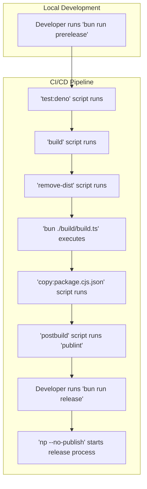

1.  **Prerelease**: The `prerelease` script is run, which first executes `test:deno` and then the main `build` script.
2.  **Build**:
    *   The `build` script starts by running `remove-dist` (`rm -rf dist`) to clean the output directory.
    *   It then executes the main build logic using `bun ./build/build.ts`.
    *   After the build, `copy:package.cjs.json` copies a specific `package.json` file into the `dist/cjs` and `dist/types` directories, likely to configure the CommonJS output correctly.
    *   Finally, the `postbuild` script runs `publint` to check the package for publishing errors.
3.  **Release**: The `release` script uses `np --no-publish` to handle version bumping, changelog generation, and tagging, but stops short of publishing to npm.

*Sources: [package.json:29-32](https://github.com/honojs/hono/blob/24547a6ed5e175f9326063efb657540162287973/package.json#L29-L32), [package.json:34-36](https://github.com/honojs/hono/blob/24547a6ed5e175f9326063efb657540162287973/package.json#L34-L36)*

# Page: Getting Started

<details>
<summary>Relevant source files</summary>

The following files were used as context for generating this wiki page:

- [README.md](https://github.com/honojs/hono/blob/24547a6ed5e175f9326063efb657540162287973/README.md)
- [src/index.ts](https://github.com/honojs/hono/blob/24547a6ed5e175f9326063efb657540162287973/src/index.ts)
- [src/types.test.ts](https://github.com/honojs/hono/blob/24547a6ed5e175f9326063efb657540162287973/src/types.test.ts)
- [src/types.ts](https://github.com/honojs/hono/blob/24547a6ed5e175f9326063efb657540162287973/src/types.ts)
</details>

# Getting Started

Hono is a small, simple, and ultrafast web framework built on Web Standards. Its name means "flame" (🔥) in Japanese. It is designed to run on any JavaScript runtime, including Cloudflare Workers, Fastly Compute, Deno, Bun, Vercel, and Node.js, allowing the same code to be used across multiple platforms. Hono is lightweight, with its `hono/tiny` preset being under 12kB, and has zero dependencies.

The framework provides clean APIs and first-class TypeScript support, enabling a delightful developer experience. Key features include a fast router, built-in and custom middleware support, and strong type safety for requests and responses.

Sources: [README.md:22-48](https://github.com/honojs/hono/blob/24547a6ed5e175f9326063efb657540162287973/README.md#L22-L48)

## Quick Start

You can create a new Hono project using the official starter kit.

```bash
npm create hono@latest
```

A basic Hono application looks like this:

```ts
import { Hono } from 'hono'
const app = new Hono()

app.get('/', (c) => c.text('Hono!'))

export default app
```

Sources: [README.md:27-39](https://github.com/honojs/hono/blob/24547a6ed5e175f9326063efb657540162287973/README.md#L27-L39), [src/index.ts:8-14](https://github.com/honojs/hono/blob/24547a6ed5e175f9326063efb657540162287973/src/index.ts#L8-L14)

## Core Concepts

Hono's design revolves around a few central components that work together to handle HTTP requests.

| Component | Description | Source |
| :--- | :--- | :--- |
| `Hono` | The main application class used to create an app instance and define routes. | [src/index.ts:53](https://github.com/honojs/hono/blob/24547a6ed5e175f9326063efb657540162287973/src/index.ts#L53) |
| `Context` | An object, typically named `c`, passed to every handler. It contains request details and methods for creating responses. | [src/index.ts:39](https://github.com/honojs/hono/blob/24547a6ed5e175f9326063efb657540162287973/src/index.ts#L39), [src/types.ts:7-8](https://github.com/honojs/hono/blob/24547a6ed5e175f9326063efb657540162287973/src/types.ts#L7-L8) |
| `Handler` | A function that receives a `Context` object and a `Next` function to process a request and return a `Response`. | [src/types.ts:76-82](https://github.com/honojs/hono/blob/24547a6ed5e175f9326063efb657540162287973/src/types.ts#L76-L82) |
| `MiddlewareHandler` | A specific type of `Handler` that typically processes the request and then calls `next()` to pass control to the next handler in the chain. | [src/types.ts:83-89](https://github.com/honojs/hono/blob/24547a6ed5e175f9326063efb657540162287973/src/types.ts#L83-L89) |
| `Next` | A function that invokes the next middleware or handler in the chain. It is an async function that returns a `Promise<void>`. | [src/types.ts:35](https://github.com/honojs/hono/blob/24547a6ed5e175f9326063efb657540162287973/src/types.ts#L35) |

### Request Handling Flow

A request to a Hono application is processed by a chain of middleware and a final handler that matches the request's path and method.

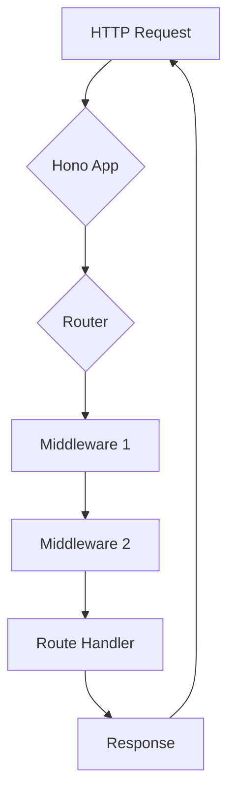

## Routing

Hono provides methods for routing HTTP requests based on the method and path pattern.

### Basic Routing

You can register handlers for specific HTTP methods like `GET`, `POST`, `PUT`, `DELETE`, etc.

```typescript
const app = new Hono()

// GET request to the root path
app.get('/', (c) => {
  return c.text('Hello Hono!')
})

// POST request to /submit
app.post('/submit', (c) => {
  return c.json({ message: 'Submitted!' })
})
```

### Path Parameters

Hono supports named parameters in the path. These can be required or optional.

-   Required parameter: `:name`
-   Optional parameter: `:name?`

The parameters are accessible via `c.req.param('name')`. The types for these parameters are automatically inferred.

```typescript
const app = new Hono()

// Required parameter 'id'
app.get('/post/:id', (c) => {
  const id = c.req.param('id') // Type is string
  return c.text(`Post ${id}`)
})

// Optional parameter 'b'
app.get('/api/:a/:b?', (c) => {
  const a = c.req.param('a') // Type is string
  const b = c.req.param('b') // Type is string | undefined
  return c.json({ a, b })
})
```

Hono's type system includes utilities to extract parameter keys from a path string.
- `ParamKeys<Path>` extracts all parameter names as a union of string literals.
- `ParamKeyToRecord<T>` converts a parameter name into a record type, handling optionality.

Sources: [src/types.test.ts:667-705](https://github.com/honojs/hono/blob/24547a6ed5e175f9326063efb657540162287973/src/types.test.ts#L667-L705), [src/types.ts:2698-2713](https://github.com/honojs/hono/blob/24547a6ed5e175f9326063efb657540162287973/src/types.ts#L2698-L2713)

### Generic `on()` Method

For non-standard HTTP methods or for handling multiple methods at once, you can use the `app.on()` method.

```typescript
const app = new Hono()

// Handle a custom 'PURGE' method
app.on('PURGE', '/cache', (c) => c.text('Cache purged'))

// Handle multiple methods for the same path
app.on(['GET', 'POST'], '/multi-method', (c) => {
  return c.json({ success: true })
})
```

Sources: [src/types.test.ts:286-350](https://github.com/honojs/hono/blob/24547a6ed5e175f9326063efb657540162287973/src/types.test.ts#L286-L350)

## Type Safety

Hono leverages TypeScript to provide strong type safety for handlers, middleware, and the context object.

### Environment and Variables (`Env`)

The `Hono` class can be parameterized with an `Env` type to provide types for environment bindings and context variables.

The `Env` type has two optional properties:
-   `Bindings`: For environment-specific bindings, like those in Cloudflare Workers. Accessed via `c.env`.
-   `Variables`: For variables set and retrieved within the application via `c.set()` and `c.get()`. Accessed via `c.get()` or `c.var`.

```typescript
// Define the Env type
type E = {
  Variables: {
    foo: string
  }
  Bindings: {
    FLAG: boolean
  }
}

const app = new Hono<E>()

// Middleware to set a variable
app.use('*', async (c, next) => {
  c.set('foo', 'bar')
  await next()
})

app.get('/', (c) => {
  // `foo` is typed as `string`
  const foo = c.get('foo')
  // `FLAG` is typed as `boolean`
  const FLAG = c.env.FLAG
  
  return c.text(`foo is ${foo}, FLAG is ${FLAG}`)
})
```

The following sequence diagram illustrates how a variable is set in middleware and accessed in a handler.

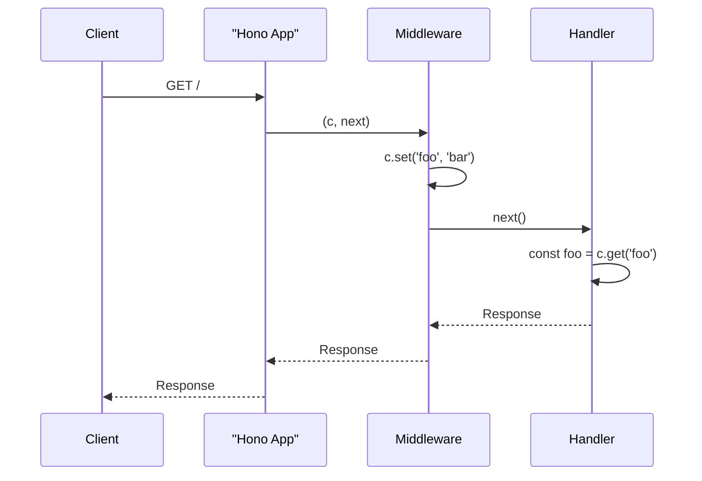

Sources: [src/types.ts:30-33](https://github.com/honojs/hono/blob/24547a6ed5e175f9326063efb657540162287973/src/types.ts#L30-L33), [src/types.test.ts:29-49](https://github.com/honojs/hono/blob/24547a6ed5e175f9326063efb657540162287973/src/types.test.ts#L29-L49)

### Input and Output Schemas

Hono can infer the types for request inputs (e.g., JSON body, query parameters) and response outputs, providing end-to-end type safety. This is achieved through a `Schema` object that is built up as routes are defined.

Key types for this system include:
-   `Input`: A generic type to define the shape of incoming data (`json`, `form`, `query`, `param`, `header`, `cookie`).
-   `TypedResponse`: A helper type to specify the response body, status code, and format (e.g., `json`, `text`).
-   `ToSchema`: A utility type that constructs a schema for a single route.
-   `ExtractSchema`: A utility type that extracts the complete schema from a `Hono` app instance.

Here is an example of a typed route:

```typescript
import { Hono } from 'hono'
import type { TypedResponse } from 'hono'

type PostPayload = {
  id: number
  title: string
}

type PostResponse = {
  success: boolean
  message: string
}

const app = new Hono()

const route = app.post(
  '/api/posts/:id',
  // Middleware for validation would go here
  (c) => {
    // c.req.valid('json') would be typed as PostPayload
    // c.req.param('id') is typed as string

    const response: TypedResponse<PostResponse, 201, 'json'> = {
      _data: { success: true, message: 'Created' },
      _status: 201,
      _format: 'json',
    }
    // This is a conceptual example; in practice, you'd use c.json()
    return c.json(response._data, response._status)
  }
)

// The schema can be extracted for use in clients
type AppSchema = typeof route
```

The resulting schema for this route would look like this:

```typescript
type ExpectedSchema = {
  '/api/posts/:id': {
    $post: {
      input: {
        json: {
          id: number
          title: string
        }
        param: {
          id: string
        }
      }
      output: {
        success: boolean
        message: string
      }
      outputFormat: 'json'
      status: 201
    }
  }
}
```

This schema is automatically inferred by Hono. The test files demonstrate this inference extensively.

Sources: [src/types.ts:2500-2530](https://github.com/honojs/hono/blob/24547a6ed5e175f9326063efb657540162287973/src/types.ts#L2500-L2530), [src/types.test.ts:486-535](https://github.com/honojs/hono/blob/24547a6ed5e175f9326063efb657540162287973/src/types.test.ts#L486-L535)

## Middleware

Middleware are functions that can process a request before or after the main handler. They are a core part of Hono's architecture.

### Using Middleware

Middleware can be applied to all routes using `app.use()` or to specific routes by passing them before the main handler.

```typescript
import { Hono } from 'hono'
import { createMiddleware } from 'hono/helper/factory'

const app = new Hono()

// Middleware applied to all routes
const mw1 = createMiddleware<{ Variables: { foo1: string } }>(async (c, next) => {
  c.set('foo1', 'value1')
  await next()
})
app.use(mw1)

// Middleware specific to a route
const mw2 = createMiddleware<{ Variables: { foo2: string } }>(async (c, next) => {
  c.set('foo2', 'value2')
  await next()
})

app.get('/', mw2, (c) => {
  const foo1 = c.get('foo1') // string
  const foo2 = c.get('foo2') // string
  return c.json({ foo1, foo2 })
})
```

Hono's types correctly merge the `Variables` from all preceding middleware, making them available in subsequent handlers. The `HandlerInterface` supports up to 10 handlers in a chain with full type inference.

Sources: [src/types.ts:127-1072](https://github.com/honojs/hono/blob/24547a6ed5e175f9326063efb657540162287973/src/types.ts#L127-L1072), [src/types.test.ts:1322-1508](https://github.com/honojs/hono/blob/24547a6ed5e175f9326063efb657540162287973/src/types.test.ts#L1322-L1508), [src/types.test.ts:2067-2088](https://github.com/honojs/hono/blob/24547a6ed5e175f9326063efb657540162287973/src/types.test.ts#L2067-L2088)

## File Overview

| File | Description |
| :--- | :--- |
| `README.md` | Provides a high-level overview of the Hono project, its features, and how to get started. |
| `src/index.ts` | The main entry point of the `hono` package, exporting the `Hono` class and core types. |
| `src/types.ts` | Contains the core TypeScript type definitions for Hono, including handlers, context, schemas, and routing interfaces. |
| `src/types.test.ts` | A comprehensive suite of static type tests that verify the correctness of Hono's complex type inference for routing, middleware, and schemas. |

## Edge Cases and Gotchas

-   **Pathless Handlers**: A handler defined without a path (e.g., `app.post((c) => ...)` after `app.get('/bar', ...)` will be registered for the path of the last defined route (`/bar` in this case).
    Sources: [src/types.test.ts:246-282](https://github.com/honojs/hono/blob/24547a6ed5e175f9326063efb657540162287973/src/types.test.ts#L246-L282)
-   **`c.json(undefined)`**: Calling `c.json(undefined)` is valid, but the inferred `output` type in the schema will be `never`. This is useful for RPC clients to know that no body is returned.
    Sources: [src/types.test.ts:538-556](https://github.com/honojs/hono/blob/24547a6ed5e175f9326063efb657540162287973/src/types.test.ts#L538-L556)
-   **Validator Middleware Position**: For `c.req.valid()` to be correctly typed, a validator middleware must be placed before the handler that uses it. The types are propagated through the handler chain.
    Sources: [src/types.test.ts:2005-2040](https://github.com/honojs/hono/blob/24547a6ed5e175f9326063efb657540162287973/src/types.test.ts#L2005-L2040), [src/types.test.ts:2043-2065](https://github.com/honojs/hono/blob/24547a6ed5e175f9326063efb657540162287973/src/types.test.ts#L2043-L2065)
-   **Middleware Scope**: Middleware registered with `app.use('/path', ...)` applies to all routes matching that path prefix. Middleware passed directly to a route method like `app.get('/path', mw, ...)` is only active for that specific route and method.
    Sources: [src/types.test.ts:2090-2223](https://github.com/honojs/hono/blob/24547a6ed5e175f9326063efb657540162287973/src/types.test.ts#L2090-L2223)

# Page: Key Features

<details>
<summary>Relevant source files</summary>

The following files were used as context for generating this wiki page:

- [README.md](https://github.com/honojs/hono/blob/24547a6ed5e175f9326063efb657540162287973/README.md)
- [src/preset/tiny.ts](https://github.com/honojs/hono/blob/24547a6ed5e175f9326063efb657540162287973/src/preset/tiny.ts)
- [src/router/reg-exp-router/router.ts](https://github.com/honojs/hono/blob/24547a6ed5e175f9326063efb657540162287973/src/router/reg-exp-router/router.ts)
- [src/preset/quick.test.ts](https://github.com/honojs/hono/blob/24547a6ed5e175f9326063efb657540162287973/src/preset/quick.test.ts)
- [src/preset/quick.ts](https://github.com/honojs/hono/blob/24547a6ed5e175f9326063efb657540162287973/src/preset/quick.ts)
- [src/preset/tiny.test.ts](https://github.com/honojs/hono/blob/24547a6ed5e175f9326063efb657540162287973/src/preset/tiny.test.ts)
- [src/router/common.case.test.ts](https://github.com/honojs/hono/blob/24547a6ed5e175f9326063efb657540162287973/src/router/common.case.test.ts)
- [src/router/reg-exp-router/matcher.ts](https://github.com/honojs/hono/blob/24547a6ed5e175f9326063efb657540162287973/src/router/reg-exp-router/matcher.ts)
</details>

# Key Features

Hono is a small, simple, and ultrafast web framework for any JavaScript runtime, built on Web Standards. Its name, meaning "flame" (炎) in Japanese, reflects its focus on performance. The core features that enable this are its high-speed router, lightweight design with zero dependencies, and multi-runtime compatibility.

Sources: [README.md:22-24](https://github.com/honojs/hono/blob/24547a6ed5e175f9326063efb657540162287973/README.md#L22-L24)

## Ultrafast Routing

Hono's performance is primarily attributed to its highly optimized router, `RegExpRouter`. Unlike routers that loop through routes linearly, `RegExpRouter` compiles all dynamic routes for a given HTTP method into a single, large regular expression. This allows for very fast matching of incoming request paths.

Sources: [README.md:43](https://github.com/honojs/hono/blob/24547a6ed5e175f9326063efb657540162287973/README.md#L43), [src/router/reg-exp-router/router.ts](https://github.com/honojs/hono/blob/24547a6ed5e175f9326063efb657540162287973/src/router/reg-exp-router/router.ts)

### Route Registration and Matcher Compilation

The `RegExpRouter` follows a two-phase process: registration and compilation.

1.  **Registration**: When `router.add(method, path, handler)` is called, the router stores the route information, including the path, handler, and parameter count, in internal maps (`#middleware` and `#routes`). It handles special cases like wildcard paths (`/*`) and optional parameters (`/:name?`).
    Sources: [src/router/reg-exp-router/router.ts:132-204](https://github.com/honojs/hono/blob/24547a6ed5e175f9326063efb657540162287973/src/router/reg-exp-router/router.ts#L132-L204)

2.  **Compilation**: The first time `router.match(method, path)` is called, it triggers the `buildAllMatchers` method. This method compiles the registered routes into an efficient matching structure. The compilation process for each HTTP method involves:
    *   Separating static paths from dynamic paths (those with parameters or wildcards).
    *   Storing static paths in a simple key-value map (`staticMap`) for O(1) lookups.
    *   Inserting all dynamic paths into a Trie data structure.
    *   Building a single, complex RegExp from the Trie.
    *   Creating handler and parameter mapping arrays that correspond to the capture groups in the generated RegExp.
    *   Once compilation is complete, the initial route maps (`#middleware` and `#routes`) are discarded to free memory.

Sources: [src/router/reg-exp-router/router.ts:34-103](https://github.com/honojs/hono/blob/24547a6ed5e175f9326063efb657540162287973/src/router/reg-exp-router/router.ts#L34-L103), [src/router/reg-exp-router/router.ts:208-222](https://github.com/honojs/hono/blob/24547a6ed5e175f9326063efb657540162287973/src/router/reg-exp-router/router.ts#L208-L222), [src/router/reg-exp-router/matcher.ts:10-12](https://github.com/honojs/hono/blob/24547a6ed5e175f9326063efb657540162287973/src/router/reg-exp-router/matcher.ts#L10-L12)

The following diagram illustrates this compilation and matching flow:

```mermaid
graph TD
    subgraph Registration Phase
        A["app.get(#quot;/users/:id#quot;, ...)"] --> B{"RegExpRouter.add()"};
        B --> C["#routes map"];
    end

    subgraph "First Match (Compilation)"
        D["app.fetch(req)"] --> E{"router.match()"};
        E -- Triggers --> F["buildAllMatchers()"];
        F --> G["buildMatcherFromPreprocessedRoutes()"];
        G --> H{"Trie.insert()"};
        H --> I{"Trie.buildRegExp()"};
        I --> J["Compiled Matcher <br> (RegExp, handlers, staticMap)"];
    end

    subgraph Subsequent Matches
        K["app.fetch(anotherReq)"] --> L{"router.match()"};
        L -- Uses pre-compiled matcher --> M["Check staticMap"];
        M -- Not found --> N["Execute single RegExp"];
        N --> O[Return matched handlers];
    end
```
Sources: [src/router/reg-exp-router/router.ts](https://github.com/honojs/hono/blob/24547a6ed5e175f9326063efb657540162287973/src/router/reg-exp-router/router.ts), [src/router/reg-exp-router/matcher.ts](https://github.com/honojs/hono/blob/24547a6ed5e175f9326063efb657540162287973/src/router/reg-exp-router/matcher.ts)

### Path Matching

The `match` function first checks the `staticMap` for a direct match. If no static route is found, it executes the generated RegExp against the request path. The index of the successful capture group in the regex result is used to look up the corresponding handlers and parameter maps.

Sources: [src/router/reg-exp-router/matcher.ts:14-29](https://github.com/honojs/hono/blob/24547a6ed5e175f9326063efb657540162287973/src/router/reg-exp-router/matcher.ts#L14-L29)

### Supported Route Patterns

The router supports a wide variety of patterns, as demonstrated in its test suite.

| Pattern Type | Example | Description |
| :--- | :--- | :--- |
| **Static** | `/hello` | Matches the exact path. |
| **Named Parameter** | `/entry/:id` | Matches a segment and captures its value as `id`. |
| **Wildcard** | `/wild/*/card` | Matches any single segment. |
| **Ending Wildcard** | `/api/*` | Matches the path prefix and everything after it. |
| **Optional Parameter** | `/api/animals/:type?` | The `:type` parameter is optional. Matches `/api/animals` and `/api/animals/dog`. |
| **RegExp Parameter** | `/post/:date{[0-9]+}` | The `:date` parameter must match the provided regular expression `[0-9]+`. |
| **Multi-segment RegExp** | `/js/:filename{[a-z0-9/]+.js}` | A parameter can capture values containing slashes if the regex allows it. |

Sources: [src/router/common.case.test.ts:61-65](https://github.com/honojs/hono/blob/24547a6ed5e175f9326063efb657540162287973/src/router/common.case.test.ts#L61-L65), [src/router/common.case.test.ts:110-120](https://github.com/honojs/hono/blob/24547a6ed5e175f9326063efb657540162287973/src/router/common.case.test.ts#L110-L120), [src/router/common.case.test.ts:122-127](https://github.com/honojs/hono/blob/24547a6ed5e175f9326063efb657540162287973/src/router/common.case.test.ts#L122-L127), [src/router/common.case.test.ts:174-190](https://github.com/honojs/hono/blob/24547a6ed5e175f9326063efb657540162287973/src/router/common.case.test.ts#L174-L190), [src/router/common.case.test.ts:373-390](https://github.com/honojs/hono/blob/24547a6ed5e175f9326063efb657540162287973/src/router/common.case.test.ts#L373-L390), [src/router/common.case.test.ts:141-152](https://github.com/honojs/hono/blob/24547a6ed5e175f9326063efb657540162287973/src/router/common.case.test.ts#L141-L152), [src/router/common.case.test.ts:497-499](https://github.com/honojs/hono/blob/24547a6ed5e175f9326063efb657540162287973/src/router/common.case.test.ts#L497-L499)

## Lightweight Presets

Hono is designed to be lightweight with zero dependencies. To offer flexibility while keeping the core small, it provides different "presets". The main package exports a default Hono class, but developers can import specialized presets for minimal bundle size.

Sources: [README.md:44](https://github.com/honojs/hono/blob/24547a6ed5e175f9326063efb657540162287973/README.md#L44)

### Preset Comparison

| Preset | Router Implementation | Description |
| :--- | :--- | :--- |
| `hono/tiny` | `PatternRouter` | A minimal preset designed for the smallest possible bundle size. |
| `hono/quick` | `SmartRouter` (with `LinearRouter` and `TrieRouter`) | A preset that uses `SmartRouter` to delegate to different router implementations based on the route patterns. |

The choice of preset determines which router is used by default when instantiating the `Hono` class.

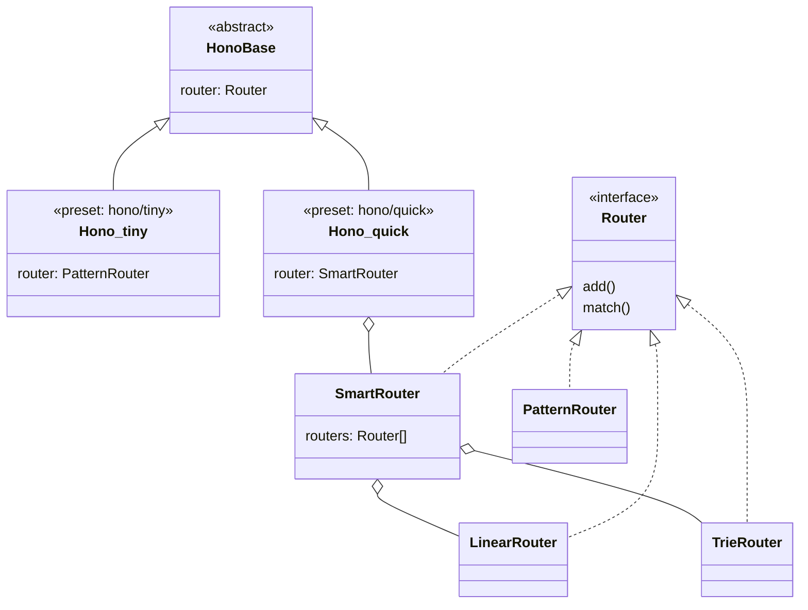
Sources: [src/preset/tiny.ts:11-20](https://github.com/honojs/hono/blob/24547a6ed5e175f9326063efb657540162287973/src/preset/tiny.ts#L11-L20), [src/preset/quick.ts:13-24](https://github.com/honojs/hono/blob/24547a6ed5e175f9326063efb657540162287973/src/preset/quick.ts#L13-L24)

### `hono/tiny`

This preset uses `PatternRouter`. The `Hono` class in this module is a direct extension of `HonoBase` that instantiates `PatternRouter` in its constructor.

```typescript
// src/preset/tiny.ts
export class Hono<
  // ...
> extends HonoBase<E, S, BasePath> {
  constructor(options: HonoOptions<E> = {}) {
    super(options)
    this.router = new PatternRouter()
  }
}
```
Sources: [src/preset/tiny.ts:11-20](https://github.com/honojs/hono/blob/24547a6ed5e175f9326063efb657540162287973/src/preset/tiny.ts#L11-L20), [src/preset/tiny.test.ts:5-8](https://github.com/honojs/hono/blob/24547a6ed5e175f9326063efb657540162287973/src/preset/tiny.test.ts#L5-L8)

### `hono/quick`

This preset uses `SmartRouter`. `SmartRouter` internally holds an array of other routers (`LinearRouter` and `TrieRouter`) and likely delegates matching to the most appropriate one.

```typescript
// src/preset/quick.ts
export class Hono<
  // ...
> extends HonoBase<E, S, BasePath> {
  constructor(options: HonoOptions<E> = {}) {
    super(options)
    this.router = new SmartRouter({
      routers: [new LinearRouter(), new TrieRouter()],
    })
  }
}
```
Sources: [src/preset/quick.ts:13-24](https://github.com/honojs/hono/blob/24547a6ed5e175f9326063efb657540162287973/src/preset/quick.ts#L13-L24), [src/preset/quick.test.ts:5-8](https://github.com/honojs/hono/blob/24547a6ed5e175f9326063efb657540162287973/src/preset/quick.test.ts#L5-L8)

## Multi-runtime and Developer Experience

### Multi-runtime

Hono is designed to run on any JavaScript runtime that supports Web Standards, including Cloudflare Workers, Fastly Compute, Deno, Bun, Vercel, AWS Lambda, and Node.js. This is achieved by relying on standard APIs and avoiding platform-specific dependencies in its core.

Sources: [README.md:22](https://github.com/honojs/hono/blob/24547a6ed5e175f9326063efb657540162287973/README.md#L22), [README.md:45](https://github.com/honojs/hono/blob/24547a6ed5e175f9326063efb657540162287973/README.md#L45)

### Developer Experience (DX)

Hono aims for a "delightful DX" with a clean API and first-class TypeScript support. The framework allows developers to strongly type environment variables (`Bindings`) and context variables (`Variables`) for improved type safety and autocompletion.

The test files for the presets demonstrate how to define types for environment bindings, ensuring that `c.env` is correctly typed within route handlers.

```typescript
// Example from src/preset/quick.test.ts
interface CloudflareBindings {
  MY_VARIABLE: string
}

const appWithInterface = new Hono<{
  Bindings: CloudflareBindings
}>()

appWithInterface.get('/', (c) => {
  // c.env.MY_VARIABLE is of type string
  expectTypeOf(c.env.MY_VARIABLE).toMatchTypeOf<string>()
  return c.text('/')
})
```
Sources: [README.md:47](https://github.com/honojs/hono/blob/24547a6ed5e175f9326063efb657540162287973/README.md#L47), [src/preset/quick.test.ts:12-29](https://github.com/honojs/hono/blob/24547a6ed5e175f9326063efb657540162287973/src/preset/quick.test.ts#L12-L29), [src/preset/tiny.test.ts:12-29](https://github.com/honojs/hono/blob/24547a6ed5e175f9326063efb657540162287973/src/preset/tiny.test.ts#L12-L29)

# Page: Architecture Overview

<details>
<summary>Relevant source files</summary>

The following files were used as context for generating this wiki page:

- [src/hono.ts](https://github.com/honojs/hono/blob/24547a6ed5e175f9326063efb657540162287973/src/hono.ts)
- [src/compose.ts](https://github.com/honojs/hono/blob/24547a6ed5e175f9326063efb657540162287973/src/compose.ts)
- [src/router.ts](https://github.com/honojs/hono/blob/24547a6ed5e175f9326063efb657540162287973/src/router.ts)
- [src/context.ts](https://github.com/honojs/hono/blob/24547a6ed5e175f9326063efb657540162287973/src/context.ts)
- [src/compose.test.ts](https://github.com/honojs/hono/blob/24547a6ed5e175f9326063efb657540162287973/src/compose.test.ts)
- [src/context.test.ts](https://github.com/honojs/hono/blob/24547a6ed5e175f9326063efb657540162287973/src/context.test.ts)
- [src/hono.test.ts](https://github.com/honojs/hono/blob/24547a6ed5e175f9326063efb657540162287973/src/hono.test.ts)
</details>

# Architecture Overview

Hono is a lightweight, high-performance web framework built around three core components: a flexible routing system, a powerful middleware composer, and an immutable context object. The architecture is designed for simplicity and performance, leveraging standard Web APIs like `Request` and `Response`.

At its heart, a Hono application is an instance of the `Hono` class. When a request arrives, the router matches the request's method and path to a registered route, which may have one or more middleware handlers and a final handler. These handlers are then executed in sequence by the middleware composer, which manages the flow of control. Each handler receives a `Context` object, which provides access to the request, methods for building the response, and a mechanism for sharing state between middleware.

## Core Components

The Hono framework is composed of several key modules that work together to handle HTTP requests.

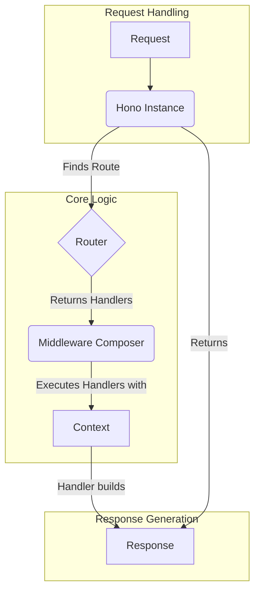
*Sources: [src/hono.ts](https://github.com/honojs/hono/blob/24547a6ed5e175f9326063efb657540162287973/src/hono.ts), [src/router.ts](https://github.com/honojs/hono/blob/24547a6ed5e175f9326063efb657540162287973/src/router.ts), [src/compose.ts](https://github.com/honojs/hono/blob/24547a6ed5e175f9326063efb657540162287973/src/compose.ts), [src/context.ts](https://github.com/honojs/hono/blob/24547a6ed5e175f9326063efb657540162287973/src/context.ts)*

### The `Hono` Class

The `Hono` class is the main entry point for a Hono application. It extends `HonoBase` and is responsible for setting up the router and registering routes.

*   **Initialization**: The constructor accepts an optional `HonoOptions` object. A key option is `router`, which allows for custom router implementations. If not provided, it defaults to `SmartRouter`.
    *Sources: [src/hono.ts:26-33](https://github.com/honojs/hono/blob/24547a6ed5e175f9326063efb657540162287973/src/hono.ts#L26-L33)*
*   **Routing**: It provides methods like `.get()`, `.post()`, `.use()`, and `.route()` to register handlers and middleware for specific paths and HTTP methods. These registrations are added to the configured router.
    *Sources: [src/hono.test.ts:53-75](https://github.com/honojs/hono/blob/24547a6ed5e175f9326063efb657540162287973/src/hono.test.ts#L53-L75), [src/hono.test.ts:1030-1087](https://github.com/honojs/hono/blob/24547a6ed5e175f9326063efb657540162287973/src/hono.test.ts#L1030-L1087)*

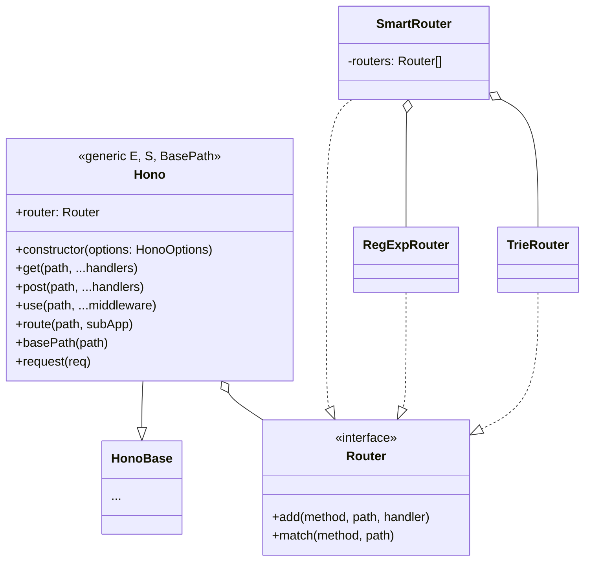
*Sources: [src/hono.ts:16-34](https://github.com/honojs/hono/blob/24547a6ed5e175f9326063efb657540162287973/src/hono.ts#L16-L34), [src/router.ts:29-52](https://github.com/honojs/hono/blob/24547a6ed5e175f9326063efb657540162287973/src/router.ts#L29-L52)*

### Routing System

Hono's routing is pluggable, with a default `SmartRouter` that combines the strengths of two different router implementations.

| Router | Description |
| :--- | :--- |
| `SmartRouter` | The default router. It delegates routing to `RegExpRouter` and `TrieRouter` to optimize for different path patterns. *Sources: [src/hono.ts:30-32](https://github.com/honojs/hono/blob/24547a6ed5e175f9326063efb657540162287973/src/hono.ts#L30-L32)* |
| `RegExpRouter` | A router that uses regular expressions for matching paths. *Sources: [src/hono.ts:3](https://github.com/honojs/hono/blob/24547a6ed5e175f9326063efb657540162287973/src/hono.ts#L3)* |
| `TrieRouter` | A router that uses a trie data structure for efficient static and parameterized path matching. *Sources: [src/hono.ts:5](https://github.com/honojs/hono/blob/24547a6ed5e175f9326063efb657540162287973/src/hono.ts#L5)* |

The core of the system is the `Router<T>` interface, which defines two primary methods:
*   `add(method: string, path: string, handler: T)`: Adds a new route to the router.
*   `match(method: string, path:string): Result<T>`: Finds handlers that match a given method and path, returning them along with any extracted path parameters.

The `Result<T>` type is a tuple containing the matched handlers and the extracted parameters.
*Sources: [src/router.ts:29-52](https://github.com/honojs/hono/blob/24547a6ed5e175f9326063efb657540162287973/src/router.ts#L29-L52), [src/router.ts:98](https://github.com/honojs/hono/blob/24547a6ed5e175f9326063efb657540162287973/src/router.ts#L98)*

### Middleware Composition

Middleware and handlers are executed using the `compose` function, which is inspired by `koa-compose`. It creates a single function that processes a chain of handlers in sequence.

*Sources: [src/compose.ts:15](https://github.com/honojs/hono/blob/24547a6ed5e175f9326063efb657540162287973/src/compose.ts#L15)*

The `compose` function returns a function that takes a `Context` object and an optional `next` function. It manages an `index` to track the current middleware and calls each handler with the context and a `dispatch` function that serves as the `next` callback.

```typescript
// src/compose.ts:15-19
export const compose = <E extends Env = Env>(
  middleware: [[Function, unknown], unknown][] | [[Function]][],
  onError?: ErrorHandler<E>,
  onNotFound?: NotFoundHandler<E>
): ((context: Context, next?: Next) => Promise<Context>) => {
```

This "onion" model allows middleware to perform actions both before and after the subsequent handlers in the chain have executed.

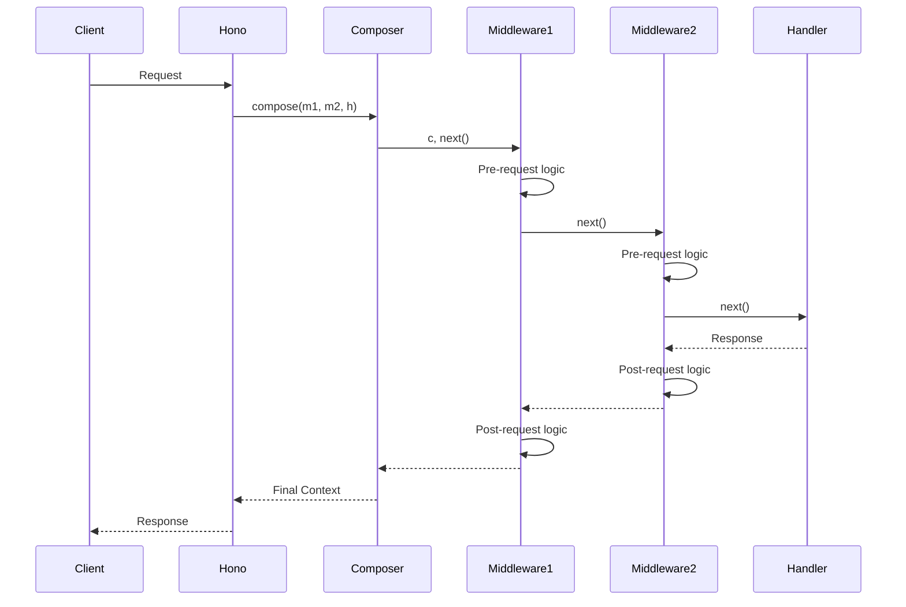
*This diagram illustrates the "onion" middleware pattern. Sources: [src/compose.test.ts:363-401](https://github.com/honojs/hono/blob/24547a6ed5e175f9326063efb657540162287973/src/compose.test.ts#L363-L401)*

The composer includes robust error handling:
*   **Error Handling**: If a handler throws an `Error`, the `onError` function provided to `compose` is invoked. The error is attached to `context.error`.
    *Sources: [src/compose.ts:53-60](https://github.com/honojs/hono/blob/24547a6ed5e175f9326063efb657540162287973/src/compose.ts#L53-L60)*
*   **Not Found**: If the middleware chain completes without a response being generated (`context.finalized` is `false`), the `onNotFound` handler is called.
    *Sources: [src/compose.ts:62-64](https://github.com/honojs/hono/blob/24547a6ed5e175f9326063efb657540162287973/src/compose.ts#L62-L64)*
*   **Multiple `next()` calls**: Calling `next()` more than once within a single handler will throw an error to prevent unexpected behavior.
    *Sources: [src/compose.ts:33-35](https://github.com/honojs/hono/blob/24547a6ed5e175f9326063efb657540162287973/src/compose.ts#L33-L35)*

### The `Context` Object

The `Context` class is the central object for a request's lifecycle. It is instantiated for each request and passed to every handler. It provides an API for accessing request data and building a response.

*Sources: [src/context.ts:293-361](https://github.com/honojs/hono/blob/24547a6ed5e175f9326063efb657540162287973/src/context.ts#L293-L361)*

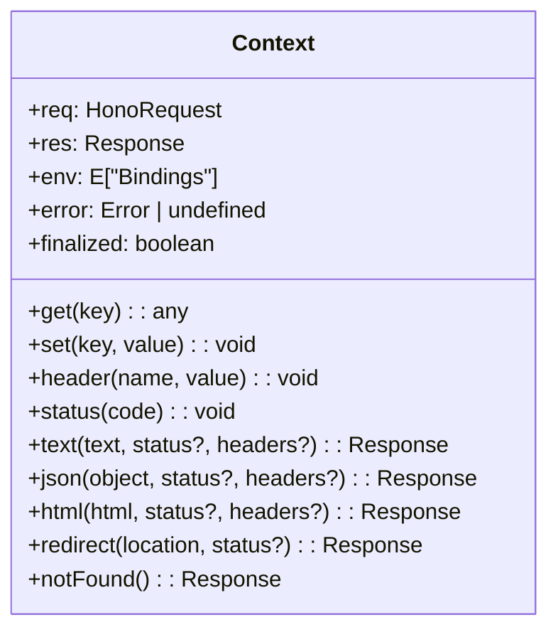
*Sources: [src/context.ts](https://github.com/honojs/hono/blob/24547a6ed5e175f9326063efb657540162287973/src/context.ts)*

#### Key Properties and Methods

| Member | Description | Source |
| :--- | :--- | :--- |
| `req` | An instance of `HonoRequest` containing request details like parameters (`c.req.param()`), queries (`c.req.query()`), and headers (`c.req.header()`). | `src/context.ts:366-369` |
| `res` | The `Response` object being built. It is initialized lazily with a `null` body. Handlers can set this property directly or use helper methods. | `src/context.ts:403-434` |
| `env` | An object containing environment bindings, such as secrets or KV namespaces in Cloudflare Workers. | `src/context.ts:315` |
| `set()` / `get()` / `var` | Methods and a property to share state between middleware. `set()` writes a value, `get()` reads it, and `var` provides a read-only object of all variables. | `src/context.ts:546-602` |
| `text()` | Creates a `text/plain` response. | `src/context.ts:682-694` |
| `json()` | Creates an `application/json` response. | `src/context.ts:708-721` |
| `html()` | Creates a `text/html` response. | `src/context.ts:723-733` |
| `redirect()` | Creates a redirect response, defaulting to status 302. | `src/context.ts:750-762` |
| `notFound()` | Invokes the application's `notFoundHandler` to generate a 404 response. | `src/context.ts:776-779` |
| `header()` | Sets a response header. | `src/context.ts:515-526` |
| `status()` | Sets the response status code. | `src/context.ts:529-531` |

## Request Lifecycle

The following diagram illustrates the complete flow of a request from its arrival to the final response.

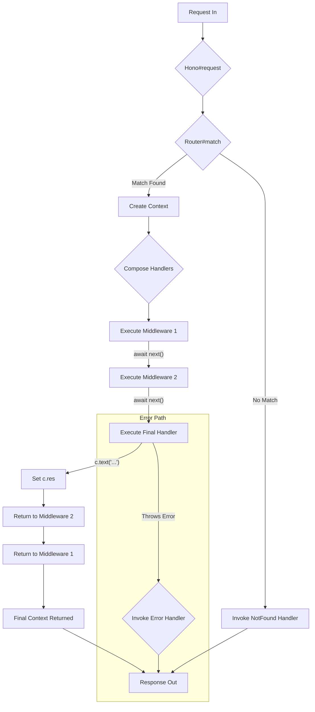
*This flowchart shows the typical path of a successful request, as well as the "not found" and "error" paths. Sources: [src/hono.ts](https://github.com/honojs/hono/blob/24547a6ed5e175f9326063efb657540162287973/src/hono.ts), [src/compose.ts](https://github.com/honojs/hono/blob/24547a6ed5e175f9326063efb657540162287973/src/compose.ts), [src/hono.test.ts:1030-1091](https://github.com/honojs/hono/blob/24547a6ed5e175f9326063efb657540162287973/src/hono.test.ts#L1030-L1091)*

## Edge cases and gotchas

- **Strict Routing**: By default, Hono uses strict routing, meaning `/hello` and `/hello/` are treated as different routes. This can be disabled by setting `strict: false` in the Hono constructor.
  *Sources: [src/hono.test.ts:310-360](https://github.com/honojs/hono/blob/24547a6ed5e175f9326063efb657540162287973/src/hono.test.ts#L310-L360)*
- **Middleware Order for Nested Routes**: When using `app.route()`, the sub-application must be fully defined *before* it is mounted on the parent application. Defining routes on the sub-app after mounting will not work.
  *Sources: [src/hono.test.ts:568-630](https://github.com/honojs/hono/blob/24547a6ed5e175f9326063efb657540162287973/src/hono.test.ts#L568-L630)*
- **Unreturned Response**: If a handler finishes execution without returning a `Response` object (or calling a response helper like `c.text()`), Hono will treat it as if no route was found and proceed to the `notFoundHandler`.
  *Sources: [src/hono.test.ts:2239-2254](https://github.com/honojs/hono/blob/24547a6ed5e175f9326063efb657540162287973/src/hono.test.ts#L2239-L2254)*
- **`c.res` Overwriting**: If a middleware sets `c.res = new Response(...)` after `await next()`, it will completely replace the `Response` object created by the inner handler, including any headers set by it. To preserve headers, they must be manually copied.
  *Sources: [src/hono.test.ts:1181-1209](https://github.com/honojs/hono/blob/24547a6ed5e175f9326063efb657540162287973/src/hono.test.ts#L1181-L1209)*
- **Multiple `next()` Calls**: The middleware composer explicitly checks for and throws an `Error('next() called multiple times')` if a handler attempts to call `next()` more than once.
  *Sources: [src/compose.ts:33-35](https://github.com/honojs/hono/blob/24547a6ed5e175f9326063efb657540162287973/src/compose.ts#L33-L35), [src/compose.test.ts:651-663](https://github.com/honojs/hono/blob/24547a6ed5e175f9326063efb657540162287973/src/compose.test.ts#L651-L663)*

## Other files in this area

### src/context.test.ts

This file contains unit tests for the `Context` class, which is a core component of the Hono architecture. The `Context` object encapsulates the incoming `Request` and is used to construct the outgoing `Response`. These tests verify the correct behavior of response generation helpers, state management, and integration with environment-specific features.

The file's main test suites verify the following behaviors:

*   **Response Helpers**:
    *   `c.text(body, status, headers)`: Creates a `Response` with a `Content-Type` of `text/plain`. The tests verify that status, headers, and body are set correctly. (Sources: [src/context.test.ts:48-62](https://github.com/honojs/hono/blob/24547a6ed5e175f9326063efb657540162287973/src/context.test.ts#L48-L62)).
    *   `c.json(body, status, headers)`: Creates a `Response` with a `Content-Type` of `application/json`. The tests verify status, headers, and that the body is correctly stringified. (Sources: [src/context.test.ts:64-71](https://github.com/honojs/hono/blob/24547a6ed5e175f9326063efb657540162287973/src/context.test.ts#L64-L71)).
    *   `c.html(body, status, headers)`: Creates a `Response` with a `Content-Type` of `text/html`. It is tested with both string and `Promise<string>` bodies. (Sources: [src/context.test.ts:73-94](https://github.com/honojs/hono/blob/24547a6ed5e175f9326063efb657540162287973/src/context.test.ts#L73-L94)).
    *   `c.redirect(location, status)`: Creates a `Response` with a `302` status code by default and a `Location` header. It is tested with relative paths, absolute URLs, `URL` objects, and multibyte characters, which are correctly encoded. URLs that are already encoded or contain invalid characters are passed through unchanged. (Sources: [src/context.test.ts:96-130](https://github.com/honojs/hono/blob/24547a6ed5e175f9326063efb657540162287973/src/context.test.ts#L96-L130)).
    *   `c.body(body, status, headers)`: Creates a response with the given body. Tests confirm that a `null` body with a `204` status results in an empty response body. (Sources: [src/context.test.ts:301-306](https://github.com/honojs/hono/blob/24547a6ed5e175f9326063efb657540162287973/src/context.test.ts#L301-L306)).
    *   `c.notFound()`: Verifies that this method returns a `Response` instance. (Sources: [src/context.test.ts:161-164](https://github.com/honojs/hono/blob/24547a6ed5e175f9326063efb657540162287973/src/context.test.ts#L161-L164)).
    *   `c.newResponse(body, init)`: Creates a new `Response`, merging headers previously set on the context. Headers in the `init` object override context headers. The status code can also be overridden. (Sources: [src/context.test.ts:247-281](https://github.com/honojs/hono/blob/24547a6ed5e175f9326063efb657540162287973/src/context.test.ts#L247-L281)).
    *   Response helpers can also accept a `Response` or `ResponseInit` object as the second argument, inheriting status and headers from it but overriding the `Content-Type` and body. (Sources: [src/context.test.ts:497-566](https://github.com/honojs/hono/blob/24547a6ed5e175f9326063efb657540162287973/src/context.test.ts#L497-L566)).

*   **State and Header Management**:
    *   `c.header(name, value, options)`: Sets a response header. If `options.append` is `true`, it appends the value to any existing header. Setting a value to `undefined` removes the header. (Sources: [src/context.test.ts:132-145](https://github.com/honojs/hono/blob/24547a6ed5e175f9326063efb657540162287973/src/context.test.ts#L132-L145), [src/context.test.ts:184-199](https://github.com/honojs/hono/blob/24547a6ed5e175f9326063efb657540162287973/src/context.test.ts#L184-L199)).
    *   `c.status(statusCode)`: Sets the status code for subsequent response helper calls. (Sources: [src/context.test.ts:232-236](https://github.com/honojs/hono/blob/24547a6ed5e175f9326063efb657540162287973/src/context.test.ts#L232-L236)).
    *   `c.set(key, value)` and `c.get(key)`: Store and retrieve arbitrary data within the context for the duration of a request. (Sources: [src/context.test.ts:147-152](https://github.com/honojs/hono/blob/24547a6ed5e175f9326063efb657540162287973/src/context.test.ts#L147-L152)).
    *   `c.var`: A proxy object that provides property-based access to the same data managed by `c.set()` and `c.get()`. (Sources: [src/context.test.ts:154-159](https://github.com/honojs/hono/blob/24547a6ed5e175f9326063efb657540162287973/src/context.test.ts#L154-L159)).
    *   `c.env`: Provides access to environment variables passed during `Context` initialization. (Sources: [src/context.test.ts:308-317](https://github.com/honojs/hono/blob/24547a6ed5e175f9326063efb657540162287973/src/context.test.ts#L308-L317)).
    *   `c.res`: A `Response` object that is initialized by default. Headers can be set on it directly. If `c.res` is reassigned to a new `Response`, headers from the previous `c.res` (including `set-cookie`) are merged into the new one. (Sources: [src/context.test.ts:283-294](https://github.com/honojs/hono/blob/24547a6ed5e175f9326063efb657540162287973/src/context.test.ts#L283-L294), [src/context.test.ts:413-428](https://github.com/honojs/hono/blob/24547a6ed5e175f9326063efb657540162287973/src/context.test.ts#L413-L428)).

*   **Rendering**:
    *   `c.render()`: Uses a renderer to create a response. The tests verify a default renderer and the ability to set a custom one via `c.setRenderer()`. (Sources: [src/context.test.ts:574-597](https://github.com/honojs/hono/blob/24547a6ed5e175f9326063efb657540162287973/src/context.test.ts#L574-L597)).

*   **Environment-Specific Properties**:
    *   `c.event` and `c.executionCtx`: These properties provide access to the underlying execution context in environments like Cloudflare Workers. The tests verify they are accessible when an `executionCtx` is provided during instantiation and throw an error otherwise. (Sources: [src/context.test.ts:338-382](https://github.com/honojs/hono/blob/24547a6ed5e175f9326063efb657540162287973/src/context.test.ts#L338-L382)).

A new engineer might be surprised by the following behaviors verified in the tests:
*   When `c.res` is reassigned (e.g., `c.res = new Response(...)`), headers from the previous `c.res` object are automatically merged into the new one. This is especially true for `set-cookie` headers, which are preserved across reassignments. (Sources: [src/context.test.ts:283-294](https://github.com/honojs/hono/blob/24547a6ed5e175f9326063efb657540162287973/src/context.test.ts#L283-L294), [src/context.test.ts:413-428](https://github.com/honojs/hono/blob/24547a6ed5e175f9326063efb657540162287973/src/context.test.ts#L413-L428)).
*   Once a `Response` object is assigned to `c.res`, its status cannot be changed by a subsequent call to `c.status()`. However, `c.header()` can still modify its headers. (Sources: [src/context.test.ts:260-265](https://github.com/honojs/hono/blob/24547a6ed5e175f9326063efb657540162287973/src/context.test.ts#L260-L265)).
*   Response helper methods like `c.html()` or `c.json()` will always set their own `Content-Type`, overriding any value set previously with `c.header()`. (Sources: [src/context.test.ts:391-401](https://github.com/honojs/hono/blob/24547a6ed5e175f9326063efb657540162287973/src/context.test.ts#L391-L401)).
*   Accessing `c.event` or `c.executionCtx` will throw an error if the `Context` was not created with an `executionCtx` object, as these are specific to certain JavaScript runtimes. (Sources: [src/context.test.ts:354-357](https://github.com/honojs/hono/blob/24547a6ed5e175f9326063efb657540162287973/src/context.test.ts#L354-L357), [src/context.test.ts:378-381](https://github.com/honojs/hono/blob/24547a6ed5e175f9326063efb657540162287973/src/context.test.ts#L378-L381)).


# Page: Request Lifecycle

<details>
<summary>Relevant source files</summary>

The following files were used as context for generating this wiki page:

- [src/hono.ts](https://github.com/honojs/hono/blob/24547a6ed5e175f9326063efb657540162287973/src/hono.ts)
- [src/compose.ts](https://github.com/honojs/hono/blob/24547a6ed5e175f9326063efb657540162287973/src/compose.ts)
- [src/context.ts](https://github.com/honojs/hono/blob/24547a6ed5e175f9326063efb657540162287973/src/context.ts)
- [src/router/smart-router/router.ts](https://github.com/honojs/hono/blob/24547a6ed5e175f9326063efb657540162287973/src/router/smart-router/router.ts)
- [src/router/smart-router/router.test.ts](https://github.com/honojs/hono/blob/24547a6ed5e175f9326063efb657540162287973/src/router/smart-router/router.test.ts)
</details>

# Request Lifecycle

The Hono request lifecycle describes the process from when an HTTP request is received by the application to when an HTTP response is sent back. This process involves routing, middleware execution, and response generation, all orchestrated around a central `Context` object.

The core components involved are the `Hono` application instance, a `Router` for matching paths, a `compose` function for executing middleware, and the `Context` object which encapsulates the request and response.

## Overall Flow

The lifecycle can be visualized as a sequence of steps:

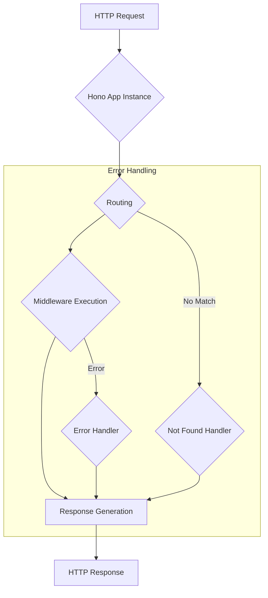

## 1. Instantiation and Routing

When a Hono application starts, a `Hono` class instance is created. A key part of its initialization is setting up the router.

Sources: [src/hono.ts](https://github.com/honojs/hono/blob/24547a6ed5e175f9326063efb657540162287973/src/hono.ts)

### SmartRouter

By default, Hono uses `SmartRouter`. This router is initialized with a collection of other routers, such as `RegExpRouter` and `TrieRouter`.

```typescript
// src/hono.ts:28-33
this.router =
  options.router ??
  new SmartRouter({
    routers: [new RegExpRouter(), new TrieRouter()],
  })
```
Sources: [src/hono.ts:28-33](https://github.com/honojs/hono/blob/24547a6ed5e175f9326063efb657540162287973/src/hono.ts#L28-L33)

The `SmartRouter`'s strategy is to try each of its configured routers in order when the first request arrives. It iterates through them, adding all registered routes and attempting to match the request. If a router throws an `UnsupportedPathError`, `SmartRouter` catches it and tries the next router. The first router that successfully processes the routes and performs a match without this specific error becomes the "active" router for all subsequent requests. This optimizes performance by selecting the best-fit router and using it directly thereafter.

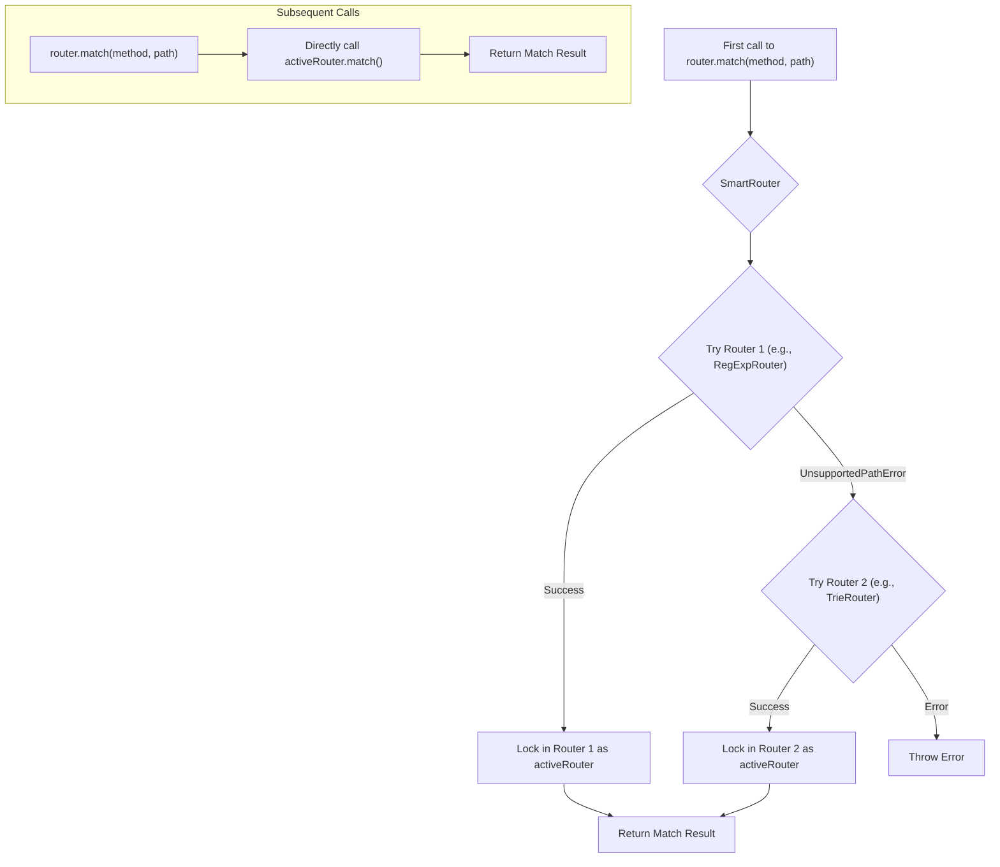
Sources: [src/router/smart-router/router.ts:21-61](https://github.com/honojs/hono/blob/24547a6ed5e175f9326063efb657540162287973/src/router/smart-router/router.ts#L21-L61), [src/router/smart-router/router.test.ts:8-12](https://github.com/honojs/hono/blob/24547a6ed5e175f9326063efb657540162287973/src/router/smart-router/router.test.ts#L8-L12)

## 2. Context Creation

For every incoming request, Hono creates a `Context` object. This object is the central piece of the framework, holding request data, environment bindings, and methods for generating a response.

The `Context` is initialized with the raw `Request` object and optional settings.

```typescript
// src/context.ts:352-353
constructor(req: Request, options?: ContextOptions<E>) {
  this.#rawRequest = req
  // ... options are assigned
}
```
Sources: [src/context.ts:352-361](https://github.com/honojs/hono/blob/24547a6ed5e175f9326063efb657540162287973/src/context.ts#L352-L361)

### Key `Context` Properties

| Property | Description | Source |
| --- | --- | --- |
| `req` | An instance of `HonoRequest`, providing helpers to access request data like params, queries, and body. It is lazily initialized on first access. | `src/context.ts:366-369` |
| `env` | Contains environment bindings, such as secrets and KV namespaces in Cloudflare Workers. | `src/context.ts:315` |
| `res` | The `Response` object. It's lazily initialized and can be set by a handler. Setting it marks the context as `finalized`. | `src/context.ts:403-434` |
| `error` | Holds an `Error` object if a middleware in the chain throws one. | `src/context.ts:333` |
| `executionCtx` | The `ExecutionContext` for environments like Cloudflare Workers. | `src/context.ts:391-397` |
| `var` / `get()` / `set()` | A key-value store for passing data between middleware. | `src/context.ts:546-602` |

## 3. Middleware Execution

After a route is matched, Hono executes the associated chain of middleware and the final handler. This is managed by the `compose` function, which implements an onion-style middleware pattern.

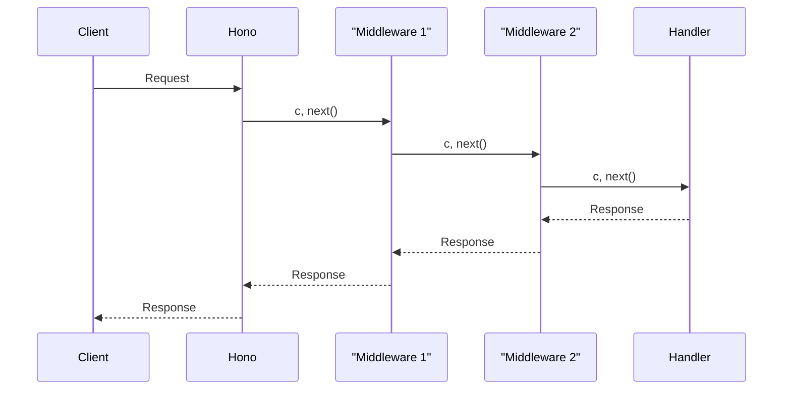
The `compose` function takes an array of middleware, an optional `onError` handler, and an optional `onNotFound` handler. It returns a single function that orchestrates the execution.

Sources: [src/compose.ts:15-19](https://github.com/honojs/hono/blob/24547a6ed5e175f9326063efb657540162287973/src/compose.ts#L15-L19)

### The `dispatch` Function

The core of `compose` is the `dispatch` function. It's called recursively to execute handlers one by one.

1.  An `index` variable tracks the current middleware being executed. A check `if (i <= index)` ensures that `next()` is not called multiple times within the same middleware (`src/compose.ts:33-35`).
2.  The current handler is retrieved from the `middleware` array (`src/compose.ts:42-47`).
3.  The handler is invoked with `await handler(context, () => dispatch(i + 1))`. The second argument, the `next` function, is a closure that calls `dispatch` for the next middleware in the chain (`src/compose.ts:51`).
4.  If the handler returns a `Response`, and the context is not yet `finalized`, the response is assigned to `context.res` (`src/compose.ts:67-69`).

## 4. Response Generation

Handlers generate a response by calling methods on the `Context` object. These methods create and configure a standard `Response` object.

| Method | Description | Source |
| --- | --- | --- |
| `c.text(body, ...)` | Creates a `text/plain` response. | `src/context.ts:682-694` |
| `c.json(body, ...)` | Creates an `application/json` response. | `src/context.ts:708-721` |
| `c.html(body, ...)` | Creates a `text/html` response. | `src/context.ts:723-733` |
| `c.body(body, ...)` | Creates a response with the given body, without a default `Content-Type`. | `src/context.ts:664-668` |
| `c.redirect(location, status)` | Creates a redirect response with a `Location` header. Default status is 302. | `src/context.ts:750-762` |
| `c.header(name, value)` | Sets a response header. | `src/context.ts:515-527` |
| `c.status(code)` | Sets the response status code. | `src/context.ts:529-531` |

All these response helper methods ultimately use the internal `#newResponse` method to construct the final `Response` object, consolidating logic for status codes and headers.

Sources: [src/context.ts:604-639](https://github.com/honojs/hono/blob/24547a6ed5e175f9326063efb657540162287973/src/context.ts#L604-L639)

## 5. Error and Not-Found Handling

The lifecycle includes built-in paths for handling errors and requests that don't match any route.

### Error Handling

If any middleware function throws an `Error`, the `compose` function's `try...catch` block captures it.
- If an `onError` handler was provided to `compose`, it is called with the error and the context (`src/compose.ts:53-56`).
- The error is also stored in `context.error` for inspection by later middleware (`src/context.ts:54`).
- If no `onError` handler is available, the error is re-thrown (`src/compose.ts:58`).

### Not-Found Handling

If the entire middleware chain is executed and no response has been generated (i.e., `context.finalized` remains `false`), the `onNotFound` handler is invoked.

```typescript
// src/compose.ts:62-64
if (context.finalized === false && onNotFound) {
  res = await onNotFound(context)
}
```
Sources: [src/compose.ts:62-64](https://github.com/honojs/hono/blob/24547a6ed5e175f9326063efb657540162287973/src/compose.ts#L62-L64)

A handler can also explicitly trigger a "Not Found" response by calling `c.notFound()`, which invokes the configured `notFoundHandler` for the context.

Sources: [src/context.ts:776-779](https://github.com/honojs/hono/blob/24547a6ed5e175f9326063efb657540162287973/src/context.ts#L776-L779)

# Page: The Hono Class

<details>
<summary>Relevant source files</summary>

The following files were used as context for generating this wiki page:

- [src/hono.ts](https://github.com/honojs/hono/blob/24547a6ed5e175f9326063efb657540162287973/src/hono.ts)
- [src/hono-base.ts](https://github.com/honojs/hono/blob/24547a6ed5e175f9326063efb657540162287973/src/hono-base.ts)
</details>

# The Hono Class

The `Hono` class is the main entry point for creating a Hono web application. It extends the `HonoBase` class, which provides the core routing and middleware logic, and adds a default router implementation. The class is designed with generics to be type-safe, allowing developers to define types for the application environment (`E`), schema (`S`), and base path (`BasePath`).

Sources: [src/hono.ts:16-20](https://github.com/honojs/hono/blob/24547a6ed5e175f9326063efb657540162287973/src/hono.ts#L16-L20), [src/hono-base.ts:98-103](https://github.com/honojs/hono/blob/24547a6ed5e175f9326063efb657540162287973/src/hono-base.ts#L98-L103)

## Class Hierarchy

`Hono` inherits from `HonoBase`. `HonoBase` can be considered an abstract class that implements most of the framework's functionality but requires a `Router` to be provided by a subclass. The `Hono` class fulfills this by providing a default router configuration.

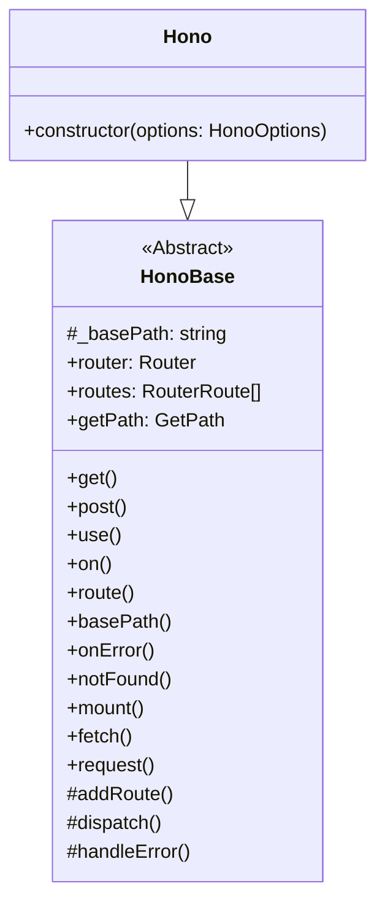
Sources: [src/hono.ts:16-20](https://github.com/honojs/hono/blob/24547a6ed5e175f9326063efb657540162287973/src/hono.ts#L16-L20), [src/hono-base.ts:98-103](https://github.com/honojs/hono/blob/24547a6ed5e175f9326063efb657540162287973/src/hono-base.ts#L98-L103)

## Instantiation and Configuration

A new Hono application is created by instantiating the `Hono` class. The constructor accepts an optional `HonoOptions` object for configuration.

```typescript
// Example instantiation
import { Hono } from 'hono'
const app = new Hono()
```

The `Hono` constructor's primary responsibility is to initialize the router. If a router is not provided in the options, it defaults to a `SmartRouter` which is configured to use a `RegExpRouter` and a `TrieRouter`.

The `HonoBase` constructor, called via `super()`, handles the setup of HTTP method handlers (e.g., `.get()`, `.post()`), middleware handlers (`.use()`), and processes the `strict` and `getPath` options.

Sources: [src/hono.ts:26-33](https://github.com/honojs/hono/blob/24547a6ed5e175f9326063efb657540162287973/src/hono.ts#L26-L33), [src/hono-base.ts:126-173](https://github.com/honojs/hono/blob/24547a6ed5e175f9326063efb657540162287973/src/hono-base.ts#L126-L173)

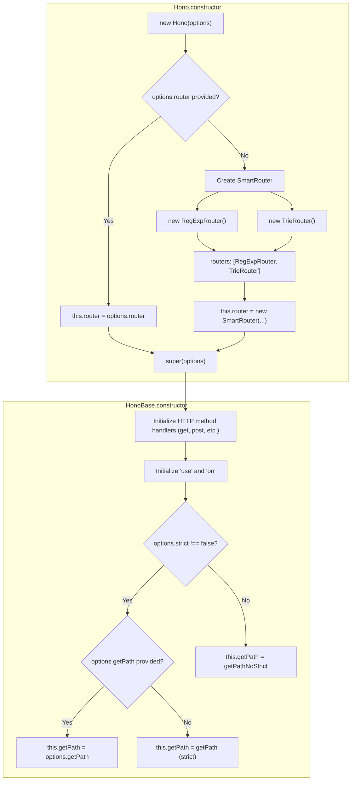
Sources: [src/hono.ts:28-32](https://github.com/honojs/hono/blob/24547a6ed5e175f9326063efb657540162287973/src/hono.ts#L28-L32), [src/hono-base.ts:128-173](https://github.com/honojs/hono/blob/24547a6ed5e175f9326063efb657540162287973/src/hono-base.ts#L128-L173), [src/router/reg-exp-router.ts](https://github.com/honojs/hono/blob/24547a6ed5e175f9326063efb657540162287973/src/router/reg-exp-router.ts), [src/router/smart-router.ts](https://github.com/honojs/hono/blob/24547a6ed5e175f9326063efb657540162287973/src/router/smart-router.ts), [src/router/trie-router.ts](https://github.com/honojs/hono/blob/24547a6ed5e175f9326063efb657540162287973/src/router/trie-router.ts)

### Configuration Options

The `HonoOptions` object allows for customization of the Hono instance.

| Option | Type | Description | Default |
| :--- | :--- | :--- | :--- |
| `strict` | `boolean` | If `true`, distinguishes between paths with and without a trailing slash. | `true` |
| `router` | `Router` | The router instance to use for matching requests. | `new SmartRouter({ routers: [new RegExpRouter(), new TrieRouter()] })` |
| `getPath`| `(request: Request, options?: { env?: E['Bindings'] }) => string` | A function to extract the request path, useful for routing based on hostnames. | A built-in function that extracts `request.url.pathname`. |

Sources: [src/hono-base.ts:46-87](https://github.com/honojs/hono/blob/24547a6ed5e175f9326063efb657540162287973/src/hono-base.ts#L46-L87), [src/hono.ts:29-32](https://github.com/honojs/hono/blob/24547a6ed5e175f9326063efb657540162287973/src/hono.ts#L29-L32)

## Routing

### Route Registration

Routes are added to the application using methods corresponding to HTTP verbs (e.g., `app.get()`, `app.post()`), as well as `app.all()`, `app.use()` for middleware, and `app.on()` for custom methods. These methods are dynamically created in the `HonoBase` constructor.

All registration methods ultimately call the private `#addRoute` method. This method:
1.  Converts the HTTP method to uppercase.
2.  Merges the instance's `_basePath` with the provided route path.
3.  Creates a `RouterRoute` object containing the path, method, and handler.
4.  Adds the handler and route object to the router via `this.router.add()`.
5.  Pushes the `RouterRoute` object to the instance's `routes` array.

Sources: [src/hono-base.ts:128-141](https://github.com/honojs/hono/blob/24547a6ed5e175f9326063efb657540162287973/src/hono-base.ts#L128-L141), [src/hono-base.ts:157-168](https://github.com/honojs/hono/blob/24547a6ed5e175f9326063efb657540162287973/src/hono-base.ts#L157-L168), [src/hono-base.ts:385-397](https://github.com/honojs/hono/blob/24547a6ed5e175f9326063efb657540162287973/src/hono-base.ts#L385-L397)

### Grouping and Nesting

#### `basePath()`

The `.basePath()` method allows for prefixing a group of routes. It creates a clone of the Hono instance and sets a new `_basePath` on the clone, which will be prepended to all subsequently defined routes.

Sources: [src/hono-base.ts:235-253](https://github.com/honojs/hono/blob/24547a6ed5e175f9326063efb657540162287973/src/hono-base.ts#L235-L253)

#### `route()`

The `.route()` method allows for mounting another Hono instance under a specific path prefix. It iterates through the routes of the provided application, adding them to the current instance with the path prefixed. It also wraps the handlers to ensure the correct error handler from the sub-app is used if it's custom.

Sources: [src/hono-base.ts:191-232](https://github.com/honojs/hono/blob/24547a6ed5e175f9326063efb657540162287973/src/hono-base.ts#L191-L232)

### Request Dispatching

The internal `#dispatch` method is the core of the request handling flow. It is called by the public `.fetch()` method.

The dispatch process is as follows:
1.  **HEAD Method**: If the request method is `HEAD`, it internally dispatches a `GET` request and returns a `Response` with a `null` body.
2.  **Path Extraction**: It calls `this.getPath()` to determine the routing path from the `Request`.
3.  **Route Matching**: It uses `this.router.match()` to find handlers that match the request's method and path.
4.  **Context Creation**: A new `Context` object is instantiated with the request, environment, and match results.
5.  **Handler Execution**:
    *   If only one handler is matched, it is invoked directly for performance.
    *   If multiple handlers are matched (e.g., middleware), they are composed into a single function using `compose()` and then executed.
6.  **Response Finalization**: If a handler does not return a `Response`, the default `notFoundHandler` is invoked.
7.  **Error Handling**: Any exceptions thrown during handler execution are caught and passed to the `#handleError` method.

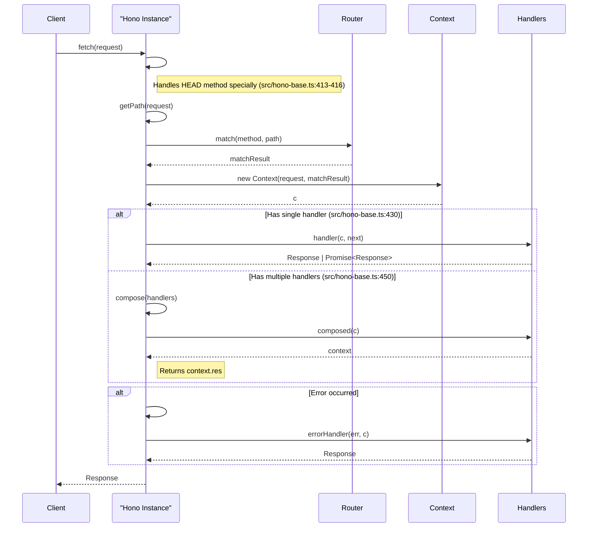
Sources: [src/hono-base.ts:406-466](https://github.com/honojs/hono/blob/24547a6ed5e175f9326063efb657540162287973/src/hono-base.ts#L406-L466)

## Error and Not Found Handling

Hono provides default handlers for 404 Not Found and 500 Internal Server Error scenarios, which can be overridden.

### `.notFound()`

This method replaces the default `notFoundHandler`. The provided handler receives the `Context` and should return a `Response`.

-   **Default Behavior**: Returns a `Response` with the text "404 Not Found" and a status of 404.
    Sources: [src/hono-base.ts:31-33](https://github.com/honojs/hono/blob/24547a6ed5e175f9326063efb657540162287973/src/hono-base.ts#L31-L33), [src/hono-base.ts:186](https://github.com/honojs/hono/blob/24547a6ed5e175f9326063efb657540162287973/src/hono-base.ts#L186)
-   **Customization**: `app.notFound((c) => c.text('Custom 404', 404))`
    Sources: [src/hono-base.ts:277-294](https://github.com/honojs/hono/blob/24547a6ed5e175f9326063efb657540162287973/src/hono-base.ts#L277-L294)

### `.onError()`

This method replaces the default `errorHandler`. The handler receives the `Error` and the `Context`.

-   **Default Behavior**: If the error has a `getResponse` method, it returns that response. Otherwise, it logs the error to the console and returns a `Response` with the text "Internal Server Error" and a status of 500.
    Sources: [src/hono-base.ts:35-42](https://github.com/honojs/hono/blob/24547a6ed5e175f9326063efb657540162287973/src/hono-base.ts#L35-L42), [src/hono-base.ts:188](https://github.com/honojs/hono/blob/24547a6ed5e175f9326063efb657540162287973/src/hono-base.ts#L188)
-   **Customization**: `app.onError((err, c) => c.text('Custom Error', 500))`
    Sources: [src/hono-base.ts:256-274](https://github.com/honojs/hono/blob/24547a6ed5e175f9326063efb657540162287973/src/hono-base.ts#L256-L274)

The internal `#handleError` method is responsible for invoking the configured `errorHandler`. It only does so for instances of `Error`; other thrown types are re-thrown.
Sources: [src/hono-base.ts:399-404](https://github.com/honojs/hono/blob/24547a6ed5e175f9326063efb657540162287973/src/hono-base.ts#L399-L404)

## Application Entry Points

### `.fetch()`

This is the primary method for running a Hono application. It conforms to the standard `fetch` handler signature used in many JavaScript server environments (e.g., Cloudflare Workers, Deno). It accepts a `Request` object and optional environment and execution context objects, and returns a `Response` or a `Promise<Response>`. Internally, it calls `#dispatch`.

Sources: [src/hono-base.ts:469-485](https://github.com/honojs/hono/blob/24547a6ed5e175f9326063efb657540162287973/src/hono-base.ts#L469-L485)

### `.request()`

A convenience method primarily for testing. It can take a URL string or a `Request` object and optional `RequestInit`. It constructs a `Request` object if necessary and calls `.fetch()`.

Sources: [src/hono-base.ts:488-517](https://github.com/honojs/hono/blob/24547a6ed5e175f9326063efb657540162287973/src/hono-base.ts#L488-L517)

### `.fire()`

A deprecated method for automatically adding a global `fetch` event listener, typically used in Service Worker environments. The documentation recommends using the `fire` export from `hono/service-worker` instead.

Sources: [src/hono-base.ts:520-542](https://github.com/honojs/hono/blob/24547a6ed5e175f9326063efb657540162287973/src/hono-base.ts#L520-L542)

## Mounting External Applications

The `.mount()` method allows you to embed other web applications or frameworks (like IttyRouter or another Hono app) within a Hono application at a specific path.

It works by adding a middleware handler for the specified path (`/path/*`). This handler:
1.  Optionally modifies the incoming `Request`. By default, it strips the mount path from the URL's pathname (e.g., a request to `/app/foo` becomes `/foo` before being passed to the mounted application). This can be disabled or customized.
2.  Calls the provided `applicationHandler` with the (potentially modified) request.
3.  If the mounted application returns a `Response`, it is forwarded. If not, `next()` is called to continue to other matching Hono routes.

Sources: [src/hono-base.ts:297-383](https://github.com/honojs/hono/blob/24547a6ed5e175f9326063efb657540162287973/src/hono-base.ts#L297-L383)

# Page: The Context Object

<details>
<summary>Relevant source files</summary>

The following files were used as context for generating this wiki page:

- [src/context.ts](https://github.com/honojs/hono/blob/24547a6ed5e175f9326063efb657540162287973/src/context.ts)
</details>

# The Context Object

The `Context` object, conventionally named `c`, is the central component for handling requests and generating responses within a Hono application. It is passed as the first argument to all handlers and middleware. The `Context` provides access to the incoming request, methods for creating responses, and a mechanism for sharing data between middleware and the final handler. It is designed to be versatile, supporting various serverless environments and runtimes.

The `Context` class is highly generic, allowing for strong type-safety across different environments and application-specific configurations. Its main generic parameters are `E` for Environment, `P` for the route path, and `I` for input/output validation types.

Sources: [src/context.ts:293-299](https://github.com/honojs/hono/blob/24547a6ed5e175f9326063efb657540162287973/src/context.ts#L293-L299)

## Architecture and Initialization

The `Context` object is instantiated by the Hono framework for each incoming request. Its constructor accepts the raw `Request` object and an optional `options` object to configure its behavior.

Sources: [src/context.ts:352-361](https://github.com/honojs/hono/blob/24547a6ed5e175f9326063efb657540162287973/src/context.ts#L352-L361)

### Constructor and Options

The `Context` is initialized with the following parameters:

| Parameter | Type | Description |
| :--- | :--- | :--- |
| `req` | `Request` | The standard `Request` object. |
| `options` | `ContextOptions<E>` | An optional object containing environment-specific configurations. |

The `ContextOptions` interface allows setting up the context with environment bindings, execution context, and custom handlers.

| Option | Type | Description |
| :--- | :--- | :--- |
| `env` | `E['Bindings']` | Environment bindings (e.g., secrets, KV namespaces). |
| `executionCtx` | `FetchEventLike \| ExecutionContext` | The execution context from the environment (e.g., Cloudflare Workers). |
| `notFoundHandler` | `NotFoundHandler<E>` | A custom handler for 404 Not Found responses. |
| `matchResult` | `Result<[H, RouterRoute]>` | The result from the router matching. |
| `path` | `string` | The path of the incoming request. |

Sources: [src/context.ts:237-252](https://github.com/honojs/hono/blob/24547a6ed5e175f9326063efb657540162287973/src/context.ts#L237-L252), [src/context.ts:352-361](https://github.com/honojs/hono/blob/24547a6ed5e175f9326063efb657540162287973/src/context.ts#L352-L361)

### Class Diagram

The following diagram illustrates the key properties and methods of the `Context` class.

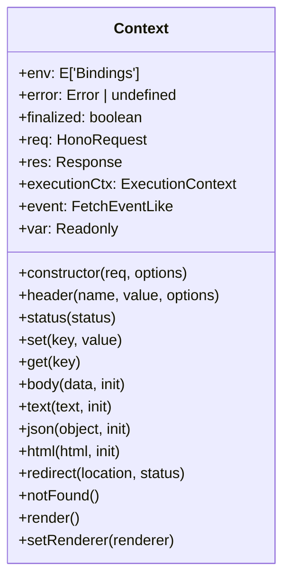
Sources: [src/context.ts:293-780](https://github.com/honojs/hono/blob/24547a6ed5e175f9326063efb657540162287973/src/context.ts#L293-L780)

## Core Properties

The `Context` object exposes several properties to access request data and manage the response lifecycle.

| Property | Type | Description |
| :--- | :--- | :--- |
| `req` | `HonoRequest<P, I['out']>` | An instance of `HonoRequest`, which extends the standard `Request` with helpers for path parameters, query parameters, and validated data. It is lazily initialized on first access. |
| `env` | `E['Bindings']` | Provides access to environment bindings, such as secrets or KV namespaces in Cloudflare Workers. |
| `res` | `Response` | The `Response` object. It is lazily created on first access. The setter has special logic to merge headers from the old response to the new one. |
| `finalized` | `boolean` | A flag that becomes `true` once the response (`c.res`) is explicitly set. This affects how subsequent header modifications are handled. |
| `error` | `Error \| undefined` | Holds an `Error` object if a preceding middleware throws one. |
| `event` | `FetchEventLike` | The `FetchEvent` from the environment. Throws an error if not available. |
| `executionCtx` | `ExecutionContext` | The `ExecutionContext` from the environment. Throws an error if not available. |

Sources: [src/context.ts:300-434](https://github.com/honojs/hono/blob/24547a6ed5e175f9326063efb657540162287973/src/context.ts#L300-L434)

### Response (`res`) Handling

The `res` property is central to response generation.
- **Getter**: If no response has been created (`#res` is undefined), it initializes a new `Response` with a `null` body and prepared headers.
- **Setter**: When a new `Response` is assigned to `c.res`, the `finalized` flag is set to `true`. The setter logic ensures that headers from any previously existing response object (e.g., set by `c.header()`) are merged into the new response. It gives special treatment to `set-cookie` headers to ensure all cookies are preserved.

Sources: [src/context.ts:403-434](https://github.com/honojs/hono/blob/24547a6ed5e175f9326063efb657540162287973/src/context.ts#L403-L434)

## State Management

The `Context` provides a key-value store for sharing data between middleware. This is useful for passing user authentication data, database connections, or other request-scoped information down the handler chain.

### Methods

- `c.set(key, value)`: Stores a value in the context's variable map. The map is created on the first call to `set`.
- `c.get(key)`: Retrieves a value by its key. Returns `undefined` if the key does not exist.
- `c.var`: Provides read-only access to all stored variables as a single object. If no variables are set, it returns an empty object.

Sources: [src/context.ts:534-602](https://github.com/honojs/hono/blob/24547a6ed5e175f9326063efb657540162287973/src/context.ts#L534-L602)

### Middleware Data Flow

The following sequence diagram shows how middleware can use `c.set()` and `c.get()` to share data.

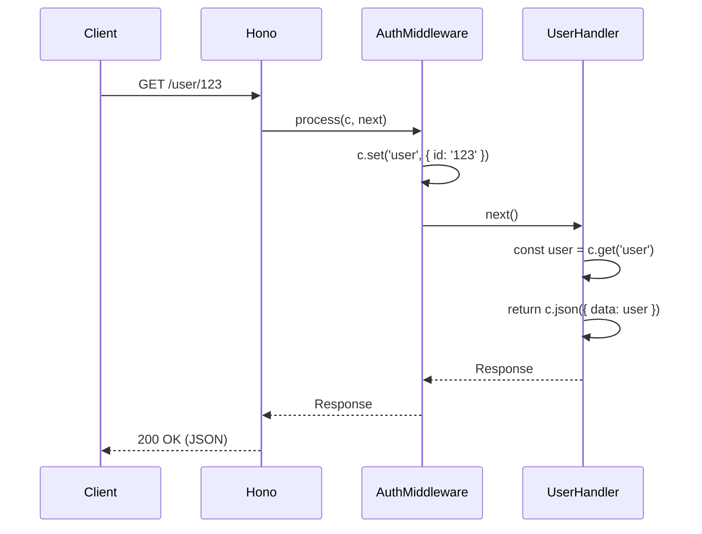
Sources: [src/context.ts:534-580](https://github.com/honojs/hono/blob/24547a6ed5e175f9326063efb657540162287973/src/context.ts#L534-L580)

## Response Generation

The `Context` offers a suite of intuitive methods for creating `Response` objects. These methods handle setting the `Content-Type` header and stringifying body content automatically.

| Method | Description | Default `Content-Type` |
| :--- | :--- | :--- |
| `body()` | Sends a response with a raw body of type `Data` (`string`, `ArrayBuffer`, `ReadableStream`, etc.). | N/A |
| `text()` | Sends a `text/plain` response. | `text/plain; charset=UTF-8` |
| `json()` | Sends an `application/json` response. The argument is automatically stringified. | `application/json` |
| `html()` | Sends a `text/html` response. Can accept a `string` or `Promise<string>`. | `text/html; charset=UTF-8` |
| `redirect()` | Performs a redirect. The default status code is `302`. | N/A |
| `notFound()` | Invokes the configured `notFoundHandler` to generate a 404 response. | N/A |

### Response Creation Flow

Most response methods are wrappers around the internal `#newResponse` method, which orchestrates the creation of the final `Response` object.

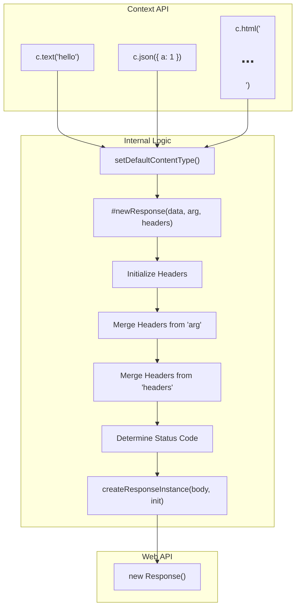
Sources: [src/context.ts:604-779](https://github.com/honojs/hono/blob/24547a6ed5e175f9326063efb657540162287973/src/context.ts#L604-L779)

The `#newResponse` method consolidates logic for building the response:
1.  It initializes a `Headers` object, using headers from an existing `c.res` object or the prepared headers if available.
2.  It merges headers from the `init` object (the `arg` parameter). It correctly appends `set-cookie` headers.
3.  It merges headers from the explicit `headers` object argument.
4.  It determines the final status code from the `arg` parameter or the value previously set by `c.status()`.
5.  It calls `createResponseInstance` (a wrapper around `new Response()`) to construct the final object.

Sources: [src/context.ts:604-639](https://github.com/honojs/hono/blob/24547a6ed5e175f9326063efb657540162287973/src/context.ts#L604-L639)

### Header and Status Control

- `c.header(name, value, options)`: Sets a response header. If `value` is `undefined`, the header is deleted. The `options.append` flag can be used to add a header value instead of overwriting it.
- `c.status(statusCode)`: Sets the HTTP status code for the response. This status will be used by response methods like `body()` if no other status is provided.

Sources: [src/context.ts:515-531](https://github.com/honojs/hono/blob/24547a6ed5e175f9326063efb657540162287973/src/context.ts#L515-L531)

## Rendering

The `Context` includes a simple but extensible rendering system.

- `c.render(...args)`: Renders content, typically using a pre-configured renderer. By default, it's an alias for `c.html()`.
- `c.setRenderer(renderer)`: Allows middleware to define a custom rendering function. This is powerful for integrating template engines. The renderer function receives content and is expected to return a `Response`.
- `c.setLayout(layout)`: Sets a layout component that can wrap rendered content.
- `c.getLayout()`: Retrieves the currently set layout.

Sources: [src/context.ts:448-497](https://github.com/honojs/hono/blob/24547a6ed5e175f9326063efb657540162287973/src/context.ts#L448-L497)

## Edge Cases and Gotchas

- **Response Finalization**: Once `c.res` is set directly (e.g., `c.res = new Response()`), the context is considered `finalized`. If `c.header()` is called after this, it must clone the existing `Response` object to modify its headers, which has a performance cost.
  Sources: [src/context.ts:414-434](https://github.com/honojs/hono/blob/24547a6ed5e175f9326063efb657540162287973/src/context.ts#L414-L434), [src/context.ts:516-518](https://github.com/honojs/hono/blob/24547a6ed5e175f9326063efb657540162287973/src/context.ts#L516-L518)
- **Lazy Initialization**: The `c.req` and `c.res` properties are created only when they are first accessed, which is a performance optimization.
  Sources: [src/context.ts:366-369](https://github.com/honojs/hono/blob/24547a6ed5e175f9326063efb657540162287973/src/context.ts#L366-L369), [src/context.ts:403-407](https://github.com/honojs/hono/blob/24547a6ed5e175f9326063efb657540162287973/src/context.ts#L403-L407)
- **`c.var` Return Value**: If no variables have been set with `c.set()`, accessing `c.var` returns an empty object (`{}`), not `null` or `undefined`.
  Sources: [src/context.ts:597-601](https://github.com/honojs/hono/blob/24547a6ed5e175f9326063efb657540162287973/src/context.ts#L597-L601)
- **Redirect URI Encoding**: `c.redirect()` automatically detects and encodes multibyte characters in the `Location` header to ensure compliance with standards.
  Sources: [src/context.ts:750-762](https://github.com/honojs/hono/blob/24547a6ed5e175f9326063efb657540162287973/src/context.ts#L750-L762)
- **`c.text()` Optimization**: For simple `c.text(body)` calls without any prior header/status modifications, the method directly returns a `new Response(text)` for maximum performance, bypassing the `#newResponse` helper.
  Sources: [src/context.ts:687-688](https://github.com/honojs/hono/blob/24547a6ed5e175f9326063efb657540162287973/src/context.ts#L687-L688)
- **Header Merging in `c.res` Setter**: The `c.res` setter intelligently merges headers, with special handling for `set-cookie` to prevent values from being overwritten. All `set-cookie` headers from the old response are appended to the new one.
  Sources: [src/context.ts:421-426](https://github.com/honojs/hono/blob/24547a6ed5e175f9326063efb657540162287973/src/context.ts#L421-L426)

# Page: The HonoRequest Class

<details>
<summary>Relevant source files</summary>

The following files were used as context for generating this wiki page:

- [src/request.ts](https://github.com/honojs/hono/blob/24547a6ed5e175f9326063efb657540162287973/src/request.ts)
- [src/request.test.ts](https://github.com/honojs/hono/blob/24547a6ed5e175f9326063efb657540162287973/src/request.test.ts)
</details>

# The HonoRequest Class

The `HonoRequest` class is a wrapper around the standard `Request` object. It provides a convenient and powerful API for accessing request data such as path parameters, query strings, headers, and the request body. It is a central component of Hono's context (`c`) object, available as `c.req`, and is designed to be immutable within a request lifecycle. Key features include an efficient body-caching mechanism to prevent multiple consumptions of the request stream and helpers for accessing validated data from middleware.

## Core Concepts & Initialization

A `HonoRequest` instance is initialized with a native `Request` object, the request's path, and the results from the router matching.

`Sources: [src/request.ts:71-80](https://github.com/honojs/hono/blob/24547a6ed5e175f9326063efb657540162287973/src/request.ts#L71-L80)`

### Properties

| Property        | Type                                | Description                                                                                             |
| --------------- | ----------------------------------- | ------------------------------------------------------------------------------------------------------- |
| `raw`           | `Request`                           | The original, underlying `Request` object. Useful for accessing platform-specific properties.           |
| `path`          | `string`                            | The pathname of the request URL.                                                                        |
| `method`        | `string`                            | The HTTP method of the request (e.g., 'GET', 'POST').                                                   |
| `url`           | `string`                            | The full URL of the request.                                                                            |
| `routeIndex`    | `number`                            | The index of the current route being processed, used for accessing correct path parameters. Default is `0`. |
| `bodyCache`     | `BodyCache`                         | An internal cache to store the consumed request body in various formats.                                |
| `matchedRoutes` | `RouterRoute[]`                     | An array of all routes that matched the request path. **(Deprecated)**                                  |
| `routePath`     | `string`                            | The path pattern of the currently executing route. **(Deprecated)**                                     |

`Sources: [src/request.ts:51-69](https://github.com/honojs/hono/blob/24547a6ed5e175f9326063efb657540162287973/src/request.ts#L51-L69), [src/request.ts:369-387](https://github.com/honojs/hono/blob/24547a6ed5e175f9326063efb657540162287973/src/request.ts#L369-L387), [src/request.ts:420-442](https://github.com/honojs/hono/blob/24547a6ed5e175f9326063efb657540162287973/src/request.ts#L420-L442)`

### Class Diagram

```mermaid
classDiagram
  direction TD
  class HonoRequest {
    +raw: Request
    +path: string
    +routeIndex: number
    +bodyCache: BodyCache
    #validatedData: object
    #matchResult: Result

    +constructor(request, path, matchResult)
    +param(key): string | undefined
    +query(key): string | undefined
    +queries(key): string[] | undefined
    +header(name): string | undefined
    +parseBody(): Promise<BodyData>
    +json(): Promise<any>
    +text(): Promise<string>
    +arrayBuffer(): Promise<ArrayBuffer>
    +bytes(): Promise<Uint8Array>
    +blob(): Promise<Blob>
    +formData(): Promise<FormData>
    +addValidatedData(target, data)
    +valid(target): object
    +url: string
    +method: string
    +matchedRoutes: RouterRoute[]
    +routePath: string
    #cachedBody(key): Promise<any>
    #getDecodedParam(key): string | undefined
    #getAllDecodedParams(): Record<string, string>
  }
```

## Accessing Request Data

`HonoRequest` provides several methods to access different parts of the incoming HTTP request.

### URL and Path Parameters (`param`)

The `.param()` method is used to retrieve parameters from the request path, as defined by the route pattern (e.g., `/users/:id`).

-   `param(key: string)`: Returns the value of a specific parameter as a string, or `undefined` if not found.
-   `param()`: Returns an object containing all path parameters.

The method automatically decodes URI-encoded characters in parameter values. The values are extracted from the `#matchResult` property, which is populated by the router.

`Sources: [src/request.ts:94-128](https://github.com/honojs/hono/blob/24547a6ed5e175f9326063efb657540162287973/src/request.ts#L94-L128)`

The behavior is demonstrated in tests, which show how parameters are retrieved based on the `routeIndex` and how they handle different routing results, including zero-length matches which correctly resolve to an empty string.

`Sources: [src/request.test.ts:41-108](https://github.com/honojs/hono/blob/24547a6ed5e175f9326063efb657540162287973/src/request.test.ts#L41-L108)`

### Query Parameters (`query` and `queries`)

Query parameters from the URL's query string can be accessed using `.query()` and `.queries()`.

-   `.query(key: string)`: Gets the first value for a given key.
-   `.query()`: Gets all query parameters as a `Record<string, string>`.
-   `.queries(key: string)`: Gets all values for a given key as an array of strings (e.g., for `?tag=A&tag=B`).
-   `.queries()`: Gets all query parameters as a `Record<string, string[]>`.

These methods rely on helper functions `getQueryParam` and `getQueryParams` and handle URL decoding.

`Sources: [src/request.ts:148-171](https://github.com/honojs/hono/blob/24547a6ed5e175f9326063efb657540162287973/src/request.ts#L148-L171), [src/request.test.ts:9-39](https://github.com/honojs/hono/blob/24547a6ed5e175f9326063efb657540162287973/src/request.test.ts#L9-L39)`

### Headers (`header`)

Request headers can be accessed via the `.header()` method.

-   `header(name: string)`: Returns the value of a specific header. Header names are case-insensitive.
-   `header()`: Returns an object containing all request headers.

If a header is not found, it returns `undefined`. An empty string is a valid header value.

`Sources: [src/request.ts:185-198](https://github.com/honojs/hono/blob/24547a6ed5e175f9326063efb657540162287973/src/request.ts#L185-L198), [src/request.test.ts:219-239](https://github.com/honojs/hono/blob/24547a6ed5e175f9326063efb657540162287973/src/request.test.ts#L219-L239)`

## Handling Request Body

`HonoRequest` provides multiple methods for parsing the request body, backed by an intelligent caching mechanism.

### Body Parsing Methods

The class offers several async methods to parse the body into different formats.

| Method          | Return Type         | Description                                                                    |
| --------------- | ------------------- | ------------------------------------------------------------------------------ |
| `json<T>()`     | `Promise<T>`        | Parses the body as JSON.                                                       |
| `text()`        | `Promise<string>`   | Reads the body as plain text.                                                  |
| `arrayBuffer()` | `Promise<ArrayBuffer>` | Reads the body as an `ArrayBuffer`.                                            |
| `bytes()`       | `Promise<Uint8Array>` | Reads the body as a `Uint8Array`. Internally calls `arrayBuffer()`.            |
| `blob()`        | `Promise<Blob>`     | Reads the body as a `Blob`.                                                    |
| `formData()`    | `Promise<FormData>` | Parses the body as `FormData`.                                                 |
| `parseBody()`   | `Promise<BodyData>` | Parses `multipart/form-data` or `application/x-www-form-urlencoded` body. |

`Sources: [src/request.ts:212-218](https://github.com/honojs/hono/blob/24547a6ed5e175f9326063efb657540162287973/src/request.ts#L212-L218), [src/request.ts:253-331](https://github.com/honojs/hono/blob/24547a6ed5e175f9326063efb657540162287973/src/request.ts#L253-L331)`

### Body Caching Mechanism

A core feature of `HonoRequest` is its ability to cache the request body after it has been read. The standard `Request` object's body is a stream that can only be consumed once. `HonoRequest` solves this by storing the result of the first body-parsing operation in its `bodyCache` property.

The internal `#cachedBody(key)` method manages this process:
1.  It checks if the requested body format (e.g., 'text', 'json') is already in `bodyCache`. If so, it returns the cached promise.
2.  If not, but another format has been cached, it reconstructs the requested format from the cached data. For example, if `.json()` was called first, the parsed object is cached. A subsequent call to `.text()` will stringify the cached object to return the text representation.
3.  If the cache is empty, it calls the corresponding method on the `raw` `Request` object (e.g., `raw.text()`), stores the resulting promise in the cache, and returns it.

`Sources: [src/request.ts:220-239](https://github.com/honojs/hono/blob/24547a6ed5e175f9326063efb657540162287973/src/request.ts#L220-L239), [src/request.test.ts:245-365](https://github.com/honojs/hono/blob/24547a6ed5e175f9326063efb657540162287973/src/request.test.ts#L245-L365)`

This flow is illustrated below:

```mermaid
sequenceDiagram
  participant User
  participant HonoRequest
  participant RawRequest

  User->>HonoRequest: await req.json()
  HonoRequest->>HonoRequest: #cachedBody('text')
  Note over HonoRequest: bodyCache is empty
  HonoRequest->>RawRequest: raw.text()
  RawRequest-->>HonoRequest: Promise<string>
  Note over HonoRequest: Caches text promise
  HonoRequest->>HonoRequest: JSON.parse(text)
  HonoRequest-->>User: Parsed JSON object

  User->>HonoRequest: await req.text()
  HonoRequest->>HonoRequest: #cachedBody('text')
  Note over HonoRequest: 'text' is cached, returns promise
  HonoRequest-->>User: Cached text content
```

## Validated Data

`HonoRequest` integrates with validation middleware to store and retrieve sanitized and validated data.

-   `addValidatedData(target, data)`: This method is used internally by validators to store the validated data. The `target` can be `'json'`, `'form'`, `'query'`, etc.
-   `valid(target)`: This method retrieves the validated data for a given target.

This system provides a type-safe way to access data that has been processed by middleware.

`Sources: [src/request.ts:339-354](https://github.com/honojs/hono/blob/24547a6ed5e175f9326063efb657540162287973/src/request.ts#L339-L354), [src/request.test.ts:182-216](https://github.com/honojs/hono/blob/24547a6ed5e175f9326063efb657540162287973/src/request.test.ts#L182-L216)`

## Utility Functions

### `cloneRawRequest`

This standalone utility function safely clones the underlying `Request` object from a `HonoRequest` instance. This is crucial when a request needs to be forwarded to another service after its body has been read (e.g., after validation).

The function's logic is as follows:
1.  If the raw request's body has not been used (`req.raw.bodyUsed` is `false`), it simply calls `req.raw.clone()`.
2.  If the body has been used, it checks the `req.bodyCache`. It uses the cached body data to construct a new `Request` object with all the same properties (headers, method, etc.).
3.  If the body was consumed directly via `req.raw` without using a `HonoRequest` method, the `bodyCache` will be empty. In this case, the function throws an `HTTPException` with a 500 status code, as it's impossible to reconstruct the body.

`Sources: [src/request.ts:476-505](https://github.com/honojs/hono/blob/24547a6ed5e175f9326063efb657540162287973/src/request.ts#L476-L505), [src/request.test.ts:479-599](https://github.com/honojs/hono/blob/24547a6ed5e175f9326063efb657540162287973/src/request.test.ts#L479-L599)`

```mermaid
graph TD
    A["cloneRawRequest(req)"] --> B{req.raw.bodyUsed?};
    B -- No --> C["Return req.raw.clone()"];
    B -- Yes --> D{req.bodyCache empty?};
    D -- No --> E[Reconstruct new Request from cache];
    E --> F[Return new Request];
    D -- Yes --> G["Throw HTTPException(500)"];
```

## Edge Cases and Gotchas

-   **Path Parameters**: A zero-length path parameter match (e.g., a wildcard `*` matching an empty path segment) will correctly result in an empty string `''` from `req.param()`, not `undefined`. `Sources: [src/request.test.ts:42-56](https://github.com/honojs/hono/blob/24547a6ed5e175f9326063efb657540162287973/src/request.test.ts#L42-L56)`
-   **Header Names**: Header names are case-insensitive when using `req.header('Header-Name')`. `Sources: [src/request.test.ts:226-238](https://github.com/honojs/hono/blob/24547a6ed5e175f9326063efb657540162287973/src/request.test.ts#L226-L238)`
-   **Body Consumption**: Directly consuming the body from `req.raw` (e.g., `await req.raw.text()`) bypasses the `HonoRequest` caching mechanism. This will prevent `cloneRawRequest` from working and may cause errors if other parts of the application try to read the body again. `Sources: [src/request.ts:482-487](https://github.com/honojs/hono/blob/24547a6ed5e175f9326063efb657540162287973/src/request.ts#L482-L487), [src/request.test.ts:568-599](https://github.com/honojs/hono/blob/24547a6ed5e175f9326063efb657540162287973/src/request.test.ts#L568-L599)`
-   **Deprecated Properties**: `matchedRoutes` and `routePath` are deprecated. The `matchedRoutes` and `routePath` helpers from `"hono/route"` should be used instead. `Sources: [src/request.ts:396-399](https://github.com/honojs/hono/blob/24547a6ed5e175f9326063efb657540162287973/src/request.ts#L396-L399), [src/request.ts:427-429](https://github.com/honojs/hono/blob/24547a6ed5e175f9326063efb657540162287973/src/request.ts#L427-L429)`

# Page: HTTP Exception Handling

<details>
<summary>Relevant source files</summary>

The following files were used as context for generating this wiki page:

- [src/http-exception.ts](https://github.com/honojs/hono/blob/24547a6ed5e175f9326063efb657540162287973/src/http-exception.ts)
- [src/hono-base.ts](https://github.com/honojs/hono/blob/24547a6ed5e175f9326063efb657540162287973/src/hono-base.ts)
- [src/http-exception.test.ts](https://github.com/honojs/hono/blob/24547a6ed5e175f9326063efb657540162287973/src/http-exception.test.ts)
</details>

# HTTP Exception Handling

Hono provides a specialized error handling system centered around the `HTTPException` class. This system allows developers to gracefully manage fatal errors, such as authentication failures or invalid requests, by interrupting the normal request-response cycle and returning a specific HTTP error response. When a handler throws an `HTTPException`, Hono's core dispatch logic catches it and uses a configurable error handler to generate the final `Response`.

The main components of this system are:
*   **`HTTPException`**: A custom `Error` subclass for HTTP-specific errors.
*   **`errorHandler`**: A function in `HonoBase` that processes caught errors.
*   **`app.onError()`**: A method to register a custom error handler.
*   **Dispatch Logic**: The `try...catch` blocks within the `#dispatch` method that orchestrate error handling.

## The `HTTPException` Class

The `HTTPException` class is the primary tool for signaling HTTP errors. It extends the standard `Error` class and is designed to be thrown when a request cannot be processed successfully.

`Sources: [src/http-exception.ts:46-78](https://github.com/honojs/hono/blob/24547a6ed5e175f9326063efb657540162287973/src/http-exception.ts#L46-L78)`

```mermaid
classDiagram
  direction TD
  class Error {
    <<JavaScript Built-in>>
    +message: string
    +cause: unknown
  }
  class HTTPException {
    +res: Response
    +status: ContentfulStatusCode
    +constructor(status, options)
    +getResponse(): Response
  }
  Error <|-- HTTPException
```

### Constructor

The constructor initializes an `HTTPException` instance.

`Sources: [src/http-exception.ts:55-59](https://github.com/honojs/hono/blob/24547a6ed5e175f9326063efb657540162287973/src/http-exception.ts#L55-L59)`

| Parameter | Type | Description | Default |
|---|---|---|---|
| `status` | `ContentfulStatusCode` | The HTTP status code for the response. | `500` |
| `options` | `HTTPExceptionOptions` | An object with additional options. | `undefined` |

The `options` object can contain the following properties:

| Property | Type | Description |
|---|---|---|
| `message` | `string` | A custom error message. This is passed to the `Error` superclass constructor and used as the response body if no `res` is provided. |
| `res` | `Response` | An existing `Response` object to use as a base for the error response. |
| `cause` | `unknown` | The underlying error that caused this exception, useful for debugging. |

`Sources: [src/http-exception.ts:14-18](https://github.com/honojs/hono/blob/24547a6ed5e175f9326063efb657540162287973/src/http-exception.ts#L14-L18)`

### `getResponse()` Method

This method generates and returns a `Response` object based on the exception's properties. It is called by Hono's default error handler.

The logic is as follows:
1.  If the exception was created with a `res` object, a *new* `Response` is created using the body and headers of the original `res`, but with the `status` code of the `HTTPException` instance. This ensures the exception's status code takes precedence.
2.  If no `res` object was provided, a new `Response` is created using the exception's `message` as the body and its `status` as the status code.

`Sources: [src/http-exception.ts:66-78](https://github.com/honojs/hono/blob/24547a6ed5e175f9326063efb657540162287973/src/http-exception.ts#L66-L78), [src/http-exception.test.ts:35-44](https://github.com/honojs/hono/blob/24547a6ed5e175f9326063efb657540162287973/src/http-exception.test.ts#L35-L44)`

## Error Handling in Hono

Hono's core application class, `HonoBase`, contains the logic for catching and processing exceptions that occur during request handling.

`Sources: [src/hono-base.ts](https://github.com/honojs/hono/blob/24547a6ed5e175f9326063efb657540162287973/src/hono-base.ts)`

### Default Error Handler

`HonoBase` includes a default `errorHandler` function that handles all errors caught during the dispatch process.

```typescript
const errorHandler: ErrorHandler = (err, c) => {
  if ('getResponse' in err) {
    const res = err.getResponse()
    return c.newResponse(res.body, res)
  }
  console.error(err)
  return c.text('Internal Server Error', 500)
}
```
`Sources: [src/hono-base.ts:35-42](https://github.com/honojs/hono/blob/24547a6ed5e175f9326063efb657540162287973/src/hono-base.ts#L35-L42)`

The default handler's logic is illustrated below:

```mermaid
graph TD
    A["Error Caught in #dispatch"] --> B["#handleError(err, c)"];
    B --> C{err instanceof Error?};
    C -- No --> D[Re-throw err];
    C -- Yes --> E["this.errorHandler(err, c)"];
    E --> F{"err has #quot;getResponse()#quot; method?"};
    F -- Yes --> G["res = err.getResponse()"];
    G --> H["Return Response based on res"];
    F -- No --> I["console.error(err)"];
    I --> J["Return 'Internal Server Error' Response (500)"];
```

This flow shows that the handler specifically checks for the `getResponse` method, which makes it compatible with `HTTPException`. For any other `Error` instance, it logs the error and returns a generic 500 response.

### Custom Error Handling with `onError`

You can override the default error handling behavior by providing a custom handler using the `app.onError()` method. This method replaces the default `errorHandler` with the function you provide.

```typescript
// Example from hono-base.ts documentation
app.onError((err, c) => {
  console.error(`${err}`)
  return c.text('Custom Error Message', 500)
})
```
`Sources: [src/hono-base.ts:256-274](https://github.com/honojs/hono/blob/24547a6ed5e175f9326063efb657540162287973/src/hono-base.ts#L256-L274)`

The `onError` method sets the `this.errorHandler` property on the Hono instance.
`Sources: [src/hono-base.ts:271-273](https://github.com/honojs/hono/blob/24547a6ed5e175f9326063efb657540162287973/src/hono-base.ts#L271-L273)`

### Request Dispatch and Exception Flow

Errors are caught within the `#dispatch` method of the `HonoBase` class, which is the main entry point for processing a request.

1.  Inside `#dispatch`, the execution of handlers is wrapped in a `try...catch` block.
2.  If an exception is thrown, the `catch` block calls `this.#handleError(err, c)`.
3.  The `#handleError` method checks if the thrown object is an instance of `Error`.
4.  If it is, `#handleError` invokes the currently registered `this.errorHandler` (either the default or a custom one).
5.  If the thrown object is not an `Error`, it is re-thrown.

`Sources: [src/hono-base.ts:399-404](https://github.com/honojs/hono/blob/24547a6ed5e175f9326063efb657540162287973/src/hono-base.ts#L399-L404), [src/hono-base.ts:436-438](https://github.com/honojs/hono/blob/24547a6ed5e175f9326063efb657540162287973/src/hono-base.ts#L436-L438), [src/hono-base.ts:462-464](https://github.com/honojs/hono/blob/24547a6ed5e175f9326063efb657540162287973/src/hono-base.ts#L462-L464)`

The following sequence diagram illustrates the entire process when a handler throws an `HTTPException`.

```mermaid
sequenceDiagram
    participant Client
    participant HonoApp
    participant Handler
    participant ErrorHandler

    Client->>HonoApp: Sends Request
    HonoApp->>HonoApp: #dispatch()
    HonoApp->>Handler: Executes handler(c, next)
    Handler->>xHonoApp: throw new HTTPException(401)
    HonoApp-->>Handler:
    Note right of HonoApp: Catches exception in #dispatch()
    HonoApp->>HonoApp: #handleError(exception, c)
    HonoApp->>ErrorHandler: Invokes errorHandler(exception, c)
    Note right of ErrorHandler: Checks for .getResponse()
    ErrorHandler->>ErrorHandler: exception.getResponse()
    ErrorHandler-->>HonoApp: Returns new Response(401)
    HonoApp-->>Client: Sends 401 Response
```

## Summary of Relevant Files

| File | Description |
|---|---|
| `src/http-exception.ts` | Defines the `HTTPException` class, which is the primary mechanism for generating HTTP error responses from exceptions. |
| `src/hono-base.ts` | Contains the core Hono application logic, including the default `errorHandler`, the `onError` method for customization, and the `#dispatch` logic that catches exceptions. |
| `src/http-exception.test.ts` | Provides unit tests for the `HTTPException` class, confirming its behavior regarding status codes, messages, causes, and response generation. |

# Page: Routing Mechanism

<details>
<summary>Relevant source files</summary>

The following files were used as context for generating this wiki page:

- [src/router.ts](https://github.com/honojs/hono/blob/24547a6ed5e175f9326063efb657540162287973/src/router.ts)
- [src/router/smart-router/router.ts](https://github.com/honojs/hono/blob/24547a6ed5e175f9326063efb657540162287973/src/router/smart-router/router.ts)
- [src/hono.ts](https://github.com/honojs/hono/blob/24547a6ed5e175f9326063efb657540162287973/src/hono.ts)
</details>

# Routing Mechanism

Hono's routing system is a flexible and high-performance mechanism designed to match incoming request paths to their corresponding handlers. The core of this system is the `Router<T>` interface, which defines a standard contract for routing logic. Hono provides multiple router implementations, and by default, it uses the `SmartRouter`. This special router acts as a meta-router, dynamically selecting the most appropriate underlying router (`RegExpRouter` or `TrieRouter`) at runtime based on the registered route patterns. This approach allows Hono to optimize for both simple and complex routing scenarios without requiring manual configuration.

The `Hono` application class is initialized with a router instance. Route registration is deferred until the first request is received, at which point the `SmartRouter` evaluates the routes and locks in the best-performing router for all subsequent requests. This lazy-evaluation strategy ensures fast startup times and optimized runtime performance.

## Core Components

The routing mechanism is composed of a central interface, a default meta-router, and concrete router implementations.

```mermaid
classDiagram
  direction TD
  class Hono {
    +router: Router
  }
  class Router {
    <<interface>>
    +name: string
    +add(method, path, handler)
    +match(method, path): Result
  }
  class SmartRouter {
    -routers: Router[]
    -routes: any[]
    +activeRouter: Router
  }
  class RegExpRouter
  class TrieRouter

  Hono o-- Router
  SmartRouter --|> Router
  RegExpRouter --|> Router
  TrieRouter --|> Router
  SmartRouter o-- RegExpRouter
  SmartRouter o-- TrieRouter
```
*This diagram shows the relationship between the `Hono` class, the `Router` interface, and its various implementations.*
Sources: [src/hono.ts:20,28-33](), [src/router.ts:29](https://github.com/honojs/hono/blob/24547a6ed5e175f9326063efb657540162287973/src/router.ts#L29), [src/router/smart-router/router.ts:4](https://github.com/honojs/hono/blob/24547a6ed5e175f9326063efb657540162287973/src/router/smart-router/router.ts#L4)

### The `Router<T>` Interface

The `Router<T>` interface provides the fundamental contract for all routers in Hono. It ensures that any router implementation can be seamlessly integrated into the `Hono` application.

| Member | Type | Description |
| --- | --- | --- |
| `name` | `string` | The name of the router implementation. |
| `add()` | `(method: string, path: string, handler: T) => void` | Adds a new route with its handler to the router. |
| `match()` | `(method: string, path: string) => Result<T>` | Matches a request method and path against registered routes. |

Sources: [src/router.ts:29-52](https://github.com/honojs/hono/blob/24547a6ed5e175f9326063efb657540162287973/src/router.ts#L29-L52)

### Routing Data Structures

When a route is matched, the `match` method returns a `Result<T>` object containing the matched handlers and any extracted URL parameters.

| Type | Definition | Description |
| --- | --- | --- |
| `Params` | `Record<string, string>` | An object mapping parameter names to their string values. e.g., `{ 'id': '123' }`. |
| `ParamStash` | `string[]` | An array of parameter values. e.g., `['123', 'abc']`. |
| `ParamIndexMap` | `Record<string, number>` | An object mapping parameter names to their index in the `ParamStash`. e.g., `{ 'id': 0, 'action': 1 }`. |
| `Result<T>` | `[[T, ParamIndexMap][], ParamStash]` or `[[T, Params][]]` | The result of a successful match. It contains an array of `[handler, params]` tuples. The params can be in one of two formats, depending on the router implementation. |

Sources: [src/router.ts:57-98](https://github.com/honojs/hono/blob/24547a6ed5e175f9326063efb657540162287973/src/router.ts#L57-L98)

## SmartRouter: The Default Router

By default, every `Hono` instance is configured with a `SmartRouter`. This router is initialized with a list of other router implementations, typically `RegExpRouter` and `TrieRouter`.

```typescript
// From src/hono.ts
export class Hono<
  // ...
> extends HonoBase<E, S, BasePath> {
  constructor(options: HonoOptions<E> = {}) {
    super(options)
    this.router =
      options.router ??
      new SmartRouter({
        routers: [new RegExpRouter(), new TrieRouter()],
      })
  }
}
```
Sources: [src/hono.ts:16-34](https://github.com/honojs/hono/blob/24547a6ed5e175f9326063efb657540162287973/src/hono.ts#L16-L34)

The `SmartRouter` does not perform matching itself. Instead, its primary role is to select the most suitable router from its list based on the types of paths that have been added.

### Route Registration

When `add(method, path, handler)` is called on a `Hono` instance, the `SmartRouter` does not immediately pass the route to its underlying routers. Instead, it caches all routes in an internal array `#routes`.

```typescript
// From src/router/smart-router/router.ts
export class SmartRouter<T> implements Router<T> {
  // ...
  #routes?: [string, string, T][] = []

  add(method: string, path: string, handler: T) {
    if (!this.#routes) {
      throw new Error(MESSAGE_MATCHER_IS_ALREADY_BUILT)
    }

    this.#routes.push([method, path, handler])
  }
  // ...
}
```
Sources: [src/router/smart-router/router.ts:7, 13-19]()

### First Match and Router Selection

The router selection logic is executed on the *first* call to the `match(method, path)` method.

```mermaid
graph TD
    A["Start: SmartRouter.match() called"] --> B{Is this the first match?};
    B -- Yes --> C["Iterate through configured routers (RegExpRouter, TrieRouter)"];
    B -- No --> D["Call activeRouter.match() directly"];
    C --> E{For each router};
    E --> F[Try adding all cached routes to it];
    F --> G[Attempt to match the current request];
    G --> H{Success?};
    H -- Yes --> I[Select this router as the activeRouter];
    I --> J[Replace SmartRouter.match with activeRouter.match];
    J --> K[Clear cached routes and router list];
    K --> L[Return match result];
    H -- No (UnsupportedPathError) --> M[Continue to next router];
    M --> E;
    G -- No (Other Error) --> N[Throw error];
    E -- All routers failed --> O["Throw #quot;Fatal error#quot;"];
```
*This flowchart illustrates the one-time process `SmartRouter` uses to select an active router.*
Sources: [src/router/smart-router/router.ts:21-61](https://github.com/honojs/hono/blob/24547a6ed5e175f9326063efb657540162287973/src/router/smart-router/router.ts#L21-L61)

The process is as follows:
1.  The `SmartRouter` iterates through its list of routers (`#routers`).
2.  For each router, it enters a `try...catch` block.
3.  It attempts to add all the cached routes from `#routes` to the current router.
4.  It then calls `match()` on that router with the current request's method and path.
5.  If the router throws an `UnsupportedPathError`, it means that router cannot handle one or more of the path patterns. The `SmartRouter` catches this specific error and simply continues to the next router in its list.
6.  If any other error occurs, it is re-thrown.
7.  If a router successfully adds all routes and returns a match result, the `SmartRouter` "locks in" this router as the active one. It does this by:
    a.  Overwriting its own `match` method with the selected router's `match` method, bound to the router instance (`this.match = router.match.bind(router)`).
    b.  Updating its internal state to only hold the selected router (`this.#routers = [router]`).
    c.  Clearing the cached routes by setting `#routes` to `undefined`.
    d.  Breaking the loop.
8.  All subsequent calls to `match` will now directly invoke the selected router's `match` method, bypassing the selection logic entirely for maximum performance.

### Request Flow Sequence

The following diagram illustrates the sequence of events for the first two requests handled by a `Hono` application using `SmartRouter`.

```mermaid
sequenceDiagram
    participant Client
    participant HonoApp
    participant SmartRouter
    participant RegExpRouter
    participant TrieRouter

    Note over Client, TrieRouter: First Request
    Client->>HonoApp: GET /users/123
    HonoApp->>SmartRouter: match('GET', '/users/123')
    SmartRouter->>RegExpRouter: add(routes...)
    RegExpRouter-->>SmartRouter: Success
    SmartRouter->>RegExpRouter: match('GET', '/users/123')
    RegExpRouter-->>SmartRouter: Match Result
    Note over SmartRouter: RegExpRouter selected. Caches cleared.
    SmartRouter-->>HonoApp: Match Result
    HonoApp-->>Client: Response

    Note over Client, TrieRouter: Second Request
    Client->>HonoApp: GET /posts/abc
    HonoApp->>SmartRouter: match('GET', '/posts/abc')
    Note over SmartRouter: Now directly calls active router
    SmartRouter->>RegExpRouter: match('GET', '/posts/abc')
    RegExpRouter-->>SmartRouter: Match Result
    SmartRouter-->>HonoApp: Match Result
    HonoApp-->>Client: Response
```
Sources: [src/router/smart-router/router.ts:21-61](https://github.com/honojs/hono/blob/24547a6ed5e175f9326063efb657540162287973/src/router/smart-router/router.ts#L21-L61)

## Edge cases and gotchas

-   **Adding Routes After Matching**: Attempting to add a route after the first match has occurred will throw an error with the message `Can not add a route since the matcher is already built.`. This is because the `SmartRouter` clears its route cache (`#routes`) after selecting an active router.
    Sources: [src/router.ts:21-22](https://github.com/honojs/hono/blob/24547a6ed5e175f9326063efb657540162287973/src/router.ts#L21-L22), [src/router/smart-router/router.ts:14-16](https://github.com/honojs/hono/blob/24547a6ed5e175f9326063efb657540162287973/src/router/smart-router/router.ts#L14-L16)
-   **No Suitable Router**: If no configured router can handle the set of registered routes (i.e., they all throw `UnsupportedPathError` or another error), the `SmartRouter` will throw a `Fatal error`.
    Sources: [src/router/smart-router/router.ts:53-55](https://github.com/honojs/hono/blob/24547a6ed5e175f9326063efb657540162287973/src/router/smart-router/router.ts#L53-L55)
-   **Accessing Active Router Prematurely**: The `activeRouter` property on `SmartRouter` is only available after the first match has successfully selected a router. Accessing it before this point will throw an error: `No active router has been determined yet.`.
    Sources: [src/router/smart-router/router.ts:63-66](https://github.com/honojs/hono/blob/24547a6ed5e175f9326063efb657540162287973/src/router/smart-router/router.ts#L63-L66)
-   **`UnsupportedPathError`**: This specific error type is used internally for control flow within `SmartRouter`'s selection logic. It is not an error that should typically be seen by the end-user; it signals that a router implementation does not support a given path's syntax.
    Sources: [src/router.ts:103](https://github.com/honojs/hono/blob/24547a6ed5e175f9326063efb657540162287973/src/router.ts#L103), [src/router/smart-router/router.ts:40-42](https://github.com/honojs/hono/blob/24547a6ed5e175f9326063efb657540162287973/src/router/smart-router/router.ts#L40-L42)

# Page: RegExpRouter

<details>
<summary>Relevant source files</summary>

The following files were used as context for generating this wiki page:

- [src/router/reg-exp-router/router.ts](https://github.com/honojs/hono/blob/24547a6ed5e175f9326063efb657540162287973/src/router/reg-exp-router/router.ts)
- [src/router/reg-exp-router/index.ts](https://github.com/honojs/hono/blob/24547a6ed5e175f9326063efb657540162287973/src/router/reg-exp-router/index.ts)
- [src/router/reg-exp-router/node.ts](https://github.com/honojs/hono/blob/24547a6ed5e175f9326063efb657540162287973/src/router/reg-exp-router/node.ts)
- [src/router/reg-exp-router/prepared-router.test.ts](https://github.com/honojs/hono/blob/24547a6ed5e175f9326063efb657540162287973/src/router/reg-exp-router/prepared-router.test.ts)
- [src/router/reg-exp-router/prepared-router.ts](https://github.com/honojs/hono/blob/24547a6ed5e175f9326063efb657540162287973/src/router/reg-exp-router/prepared-router.ts)
- [src/router/reg-exp-router/router.test.ts](https://github.com/honojs/hono/blob/24547a6ed5e175f9326063efb657540162287973/src/router/reg-exp-router/router.test.ts)
- [src/router/reg-exp-router/trie.ts](https://github.com/honojs/hono/blob/24547a6ed5e175f9326063efb657540162287973/src/router/reg-exp-router/trie.ts)
</details>

# RegExpRouter

The `RegExpRouter` is a routing module within the Hono framework that uses regular expressions for path matching. It processes a collection of routes, builds a trie data structure, and then compiles the trie into a single, large regular expression for efficient matching. This approach is designed to handle both static and dynamic routes, including those with parameters and wildcards.

The module provides two main router implementations: `RegExpRouter` for dynamic route registration and `PreparedRegExpRouter` for scenarios where routes are known in advance, offering performance benefits by pre-compiling and serializing the routing logic.

Sources: [src/router/reg-exp-router/router.ts](https://github.com/honojs/hono/blob/24547a6ed5e175f9326063efb657540162287973/src/router/reg-exp-router/router.ts), [src/router/reg-exp-router/prepared-router.ts](https://github.com/honojs/hono/blob/24547a6ed5e175f9326063efb657540162287973/src/router/reg-exp-router/prepared-router.ts)

## Key Components

The `RegExpRouter` system is composed of several key classes and files that work together to provide routing functionality.

| File | Role |
| --- | --- |
| `router.ts` | Contains the main `RegExpRouter` class, which manages route registration and matcher building. |
| `prepared-router.ts` | Implements `PreparedRegExpRouter`, an optimized version for pre-defined routes, along with serialization logic. |
| `trie.ts` | Defines the `Trie` class, responsible for building the trie from path tokens and generating the final `RegExp`. |
| `node.ts` | Defines the `Node` class, which represents a single node within the trie and handles the logic for token insertion and path ambiguity detection. |
| `index.ts` | Serves as the public entry point, exporting the `RegExpRouter` and `PreparedRegExpRouter` classes. |
| `*.test.ts` | Contains unit and integration tests that define the expected behavior and limitations of the routers. |

Sources: [src/router/reg-exp-router/index.ts](https://github.com/honojs/hono/blob/24547a6ed5e175f9326063efb657540162287973/src/router/reg-exp-router/index.ts), [src/router/reg-exp-router/router.ts](https://github.com/honojs/hono/blob/24547a6ed5e175f9326063efb657540162287973/src/router/reg-exp-router/router.ts), [src/router/reg-exp-router/prepared-router.ts](https://github.com/honojs/hono/blob/24547a6ed5e175f9326063efb657540162287973/src/router/reg-exp-router/prepared-router.ts), [src/router/reg-exp-router/trie.ts](https://github.com/honojs/hono/blob/24547a6ed5e175f9326063efb657540162287973/src/router/reg-exp-router/trie.ts), [src/router/reg-exp-router/node.ts](https://github.com/honojs/hono/blob/24547a6ed5e175f9326063efb657540162287973/src/router/reg-exp-router/node.ts)

### Class Relationships

The following diagram illustrates the relationships between the main classes in the `RegExpRouter` module.

```mermaid
classDiagram
direction TD
class Router {
  <<interface>>
  add(method, path, handler)
  match(method, path)
}
class RegExpRouter {
  #middleware
  #routes
  add(method, path, handler)
  match(method, path)
  buildAllMatchers()
  #buildMatcher(method)
}
class PreparedRegExpRouter {
  #matchers
  #relocateMap
  add(method, path, handler)
  match(method, path)
}
class Trie {
  #root: Node
  insert(path, index, pathErrorCheckOnly)
  buildRegExp()
}
class Node {
  #children
  #index
  insert(tokens, index, paramMap, context, pathErrorCheckOnly)
  buildRegExpStr()
}

Router <|.. RegExpRouter
Router <|.. PreparedRegExpRouter
RegExpRouter --> Trie : "uses to build matchers"
Trie --> Node : "composes"
```

This diagram shows that both `RegExpRouter` and `PreparedRegExpRouter` implement the `Router` interface. `RegExpRouter` uses a `Trie` instance, which in turn is composed of `Node` objects, to build its routing logic.

Sources: [src/router/reg-exp-router/router.ts:122-252](https://github.com/honojs/hono/blob/24547a6ed5e175f9326063efb657540162287973/src/router/reg-exp-router/router.ts#L122-L252), [src/router/reg-exp-router/prepared-router.ts:9-93](https://github.com/honojs/hono/blob/24547a6ed5e175f9326063efb657540162287973/src/router/reg-exp-router/prepared-router.ts#L9-L93), [src/router/reg-exp-router/trie.ts:6-74](https://github.com/honojs/hono/blob/24547a6ed5e175f9326063efb657540162287973/src/router/reg-exp-router/trie.ts#L6-L74), [src/router/reg-exp-router/node.ts:45-162](https://github.com/honojs/hono/blob/24547a6ed5e175f9326063efb657540162287973/src/router/reg-exp-router/node.ts#L45-L162)

## `RegExpRouter`

The `RegExpRouter` is the standard, dynamic implementation. It allows routes to be added at any time. The core logic is deferred until the first `match` call, at which point it builds the necessary "matchers" for all registered routes.

### Route Registration (`add`)

The `add(method, path, handler)` method registers a handler for a specific HTTP method and path.

1.  **Initialization**: The router maintains separate records for middleware and routes for each HTTP method (`#middleware`, `#routes`).
    Sources: [src/router/reg-exp-router/router.ts:124-125](https://github.com/honojs/hono/blob/24547a6ed5e175f9326063efb657540162287973/src/router/reg-exp-router/router.ts#L124-L125)
2.  **Wildcard Handling**: Paths ending in `*` (e.g., `/static/*`) are treated as wildcard routes. The router creates a `RegExp` for the path and applies the handler to all existing and future routes that match the wildcard pattern. A cache (`wildcardRegExpCache`) is used to avoid recompiling the same wildcard regex.
    Sources: [src/router/reg-exp-router/router.ts:155-187](https://github.com/honojs/hono/blob/24547a6ed5e175f9326063efb657540162287973/src/router/reg-exp-router/router.ts#L155-L187), [src/router/reg-exp-router/router.ts:19-28](https://github.com/honojs/hono/blob/24547a6ed5e175f9326063efb657540162287973/src/router/reg-exp-router/router.ts#L19-L28)
3.  **Optional Parameters**: Paths with optional parameters (e.g., `/api/users/:id?`) are expanded into multiple concrete paths by `checkOptionalParameter`. For `/api/users/:id?`, this would generate `/api/users` and `/api/users/:id`.
    Sources: [src/router/reg-exp-router/router.ts:189-203](https://github.com/honojs/hono/blob/24547a6ed5e175f9326063efb657540162287973/src/router/reg-exp-router/router.ts#L189-L203)
4.  **Handler Storage**: For each path, the router stores an array of `[handler, paramCount]` tuples. This allows multiple handlers (e.g., middleware) to be associated with a single route.
    Sources: [src/router/reg-exp-router/router.ts:200](https://github.com/honojs/hono/blob/24547a6ed5e175f9326063efb657540162287973/src/router/reg-exp-router/router.ts#L200)

### Matcher Generation

When `match()` is called for the first time, `buildAllMatchers()` is invoked to compile all registered routes into an efficient structure for matching. This process is memoized; subsequent calls to `match()` will use the already-built matchers.

The flow for building a matcher for a given HTTP method is handled by `buildMatcherFromPreprocessedRoutes`.

```mermaid
graph TD
    A["start: buildMatcherFromPreprocessedRoutes(routes)"] --> B{routes.length === 0?};
    B -- Yes --> C["Return nullMatcher"];
    B -- No --> D["Sort routes (static paths processed first)"];
    D --> E["Initialize Trie and staticMap"];
    E --> F{Loop through sorted routes};
    F --> G{Is path static?};
    G -- Yes --> H["Add handler to staticMap"];
    G -- No --> I["Insert dynamic path into Trie"];
    I --> J["trie.insert(path)"];
    H --> K["trie.insert(path, pathErrorCheckOnly=true)"];
    J --> L{Check for PATH_ERROR};
    K --> L;
    L -- Error --> M["Throw UnsupportedPathError"];
    L -- Success --> F;
    F -- End loop --> N["trie.buildRegExp()"];
    N --> O["Build handlerMap and paramReplacementMap"];
    O --> P["Return Matcher: [regexp, handlerMap, staticMap]"];
```

1.  **Route Sorting**: Routes are sorted to handle static paths more efficiently. Static paths are identified by checking if they contain `*` or `/:`.
    Sources: [src/router/reg-exp-router/router.ts:43-49](https://github.com/honojs/hono/blob/24547a6ed5e175f9326063efb657540162287973/src/router/reg-exp-router/router.ts#L43-L49)
2.  **Trie Insertion**:
    *   Dynamic paths are inserted into a `Trie` data structure. The `trie.insert` method tokenizes the path and builds a tree. During this process, it detects ambiguous paths (e.g., `/users/:id` and `/users/new` at the same level), throwing a `PATH_ERROR` symbol, which is caught and re-thrown as an `UnsupportedPathError`.
    *   Static paths are also inserted with `pathErrorCheckOnly=true` to detect conflicts with dynamic paths, but their handlers are stored in a separate `staticMap` for direct lookups.
    Sources: [src/router/reg-exp-router/router.ts:51-65](https://github.com/honojs/hono/blob/24547a6ed5e175f9326063efb657540162287973/src/router/reg-exp-router/router.ts#L51-L65), [src/router/reg-exp-router/node.ts:50-133](https://github.com/honojs/hono/blob/24547a6ed5e175f9326063efb657540162287973/src/router/reg-exp-router/node.ts#L50-L133)
3.  **RegExp Compilation**: The `trie.buildRegExp()` method traverses the trie and constructs a single, large regular expression that can match all registered dynamic routes. It also creates maps to associate capture group indices with handler indices and parameter names.
    Sources: [src/router/reg-exp-router/trie.ts:49-73](https://github.com/honojs/hono/blob/24547a6ed5e175f9326063efb657540162287973/src/router/reg-exp-router/trie.ts#L49-L73)
4.  **Matcher Creation**: The final output is a `Matcher` tuple: `[RegExp, HandlerData<T>[], StaticMap<T>]`. This structure contains the compiled regex for dynamic routes, a map of handlers indexed by capture groups, and a direct lookup map for static routes.
    Sources: [src/router/reg-exp-router/router.ts:102](https://github.com/honojs/hono/blob/24547a6ed5e175f9326063efb657540162287973/src/router/reg-exp-router/router.ts#L102)

### Path Matching (`match`)

The `match` function uses the generated `Matcher` to find handlers for an incoming request path.

1.  It first attempts a direct lookup in the `staticMap`. If a match is found, it returns the corresponding handlers immediately.
2.  If no static match is found, it executes the compiled `RegExp` against the path.
3.  If the regex matches, it uses the capture groups from the result to find the correct handlers and extract path parameters from the `handlerMap`.
4.  If neither method finds a match, it returns a "not found" result.

Sources: [src/router/reg-exp-router/matcher.ts:9-27](https://github.com/honojs/hono/blob/24547a6ed5e175f9326063efb657540162287973/src/router/reg-exp-router/matcher.ts#L9-L27), [src/router/reg-exp-router/router.ts:206](https://github.com/honojs/hono/blob/24547a6ed5e175f9326063efb657540162287973/src/router/reg-exp-router/router.ts#L206)

## `PreparedRegExpRouter`

The `PreparedRegExpRouter` is an optimized router for environments where the set of all possible routes is known at build time (e.g., serverless functions, static site generation). It separates the expensive matcher-building step from the runtime route registration.

### Two-Phase Initialization

1.  **Build Phase**: The `buildInitParams({ paths: string[] })` function is called with a list of all possible route paths. It uses an internal `RegExpRouter` instance to generate the `matchers` and a `relocateMap`.
    Sources: [src/router/reg-exp-router/prepared-router.ts:95-154](https://github.com/honojs/hono/blob/24547a6ed5e175f9326063efb657540162287973/src/router/reg-exp-router/prepared-router.ts#L95-L154)
2.  **Serialization**: The result of `buildInitParams` can be serialized to a string using `serializeInitParams`. This allows the pre-computed routing logic to be stored as code or JSON. The regular expressions are embedded as strings using their `toString()` representation.
    Sources: [src/router/reg-exp-router/prepared-router.ts:156-165](https://github.com/honojs/hono/blob/24547a6ed5e175f9326063efb657540162287973/src/router/reg-exp-router/prepared-router.ts#L156-L165)
3.  **Runtime Phase**: At runtime, the application creates a `new PreparedRegExpRouter(...)` with the de-serialized `matchers` and `relocateMap`.

### Runtime `add`

The `add` method in `PreparedRegExpRouter` is much simpler and faster than its `RegExpRouter` counterpart.

-   It does not build a trie or compile regular expressions.
-   It uses the `relocateMap` to find the pre-calculated indices in the `matchers` array where the new handler should be placed.
-   If a path is provided that was not included in the initial `paths` array during the build phase, it throws an error.

Sources: [src/router/reg-exp-router/prepared-router.ts:47-86](https://github.com/honojs/hono/blob/24547a6ed5e175f9326063efb657540162287973/src/router/reg-exp-router/prepared-router.ts#L47-L86), [src/router/reg-exp-router/prepared-router.ts:74-76](https://github.com/honojs/hono/blob/24547a6ed5e175f9326063efb657540162287973/src/router/reg-exp-router/prepared-router.ts#L74-L76)

## Error Handling and Limitations

The router will throw an `UnsupportedPathError` in cases of ambiguity. This is a key design feature to prevent unpredictable routing behavior.

### Ambiguous Routes

An `UnsupportedPathError` is thrown when two or more registered routes could match the same URL, and the router cannot determine a clear precedence. This is detected during the trie insertion process in `Node.insert`.

Common causes include:
-   A static path and a dynamic path at the same level: e.g., `/users/new` and `/users/:id`.
-   Two dynamic paths with different parameter names at the same level: e.g., `/:type/:id` and `/:class/:id`.
-   Overlapping wildcard and dynamic paths.

Sources: [src/router/reg-exp-router/node.ts:97-101](https://github.com/honojs/hono/blob/24547a6ed5e175f9326063efb657540162287973/src/router/reg-exp-router/node.ts#L97-L101), [src/router/reg-exp-router/node.ts:117-123](https://github.com/honojs/hono/blob/24547a6ed5e175f9326063efb657540162287973/src/router/reg-exp-router/node.ts#L117-L123), [src/router/reg-exp-router/router.test.ts:40-140](https://github.com/honojs/hono/blob/24547a6ed5e175f9326063efb657540162287973/src/router/reg-exp-router/router.test.ts#L40-L140)

### Unsupported Path Features

The `RegExpRouter` has some limitations on the complexity of regular expressions used in path parameters.
-   **Complex Capturing Groups**: Using capturing groups within a parameter's custom regex (e.g., `/:capture{ba(r|z)}`) is not supported and will lead to an `UnsupportedPathError`. The custom regex is expected to be non-capturing or a simple pattern.
    Sources: [src/router/reg-exp-router/node.ts:87-91](https://github.com/honojs/hono/blob/24547a6ed5e175f9326063efb657540162287973/src/router/reg-exp-router/node.ts#L87-L91), [src/router/reg-exp-router/router.test.ts:129-139](https://github.com/honojs/hono/blob/24547a6ed5e175f9326063efb657540162287973/src/router/reg-exp-router/router.test.ts#L129-L139)
-   **Duplicate Parameter Names**: Paths with duplicate parameter names (e.g., `/:id/:id`) are not supported. The tests indicate this is a known limitation.
    Sources: [src/router/reg-exp-router/router.test.ts:11-13](https://github.com/honojs/hono/blob/24547a6ed5e175f9326063efb657540162287973/src/router/reg-exp-router/router.test.ts#L11-L13)

## Other files in this area

### src/router/reg-exp-router/prepared-router.test.ts

This file contains tests for the `PreparedRegExpRouter` and its associated utility functions, `buildInitParams` and `serializeInitParams`. It verifies the router's core functionality and its unique two-phase initialization process.

The tests are organized into two main suites:

1.  **`describe('PreparedRegExpRouter', ...)`**: This suite tests the router class itself.
    *   It uses a common test runner, `runTest`, to validate the router against a standard set of routing scenarios (Sources: [src/router/reg-exp-router/prepared-router.test.ts:6-51](https://github.com/honojs/hono/blob/24547a6ed5e175f9326063efb657540162287973/src/router/reg-exp-router/prepared-router.test.ts#L6-L51)).
    *   Several tests from the common suite are explicitly skipped due to limitations of this router implementation (Sources: [src/router/reg-exp-router/prepared-router.test.ts:7-24](https://github.com/honojs/hono/blob/24547a6ed5e175f9326063efb657540162287973/src/router/reg-exp-router/prepared-router.test.ts#L7-L24)). Skipped cases include:
        *   `UnsupportedPath`: Duplicate parameter names, complex capture groups, and parameters with `{.*}` regular expressions (Sources: [src/router/reg-exp-router/prepared-router.test.ts:9-18](https://github.com/honojs/hono/blob/24547a6ed5e175f9326063efb657540162287973/src/router/reg-exp-router/prepared-router.test.ts#L9-L18)).
        *   Ambiguity: Paths with slashes like `/js/main.js` which are ambiguous with `:label` style parameters (Sources: [src/router/reg-exp-router/prepared-router.test.ts:20-23](https://github.com/honojs/hono/blob/24547a6ed5e175f9326063efb657540162287973/src/router/reg-exp-router/prepared-router.test.ts#L20-L23)).
    *   The test setup for `runTest` demonstrates the intended usage pattern:
        1.  All route paths are collected (Sources: [src/router/reg-exp-router/prepared-router.test.ts:30-32](https://github.com/honojs/hono/blob/24547a6ed5e175f9326063efb657540162287973/src/router/reg-exp-router/prepared-router.test.ts#L30-L32)).
        2.  On the first match, `buildInitParams` is called with all collected paths (Sources: [src/router/reg-exp-router/prepared-router.test.ts:35-38](https://github.com/honojs/hono/blob/24547a6ed5e175f9326063efb657540162287973/src/router/reg-exp-router/prepared-router.test.ts#L35-L38)).
        3.  The result is serialized with `serializeInitParams` and then evaluated using `eval()` to create the constructor arguments (Sources: [src/router/reg-exp-router/prepared-router.test.ts:35-40](https://github.com/honojs/hono/blob/24547a6ed5e175f9326063efb657540162287973/src/router/reg-exp-router/prepared-router.test.ts#L35-L40)).
        4.  The `PreparedRegExpRouter` is instantiated with these arguments (Sources: [src/router/reg-exp-router/prepared-router.test.ts:41](https://github.com/honojs/hono/blob/24547a6ed5e175f9326063efb657540162287973/src/router/reg-exp-router/prepared-router.test.ts#L41)).
        5.  Finally, the actual routes (with handlers) are added to the router instance (Sources: [src/router/reg-exp-router/prepared-router.test.ts:43-45](https://github.com/honojs/hono/blob/24547a6ed5e175f9326063efb657540162287973/src/router/reg-exp-router/prepared-router.test.ts#L43-L45)).
    *   A dedicated test for the `add()` method confirms that it throws an error if a route is added for a path that was not included in the initial `buildInitParams` call (Sources: [src/router/reg-exp-router/prepared-router.test.ts:63-69](https://github.com/honojs/hono/blob/24547a6ed5e175f9326063efb657540162287973/src/router/reg-exp-router/prepared-router.test.ts#L63-L69)).

2.  **`describe('buildInitParams() and serializeInitParams()', ...)`**: This suite tests the helper functions responsible for the pre-computation and serialization steps.
    *   It verifies the correct generation of initialization parameters for various scenarios:
        *   An empty list of paths (Sources: [src/router/reg-exp-router/prepared-router.test.ts:74-80](https://github.com/honojs/hono/blob/24547a6ed5e175f9326063efb657540162287973/src/router/reg-exp-router/prepared-router.test.ts#L74-L80)).
        *   A single static path (Sources: [src/router/reg-exp-router/prepared-router.test.ts:82-101](https://github.com/honojs/hono/blob/24547a6ed5e175f9326063efb657540162287973/src/router/reg-exp-router/prepared-router.test.ts#L82-L101)).
        *   Paths with parameters (e.g., `/hello/:name`) (Sources: [src/router/reg-exp-router/prepared-router.test.ts:103-117](https://github.com/honojs/hono/blob/24547a6ed5e175f9326063efb657540162287973/src/router/reg-exp-router/prepared-router.test.ts#L103-L117)).
        *   A wildcard path (`*`) (Sources: [src/router/reg-exp-router/prepared-router.test.ts:119-130](https://github.com/honojs/hono/blob/24547a6ed5e175f9326063efb657540162287973/src/router/reg-exp-router/prepared-router.test.ts#L119-L130)).
        *   A complex mix of static, parameterized, and wildcard paths (Sources: [src/router/reg-exp-router/prepared-router.test.ts:132-153](https://github.com/honojs/hono/blob/24547a6ed5e175f9326063efb657540162287973/src/router/reg-exp-router/prepared-router.test.ts#L132-L153)).
    *   In each test case, it also asserts that `serializeInitParams` produces a string that, when passed to `eval()`, reconstructs the original parameters object, confirming the serialization-deserialization loop is valid (Sources: [src/router/reg-exp-router/prepared-router.test.ts:79, 100, 116, 129, 152]()).

A new engineer might be surprised by the two-phase initialization process. All possible route path patterns must be known upfront to construct the router. The `add` method cannot introduce new patterns at runtime; it only associates handlers with pre-compiled paths. The use of `eval()` is also notable, suggesting an intended use case of generating the serialized router configuration at a build step to be loaded efficiently at runtime.


# Page: TrieRouter

<details>
<summary>Relevant source files</summary>

The following files were used as context for generating this wiki page:

- [src/router/trie-router/router.ts](https://github.com/honojs/hono/blob/24547a6ed5e175f9326063efb657540162287973/src/router/trie-router/router.ts)
- [src/router/trie-router/index.ts](https://github.com/honojs/hono/blob/24547a6ed5e175f9326063efb657540162287973/src/router/trie-router/index.ts)
- [src/router/trie-router/node.test.ts](https://github.com/honojs/hono/blob/24547a6ed5e175f9326063efb657540162287973/src/router/trie-router/node.test.ts)
- [src/router/trie-router/node.ts](https://github.com/honojs/hono/blob/24547a6ed5e175f9326063efb657540162287973/src/router/trie-router/node.ts)
- [src/router/trie-router/router.test.ts](https://github.com/honojs/hono/blob/24547a6ed5e175f9326063efb657540162287973/src/router/trie-router/router.test.ts)
</details>

# TrieRouter

The `TrieRouter` is a routing implementation for Hono that utilizes a trie data structure for efficient matching of URL paths to handlers. It provides support for static paths, named parameters (e.g., `/:id`), wildcards, and parameter validation with regular expressions.

The system is composed of two main classes: `TrieRouter`, which serves as the public API for adding and matching routes, and `Node`, which represents a node within the trie and contains the core logic for insertion and searching. This design allows for fast route lookups by traversing the trie based on the segments of a request path.

## File Overview

| File                               | Description                                                                                             |
| ---------------------------------- | ------------------------------------------------------------------------------------------------------- |
| `src/router/trie-router/router.ts` | Defines the main `TrieRouter` class, which implements the `Router` interface.                           |
| `src/router/trie-router/node.ts`   | Contains the `Node` class, which implements the trie data structure and the core routing logic.         |
| `src/router/trie-router/index.ts`  | Exports the `TrieRouter` class, making it available as the module's public interface.                   |
| `src/router/trie-router/node.test.ts` | Contains extensive unit tests for the `Node` class, demonstrating its features and edge cases.        |
| `src/router/trie-router/router.test.ts` | Contains integration tests for the `TrieRouter` class to ensure it conforms to the common router test cases. |

## Architecture

The `TrieRouter`'s architecture is centered around the `Node` class, which forms a prefix tree (trie). Each path segment corresponds to a node in the trie.

```mermaid
graph TD
    A["TrieRouter"] -- Manages --> B["Root Node<T>"];
    B -- "add(method, path, handler)" --> C{"Inserts path into trie"};
    B -- "match(method, path)" --> D{"Searches trie for handlers"};
    C -- "Creates/Traverses" --> E["Child Node<T>"];
    D -- "Traverses" --> E;
    E -- "Contains" --> F["#methods (Handlers)"];
    E -- "Contains" --> G["#children (Sub-paths)"];
    E -- "Contains" --> H["#patterns (e.g., :id, *)"];
```
This diagram shows that the `TrieRouter` holds a reference to a root `Node`. When a route is added, the path is broken down, and a branch of nodes is created in the trie. When a request comes in, the router traverses the trie to find all matching handlers.

### Core Components

#### `TrieRouter` Class

The `TrieRouter` class is the main entry point for the routing system. It implements the generic `Router<T>` interface.

-   **`name`**: A string property identifying the router as `'TrieRouter'`.
-   **`#node`**: A private instance of `Node<T>` that serves as the root of the trie.

**Methods:**

-   `constructor()`: Initializes the root `#node`.
    `Sources: [src/router/trie-router/router.ts:9-11](https://github.com/honojs/hono/blob/24547a6ed5e175f9326063efb657540162287973/src/router/trie-router/router.ts#L9-L11)`
-   `add(method: string, path: string, handler: T)`: Adds a new route. It first checks for optional parameters in the path using `checkOptionalParameter`. If optional parts exist, it adds all possible path variations. Otherwise, it inserts the single path into the trie via `this.#node.insert()`.
    `Sources: [src/router/trie-router/router.ts:13-23](https://github.com/honojs/hono/blob/24547a6ed5e175f9326063efb657540162287973/src/router/trie-router/router.ts#L13-L23)`
-   `match(method: string, path: string): Result<T>`: Finds matching handlers for a given method and path by delegating the search to the root node's `search` method.
    `Sources: [src/router/trie-router/router.ts:25-27](https://github.com/honojs/hono/blob/24547a6ed5e175f9326063efb657540162287973/src/router/trie-router/router.ts#L25-L27)`

#### `Node` Class

The `Node` class is the fundamental building block of the trie. Each node represents a segment of a URL path.

```mermaid
classDiagram
    class Node~T~ {
        - #methods: Record<string, HandlerSet<T>>[]
        - #children: Record<string, Node<T>>
        - #patterns: Pattern[]
        - #order: number
        - #params: Record<string, string>
        + constructor(method?: string, handler?: T)
        + insert(method: string, path: string, handler: T): Node<T>
        + search(method: string, path: string): [[T, Params][]]
        - #pushHandlerSets(...)
    }
```
`Sources: [src/router/trie-router/node.ts:25-234](https://github.com/honojs/hono/blob/24547a6ed5e175f9326063efb657540162287973/src/router/trie-router/node.ts#L25-L234)`

**Key Properties:**

-   `#methods`: An array of objects, where each object maps a method name (e.g., 'GET', 'POST', or `METHOD_NAME_ALL`) to a `HandlerSet`. A node can have multiple handlers for the same method.
    `Sources: [src/router/trie-router/node.ts:26](https://github.com/honojs/hono/blob/24547a6ed5e175f9326063efb657540162287973/src/router/trie-router/node.ts#L26), [src/router/trie-router/node.ts:76-82](https://github.com/honojs/hono/blob/24547a6ed5e175f9326063efb657540162287973/src/router/trie-router/node.ts#L76-L82)`
-   `#children`: An object mapping path segments (e.g., 'users', 'posts') to child `Node` instances.
    `Sources: [src/router/trie-router/node.ts:28](https://github.com/honojs/hono/blob/24547a6ed5e175f9326063efb657540162287973/src/router/trie-router/node.ts#L28)`
-   `#patterns`: An array storing information about dynamic segments, such as named parameters (`:id`), regex-constrained parameters (`:id{[0-9]+}`), or wildcards (`*`).
    `Sources: [src/router/trie-router/node.ts:29](https://github.com/honojs/hono/blob/24547a6ed5e175f9326063efb657540162287973/src/router/trie-router/node.ts#L29)`
-   `#order`: A number that increments with each insertion, used to determine the score of a handler for sorting matched routes.
    `Sources: [src/router/trie-router/node.ts:30](https://github.com/honojs/hono/blob/24547a6ed5e175f9326063efb657540162287973/src/router/trie-router/node.ts#L30), [src/router/trie-router/node.ts:45](https://github.com/honojs/hono/blob/24547a6ed5e175f9326063efb657540162287973/src/router/trie-router/node.ts#L45)`

### Data Flow

#### Route Registration (`add`)

The process of adding a route involves breaking the path into segments and creating a corresponding branch in the trie.

```mermaid
sequenceDiagram
    participant C as Client
    participant TR as "TrieRouter"
    participant N as "Node"
    participant U as "URL Utils"

    C->>TR: add("GET", "/users/:id", handler)
    TR->>U: checkOptionalParameter("/users/:id")
    U-->>TR: null
    TR->>N: insert("GET", "/users/:id", handler)
    N->>U: splitRoutingPath("/users/:id")
    U-->>N: ["users", ":id"]
    Note over N: Traverses/creates child for "users"
    Note over N: Traverses/creates child for ":id"
    N->>U: getPattern(":id", undefined)
    U-->>N: [":id", "id", true]
    Note over N: Stores pattern and handler in final node
    N-->>TR: returns final node
    TR-->>C:
```
`Sources: [src/router/trie-router/router.ts:13-23](https://github.com/honojs/hono/blob/24547a6ed5e175f9326063efb657540162287973/src/router/trie-router/router.ts#L13-L23), [src/router/trie-router/node.ts:44-85](https://github.com/honojs/hono/blob/24547a6ed5e175f9326063efb657540162287973/src/router/trie-router/node.ts#L44-L85)`

#### Route Matching (`match`)

Matching a route involves traversing the trie based on the incoming request path segments.

```mermaid
sequenceDiagram
    participant C as Client
    participant TR as "TrieRouter"
    participant N as "Node"
    participant U as "URL Utils"

    C->>TR: match("GET", "/users/123")
    TR->>N: search("GET", "/users/123")
    N->>U: splitPath("/users/123")
    U-->>N: ["users", "123"]
    Note over N: Start traversal from root
    Note over N: Finds static child "users"
    Note over N: At "users" node, checks patterns for "123"
    Note over N: Matches pattern for ":id"
    Note over N: Captures param { id: "123" }
    N->>N: #pushHandlerSets(...)
    Note over N: Adds handler and params to results
    Note over N: Sorts results by score
    N-->>TR: [[handler, { id: "123" }]]
    TR-->>C:
```
`Sources: [src/router/trie-router/router.ts:25-27](https://github.com/honojs/hono/blob/24547a6ed5e175f9326063efb657540162287973/src/router/trie-router/router.ts#L25-L27), [src/router/trie-router/node.ts:114-233](https://github.com/honojs/hono/blob/24547a6ed5e175f9326063efb657540162287973/src/router/trie-router/node.ts#L114-L233)`

## Routing Features

The `TrieRouter` supports a variety of path patterns, demonstrated by the extensive test suite.

| Feature                      | Example Path                           | Description - |
| ---------------------------- | -------------------------------------- | ------------------------------------------------------------------------------------------------------------------------------------------------------------------------------------------------------------------------------------------------------------------------------------------------------------------------------------------------------------------------------------------------------------------------------------------------------------------------------------------------------------------------------------------------------------------------------------------------------------------------------------------------------------------------------------------------------------------------------------------------------------------------------------------------------------------------------------------------------------------------------------------------------------------------------------------------------------------------------------------------------------------------------------------------------------------------------------------------------------------------------------------------------------------------------------------------------------------------------------------------------------------------------------------------------------------------------------------------------------------------------------------------------------------------------------------------------------------------------------------------------------------------------------------------------------------------------------------------------------------------------------------------------------------------------------------------------------------------------------------------------------------------------------------------------------------------------------------------------------------------------------------------------------------------------------------------------------------------------------------------------------------------------------------------------------------------------------------------------------------------------------------------------------------------------------------------------------------------------------------------------------------------------------------------------------------------------------------------------------------------------------------------------------------------------------------------------------------------------------------------------------------------------------------------------------------------------------------------------------------------------------------------------------------------------------------------------------------------------------------------------------------------------------------------------------------------------------------------------------------------------------------------------------------------------------------------------------------------------------------------------------------------------------------------------------------------------------------------------------------------------------------------------------------------------------------------------------------------------------------------------------------------------------------------------------------------------------------------------------------------------------------------------------------------------------------------------------------------------------------------------------------------------------------------------------------------------------------------------------------------------------------------------------------------------------------------------------------------------------------------------------------------------------------------------------------------------------------------------------------------------------------------------------------------------------------------------------------------------------------------------------------------------------------------------------------------------------------------------------------------------------------------------------------------------------------------------------------------------------------------------------------------------------------------------------------------------------------------------------------------------------------------------------------------------------------------------------------------------------------------------------------------------------------------------------------------------------------------------------------------------------------------------------------------------------------------------------------------------------------------------------------------------------------------------------------------------------------------------------------------------------------------------------------------------------------------------------------------------------------------------------------------------------------------------------------------------------------------------------------------------------------------------------------------------------------------------------------------------------------------------------------------------------------------------------------------------------------------------------------------------------------------------------------------------------------------------------------------------------------------------------------------------------------------------------------------------------------------------------------------------------------------------------------------------------------------------------------------------------------------------------------------------------------------------------------------------------------------------------------------------------------------------------------------------------------------------------------------------------------------------------------------------------------------------------------------------------------------------------------------------------------------------------------------------------------------------------------------------------------------------------------------------------------------------------------------------------------------------------------------------------------------------------------------------------------------------------------------------------------------------------------------------------------------------------------------------------------------------------------------------------------------------------------------------------------------------------------------------------------------------------------------------------------------------------------------------------------------------------------------------------------------------------------------------------------------------------------------------------------------------------------------------------------------------------------------------------------------------------------------------------------------------------------------------------------------------------------------------------------------------------------------------------------------------------------------------------------------------------------------------------------------------------------------------------------------------------------------------------------------------------------------------------------------------------------------------------------------------------------------------------------------------------------------------------------------------------------------------------------------------------------------------------------------------------------------------------------------------------------------------------------------------------------------------------------------------------------------------------------------------------------------------------------------------------------------------------------------------------------------------------------------------------------------------------------------------------------------------------------------------------------------------------------------------------------------------------------------------------------------------------------------------------------------------------------------------------------------------------------------------------------------------------------------------------------------------------------------------------------------------------------------------------------------------------------------------------------------------------------------------------------------------------------------------------------------------------------------------------------------------------------------------------------------------------------------------------------------------------------------------------------------------------------------------------------------------------------------------------------------------------------------------------------------------------------------------------------------------------------------------------------------------------------------------------------------------------------------------------------------------------------------- |
| Static Routes                | `/hello/foo`                           | Matches an exact path. `Sources: [src/router/trie-router/node.test.ts:40-65](https://github.com/honojs/hono/blob/24547a6ed5e175f9326063efb657540162287973/src/router/trie-router/node.test.ts#L40-L65)` - |
-   Named Parameters             | `/entry/:id`                           | Captures a path segment as a named parameter. The value is available in the result. `Sources: [src/router/trie-router/node.test.ts:67-109](https://github.com/honojs/hono/blob/24547a6ed5e175f9326063efb657540162287973/src/router/trie-router/node.test.ts#L67-L109)` - |
-   Regex Constraints            | `/:id{[0-9]+}`                         | Constrains a named parameter to match a given regular expression. `Sources: [src/router/trie-router/node.test.ts:216-234](https://github.com/honojs/hono/blob/24547a6ed5e175f9326063efb657540162287973/src/router/trie-router/node.test.ts#L216-L234)` - |
-   Wildcard (Single Segment)    | `/wildcard-abc/*/wildcard-efg`         | The `*` matches a single path segment. `Sources: [src/router/trie-router/node.test.ts:200-214](https://github.com/honojs/hono/blob/24547a6ed5e175f9326063efb657540162287973/src/router/trie-router/node.test.ts#L200-L214)` - |
-   Wildcard (Multi-Segment)     | `/api/*`                               | A `*` at the end of a path matches the current segment and all subsequent segments. `Sources: [src/router/trie-router/node.test.ts:270-283](https://github.com/honojs/hono/blob/24547a6ed5e175f9326063efb657540162287973/src/router/trie-router/node.test.ts#L270-L283)` - |
-   `ALL` Method                 | `ALL /all-methods`                     | Registers a handler that matches any HTTP method. `Sources: [src/router/trie-router/node.test.ts:236-247](https://github.com/honojs/hono/blob/24547a6ed5e175f9326063efb657540162287973/src/router/trie-router/node.test.ts#L236-L247)` - |
-   Multi-Match                | `/api/*` and `/api/posts/:id`          | A single request can match multiple routes (e.g., middleware and a specific handler). The router returns all matching handlers. `Sources: [src/router/trie-router/node.test.ts:302-408](https://github.com/honojs/hono/blob/24547a6ed5e175f9326063efb657540162287973/src/router/trie-router/node.test.ts#L302-L408)` - |

## Route Precedence and Sorting

When a request matches multiple routes, the `TrieRouter` returns all of them. The order of the returned handlers is determined by their insertion order, not by path specificity. Each handler is assigned a `score` based on an incrementing counter (`#order`) in the `Node` class at the time of insertion. The `search` method sorts the final list of matched handlers by this score in ascending order.

`Sources: [src/router/trie-router/node.ts:45](https://github.com/honojs/hono/blob/24547a6ed5e175f9326063efb657540162287973/src/router/trie-router/node.ts#L45), [src/router/trie-router/node.ts:80](https://github.com/honojs/hono/blob/24547a6ed5e175f9326063efb657540162287973/src/router/trie-router/node.ts#L80), [src/router/trie-router/node.ts:226-230](https://github.com/honojs/hono/blob/24547a6ed5e175f9326063efb657540162287973/src/router/trie-router/node.ts#L226-L230)`

For example, consider the following insertions:

1.  `node.insert('get', '*', 'wildcard')`
2.  `node.insert('get', '/page', 'static')`
3.  `node.insert('get', '/:slug', 'param')`

A request to `GET /page` will match all three routes. The returned handlers will be in the order they were inserted: `['wildcard', 'static', 'param']`.

`Sources: [src/router/trie-router/node.test.ts:559-573](https://github.com/honojs/hono/blob/24547a6ed5e175f9326063efb657540162287973/src/router/trie-router/node.test.ts#L559-L573)`

This behavior is consistent across different pattern types, including wildcards and named parameters.

`Sources: [src/router/trie-router/node.test.ts:575-645](https://github.com/honojs/hono/blob/24547a6ed5e175f9326063efb657540162287973/src/router/trie-router/node.test.ts#L575-L645)`

## Edge Cases and Gotchas

-   **Trailing Slashes**: The router treats paths with and without a trailing slash as distinct. For example, a route registered for `/book` will not match a request for `/book/`.
    `Sources: [src/router/trie-router/node.test.ts:427-439](https://github.com/honojs/hono/blob/24547a6ed5e175f9326063efb657540162287973/src/router/trie-router/node.test.ts#L427-L439)`
-   **Duplicate Parameter Names**: If a path contains duplicate parameter names (e.g., `/:id/:id`), only the value for the first occurrence is captured. For example, in a request to `/123/456`, `id` will be `'123'`.
    `Sources: [src/router/trie-router/node.test.ts:494-501](https://github.com/honojs/hono/blob/24547a6ed5e175f9326063efb657540162287973/src/router/trie-router/node.test.ts#L494-L501)`
-   **Parameter Name Overlap**: When routes with different parameter names can match the same path, both are returned. For a request to `/posts/action`, routes `/:id/:action` and `/posts/:id` will both match, producing two sets of parameters: `{ id: 'posts', action: 'action' }` and `{ id: 'action' }` respectively.
    `Sources: [src/router/trie-router/node.test.ts:526-538](https://github.com/honojs/hono/blob/24547a6ed5e175f9326063efb657540162287973/src/router/trie-router/node.test.ts#L526-L538)`
-   **Regex with Slashes**: A regex pattern in a parameter can match path segments containing slashes. For example, a route `/js/:filename{[a-z0-9/]+.js}` can match `/js/chunk/nest/123.js`, capturing `chunk/nest/123.js` as the `filename` parameter.
    `Sources: [src/router/trie-router/node.test.ts:451-475](https://github.com/honojs/hono/blob/24547a6ed5e175f9326063efb657540162287973/src/router/trie-router/node.test.ts#L451-L475)`

## Other files in this area

### src/router/trie-router/index.ts

This file serves as the public entry point for the `TrieRouter` module. Its sole purpose is to re-export the `TrieRouter` class from its implementation file.

-   **Exports**:
    -   `TrieRouter`: Re-exported from `./router`. Sources: [src/router/trie-router/index.ts:6-6](https://github.com/honojs/hono/blob/24547a6ed5e175f9326063efb657540162287973/src/router/trie-router/index.ts#L6-L6)

### src/router/trie-router/router.test.ts

This is a test file that verifies the functionality of `TrieRouter`.

-   It imports a common test runner function, `runTest`, from `../common.case.test`. Sources: [src/router/trie-router/router.test.ts:1-1](https://github.com/honojs/hono/blob/24547a6ed5e175f9326063efb657540162287973/src/router/trie-router/router.test.ts#L1-L1)
-   It defines a test suite for `TrieRouter`. Sources: [src/router/trie-router/router.test.ts:4-4](https://github.com/honojs/hono/blob/24547a6ed5e175f9326063efb657540162287973/src/router/trie-router/router.test.ts#L4-L4)
-   The test suite executes the common router tests against a new `TrieRouter` instance, which is created by the `newRouter` factory function `() => new TrieRouter()`. Sources: [src/router/trie-router/router.test.ts:5-7](https://github.com/honojs/hono/blob/24547a6ed5e175f9326063efb657540162287973/src/router/trie-router/router.test.ts#L5-L7)


# Page: SmartRouter

<details>
<summary>Relevant source files</summary>

The following files were used as context for generating this wiki page:

- [src/router/smart-router/router.ts](https://github.com/honojs/hono/blob/24547a6ed5e175f9326063efb657540162287973/src/router/smart-router/router.ts)
- [src/router/smart-router/index.ts](https://github.com/honojs/hono/blob/24547a6ed5e175f9326063efb657540162287973/src/router/smart-router/index.ts)
</details>

# SmartRouter

`SmartRouter` is a meta-router that dynamically selects an optimal underlying router implementation at runtime. It is initialized with a list of different router implementations. On the first `match` request, it iterates through these routers, attempting to add all registered routes to each one. The first router that successfully handles all routes without throwing an `UnsupportedPathError` is chosen as the "active" router for the lifetime of the `SmartRouter` instance.

This strategy allows Hono to use a more performant router (like `TrieRouter`) for simple path structures but fall back to a more flexible one (like `RegExpRouter`) if complex path patterns are used, without requiring manual configuration from the developer. After the initial selection, all subsequent routing operations are delegated directly to the chosen active router, minimizing overhead.

## Architecture

The `SmartRouter` acts as a stateful wrapper around a collection of other `Router` implementations. Its internal state changes significantly after the first `match` operation is performed.

Sources: [src/router/smart-router/router.ts:4-70](https://github.com/honojs/hono/blob/24547a6ed5e175f9326063efb657540162287973/src/router/smart-router/router.ts#L4-L70)

### Class Diagram

The following diagram illustrates the structure of the `SmartRouter` class, its private properties, and public interface.

```mermaid
classDiagram
  direction TD
  class SmartRouter {
    +name: string
    -routers: Router[]
    -routes: [string, string, T][]
    +constructor(init: { routers: Router[] })
    +add(method: string, path: string, handler: T): void
    +match(method: string, path: string): Result~T~
    +activeRouter: Router~T~
  }
  class Router {
    <<interface>>
    name: string
    add()
    match()
  }
  SmartRouter --|> Router
  SmartRouter o-- "1..*" Router : contains
```

### Properties and Methods

| Member | Type | Description |
| --- | --- | --- |
| `name` | `string` | The name of the router. Initially `'SmartRouter'`, it is updated to reflect the active router after selection, e.g., `'SmartRouter + RegExpRouter'`. Sources: [src/router/smart-router/router.ts:5](https://github.com/honojs/hono/blob/24547a6ed5e175f9326063efb657540162287973/src/router/smart-router/router.ts#L5), [src/router/smart-router/router.ts:58](https://github.com/honojs/hono/blob/24547a6ed5e175f9326063efb657540162287973/src/router/smart-router/router.ts#L58) |
| `#routers` | `Router<T>[]` | An array of router instances to try. After the first successful `match`, this array is replaced with one containing only the selected active router. Sources: [src/router/smart-router/router.ts:6](https://github.com/honojs/hono/blob/24547a6ed5e175f9326063efb657540162287973/src/router/smart-router/router.ts#L6), [src/router/smart-router/router.ts:10](https://github.com/honojs/hono/blob/24547a6ed5e175f9326063efb657540162287973/src/router/smart-router/router.ts#L10), [src/router/smart-router/router.ts:47](https://github.com/honojs/hono/blob/24547a6ed5e175f9326063efb657540162287973/src/router/smart-router/router.ts#L47) |
| `#routes` | `[string, string, T][]` | A temporary buffer to store routes before the first `match` call. It is set to `undefined` after a router is selected. Sources: [src/router/smart-router/router.ts:7](https://github.com/honojs/hono/blob/24547a6ed5e175f9326063efb657540162287973/src/router/smart-router/router.ts#L7), [src/router/smart-router/router.ts:48](https://github.com/honojs/hono/blob/24547a6ed5e175f9326063efb657540162287973/src/router/smart-router/router.ts#L48) |
| `constructor()` | `(init: { routers: Router<T>[] })` | Initializes the `SmartRouter` with a list of candidate routers. Sources: [src/router/smart-router/router.ts:9-11](https://github.com/honojs/hono/blob/24547a6ed5e175f9326063efb657540162287973/src/router/smart-router/router.ts#L9-L11) |
| `add()` | `(method, path, handler)` | Adds a route to the internal `#routes` buffer. Throws an error if called after the router has been selected (i.e., after the first `match` call). Sources: [src/router/smart-router/router.ts:13-19](https://github.com/honojs/hono/blob/24547a6ed5e175f9326063efb657540162287973/src/router/smart-router/router.ts#L13-L19) |
| `match()` | `(method, path)` | On the first call, it performs the router selection logic. On subsequent calls, it delegates directly to the active router's `match` method. Sources: [src/router/smart-router/router.ts:21-61](https://github.com/honojs/hono/blob/24547a6ed5e175f9326063efb657540162287973/src/router/smart-router/router.ts#L21-L61) |
| `activeRouter` | `get: Router<T>` | A getter that returns the selected active router. Throws an error if called before a router has been selected. Sources: [src/router/smart-router/router.ts:63-69](https://github.com/honojs/hono/blob/24547a6ed5e175f9326063efb657540162287973/src/router/smart-router/router.ts#L63-L69) |

## Operational Flow

The operational flow is divided into two distinct phases: an initial "pending" state where routes are buffered, and a final "locked" state where an active router has been chosen.

### Route Registration (`add`)

Initially, all calls to `add` simply append the route information (method, path, handler) to the internal `#routes` array.

```typescript
add(method: string, path: string, handler: T) {
  if (!this.#routes) {
    throw new Error(MESSAGE_MATCHER_IS_ALREADY_BUILT)
  }

  this.#routes.push([method, path, handler])
}
```
Sources: [src/router/smart-router/router.ts:13-19](https://github.com/honojs/hono/blob/24547a6ed5e175f9326063efb657540162287973/src/router/smart-router/router.ts#L13-L19)

This continues until the `match` method is called for the first time. If `add` is called after this point, it will throw an error with the message defined in `MESSAGE_MATCHER_IS_ALREADY_BUILT`.

Sources: [src/router/smart-router/router.ts:14-16](https://github.com/honojs/hono/blob/24547a6ed5e175f9326063efb657540162287973/src/router/smart-router/router.ts#L14-L16)

### Router Selection and Matching (`match`)

The first call to `match` triggers the core logic of `SmartRouter`. It iterates through the provided routers and attempts to find one that can handle all the buffered routes.

The flow is as follows:

```mermaid
graph TD
    A["match(method, path) called"] --> B{Is this the first call?};
    B -- Yes --> C[Iterate through candidate routers];
    B -- No --> D["Delegate to activeRouter.match()"];
    C --> E{For each router};
    E --> F[try...catch block];
    F --> G[Add all buffered routes to router];
    G --> H["Call router.match(method, path)"];
    H -- Success --> I[Selection successful];
    H -- Throws UnsupportedPathError --> J[Catch error and continue to next router];
    H -- Throws other error --> K[Re-throw error];
    I --> L[Re-bind this.match to activeRouter.match];
    L --> M[Set active router];
    M --> N[Clear buffered routes];
    N --> O[Update this.name];
    O --> P[Return match result];
    D --> P;
    E -- No more routers --> Q["Throw #quot;Fatal error#quot;"];
```
Sources: [src/router/smart-router/router.ts:21-61](https://github.com/honojs/hono/blob/24547a6ed5e175f9326063efb657540162287973/src/router/smart-router/router.ts#L21-L61)

A `try...catch` block handles errors during this process. Specifically, it catches `UnsupportedPathError` to allow the loop to continue to the next router, as this error indicates the current router cannot handle one or more of the path patterns. Any other error is considered fatal and is re-thrown.

Sources: [src/router/smart-router/router.ts:39-44](https://github.com/honojs/hono/blob/24547a6ed5e175f9326063efb657540162287973/src/router/smart-router/router.ts#L39-L44)

Once a suitable router is found, `SmartRouter` optimizes itself:
1.  The `SmartRouter.match` method is replaced with the selected router's `match` method directly.
2.  The `#routers` array is cleared and replaced with a single-element array containing only the active router.
3.  The `#routes` buffer is set to `undefined`.

Sources: [src/router/smart-router/router.ts:46-48](https://github.com/honojs/hono/blob/24547a6ed5e175f9326063efb657540162287973/src/router/smart-router/router.ts#L46-L48)

If the loop completes and no router could handle the routes, a "Fatal error" is thrown.

Sources: [src/router/smart-router/router.ts:52-54](https://github.com/honojs/hono/blob/24547a6ed5e175f9326063efb657540162287973/src/router/smart-router/router.ts#L52-L54)

The sequence diagram for the first `match` call looks like this:

```mermaid
sequenceDiagram
    participant C as Client
    participant SR as SmartRouter
    participant R1 as Router1
    participant R2 as Router2

    C->>SR: match(method, path)
    SR->>R1: add(route1)
    R1-->>SR: void
    SR->>R1: add(route2)
    R1-->>SR: void
    SR->>R1: match(method, path)
    R1-->>xSR: throws UnsupportedPathError
    SR->>R2: add(route1)
    R2-->>SR: void
    SR->>R2: add(route2)
    R2-->>SR: void
    SR->>R2: match(method, path)
    R2-->>SR: Result
    Note over SR: R2 is selected as active router
    SR-->>C: Result
```

## Error Handling and Edge Cases

| Condition | Action | Source |
| --- | --- | --- |
| `add()` is called after the first `match()`. | Throws `Error` with message `MESSAGE_MATCHER_IS_ALREADY_BUILT`. | [src/router/smart-router/router.ts:14-16](https://github.com/honojs/hono/blob/24547a6ed5e175f9326063efb657540162287973/src/router/smart-router/router.ts#L14-L16) |
| `match()` is called, but the internal `#routes` buffer is already cleared (should not happen in normal flow). | Throws `Error('Fatal error')`. | [src/router/smart-router/router.ts:22-24](https://github.com/honojs/hono/blob/24547a6ed5e175f9326063efb657540162287973/src/router/smart-router/router.ts#L22-L24) |
| A candidate router cannot handle a specific path pattern during selection. | Catches `UnsupportedPathError` and tries the next router. | [src/router/smart-router/router.ts:40-42](https://github.com/honojs/hono/blob/24547a6ed5e175f9326063efb657540162287973/src/router/smart-router/router.ts#L40-L42) |
| A candidate router throws an error other than `UnsupportedPathError`. | The error is re-thrown, halting the selection process. | [src/router/smart-router/router.ts:43](https://github.com/honojs/hono/blob/24547a6ed5e175f9326063efb657540162287973/src/router/smart-router/router.ts#L43) |
| No candidate router can handle the set of registered routes. | Throws `Error('Fatal error')` after trying all routers. | [src/router/smart-router/router.ts:52-54](https://github.com/honojs/hono/blob/24547a6ed5e175f9326063efb657540162287973/src/router/smart-router/router.ts#L52-L54) |
| The `activeRouter` getter is accessed before the first `match()` call. | Throws `Error('No active router has been determined yet.')`. | [src/router/smart-router/router.ts:64-66](https://github.com/honojs/hono/blob/24547a6ed5e175f9326063efb657540162287973/src/router/smart-router/router.ts#L64-L66) |

## Module Exports

The `SmartRouter` class is the sole export from the `smart-router` module. The `index.ts` file serves as the public entry point for the module.

```typescript
export { SmartRouter } from './router'
```
Sources: [src/router/smart-router/index.ts:6](https://github.com/honojs/hono/blob/24547a6ed5e175f9326063efb657540162287973/src/router/smart-router/index.ts#L6)

# Page: PatternRouter

<details>
<summary>Relevant source files</summary>

The following files were used as context for generating this wiki page:

- [src/router/pattern-router/router.ts](https://github.com/honojs/hono/blob/24547a6ed5e175f9326063efb657540162287973/src/router/pattern-router/router.ts)
- [src/router/pattern-router/index.ts](https://github.com/honojs/hono/blob/24547a6ed5e175f9326063efb657540162287973/src/router/pattern-router/index.ts)
- [src/router/pattern-router/router.test.ts](https://github.com/honojs/hono/blob/24547a6ed5e175f9326063efb657540162287973/src/router/pattern-router/router.test.ts)
</details>

# PatternRouter

The `PatternRouter` is a routing implementation for the Hono web framework that uses regular expressions to match request paths to handlers. It converts user-friendly path patterns, including named parameters and wildcards, into `RegExp` objects for efficient matching. This router is designed to be a simple yet effective solution for path-based routing.

The `PatternRouter` implements the generic `Router<T>` interface, making it a pluggable component within the Hono ecosystem. Its core functionality involves two main operations: adding routes with associated handlers and matching incoming requests against the registered routes.

Sources: [src/router/pattern-router/router.ts:8](https://github.com/honojs/hono/blob/24547a6ed5e175f9326063efb657540162287973/src/router/pattern-router/router.ts#L8), [src/router/pattern-router/index.ts:6](https://github.com/honojs/hono/blob/24547a6ed5e175f9326063efb657540162287973/src/router/pattern-router/index.ts#L6)

## Architecture

The `PatternRouter`'s architecture is centered around the `PatternRouter<T>` class, which manages a collection of routes. Each route is stored internally as a tuple containing a compiled `RegExp`, the associated HTTP method, and the handler.

Sources: [src/router/pattern-router/router.ts](https://github.com/honojs/hono/blob/24547a6ed5e175f9326063efb657540162287973/src/router/pattern-router/router.ts)

### Core Components

| Component         | Description                                                                                                                              | Source                                                              |
| ----------------- | ---------------------------------------------------------------------------------------------------------------------------------------- | ------------------------------------------------------------------- |
| `PatternRouter<T>`  | The main class that implements the `Router<T>` interface. It contains the logic for adding and matching routes.                          | `[src/router/pattern-router/router.ts:8](https://github.com/honojs/hono/blob/24547a6ed5e175f9326063efb657540162287973/src/router/pattern-router/router.ts#L8)`                           |
| `#routes`         | A private array within `PatternRouter` that stores the registered routes.                                                                | `[src/router/pattern-router/router.ts:10](https://github.com/honojs/hono/blob/24547a6ed5e175f9326063efb657540162287973/src/router/pattern-router/router.ts#L10)`                          |
| `Route<T>`        | A type alias for a route tuple: `[RegExp, string, T]`. This represents the compiled pattern, the HTTP method, and the handler respectively. | `[src/router/pattern-router/router.ts:4](https://github.com/honojs/hono/blob/24547a6ed5e175f9326063efb657540162287973/src/router/pattern-router/router.ts#L4)`                           |
| `emptyParams`     | A constant `Object.create(null)` used as a fallback for route matches that do not have any named parameters.                               | `[src/router/pattern-router/router.ts:6](https://github.com/honojs/hono/blob/24547a6ed5e175f9326063efb657540162287973/src/router/pattern-router/router.ts#L6), [src/router/pattern-router/router.ts:53](https://github.com/honojs/hono/blob/24547a6ed5e175f9326063efb657540162287973/src/router/pattern-router/router.ts#L53)` |

### Class Diagram

The following diagram illustrates the structure of the `PatternRouter` class.

```mermaid
classDiagram
  direction TD
  class PatternRouter~T~ {
    +name: string
    #routes: Route~T~[]
    +add(method: string, path: string, handler: T): void
    +match(method: string, path:string): Result~T~
  }
  class Router~T~ {
    <<interface>>
    add(method, path, handler)
    match(method, path)
  }
  Router~T~ <|-- PatternRouter~T~

  note for PatternRouter "~T~ is a generic type for the handler"
```
Sources: [src/router/pattern-router/router.ts:4-10](https://github.com/honojs/hono/blob/24547a6ed5e175f9326063efb657540162287973/src/router/pattern-router/router.ts#L4-L10), [src/router.ts](https://github.com/honojs/hono/blob/24547a6ed5e175f9326063efb657540162287973/src/router.ts)

## Route Registration

Routes are added to the router using the `add` method. This method takes an HTTP method, a path string, and a handler, then converts the path into a regular expression for later matching.

Sources: [src/router/pattern-router/router.ts:12-42](https://github.com/honojs/hono/blob/24547a6ed5e175f9326063efb657540162287973/src/router/pattern-router/router.ts#L12-L42)

### Path Pattern Syntax

The `add` method supports several special patterns in the path string, which are translated into regular expression components.

| Pattern             | Example                 | Regex Equivalent      | Description - |
| `/:param`           | `/user/:id`             | `/(?<id>[^/]+)`        | A named parameter that matches any character except a forward slash. The value is captured and available in `c.req.param()`. - |
| `/:param{regex}`    | `/post/:id{[0-9]+}`     | `/(?<id>[0-9]+)`       | A named parameter with a custom regular expression constraint. - |
| `*`                 | `/files/*`              | `/.+` (if at end)     | A wildcard that matches one or more characters. When used at the end of a path, it matches the rest of the path. - |
| `?`                 | `/users/:id?`           | Two routes: `/users` and `/users/:id` | An optional segment marker. This creates two routes: one with the segment and one without. - |

Sources: [src/router/pattern-router/router.ts:13-31](https://github.com/honojs/hono/blob/24547a6ed5e175f9326063efb657540162287973/src/router/pattern-router/router.ts#L13-L31)

### `add()` Method Flow

The `add` method follows a specific process to convert a path string into a storable route.

```mermaid
graph TD
    A["Start: add(method, path, handler)"] --> B{Path ends with '?'};
    B -- Yes --> C["Remove '?' and recursively call add() for parent path"];
    C --> D{Path ends with '*'};
    B -- No --> D;
    D -- Yes --> E[Set endsWithWildcard flag and trim path];
    D -- No --> F[Parse path into segments];
    E --> F;
    F --> G[Convert each segment to Regex part];
    G --> H{Is segment a parameter? e.g. :id};
    H -- Yes --> I["Convert to named capture group: (?<id>...)" ];
    H -- No --> J{Is segment a wildcard? /*};
    J -- Yes --> K["Convert to /[^/]+"];
    J -- No --> L["Escape special characters"];
    I --> M[Join parts into final Regex string];
    K --> M;
    L --> M;
    M --> N{endsWithWildcard?};
    N -- Yes --> O["Append nothing"];
    N -- No --> P["Append /?$ for optional trailing slash"];
    O --> Q[Create new RegExp object];
    P --> Q;
    Q --> R{RegExp creation successful?};
    R -- Yes --> S["Push [RegExp, method, handler] to #routes"];
    R -- No --> T[Throw UnsupportedPathError];
    S --> U[End];
    T --> U;
```
Sources: [src/router/pattern-router/router.ts:12-42](https://github.com/honojs/hono/blob/24547a6ed5e175f9326063efb657540162287973/src/router/pattern-router/router.ts#L12-L42)

## Route Matching

Incoming requests are matched against registered routes using the `match` method. It iterates through all routes and returns all handlers that match the request's method and path.

Sources: [src/router/pattern-router/router.ts:44-59](https://github.com/honojs/hono/blob/24547a6ed5e175f9326063efb657540162287973/src/router/pattern-router/router.ts#L44-L59)

### `match()` Method Flow

The following sequence diagram shows the process of matching a request.

```mermaid
sequenceDiagram
    participant Caller
    participant PatternRouter
    participant "route: Route<T>"

    Caller->>PatternRouter: match(method, path)
    PatternRouter->>PatternRouter: Initialize empty handlers array
    loop For each route in #routes
        PatternRouter->>route: Get [pattern, routeMethod, handler]
        alt Method matches (request method or ALL)
            PatternRouter->>route: pattern.exec(path)
            route-->>PatternRouter: matchResult
            alt matchResult is not null
                PatternRouter->>PatternRouter: Extract handler and params (match.groups)
                PatternRouter->>PatternRouter: Push [handler, params] to handlers array
            end
        end
    end
    PatternRouter-->>Caller: Return [handlers]
```
Sources: [src/router/pattern-router/router.ts:44-59](https://github.com/honojs/hono/blob/24547a6ed5e175f9326063efb657540162287973/src/router/pattern-router/router.ts#L44-L59)

The `match` method returns a `Result<T>`, which is defined as `[T, Params][]`. The `PatternRouter` wraps this in an additional array, resulting in a return type of `[[T, Params][]]`.

Sources: [src/router/pattern-router/router.ts:1](https://github.com/honojs/hono/blob/24547a6ed5e175f9326063efb657540162287973/src/router/pattern-router/router.ts#L1), [src/router/pattern-router/router.ts:58](https://github.com/honojs/hono/blob/24547a6ed5e175f9326063efb657540162287973/src/router/pattern-router/router.ts#L58)

## Testing and Behavior

The behavior of `PatternRouter` is verified through a set of tests, some of which are part of a common test suite shared by other routers.

Sources: [src/router/pattern-router/router.test.ts](https://github.com/honojs/hono/blob/24547a6ed5e175f9326063efb657540162287973/src/router/pattern-router/router.test.ts)

### Trailing Slashes

`PatternRouter` automatically handles optional trailing slashes for non-wildcard routes. A route registered as `/book` will match both `/book` and `/book/`. This is achieved by appending `/?$` to the generated regular expression.

- **Regex Suffix**: `/?$` (`src/router/pattern-router/router.ts:35`)
- **Test Case**: The test `GET /book/` confirms that a request to `/book/` successfully matches the handler for `/book`. (`src/router/pattern-router/router.test.ts:36-40`)

### Unsupported Paths

The router will throw an `UnsupportedPathError` if it cannot compile a valid regular expression from the given path. This most commonly occurs with duplicate parameter names.

- **Example**: `router.add('GET', '/:id/:id', 'foo')` will throw `UnsupportedPathError`. (`src/router/pattern-router/router.test.ts:21-26`)
- **Reason**: This would generate an invalid RegExp with duplicate named capture groups. The router catches this exception during `new RegExp()` and re-throws it as `UnsupportedPathError`. (`src/router/pattern-router/router.ts:39-41`)

### Test Suite

`PatternRouter` is validated against a common test suite defined in `common.case.test`. However, it skips certain tests that cover unsupported features.

- **Test Runner**: `runTest({ newRouter: () => new PatternRouter() })` (`src/router/pattern-router/router.test.ts:6-18`)
- **Skipped Tests**:
  - `Duplicate param name > self`: Skipped because this case is expected to throw an `UnsupportedPathError`. (`src/router/pattern-router/router.test.ts:9-11]`)
  - `Trailing slash > GET /book/`: Skipped in the common suite because `PatternRouter` intentionally allows trailing slashes, which might differ from other routers' behavior. (`src/router/pattern-router/router.test.ts:13-15]`)

Sources: [src/router/pattern-router/router.test.ts:1-42](https://github.com/honojs/hono/blob/24547a6ed5e175f9326063efb657540162287973/src/router/pattern-router/router.test.ts#L1-L42), [src/router/common.case.test.ts](https://github.com/honojs/hono/blob/24547a6ed5e175f9326063efb657540162287973/src/router/common.case.test.ts)

# Page: LinearRouter

<details>
<summary>Relevant source files</summary>

The following files were used as context for generating this wiki page:

- [src/router/linear-router/router.ts](https://github.com/honojs/hono/blob/24547a6ed5e175f9326063efb657540162287973/src/router/linear-router/router.ts)
- [src/router/linear-router/index.ts](https://github.com/honojs/hono/blob/24547a6ed5e175f9326063efb657540162287973/src/router/linear-router/index.ts)
- [src/router/linear-router/router.test.ts](https://github.com/honojs/hono/blob/24547a6ed5e175f9326063efb657540162287973/src/router/linear-router/router.test.ts)
</details>

# LinearRouter

The `LinearRouter` is a routing implementation for the Hono web framework. It provides a straightforward, sequential approach to matching incoming request paths against a list of registered routes. It supports static paths, paths with named parameters (e.g., `/users/:id`), parameters with custom regular expressions (e.g., `/posts/:id{\d+}`), and wildcard paths (e.g., `/files/*`).

The router iterates through its registered routes in the order they were added, checking for a match against the request's method and path. This linear scan approach makes it simple and predictable. It is designed to handle common routing patterns but explicitly disallows combining path parameters and wildcards in the same route pattern, throwing an `UnsupportedPathError` in such cases.

Sources: [src/router/linear-router/router.ts:11-13, 136-138](), [src/router/linear-router/index.ts](https://github.com/honojs/hono/blob/24547a6ed5e175f9326063efb657540162287973/src/router/linear-router/index.ts)

## Architecture

The `LinearRouter` is implemented as a class that conforms to the generic `Router<T>` interface. Its core component is a private array that stores all registered routes.

Sources: [src/router/linear-router/router.ts:11](https://github.com/honojs/hono/blob/24547a6ed5e175f9326063efb657540162287973/src/router/linear-router/router.ts#L11)

```mermaid
classDiagram
  direction TD
  class Router {
    <<interface>>
    add(method, path, handler)
    match(method, path) Result
  }
  class LinearRouter {
    +name: string = "LinearRouter"
    #routes: [string, string, T][]
    +add(method: string, path: string, handler: T): void
    +match(method: string, path: string): Result~T~
  }
  Router <|.. LinearRouter
```
*Diagram illustrating the class structure of `LinearRouter`.*
Sources: [src/router/linear-router/router.ts:11-25](https://github.com/honojs/hono/blob/24547a6ed5e175f9326063efb657540162287973/src/router/linear-router/router.ts#L11-L25)

### Route Storage

Routes are stored internally in a private array named `#routes`. Each element in this array is a tuple containing the HTTP method, the path pattern, and the associated handler.

```typescript
// Internal route storage structure
#routes: [string, string, T][] = []
```
*Sources: [src/router/linear-router/router.ts:13](https://github.com/honojs/hono/blob/24547a6ed5e175f9326063efb657540162287973/src/router/linear-router/router.ts#L13)*

## Route Registration

Routes are added to the router using the `add` method. This method takes an HTTP method, a path string, and a handler as arguments.

```typescript
add(method: string, path: string, handler: T)
```

The `add` method supports optional path parameters (e.g., `/users/:id?`). It uses the `checkOptionalParameter` utility to expand such paths into multiple concrete routes. For example, `/users/:id?` would be expanded and registered as both `/users` and `/users/:id`. Each resulting path is then pushed to the `#routes` array along with its method and handler.

Sources: [src/router/linear-router/router.ts:15-23](https://github.com/honojs/hono/blob/24547a6ed5e175f9326063efb657540162287973/src/router/linear-router/router.ts#L15-L23)

## Route Matching

The `match(method, path)` method is responsible for finding handlers that correspond to an incoming request. It iterates through the `#routes` array sequentially. For each route, it first checks if the HTTP method matches (or if the route's method is `ALL`), and then proceeds to match the path pattern.

The method returns a `Result<T>`, which is an array containing a single element: an array of `[handler, params]` tuples for all matching routes.

Sources: [src/router/linear-router/router.ts:25-29, 142]()

### Matching Logic Flow

The router's matching logic follows a series of checks to determine the type of path and apply the correct matching strategy.

```mermaid
graph TD
    A["Start match(method, path)"] --> B{"Loop through #routes"};
    B --> C{Method matches?};
    C -- No --> B;
    C -- Yes --> D{Path is '*' or '/*' ?};
    D -- Yes --> E[Add handler w/ empty params] --> B;
    D -- No --> F{"Path has labels (':') or wildcards ('*')?"};
    F -- No --> G[Static path match?] --> H{Match?};
    F -- Yes --> I{Path has both labels and wildcards?};
    I -- Yes --> J[Throw UnsupportedPathError];
    I -- No --> K{Has wildcard only?};
    K -- Yes --> L[Wildcard matching logic] --> H;
    K -- No --> M[Parameter matching logic] --> H;
    H -- Yes --> E;
    H -- No --> B;
    B -- End of Loop --> N[Return all found handlers];
```
*Flowchart of the `match` method's logic.*
Sources: [src/router/linear-router/router.ts:27-143](https://github.com/honojs/hono/blob/24547a6ed5e175f9326063efb657540162287973/src/router/linear-router/router.ts#L27-L143)

### Path Matching Strategies

#### 1. Static Paths
If a route path contains no parameters (`:`) or wildcards (`*`), the router performs a direct string comparison against the request path. It also handles an optional trailing slash, meaning a request to `/book/` will match the route `/book`.

Sources: [src/router/linear-router/router.ts:37-40](https://github.com/honojs/hono/blob/24547a6ed5e175f9326063efb657540162287973/src/router/linear-router/router.ts#L37-L40), [src/router/linear-router/router.test.ts:42-55](https://github.com/honojs/hono/blob/24547a6ed5e175f9326063efb657540162287973/src/router/linear-router/router.test.ts#L42-L55)

#### 2. Wildcard Paths
For paths containing only a wildcard (`*`), such as `/assets/*`, the router splits the route path by the wildcard and checks if these static segments exist in the request path in the correct order.

- If the route ends with `*` (e.g., `/img/*`), it matches any request path that starts with `/img/`.
- If the wildcard is in the middle (e.g., `/files/*/details`), it matches paths like `/files/image.png/details`.

Sources: [src/router/linear-router/router.ts:41-69](https://github.com/honojs/hono/blob/24547a6ed5e175f9326063efb657540162287973/src/router/linear-router/router.ts#L41-L69)

#### 3. Parameterized Paths
For paths with named parameters (e.g., `/users/:id`), the router parses the path segment by segment.

- **Simple Parameters (`:name`):** It extracts the value from the corresponding segment of the request path until the next `/` or the end of the string.
- **Regex-constrained Parameters (`:name{regex}`):** It uses the provided regular expression to match and extract the parameter value. A lookahead is constructed from the next static path segment to ensure the regex doesn't consume too much of the path.

All extracted parameters are collected into a `params` object, which is returned alongside the handler.

Sources: [src/router/linear-router/router.ts:70-135](https://github.com/honojs/hono/blob/24547a6ed5e175f9326063efb657540162287973/src/router/linear-router/router.ts#L70-L135)

### Key Regular Expressions

The router uses several regular expressions for parsing paths.

| Regex             | Purpose                                                                                                                            | Source File                                      |
| ----------------- | ---------------------------------------------------------------------------------------------------------------------------------- | ------------------------------------------------ |
| `splitPathRe`     | Splits a parameterized path into its static and dynamic segments. e.g., `/:id/action` -> `['/:id', '/action']`                       | `src/router/linear-router/router.ts:9`           |
| `splitByStarRe`   | Splits a wildcard path by the `*` character.                                                                                       | `src/router/linear-router/router.ts:10`          |

## Limitations and Edge Cases

The testing suite reveals several specific behaviors and limitations of the `LinearRouter`.

Sources: [src/router/linear-router/router.test.ts](https://github.com/honojs/hono/blob/24547a6ed5e175f9326063efb657540162287973/src/router/linear-router/router.test.ts)

### Unsupported Path Combination
The router explicitly forbids route patterns that contain both a named parameter (`:`) and a wildcard (`*`). Attempting to add or match such a route will result in an `UnsupportedPathError`.

- **Example:** `router.add('GET', '/entry/:id/*', 'handler')`
- **Result:** Throws `UnsupportedPathError` during matching.

Sources: [src/router/linear-router/router.ts:136-138](https://github.com/honojs/hono/blob/24547a6ed5e175f9326063efb657540162287973/src/router/linear-router/router.ts#L136-L138), [src/router/linear-router/router.test.ts:25-38](https://github.com/honojs/hono/blob/24547a6ed5e175f9326063efb657540162287973/src/router/linear-router/router.test.ts#L25-L38)

### Trailing Slashes
The router is lenient with trailing slashes on incoming requests. A request for `/book/` will successfully match a route defined as `/book`.

Sources: [src/router/linear-router/router.test.ts:17-19, 50-54]()

### Skipped Test Cases
The test file `router.test.ts` skips several test cases, indicating features that are not supported by `LinearRouter` compared to other routers in the Hono ecosystem. These include:
- Complex multi-match scenarios where different handlers could match the same URL with different parameter extractions.
- Regex patterns in parameters that themselves contain a wildcard (e.g., `/:file{.+\.html$}`).
- A parameter with a `{.*}` regexp.

Sources: [src/router/linear-router/router.test.ts:7-15](https://github.com/honojs/hono/blob/24547a6ed5e175f9326063efb657540162287973/src/router/linear-router/router.test.ts#L7-L15)

# Page: Middleware Concepts

<details>
<summary>Relevant source files</summary>

The following files were used as context for generating this wiki page:

- [src/compose.ts](https://github.com/honojs/hono/blob/24547a6ed5e175f9326063efb657540162287973/src/compose.ts)
- [src/hono-base.ts](https://github.com/honojs/hono/blob/24547a6ed5e175f9326063efb657540162287973/src/hono-base.ts)
</details>

# Middleware Concepts

Hono's design is centered around a powerful middleware system, inspired by frameworks like Koa.js. Middleware are functions that process an incoming request, and they can be chained together to create a processing pipeline. This allows for modular and reusable logic for tasks such as logging, authentication, caching, and body parsing.

The core of this system is the `compose` function, which takes an array of middleware handlers and combines them into a single function that executes them in sequence. This creates an "onion" model where the request flows through each middleware to the route handler, and the response flows back out through the same middleware in reverse order.

## Middleware Handlers

A middleware handler is an asynchronous function that receives two arguments: `c` (the Context object) and `next` (a function to call the next middleware in the chain).

```typescript
type MiddlewareHandler = (c: Context, next: Next) => Promise<void | Response | undefined>
```

### Handler Parameters

| Parameter | Type      | Description                                                                                                                              |
| :-------- | :-------- | :--------------------------------------------------------------------------------------------------------------------------------------- |
| `c`       | `Context` | The request/response context object. It holds the request, provides methods to build a response (e.g., `c.text()`), and shares state. |
| `next`    | `Next`    | A function that invokes the next middleware in the stack. It is crucial to `await next()` to ensure the chain continues execution.      |

A middleware can perform actions before and after the next middleware is called. To pass control, it must call `await next()`. If a middleware returns a `Response` object without calling `next()`, the chain is terminated, and the response is sent to the client immediately.

Sources: [src/types.ts](https://github.com/honojs/hono/blob/24547a6ed5e175f9326063efb657540162287973/src/types.ts), [src/compose.ts:51](https://github.com/honojs/hono/blob/24547a6ed5e175f9326063efb657540162287973/src/compose.ts#L51)

### Registering Middleware

Middleware is registered on a Hono instance using the `app.use()` method. It can be applied to all routes or scoped to a specific path.

```typescript
// Middleware for all paths
app.use(async (c, next) => {
  console.log('Request received');
  await next();
  console.log('Response sent');
});

// Middleware for paths under /admin/*
app.use('/admin/*', async (c, next) => {
  // ... authentication logic
  await next();
});
```

The `app.use()` method accepts one or more middleware handlers. If the first argument is a string, it's treated as a path pattern; otherwise, the middleware is applied globally. Internally, `app.use()` registers the handler for all HTTP methods by using the special method name `METHOD_NAME_ALL`.

Sources: [src/hono-base.ts:157-168](https://github.com/honojs/hono/blob/24547a6ed5e175f9326063efb657540162287973/src/hono-base.ts#L157-L168)

## Composition and Execution Flow

When a request matches a route, Hono gathers all applicable middleware and the final route handler. If more than one handler is found, they are passed to the `compose` function to create a single, executable pipeline.

Sources: [src/hono-base.ts:450](https://github.com/honojs/hono/blob/24547a6ed5e175f9326063efb657540162287973/src/hono-base.ts#L450)

The `compose` function orchestrates the "onion" model of middleware execution. A request passes through each layer of middleware, which can modify it before passing it to the next layer. After the innermost handler generates a response, the flow reverses, and the response travels back through each middleware, allowing for post-processing.

The following diagram illustrates this flow:

```mermaid
sequenceDiagram
    participant Client
    participant Hono
    participant Middleware1
    participant Middleware2
    participant RouteHandler

    Client->>Hono: Request
    Hono->>Middleware1: c, next()
    Middleware1->>Middleware2: c, next()
    Middleware2->>RouteHandler: c, next()
    Note over RouteHandler: Generates Response
    RouteHandler-->>Middleware2: Response
    Middleware2-->>Middleware1: Response
    Middleware1-->>Hono: Response
    Hono-->>Client: Final Response
```

### The `dispatch` Function

The `compose` function returns a closure that contains an inner `dispatch` function. This function is the engine that drives the middleware execution.

Sources: [src/compose.ts:15-24](https://github.com/honojs/hono/blob/24547a6ed5e175f9326063efb657540162287973/src/compose.ts#L15-L24)

The `dispatch` function's logic can be visualized as follows:

```mermaid
graph TD
    A["dispatch(i)"] --> B{"i <= index?"};
    B -- Yes --> C["Throw #quot;next() called multiple times#quot;"];
    B -- No --> D[index = i];
    D --> E{"middleware[i] exists?"};
    E -- Yes --> F["handler = middleware[i]"];
    F --> G["try { await handler(c, () => dispatch(i+1)) }"];
    E -- No --> H{Is there a final `next`?};
    H -- Yes --> I[handler = next];
    I --> G;
    H -- No --> J[handler = undefined];
    J --> K{c.finalized === false and onNotFound?};
    K -- Yes --> L["res = await onNotFound(c)"];
    K -- No --> M[End of dispatch for i];
    L --> M;
    G --> N{Error thrown?};
    N -- Yes --> O{onError handler exists?};
    O -- Yes --> P["res = await onError(err, c)"];
    O -- No --> Q[Rethrow err];
    N -- No --> R[res = handler's return value];
    P --> S[Set context.res = res];
    R --> S;
    S --> M;
    M --> T[return context];
```

Key behaviors of the `dispatch` function:
-   It maintains an `index` to track the current position in the middleware stack.
-   It prevents `next()` from being called more than once within the same middleware by checking `if (i <= index)`.
-   It wraps each handler call in a `try...catch` block to manage errors.
-   When the end of the stack is reached, it calls the `onNotFound` handler if no response has been generated.

Sources: [src/compose.ts:25-71](https://github.com/honojs/hono/blob/24547a6ed5e175f9326063efb657540162287973/src/compose.ts#L25-L71)

## Special Handlers

Hono provides hooks to manage application-wide concerns like errors and 404 pages through special handlers.

### Error Handling

Errors thrown within middleware or route handlers are caught by the `compose` function's `try...catch` block. If an `onError` handler is registered, it will be invoked with the error and the context.

You can set a custom error handler using `app.onError()`:

```typescript
app.onError((err, c) => {
  console.error(`${err}`);
  return c.text('Custom Error Message', 500);
});
```

Hono provides a default `errorHandler` that:
1.  Checks if the error has a `getResponse` method (indicating an `HTTPException`). If so, it returns the exception's response.
2.  Otherwise, it logs the error to the console and returns a generic "Internal Server Error" response with a 500 status code.

Sources: [src/hono-base.ts:35-42](https://github.com/honojs/hono/blob/24547a6ed5e175f9326063efb657540162287973/src/hono-base.ts#L35-L42), [src/hono-base.ts:271-274](https://github.com/honojs/hono/blob/24547a6ed5e175f9326063efb657540162287973/src/hono-base.ts#L271-L274), [src/compose.ts:53-57](https://github.com/honojs/hono/blob/24547a6ed5e175f9326063efb657540162287973/src/compose.ts#L53-L57)

### Not Found Handling

If the middleware stack is fully executed and no response has been created (i.e., `context.finalized` is `false`), the `onNotFound` handler is called.

A custom 404 handler can be set with `app.notFound()`:

```typescript
app.notFound((c) => {
  return c.text('Custom 404 Message', 404);
});
```

The default `notFoundHandler` simply returns a "404 Not Found" text response with a 404 status code.

Sources: [src/hono-base.ts:31-33](https://github.com/honojs/hono/blob/24547a6ed5e175f9326063efb657540162287973/src/hono-base.ts#L31-L33), [src/hono-base.ts:291-294](https://github.com/honojs/hono/blob/24547a6ed5e175f9326063efb657540162287973/src/hono-base.ts#L291-L294), [src/compose.ts:62-64](https://github.com/honojs/hono/blob/24547a6ed5e175f9326063efb657540162287973/src/compose.ts#L62-L64)

## Edge Cases and Gotchas

-   **Calling `next()` multiple times:** Each middleware must call `next()` at most once. Calling it multiple times will throw an `Error('next() called multiple times')`.
    Sources: [src/compose.ts:33-35](https://github.com/honojs/hono/blob/24547a6ed5e175f9326063efb657540162287973/src/compose.ts#L33-L35)
-   **Unfinalized Context:** If the middleware chain completes without any handler returning a `Response`, and `await next()` was forgotten in the chain, Hono will throw an error: `Error('Context is not finalized. Did you forget to return a Response object or \`await next()\`?')`.
    Sources: [src/hono-base.ts:456-458](https://github.com/honojs/hono/blob/24547a6ed5e175f9326063efb657540162287973/src/hono-base.ts#L456-L458)
-   **Single Handler Optimization:** If a route matches only a single handler, the `compose` function is skipped for performance. The handler is invoked directly.
    Sources: [src/hono-base.ts:429-448](https://github.com/honojs/hono/blob/24547a6ed5e175f9326063efb657540162287973/src/hono-base.ts#L429-L448)
-   **`app.use()` Method Specificity:** Middleware registered with `app.use()` applies to *all* HTTP methods for the given path pattern.
    Sources: [src/hono-base.ts:165](https://github.com/honojs/hono/blob/24547a6ed5e175f9326063efb657540162287973/src/hono-base.ts#L165)

# Page: Authentication Middleware

<details>
<summary>Relevant source files</summary>

The following files were used as context for generating this wiki page:

- [src/middleware/basic-auth/index.ts](https://github.com/honojs/hono/blob/24547a6ed5e175f9326063efb657540162287973/src/middleware/basic-auth/index.ts)
- [src/middleware/bearer-auth/index.ts](https://github.com/honojs/hono/blob/24547a6ed5e175f9326063efb657540162287973/src/middleware/bearer-auth/index.ts)
- [src/middleware/basic-auth/index.test.ts](https://github.com/honojs/hono/blob/24547a6ed5e175f9326063efb657540162287973/src/middleware/basic-auth/index.test.ts)
- [src/middleware/bearer-auth/index.test.ts](https://github.com/honojs/hono/blob/24547a6ed5e175f9326063efb657540162287973/src/middleware/bearer-auth/index.test.ts)
- [src/middleware/combine/index.test.ts](https://github.com/honojs/hono/blob/24547a6ed5e175f9326063efb657540162287973/src/middleware/combine/index.test.ts)
- [src/middleware/combine/index.ts](https://github.com/honojs/hono/blob/24547a6ed5e175f9326063efb657540162287973/src/middleware/combine/index.ts)
- [src/middleware/context-storage/index.test.ts](https://github.com/honojs/hono/blob/24547a6ed5e175f9326063efb657540162287973/src/middleware/context-storage/index.test.ts)
- [src/middleware/context-storage/index.ts](https://github.com/honojs/hono/blob/24547a6ed5e175f9326063efb657540162287973/src/middleware/context-storage/index.ts)
</details>

# Authentication Middleware

Hono provides a suite of built-in middleware for handling common HTTP authentication schemes. These middlewares can be used to protect routes by verifying credentials provided in request headers. The primary authentication middlewares are `basicAuth` for Basic Authentication and `bearerAuth` for Bearer Token Authentication.

These middlewares are designed to be flexible, supporting both static credential checks and dynamic verification through custom functions. They also offer robust error handling and response customization. For more complex scenarios, they can be used with middleware combinators like `some`, `every`, and `except`. After successful authentication, user data can be made available to downstream handlers using the `contextStorage` middleware.

## Basic Authentication

The `basicAuth` middleware implements HTTP Basic Authentication, which transmits a Base64-encoded `username:password` string in the `Authorization` header. It can be configured with static credentials or a dynamic verification function.

Sources: [src/middleware/basic-auth/index.ts](https://github.com/honojs/hono/blob/24547a6ed5e175f9326063efb657540162287973/src/middleware/basic-auth/index.ts)

### Configuration

The `basicAuth` middleware is initialized with an options object. It requires either a `username` and `password` pair or a `verifyUser` function.

| Option | Type | Description |
| --- | --- | --- |
| `username` | `string` | The username for authentication. Must be provided with `password`. |
| `password` | `string` | The password for authentication. Must be provided with `username`. |
| `verifyUser` | `(username: string, password: string, c: Context) => boolean \| Promise<boolean>` | A function to dynamically verify user credentials. |
| `realm` | `string` | The realm for the `WWW-Authenticate` header. Defaults to `"Secure Area"`. |
| `hashFunction` | `Function` | An optional hash function for securely comparing credentials. |
| `invalidUserMessage` | `string \| object \| MessageFunction` | The message returned on authentication failure. Defaults to `"Unauthorized"`. |
| `onAuthSuccess` | `(c: Context, username: string) => void \| Promise<void>` | A callback function executed on successful authentication. |

Sources: [src/middleware/basic-auth/index.ts:14-29](https://github.com/honojs/hono/blob/24547a6ed5e175f9326063efb657540162287973/src/middleware/basic-auth/index.ts#L14-L29), [src/middleware/basic-auth/index.ts:93-99](https://github.com/honojs/hono/blob/24547a6ed5e175f9326063efb657540162287973/src/middleware/basic-auth/index.ts#L93-L99)

### Logic Flow

The middleware first attempts to parse credentials from the `Authorization` header. If credentials are found, it validates them using either the `verifyUser` function or by comparing them against the provided list of users. If validation succeeds, the `onAuthSuccess` callback is executed (if provided) and the request is passed to the next middleware. If validation fails or no credentials are provided, it throws an `HTTPException` with a `401 Unauthorized` status.

```mermaid
graph TD
    A[Start basicAuth middleware] --> B{Auth header present?};
    B -- No --> I[Construct 401 Response];
    B -- Yes --> C{Parse credentials};
    C --> D{Credentials valid?};
    D -- No --> I;
    D -- Yes --> E{verifyUser option provided?};
    E -- Yes --> F["Call verifyUser(user, pass, c)"];
    F --> G{Verification successful?};
    E -- No --> H[Loop through static users];
    H --> H1["timingSafeEqual(user, pass)"];
    H1 --> G;
    G -- No --> I;
    G -- Yes --> J{onAuthSuccess callback provided?};
    J -- Yes --> K["await onAuthSuccess(c, user)"];
    K --> L["await next()"];
    J -- No --> L;
    I --> M[Throw HTTPException];
    L --> N[End];
```
*Diagram illustrating the control flow of the `basicAuth` middleware.*
Sources: [src/middleware/basic-auth/index.ts:105-153](https://github.com/honojs/hono/blob/24547a6ed5e175f9326063efb657540162287973/src/middleware/basic-auth/index.ts#L105-L153)

### Usage

#### Static Credentials

For simple cases, you can provide a static username and password. Multiple user pairs can also be provided.

```typescript
// Single user
app.use('/auth/*', basicAuth({
  username: 'hono',
  password: 'ahotproject',
}));

// Multiple users
app.use('/auth-multi/*', basicAuth(
  { username: 'user-b', password: 'password-b' },
  { username: 'user-c', password: 'password-c' }
));
```
Sources: [src/middleware/basic-auth/index.test.ts:24-30](https://github.com/honojs/hono/blob/24547a6ed5e175f9326063efb657540162287973/src/middleware/basic-auth/index.test.ts#L24-L30), [src/middleware/basic-auth/index.test.ts:46-56](https://github.com/honojs/hono/blob/24547a6ed5e175f9326063efb657540162287973/src/middleware/basic-auth/index.test.ts#L46-L56)

#### Dynamic Verification

The `verifyUser` function allows for dynamic credential validation, for example, by checking against a database.

```typescript
app.use('/verify-user/*', basicAuth({
  verifyUser: (username, password, c) => {
    // Custom logic to verify user
    return username === 'dynamic-user' && password === 'hono-password';
  },
}));
```
Sources: [src/middleware/basic-auth/index.test.ts:73-84](https://github.com/honojs/hono/blob/24547a6ed5e175f9326063efb657540162287973/src/middleware/basic-auth/index.test.ts#L73-L84)

#### Post-Authentication Hook

The `onAuthSuccess` callback can be used to set user information in the context after a successful login.

```typescript
app.use('/auth/*', basicAuth({
  username: 'hono',
  password: 'ahotproject',
  onAuthSuccess: (c, username) => {
    c.set('user', { name: username, role: 'admin' });
  },
}));
```
Sources: [src/middleware/basic-auth/index.ts:21](https://github.com/honojs/hono/blob/24547a6ed5e175f9326063efb657540162287973/src/middleware/basic-auth/index.ts#L21), [src/middleware/basic-auth/index.test.ts:338-342](https://github.com/honojs/hono/blob/24547a6ed5e175f9326063efb657540162287973/src/middleware/basic-auth/index.test.ts#L338-L342)

## Bearer Authentication

The `bearerAuth` middleware implements Bearer Token Authentication, a common method for protecting APIs. It checks for a token in the `Authorization` header, typically prefixed with "Bearer ".

Sources: [src/middleware/bearer-auth/index.ts](https://github.com/honojs/hono/blob/24547a6ed5e175f9326063efb657540162287973/src/middleware/bearer-auth/index.ts)

### Configuration

The `bearerAuth` middleware requires either a static `token` (or an array of tokens) or a `verifyToken` function for validation.

| Option | Type | Description |
| --- | --- | --- |
| `token` | `string \| string[]` | A static token or an array of valid tokens. |
| `verifyToken` | `(token: string, c: Context) => boolean \| Promise<boolean>` | A function to dynamically verify a token. |
| `realm` | `string` | The realm for the `WWW-Authenticate` header. Defaults to `""`. |
| `prefix` | `string` | The expected prefix for the token in the header. Defaults to `"Bearer"`. Can be set to `""` for no prefix. |
| `headerName` | `string` | The name of the header containing the token. Defaults to `"Authorization"`. |
| `hashFunction` | `Function` | An optional hash function for securely comparing tokens. |
| `noAuthenticationHeader` | `CustomizedErrorResponseOptions` | Custom message and `WWW-Authenticate` header for missing auth header errors. |
| `invalidAuthenticationHeader` | `CustomizedErrorResponseOptions` | Custom message and `WWW-Authenticate` header for malformed auth header errors. |
| `invalidToken` | `CustomizedErrorResponseOptions` | Custom message and `WWW-Authenticate` header for invalid token errors. |

Sources: [src/middleware/bearer-auth/index.ts:22-66](https://github.com/honojs/hono/blob/24547a6ed5e175f9326063efb657540162287973/src/middleware/bearer-auth/index.ts#L22-L66), [src/middleware/bearer-auth/index.ts:110-115](https://github.com/honojs/hono/blob/24547a6ed5e175f9326063efb657540162287973/src/middleware/bearer-auth/index.ts#L110-L115)

### Logic Flow

The middleware extracts the token from the specified header, validates its format, and then verifies its value. Failures at different stages result in distinct error responses (401 for missing/invalid token, 400 for malformed header), which can be customized.

```mermaid
graph TD
    A[Start bearerAuth middleware] --> B{Header present?};
    B -- No --> C["Throw 401 #quot;No Auth Header#quot; error"];
    B -- Yes --> D{Parse token from header};
    D --> E{Token format valid?};
    E -- No --> F["Throw 400 #quot;Invalid Auth Header#quot; error"];
    E -- Yes --> G{verifyToken option provided?};
    G -- Yes --> H["Call verifyToken(token, c)"];
    G -- No --> I[Loop through static tokens];
    I --> J["timingSafeEqual(token, providedToken)"];
    H --> K{Verification successful?};
    J --> K;
    K -- No --> L["Throw 401 #quot;Invalid Token#quot; error"];
    K -- Yes --> M["await next()"];
    C --> Z[End];
    F --> Z;
    L --> Z;
    M --> Z;
```
*Diagram illustrating the control flow of the `bearerAuth` middleware.*
Sources: [src/middleware/bearer-auth/index.ts:156-221](https://github.com/honojs/hono/blob/24547a6ed5e175f9326063efb657540162287973/src/middleware/bearer-auth/index.ts#L156-L221)

### Usage

#### Static Token

A single token or an array of valid tokens can be provided for validation.

```typescript
const token = 'honoishot';

// Single token
app.use('/api/*', bearerAuth({ token }));

// Multiple tokens
const tokens = ['token1', 'token2'];
app.use('/api/multi-token/*', bearerAuth({ token: tokens }));
```
Sources: [src/middleware/bearer-auth/index.test.ts:18](https://github.com/honojs/hono/blob/24547a6ed5e175f9326063efb657540162287973/src/middleware/bearer-auth/index.test.ts#L18), [src/middleware/bearer-auth/index.test.ts:49](https://github.com/honojs/hono/blob/24547a6ed5e175f9326063efb657540162287973/src/middleware/bearer-auth/index.test.ts#L49)

#### Custom Prefix and Header

The middleware can be configured for non-standard use cases, such as a custom prefix or a different header for API keys.

```typescript
// Custom prefix
app.use('/authBot/*', bearerAuth({ token, prefix: 'Bot' }));

// Custom header with no prefix
app.use('/apiKey/*', bearerAuth({ token, prefix: '', headerName: 'X-Api-Key' }));
```
Sources: [src/middleware/bearer-auth/index.test.ts:28](https://github.com/honojs/hono/blob/24547a6ed5e175f9326063efb657540162287973/src/middleware/bearer-auth/index.test.ts#L28), [src/middleware/bearer-auth/index.test.ts:34](https://github.com/honojs/hono/blob/24547a6ed5e175f9326063efb657540162287973/src/middleware/bearer-auth/index.test.ts#L34)

## Combining Authentication Middleware

Hono provides helper functions to combine multiple middlewares, which is particularly useful for creating complex authentication logic.

Sources: [src/middleware/combine/index.ts](https://github.com/honojs/hono/blob/24547a6ed5e175f9326063efb657540162287973/src/middleware/combine/index.ts)

### `some` (OR Logic)

The `some` combinator executes middlewares sequentially until one succeeds (by calling `next()` or returning a `Response`). If a middleware fails (throws an error or returns `false`), `some` will try the next one. This is useful for supporting multiple authentication methods.

```mermaid
sequenceDiagram
    participant C as Client
    participant S as some()
    participant M1 as Middleware1
    participant M2 as Middleware2
    participant H as Handler

    C->>S: Request
    S->>M1: c, next
    M1->>S: throws Error
    S-->>M1:
    S->>M2: c, next
    M2->>H: next()
    H-->>M2: Response
    M2-->>S: Response
    S-->>C: Response
```
*Sequence diagram showing `some` trying a second middleware after the first one fails.*
Sources: [src/middleware/combine/index.ts:38-69](https://github.com/honojs/hono/blob/24547a6ed5e175f9326063efb657540162287973/src/middleware/combine/index.ts#L38-L69), [src/middleware/combine/index.test.ts:29-43](https://github.com/honojs/hono/blob/24547a6ed5e175f9326063efb657540162287973/src/middleware/combine/index.test.ts#L29-L43)

### `every` (AND Logic)

The `every` combinator requires all provided middlewares to pass. It composes them into a single chain. If any middleware fails, the entire chain is aborted.

Sources: [src/middleware/combine/index.ts:99-117](https://github.com/honojs/hono/blob/24547a6ed5e175f9326063efb657540162287973/src/middleware/combine/index.ts#L99-L117), [src/middleware/combine/index.test.ts:145-158](https://github.com/honojs/hono/blob/24547a6ed5e175f9326063efb657540162287973/src/middleware/combine/index.test.ts#L145-L158)

### `except` (Exclusion Logic)

The `except` combinator applies middleware to all routes *except* those matching a given path pattern or condition. This is ideal for exempting public routes from authentication.

```typescript
// Apply bearerAuth to all routes under /api/* except for /api/public/*
app.use('/api/*', except(
  '/api/public/*',
  bearerAuth({ token }),
));
```
Sources: [src/middleware/combine/index.ts:141-165](https://github.com/honojs/hono/blob/24547a6ed5e175f9326063efb657540162287973/src/middleware/combine/index.ts#L141-L165), [src/middleware/combine/index.test.ts:240-260](https://github.com/honojs/hono/blob/24547a6ed5e175f9326063efb657540162287973/src/middleware/combine/index.test.ts#L240-L260)

## Managing Context after Authentication

After a user is authenticated, it's common to need their identity in subsequent handlers or services. The `contextStorage` middleware, based on `node:async_hooks`, provides a way to access the Hono `Context` object without passing it explicitly through function calls.

Sources: [src/middleware/context-storage/index.ts](https://github.com/honojs/hono/blob/24547a6ed5e175f9326063efb657540162287973/src/middleware/context-storage/index.ts)

### Usage

1.  **Enable `contextStorage`:** Add the middleware at the beginning of your application stack.
2.  **Set Data:** In a middleware like `onAuthSuccess`, set the user data in the context.
3.  **Get Data:** Use `getContext()` or `tryGetContext()` anywhere within the request's asynchronous call stack to retrieve the context and its data.

```typescript
import { contextStorage, getContext } from 'hono/context-storage'
import { basicAuth } from 'hono/basic-auth'

const app = new Hono();

// 1. Enable context storage
app.use(contextStorage());

// 2. Set data after authentication
app.use(basicAuth({
  username: 'admin',
  password: 'password',
  onAuthSuccess: (c, username) => {
    c.set('user', { name: username });
  }
}));

// 3. Access data in a downstream handler
const getUser = () => {
  const c = getContext();
  return c.get('user');
}

app.get('/', (c) => {
  const user = getUser();
  return c.json({ message: `Welcome, ${user.name}` });
});
```
`getContext()` will throw an error if called outside of a request lifecycle, while `tryGetContext()` will return `undefined`.

Sources: [src/middleware/context-storage/index.ts:43-59](https://github.com/honojs/hono/blob/24547a6ed5e175f9326063efb657540162287973/src/middleware/context-storage/index.ts#L43-L59), [src/middleware/context-storage/index.test.ts:13-28](https://github.com/honojs/hono/blob/24547a6ed5e175f9326063efb657540162287973/src/middleware/context-storage/index.test.ts#L13-L28)

## Error Handling and Customization

Both authentication middlewares throw an `HTTPException` on failure, which Hono's error handler catches. The response within the exception can be customized.

### Basic Auth Errors

For `basicAuth`, the failure response can be customized with the `invalidUserMessage` option. It can be a string, an object (which will be returned as JSON), or a function that returns a string or object.

Sources: [src/middleware/basic-auth/index.ts:137-151](https://github.com/honojs/hono/blob/24547a6ed5e175f9326063efb657540162287973/src/middleware/basic-auth/index.ts#L137-L151), [src/middleware/basic-auth/index.test.ts:284-320](https://github.com/honojs/hono/blob/24547a6ed5e175f9326063efb657540162287973/src/middleware/basic-auth/index.test.ts#L284-L320)

### Bearer Auth Errors

`bearerAuth` provides more granular control over error responses for three distinct failure scenarios.

| Scenario | Status Code | Default Message | Configuration Option |
| --- | --- | --- | --- |
| No `Authorization` header | `401` | "Unauthorized" | `noAuthenticationHeader` |
| Malformed `Authorization` header | `400` | "Bad Request" | `invalidAuthenticationHeader` |
| Invalid token | `401` | "Unauthorized" | `invalidToken` |

Each configuration option is an object that can specify a `message` and a `wwwAuthenticateHeader`.

Sources: [src/middleware/bearer-auth/index.ts:158-193](https://github.com/honojs/hono/blob/24547a6ed5e175f9326063efb657540162287973/src/middleware/bearer-auth/index.ts#L158-L193), [src/middleware/bearer-auth/index.ts:207-216](https://github.com/honojs/hono/blob/24547a6ed5e175f9326063efb657540162287973/src/middleware/bearer-auth/index.ts#L207-L216)

# Page: JWT Middleware

<details>
<summary>Relevant source files</summary>

The following files were used as context for generating this wiki page:

- [src/middleware/jwt/index.ts](https://github.com/honojs/hono/blob/24547a6ed5e175f9326063efb657540162287973/src/middleware/jwt/index.ts)
- [src/utils/jwt/jwt.ts](https://github.com/honojs/hono/blob/24547a6ed5e175f9326063efb657540162287973/src/utils/jwt/jwt.ts)
- [src/middleware/ip-restriction/index.test.ts](https://github.com/honojs/hono/blob/24547a6ed5e175f9326063efb657540162287973/src/middleware/ip-restriction/index.test.ts)
- [src/middleware/ip-restriction/index.ts](https://github.com/honojs/hono/blob/24547a6ed5e175f9326063efb657540162287973/src/middleware/ip-restriction/index.ts)
- [src/middleware/jwk/index.test.ts](https://github.com/honojs/hono/blob/24547a6ed5e175f9326063efb657540162287973/src/middleware/jwk/index.test.ts)
- [src/middleware/jwk/index.ts](https://github.com/honojs/hono/blob/24547a6ed5e175f9326063efb657540162287973/src/middleware/jwk/index.ts)
- [src/middleware/jwk/jwk.ts](https://github.com/honojs/hono/blob/24547a6ed5e175f9326063efb657540162287973/src/middleware/jwk/jwk.ts)
- [src/middleware/jwt/index.test.ts](https://github.com/honojs/hono/blob/24547a6ed5e175f9326063efb657540162287973/src/middleware/jwt/index.test.ts)
</details>

# JWT Middleware

The Hono framework provides a comprehensive set of tools for handling JSON Web Tokens (JWT), including middleware for both symmetric (shared secret) and asymmetric (public/private key via JWK) authentication. These utilities allow developers to sign, verify, and decode tokens, securing routes by ensuring that incoming requests have valid credentials.

The core logic for JWT operations is centralized in `src/utils/jwt/jwt.ts`, which is then utilized by two distinct middleware implementations: `jwt` for symmetric algorithms and `jwk` for asymmetric algorithms using JSON Web Key Sets. The middleware automatically extracts tokens from headers or cookies, performs validation, and makes the decoded payload available in the request context.

## Core JWT Utilities

The fundamental JWT operations are available as standalone functions, exported from `src/middleware/jwt/index.ts` and implemented in `src/utils/jwt/jwt.ts`.

Sources: [src/middleware/jwt/index.ts:3](https://github.com/honojs/hono/blob/24547a6ed5e175f9326063efb657540162287973/src/middleware/jwt/index.ts#L3), [src/utils/jwt/jwt.ts](https://github.com/honojs/hono/blob/24547a6ed5e175f9326063efb657540162287973/src/utils/jwt/jwt.ts)

### `sign`

Generates a JWT string.

-   **`payload`**: `JWTPayload` - The data to encode in the token.
-   **`privateKey`**: `SignatureKey` - The secret or private key for signing.
-   **`alg`**: `SignatureAlgorithm` - The signing algorithm. Defaults to `'HS256'`. If the `privateKey` is an object with `alg` and `kid` properties, those will be used to create the token header.

```typescript
export const sign = async (
  payload: JWTPayload,
  privateKey: SignatureKey,
  alg: SignatureAlgorithm = 'HS256'
): Promise<string> => {
  // ... implementation
}
```

Sources: [src/utils/jwt/jwt.ts:56-76](https://github.com/honojs/hono/blob/24547a6ed5e175f9326063efb657540162287973/src/utils/jwt/jwt.ts#L56-L76)

### `decode`

Decodes a JWT without verifying its signature. It returns the header and payload.

-   **`token`**: `string` - The JWT string.
-   Throws `JwtTokenInvalid` if the token does not have three parts separated by dots.

```typescript
export const decode = (token: string): { header: TokenHeader; payload: JWTPayload } => {
  // ... implementation
}
```

Sources: [src/utils/jwt/jwt.ts:264-279](https://github.com/honojs/hono/blob/24547a6ed5e175f9326063efb657540162287973/src/utils/jwt/jwt.ts#L264-L279)

### `verify`

Verifies a JWT's signature and its claims using a symmetric key.

-   **`token`**: `string` - The JWT string.
-   **`publicKey`**: `SignatureKey` - The secret or public key for verification.
-   **`algOrOptions`**: `SignatureAlgorithm | VerifyOptionsWithAlg` - The algorithm or an options object containing the algorithm and other verification settings.
-   Throws various `Jwt...` exceptions on failure (e.g., `JwtTokenExpired`, `JwtAlgorithmMismatch`).

Sources: [src/utils/jwt/jwt.ts:96-188](https://github.com/honojs/hono/blob/24547a6ed5e175f9326063efb657540162287973/src/utils/jwt/jwt.ts#L96-L188)

### `verifyWithJwks`

Verifies a JWT's signature against a set of JSON Web Keys (JWKs). This is used for asymmetric key verification.

-   **`token`**: `string` - The JWT string.
-   **`options`**: An object containing:
    -   `keys`: `HonoJsonWebKey[]` - An array of public keys.
    -   `jwks_uri`: `string` - A URI to fetch the JWK set from.
    -   `verification`: `VerifyOptions` - Standard claim verification options.
    -   `allowedAlgorithms`: `AsymmetricAlgorithm[]` - A required list of allowed algorithms.
-   Throws an error if neither `keys` nor `jwks_uri` is provided.
-   Rejects symmetric algorithms like `HS256` to prevent algorithm confusion attacks.

Sources: [src/utils/jwt/jwt.ts:197-262](https://github.com/honojs/hono/blob/24547a6ed5e175f9326063efb657540162287973/src/utils/jwt/jwt.ts#L197-L262)

## Symmetric JWT Middleware (`jwt`)

This middleware is designed for JWTs signed with symmetric algorithms (e.g., `HS256`, `HS384`, `HS512`) where a single shared secret is used for both signing and verification.

### Configuration

The `jwt` middleware is configured with the following options:

| Option       | Type                               | Description -
| :----------- | :--------------------------------- | :--------------------------------------------------------------------------------------------------------------------------------------------------------------------------------------------------------------------------------------------------------------------------------------------------------------------------------------------------------------------------------------------------------------------------------------------------------------------------------------------------------------------------------------------------------------------------------------------------------------------------------------------------------------------------------------------------------------------------------------------------------------------------------------------------------------------------------------------------------------------------------------------------------------------------------------------------------------------------------------------------------------------------------------------------------------------------------------------------------------------------------------------------------------------------------------------------------------------------------------------------------------------------------------------------------------------------------------------------------------------------------------------------------------------------------------------------------------------------------------------------------------------------------------------------------------------------------------------------------------------------------------------------------------------------------------------------------------------------------------------------------------------------------------------------------------------------------------------------------------------------------------------------------------------------------------------------------------------------------------------------------------------------------------------------------------------------------------------------------------------------------------------------------------------------------------------------------------------------------------------------------------------------------------------------------------------------------------------------------------------------------------------------------------------------------------------------------------------------------------------------------------------------------------------------------------------------------------------------------------------------------------------------------------------------------------------------------------------------------------------------------------------------------------------------------------------------------------------------------------------------------------------------------------------------------------------------------------------------------------------------------------------------------------------------------------------------------------------------------------------------------------------------------------------------------------------------------------------------------------------------------------------------------------------------------------------------------------------------------------------------------------------------------------------------------------------------------------------------------------------------------------------------------------------------------------------------------------------------------------------------------------------------------------------------------------------------------------------------------------------------------------------------------------------------------------------------------------------------------------------------------------------------------------------------------------------------------------------------------------------------------------------------------------------------------------------------------------------------------------------------------------------------------------------------------------------------------------------------------------------------------------------------------------------------------------------------------------------------------------------------------------------------------------------------------------------------------------------------------------------------------------------------------------------------------------------------------------------------------------------------------------------------------------------------------------------------------------------------------------------------------------------------------------------------------------------------------------------------------------------------------------------------------------------------------------------------------------------------------------------------------------------------------------------------------------------------------------------------------------------------------------------------------------------------------------------------------------------------------------------------------------------------------------------------------------------------------------------------------------------------------------------------------------------------------------------------------------------------------------------------------------------------------------------------------------------------------------------------------------------------------------------------------------------------------------------------------------------------------------------------------------------------------------------------------------------------------------------------------------------------------------------------------------------------------------------------------------------------------------------------------------------------------------------------------------------------------------------------------------------------------------------------------------------------------------------------------------------------------------------------------------------------------------------------------------------------------- |
| `secret`     | `string`                           | The shared secret key for signing and verifying tokens. -
| `alg`        | `SignatureAlgorithm`               | **Required.** The algorithm used to sign the token. This must be explicitly provided to prevent algorithm confusion attacks. -
| `cookie`     | `string` or `{ key, secret, ... }` | If set, the middleware will look for the token in a cookie if it's not in the `Authorization` header. It can be a simple cookie name or an object for signed cookies. -
| `headerName` | `string`                           | The name of the header containing the token. Defaults to `'Authorization'`. -

Sources: [src/middleware/jwt/index.test.ts:17](https://github.com/honojs/hono/blob/24547a6ed5e175f9326063efb657540162287973/src/middleware/jwt/index.test.ts#L17), [src/middleware/jwt/index.test.ts:164-167](https://github.com/honojs/hono/blob/24547a6ed5e175f9326063efb657540162287973/src/middleware/jwt/index.test.ts#L164-L167), [src/middleware/jwt/index.test.ts:357](https://github.com/honojs/hono/blob/24547a6ed5e175f9326063efb657540162287973/src/middleware/jwt/index.test.ts#L357)

### Behavior

1.  The middleware first checks for a token in the specified header (default `Authorization`). The token must be prefixed with `Bearer ` (case-insensitive).
2.  If not found in the header, and the `cookie` option is set, it attempts to retrieve the token from the specified cookie. It supports both plain and signed cookies.
3.  If no token is found, it throws a 401 `HTTPException`.
4.  If a token is found, it is verified against the provided `secret` and `alg`.
5.  On successful verification, the decoded payload is stored in the context via `c.set('jwtPayload', payload)` and the request proceeds to the next handler.
6.  On failure (e.g., invalid signature, incorrect algorithm, malformed token), it throws a 401 `HTTPException`.

Sources: [src/middleware/jwt/index.test.ts:49-59](https://github.com/honojs/hono/blob/24547a6ed5e175f9326063efb657540162287973/src/middleware/jwt/index.test.ts#L49-L59), [src/middleware/jwt/index.test.ts:380-394](https://github.com/honojs/hono/blob/24547a6ed5e175f9326063efb657540162287973/src/middleware/jwt/index.test.ts#L380-L394), [src/middleware/jwt/index.test.ts:103-117](https://github.com/honojs/hono/blob/24547a6ed5e175f9326063efb657540162287973/src/middleware/jwt/index.test.ts#L103-L117)

## Asymmetric JWK Middleware (`jwk`)

This middleware is for JWTs signed with asymmetric algorithms (e.g., `RS256`, `ES256`) and verified using a public key from a JSON Web Key Set (JWKS). This is common in systems using OAuth 2.0 and OpenID Connect.

Sources: [src/middleware/jwk/jwk.ts](https://github.com/honojs/hono/blob/24547a6ed5e175f9326063efb657540162287973/src/middleware/jwk/jwk.ts), [src/middleware/jwk/index.ts](https://github.com/honojs/hono/blob/24547a6ed5e175f9326063efb657540162287973/src/middleware/jwk/index.ts)

### Configuration

The `jwk` middleware has a more extensive set of options:

| Option | Type | Description |
| :--- | :--- | :--- |
| `keys` | `HonoJsonWebKey[]` or `(c) => Promise<HonoJsonWebKey[]>` | An array of public keys or a function that returns them. |
| `jwks_uri` | `string` or `(c) => Promise<string>` | A URI to fetch the JWK set. The response must be a JSON object with a `keys` array. |
| `alg` | `AsymmetricAlgorithm[]` | **Required.** An array of allowed asymmetric algorithms (e.g., `['RS256']`). |
| `allow_anon` | `boolean` | If `true`, requests without a token are allowed to proceed. Defaults to `false`. |
| `cookie` | `string` or `{ key, secret, ... }` | Similar to the `jwt` middleware, for retrieving the token from a cookie. |
| `headerName` | `string` | The header name for the token. Defaults to `'Authorization'`. |
| `verification` | `VerifyOptions` | Additional options for payload claim verification (e.g., `iss`, `aud`). |

At least one of `keys` or `jwks_uri` must be provided.

Sources: [src/middleware/jwk/jwk.ts:49-62](https://github.com/honojs/hono/blob/24547a6ed5e175f9326063efb657540162287973/src/middleware/jwk/jwk.ts#L49-L62), [src/middleware/jwk/index.test.ts:222-226](https://github.com/honojs/hono/blob/24547a6ed5e175f9326063efb657540162287973/src/middleware/jwk/index.test.ts#L222-L226)

### Request Flow and Verification

The `jwk` middleware follows a specific sequence to authenticate a request.

```mermaid
sequenceDiagram
    participant Client
    participant Middleware as jwk Middleware
    participant Context as Hono Context
    participant JWKS_Endpoint

    Client->>Middleware: Request with JWT
    Middleware->>Context: c.req.raw.headers.get(headerName)
    alt Token in Header
        Context-->>Middleware: "Bearer <token>"
    else Token in Cookie
        Middleware->>Context: getCookie(c, cookieName)
        Context-->>Middleware: "<token>"
    else No Token
        alt allow_anon is true
            Middleware->>Client: next()
        else
            Middleware-->>Client: 401 Unauthorized Response
        end
    end

    Middleware->>Middleware: Decode token header to find 'kid'
    opt jwks_uri is configured
        Middleware->>JWKS_Endpoint: fetch(jwks_uri)
        JWKS_Endpoint-->>Middleware: JWK Set (JSON)
    end
    Middleware->>Middleware: Find key in JWK set where key.kid == token.header.kid
    alt Matching key found
        Middleware->>Middleware: Jwt.verifyWithJwks(token, key, options)
        alt Verification successful
            Middleware->>Context: c.set('jwtPayload', payload)
            Middleware->>Client: next()
        else Verification failed
            Middleware-->>Client: 401 Unauthorized Response
        end
    else No matching key
        Middleware-->>Client: 401 Unauthorized Response
    end
```

1.  **Token Extraction**: The token is extracted from the `Authorization` header or a specified cookie.
2.  **Key Retrieval**: The middleware decodes the JWT header to find the `kid` (Key ID). It then searches for a matching key in the `keys` provided or fetched from the `jwks_uri`.
3.  **Algorithm Validation**: It checks that the algorithm in the token's header is one of the `allowedAlgorithms` specified in the options. Symmetric algorithms are explicitly rejected to prevent attacks.
4.  **Signature Verification**: It uses `Jwt.verifyWithJwks` to verify the token's signature with the matched public key.
5.  **Claim Validation**: It validates standard claims like `exp` (expiration), `nbf` (not before), and `iat` (issued at) by default. Additional claims like `iss` (issuer) can be validated via the `verification` option.
6.  **Context Update**: On success, the payload is set on `c.set('jwtPayload', payload)`.

Sources: [src/middleware/jwk/jwk.ts:75-167](https://github.com/honojs/hono/blob/24547a6ed5e175f9326063efb657540162287973/src/middleware/jwk/jwk.ts#L75-L167), [src/utils/jwt/jwt.ts:218-226](https://github.com/honojs/hono/blob/24547a6ed5e175f9326063efb657540162287973/src/utils/jwt/jwt.ts#L218-L226), [src/middleware/jwk/index.test.ts:871-903](https://github.com/honojs/hono/blob/24547a6ed5e175f9326063efb657540162287973/src/middleware/jwk/index.test.ts#L871-L903)

## Token Claim Verification

Both middleware types leverage the core `verify` function to validate standard JWT claims.

```mermaid
graph TD
    A[Start Verification] --> B{Token has 3 parts?};
    B -- No --> X1[Throw JwtTokenInvalid];
    B -- Yes --> C{Header `alg` matches expected `alg`?};
    C -- No --> X2[Throw JwtAlgorithmMismatch];
    C -- Yes --> D{"`nbf` claim valid? (if present)"};
    D -- No --> X3[Throw JwtTokenNotBefore];
    D -- Yes --> E{"`exp` claim valid? (if present)"};
    E -- No --> X4[Throw JwtTokenExpired];
    E -- Yes --> F{"`iat` claim valid? (if present)"};
    F -- No --> X5[Throw JwtTokenIssuedAt];
    F -- Yes --> G{"`iss` claim valid? (if required)"};
    G -- No --> X6[Throw JwtTokenIssuer];
    G -- Yes --> H{"`aud` claim valid? (if required)"};
    H -- No --> X7[Throw JwtTokenAudience];
    H -- Yes --> I[Verify Signature];
    I -- Mismatched --> X8[Throw JwtTokenSignatureMismatched];
    I -- Matched --> J[Verification Successful];
```

The verification options control which checks are performed:

| Option | Type | Default | Description |
| :--- | :--- | :--- | :--- |
| `nbf` | `boolean` | `true` | Verify the `nbf` (not before) claim. |
| `exp` | `boolean` | `true` | Verify the `exp` (expiration time) claim. |
| `iat` | `boolean` | `true` | Verify the `iat` (issued at) claim. |
| `iss` | `string` or `RegExp` | `undefined` | Verify the `iss` (issuer) claim. |
| `aud` | `string`, `string[]`, or `RegExp` | `undefined` | Verify the `aud` (audience) claim. |

Sources: [src/utils/jwt/jwt.ts:78-89](https://github.com/honojs/hono/blob/24547a6ed5e175f9326063efb657540162287973/src/utils/jwt/jwt.ts#L78-L89), [src/utils/jwt/jwt.ts:130-174](https://github.com/honojs/hono/blob/24547a6ed5e175f9326063efb657540162287973/src/utils/jwt/jwt.ts#L130-L174)

## Edge Cases and Gotchas

-   **Algorithm Is Required**: Both `jwt` and `jwk` middleware require the `alg` option to be explicitly set. This is a security measure to prevent algorithm confusion attacks, where an attacker might try to use a token with a weaker algorithm (e.g., `HS256` where `RS256` is expected).
    Sources: [src/middleware/jwt/index.test.ts:678-683](https://github.com/honojs/hono/blob/24547a6ed5e175f9326063efb657540162287973/src/middleware/jwt/index.test.ts#L678-L683), [src/middleware/jwk/jwk.ts:59](https://github.com/honojs/hono/blob/24547a6ed5e175f9326063efb657540162287973/src/middleware/jwk/jwk.ts#L59)
-   **JWK Symmetric Algorithm Rejection**: The `verifyWithJwks` function and `jwk` middleware will throw a `JwtSymmetricAlgorithmNotAllowed` error if a token uses a symmetric algorithm (`HS256`, `HS384`, `HS512`), as these are inappropriate for a public key infrastructure.
    Sources: [src/utils/jwt/jwt.ts:218-221](https://github.com/honojs/hono/blob/24547a6ed5e175f9326063efb657540162287973/src/utils/jwt/jwt.ts#L218-L221)
-   **Error Handling**: On verification failure, the middleware throws an `HTTPException` with a status of 401. The original verification error (e.g., `JwtTokenExpired`) is attached to the `cause` property of the `HTTPException`, allowing for more granular error handling in an `onError` handler.
    Sources: [src/middleware/jwk/jwk.ts:152-161](https://github.com/honojs/hono/blob/24547a6ed5e175f9326063efb657540162287973/src/middleware/jwk/jwk.ts#L152-L161), [src/middleware/jwt/index.test.ts:443-467](https://github.com/honojs/hono/blob/24547a6ed5e175f9326063efb657540162287973/src/middleware/jwt/index.test.ts#L443-L467)
-   **Bearer Scheme**: The token in the `Authorization` header must be prefixed with `Bearer ` (case-insensitive). Other schemes like `Basic` will result in a 401 error.
    Sources: [src/middleware/jwt/index.test.ts:87-101](https://github.com/honojs/hono/blob/24547a6ed5e175f9326063efb657540162287973/src/middleware/jwt/index.test.ts#L87-L101), [src/middleware/jwk/jwk.ts:81-90](https://github.com/honojs/hono/blob/24547a6ed5e175f9326063efb657540162287973/src/middleware/jwk/jwk.ts#L81-L90)
-   **Context Variable Typing**: To get proper type inference for the decoded payload, you can extend the Hono `Variables` type with `JwtVariables<YourPayloadType>`.
    Sources: [src/middleware/jwt/index.ts:1](https://github.com/honojs/hono/blob/24547a6ed5e175f9326063efb657540162287973/src/middleware/jwt/index.ts#L1), [src/middleware/jwt/index.ts:7-9](https://github.com/honojs/hono/blob/24547a6ed5e175f9326063efb657540162287973/src/middleware/jwt/index.ts#L7-L9), [src/middleware/jwt/index.test.ts:721-735](https://github.com/honojs/hono/blob/24547a6ed5e175f9326063efb657540162287973/src/middleware/jwt/index.test.ts#L721-L735)

## Other files in this area

### src/middleware/ip-restriction/index.ts

This file implements an IP Restriction middleware for Hono. It is not related to JWT middleware; its purpose is to allow or deny requests based on the client's IP address. Sources: [src/middleware/ip-restriction/index.ts:1-4](https://github.com/honojs/hono/blob/24547a6ed5e175f9326063efb657540162287973/src/middleware/ip-restriction/index.ts#L1-L4).

**Exports**

-   **`ipRestriction` (function):** This is the main export, a factory function that creates the middleware handler. Sources: [src/middleware/ip-restriction/index.ts:218-279](https://github.com/honojs/hono/blob/24547a6ed5e175f9326063efb657540162287973/src/middleware/ip-restriction/index.ts#L218-L279). It accepts three arguments:
    1.  `getIP`: A function to retrieve the client's IP address, of type `GetConnInfo | ((c: Context) => string)`. Sources: [src/middleware/ip-restriction/index.ts:219](https://github.com/honojs/hono/blob/24547a6ed5e175f9326063efb657540162287973/src/middleware/ip-restriction/index.ts#L219), [src/middleware/ip-restriction/index.ts:23](https://github.com/honojs/hono/blob/24547a6ed5e175f9326063efb657540162287973/src/middleware/ip-restriction/index.ts#L23).
    2.  `rules`: An `IPRestrictionRules` object with optional `denyList` and `allowList` arrays. Both default to an empty array `[]`. Sources: [src/middleware/ip-restriction/index.ts:220](https://github.com/honojs/hono/blob/24547a6ed5e175f9326063efb657540162287973/src/middleware/ip-restriction/index.ts#L220).
    3.  `onError`: An optional custom error handler. If not provided, the middleware throws an `HTTPException` with a 403 status and "Forbidden" message when blocking a request. Sources: [src/middleware/ip-restriction/index.ts:221-224](https://github.com/honojs/hono/blob/24547a6ed5e175f9326063efb657540162287973/src/middleware/ip-restriction/index.ts#L221-L224), [src/middleware/ip-restriction/index.ts:231-236](https://github.com/honojs/hono/blob/24547a6ed5e175f9326063efb657540162287973/src/middleware/ip-restriction/index.ts#L231-L236).

-   **`IPRestrictionRule` (type):** Defines the type for a rule, which can be a `string` or a function `(addr: { addr: string; type: AddressType }) => boolean`. Sources: [src/middleware/ip-restriction/index.ts:38](https://github.com/honojs/hono/blob/24547a6ed5e175f9326063efb657540162287973/src/middleware/ip-restriction/index.ts#L38).
    -   Supported string formats include:
        -   `*`: Matches all addresses. Sources: [src/middleware/ip-restriction/index.ts:27](https://github.com/honojs/hono/blob/24547a6ed5e175f9326063efb657540162287973/src/middleware/ip-restriction/index.ts#L27), [src/middleware/ip-restriction/index.ts:83-85](https://github.com/honojs/hono/blob/24547a6ed5e175f9326063efb657540162287973/src/middleware/ip-restriction/index.ts#L83-L85).
        -   Static IPs (e.g., `192.168.2.0`, `::1`). Sources: [src/middleware/ip-restriction/index.ts:30](https://github.com/honojs/hono/blob/24547a6ed5e175f9326063efb657540162287973/src/middleware/ip-restriction/index.ts#L30), [src/middleware/ip-restriction/index.ts:34](https://github.com/honojs/hono/blob/24547a6ed5e175f9326063efb657540162287973/src/middleware/ip-restriction/index.ts#L34).
        -   CIDR notation (e.g., `192.168.2.0/24`, `::1/10`). Sources: [src/middleware/ip-restriction/index.ts:31](https://github.com/honojs/hono/blob/24547a6ed5e175f9326063efb657540162287973/src/middleware/ip-restriction/index.ts#L31), [src/middleware/ip-restriction/index.ts:35](https://github.com/honojs/hono/blob/24547a6ed5e175f9326063efb657540162287973/src/middleware/ip-restriction/index.ts#L35).

-   **`IPRestrictionRules` (interface):** Defines the rules object with optional `denyList` and `allowList` properties, both of type `IPRestrictionRule[]`. Sources: [src/middleware/ip-restriction/index.ts:172-175](https://github.com/honojs/hono/blob/24547a6ed5e175f9326063efb657540162287973/src/middleware/ip-restriction/index.ts#L172-L175).

**Behavior**

-   **Processing Order:**
    1.  The `denyList` is checked first. A match results in the request being blocked. Sources: [src/middleware/ip-restriction/index.ts:250-255](https://github.com/honojs/hono/blob/24547a6ed5e175f9326063efb657540162287973/src/middleware/ip-restriction/index.ts#L250-L255).
    2.  If not denied, the `allowList` is checked. A match allows the request to proceed. Sources: [src/middleware/ip-restriction/index.ts:256-258](https://github.com/honojs/hono/blob/24547a6ed5e175f9326063efb657540162287973/src/middleware/ip-restriction/index.ts#L256-L258).
    3.  If the `allowList` is empty, any request not on the `denyList` is allowed. Sources: [src/middleware/ip-restriction/index.ts:270-271](https://github.com/honojs/hono/blob/24547a6ed5e175f9326063efb657540162287973/src/middleware/ip-restriction/index.ts#L270-L271).
    4.  If the `allowList` is not empty and there was no match, the request is blocked. Sources: [src/middleware/ip-restriction/index.ts:270](https://github.com/honojs/hono/blob/24547a6ed5e175f9326063efb657540162287973/src/middleware/ip-restriction/index.ts#L270), [src/middleware/ip-restriction/index.ts:272-277](https://github.com/honojs/hono/blob/24547a6ed5e175f9326063efb657540162287973/src/middleware/ip-restriction/index.ts#L272-L277).

-   **Error Handling:**
    -   Invalid rule strings (e.g., bad CIDR) will cause the `ipRestriction` factory to throw a `TypeError`. Sources: [src/middleware/ip-restriction/index.ts:43](https://github.com/honojs/hono/blob/24547a6ed5e175f9326063efb657540162287973/src/middleware/ip-restriction/index.ts#L43), [src/middleware/ip-restriction/index.ts:47](https://github.com/honojs/hono/blob/24547a6ed5e175f9326063efb657540162287973/src/middleware/ip-restriction/index.ts#L47), [src/middleware/ip-restriction/index.ts:62](https://github.com/honojs/hono/blob/24547a6ed5e175f9326063efb657540162287973/src/middleware/ip-restriction/index.ts#L62), [src/middleware/ip-restriction/index.ts:94](https://github.com/honojs/hono/blob/24547a6ed5e175f9326063efb657540162287973/src/middleware/ip-restriction/index.ts#L94).
    -   If the client IP address cannot be determined or is invalid, a 403 `HTTPException` is thrown. This specific case does not trigger the custom `onError` handler. Sources: [src/middleware/ip-restriction/index.ts:241-243](https://github.com/honojs/hono/blob/24547a6ed5e175f9326063efb657540162287973/src/middleware/ip-restriction/index.ts#L241-L243), [src/middleware/ip-restriction/index.ts:259-268](https://github.com/honojs/hono/blob/24547a6ed5e175f9326063efb657540162287973/src/middleware/ip-restriction/index.ts#L259-L268).

**Surprising Behavior**

-   A non-empty `allowList` acts as a default-deny policy; only IPs on the list are permitted. An empty `allowList` is a default-allow policy. Sources: [src/middleware/ip-restriction/index.ts:270-277](https://github.com/honojs/hono/blob/24547a6ed5e175f9326063efb657540162287973/src/middleware/ip-restriction/index.ts#L270-L277).
-   The middleware correctly handles and matches IPv4-mapped IPv6 addresses (e.g., `::ffff:192.168.1.1`) against both IPv4 rules (`192.168.1.0/24`) and equivalent IPv6 rules. Sources: [src/middleware/ip-restriction/index.ts:75-78](https://github.com/honojs/hono/blob/24547a6ed5e175f9326063efb657540162287973/src/middleware/ip-restriction/index.ts#L75-L78), [src/middleware/ip-restriction/index.ts:105-108](https://github.com/honojs/hono/blob/24547a6ed5e175f9326063efb657540162287973/src/middleware/ip-restriction/index.ts#L105-L108).

### src/middleware/ip-restriction/index.test.ts

This file contains tests for the `ipRestriction` middleware. It has no functional relationship to JWT middleware. Sources: [src/middleware/ip-restriction/index.test.ts:4](https://github.com/honojs/hono/blob/24547a6ed5e175f9326063efb657540162287973/src/middleware/ip-restriction/index.test.ts#L4).

**Verified Behaviors**

-   **Core Logic:**
    -   Requests are blocked (403) if the IP is in the `denyList`. Sources: [src/middleware/ip-restriction/index.test.ts:43](https://github.com/honojs/hono/blob/24547a6ed5e175f9326063efb657540162287973/src/middleware/ip-restriction/index.test.ts#L43), [src/middleware/ip-restriction/index.test.ts:47](https://github.com/honojs/hono/blob/24547a6ed5e175f9326063efb657540162287973/src/middleware/ip-restriction/index.test.ts#L47).
    -   Requests are allowed (200) if the IP is in the `allowList` (and not in the `denyList`). This is tested for both static IPs and CIDR ranges. Sources: [src/middleware/ip-restriction/index.test.ts:40-42](https://github.com/honojs/hono/blob/24547a6ed5e175f9326063efb657540162287973/src/middleware/ip-restriction/index.test.ts#L40-L42).
    -   If `allowList` is empty, requests are allowed (200) as long as the IP is not in the `denyList`. Sources: [src/middleware/ip-restriction/index.test.ts:45-50](https://github.com/honojs/hono/blob/24547a6ed5e175f9326063efb657540162287973/src/middleware/ip-restriction/index.test.ts#L45-L50).
    -   If `allowList` is not empty, requests from IPs not on the list are blocked (403). Sources: [src/middleware/ip-restriction/index.test.ts:38](https://github.com/honojs/hono/blob/24547a6ed5e175f9326063efb657540162287973/src/middleware/ip-restriction/index.test.ts#L38).

-   **Custom Error Handler:**
    -   Verifies that a custom `onError` handler is invoked for blocked requests and returns a custom response. Sources: [src/middleware/ip-restriction/index.test.ts:52-62](https://github.com/honojs/hono/blob/24547a6ed5e175f9326063efb657540162287973/src/middleware/ip-restriction/index.test.ts#L52-L62).

-   **Invalid Inputs:**
    -   Confirms that providing an invalid CIDR rule (e.g., `192.168.0.0/33`) to the middleware factory throws an error. Sources: [src/middleware/ip-restriction/index.test.ts:141-150](https://github.com/honojs/hono/blob/24547a6ed5e175f9326063efb657540162287973/src/middleware/ip-restriction/index.test.ts#L141-L150).
    -   Verifies that requests with an invalid remote IP address (e.g., `999.999.999.999`) are rejected with a 403 status. Sources: [src/middleware/ip-restriction/index.test.ts:64-89](https://github.com/honojs/hono/blob/24547a6ed5e175f9326063efb657540162287973/src/middleware/ip-restriction/index.test.ts#L64-L89).
    -   Crucially, it tests that the custom `onError` handler is **not** called for invalid remote IP addresses; a default 403 "Forbidden" response is returned instead. Sources: [src/middleware/ip-restriction/index.test.ts:91-116](https://github.com/honojs/hono/blob/24547a6ed5e175f9326063efb657540162287973/src/middleware/ip-restriction/index.test.ts#L91-L116).

-   **Rule Matching:**
    -   Tests matching for the `*` wildcard rule. Sources: [src/middleware/ip-restriction/index.test.ts:152-156](https://github.com/honojs/hono/blob/24547a6ed5e175f9326063efb657540162287973/src/middleware/ip-restriction/index.test.ts#L152-L156).
    -   Includes extensive tests for CIDR notation matching for IPv4, IPv6, and IPv4-mapped IPv6 addresses. Sources: [src/middleware/ip-restriction/index.test.ts:157-182](https://github.com/honojs/hono/blob/24547a6ed5e175f9326063efb657540162287973/src/middleware/ip-restriction/index.test.ts#L157-L182).
    -   Verifies static IP matching, including canonicalization of IPv6 addresses (e.g., `2001:db8::1` matches `2001:db8:0:0:0:0:0:1`) and matching IPv4-mapped IPv6 addresses against plain IPv4 rules. Sources: [src/middleware/ip-restriction/index.test.ts:183-206](https://github.com/honojs/hono/blob/24547a6ed5e175f9326063efb657540162287973/src/middleware/ip-restriction/index.test.ts#L183-L206).
    -   Confirms that function rules are executed with the correct IP address information and their boolean return value is respected. Sources: [src/middleware/ip-restriction/index.test.ts:207-216](https://github.com/honojs/hono/blob/24547a6ed5e175f9326063efb657540162287973/src/middleware/ip-restriction/index.test.ts#L207-L216).


# Page: CORS Middleware

<details>
<summary>Relevant source files</summary>

The following files were used as context for generating this wiki page:

- [src/middleware/cors/index.ts](https://github.com/honojs/hono/blob/24547a6ed5e175f9326063efb657540162287973/src/middleware/cors/index.ts)
- [src/middleware/cors/index.test.ts](https://github.com/honojs/hono/blob/24547a6ed5e175f9326063efb657540162287973/src/middleware/cors/index.test.ts)
- [src/middleware/jwt/jwt.ts](https://github.com/honojs/hono/blob/24547a6ed5e175f9326063efb657540162287973/src/middleware/jwt/jwt.ts)
- [src/middleware/language/index.test.ts](https://github.com/honojs/hono/blob/24547a6ed5e175f9326063efb657540162287973/src/middleware/language/index.test.ts)
- [src/middleware/language/index.ts](https://github.com/honojs/hono/blob/24547a6ed5e175f9326063efb657540162287973/src/middleware/language/index.ts)
- [src/middleware/language/language.ts](https://github.com/honojs/hono/blob/24547a6ed5e175f9326063efb657540162287973/src/middleware/language/language.ts)
- [src/middleware/method-override/index.test.ts](https://github.com/honojs/hono/blob/24547a6ed5e175f9326063efb657540162287973/src/middleware/method-override/index.test.ts)
- [src/middleware/method-override/index.ts](https://github.com/honojs/hono/blob/24547a6ed5e175f9326063efb657540162287973/src/middleware/method-override/index.ts)
</details>

# CORS Middleware

The CORS middleware for Hono provides a flexible and robust way to manage Cross-Origin Resource Sharing (CORS) headers. It allows developers to configure which origins, methods, and headers are permitted for cross-origin requests, including special handling for preflight `OPTIONS` requests. The middleware is highly configurable, supporting static strings, arrays, and dynamic functions to determine the appropriate CORS headers for each incoming request.

This middleware intercepts requests to add the necessary `Access-Control-*` headers to the response. For preflight `OPTIONS` requests, it terminates the request flow and responds directly with a `204 No Content` status and the relevant CORS headers, avoiding the need to pass the request to subsequent handlers.

Sources: [src/middleware/cors/index.ts:63-157](https://github.com/honojs/hono/blob/24547a6ed5e175f9326063efb657540162287973/src/middleware/cors/index.ts#L63-L157)

## Configuration

The `cors` middleware is initialized with an optional configuration object that defines its behavior. If no options are provided, it uses a permissive default configuration.

Sources: [src/middleware/cors/index.ts:63-70](https://github.com/honojs/hono/blob/24547a6ed5e175f9326063efb657540162287973/src/middleware/cors/index.ts#L63-L70)

The available options are defined in the `CORSOptions` type:

| Option          | Type                                                                                                                            | Default                                               | Description - `origin`        | `string` \| `string[]` \| `(origin: string, c: Context) => Promise<string | undefined | null> | string | undefined | null` | `'*'`                                                 | Sets the `Access-Control-Allow-Origin` header. Can be a wildcard, a single origin, an array of origins, or a function for dynamic validation. |
| `allowMethods`  | `string[]` \| `(origin: string, c: Context) => Promise<string[]> | string[]`                                                   | `['GET', 'HEAD', 'PUT', 'POST', 'DELETE', 'PATCH']` | Sets the `Access-Control-Allow-Methods` header, typically used in preflight responses.                                                              |
| `allowHeaders`  | `string[]`                                                                                                                      | `[]`                                                  | Sets the `Access-Control-Allow-Headers` header. If empty, it may reflect the `Access-Control-Request-Headers` header from the request.        |
| `maxAge`        | `number`                                                                                                                        | `undefined`                                           | Sets the `Access-Control-Max-Age` header, indicating how long the results of a preflight request can be cached.                               |
| `credentials`   | `boolean`                                                                                                                       | `undefined`                                           | Sets the `Access-Control-Allow-Credentials` header to `true`.                                                                                 |
| `exposeHeaders` | `string[]`                                                                                                                      | `[]`                                                  | Sets the `Access-Control-Expose-Headers` header, indicating which headers can be exposed to the client-side script.                           |

Sources: [src/middleware/cors/index.ts:9-22](https://github.com/honojs/hono/blob/24547a6ed5e175f9326063efb657540162287973/src/middleware/cors/index.ts#L9-L22), [src/middleware/cors/index.ts:64-70](https://github.com/honojs/hono/blob/24547a6ed5e175f9326063efb657540162287973/src/middleware/cors/index.ts#L64-L70)

## Core Logic and Flow

The middleware's logic adapts based on the request method and the provided configuration. For all requests, it first attempts to validate the `Origin` header. If the origin is allowed, it sets the `Access-Control-Allow-Origin` header. It also sets `Access-Control-Allow-Credentials` and `Access-Control-Expose-Headers` if configured.

The primary branching logic depends on whether the request is a preflight `OPTIONS` request or an actual data request.

```mermaid
graph TD
    A[Start CORS Middleware] --> B{Check Origin};
    B --> C["findAllowOrigin(req.origin)"];
    C --> D{Origin Allowed?};
    D -- Yes --> E["Set #quot;Access-Control-Allow-Origin#quot;"];
    D -- No --> F[Proceed without CORS headers];
    E --> G[Set other headers e.g. Credentials, ExposeHeaders];
    G --> H{Request method is OPTIONS?};
    H -- Yes (Preflight) --> I[Handle Preflight Request];
    I --> J[Return 204 No Content];
    H -- No (Actual Request) --> K["await next()"];
    K --> L{origin !== '*' ?};
    L -- Yes --> M["Append #quot;Vary: Origin#quot; to response"];
    L -- No --> N[End];
    M --> N;
    F --> K;
    J --> N;
```
*Diagram illustrating the high-level logic of the CORS middleware.*
Sources: [src/middleware/cors/index.ts:96-157](https://github.com/honojs/hono/blob/24547a6ed5e175f9326063efb657540162287973/src/middleware/cors/index.ts#L96-L157)

### Origin Validation

The `origin` option is processed into a `findAllowOrigin` function upon middleware initialization. This function is designed to handle the different types of the `origin` option:
-   **`string`**: If `'*'`, it allows all origins. If a specific origin string, it only allows that exact origin.
-   **`string[]`**: It allows any origin present in the array.
-   **`function`**: It executes the provided function with the request's origin, allowing for custom, dynamic validation logic. This function can be synchronous or asynchronous.

Sources: [src/middleware/cors/index.ts:72-84](https://github.com/honojs/hono/blob/24547a6ed5e175f9326063efb657540162287973/src/middleware/cors/index.ts#L72-L84), [src/middleware/cors/index.test.ts:260-302](https://github.com/honojs/hono/blob/24547a6ed5e175f9326063efb657540162287973/src/middleware/cors/index.test.ts#L260-L302)

## Preflight (OPTIONS) Request Handling

When the middleware receives an `OPTIONS` request, it triggers the preflight handling logic. This flow is designed to respond to the browser's preflight check without passing the request to the application's business logic.

```mermaid
sequenceDiagram
    participant Client
    participant Hono_App_CORS_Middleware as Hono App (CORS Middleware)
    participant Next_Handler as Next Handler

    Client->>Hono_App_CORS_Middleware: OPTIONS /resource
    Note over Hono_App_CORS_Middleware: Intercepts OPTIONS request
    Hono_App_CORS_Middleware->>Hono_App_CORS_Middleware: findAllowOrigin(origin)
    alt Origin is allowed
        Hono_App_CORS_Middleware->>Hono_App_CORS_Middleware: Set AC-Allow-Origin header
        Hono_App_CORS_Middleware->>Hono App (CОРS Middleware): findAllowMethods(origin)
        Hono_App_CORS_Middleware->>Hono_App_CORS_Middleware: Set AC-Allow-Methods header
        Hono_App_CORS_Middleware->>Hono_App_CORS_Middleware: Set AC-Allow-Headers header
        Hono_App_CORS_Middleware->>Hono_App_CORS_Middleware: Set other CORS headers (MaxAge, etc.)
        Hono_App_CORS_Middleware-->>Client: 204 No Content with CORS headers
    else Origin is not allowed
        Hono_App_CORS_Middleware-->>Client: Response without CORS headers
    end
    Note right of Next_Handler: Next Handler is not called
```
*Sequence diagram for a preflight OPTIONS request.*
Sources: [src/middleware/cors/index.ts:114-148](https://github.com/honojs/hono/blob/24547a6ed5e175f9326063efb657540162287973/src/middleware/cors/index.ts#L114-L148)

Key steps in preflight handling:
1.  **`Vary` Header**: If the `origin` is not a wildcard (`'*'`), the `Vary: Origin` header is set to instruct caches that the response is dependent on the `Origin` request header.
2.  **`Access-Control-Max-Age`**: If `maxAge` is configured, this header is set.
3.  **`Access-Control-Allow-Methods`**: The allowed methods are determined (statically or dynamically via the `allowMethods` function) and set in this header.
4.  **`Access-Control-Allow-Headers`**: If `allowHeaders` is configured, its value is used. Otherwise, the middleware reflects the value of the `Access-Control-Request-Headers` header from the incoming request.
5.  **Response**: The middleware terminates the request chain by returning a `Response` object with a `204 No Content` status, containing all the constructed CORS headers.

Sources: [src/middleware/cors/index.ts:114-148](https://github.com/honojs/hono/blob/24547a6ed5e175f9326063efb657540162287973/src/middleware/cors/index.ts#L114-L148)

## Usage Examples

### Basic Usage (Default)

Using `cors()` with no options enables CORS with permissive defaults, allowing all origins and common HTTP methods.

```typescript
import { Hono } from 'hono'
import { cors } from 'hono/cors'

const app = new Hono()

app.use('/api/*', cors())

app.get('/api/abc', (c) => {
  return c.json({ success: true })
})
```
This configuration will result in an `Access-Control-Allow-Origin: *` header for requests to `/api/abc`.

Sources: [src/middleware/cors/index.test.ts:7](https://github.com/honojs/hono/blob/24547a6ed5e175f9326063efb657540162287973/src/middleware/cors/index.test.ts#L7), [src/middleware/cors/index.ts:65](https://github.com/honojs/hono/blob/24547a6ed5e175f9326063efb657540162287973/src/middleware/cors/index.ts#L65)

### Customized Configuration

The middleware can be configured with specific origins, methods, headers, and other CORS options.

```typescript
app.use(
  '/api2/*',
  cors({
    origin: 'http://example.com',
    allowHeaders: ['X-Custom-Header', 'Upgrade-Insecure-Requests'],
    allowMethods: ['POST', 'GET', 'OPTIONS'],
    exposeHeaders: ['Content-Length', 'X-Kuma-Revision'],
    maxAge: 600,
    credentials: true,
  })
)
```
This setup restricts access to a single origin and specifies exactly which headers and methods are allowed.

Sources: [src/middleware/cors/index.ts:43-53](https://github.com/honojs/hono/blob/24547a6ed5e175f9326063efb657540162287973/src/middleware/cors/index.ts#L43-L53)

### Dynamic Origin with a Function

For more complex scenarios, the `origin` option can be a function that dynamically determines whether an origin is allowed. This function can be synchronous or asynchronous.

```typescript
app.use(
  '/api4/*',
  cors({
    origin: (origin) => (origin.endsWith('.example.com') ? origin : 'http://example.com'),
  })
)

// Async example
app.use(
  '/api8/*',
  cors({
    origin: (origin) =>
      new Promise<string>((resolve) =>
        resolve(origin.endsWith('.example.com') ? origin : 'http://example.com')
      ),
  })
)
```
This allows for patterns like subdomain whitelisting.

Sources: [src/middleware/cors/index.test.ts:28-33](https://github.com/honojs/hono/blob/24547a6ed5e175f9326063efb657540162287973/src/middleware/cors/index.test.ts#L28-L33), [src/middleware/cors/index.test.ts:61-68](https://github.com/honojs/hono/blob/24547a6ed5e175f9326063efb657540162287973/src/middleware/cors/index.test.ts#L61-L68)

## Middleware Pattern in Hono

The Hono framework uses a consistent middleware pattern. A middleware is a function that receives the `Context` (`c`) and a `next` function as arguments. This pattern is visible not only in the CORS middleware but across Hono's built-in middleware offerings.

The standard signature is `(c: Context, next: Next) => Promise<void | Response>`. The middleware performs its logic, potentially modifying the request or response, and then calls `await next()` to pass control to the next middleware in the chain or to the final route handler. If a middleware needs to terminate the request and send a response immediately (like the CORS middleware for preflight requests), it can return a `Response` object without calling `next`.

This consistent design makes middleware in Hono composable and predictable.

Sources: [src/middleware/cors/index.ts:96](https://github.com/honojs/hono/blob/24547a6ed5e175f9326063efb657540162287973/src/middleware/cors/index.ts#L96), [src/middleware/jwt/jwt.ts:76](https://github.com/honojs/hono/blob/24547a6ed5e175f9326063efb657540162287973/src/middleware/jwt/jwt.ts#L76), [src/middleware/language/language.ts:277](https://github.com/honojs/hono/blob/24547a6ed5e175f9326063efb657540162287973/src/middleware/language/language.ts#L277), [src/middleware/method-override/index.ts:61](https://github.com/honojs/hono/blob/24547a6ed5e175f9326063efb657540162287973/src/middleware/method-override/index.ts#L61)

## Edge Cases and Gotchas

### `Vary` Header Management

-   For non-wildcard `origin` configurations, the middleware adds `Vary: Origin` to the response. This is crucial for correct caching behavior.
-   If the `origin` is `'*'`, the `Vary` header is not added by the middleware, as the response is not origin-dependent.
-   If a response from a downstream handler already includes a `Vary` header, the middleware will append `Origin` to the existing value (e.g., `X-Custom-Vary-Value, Origin`).

Sources: [src/middleware/cors/index.ts:116](https://github.com/honojs/hono/blob/24547a6ed5e175f9326063efb657540162287973/src/middleware/cors/index.ts#L116), [src/middleware/cors/index.ts:153-155](https://github.com/honojs/hono/blob/24547a6ed5e175f9326063efb657540162287973/src/middleware/cors/index.ts#L153-L155), [src/middleware/cors/index.test.ts:248-258](https://github.com/honojs/hono/blob/24547a6ed5e175f9326063efb657540162287973/src/middleware/cors/index.test.ts#L248-L258)

### `credentials: true` with Wildcard Origin

-   A common pitfall in CORS configuration is setting `Access-Control-Allow-Credentials: true` along with `Access-Control-Allow-Origin: *`. Browsers reject this combination for security reasons.
-   The Hono CORS middleware correctly handles this case. If `credentials` is `true` and `origin` is `'*'`, it will send `Access-Control-Allow-Origin: *` and will *not* reflect the request's `Origin` header. This ensures the response is valid, although it may not achieve the desired credentialed request from a specific origin. For credentialed requests, a specific origin or a dynamic function must be used instead of the wildcard.

Sources: [src/middleware/cors/index.test.ts:365-422](https://github.com/honojs/hono/blob/24547a6ed5e175f9326063efb657540162287973/src/middleware/cors/index.test.ts#L365-L422)

### `allowHeaders` Reflection

-   If the `allowHeaders` option is not provided or is an empty array, the middleware's behavior changes during a preflight request.
-   It will inspect the request's `Access-Control-Request-Headers` header and reflect its value in the `Access-Control-Allow-Headers` response header. This provides a convenient default for simple setups.

Sources: [src/middleware/cors/index.ts:128-138](https://github.com/honojs/hono/blob/24547a6ed5e175f9326063efb657540162287973/src/middleware/cors/index.ts#L128-L138), [src/middleware/cors/index.test.ts:147-159](https://github.com/honojs/hono/blob/24547a6ed5e175f9326063efb657540162287973/src/middleware/cors/index.test.ts#L147-L159)

## Other files in this area

### src/middleware/language/index.test.ts

This is a test file for the `languageDetector` middleware. It is not related to CORS middleware but is another middleware utility provided by the Hono framework. The tests verify the middleware's ability to detect a user's language from various sources and handle different configurations and edge cases.

The tests cover the following behaviors:

*   **Detection Sources**:
    *   **Query Parameter**: Detects language from a query parameter (e.g., `/?lang=fr`). It ignores unsupported languages and falls back to the `fallbackLanguage`. Sources: [src/middleware/language/index.test.ts:16-36](https://github.com/honojs/hono/blob/24547a6ed5e175f9326063efb657540162287973/src/middleware/language/index.test.ts#L16-L36)
    *   **Cookie**: Detects language from a cookie (e.g., `cookie: 'language=fr'`). Sources: [src/middleware/language/index.test.ts:38-51](https://github.com/honojs/hono/blob/24547a6ed5e175f9326063efb657540162287973/src/middleware/language/index.test.ts#L38-L51)
    *   **Header**: Detects language from the `Accept-Language` header, respecting quality `q` values. It can match truncated language codes (e.g., matching `ja` from `ja-JP`) and prefers exact matches over truncated ones. It handles malformed headers by using the fallback language. Sources: [src/middleware/language/index.test.ts:65-186](https://github.com/honojs/hono/blob/24547a6ed5e175f9326063efb657540162287973/src/middleware/language/index.test.ts#L65-L186)
    *   **Path**: Detects language from a URL path segment at a configurable index (`lookupFromPathIndex`). It correctly uses the original URL path, even if Hono's `getPath` option has modified it. Sources: [src/middleware/language/index.test.ts:188-241](https://github.com/honojs/hono/blob/24547a6ed5e175f9326063efb657540162287973/src/middleware/language/index.test.ts#L188-L241)

*   **Core Functionality**:
    *   **Detection Order**: The `order` option is respected, trying detectors in the specified sequence (e.g., `['cookie', 'querystring']`) and moving to the next one on failure. Sources: [src/middleware/language/index.test.ts:243-271](https://github.com/honojs/hono/blob/24547a6ed5e175f9326063efb657540162287973/src/middleware/language/index.test.ts#L243-L271)
    *   **Caching**: When `caches: ['cookie']` is set, the detected language is cached in a `set-cookie` response header. Sources: [src/middleware/language/index.test.ts:53-62](https://github.com/honojs/hono/blob/24547a6ed5e175f9326063efb657540162287973/src/middleware/language/index.test.ts#L53-L62)
    *   **Language Conversion**: A `convertDetectedLanguage` function can be provided to transform the detected language string before it's matched against supported languages. Sources: [src/middleware/language/index.test.ts:273-283](https://github.com/honojs/hono/blob/24547a6ed5e175f9326063efb657540162287973/src/middleware/language/index.test.ts#L273-L283)
    *   **Case Sensitivity**: The `ignoreCase` option controls whether matching is case-sensitive. If `ignoreCase: false`, a language like `FR` will not match `fr` and will trigger the fallback. Sources: [src/middleware/language/index.test.ts:285-294](https://github.com/honojs/hono/blob/24547a6ed5e175f9326063efb657540162287973/src/middleware/language/index.test.ts#L285-L294)

*   **Error Handling and Validation**:
    *   The middleware throws an error on initialization if the configuration is invalid, such as when `fallbackLanguage` is not in `supportedLanguages`, `supportedLanguages` is empty, or `lookupFromPathIndex` is negative. Sources: [src/middleware/language/index.test.ts:342-374](https://github.com/honojs/hono/blob/24547a6ed5e175f9326063efb657540162287973/src/middleware/language/index.test.ts#L342-L374)
    *   During a request, if a detector or the `convertDetectedLanguage` function throws an error, the middleware catches it and uses the `fallbackLanguage`. Sources: [src/middleware/language/index.test.ts:298-312](https://github.com/honojs/hono/blob/24547a6ed5e175f9326063efb657540162287973/src/middleware/language/index.test.ts#L298-L312), [src/middleware/language/index.test.ts:325-339](https://github.com/honojs/hono/blob/24547a6ed5e175f9326063efb657540162287973/src/middleware/language/index.test.ts#L325-L339)

*   **Debug Mode**:
    *   When `debug: true` is set, detection details are logged to `console.log`, and any errors (e.g., from a detector or from caching) are logged to `console.error`. When `debug: false`, errors are handled silently. Sources: [src/middleware/language/index.test.ts:389-470](https://github.com/honojs/hono/blob/24547a6ed5e175f9326063efb657540162287973/src/middleware/language/index.test.ts#L389-L470)

A surprising behavior for a new engineer is that path detection operates on the original request URL, ignoring modifications made by Hono's `getPath` function, which ensures consistent detection. Sources: [src/middleware/language/index.test.ts:213-240](https://github.com/honojs/hono/blob/24547a6ed5e175f9326063efb657540162287973/src/middleware/language/index.test.ts#L213-L240)

### src/middleware/language/index.ts

This file serves as the public entry point for the language detection middleware. It is not related to CORS middleware. Its purpose is to export all the necessary functions and types from the internal `./language` module for consumption by developers.

*   **Exports**:
    *   **Types**: It exports the main types used for configuration and context: `LanguageVariables`, `DetectorOptions`, `DetectorType`, and `CacheType`. Sources: [src/middleware/language/index.ts:1-2](https://github.com/honojs/hono/blob/24547a6ed5e175f9326063efb657540162287973/src/middleware/language/index.ts#L1-L2)
    *   **Functions**: It exports the main middleware function `languageDetector` as well as the individual detector functions: `detectFromCookie`, `detectFromHeader`, `detectFromPath`, and `detectFromQuery`. Sources: [src/middleware/language/index.ts:3-9](https://github.com/honojs/hono/blob/24547a6ed5e175f9326063efb657540162287973/src/middleware/language/index.ts#L3-L9)

*   **Module Augmentation**:
    *   The file extends Hono's global `ContextVariableMap` by adding `LanguageVariables`. This is what makes the detected language available in the context via `c.get('language')`. Sources: [src/middleware/language/index.ts:10-12](https://github.com/honojs/hono/blob/24547a6ed5e175f9326063efb657540162287973/src/middleware/language/index.ts#L10-L12)

A new engineer might be surprised that this file contains no logic itself; it is purely an index file that re-exports functionality from another file (`./language.ts`, which is not provided) and performs the critical type augmentation for Hono's context.

### src/middleware/method-override/index.test.ts

This file contains tests for the `methodOverride` middleware. This middleware is unrelated to CORS; it allows overriding the HTTP method of a request, typically to enable methods like `DELETE` or `PUT` in environments that only support `GET` and `POST` (like HTML forms).

The tests verify three methods of overriding:

*   **Form-based Override**:
    *   Verifies that a `POST` request's method can be changed by including a specific field in the form data.
    *   The default field name is `_method`. Sources: [src/middleware/method-override/index.test.ts:21-22](https://github.com/honojs/hono/blob/24547a6ed5e175f9326063efb657540162287973/src/middleware/method-override/index.test.ts#L21-L22)
    *   The field name can be customized using the `form` option (e.g., `methodOverride({ app, form: 'custom-input-name' })`). Sources: [src/middleware/method-override/index.test.ts:8](https://github.com/honojs/hono/blob/24547a6ed5e175f9326063efb657540162287973/src/middleware/method-override/index.test.ts#L8), [src/middleware/method-override/index.test.ts:36-37](https://github.com/honojs/hono/blob/24547a6ed5e175f9326063efb657540162287973/src/middleware/method-override/index.test.ts#L36-L37)
    *   This works for both `multipart/form-data` and `application/x-www-form-urlencoded` content types. Sources: [src/middleware/method-override/index.test.ts:18-59](https://github.com/honojs/hono/blob/24547a6ed5e175f9326063efb657540162287973/src/middleware/method-override/index.test.ts#L18-L59), [src/middleware/method-override/index.test.ts:61-125](https://github.com/honojs/hono/blob/24547a6ed5e175f9326063efb657540162287973/src/middleware/method-override/index.test.ts#L61-L125)

*   **Header-based Override**:
    *   Verifies that a `POST` request's method can be changed by sending a specific HTTP header.
    *   The header name is configured via the `header` option (e.g., `methodOverride({ app, header: 'X-METHOD-OVERRIDE' })`). Sources: [src/middleware/method-override/index.test.ts:130](https://github.com/honojs/hono/blob/24547a6ed5e175f9326063efb657540162287973/src/middleware/method-override/index.test.ts#L130)
    *   The override is only applied to `POST` requests; `GET` requests are not affected. Sources: [src/middleware/method-override/index.test.ts:152-164](https://github.com/honojs/hono/blob/24547a6ed5e175f9326063efb657540162287973/src/middleware/method-override/index.test.ts#L152-L164)

*   **Query-based Override**:
    *   Verifies that a `POST` request's method can be changed by including a query parameter in the URL.
    *   The query parameter name is configured via the `query` option (e.g., `methodOverride({ app, query: '_method' })`). Sources: [src/middleware/method-override/index.test.ts:169](https://github.com/honojs/hono/blob/24547a6ed5e175f9326063efb657540162287973/src/middleware/method-override/index.test.ts#L169)
    *   This override also applies only to `POST` requests. Sources: [src/middleware/method-override/index.test.ts:188-197](https://github.com/honojs/hono/blob/24547a6ed5e175f9326063efb657540162287973/src/middleware/method-override/index.test.ts#L188-L197)

A surprising behavior a new engineer might get wrong is that the middleware removes the header or query parameter used for the override from the request. For example, after an override via the `X-METHOD-OVERRIDE` header, `c.req.header('X-METHOD-OVERRIDE')` will return `null` in the route handler. Sources: [src/middleware/method-override/index.test.ts:148](https://github.com/honojs/hono/blob/24547a6ed5e175f9326063efb657540162287973/src/middleware/method-override/index.test.ts#L148), [src/middleware/method-override/index.test.ts:184](https://github.com/honojs/hono/blob/24547a6ed5e175f9326063efb657540162287973/src/middleware/method-override/index.test.ts#L184)


# Page: CSRF Middleware

<details>
<summary>Relevant source files</summary>

The following files were used as context for generating this wiki page:

- [src/middleware/csrf/index.ts](https://github.com/honojs/hono/blob/24547a6ed5e175f9326063efb657540162287973/src/middleware/csrf/index.ts)
- [src/middleware/csrf/index.test.ts](https://github.com/honojs/hono/blob/24547a6ed5e175f9326063efb657540162287973/src/middleware/csrf/index.test.ts)
- [src/middleware/powered-by/index.test.ts](https://github.com/honojs/hono/blob/24547a6ed5e175f9326063efb657540162287973/src/middleware/powered-by/index.test.ts)
- [src/middleware/powered-by/index.ts](https://github.com/honojs/hono/blob/24547a6ed5e175f9326063efb657540162287973/src/middleware/powered-by/index.ts)
- [src/middleware/serve-static/index.test.ts](https://github.com/honojs/hono/blob/24547a6ed5e175f9326063efb657540162287973/src/middleware/serve-static/index.test.ts)
- [src/middleware/serve-static/path.test.ts](https://github.com/honojs/hono/blob/24547a6ed5e175f9326063efb657540162287973/src/middleware/serve-static/path.test.ts)
- [src/middleware/serve-static/path.ts](https://github.com/honojs/hono/blob/24547a6ed5e175f9326063efb657540162287973/src/middleware/serve-static/path.ts)
- [src/middleware/timeout/index.test.ts](https://github.com/honojs/hono/blob/24547a6ed5e175f9326063efb657540162287973/src/middleware/timeout/index.test.ts)
</details>

# CSRF Middleware

The CSRF (Cross-Site Request Forgery) middleware provides protection against CSRF attacks for Hono applications. It operates by inspecting incoming requests and validating their `Origin` and `Sec-Fetch-Site` headers to ensure they originate from a trusted source. This middleware is specifically designed to protect against attacks initiated from traditional HTML forms.

The middleware intercepts requests before they reach the route handler. It applies its validation logic only to requests that are considered "unsafe" (e.g., `POST`, `PUT`, `DELETE`) and have a `Content-Type` that can be submitted by a standard HTML form. If a request fails validation, the middleware terminates the request flow by throwing an `HTTPException`, which results in a `403 Forbidden` response.

Sources: [src/middleware/csrf/index.ts:32-37,138-151]()

## Core Logic and Flow

The middleware's core logic is executed for every incoming request. However, it only performs a validation check if a specific set of conditions are met. The request is blocked if and only if all of the following are true:
1.  The request method is not "safe" (i.e., not `GET` or `HEAD`).
2.  The request's `Content-Type` header matches one of the types typically submitted by an HTML form (`application/x-www-form-urlencoded`, `multipart/form-data`, or `text/plain`).
3.  The `Sec-Fetch-Site` header validation fails.
4.  The `Origin` header validation fails.

If both the `Sec-Fetch-Site` and `Origin` validations fail for a relevant request, a `403 Forbidden` response is sent. If either validation passes, the request is allowed to proceed to the next middleware or handler.

Sources: [src/middleware/csrf/index.ts:139-147](https://github.com/honojs/hono/blob/24547a6ed5e175f9326063efb657540162287973/src/middleware/csrf/index.ts#L139-L147)

The following diagram illustrates the decision flow within the CSRF middleware:

```mermaid
graph TD
    A[Incoming Request] --> B{"Is method safe? (GET/HEAD)"};
    B -- Yes --> C["Allow Request (next())"];
    B -- No --> D{Is Content-Type form-like?};
    D -- No --> C;
    D -- Yes --> E{Check Sec-Fetch-Site};
    E -- Allowed --> C;
    E -- Not Allowed --> F{Check Origin};
    F -- Allowed --> C;
    F -- Not Allowed --> G["Block Request (403 Forbidden)"];
```
*Sources: [src/middleware/csrf/index.ts:139-151](https://github.com/honojs/hono/blob/24547a6ed5e175f9326063efb657540162287973/src/middleware/csrf/index.ts#L139-L151)*

## Configuration

The `csrf()` function accepts an optional `options` object to customize its behavior.

Sources: [src/middleware/csrf/index.ts:23-26,94]()

| Option         | Type                                                              | Description - `string \| string[] \| IsAllowedOriginHandler`                               | Defines allowed origins. Can be a single string, an array of strings, or a custom validation function. - `SecFetchSite \| SecFetchSite[] \| IsAllowedSecFetchSiteHandler` | Defines allowed `Sec-Fetch-Site` header values. Can be a single string, an array of strings, or a custom validation function. The valid values are `'same-origin'`, `'same-site'`, `'none'`, and `'cross-site'`. |
| **Default Value**  | `(origin, c) => origin === new URL(c.req.url).origin`             | `(secFetchSite) => secFetchSite === 'same-origin'` -

*Sources: [src/middleware/csrf/index.ts:12,23-26,96-97,116-117]()*

### Origin Validation

The `origin` option controls which sources are allowed to make state-changing requests.

-   **Default**: If `origin` is not specified, the middleware only allows requests where the `Origin` header exactly matches the origin of the server's own URL (e.g., a request to `http://localhost/form` must have an `Origin` header of `http://localhost`).
-   **String**: A single allowed origin (e.g., `'https://example.com'`).
-   **String Array**: A list of allowed origins (e.g., `['https://app.com', 'https://api.com']`).
-   **Function**: A custom handler `(origin: string, c: Context) => boolean | Promise<boolean>` for dynamic validation. This function receives the `Origin` header value and the Hono context, and can return a boolean or a promise resolving to a boolean.

*Sources: [src/middleware/csrf/index.ts:24,95-104](), [src/middleware/csrf/index.test.ts:221-372](https://github.com/honojs/hono/blob/24547a6ed5e175f9326063efb657540162287973/src/middleware/csrf/index.test.ts#L221-L372)*

### Sec-Fetch-Site Validation

The `secFetchSite` option validates the `Sec-Fetch-Site` header, which indicates the relationship between a request initiator's origin and the target's origin.

-   **Default**: If `secFetchSite` is not specified, the middleware only allows requests with a `Sec-Fetch-Site` header of `'same-origin'`.
-   **String**: A single allowed value (e.g., `'same-site'`).
-   **String Array**: A list of allowed values (e.g., `['same-origin', 'same-site']`).
-   **Function**: A custom handler `(secFetchSite: SecFetchSite, c: Context) => boolean | Promise<boolean>` for dynamic validation based on the header value and request context.

*Sources: [src/middleware/csrf/index.ts:25,114-124](), [src/middleware/csrf/index.test.ts:374-523](https://github.com/honojs/hono/blob/24547a6ed5e175f9326063efb657540162287973/src/middleware/csrf/index.test.ts#L374-L523)*

## Request Flow Sequence Diagram

This diagram shows the sequence of events for both a successful same-origin request and a blocked cross-origin request.

```mermaid
sequenceDiagram
    participant Client
    participant HonoApp as "Hono App"
    participant CSRF as "CSRF Middleware"
    participant Handler as "Route Handler"

    box "Successful Same-Origin Request"
        Client->>HonoApp: POST /form (Origin: 'http://localhost', Content-Type: 'application/x-www-form-urlencoded')
        HonoApp->>CSRF: Process request
        CSRF->>CSRF: Method is not safe (POST)
        CSRF->>CSRF: Content-Type is form-like
        CSRF->>CSRF: Origin 'http://localhost' is valid (matches request URL)
        CSRF->>Handler: next()
        Handler-->>CSRF: Response
        CSRF-->>HonoApp: Response
        HonoApp-->>Client: 200 OK
    end

    box "Blocked Cross-Origin Request"
        Client->>HonoApp: POST /form (Origin: 'http://evil.com', Content-Type: 'application/x-www-form-urlencoded', Sec-Fetch-Site: 'cross-site')
        HonoApp->>CSRF: Process request
        CSRF->>CSRF: Method is not safe (POST)
        CSRF->>CSRF: Content-Type is form-like
        CSRF->>CSRF: Sec-Fetch-Site 'cross-site' is not allowed (default is 'same-origin')
        CSRF->>CSRF: Origin 'http://evil.com' is not allowed
        CSRF->>HonoApp: throw new HTTPException(403)
        HonoApp-->>Client: 403 Forbidden
    end
```
*Sources: [src/middleware/csrf/index.ts:138-151](https://github.com/honojs/hono/blob/24547a6ed5e175f9326063efb657540162287973/src/middleware/csrf/index.ts#L138-L151), [src/middleware/csrf/index.test.ts:58-107](https://github.com/honojs/hono/blob/24547a6ed5e175f9326063efb657540162287973/src/middleware/csrf/index.test.ts#L58-L107)*

## Edge Cases and Gotchas

-   **API Requests are Ignored**: The middleware is designed to protect against form-based attacks. Requests with `Content-Type` such as `application/json` are not checked and will always pass, regardless of origin. This is by design, as such requests are not typically vulnerable to simple CSRF attacks.
    *Sources: [src/middleware/csrf/index.ts:29-30,141](), [src/middleware/csrf/index.test.ts:171-197](https://github.com/honojs/hono/blob/24547a6ed5e175f9326063efb657540162287973/src/middleware/csrf/index.test.ts#L171-L197)*
-   **Missing Headers Cause Failure**: If a request requires validation (unsafe method + form content type), the absence of an `Origin` header or a `Sec-Fetch-Site` header will cause the respective validation step to fail. If both headers are missing, the request will be blocked.
    *Sources: [src/middleware/csrf/index.ts:107-109,127-129](), [src/middleware/csrf/index.test.ts:164-169](https://github.com/honojs/hono/blob/24547a6ed5e175f9326063efb657540162287973/src/middleware/csrf/index.test.ts#L164-L169)*
-   **Default `Content-Type`**: If a request does not have a `Content-Type` header, the middleware's check defaults to treating it as `'text/plain'`. Since `text/plain` is a protected content type, such requests will be subject to CSRF validation.
    *Sources: [src/middleware/csrf/index.ts:141](https://github.com/honojs/hono/blob/24547a6ed5e175f9326063efb657540162287973/src/middleware/csrf/index.ts#L141), [src/middleware/csrf/index.test.ts:211-218](https://github.com/honojs/hono/blob/24547a6ed5e175f9326063efb657540162287973/src/middleware/csrf/index.test.ts#L211-L218)*
-   **Error Handling**: When a request is blocked, the middleware throws an `HTTPException`. This is a standard Hono mechanism for interrupting the request flow with a specific HTTP error response. Other middleware, like the `timeout` middleware, use the same mechanism.
    *Sources: [src/middleware/csrf/index.ts:146](https://github.com/honojs/hono/blob/24547a6ed5e175f9326063efb657540162287973/src/middleware/csrf/index.ts#L146), [src/middleware/timeout/index.test.ts:13-17](https://github.com/honojs/hono/blob/24547a6ed5e175f9326063efb657540162287973/src/middleware/timeout/index.test.ts#L13-L17)*
-   **Middleware Architecture**: The CSRF middleware is a standard Hono `MiddlewareHandler`. It follows the `(c, next)` pattern, where it can perform actions before (`await next()`) and/or after the next handler in the chain. Other middleware like `poweredBy` demonstrate a simpler pattern where they only act after the handler has run to modify the response.
    *Sources: [src/middleware/csrf/index.ts:138](https://github.com/honojs/hono/blob/24547a6ed5e175f9326063efb657540162287973/src/middleware/csrf/index.ts#L138), [src/middleware/powered-by/index.ts:31-34](https://github.com/honojs/hono/blob/24547a6ed5e175f9326063efb657540162287973/src/middleware/powered-by/index.ts#L31-L34)*
-   **Path Handling**: While this middleware does not perform complex path manipulation, other Hono middleware like `serve-static` rely on robust path joining logic to correctly map URL paths to file system paths, demonstrating the variety of utilities that can support middleware functionality.
    *Sources: [src/middleware/serve-static/path.ts:5-25](https://github.com/honojs/hono/blob/24547a6ed5e175f9326063efb657540162287973/src/middleware/serve-static/path.ts#L5-L25), [src/middleware/serve-static/index.test.ts:246-281](https://github.com/honojs/hono/blob/24547a6ed5e175f9326063efb657540162287973/src/middleware/serve-static/index.test.ts#L246-L281)*

## Other files in this area

### src/middleware/powered-by/index.test.ts

This is a test file for the `poweredBy` middleware and has no direct relationship with the CSRF middleware. It verifies the functionality of adding an `X-Powered-By` header to responses.

The test suite defines a `Hono` application instance and applies the `poweredBy` middleware to different routes to test its behavior. `Sources: [src/middleware/powered-by/index.test.ts:5-15](https://github.com/honojs/hono/blob/24547a6ed5e175f9326063efb657540162287973/src/middleware/powered-by/index.test.ts#L5-L15)`

The tests verify the following behaviors:
-   When called with no arguments, `poweredBy()` sets the `X-Powered-By` header to a default value of `Hono`. `Sources: [src/middleware/powered-by/index.test.ts:7, 17-22]()`
-   When a custom `serverName` is provided, such as `poweredBy({ serverName: 'Foo' })`, the `X-Powered-By` header is set to that custom value. `Sources: [src/middleware/powered-by/index.test.ts:14, 31-36]()`
-   Applying the middleware multiple times to the same route path does not create a duplicate or malformed header; the `X-Powered-By` header is still set to the single, correct value. `Sources: [src/middleware/powered-by/index.test.ts:10-11, 24-29]()`

### src/middleware/serve-static/path.test.ts

This file is a test suite for a path utility function used by the `serve-static` middleware. It has no functional relationship with the CSRF middleware.

The file's primary purpose is to test the `defaultJoin` function. `Sources: [src/middleware/serve-static/path.test.ts:2](https://github.com/honojs/hono/blob/24547a6ed5e175f9326063efb657540162287973/src/middleware/serve-static/path.test.ts#L2)`. The tests ensure that this custom path joining implementation behaves identically to the standard `node:path/posix.join` function. `Sources: [src/middleware/serve-static/path.test.ts:5-6](https://github.com/honojs/hono/blob/24547a6ed5e175f9326063efb657540162287973/src/middleware/serve-static/path.test.ts#L5-L6)`

A comprehensive set of test cases is used to compare the output of `defaultJoin` against `posixJoin`. These cases cover:
-   Basic path joining. `Sources: [src/middleware/serve-static/path.test.ts:8-16](https://github.com/honojs/hono/blob/24547a6ed5e175f9326063efb657540162287973/src/middleware/serve-static/path.test.ts#L8-L16)`
-   Paths with parent directory references (`..`). `Sources: [src/middleware/serve-static/path.test.ts:17-22](https://github.com/honojs/hono/blob/24547a6ed5e175f9326063efb657540162287973/src/middleware/serve-static/path.test.ts#L17-L22)`
-   Paths with current directory references (`.`). `Sources: [src/middleware/serve-static/path.test.ts:24-29](https://github.com/honojs/hono/blob/24547a6ed5e175f9326063efb657540162287973/src/middleware/serve-static/path.test.ts#L24-L29)`
-   Edge cases, including empty inputs, root paths, and single-character paths. `Sources: [src/middleware/serve-static/path.test.ts:31-37](https://github.com/honojs/hono/blob/24547a6ed5e175f9326063efb657540162287973/src/middleware/serve-static/path.test.ts#L31-L37)`
-   Security-related handling of backslashes (`\`) to ensure they are treated correctly within POSIX-style paths. `Sources: [src/middleware/serve-static/path.test.ts:38-41](https://github.com/honojs/hono/blob/24547a6ed5e175f9326063efb657540162287973/src/middleware/serve-static/path.test.ts#L38-L41)`

A new engineer might be surprised to find a custom implementation of `path.join` rather than a direct dependency on Node.js's `path` module. This test file confirms the custom implementation is a reliable and secure equivalent for POSIX environments.


# Page: Cache Middleware

<details>
<summary>Relevant source files</summary>

The following files were used as context for generating this wiki page:

- [src/middleware/cache/index.ts](https://github.com/honojs/hono/blob/24547a6ed5e175f9326063efb657540162287973/src/middleware/cache/index.ts)
- [src/middleware/cache/index.test.ts](https://github.com/honojs/hono/blob/24547a6ed5e175f9326063efb657540162287973/src/middleware/cache/index.test.ts)
- [src/middleware/timeout/index.ts](https://github.com/honojs/hono/blob/24547a6ed5e175f9326063efb657540162287973/src/middleware/timeout/index.ts)
- [src/middleware/trailing-slash/index.test.ts](https://github.com/honojs/hono/blob/24547a6ed5e175f9326063efb657540162287973/src/middleware/trailing-slash/index.test.ts)
- [src/middleware/trailing-slash/index.ts](https://github.com/honojs/hono/blob/24547a6ed5e175f9326063efb657540162287973/src/middleware/trailing-slash/index.ts)
</details>

# Cache Middleware

The Cache Middleware for Hono provides a mechanism to cache `GET` request responses using the standard [Cache API](https://developer.mozilla.org/en-US/docs/Web/API/Cache). It intercepts incoming requests, serves responses from the cache if available, and stores new responses for subsequent requests. This helps to reduce server load and improve response times for frequently accessed content.

The middleware is highly configurable, allowing customization of cache names, cache keys, cache control headers, and which status codes are considered cacheable. It is designed to be environment-aware, gracefully disabling itself if the Cache API is not available.

Sources: [src/middleware/cache/index.ts:38-63](https://github.com/honojs/hono/blob/24547a6ed5e175f9326063efb657540162287973/src/middleware/cache/index.ts#L38-L63)

## Core Functionality

The middleware operates on a cache-aside pattern. For eligible requests, it first attempts to find a matching response in the cache. If a match is found (a cache hit), it returns the cached response immediately. If no match is found (a cache miss), it passes the request to the next middleware or handler. On the way back, it evaluates the generated response and, if it meets the caching criteria, stores a clone of it in the cache for future requests.

Sources: [src/middleware/cache/index.ts:138-181](https://github.com/honojs/hono/blob/24547a6ed5e175f9326063efb657540162287973/src/middleware/cache/index.ts#L138-L181)

### Request and Response Flow

The following diagram illustrates the sequence of operations for a typical request handled by the cache middleware.

```mermaid
sequenceDiagram
    participant Client
    participant Hono as Hono App
    participant CacheMW as Cache Middleware
    participant CacheAPI as Cache API
    participant Handler as Route Handler

    Client->>Hono: GET /resource
    Hono->>CacheMW: Process request
    alt Request is eligible for caching
        CacheMW->>CacheAPI: cache.match(key)
        alt Cache Hit
            CacheAPI-->>CacheMW: Cached Response
            CacheMW-->>Hono: Cached Response
            Hono-->>Client: Cached Response
        else Cache Miss
            CacheMW->>Handler: next()
            Handler-->>CacheMW: Generate new Response
            alt Response is cacheable
                CacheMW->>CacheAPI: cache.put(key, response.clone())
            end
            CacheMW-->>Hono: New Response
            Hono-->>Client: New Response
        end
    else Request is NOT eligible (e.g., POST or has Auth header)
        CacheMW->>Handler: next()
        Handler-->>CacheMW: Response
        CacheMW-->>Hono: Response
        Hono-->>Client: Response
    end
```
*This diagram shows the flow for both cache hits and misses, as well as how non-cacheable requests are handled.*

Sources: [src/middleware/cache/index.ts:138-181](https://github.com/honojs/hono/blob/24547a6ed5e175f9326063efb657540162287973/src/middleware/cache/index.ts#L138-L181)

## Configuration Options

The cache middleware is initialized with an options object that controls its behavior.

| Option                 | Type                                              | Description                                                                                                                                                             | Default         |
| ---------------------- | ------------------------------------------------- | ----------------------------------------------------------------------------------------------------------------------------------------------------------------------- | --------------- |
| `cacheName`            | `string` \| `(c: Context) => Promise<string> \| string` | **Required.** The name of the cache store. Can be a static string or a function to generate it dynamically per request.                                                | -               |
| `wait`                 | `boolean`                                         | If `true`, Hono waits for `cache.put` to resolve. If `false`, it uses `c.executionCtx.waitUntil`. Required to be `true` in Deno.                                        | `false`         |
| `cacheControl`         | `string`                                          | A string of directives to add to the `Cache-Control` response header, e.g., `max-age=3600`.                                                                             | `undefined`     |
| `vary`                 | `string` \| `string[]`                            | Request headers to add to the cache key and the `Vary` response header. Disallows `*`.                                                                                  | `undefined`     |
| `keyGenerator`         | `(c: Context) => Promise<string> \| string`       | A function to generate a custom cache key for the request. Overrides the default URL-based key.                                                                         | `undefined`     |
| `cacheableStatusCodes` | `StatusCode[]`                                    | An array of HTTP status codes that are eligible for caching.                                                                                                            | `[200]`         |
| `onCacheNotAvailable`  | `(() => void)` \| `false`                         | A callback invoked if `globalThis.caches` is not available. Set to `false` to suppress the default console log.                                                         | `console.log`   |

Sources: [src/middleware/cache/index.ts:64-72](https://github.com/honojs/hono/blob/24547a6ed5e175f9326063efb657540162287973/src/middleware/cache/index.ts#L64-L72)

## Cache Key Generation

A unique key is generated for each request to store and retrieve responses from the cache. The composition of this key depends on the middleware configuration.

```mermaid
graph TD
    A[Request URL] --> B{keyGenerator provided?};
    B -- Yes --> C["key = keyGenerator(c)"];
    B -- No --> D["key = c.req.url"];
    C --> E{vary option provided?};
    D --> E;
    E -- No --> F[Final Cache Key];
    E -- Yes --> G["For each header in 'vary'"];
    G --> H["key += '::header=value'"];
    H --> F;
```
*This flowchart illustrates how the final cache key is constructed based on the request URL, a custom `keyGenerator`, and the `vary` option.*

1.  **Base Key**: By default, the key is the full request URL (`c.req.url`).
2.  **`keyGenerator`**: If a `keyGenerator` function is provided, its return value is used as the base key instead of the URL.
3.  **`vary`**: If the `vary` option is set, the middleware iterates through the specified header names. For each header, it appends the header name and its value from the incoming request to the key (e.g., `::Accept-Language=en`). This creates distinct cache entries for different request header values.

Sources: [src/middleware/cache/index.ts:144-153](https://github.com/honojs/hono/blob/24547a6ed5e175f9326063efb657540162287973/src/middleware/cache/index.ts#L144-L153), [src/middleware/cache/index.test.ts:66-78](https://github.com/honojs/hono/blob/24547a6ed5e175f9326063efb657540162287973/src/middleware/cache/index.test.ts#L66-L78)

## Caching Rules and Conditions

Not all requests and responses are cached. The middleware applies a set of rules to determine eligibility.

### Request Eligibility

The middleware will only attempt to use the cache for requests that meet the following criteria:
- The request method must be `GET`. All other methods (POST, PUT, etc.) bypass the cache logic entirely.
- The request must not contain an `Authorization` header.

Sources: [src/middleware/cache/index.ts:139-142](https://github.com/honojs/hono/blob/24547a6ed5e175f9326063efb657540162287973/src/middleware/cache/index.ts#L139-L142), [src/middleware/cache/index.test.ts:712-727](https://github.com/honojs/hono/blob/24547a6ed5e175f9326063efb657540162287973/src/middleware/cache/index.test.ts#L712-L727), [src/middleware/cache/index.test.ts:729-752](https://github.com/honojs/hono/blob/24547a6ed5e175f9326063efb657540162287973/src/middleware/cache/index.test.ts#L729-L752)

### Response Eligibility (Cache Skipping)

After a response is generated by a downstream handler, the middleware checks several conditions to decide whether to store it. Caching is skipped if any of the following are true:

1.  The response status code is not in the `cacheableStatusCodes` array. The default is `[200]`.
2.  The response contains a `Set-Cookie` header.
3.  The response's `Cache-Control` header contains `private`, `no-store`, or `no-cache`.
4.  The response's `Vary` header contains a value that was not specified in the middleware's `vary` configuration. This prevents caching a response that varies on a header the middleware isn't tracking, which could lead to serving incorrect content.

```mermaid
graph TD
    A[Generated Response] --> B{Status in cacheableStatusCodes?};
    B -- No --> Z["Don't Cache"];
    B -- Yes --> C{Response has 'Set-Cookie'?};
    C -- Yes --> Z;
    C -- No --> D{Cache-Control has private/no-store/no-cache?};
    D -- Yes --> Z;
    D -- No --> E{Vary header mismatch?};
    E -- Yes --> Z;
    E -- No --> F[Cache the Response];
```
*This diagram outlines the decision logic for whether to store a generated response in the cache.*

Sources: [src/middleware/cache/index.ts:15-16](https://github.com/honojs/hono/blob/24547a6ed5e175f9326063efb657540162287973/src/middleware/cache/index.ts#L15-L16), [src/middleware/cache/index.ts:27-36](https://github.com/honojs/hono/blob/24547a6ed5e175f9326063efb657540162287973/src/middleware/cache/index.ts#L27-L36), [src/middleware/cache/index.ts:164-172](https://github.com/honojs/hono/blob/24547a6ed5e175f9326063efb657540162287973/src/middleware/cache/index.ts#L164-L172), [src/middleware/cache/index.test.ts:454-502](https://github.com/honojs/hono/blob/24547a6ed5e175f9326063efb657540162287973/src/middleware/cache/index.test.ts#L454-L502)

## Header Management

The middleware can modify the `Cache-Control` and `Vary` headers of the response.

### Cache-Control

If the `cacheControl` option is set, the middleware will add the specified directives to the response's `Cache-Control` header. It avoids duplicating directives that are already present. This allows for composing `Cache-Control` headers from both the middleware configuration and the downstream handler.

Sources: [src/middleware/cache/index.ts:106-119](https://github.com/honojs/hono/blob/24547a6ed5e175f9326063efb657540162287973/src/middleware/cache/index.ts#L106-L119), [src/middleware/cache/index.test.ts:257-276](https://github.com/honojs/hono/blob/24547a6ed5e175f9326063efb657540162287973/src/middleware/cache/index.test.ts#L257-L276)

### Vary

If the `vary` option is set, the middleware ensures the `Vary` header is present on the response.
- If the original response has no `Vary` header, a new one is created with the values from the `vary` option.
- If the original response already has a `Vary` header, the values from the `vary` option are merged with the existing ones, and duplicates are removed.
- If the merged result includes `*`, the `Vary` header is set to `*`.

Sources: [src/middleware/cache/index.ts:121-135](https://github.com/honojs/hono/blob/24547a6ed5e175f9326063efb657540162287973/src/middleware/cache/index.ts#L121-L135), [src/middleware/cache/index.test.ts:278-321](https://github.com/honojs/hono/blob/24547a6ed5e175f9326063efb657540162287973/src/middleware/cache/index.test.ts#L278-L321)

## Environment and Execution

### Asynchronous Caching

The `wait` option controls how the `cache.put()` operation is handled.
- **`wait: false` (default):** The `cache.put()` promise is passed to `c.executionCtx.waitUntil()`. This allows the response to be sent to the client without waiting for the cache write to complete, which is ideal for serverless environments like Cloudflare Workers.
- **`wait: true`:** The middleware will `await` the `cache.put()` promise. This ensures the cache write is finished before the handler completes and is required for environments like Deno.

Sources: [src/middleware/cache/index.ts:84-86](https://github.com/honojs/hono/blob/24547a6ed5e175f9326063efb657540162287973/src/middleware/cache/index.ts#L84-L86), [src/middleware/cache/index.ts:175-179](https://github.com/honojs/hono/blob/24547a6ed5e175f9326063efb657540162287973/src/middleware/cache/index.ts#L175-L179)

### Cache API Availability

The middleware checks for the existence of `globalThis.caches` upon initialization. If it is not defined, the middleware becomes a no-op (it simply calls `next()` and does nothing else).
- By default, a message is logged to the console.
- `onCacheNotAvailable: false` suppresses this message.
- `onCacheNotAvailable: () => void` allows providing a custom callback function.

Sources: [src/middleware/cache/index.ts:73-82](https://github.com/honojs/hono/blob/24547a6ed5e175f9326063efb657540162287973/src/middleware/cache/index.ts#L73-L82), [src/middleware/cache/index.test.ts:368-411](https://github.com/honojs/hono/blob/24547a6ed5e175f9326063efb657540162287973/src/middleware/cache/index.test.ts#L368-L411)

## Edge Cases and Gotchas

- **`vary: '*'` is disallowed:** Configuring the middleware with `vary: '*'` will throw an error on initialization, as this directive effectively disables caching. However, if a downstream handler sets `Vary: *`, the middleware will respect it and set the header, but will not cache the response.
  Sources: [src/middleware/cache/index.ts:95-99](https://github.com/honojs/hono/blob/24547a6ed5e175f9326063efb657540162287973/src/middleware/cache/index.ts#L95-L99), [src/middleware/cache/index.test.ts:323-326](https://github.com/honojs/hono/blob/24547a6ed5e175f9326063efb657540162287973/src/middleware/cache/index.test.ts#L323-L326), [src/middleware/cache/index.test.ts:700-710](https://github.com/honojs/hono/blob/24547a6ed5e175f9326063efb657540162287973/src/middleware/cache/index.test.ts#L700-L710)
- **`Vary` Mismatch:** If a downstream handler adds a `Vary` header for a field not specified in the middleware's `vary` option (e.g., handler adds `Vary: Cookie` but middleware has `vary: 'Accept-Language'`), the response will not be cached.
  Sources: [src/middleware/cache/index.ts:32-34](https://github.com/honojs/hono/blob/24547a6ed5e175f9326063efb657540162287973/src/middleware/cache/index.ts#L32-L34), [src/middleware/cache/index.test.ts:688-698](https://github.com/honojs/hono/blob/24547a6ed5e175f9326063efb657540162287973/src/middleware/cache/index.test.ts#L688-L698)
- **Authorization Header:** Any request containing an `Authorization` header will bypass the cache entirely. Neither cache reads nor writes will be performed.
  Sources: [src/middleware/cache/index.ts:139](https://github.com/honojs/hono/blob/24547a6ed5e175f9326063efb657540162287973/src/middleware/cache/index.ts#L139), [src/middleware/cache/index.test.ts:712-727](https://github.com/honojs/hono/blob/24547a6ed5e175f9326063efb657540162287973/src/middleware/cache/index.test.ts#L712-L727)

## Related Middleware

The Hono framework includes other middleware that can be used alongside the cache middleware.

### Timeout Middleware

The `timeout` middleware can be used to enforce a time limit on request processing. If a handler takes longer than the specified duration to produce a response, the middleware will abort it and throw an `HTTPException`, typically resulting in a `504 Gateway Timeout` response.

Sources: [src/middleware/timeout/index.ts](https://github.com/honojs/hono/blob/24547a6ed5e175f9326063efb657540162287973/src/middleware/timeout/index.ts)

### Trailing Slash Middleware

This module provides two middleware functions, `trimTrailingSlash` and `appendTrailingSlash`, to enforce a consistent URL structure. They can redirect requests to a URL with or without a trailing slash, which can help prevent cache fragmentation by ensuring that URLs are canonical.

- `trimTrailingSlash`: Redirects `path/` to `path`.
- `appendTrailingSlash`: Redirects `path` to `path/`.

Sources: [src/middleware/trailing-slash/index.ts](https://github.com/honojs/hono/blob/24547a6ed5e175f9326063efb657540162287973/src/middleware/trailing-slash/index.ts), [src/middleware/trailing-slash/index.test.ts](https://github.com/honojs/hono/blob/24547a6ed5e175f9326063efb657540162287973/src/middleware/trailing-slash/index.test.ts)

# Page: Compress Middleware

<details>
<summary>Relevant source files</summary>

The following files were used as context for generating this wiki page:

- [src/middleware/compress/index.ts](https://github.com/honojs/hono/blob/24547a6ed5e175f9326063efb657540162287973/src/middleware/compress/index.ts)
- [src/middleware/compress/index.test.ts](https://github.com/honojs/hono/blob/24547a6ed5e175f9326063efb657540162287973/src/middleware/compress/index.test.ts)
</details>

# Compress Middleware

The Compress middleware for Hono is designed to reduce the size of response bodies sent to the client by applying `gzip` or `deflate` compression. This can lead to faster load times and reduced bandwidth consumption. The middleware intelligently decides whether to compress a response based on request headers, response headers, and response body size. It leverages the native `CompressionStream` API for efficient, streaming compression.

The middleware is implemented as a `MiddlewareHandler` (`Sources: [src/middleware/compress/index.ts:6](https://github.com/honojs/hono/blob/24547a6ed5e175f9326063efb657540162287973/src/middleware/compress/index.ts#L6), [src/types.ts](https://github.com/honojs/hono/blob/24547a6ed5e175f9326063efb657540162287973/src/types.ts)`) which intercepts the response after it has been generated by subsequent handlers in the chain, applies compression if applicable, and then sends the modified response to the client.

## Configuration

The `compress` middleware can be configured with an options object to customize its behavior.

`Sources: [src/middleware/compress/index.ts:18-22](https://github.com/honojs/hono/blob/24547a6ed5e175f9326063efb657540162287973/src/middleware/compress/index.ts#L18-L22)`

| Option              | Type                                   | Default Value                         | Description - |
| `encoding`          | `'gzip'` \| `'deflate'`                | `['gzip', 'deflate']`                 | Specifies the allowed compression encoding. If not set, both `gzip` and `deflate` are considered, with `gzip` being prioritized if the client accepts both. `Sources: [src/middleware/compress/index.ts:19, 52, 72]()` - |
| `threshold`         | `number`                               | `1024`                                | The minimum response body size in bytes required to trigger compression. Responses smaller than this value will not be compressed. `Sources: [src/middleware/compress/index.ts:20, 53, 71]()` - |
| `contentTypeFilter` | `RegExp` \| `(contentType: string) => boolean` | `COMPRESSIBLE_CONTENT_TYPE_REGEX` | A filter to determine if a response's `Content-Type` is eligible for compression. It can be a regular expression or a custom function. `Sources: [src/middleware/compress/index.ts:21, 54, 74]()` - |

The default `COMPRESSIBLE_CONTENT_TYPE_REGEX` is exported from the module and is designed to match common text-based formats that benefit from compression, while excluding formats that are typically already compressed (like images).

`Sources: [src/middleware/compress/index.ts:8, 10](), [src/utils/compress.ts](https://github.com/honojs/hono/blob/24547a6ed5e175f9326063efb657540162287973/src/utils/compress.ts)`

## Core Logic

### Middleware Execution Flow

The middleware operates by first allowing downstream handlers to execute via `await next()`. It then inspects the resulting `ctx.res` (the `Response` object) to determine if compression should be applied.

```mermaid
graph TD
    A[Request received] --> B{"compress(ctx, next)"};
    B --> C["await next()"];
    C --> D[Response generated];
    D --> E{Should compress?};
    E -- No --> F[Return original Response];
    E -- Yes --> G{Select encoding};
    G -- None available --> F;
    G -- Encoding selected --> H[Create CompressionStream];
    H --> I[Pipe Response body through stream];
    I --> J[Create new Response with compressed body];
    J --> K[Update headers: Content-Encoding, ETag. Delete Content-Length];
    K --> L[Return compressed Response];
```
*This diagram illustrates the decision-making process within the compress middleware.*
`Sources: [src/middleware/compress/index.ts:86-121](https://github.com/honojs/hono/blob/24547a6ed5e175f9326063efb657540162287973/src/middleware/compress/index.ts#L86-L121)`

### Compression Eligibility

Compression is skipped under several conditions to ensure correctness and efficiency. The middleware checks these conditions in order before attempting to compress.

`Sources: [src/middleware/compress/index.ts:91-99](https://github.com/honojs/hono/blob/24547a6ed5e175f9326063efb657540162287973/src/middleware/compress/index.ts#L91-L99)`

1.  **Already Encoded**: If the response already has a `Content-Encoding` or `Transfer-Encoding` header, it is assumed to be already compressed or chunked, and no further action is taken.
    `Sources: [src/middleware/compress/index.test.ts:134-137, 149-159]()`
2.  **HEAD Request**: `HEAD` requests should not have a response body, so compression is skipped.
    `Sources: [src/middleware/compress/index.test.ts:297-304](https://github.com/honojs/hono/blob/24547a6ed5e175f9326063efb657540162287973/src/middleware/compress/index.test.ts#L297-L304)`
3.  **Below Threshold**: If the `Content-Length` header is present and its value is less than the configured `threshold` (default 1024 bytes), the response is considered too small to benefit from compression.
    `Sources: [src/middleware/compress/index.test.ts:119-122](https://github.com/honojs/hono/blob/24547a6ed5e175f9326063efb657540162287973/src/middleware/compress/index.test.ts#L119-L122)`
4.  **Content-Type Mismatch**: The response's `Content-Type` must match the `contentTypeFilter`. By default, this includes types like `text/*`, `application/json`, etc., but excludes binary formats like `image/jpeg`.
    `Sources: [src/middleware/compress/index.test.ts:128-132, 248-289]()`
5.  **`no-transform` Directive**: If the `Cache-Control` header includes the `no-transform` directive, compression is disabled as per RFC 7234. This is handled by the `shouldTransform` utility function.
    `Sources: [src/middleware/compress/index.ts:98, 123-128](), [src/middleware/compress/index.test.ts:292-295](https://github.com/honojs/hono/blob/24547a6ed5e175f9326063efb657540162287973/src/middleware/compress/index.test.ts#L292-L295)`

### Encoding Selection

The `selectEncoding` function determines the best compression algorithm to use based on the client's `Accept-Encoding` header and the middleware's configured `candidates` (`['gzip', 'deflate']` by default).

`Sources: [src/middleware/compress/index.ts:24-44](https://github.com/honojs/hono/blob/24547a6ed5e175f9326063efb657540162287973/src/middleware/compress/index.ts#L24-L44)`

The selection logic is as follows:
1.  The `Accept-Encoding` header is parsed using `parseAccept` into a list of types with associated quality values (`q`).
    `Sources: [src/middleware/compress/index.ts:31](https://github.com/honojs/hono/blob/24547a6ed5e175f9326063efb657540162287973/src/middleware/compress/index.ts#L31), [src/utils/accept.ts](https://github.com/honojs/hono/blob/24547a6ed5e175f9326063efb657540162287973/src/utils/accept.ts)`
2.  The function iterates through the server's supported encodings (`candidates`).
3.  If an encoding has a quality value of `1`, it is selected immediately.
4.  Otherwise, the encoding with the highest non-zero `q` value is chosen.
5.  If multiple encodings have the same highest `q` value, the one that appears first in the `candidates` array is chosen. By default, `gzip` is before `deflate`, so it is prioritized.
    `Sources: [src/middleware/compress/index.ts:12, 72](), [src/middleware/compress/index.test.ts:115-117, 420-426]()`
6.  A wildcard `*` in `Accept-Encoding` will match any available encoding, but with a lower priority than an explicitly listed encoding.
    `Sources: [src/middleware/compress/index.ts:32](https://github.com/honojs/hono/blob/24547a6ed5e175f9326063efb657540162287973/src/middleware/compress/index.ts#L32), [src/middleware/compress/index.test.ts:388-394](https://github.com/honojs/hono/blob/24547a6ed5e175f9326063efb657540162287973/src/middleware/compress/index.test.ts#L388-L394)`
7.  If an encoding has `q=0`, it is explicitly disallowed and will not be chosen.
    `Sources: [src/middleware/compress/index.test.ts:372-378](https://github.com/honojs/hono/blob/24547a6ed5e175f9326063efb657540162287973/src/middleware/compress/index.test.ts#L372-L378)`

### Header Modifications

When a response is compressed, several headers are modified:

-   **`Content-Encoding`**: This header is set to the chosen encoding, either `'gzip'` or `'deflate'`.
    `Sources: [src/middleware/compress/index.ts:113](https://github.com/honojs/hono/blob/24547a6ed5e175f9326063efb657540162287973/src/middleware/compress/index.ts#L113)`
-   **`Content-Length`**: This header is deleted. Since the body is now a compressed stream, the final size is not known in advance.
    `Sources: [src/middleware/compress/index.ts:112](https://github.com/honojs/hono/blob/24547a6ed5e175f9326063efb657540162287973/src/middleware/compress/index.ts#L112), [src/middleware/compress/index.test.ts:139-142](https://github.com/honojs/hono/blob/24547a6ed5e175f9326063efb657540162287973/src/middleware/compress/index.test.ts#L139-L142)`
-   **`ETag`**: If a strong ETag (e.g., `"abc"`) exists, it is converted to a weak ETag (e.g., `W/"abc"`). This is because the compressed response is not byte-for-byte identical to the original resource, making a strong validator inappropriate. Weak ETags already present are not modified.
    `Sources: [src/middleware/compress/index.ts:116-119](https://github.com/honojs/hono/blob/24547a6ed5e175f9326063efb657540162287973/src/middleware/compress/index.ts#L116-L119), [src/middleware/compress/index.test.ts:196-237](https://github.com/honojs/hono/blob/24547a6ed5e175f9326063efb657540162287973/src/middleware/compress/index.test.ts#L196-L237)`

## Usage Examples

### Basic Usage

To enable compression with default settings for all routes, simply add the middleware to your Hono application.

```typescript
import { Hono } from 'hono'
import { compress } from 'hono/compress'

const app = new Hono()

app.use(compress())

app.get('/', (c) => {
  return c.text('a'.repeat(2000)) // This response will be compressed
})
```
`Sources: [src/middleware/compress/index.ts:58-62](https://github.com/honojs/hono/blob/24547a6ed5e175f9326063efb657540162287973/src/middleware/compress/index.ts#L58-L62), [src/middleware/compress/index.test.ts:8-9](https://github.com/honojs/hono/blob/24547a6ed5e175f9326063efb657540162287973/src/middleware/compress/index.test.ts#L8-L9)`

### Custom Content-Type Filtering

You can provide a `RegExp` or a function to the `contentTypeFilter` option to control which content types are compressed.

**Using a RegExp:**
This example compresses only JSON responses.

```typescript
app.use(compress({ contentTypeFilter: /^application\/json/ }))
```
`Sources: [src/middleware/compress/index.ts:64](https://github.com/honojs/hono/blob/24547a6ed5e175f9326063efb657540162287973/src/middleware/compress/index.ts#L64), [src/middleware/compress/index.test.ts:249-268](https://github.com/honojs/hono/blob/24547a6ed5e175f9326063efb657540162287973/src/middleware/compress/index.test.ts#L249-L268)`

**Using a Function:**
This example uses a function to extend the default compressible types with a custom format.

```typescript
import { COMPRESSIBLE_CONTENT_TYPE_REGEX } from 'hono/compress'

app.use(compress({ 
  contentTypeFilter: (type) => 
    COMPRESSIBLE_CONTENT_TYPE_REGEX.test(type) || type === "application/x-myformat" 
}))
```
`Sources: [src/middleware/compress/index.ts:67](https://github.com/honojs/hono/blob/24547a6ed5e175f9326063efb657540162287973/src/middleware/compress/index.ts#L67), [src/middleware/compress/index.test.ts:270-289](https://github.com/honojs/hono/blob/24547a6ed5e175f9326063efb657540162287973/src/middleware/compress/index.test.ts#L270-L289)`

## Edge Cases and Gotchas

-   **`Cache-Control: no-transform`**: Proxies and caches are instructed not to modify the payload, which includes compression. The middleware respects this directive and will not compress the response.
    `Sources: [src/middleware/compress/index.ts:123-128](https://github.com/honojs/hono/blob/24547a6ed5e175f9326063efb657540162287973/src/middleware/compress/index.ts#L123-L128)`
-   **Streaming Responses**: The middleware fully supports streaming responses. It wraps the original response body stream with a `CompressionStream`, allowing for efficient compression of large, dynamically generated content without buffering the entire body in memory.
    `Sources: [src/middleware/compress/index.ts:110-111](https://github.com/honojs/hono/blob/24547a6ed5e175f9326063efb657540162287973/src/middleware/compress/index.ts#L110-L111), [src/middleware/compress/index.test.ts:178-183](https://github.com/honojs/hono/blob/24547a6ed5e175f9326063efb657540162287973/src/middleware/compress/index.test.ts#L178-L183)`
-   **Server-Sent Events (SSE)**: The default `contentTypeFilter` does not include `text/event-stream`. Therefore, SSE responses are not compressed by default.
    `Sources: [src/middleware/compress/index.test.ts:190-193](https://github.com/honojs/hono/blob/24547a6ed5e175f9326063efb657540162287973/src/middleware/compress/index.test.ts#L190-L193)`
-   **ETag Conversion**: Remember that strong ETags will be automatically converted to weak ETags upon compression. This is the correct behavior but might be surprising if not anticipated.
    `Sources: [src/middleware/compress/index.ts:116-119](https://github.com/honojs/hono/blob/24547a6ed5e175f9326063efb657540162287973/src/middleware/compress/index.ts#L116-L119)`
-   **HEAD Requests**: No compression is performed for `HEAD` requests, and the body is left empty as expected.
    `Sources: [src/middleware/compress/index.ts:95](https://github.com/honojs/hono/blob/24547a6ed5e175f9326063efb657540162287973/src/middleware/compress/index.ts#L95)`

# Page: ETag Middleware

<details>
<summary>Relevant source files</summary>

The following files were used as context for generating this wiki page:

- [src/middleware/etag/index.ts](https://github.com/honojs/hono/blob/24547a6ed5e175f9326063efb657540162287973/src/middleware/etag/index.ts)
- [src/middleware/etag/digest.ts](https://github.com/honojs/hono/blob/24547a6ed5e175f9326063efb657540162287973/src/middleware/etag/digest.ts)
- [src/middleware/etag/index.test.ts](https://github.com/honojs/hono/blob/24547a6ed5e175f9326063efb657540162287973/src/middleware/etag/index.test.ts)
</details>

# ETag Middleware

The ETag middleware for Hono automatically generates and attaches an `ETag` header to outbound responses. This header serves as a unique identifier for a specific version of a resource, enabling clients like web browsers to perform efficient caching.

When a client makes a subsequent request for the same resource, it can include the received `ETag` value in an `If-None-Match` request header. The middleware compares this value with the ETag of the current resource version. If they match, indicating the resource has not changed, the middleware intercepts the full response and instead sends back a lightweight `304 Not Modified` status with an empty body, saving bandwidth and improving performance.

Sources: [src/middleware/etag/index.ts:57-68](https://github.com/honojs/hono/blob/24547a6ed5e175f9326063efb657540162287973/src/middleware/etag/index.ts#L57-L68), [src/middleware/etag/index.ts:107-114](https://github.com/honojs/hono/blob/24547a6ed5e175f9326063efb657540162287973/src/middleware/etag/index.ts#L107-L114)

## Core Logic and Flow

The `etag` middleware wraps downstream request handlers. After a response is generated by the application, the middleware inspects it. If an `ETag` header is not already present, it generates one by hashing the response body. It then checks the request's `If-None-Match` header. If a match is found, the original response is discarded and replaced with a `304 Not Modified` response. Otherwise, the `ETag` header is added to the original response.

Sources: [src/middleware/etag/index.ts:84-123](https://github.com/honojs/hono/blob/24547a6ed5e175f9326063efb657540162287973/src/middleware/etag/index.ts#L84-L123)

The following diagram illustrates the middleware's operational flow:

```mermaid
sequenceDiagram
    participant Client
    participant Hono as "Hono App"
    participant ETag as "ETag Middleware"
    participant Handler as "Route Handler"

    Client->>Hono: GET /resource\n(optional If-None-Match header)
    Hono->>ETag: Process request
    ETag->>Handler: await next()
    Handler-->>ETag: Returns Response object
    ETag->>ETag: Inspect Response
    alt ETag header already exists
        ETag->>ETag: Use existing ETag
    else No ETag header
        opt Digest generator is available
            ETag->>ETag: Generate ETag from response body
        end
    end

    alt ETag matches "If-None-Match"
        ETag->>ETag: Create new Response(null, { status: 304 })
        ETag->>ETag: Copy retained headers (Cache-Control, etc.)
        ETag-->>Hono: Return 304 Response
    else No match or no "If-None-Match"
        ETag->>ETag: Add ETag header to original Response
        ETag-->>Hono: Return original Response
    end
    Hono-->>Client: Send final Response
```
Sources: [src/middleware/etag/index.ts:84-123](https://github.com/honojs/hono/blob/24547a6ed5e175f9326063efb657540162287973/src/middleware/etag/index.ts#L84-L123)

## Configuration

The middleware can be customized by passing an `ETagOptions` object.

Sources: [src/middleware/etag/index.ts:79](https://github.com/honojs/hono/blob/24547a6ed5e175f9326063efb657540162287973/src/middleware/etag/index.ts#L79), [src/middleware/etag/index.ts:9-13](https://github.com/honojs/hono/blob/24547a6ed5e175f9326063efb657540162287973/src/middleware/etag/index.ts#L9-L13)

| Option              | Type                                                              | Default                                | Description - |
| `weak`              | `boolean`                                                         | `false`                                | If `true`, a weak ETag (prefixed with `W/`) is generated. Weak ETags indicate semantic equivalence, not byte-for-byte identity. - |
| `retainedHeaders`   | `string[]`                                                        | `RETAINED_304_HEADERS`                 | An array of lowercase header names to preserve in a `304 Not Modified` response. The default list is `'cache-control'`, `'content-location'`, `'date'`, `'etag'`, `'expires'`, and `'vary'`. - |
| `generateDigest`    | `(body: Uint8Array) => ArrayBuffer | Promise<ArrayBuffer>` | `crypto.subtle.digest` with `SHA-1` | A function to generate a hash from the response body. If not provided, it defaults to using the Web Crypto API (`crypto.subtle`) with the SHA-1 algorithm. This can be overridden to use other algorithms (e.g., SHA-256) or a custom implementation. |

Sources: [src/middleware/etag/index.ts:9-13](https://github.com/honojs/hono/blob/24547a6ed5e175f9326063efb657540162287973/src/middleware/etag/index.ts#L9-L13), [src/middleware/etag/index.ts:21-28](https://github.com/honojs/hono/blob/24547a6ed5e175f9326063efb657540162287973/src/middleware/etag/index.ts#L21-L28), [src/middleware/etag/index.ts:41-51](https://github.com/honojs/hono/blob/24547a6ed5e175f9326063efb657540162287973/src/middleware/etag/index.ts#L41-L51), [src/middleware/etag/index.ts:80-82](https://github.com/honojs/hono/blob/24547a6ed5e175f9326063efb657540162287973/src/middleware/etag/index.ts#L80-L82)

## Digest Generation

The ETag value is generated by creating a cryptographic hash of the response body. Since the body can be a `ReadableStream`, the middleware is designed to process it in chunks.

The `generateDigest` function orchestrates this process. It reads from the stream, and for each chunk, it appends it to a buffer using `mergeBuffers`. The provided `generator` function (e.g., `crypto.subtle.digest`) is then called on the entire concatenated buffer. This process repeats until the stream is fully consumed. Finally, the resulting `ArrayBuffer` from the hash function is converted into a hexadecimal string.

Sources: [src/middleware/etag/digest.ts:16-43](https://github.com/honojs/hono/blob/24547a6ed5e175f9326063efb657540162287973/src/middleware/etag/digest.ts#L16-L43)

```mermaid
graph TD
    A[Start: generateDigest] --> B{Stream available?};
    B -->|No| C[Return null];
    B -->|Yes| D[Get stream reader];
    D --> E{Read chunk};
    E -->|Done| F{Result buffer exists?};
    F -->|No| C;
    F -->|Yes| G[Convert buffer to hex string];
    G --> H[Return hex string];
    E -->|Has value| I[Merge chunk into result buffer];
    I --> J["Call generator(mergedBuffer)"];
    J --> E;
```
Sources: [src/middleware/etag/digest.ts](https://github.com/honojs/hono/blob/24547a6ed5e175f9326063efb657540162287973/src/middleware/etag/digest.ts)

## Conditional GETs and 304 Responses

A key feature of this middleware is its handling of conditional `GET` requests. When a client provides an `If-None-Match` header, the middleware's `etagMatches` function is called.

This function performs the following checks:
1.  Parses the `If-None-Match` header, which can contain a single ETag or a comma-separated list of ETags.
2.  For each ETag from the client, it strips any weak validator prefix (`W/`) using the `stripWeak` function.
3.  It performs the same stripping on the server-generated ETag.
4.  It compares the stripped values. If any client-provided ETag matches the server's ETag, the function returns `true`.

If `etagMatches` returns `true`, the middleware generates a new `Response` with a `304 Not Modified` status and a `null` body. It then prunes headers from this response, keeping only the `ETag` header and those specified in the `retainedHeaders` option.

Sources: [src/middleware/etag/index.ts:30-36](https://github.com/honojs/hono/blob/24547a6ed5e175f9326063efb657540162287973/src/middleware/etag/index.ts#L30-L36), [src/middleware/etag/index.ts:107-120](https://github.com/honojs/hono/blob/24547a6ed5e175f9326063efb657540162287973/src/middleware/etag/index.ts#L107-L120), [src/middleware/etag/index.test.ts:170-219](https://github.com/honojs/hono/blob/24547a6ed5e175f9326063efb657540162287973/src/middleware/etag/index.test.ts#L170-L219)

## Usage Examples

### Basic Usage

To enable the ETag middleware with default settings, simply apply it to the desired routes.

```typescript
import { Hono } from 'hono'
import { etag } from 'hono/etag'

const app = new Hono()

app.use('/etag/*', etag())
app.get('/etag/abc', (c) => {
  return c.text('Hono is hot')
})
```
Sources: [src/middleware/etag/index.ts:70-77](https://github.com/honojs/hono/blob/24547a6ed5e175f9326063efb657540162287973/src/middleware/etag/index.ts#L70-L77)

### Custom Digest Algorithm

You can provide a custom `generateDigest` function to use a different hashing algorithm, such as SHA-256.

```typescript
import { Hono } from 'hono'
import { etag } from 'hono/etag'

const app = new Hono()

app.use(
  '/etag/*',
  etag({
    generateDigest: (body) =>
      crypto.subtle.digest(
        {
          name: 'SHA-256',
        },
        body
      ),
  })
)

app.get('/etag/abc', (c) => {
  return c.text('Hono is hot')
})
```
Sources: [src/middleware/etag/index.test.ts:24-36](https://github.com/honojs/hono/blob/24547a6ed5e175f9326063efb657540162287973/src/middleware/etag/index.test.ts#L24-L36)

## Edge Cases and Gotchas

### Pre-existing ETag Headers

If a downstream handler has already set an `ETag` header on the response, the middleware will not generate a new one or override the existing one. It will use the pre-existing header for the `If-None-Match` comparison.

Sources: [src/middleware/etag/index.ts:90](https://github.com/honojs/hono/blob/24547a6ed5e175f9326063efb657540162287973/src/middleware/etag/index.ts#L90), [src/middleware/etag/index.test.ts:232-241](https://github.com/honojs/hono/blob/24547a6ed5e175f9326063efb657540162287973/src/middleware/etag/index.test.ts#L232-L241)

### Unavailable Crypto API

The default digest generator relies on the Web Crypto API (`crypto.subtle`). If this API is not available in the runtime environment (e.g., older Node.js versions) and a custom `generateDigest` function is not provided, the middleware will be disabled and will not generate any `ETag` headers.

Sources: [src/middleware/etag/index.ts:42-50](https://github.com/honojs/hono/blob/24547a6ed5e175f9326063efb657540162287973/src/middleware/etag/index.ts#L42-L50), [src/middleware/etag/index.ts:93-95](https://github.com/honojs/hono/blob/24547a6ed5e175f9326063efb657540162287973/src/middleware/etag/index.ts#L93-L95), [src/middleware/etag/index.test.ts:293-316](https://github.com/honojs/hono/blob/24547a6ed5e175f9326063efb657540162287973/src/middleware/etag/index.test.ts#L293-L316)

### Empty or Null Response Bodies

No `ETag` header will be generated for responses with a `null` body or an empty `ReadableStream`. The middleware will simply pass the response through without modification.

Sources: [src/middleware/etag/digest.ts:20-22](https://github.com/honojs/hono/blob/24547a6ed5e175f9326063efb657540162287973/src/middleware/etag/digest.ts#L20-L22), [src/middleware/etag/digest.ts:36-38](https://github.com/honojs/hono/blob/24547a6ed5e175f9326063efb657540162287973/src/middleware/etag/digest.ts#L36-L38), [src/middleware/etag/index.ts:101-103](https://github.com/honojs/hono/blob/24547a6ed5e175f9326063efb657540162287973/src/middleware/etag/index.ts#L101-L103), [src/middleware/etag/index.test.ts:133-156](https://github.com/honojs/hono/blob/24547a6ed5e175f9326063efb657540162287973/src/middleware/etag/index.test.ts#L133-L156)

### Duplicate Middleware Application

If the `etag` middleware is applied more than once in the middleware chain for the same request, it will not cause issues. The first instance (closest to the route handler) will generate and set the `ETag`. Subsequent instances will see the existing header and will not attempt to generate a new one.

Sources: [src/middleware/etag/index.test.ts:221-230](https://github.com/honojs/hono/blob/24547a6ed5e175f9326063efb657540162287973/src/middleware/etag/index.test.ts#L221-L230)

# Page: Body Limit Middleware

<details>
<summary>Relevant source files</summary>

The following files were used as context for generating this wiki page:

- [src/middleware/body-limit/index.ts](https://github.com/honojs/hono/blob/24547a6ed5e175f9326063efb657540162287973/src/middleware/body-limit/index.ts)
- [src/middleware/body-limit/index.test.ts](https://github.com/honojs/hono/blob/24547a6ed5e175f9326063efb657540162287973/src/middleware/body-limit/index.test.ts)
</details>

# Body Limit Middleware

The Body Limit middleware for Hono is a built-in utility designed to enforce a maximum size for incoming request bodies. Its primary purpose is to prevent clients from sending excessively large payloads, which could otherwise lead to performance degradation or denial-of-service vulnerabilities. The middleware inspects request headers and, if necessary, reads the request stream to validate the body size before passing control to the next handler in the chain.

This middleware can handle requests with a `Content-Length` header as well as chunked requests using `Transfer-Encoding`. It provides a configurable error handler for customized responses when the size limit is exceeded.

Sources: [src/middleware/body-limit/index.ts:1-111](https://github.com/honojs/hono/blob/24547a6ed5e175f9326063efb657540162287973/src/middleware/body-limit/index.ts#L1-L111)

## Configuration

The middleware is initialized by calling the `bodyLimit` function with a configuration object.

Sources: [src/middleware/body-limit/index.ts:50-60](https://github.com/honojs/hono/blob/24547a6ed5e175f9326063efb657540162287973/src/middleware/body-limit/index.ts#L50-L60)

### Options

The `bodyLimit` function accepts a `BodyLimitOptions` object with the following properties:

| Parameter | Type                                         | Description                                                                    |
| :-------- | :------------------------------------------- | :----------------------------------------------------------------------------- |
| `maxSize` | `number`                                     | **Required**. The maximum allowed body size in bytes.                          |
| `onError` | `(c: Context) => Response \| Promise<Response>` | Optional. A custom error handler invoked when the body size exceeds `maxSize`. |

Sources: [src/middleware/body-limit/index.ts:13-16](https://github.com/honojs/hono/blob/24547a6ed5e175f9326063efb657540162287973/src/middleware/body-limit/index.ts#L13-L16)

### Example Usage

Here is a basic example of how to apply the middleware to a specific route:

```typescript
import { Hono } from 'hono'
import { bodyLimit } from 'hono/body-limit'

const app = new Hono()

app.post(
  '/upload',
  bodyLimit({
    maxSize: 50 * 1024, // 50kb
    onError: (c) => {
      return c.text('overflow :(', 413)
    },
  }),
  async (c) => {
    const body = await c.req.parseBody()
    // ... process body
    return c.text('pass :)')
  }
)
```

Sources: [src/middleware/body-limit/index.ts:28-48](https://github.com/honojs/hono/blob/24547a6ed5e175f9326063efb657540162287973/src/middleware/body-limit/index.ts#L28-L48)

## Core Logic and Flow

The middleware's logic is designed to efficiently check the body size while correctly handling different HTTP request types and headers. The check is performed before the main route handler is executed, ensuring that oversized requests are rejected early.

Sources: [src/middleware/body-limit/index.ts:61-110](https://github.com/honojs/hono/blob/24547a6ed5e175f9326063efb657540162287973/src/middleware/body-limit/index.ts#L61-L110)

### Processing Flow

The following diagram illustrates the decision-making process within the middleware:

```mermaid
graph TD
    A[Start Middleware] --> B{"Request has a body?"};
    B -- No --> C["Call next()"];
    B -- Yes --> D{Check Headers};
    D --> E{"'Content-Length' only?"};
    E -- Yes --> F{"Content-Length > maxSize?"};
    F -- Yes --> G["Call onError()"];
    F -- No --> C;
    E -- No --> H["'Transfer-Encoding' or no length header"];
    H --> I[Read body stream in chunks];
    I --> J{"Accumulated size > maxSize?"};
    J -- Yes --> G;
    J -- No --> K{"Stream done?"};
    K -- No --> I;
    K -- Yes --> L[Reconstruct Request with buffered body];
    L --> C;
    C --> Z[End Middleware];
    G --> Z;
```

This flow can be broken down into these key steps:
1.  **Body Presence Check**: The middleware first checks if the request contains a body (`c.req.raw.body`). If not (e.g., for `GET` or `HEAD` requests), it immediately calls `next()` to proceed to the next handler.
    Sources: [src/middleware/body-limit/index.ts:62-65](https://github.com/honojs/hono/blob/24547a6ed5e175f9326063efb657540162287973/src/middleware/body-limit/index.ts#L62-L65)
2.  **Header-based Check**: If a body exists and only a `Content-Length` header is present, the middleware performs a simple numerical comparison. If the `Content-Length` exceeds `maxSize`, the `onError` handler is invoked; otherwise, `next()` is called.
    Sources: [src/middleware/body-limit/index.ts:67-74](https://github.com/honojs/hono/blob/24547a6ed5e175f9326063efb657540162287973/src/middleware/body-limit/index.ts#L67-L74)
3.  **Stream-based Check**: If the `Transfer-Encoding` header is present (which takes precedence over `Content-Length`) or if no length headers are available, the middleware must read the entire body stream to determine its size.
    - It reads the stream chunk by chunk, accumulating the total size.
    - If the size ever exceeds `maxSize`, the `onError` handler is invoked immediately, and the stream reading stops.
    - This ensures that even if a handler doesn't read the body, the size limit is still enforced.
    Sources: [src/middleware/body-limit/index.ts:76-94](https://github.com/honojs/hono/blob/24547a6ed5e175f9326063efb657540162287973/src/middleware/body-limit/index.ts#L76-L94), [src/middleware/body-limit/index.test.ts:202-272](https://github.com/honojs/hono/blob/24547a6ed5e175f9326063efb657540162287973/src/middleware/body-limit/index.test.ts#L202-L272)
4.  **Request Reconstruction**: If the stream is fully read and the total size is within the limit, the original request body stream has been consumed. To allow downstream handlers to read the body, the middleware reconstructs the request (`c.req.raw`) with a new `ReadableStream` created from the buffered chunks.
    Sources: [src/middleware/body-limit/index.ts:96-108](https://github.com/honojs/hono/blob/24547a6ed5e175f9326063efb657540162287973/src/middleware/body-limit/index.ts#L96-L108)

## Error Handling

The middleware provides a default error handler and allows for a custom implementation via the `onError` option.

### Default Error Handler

If the `onError` option is not provided, the middleware uses a default handler. This handler creates a `Response` object with a status code of `413` (Payload Too Large) and a plain text body of `Payload Too Large`. It then throws an `HTTPException` containing this response, which Hono's default error handling will process.

Sources: [src/middleware/body-limit/index.ts:10](https://github.com/honojs/hono/blob/24547a6ed5e175f9326063efb657540162287973/src/middleware/body-limit/index.ts#L10), [src/middleware/body-limit/index.ts:51-58](https://github.com/honojs/hono/blob/24547a6ed5e175f9326063efb657540162287973/src/middleware/body-limit/index.ts#L51-L58)

### Custom Error Handler

A custom error handler can be provided to override the default behavior. This function receives the `Context` object (`c`) and must return a `Response` object or a `Promise` that resolves to one. This allows for custom response formats (e.g., JSON) and status codes.

```typescript
// Example of a custom error handler
app.use(
  '/upload',
  bodyLimit({
    maxSize: 15,
    onError: (c) => {
      return c.text('no', 413)
    },
  })
)
```

The tests confirm that when a request with a body larger than 15 bytes is sent to this endpoint, the custom response (`no` with status 413) is returned.

Sources: [src/middleware/body-limit/index.ts:14-15](https://github.com/honojs/hono/blob/24547a6ed5e175f9326063efb657540162287973/src/middleware/body-limit/index.ts#L14-L15), [src/middleware/body-limit/index.test.ts:105-132](https://github.com/honojs/hono/blob/24547a6ed5e175f9326063efb657540162287973/src/middleware/body-limit/index.test.ts#L105-L132)

## Interaction Sequence

The following diagram shows the sequence of interactions for a request with a chunked body that exceeds the size limit.

```mermaid
sequenceDiagram
    participant Client
    participant HonoApp as "Hono App"
    participant BodyLimit as "bodyLimit Middleware"
    participant Handler as "Route Handler"

    Client->>HonoApp: POST /upload (chunked body > maxSize)
    HonoApp->>BodyLimit: Process request
    BodyLimit->>BodyLimit: Read body stream chunk by chunk
    Note over BodyLimit: Accumulated size exceeds maxSize
    BodyLimit->>HonoApp: Call onError() handler
    HonoApp-->>Client: HTTP 413 Payload Too Large
    Note over BodyLimit, Handler: Route Handler is never called
```

This illustrates that the validation happens entirely within the middleware, and the route handler is only invoked if the validation passes.

Sources: [src/middleware/body-limit/index.test.ts:255-259](https://github.com/honojs/hono/blob/24547a6ed5e175f9326063efb657540162287973/src/middleware/body-limit/index.test.ts#L255-L259)

## Edge Cases and Gotchas

### `Transfer-Encoding` Precedence

As per RFC 7230, if both `Content-Length` and `Transfer-Encoding` headers are present, `Transfer-Encoding` takes precedence. The middleware correctly implements this behavior by ignoring `Content-Length` and reading the stream if `Transfer-Encoding` is found. This prevents attackers from bypassing the size limit by providing a small, misleading `Content-Length` while sending a large, chunked body.

Sources: [src/middleware/body-limit/index.ts:70](https://github.com/honojs/hono/blob/24547a6ed5e175f9326063efb657540162287973/src/middleware/body-limit/index.ts#L70), [src/middleware/body-limit/index.ts:76-78](https://github.com/honojs/hono/blob/24547a6ed5e175f9326063efb657540162287973/src/middleware/body-limit/index.ts#L76-L78), [src/middleware/body-limit/index.test.ts:143-169](https://github.com/honojs/hono/blob/24547a6ed5e175f9326063efb657540162287973/src/middleware/body-limit/index.test.ts#L143-L169)

### Request Body Consumption and Reconstruction

For requests involving `Transfer-Encoding` or no length headers, the middleware must consume the request body stream to calculate its size. Because a `ReadableStream` can only be read once, the middleware buffers the body chunks. If the size is valid, it creates a *new* `Request` object, populates it with a new `ReadableStream` from the buffered chunks, and replaces `c.req.raw` with this new object. Any subsequent middleware or the final route handler will read from this reconstructed stream, not the original one.

Sources: [src/middleware/body-limit/index.ts:81-108](https://github.com/honojs/hono/blob/24547a6ed5e175f9326063efb657540162287973/src/middleware/body-limit/index.ts#L81-L108)

### Pre-emptive Rejection

The size validation is always performed *before* the route handler is executed. If a request body is determined to be too large, the middleware immediately invokes the `onError` handler and stops further processing. The registered route handler for that path will not be called. This is demonstrated in tests where a mock handler is never invoked for oversized requests.

Sources: [src/middleware/body-limit/index.test.ts:255-271](https://github.com/honojs/hono/blob/24547a6ed5e175f9326063efb657540162287973/src/middleware/body-limit/index.test.ts#L255-L271)

# Page: Logger Middleware

<details>
<summary>Relevant source files</summary>

The following files were used as context for generating this wiki page:

- [src/middleware/logger/index.ts](https://github.com/honojs/hono/blob/24547a6ed5e175f9326063efb657540162287973/src/middleware/logger/index.ts)
- [src/middleware/logger/index.test.ts](https://github.com/honojs/hono/blob/24547a6ed5e175f9326063efb657540162287973/src/middleware/logger/index.test.ts)
</details>

# Logger Middleware

The Logger middleware for Hono provides a simple yet effective way to log HTTP requests and responses. It logs the request method and path upon arrival, and then logs the method, path, status code, and response time upon completion. The middleware is highly configurable, allowing for custom logging functions and featuring color-coded status outputs for better readability in development environments.

Sources: [src/middleware/logger/index.ts:1-4](https://github.com/honojs/hono/blob/24547a6ed5e175f9326063efb657540162287973/src/middleware/logger/index.ts#L1-L4)

## Core Functionality

The primary export is the `logger` function, which acts as a factory for the middleware handler. This function can be invoked with an optional custom print function; if none is provided, it defaults to `console.log`.

The returned middleware handler conforms to the `MiddlewareHandler` type. When a request comes in, it performs the following steps:
1.  Extracts the `method` and `url` from the request context (`c.req`).
2.  Logs an "Incoming" message with the method and path.
3.  Records the current timestamp using `Date.now()`.
4.  Calls `await next()` to pass control to subsequent middleware or the final route handler.
5.  Once the response is ready (after `next()` resolves), it logs an "Outgoing" message including the method, path, response status code, and the total elapsed time.

Sources: [src/middleware/logger/index.ts:81-95](https://github.com/honojs/hono/blob/24547a6ed5e175f9326063efb657540162287973/src/middleware/logger/index.ts#L81-L95), [src/types.ts](https://github.com/honojs/hono/blob/24547a6ed5e175f9326063efb657540162287973/src/types.ts)

### Middleware Execution Flow

The following diagram illustrates the sequence of operations within the logger middleware for a single request/response cycle.

```mermaid
sequenceDiagram
    participant Client
    participant HonoApp
    participant LoggerMiddleware
    participant NextMiddleware
    participant LogFunction

    Client->>HonoApp: Request (e.g., GET /short)
    HonoApp->>LoggerMiddleware: logger(c, next)
    LoggerMiddleware->>LogFunction: log("<-- GET /short")
    LoggerMiddleware->>NextMiddleware: await next()
    NextMiddleware-->>LoggerMiddleware: Response ready
    LoggerMiddleware->>LogFunction: log("--> GET /short 200 10ms")
    LoggerMiddleware-->>HonoApp: Completes
    HonoApp-->>Client: Response
```
*Diagram based on the logic in `logger(c, next)`.*
Sources: [src/middleware/logger/index.ts:82-94](https://github.com/honojs/hono/blob/24547a6ed5e175f9326063efb657540162287973/src/middleware/logger/index.ts#L82-L94)

## Log Message Formatting

The middleware formats log messages to be informative and easy to parse, using distinct prefixes, color-coded status codes, and human-readable timings.

### Log Prefixes

Log messages are prefixed to indicate the direction of the HTTP message. These prefixes are defined in the `LogPrefix` enum.

| Prefix | Name     | Description                               |
| :----- | :------- | :---------------------------------------- |
| `-->`  | Outgoing | Indicates a response being sent.          |
| `<--`  | Incoming | Indicates a request being received.       |
| `xxx`  | Error    | Defined but not used in the primary flow. |

Sources: [src/middleware/logger/index.ts:9-13](https://github.com/honojs/hono/blob/24547a6ed5e175f9326063efb657540162287973/src/middleware/logger/index.ts#L9-L13)

The log message format depends on the prefix.
-   **Incoming**: `<-- ${method} ${path}`
-   **Outgoing**: `--> ${method} ${path} ${status} ${elapsed}`

Sources: [src/middleware/logger/index.ts:58-62](https://github.com/honojs/hono/blob/24547a6ed5e175f9326063efb657540162287973/src/middleware/logger/index.ts#L58-L62)

### Status Code Coloring

To improve readability, response status codes in the outgoing log message are color-coded based on their category. This feature is enabled by default but can be disabled (e.g., by setting the `NO_COLOR` environment variable). The color logic is handled by the `colorStatus` function, which checks for color support via `getColorEnabledAsync`.

| Status Code Range | Color  | Meaning  | ANSI Code Example            |
| :---------------- | :----- | :------- | :--------------------------- |
| `5xx`             | Red    | Error    | `\x1b[31m500\x1b[0m`         |
| `4xx`             | Yellow | Warning  | `\x1b[33m404\x1b[0m`         |
| `3xx`             | Cyan   | Redirect | `\x1b[36m301\x1b[0m`         |
| `2xx`             | Green  | Success  | `\x1b[32m200\x1b[0m`         |
| Other             | None   | -        | `101` (plain text)           |

If color is disabled or the status code does not fall into the 2xx-5xx ranges, it is printed as a plain number.

Sources: [src/middleware/logger/index.ts:28-46](https://github.com/honojs/hono/blob/24547a6ed5e175f9326063efb657540162287973/src/middleware/logger/index.ts#L28-L46), [src/utils/color.ts](https://github.com/honojs/hono/blob/24547a6ed5e175f9326063efb657540162287973/src/utils/color.ts), [src/middleware/logger/index.test.ts:129-204](https://github.com/honojs/hono/blob/24547a6ed5e175f9326063efb657540162287973/src/middleware/logger/index.test.ts#L129-L204)

#### Color Logic Flow

```mermaid
graph TD
    A["colorStatus(status)"] --> B{Color Enabled?};
    B -- Yes --> C{"Switch on (status / 100)"};
    B -- No --> H["Return status as string"];
    C -- 5 --> D["Return Red status"];
    C -- 4 --> E["Return Yellow status"];
    C -- 3 --> F["Return Cyan status"];
    C -- 2 --> G["Return Green status"];
    C -- Other --> H;
    D --> I[End];
    E --> I;
    F --> I;
    G --> I;
    H --> I;
```
*Diagram based on the logic in `colorStatus`.*
Sources: [src/middleware/logger/index.ts:28-46](https://github.com/honojs/hono/blob/24547a6ed5e175f9326063efb657540162287973/src/middleware/logger/index.ts#L28-L46)

### Time Formatting

The elapsed time for a response is calculated by the `time` function. It measures the delta from a given start time in milliseconds. The `humanize` helper function then formats this number for readability.

-   If the duration is less than 1000ms, it is formatted as `[delta]ms`.
-   If the duration is 1000ms or more, it is rounded to the nearest second and formatted as `[seconds]s`.
-   Numbers are formatted with a comma as a thousands separator.

Sources: [src/middleware/logger/index.ts:15-26](https://github.com/honojs/hono/blob/24547a6ed5e175f9326063efb657540162287973/src/middleware/logger/index.ts#L15-L26)

## Configuration and Usage

The logger is added to a Hono application using `app.use()`.

### Basic Usage

To use the logger with default settings (logging to `console.log`), simply add it to the application middleware stack.

```typescript
import { Hono } from 'hono'
import { logger } from 'hono/logger'

const app = new Hono()

app.use(logger())

app.get('/', (c) => c.text('Hello Hono!'))
```
*Example from JSDoc comments.*
Sources: [src/middleware/logger/index.ts:73-79](https://github.com/honojs/hono/blob/24547a6ed5e175f9326063efb657540162287973/src/middleware/logger/index.ts#L73-L79)

### Custom Log Function

The `logger` factory accepts a `PrintFunc` argument to customize the logging output destination. This is useful for redirecting logs to a file, a logging service, or for capturing logs during testing. The function signature is `(str: string, ...rest: string[]) => void`.

```typescript
// Custom function to capture logs
let log: string
const logFn = (str: string) => {
  log = str
}

// Initialize logger with the custom function
app.use('*', logger(logFn))
```
*Example derived from the test setup.*
Sources: [src/middleware/logger/index.ts:48](https://github.com/honojs/hono/blob/24547a6ed5e175f9326063efb657540162287973/src/middleware/logger/index.ts#L48), [src/middleware/logger/index.ts:81](https://github.com/honojs/hono/blob/24547a6ed5e175f9326063efb657540162287973/src/middleware/logger/index.ts#L81), [src/middleware/logger/index.test.ts:15-17](https://github.com/honojs/hono/blob/24547a6ed5e175f9326063efb657540162287973/src/middleware/logger/index.test.ts#L15-L17), [src/middleware/logger/index.test.ts:22](https://github.com/honojs/hono/blob/24547a6ed5e175f9326063efb657540162287973/src/middleware/logger/index.test.ts#L22)

## Testing

The middleware's functionality is verified through a comprehensive test suite in `src/middleware/logger/index.test.ts`. A mock `Hono` application is configured with the logger using a custom `logFn` to capture and assert the output.

Sources: [src/middleware/logger/index.test.ts](https://github.com/honojs/hono/blob/24547a6ed5e175f9326063efb657540162287973/src/middleware/logger/index.test.ts), [src/hono.ts](https://github.com/honojs/hono/blob/24547a6ed5e175f9326063efb657540162287973/src/hono.ts)

### Test Scenarios

The tests cover various HTTP status codes, response body sizes, and response times to ensure correct logging output.

| Scenario                               | Expected Status | Test Case Location                                       |
| -------------------------------------- | :-------------: | -------------------------------------------------------- |
| 200 OK with empty body                 |       200       | [src/middleware/logger/index.test.ts:44-50](https://github.com/honojs/hono/blob/24547a6ed5e175f9326063efb657540162287973/src/middleware/logger/index.test.ts#L44-L50)            |
| 200 OK with small body                 |       200       | [src/middleware/logger/index.test.ts:52-58](https://github.com/honojs/hono/blob/24547a6ed5e175f9326063efb657540162287973/src/middleware/logger/index.test.ts#L52-L58)            |
| 200 OK with query parameters           |       200       | [src/middleware/logger/index.test.ts:60-66](https://github.com/honojs/hono/blob/24547a6ed5e175f9326063efb657540162287973/src/middleware/logger/index.test.ts#L60-L66)            |
| 200 OK with large body                 |       200       | [src/middleware/logger/index.test.ts:68-74](https://github.com/honojs/hono/blob/24547a6ed5e175f9326063efb657540162287973/src/middleware/logger/index.test.ts#L68-L74)            |
| 200 OK with >1 second response time    |       200       | [src/middleware/logger/index.test.ts:76-82](https://github.com/honojs/hono/blob/24547a6ed5e175f9326063efb657540162287973/src/middleware/logger/index.test.ts#L76-L82)            |
| 301 Moved Permanently                  |       301       | [src/middleware/logger/index.test.ts:84-90](https://github.com/honojs/hono/blob/24547a6ed5e175f9326063efb657540162287973/src/middleware/logger/index.test.ts#L84-L90)            |
| 404 Not Found                          |       404       | [src/middleware/logger/index.test.ts:92-102](https://github.com/honojs/hono/blob/24547a6ed5e175f9326063efb657540162287973/src/middleware/logger/index.test.ts#L92-L102)           |
| 511 Network Authentication Required    |       511       | [src/middleware/logger/index.test.ts:104-110](https://github.com/honojs/hono/blob/24547a6ed5e175f9326063efb657540162287973/src/middleware/logger/index.test.ts#L104-L110)          |
| 100 Continue (unsupported by coloring) |       100       | [src/middleware/logger/index.test.ts:112-118](https://github.com/honojs/hono/blob/24547a6ed5e175f9326063efb657540162287973/src/middleware/logger/index.test.ts#L112-L118)          |
| 700 (custom, unsupported by coloring)  |       700       | [src/middleware/logger/index.test.ts:120-126](https://github.com/honojs/hono/blob/24547a6ed5e175f9326063efb657540162287973/src/middleware/logger/index.test.ts#L120-L126)          |

### Color-Disabled Environment

A separate test suite validates the logger's behavior when colors are disabled by setting the `NO_COLOR` environment variable. In this mode, status codes are logged as plain numbers without any ANSI color escape codes.

Sources: [src/middleware/logger/index.test.ts:129-204](https://github.com/honojs/hono/blob/24547a6ed5e175f9326063efb657540162287973/src/middleware/logger/index.test.ts#L129-L204)

# Page: Pretty JSON Middleware

<details>
<summary>Relevant source files</summary>

The following files were used as context for generating this wiki page:

- [src/middleware/pretty-json/index.ts](https://github.com/honojs/hono/blob/24547a6ed5e175f9326063efb657540162287973/src/middleware/pretty-json/index.ts)
- [src/middleware/pretty-json/index.test.ts](https://github.com/honojs/hono/blob/24547a6ed5e175f9326063efb657540162287973/src/middleware/pretty-json/index.test.ts)
</details>

# Pretty JSON Middleware

The Pretty JSON middleware for Hono is a utility that formats JSON responses to be human-readable by adding indentation. It operates by intercepting outgoing responses, checking if they are JSON, and if certain conditions are met, re-serializing the JSON body with formatting. This is primarily a development tool to make inspecting API responses easier.

The middleware is conditionally activated, either by a specific query parameter in the request URL or by a configuration option that forces pretty-printing for all JSON responses. It is implemented as a standard `MiddlewareHandler` that wraps the subsequent handlers in the chain, modifying the response object `c.res` after the main route handler has executed.

Sources: [src/middleware/pretty-json/index.ts:1-56](https://github.com/honojs/hono/blob/24547a6ed5e175f9326063efb657540162287973/src/middleware/pretty-json/index.ts#L1-L56)

## Configuration Options

The `prettyJSON` middleware can be configured through an options object passed to the factory function.

Sources: [src/middleware/pretty-json/index.ts:8-26](https://github.com/honojs/hono/blob/24547a6ed5e175f9326063efb657540162287973/src/middleware/pretty-json/index.ts#L8-L26)

| Option  | Type      | Description                                                              | Default Value |
| :------ | :-------- | :----------------------------------------------------------------------- | :------------ |
| `space` | `number`  | The number of spaces to use for indentation.                             | `2`           |
| `query` | `string`  | The name of the query parameter that triggers pretty-printing.           | `'pretty'`    |
| `force` | `boolean` | If `true`, all JSON responses will be pretty-printed, ignoring the query parameter. | `false`       |

The default values are applied within the middleware's logic. The `space` default is `2` (`src/middleware/pretty-json/index.ts:53`), the `query` default is `'pretty'` (`src/middleware/pretty-json/index.ts:47`), and the `force` default is `false` (`src/middleware/pretty-json/index.ts:25`).

## Execution Flow

The middleware operates on the response *after* it has been generated by the route handler. It achieves this by first calling `await next()` and then inspecting the resulting `c.res` object.

1.  **Condition Check**: Upon execution, the middleware first determines if a pretty format is requested. This is resolved to a boolean `pretty` flag. The condition is `true` if the `force` option is set to `true`, or if the request URL contains the target query parameter (e.g., `?pretty`). The check also handles valueless query parameters like `?pretty` by checking if `c.req.query(targetQuery) === ''`.
2.  **Invoke Next Handler**: It calls `await next()` to pass control down the middleware chain to the route handler, which generates the original response.
3.  **Response Inspection**: After the response is generated, the middleware checks two conditions:
    *   Is the `pretty` flag from step 1 `true`?
    *   Does the response `Content-Type` header start with `application/json`?
4.  **Response Modification**: If both conditions are met, the middleware parses the JSON body from the original response, re-serializes it using `JSON.stringify` with the configured indentation (`space`), and creates a new `Response` object to replace the original `c.res`.

Sources: [src/middleware/pretty-json/index.ts:48-55](https://github.com/honojs/hono/blob/24547a6ed5e175f9326063efb657540162287973/src/middleware/pretty-json/index.ts#L48-L55)

The following diagram illustrates this control flow:

```mermaid
graph TD
    A[Request In] --> B{prettyJSON Middleware};
    B --> C{"Determine if 'pretty' is needed"};
    C --> D["options.force === true?"];
    D -- Yes --> E[Set pretty = true];
    D -- No --> F["c.req.query('pretty') exists?"];
    F -- Yes --> E;
    F -- No --> G[Set pretty = false];
    E --> H["await next()"];
    G --> H;
    H --> I[Route Handler Generates Response];
    I --> J{"Check 'pretty' flag AND Content-Type"};
    J -- "true AND 'application/json'" --> K[Parse and Re-stringify JSON with indentation];
    K --> L[Replace c.res with new formatted Response];
    J -- "false OR not JSON" --> M[Do nothing];
    L --> N[Response Out];
    M --> N;
```

## Usage Examples

The following examples are derived from the middleware's test suite and demonstrate its primary use cases.

Sources: [src/middleware/pretty-json/index.test.ts](https://github.com/honojs/hono/blob/24547a6ed5e175f9326063efb657540162287973/src/middleware/pretty-json/index.test.ts)

### Default Behavior

With no options, the middleware is triggered by the `?pretty` query parameter and uses 2 spaces for indentation.

```typescript
const app = new Hono()
app.use('*', prettyJSON())
app.get('/', (c) => {
  return c.json({ message: 'Hono!' })
})

// Request: GET /?pretty
// Response Body:
// {
//   "message": "Hono!"
// }
```

Sources: [src/middleware/pretty-json/index.test.ts:5-18](https://github.com/honojs/hono/blob/24547a6ed5e175f9326063efb657540162287973/src/middleware/pretty-json/index.test.ts#L5-L18)

### Custom Indentation

The `space` option controls the number of spaces used for indentation.

```typescript
const app = new Hono()
app.use('*', prettyJSON({ space: 4 }))
app.get('/', (c) => {
  return c.json({ message: 'Hono!' })
})

// Request: GET /?pretty
// Response Body:
// {
//     "message": "Hono!"
// }
```

Sources: [src/middleware/pretty-json/index.test.ts:20-33](https://github.com/honojs/hono/blob/24547a6ed5e175f9326063efb657540162287973/src/middleware/pretty-json/index.test.ts#L20-L33)

### Custom Query Parameter

The `query` option changes the query parameter that activates the middleware.

```typescript
const app = new Hono()
app.use(
  '*',
  prettyJSON({
    query: 'format',
  })
)
app.get('/', (c) => c.json({ message: 'Hono!' }))

// Request: GET /?format -> Pretty JSON
// Request: GET /?pretty -> Compact JSON
```

Sources: [src/middleware/pretty-json/index.test.ts:35-57](https://github.com/honojs/hono/blob/24547a6ed5e175f9326063efb657540162287973/src/middleware/pretty-json/index.test.ts#L35-L57)

### Forcing Pretty Output

The `force` option makes pretty-printing unconditional for all JSON responses, regardless of query parameters.

```typescript
const app = new Hono()
app.use('*', prettyJSON({ force: true }))
app.get('/', (c) => {
  return c.json({ message: 'Hono!' })
})

// Request: GET /
// Response Body is pretty-printed.
//
// Request: GET /?pretty
// Response Body is also pretty-printed.
```

Sources: [src/middleware/pretty-json/index.test.ts:59-75](https://github.com/honojs/hono/blob/24547a6ed5e175f9326063efb657540162287973/src/middleware/pretty-json/index.test.ts#L59-L75)

## Test Suite Analysis

The file `src/middleware/pretty-json/index.test.ts` provides comprehensive test coverage for the middleware's functionality. It uses a `Hono` app instance to test the middleware's behavior under different configurations and request conditions.

The test suite covers the following scenarios:
- **Default behavior**: Verifies that adding `?pretty` to a URL correctly formats the JSON response with 2 spaces. (`src/middleware/pretty-json/index.test.ts:5-18`)
- **Custom space option**: Ensures that `prettyJSON({ space: 4 })` produces a JSON response indented with 4 spaces. (`src/middleware/pretty-json/index.test.ts:20-33`)
- **Custom query option**: Confirms that `prettyJSON({ query: 'format' })` activates formatting only when `?format` is present and not when `?pretty` is present. (`src/middleware/pretty-json/index.test.ts:35-57`)
- **Force option**: Checks that `prettyJSON({ force: true })` formats the JSON response even when no query parameter is provided. (`src/middleware/pretty-json/index.test.ts:59-75`)

# Page: Request ID Middleware

<details>
<summary>Relevant source files</summary>

The following files were used as context for generating this wiki page:

- [src/middleware/request-id/index.ts](https://github.com/honojs/hono/blob/24547a6ed5e175f9326063efb657540162287973/src/middleware/request-id/index.ts)
- [src/middleware/request-id/index.test.ts](https://github.com/honojs/hono/blob/24547a6ed5e175f9326063efb657540162287973/src/middleware/request-id/index.test.ts)
- [src/middleware/request-id/request-id.ts](https://github.com/honojs/hono/blob/24547a6ed5e175f9326063efb657540162287973/src/middleware/request-id/request-id.ts)
</details>

# Request ID Middleware

The Request ID middleware for Hono is designed to ensure every incoming request has a unique identifier. This ID can be used for logging, tracing, and debugging purposes. The middleware can either use an ID provided in a request header or generate a new one if the header is missing or its value is invalid. The generated ID is attached to the response headers and is also available in the Hono context for use by subsequent middleware and handlers.

The module exports the `requestId` middleware factory and associated TypeScript types. It also augments Hono's `ContextVariableMap` to provide type-safe access to the `requestId` variable.

Sources: [src/middleware/request-id/request-id.ts:1-4](https://github.com/honojs/hono/blob/24547a6ed5e175f9326063efb657540162287973/src/middleware/request-id/request-id.ts#L1-L4), [src/middleware/request-id/index.ts:1-7](https://github.com/honojs/hono/blob/24547a6ed5e175f9326063efb657540162287973/src/middleware/request-id/index.ts#L1-L7)

## Core Logic

The middleware's primary function is to determine the request ID for an incoming request, set it in the context, and add it to the response headers.

The process flow is as follows:
1.  The middleware attempts to read a request ID from the incoming request header, specified by the `headerName` option (defaults to `X-Request-Id`).
2.  It then validates the retrieved ID. An ID is considered invalid if:
    *   It is not present.
    *   Its length exceeds the configured `limitLength` (defaults to 255).
    *   It contains characters other than word characters (`a-z`, `A-Z`, `0-9`, `_`), hyphens (`-`), or equals signs (`=`). The validation is performed using the regex `/[^\w\-=]/`.
3.  If the ID is invalid, a new ID is generated using the configured `generator` function (defaults to `crypto.randomUUID()`).
4.  The final ID (either from the header or newly generated) is stored in the Hono context via `c.set('requestId', reqId)`.
5.  If `headerName` is not an empty string, the ID is also added as a response header with the same name.
6.  Control is passed to the next middleware in the chain by calling `await next()`.

Sources: [src/middleware/request-id/request-id.ts:46-58](https://github.com/honojs/hono/blob/24547a6ed5e175f9326063efb657540162287973/src/middleware/request-id/request-id.ts#L46-L58)

### Logic Flow Diagram

This diagram illustrates the decision-making process for determining the request ID.

```mermaid
graph TD
    A[Start Middleware] --> B{Read ID from header};
    B --> C{ID exists?};
    C -- No --> G["Generate new ID (generator())"];
    C -- Yes --> D{"Length <= limitLength?"};
    D -- No --> G;
    D -- Yes --> E{"Is valid? /[^\w\-=]/"};
    E -- No --> G;
    E -- Yes --> F[Use header ID];
    G --> H[Set ID in context];
    F --> H;
    H --> I{headerName is not empty?};
    I -- Yes --> J[Set response header];
    I -- No --> K["Call next()"];
    J --> K;
```
Sources: [src/middleware/request-id/request-id.ts:48-56](https://github.com/honojs/hono/blob/24547a6ed5e175f9326063efb657540162287973/src/middleware/request-id/request-id.ts#L48-L56)

## Configuration

The `requestId` middleware can be customized by passing an options object.

```typescript
export type RequestIdOptions = {
  limitLength?: number
  headerName?: string
  generator?: (c: Context) => string
}
```
Sources: [src/middleware/request-id/request-id.ts:13-17](https://github.com/honojs/hono/blob/24547a6ed5e175f9326063efb657540162287973/src/middleware/request-id/request-id.ts#L13-L17)

The available options are summarized in the table below:

| Option | Type | Default | Description |
| --- | --- | --- | --- |
| `limitLength` | `number` | `255` | The maximum allowed length for a request ID provided in a header. If the length is exceeded, a new ID is generated. |
| `headerName` | `string` | `'X-Request-Id'` | The name of the HTTP header to check for an existing request ID and to set in the response. |
| `generator` | `(c: Context) => string` | `() => crypto.randomUUID()` | A function to generate a new request ID. It receives the Hono `Context` object as an argument. |

Sources: [src/middleware/request-id/request-id.ts:23-25](https://github.com/honojs/hono/blob/24547a6ed5e175f9326063efb657540162287973/src/middleware/request-id/request-id.ts#L23-L25), [src/middleware/request-id/request-id.ts:42-44](https://github.com/honojs/hono/blob/24547a6ed5e175f9326063efb657540162287973/src/middleware/request-id/request-id.ts#L42-L44)

## Usage

To use the middleware, import `requestId` and apply it to your Hono application instance.

### Basic Usage

```typescript
import { Hono } from 'hono'
import { requestId, RequestIdVariables } from 'hono/request-id'

// Augment Hono's variables type
type Variables = RequestIdVariables

const app = new Hono<{ Variables: Variables }>()

app.use('*', requestId())

app.get('/', (c) => {
  const id = c.get('requestId')
  console.log(id) // e.g., 'f31f8d32-94e4-45a3-8b49-3b733f3527a2'
  return c.text('Hello World!')
})
```
This example is based on the usage pattern shown in the JSDoc and test files.

Sources: [src/middleware/request-id/request-id.ts:29-39](https://github.com/honojs/hono/blob/24547a6ed5e175f9326063efb657540162287973/src/middleware/request-id/request-id.ts#L29-L39), [src/middleware/request-id/index.test.ts:8-10](https://github.com/honojs/hono/blob/24547a6ed5e175f9326063efb657540162287973/src/middleware/request-id/index.test.ts#L8-L10)

### Accessing the Request ID

The request ID is stored in the context and can be accessed using `c.get('requestId')`. The `index.ts` file augments the global `ContextVariableMap` to include `RequestIdVariables`, which ensures that `c.get('requestId')` is type-safe when using TypeScript.

```typescript
// src/middleware/request-id/index.ts
declare module '../..' {
  interface ContextVariableMap extends RequestIdVariables {}
}
```
Sources: [src/middleware/request-id/index.ts:5-7](https://github.com/honojs/hono/blob/24547a6ed5e175f9326063efb657540162287973/src/middleware/request-id/index.ts#L5-L7), [src/middleware/request-id/request-id.ts:9-11](https://github.com/honojs/hono/blob/24547a6ed5e175f9326063efb657540162287973/src/middleware/request-id/request-id.ts#L9-L11), [src/middleware/request-id/request-id.ts:53](https://github.com/honojs/hono/blob/24547a6ed5e175f9326063efb657540162287973/src/middleware/request-id/request-id.ts#L53)

### Sequence Diagram

The following diagram shows the interaction between a client, the Hono application, the Request ID middleware, and a route handler.

```mermaid
sequenceDiagram
    participant Client
    participant HonoApp as "Hono App"
    participant Middleware as "requestId()"
    participant Handler as "Route Handler"

    Client->>HonoApp: GET /resource (with X-Request-Id)
    HonoApp->>Middleware: process(c, next)
    Middleware->>Middleware: Read 'X-Request-Id' header
    Middleware->>Middleware: Validate ID
    alt ID is valid
        Middleware->>Middleware: Use existing ID
    else ID is invalid or missing
        Middleware->>Middleware: Generate new ID
    end
    Middleware->>Middleware: c.set('requestId', id)
    Middleware->>Middleware: c.header('X-Request-Id', id)
    Middleware->>Handler: next()
    Handler->>Handler: c.get('requestId')
    Handler-->>Middleware: return response
    Middleware-->>HonoApp: response
    HonoApp-->>Client: 200 OK (with X-Request-Id)
```
Sources: [src/middleware/request-id/request-id.ts:46-58](https://github.com/honojs/hono/blob/24547a6ed5e175f9326063efb657540162287973/src/middleware/request-id/request-id.ts#L46-L58)

## Customization Examples

### Custom ID Generator

You can provide a custom function to generate IDs. This function receives the `Context` object, allowing for complex logic, such as combining multiple request headers.

```typescript
function generateDoubleRequestId(c: Context) {
  const honoId = c.req.header('Hono-Request-Id')
  const ohnoId = c.req.header('Ohno-Request-Id')
  if (honoId && ohnoId) {
    return honoId + ohnoId
  }
  return crypto.randomUUID()
}

app.use('/doubleRequestId', requestId({ generator: generateDoubleRequestId }))
```
In this test case, if both `Hono-Request-Id` and `Ohno-Request-Id` headers are present, their values are concatenated to form the new request ID.

Sources: [src/middleware/request-id/index.test.ts:62-72](https://github.com/honojs/hono/blob/24547a6ed5e175f9326063efb657540162287973/src/middleware/request-id/index.test.ts#L62-L72)

### Custom Header Name

The `headerName` option allows you to change the header used for the request ID.

```typescript
app.use('/requestId', requestId({ headerName: 'Hono-Request-Id' }))
```
The middleware will now look for `Hono-Request-Id` in the request and set it in the response.

Sources: [src/middleware/request-id/index.test.ts:144](https://github.com/honojs/hono/blob/24547a6ed5e175f9326063efb657540162287973/src/middleware/request-id/index.test.ts#L144)

### Custom Length Limit

The `limitLength` option can be used to adjust the maximum length of an accepted request ID from a header.

```typescript
// Default limit is 255. A 256-char ID will be rejected.
app.use('/requestId', requestId())

// Custom limit of 256. A 256-char ID will be accepted.
app.use('/limit256', requestId({ limitLength: 256 }))
```
Sources: [src/middleware/request-id/index.test.ts:102-103](https://github.com/honojs/hono/blob/24547a6ed5e175f9326063efb657540162287973/src/middleware/request-id/index.test.ts#L102-L103), [src/middleware/request-id/index.test.ts:118-139](https://github.com/honojs/hono/blob/24547a6ed5e175f9326063efb657540162287973/src/middleware/request-id/index.test.ts#L118-L139)

## Edge Cases and Gotchas

*   **Empty Header Name**: If `headerName` is set to an empty string (`''`), the middleware will not read any header from the request, nor will it set any header on the response. A new ID will always be generated and will only be available on the context via `c.get('requestId')`.
    Sources: [src/middleware/request-id/request-id.ts:48](https://github.com/honojs/hono/blob/24547a6ed5e175f9326063efb657540162287973/src/middleware/request-id/request-id.ts#L48), [src/middleware/request-id/request-id.ts:54-56](https://github.com/honojs/hono/blob/24547a6ed5e175f9326063efb657540162287973/src/middleware/request-id/request-id.ts#L54-L56), [src/middleware/request-id/index.test.ts:145](https://github.com/honojs/hono/blob/24547a6ed5e175f9326063efb657540162287973/src/middleware/request-id/index.test.ts#L145), [src/middleware/request-id/index.test.ts:161-167](https://github.com/honojs/hono/blob/24547a6ed5e175f9326063efb657540162287973/src/middleware/request-id/index.test.ts#L161-L167)

*   **ID Validation**: The validation for an incoming request ID is strict. It only allows alphanumeric characters (`a-zA-Z0-9`), underscore (`_`), hyphen (`-`), and equals (`=`). Any other character will cause the provided ID to be rejected and a new one to be generated. For example, an ID like `'Hello!12345-@*^'` is invalid.
    Sources: [src/middleware/request-id/request-id.ts:49](https://github.com/honojs/hono/blob/24547a6ed5e175f9326063efb657540162287973/src/middleware/request-id/request-id.ts#L49), [src/middleware/request-id/index.test.ts:45-55](https://github.com/honojs/hono/blob/24547a6ed5e175f9326063efb657540162287973/src/middleware/request-id/index.test.ts#L45-L55)

*   **Default Length Limit**: The default maximum length for an incoming ID is `255` characters. An ID of 256 characters or more will be rejected, and a new one will be generated, unless the `limitLength` option is explicitly set to a higher value.
    Sources: [src/middleware/request-id/request-id.ts:42](https://github.com/honojs/hono/blob/24547a6ed5e175f9326063efb657540162287973/src/middleware/request-id/request-id.ts#L42), [src/middleware/request-id/index.test.ts:118-128](https://github.com/honojs/hono/blob/24547a6ed5e175f9326063efb657540162287973/src/middleware/request-id/index.test.ts#L118-L128)

# Page: Secure Headers Middleware

<details>
<summary>Relevant source files</summary>

The following files were used as context for generating this wiki page:

- [src/middleware/secure-headers/index.ts](https://github.com/honojs/hono/blob/24547a6ed5e175f9326063efb657540162287973/src/middleware/secure-headers/index.ts)
- [src/middleware/secure-headers/secure-headers.ts](https://github.com/honojs/hono/blob/24547a6ed5e175f9326063efb657540162287973/src/middleware/secure-headers/secure-headers.ts)
- [src/middleware/secure-headers/index.test.ts](https://github.com/honojs/hono/blob/24547a6ed5e175f9326063efb657540162287973/src/middleware/secure-headers/index.test.ts)
- [src/middleware/secure-headers/permissions-policy.ts](https://github.com/honojs/hono/blob/24547a6ed5e175f9326063efb657540162287973/src/middleware/secure-headers/permissions-policy.ts)
</details>

# Secure Headers Middleware

The Secure Headers middleware for Hono automatically sets various security-related HTTP headers to responses. Its purpose is to enhance application security by protecting against common web vulnerabilities such as Cross-Site Scripting (XSS), clickjacking, and other attacks. The middleware is highly configurable, allowing developers to enable, disable, or customize each header to fit their specific security requirements.

This middleware is implemented as a factory function that returns a `MiddlewareHandler`. It sets headers after the downstream middleware has executed by awaiting `next()`, ensuring that its security policies are the last to be applied to the response.

Sources: [src/middleware/secure-headers/secure-headers.ts:148-178](https://github.com/honojs/hono/blob/24547a6ed5e175f9326063efb657540162287973/src/middleware/secure-headers/secure-headers.ts#L148-L178), [src/middleware/secure-headers/secure-headers.ts:215-228](https://github.com/honojs/hono/blob/24547a6ed5e175f9326063efb657540162287973/src/middleware/secure-headers/secure-headers.ts#L215-L228)

## Core Functionality

The main export of the module is the `secureHeaders` function, which is a middleware factory. When called, it processes the provided configuration, prepares a list of headers to set, and returns an asynchronous middleware function.

The middleware execution flow is as follows:
1.  The `secureHeaders` middleware is invoked for a request.
2.  It evaluates any dynamic header values (e.g., CSP nonces) and stores them in the request context.
3.  It calls `await next()` to pass control to the next middleware in the chain or to the route handler.
4.  After the response has been generated by the downstream handlers, control returns to the `secureHeaders` middleware.
5.  It sets all configured security headers on the `ctx.res.headers` object.
6.  It optionally removes the `X-Powered-By` header.

Sources: [src/middleware/secure-headers/secure-headers.ts:179-229](https://github.com/honojs/hono/blob/24547a6ed5e175f9326063efb657540162287973/src/middleware/secure-headers/secure-headers.ts#L179-L229)

### Middleware Execution Flow

The following diagram illustrates the sequence of operations when a request is processed by the `secureHeaders` middleware.

```mermaid
sequenceDiagram
    participant Client
    participant Hono as "Hono App"
    participant SecureHeaders as "secureHeaders()"
    participant Next as "next()"
    participant Handler as "Route Handler"

    Client->>Hono: Request
    Hono->>SecureHeaders: Process request
    Note over SecureHeaders: Evaluate dynamic values (e.g., NONCE)
    SecureHeaders->>Next: await next()
    Next->>Handler: Execute handler
    Handler-->>Next: Return Response
    Next-->>SecureHeaders: Response from downstream
    Note over SecureHeaders: Set all security headers
    SecureHeaders-->>Hono: Finalized response
    Hono-->>Client: Response with headers
```
*This diagram illustrates the middleware calling `next()` and then setting headers on the response after `next()` completes.*
Sources: [src/middleware/secure-headers/secure-headers.ts:215-228](https://github.com/honojs/hono/blob/24547a6ed5e175f9326063efb657540162287973/src/middleware/secure-headers/secure-headers.ts#L215-L228)

## Configuration

The middleware is configured by passing a `SecureHeadersOptions` object to the `secureHeaders()` function. Most headers can be enabled/disabled with a boolean or have their value completely overridden with a string.

Sources: [src/middleware/secure-headers/secure-headers.ts:69-88](https://github.com/honojs/hono/blob/24547a6ed5e175f9326063efb657540162287973/src/middleware/secure-headers/secure-headers.ts#L69-L88), [src/middleware/secure-headers/secure-headers.ts:179](https://github.com/honojs/hono/blob/24547a6ed5e175f9326063efb657540162287973/src/middleware/secure-headers/secure-headers.ts#L179)

### General Header Options

The following table details the configurable headers, their purpose, and their default settings.

| Option | HTTP Header | Default Value | Default State |
| --- | --- | --- | --- |
| `crossOriginEmbedderPolicy` | `Cross-Origin-Embedder-Policy` | `require-corp` | `false` |
| `crossOriginResourcePolicy` | `Cross-Origin-Resource-Policy` | `same-origin` | `true` |
| `crossOriginOpenerPolicy` | `Cross-Origin-Opener-Policy` | `same-origin` | `true` |
| `originAgentCluster` | `Origin-Agent-Cluster` | `?1` | `true` |
| `referrerPolicy` | `Referrer-Policy` | `no-referrer` | `true` |
| `strictTransportSecurity` | `Strict-Transport-Security` | `max-age=15552000; includeSubDomains` | `true` |
| `xContentTypeOptions` | `X-Content-Type-Options` | `nosniff` | `true` |
| `xDnsPrefetchControl` | `X-DNS-Prefetch-Control` | `off` | `true` |
| `xDownloadOptions` | `X-Download-Options` | `noopen` | `true` |
| `xFrameOptions` | `X-Frame-Options` | `SAMEORIGIN` | `true` |
| `xPermittedCrossDomainPolicies` | `X-Permitted-Cross-Domain-Policies` | `none` | `true` |
| `xXssProtection` | `X-XSS-Protection` | `0` | `true` |
| `removePoweredBy` | `X-Powered-By` | (Removes header) | `true` |

*Default states and values are defined in `DEFAULT_OPTIONS` and `HEADERS_MAP`.*
Sources: [src/middleware/secure-headers/secure-headers.ts:94-107](https://github.com/honojs/hono/blob/24547a6ed5e175f9326063efb657540162287973/src/middleware/secure-headers/secure-headers.ts#L94-L107), [src/middleware/secure-headers/secure-headers.ts:109-124](https://github.com/honojs/hono/blob/24547a6ed5e175f9326063efb657540162287973/src/middleware/secure-headers/secure-headers.ts#L109-L124)

### Content Security Policy (CSP)

CSP is configured via the `contentSecurityPolicy` and `contentSecurityPolicyReportOnly` options. These options accept a `ContentSecurityPolicyOptions` object where keys are CSP directives in camelCase (e.g., `defaultSrc`) and values are arrays of strings representing the sources for that directive.

```typescript
// Example CSP configuration
app.use(
  '/test',
  secureHeaders({
    contentSecurityPolicy: {
      defaultSrc: ["'self'"],
      scriptSrc: ["'self'", NONCE],
      reportUri: '/csp-report',
    },
  })
)
```
Sources: [src/middleware/secure-headers/secure-headers.ts:18-44](https://github.com/honojs/hono/blob/24547a6ed5e175f9326063efb657540162287973/src/middleware/secure-headers/secure-headers.ts#L18-L44), [src/middleware/secure-headers/secure-headers.ts:184-198](https://github.com/honojs/hono/blob/24547a6ed5e175f9326063efb657540162287973/src/middleware/secure-headers/secure-headers.ts#L184-L198), [src/middleware/secure-headers/index.test.ts:488-496](https://github.com/honojs/hono/blob/24547a6ed5e175f9326063efb657540162287973/src/middleware/secure-headers/index.test.ts#L488-L496)

#### Dynamic Nonce Generation

The middleware provides a special `NONCE` export for generating dynamic, single-use nonces for CSP directives like `script-src` and `style-src`.

`NONCE` is a `ContentSecurityPolicyOptionHandler` function that:
1.  Checks if a nonce already exists in the context variable `secureHeadersNonce`.
2.  If not, it generates a new 16-byte random, base64-encoded nonce using `crypto.getRandomValues`.
3.  It stores this nonce in the context using `ctx.set('secureHeadersNonce', nonce)`.
4.  It returns the formatted string `'nonce-...'` to be embedded in the CSP header.

The stored nonce can then be retrieved in your application logic (e.g., template rendering) via `c.get('secureHeadersNonce')`.

Sources: [src/middleware/secure-headers/secure-headers.ts:131-145](https://github.com/honojs/hono/blob/24547a6ed5e175f9326063efb657540162287973/src/middleware/secure-headers/secure-headers.ts#L131-L145), [src/middleware/secure-headers/index.test.ts:408-428](https://github.com/honojs/hono/blob/24547a6ed5e175f9326063efb657540162287973/src/middleware/secure-headers/index.test.ts#L408-L428)

### Permissions Policy

The `Permissions-Policy` header is configured using the `permissionsPolicy` option. The value is an object where keys are policy directives (e.g., `camera`, `geolocation`) and values specify the allowlist.

-   `boolean`: `true` maps to `*`, `false` maps to `none`.
-   `string[]`: An array of allowed origins. An empty array `[]` results in `()`, disabling the feature.
-   Special values like `'self'`, `'*'`, `'none'`, and `'src'` are also supported.

```typescript
// Example Permissions-Policy configuration
app.use(
  '/test',
  secureHeaders({
    permissionsPolicy: {
      fullscreen: ['self'],
      camera: false, // equivalent to 'none'
      microphone: true, // equivalent to '*'
      syncXhr: [], // equivalent to '()'
      payment: ['self', 'example.com'],
    },
  })
)
```
The available directives are defined as a union of types in `permissions-policy.ts`, covering standardized, proposed, and experimental features.

Sources: [src/middleware/secure-headers/secure-headers.ts:63-65](https://github.com/honojs/hono/blob/24547a6ed5e175f9326063efb657540162287973/src/middleware/secure-headers/secure-headers.ts#L63-L65), [src/middleware/secure-headers/secure-headers.ts:290-314](https://github.com/honojs/hono/blob/24547a6ed5e175f9326063efb657540162287973/src/middleware/secure-headers/secure-headers.ts#L290-L314), [src/middleware/secure-headers/index.test.ts:171-185](https://github.com/honojs/hono/blob/24547a6ed5e175f9326063efb657540162287973/src/middleware/secure-headers/index.test.ts#L171-L185), [src/middleware/secure-headers/permissions-policy.ts](https://github.com/honojs/hono/blob/24547a6ed5e175f9326063efb657540162287973/src/middleware/secure-headers/permissions-policy.ts)

### Reporting

The middleware supports the `Reporting-Endpoints` and `Report-To` headers, which work with CSP and other reporting mechanisms.

-   **`reportingEndpoints`**: Configures the `Reporting-Endpoints` header. It takes an array of objects, each with a `name` and `url`.
-   **`reportTo`**: Configures the `Report-To` header. It takes an array of report group objects, which are serialized to JSON.

These can be used with the `reportTo` and `reportUri` directives in a CSP configuration.

Sources: [src/middleware/secure-headers/secure-headers.ts:46-59](https://github.com/honojs/hono/blob/24547a6ed5e175f9326063efb657540162287973/src/middleware/secure-headers/secure-headers.ts#L46-L59), [src/middleware/secure-headers/secure-headers.ts:207-213](https://github.com/honojs/hono/blob/24547a6ed5e175f9326063efb657540162287973/src/middleware/secure-headers/secure-headers.ts#L207-L213), [src/middleware/secure-headers/index.test.ts:296-406](https://github.com/honojs/hono/blob/24547a6ed5e175f9326063efb657540162287973/src/middleware/secure-headers/index.test.ts#L296-L406)

## Module Exports and Types

The main entry point `src/middleware/secure-headers/index.ts` exports the core components of the middleware.

| Export | Type | Description |
| --- | --- | --- |
| `secureHeaders` | `(options?: SecureHeadersOptions) => MiddlewareHandler` | The middleware factory function. |
| `NONCE` | `ContentSecurityPolicyOptionHandler` | A handler to generate and inject a CSP nonce. |
| `SecureHeadersVariables` | `type` | A type definition for context variables set by this middleware, primarily `{ secureHeadersNonce?: string }`. |
| `ContentSecurityPolicyOptionHandler` | `type` | A function type `(ctx: Context, directive: string) => string` for dynamically generating CSP directive values. |

The `SecureHeadersVariables` type is merged into Hono's global `ContextVariableMap` via module augmentation, providing type safety for `c.get('secureHeadersNonce')`.

Sources: [src/middleware/secure-headers/index.ts:1-8](https://github.com/honojs/hono/blob/24547a6ed5e175f9326063efb657540162287973/src/middleware/secure-headers/index.ts#L1-L8), [src/middleware/secure-headers/secure-headers.ts:11-16](https://github.com/honojs/hono/blob/24547a6ed5e175f9326063efb657540162287973/src/middleware/secure-headers/secure-headers.ts#L11-L16)

## Edge cases and gotchas

-   **`crossOriginEmbedderPolicy` is disabled by default**: Unlike most other security headers which are enabled by default, `crossOriginEmbedderPolicy` is set to `false`. It must be explicitly enabled with `crossOriginEmbedderPolicy: true` if needed.
    Sources: [src/middleware/secure-headers/secure-headers.ts:110](https://github.com/honojs/hono/blob/24547a6ed5e175f9326063efb657540162287973/src/middleware/secure-headers/secure-headers.ts#L110)
-   **Middleware Order for `X-Powered-By`**: The `removePoweredBy` option only works if `secureHeaders()` is placed *after* any middleware that sets the `X-Powered-By` header (like Hono's built-in `poweredBy` middleware). If `secureHeaders()` runs first, the header will be set later and not removed.
    Sources: [src/middleware/secure-headers/index.test.ts:122-128](https://github.com/honojs/hono/blob/24547a6ed5e175f9326063efb657540162287973/src/middleware/secure-headers/index.test.ts#L122-L128)
-   **Header Overwriting**: The secure headers are applied *after* `next()` resolves. This means they will overwrite any same-name headers set by downstream route handlers or other middleware.
    Sources: [src/middleware/secure-headers/secure-headers.ts:223](https://github.com/honojs/hono/blob/24547a6ed5e175f9326063efb657540162287973/src/middleware/secure-headers/secure-headers.ts#L223), [src/middleware/secure-headers/index.test.ts:130-143](https://github.com/honojs/hono/blob/24547a6ed5e175f9326063efb657540162287973/src/middleware/secure-headers/index.test.ts#L130-L143)

# Page: Timing Middleware

<details>
<summary>Relevant source files</summary>

The following files were used as context for generating this wiki page:

- [src/middleware/timing/index.ts](https://github.com/honojs/hono/blob/24547a6ed5e175f9326063efb657540162287973/src/middleware/timing/index.ts)
- [src/middleware/timing/index.test.ts](https://github.com/honojs/hono/blob/24547a6ed5e175f9326063efb657540162287973/src/middleware/timing/index.test.ts)
- [src/middleware/timing/timing.ts](https://github.com/honojs/hono/blob/24547a6ed5e175f9326063efb657540162287973/src/middleware/timing/timing.ts)
</details>

# Timing Middleware

The Timing Middleware for Hono provides an implementation of the `Server-Timing` HTTP header, allowing developers to measure and report the performance of various operations during a request-response cycle. It can automatically report the total response time and provides a simple API to add custom duration-based and value-less metrics from anywhere in the application.

This middleware is self-contained and exposes several helper functions (`setMetric`, `startTime`, `endTime`, `wrapTime`) for fine-grained performance monitoring. It also extends the Hono `Context` to store timing information during the request lifecycle.

Sources: [src/middleware/timing/timing.ts:1-4](https://github.com/honojs/hono/blob/24547a6ed5e175f9326063efb657540162287973/src/middleware/timing/timing.ts#L1-L4), [src/middleware/timing/index.ts:4-8](https://github.com/honojs/hono/blob/24547a6ed5e175f9326063efb657540162287973/src/middleware/timing/index.ts#L4-L8)

## Middleware Configuration

The middleware is initialized by calling the `timing()` function, which can accept an optional configuration object.

Sources: [src/middleware/timing/timing.ts:76-84](https://github.com/honojs/hono/blob/24547a6ed5e175f9326063efb657540162287973/src/middleware/timing/timing.ts#L76-L84)

The following options are available:

| Option             | Type                                                 | Default                 | Description                                                                                                                              |
| ------------------ | ---------------------------------------------------- | ----------------------- | ---------------------------------------------------------------------------------------------------------------------------------------- |
| `total`            | `boolean`                                            | `true`                  | If `true`, a `total` metric measuring the entire request-response duration is automatically added.                                       |
| `enabled`          | `boolean` \| `((c: Context) => boolean)`             | `true`                  | A boolean or a function returning a boolean to conditionally enable or disable adding the `Server-Timing` header to the response.        |
| `totalDescription` | `string`                                             | `"Total Response Time"` | A custom description for the `total` metric.                                                                                             |
| `autoEnd`          | `boolean`                                            | `true`                  | If `true`, any timers started with `startTime()` that have not been explicitly ended with `endTime()` will be automatically ended. |
| `crossOrigin`      | `boolean` \| `string` \| `((c: Context) => string)` | `false`                 | Controls the `Timing-Allow-Origin` header. `true` sets it to `*`, a string sets it to that value, and a function can determine it dynamically. |

Sources: [src/middleware/timing/timing.ts:22-28](https://github.com/honojs/hono/blob/24547a6ed5e175f9326063efb657540162287973/src/middleware/timing/timing.ts#L22-L28), [src/middleware/timing/timing.ts:77-84](https://github.com/honojs/hono/blob/24547a6ed5e175f9326063efb657540162287973/src/middleware/timing/timing.ts#L77-L84)

## Execution Flow

The `timing` middleware wraps the request lifecycle to capture metrics. When a request comes in, the middleware initializes a metrics container on the Hono context. If configured, it starts a `total` timer. It then passes control to the next middleware or handler. After the response has been generated, it finalizes all timers, formats the metrics, and appends the `Server-Timing` and `Timing-Allow-Origin` headers.

Sources: [src/middleware/timing/timing.ts:85-125](https://github.com/honojs/hono/blob/24547a6ed5e175f9326063efb657540162287973/src/middleware/timing/timing.ts#L85-L125)

The following diagram illustrates the sequence of operations:

```mermaid
sequenceDiagram
    participant Client
    participant Hono as "Hono App"
    participant Timing as "Timing Middleware"
    participant Handler as "Route Handler"

    Client->>Hono: Request
    Hono->>Timing: timing(c, next)
    Timing->>Timing: Initialize metrics on context
    opt options.total is true
        Timing->>Timing: startTime(c, 'total')
    end
    Timing->>Handler: next()
    Handler->>Handler: Business logic
    Handler->>Timing: Use API (e.g., startTime, endTime)
    Handler-->>Timing: Response
    opt options.total is true
        Timing->>Timing: endTime(c, 'total')
    end
    opt options.autoEnd is true
        Timing->>Timing: End any unfinished timers
    end
    Timing->>Timing: Format all metrics
    Timing->>Hono: Append 'Server-Timing' header
    opt options.crossOrigin is set
        Timing->>Hono: Append 'Timing-Allow-Origin' header
    end
    Hono-->>Client: Response with headers
```

## API Reference

The middleware exports several functions to interact with the timing system from your route handlers. To use them, you must first ensure the `timing()` middleware is applied to the route.

Sources: [src/middleware/timing/index.ts:4](https://github.com/honojs/hono/blob/24547a6ed5e175f9326063efb657540162287973/src/middleware/timing/index.ts#L4), [src/middleware/timing/timing.ts:157-159](https://github.com/honojs/hono/blob/24547a6ed5e175f9326063efb657540162287973/src/middleware/timing/timing.ts#L157-L159)

### `setMetric()`

This function adds a custom metric to the `Server-Timing` header. It has two forms:

1.  **Value-less metric**: Provides a name and an optional description.
    ```typescript
    setMetric(c: Context, name: string, description?: string): void
    ```
    Example: `setMetric(c, 'region', 'europe-west3')`
    Sources: [src/middleware/timing/timing.ts:131](https://github.com/honojs/hono/blob/24547a6ed5e175f9326063efb657540162287973/src/middleware/timing/timing.ts#L131), [src/middleware/timing/index.test.ts:41](https://github.com/honojs/hono/blob/24547a6ed5e175f9326063efb657540162287973/src/middleware/timing/index.test.ts#L41)

2.  **Metric with a value**: Provides a name, a numeric duration (in milliseconds), an optional description, and an optional precision for the duration.
    ```typescript
    setMetric(c: Context, name: string, value: number, description?: string, precision?: number): void
    ```
    Example: `setMetric(c, 'custom', 23.8, 'My custom Metric')`
    Sources: [src/middleware/timing/timing.ts:129](https://github.com/honojs/hono/blob/24547a6ed5e175f9326063efb657540162287973/src/middleware/timing/timing.ts#L129), [src/middleware/timing/timing.ts:161-166](https://github.com/honojs/hono/blob/24547a6ed5e175f9326063efb657540162287973/src/middleware/timing/timing.ts#L161-L166)

### `startTime()`

Starts a new timer with a given name and optional description. The start time is recorded using `performance.now()` or `Date.now()` as a fallback.

```typescript
startTime(c: Context, name:string, description?: string): void
```
Example: `startTime(c, 'db');`

Sources: [src/middleware/timing/timing.ts:187-194](https://github.com/honojs/hono/blob/24547a6ed5e175f9326063efb657540162287973/src/middleware/timing/timing.ts#L187-L194)

### `endTime()`

Stops a previously started timer and adds its calculated duration as a metric to the `Server-Timing` header.

```typescript
endTime(c: Context, name: string, precision?: number): void
```
Example: `endTime(c, 'db');`

If `endTime` is called for a timer that was not started, it will log a warning to the console.

Sources: [src/middleware/timing/timing.ts:208-225](https://github.com/honojs/hono/blob/24547a6ed5e175f9326063efb657540162287973/src/middleware/timing/timing.ts#L208-L225), [src/middleware/timing/index.test.ts:293-308](https://github.com/honojs/hono/blob/24547a6ed5e175f9326063efb657540162287973/src/middleware/timing/index.test.ts#L293-L308)

### `wrapTime()`

A utility function that wraps a `Promise`, automatically starting a timer before the promise begins and ending it when the promise resolves or rejects. This is a convenient way to time asynchronous operations.

```typescript
async function wrapTime<T>(
  c: Context,
  name: string,
  callable: Promise<T>,
  description?: string,
  precision?: number
): Promise<T>
```
Example: `const data = await wrapTime(c, 'query', db.findMany(...));`

This function correctly measures the duration even if the wrapped promise throws an error.

Sources: [src/middleware/timing/timing.ts:244-257](https://github.com/honojs/hono/blob/24547a6ed5e175f9326063efb657540162287973/src/middleware/timing/timing.ts#L244-L257), [src/middleware/timing/index.test.ts:76-83](https://github.com/honojs/hono/blob/24547a6ed5e175f9326063efb657540162287973/src/middleware/timing/index.test.ts#L76-L83)

## Internal Data Structures

The middleware attaches data to the Hono `Context` under the `metric` key. This data is defined by the `TimingVariables` type.

Sources: [src/middleware/timing/index.ts:6-8](https://github.com/honojs/hono/blob/24547a6ed5e175f9326063efb657540162287973/src/middleware/timing/index.ts#L6-L8), [src/middleware/timing/timing.ts:10-15](https://github.com/honojs/hono/blob/24547a6ed5e175f9326063efb657540162287973/src/middleware/timing/timing.ts#L10-L15), [src/context.ts](https://github.com/honojs/hono/blob/24547a6ed5e175f9326063efb657540162287973/src/context.ts)

```typescript
export type TimingVariables = {
  metric?: {
    headers: string[]
    timers: Map<string, Timer>
  }
}

interface Timer {
  description?: string
  start: number
}
```
- `headers`: An array of formatted strings that will be joined to form the final `Server-Timing` header.
- `timers`: A `Map` holding active timers, where the key is the timer's name and the value is a `Timer` object containing its start time and description.

Sources: [src/middleware/timing/timing.ts:10-20](https://github.com/honojs/hono/blob/24547a6ed5e175f9326063efb657540162287973/src/middleware/timing/timing.ts#L10-L20)

The relationship between these structures can be visualized as follows:

```mermaid
classDiagram
    direction TD
    class TimingVariables {
        +metric: MetricContainer
    }
    class MetricContainer {
        +headers: string[]
        +timers: Map<string, Timer>
    }
    class Timer {
        +description: string
        +start: number
    }
    TimingVariables *-- "1" MetricContainer
    MetricContainer o-- "0..*" Timer
```

## Edge Cases and Gotchas

### Uninitialized Metrics

If `setMetric`, `startTime`, or `endTime` are called on a route where the `timing()` middleware has not been applied, the functions will have no effect and will log a warning to the console: `Metrics not initialized! Please add the \`timing()\` middleware to this route!`.

Sources: [src/middleware/timing/timing.ts:157-159](https://github.com/honojs/hono/blob/24547a6ed5e175f9326063efb657540162287973/src/middleware/timing/timing.ts#L157-L159), [src/middleware/timing/index.test.ts:272-291](https://github.com/honojs/hono/blob/24547a6ed5e175f9326063efb657540162287973/src/middleware/timing/index.test.ts#L272-L291)

### Ending Non-existent Timers

Calling `endTime(c, 'nonExistentTimer')` for a timer that was never started with `startTime` will also result in a console warning: `Timer "nonExistentTimer" does not exist!`.

Sources: [src/middleware/timing/timing.ts:215-217](https://github.com/honojs/hono/blob/24547a6ed5e175f9326063efb657540162287973/src/middleware/timing/timing.ts#L215-L217), [src/middleware/timing/index.test.ts:293-308](https://github.com/honojs/hono/blob/24547a6ed5e175f9326063efb657540162287973/src/middleware/timing/index.test.ts#L293-L308)

### Nested Middleware

The middleware is designed to be idempotent. If it is applied to both a parent router and a sub-router, it will only initialize the metrics once for a given request, preventing duplicate headers or metrics.

Sources: [src/middleware/timing/timing.ts:89-91](https://github.com/honojs/hono/blob/24547a6ed5e175f9326063efb657540162287973/src/middleware/timing/timing.ts#L89-L91), [src/middleware/timing/index.test.ts:96-104](https://github.com/honojs/hono/blob/24547a6ed5e175f9326063efb657540162287973/src/middleware/timing/index.test.ts#L96-L104), [src/hono.ts](https://github.com/honojs/hono/blob/24547a6ed5e175f9326063efb657540162287973/src/hono.ts)

### Performance API Fallback

The middleware prefers using the high-resolution `performance.now()` API for timing. If this API is not available in the runtime environment (e.g., older Node.js versions or some edge runtimes), it will gracefully fall back to using `Date.now()`.

Sources: [src/middleware/timing/timing.ts:30-35](https://github.com/honojs/hono/blob/24547a6ed5e175f9326063efb657540162287973/src/middleware/timing/timing.ts#L30-L35), [src/middleware/timing/index.test.ts:249-268](https://github.com/honojs/hono/blob/24547a6ed5e175f9326063efb657540162287973/src/middleware/timing/index.test.ts#L249-L268)

# Page: Serve Static Middleware

<details>
<summary>Relevant source files</summary>

The following files were used as context for generating this wiki page:

- [src/middleware/serve-static/index.ts](https://github.com/honojs/hono/blob/24547a6ed5e175f9326063efb657540162287973/src/middleware/serve-static/index.ts)
- [src/adapter/bun/serve-static.ts](https://github.com/honojs/hono/blob/24547a6ed5e175f9326063efb657540162287973/src/adapter/bun/serve-static.ts)
- [src/adapter/deno/serve-static.ts](https://github.com/honojs/hono/blob/24547a6ed5e175f9326063efb657540162287973/src/adapter/deno/serve-static.ts)
- [src/adapter/bun/conninfo.test.ts](https://github.com/honojs/hono/blob/24547a6ed5e175f9326063efb657540162287973/src/adapter/bun/conninfo.test.ts)
- [src/adapter/bun/conninfo.ts](https://github.com/honojs/hono/blob/24547a6ed5e175f9326063efb657540162287973/src/adapter/bun/conninfo.ts)
- [src/adapter/bun/server.test.ts](https://github.com/honojs/hono/blob/24547a6ed5e175f9326063efb657540162287973/src/adapter/bun/server.test.ts)
- [src/adapter/bun/server.ts](https://github.com/honojs/hono/blob/24547a6ed5e175f9326063efb657540162287973/src/adapter/bun/server.ts)
- [src/adapter/bun/ssg.ts](https://github.com/honojs/hono/blob/24547a6ed5e175f9326063efb657540162287973/src/adapter/bun/ssg.ts)
</details>

# Serve Static Middleware

The Serve Static Middleware for Hono provides a mechanism to serve static files from a local filesystem. Its architecture is composed of a generic, runtime-agnostic core logic module that is extended by platform-specific adapters (e.g., for Bun, Deno, Node.js). This design allows the middleware to handle file system operations by abstracting them through a `getContent` function provided by the adapter.

The middleware supports features such as serving precompressed assets (Brotli, Zstandard, Gzip), path rewriting, custom MIME types, and lifecycle hooks for found or not-found files.

Sources: [src/middleware/serve-static/index.ts](https://github.com/honojs/hono/blob/24547a6ed5e175f9326063efb657540162287973/src/middleware/serve-static/index.ts), [src/adapter/bun/serve-static.ts](https://github.com/honojs/hono/blob/24547a6ed5e175f9326063efb657540162287973/src/adapter/bun/serve-static.ts), [src/adapter/deno/serve-static.ts](https://github.com/honojs/hono/blob/24547a6ed5e175f9326063efb657540162287973/src/adapter/deno/serve-static.ts)

## Core Logic

The main logic resides in `src/middleware/serve-static/index.ts` and is exported as a higher-order function `serveStatic`. This function is not intended for direct use but is wrapped by runtime-specific adapters. It accepts an options object that must include a `getContent` function to abstract file retrieval.

The middleware follows a clear execution path to locate and serve a file, as illustrated below.

Sources: [src/middleware/serve-static/index.ts:35-126](https://github.com/honojs/hono/blob/24547a6ed5e175f9326063efb657540162287973/src/middleware/serve-static/index.ts#L35-L126)

### Middleware Execution Flow

The following diagram shows the control flow within the `serveStatic` middleware.

```mermaid
graph TD
    A[Start Middleware] --> B{Response already set?};
    B -- Yes --> C["Call next() and return"];
    B -- No --> D[Determine filename];
    D --> E{Path specified in options?};
    E -- Yes --> F[Use options.path];
    E -- No --> G[Decode request path];
    G --> H{Path is valid?};
    H -- No --> I["Call onNotFound() hook"];
    I --> C;
    H -- Yes --> J[Construct full path];
    J --> K{Is path a directory?};
    K -- Yes --> L["Append #quot;index.html#quot;"];
    K -- No --> M["Call getContent(path)"];
    L --> M;
    M --> N{Content found?};
    N -- No --> O["Call onNotFound() hook"];
    O --> P["Call next() and return"];
    N -- Yes --> Q{Content is a Response object?};
    Q -- Yes --> R[Return new Response from content];
    Q -- No --> S[Set Content-Type header];
    S --> T{Precompressed enabled and compressible type?};
    T -- Yes --> U[Check Accept-Encoding header];
    U --> V{"Supported encoding found? (br, zst, gz)"};
    V -- Yes --> W["Try getContent() for compressed file"];
    W --> X{Compressed file found?};
    X -- Yes --> Y[Use compressed content, set Content-Encoding];
    X -- No --> Z[Continue to next encoding];
    V -- No --> AA[Use original content];
    T -- No --> AA;
    Y --> BB["Call onFound() hook"];
    AA --> BB;
    BB --> CC[Return content in response body];
```
*Diagram based on logic in `src/middleware/serve-static/index.ts:54-125`*

## Configuration Options

The middleware can be configured with the following options, defined in the `ServeStaticOptions` type.

| Option | Type | Description | Default |
| --- | --- | --- | --- |
| `root` | `string` | The root directory from which to serve files. | `'./'` |
| `path` | `string` | A fixed path to the file to serve, ignoring the request path. | `undefined` |
| `precompressed` | `boolean` | If `true`, enables serving of precompressed files (`.br`, `.zst`, `.gz`). | `undefined` (false) |
| `mimes` | `Record<string, string>` | A map of file extensions to custom MIME types. | `undefined` |
| `rewriteRequestPath` | `(path: string) => string` | A function to rewrite the request path before resolving it. | `undefined` |
| `onFound` | `(path: string, c: Context<E>) => void \| Promise<void>` | A callback executed when a file is successfully found. | `undefined` |
| `onNotFound` | `(path: string, c: Context<E>) => void \| Promise<void>` | A callback executed when a file is not found. | `undefined` |

Sources: [src/middleware/serve-static/index.ts:13-21](https://github.com/honojs/hono/blob/24547a6ed5e175f9326063efb657540162287973/src/middleware/serve-static/index.ts#L13-L21)

## Runtime Adapters

The core `serveStatic` logic is runtime-agnostic. Platform-specific functionality, like accessing the file system, is injected via adapters. These adapters provide implementations for `getContent`, `isDir`, and `join`.

Sources: [src/middleware/serve-static/index.ts:37-48](https://github.com/honojs/hono/blob/24547a6ed5e175f9326063efb657540162287973/src/middleware/serve-static/index.ts#L37-L48)

### Bun Adapter

The Bun adapter uses `Bun.file` to efficiently access file content.

-   **`getContent`**: It creates a `Bun.file` object from the path and checks for its existence with `file.exists()`. If it exists, the file object is returned; otherwise, `null`.
-   **`isDir`**: It uses `stat` from `node:fs/promises` to check if a path is a directory.
-   **`join`**: It uses `join` from the `node:path` module.

Sources: [src/adapter/bun/serve-static.ts:8-32](https://github.com/honojs/hono/blob/24547a6ed5e175f9326063efb657540162287973/src/adapter/bun/serve-static.ts#L8-L32)

### Deno Adapter

The Deno adapter uses the `Deno` global object for file system operations.

-   **`getContent`**: It attempts to open a file using `Deno.open()`. If successful, it returns the `file.readable` stream. It handles `Deno.errors.NotFound` by returning `null`. It explicitly checks if the path is a directory first and returns `null` if so.
-   **`isDir`**: It uses `Deno.lstatSync` to check if a path is a directory.
-   **`join`**: It uses `join` from the `node:path` module.

Sources: [src/adapter/deno/serve-static.ts:8-42](https://github.com/honojs/hono/blob/24547a6ed5e175f9326063efb657540162287973/src/adapter/deno/serve-static.ts#L8-L42)

## Key Features

### Precompressed Asset Support

When the `precompressed` option is enabled, the middleware can serve statically compressed files to reduce bandwidth.

1.  It first checks if the determined MIME type is compressible using the `COMPRESSIBLE_CONTENT_TYPE_REGEX`.
2.  It parses the `Accept-Encoding` request header to see which compression algorithms the client supports.
3.  It then checks for files with appended extensions in a specific order: `.br` (Brotli), `.zst` (Zstandard), and `.gz` (Gzip).
4.  If a compressed version is found and supported by the client, it's served with the appropriate `Content-Encoding` and `Vary` headers.

The order of preference for encodings is defined by `ENCODINGS_ORDERED_KEYS`: `['br', 'zstd', 'gzip']`.

Sources: [src/middleware/serve-static/index.ts:23-28](https://github.com/honojs/hono/blob/24547a6ed5e175f9326063efb657540162287973/src/middleware/serve-static/index.ts#L23-L28), [src/middleware/serve-static/index.ts:96-117](https://github.com/honojs/hono/blob/24547a6ed5e175f9326063efb657540162287973/src/middleware/serve-static/index.ts#L96-L117)

### Path Handling and Rewriting

-   **Path Source**: The middleware first checks if a static `path` is provided in the options. If so, it uses that path exclusively. Otherwise, it decodes the incoming request path from `c.req.path`.
-   **Security**: It performs a security check on the decoded path to prevent path traversal attacks, rejecting paths containing `.` or `..` components or multiple slashes.
-   **Rewriting**: If the `rewriteRequestPath` option is provided, it is called to transform the request path before it's joined with the `root`.
-   **Directory Handling**: If a resolved path points to a directory (checked via the `isDir` function), the middleware appends the default document name, which is hardcoded to `index.html`.

Sources: [src/middleware/serve-static/index.ts:30](https://github.com/honojs/hono/blob/24547a6ed5e175f9326063efb657540162287973/src/middleware/serve-static/index.ts#L30), [src/middleware/serve-static/index.ts:62-83](https://github.com/honojs/hono/blob/24547a6ed5e175f9326063efb657540162287973/src/middleware/serve-static/index.ts#L62-L83)

## Related Bun Adapter Utilities

The Hono Bun adapter includes several utilities that, while not directly used by `serveStatic`, are part of the same adapter module and provide context on its overall design.

| File | Export | Description |
| --- | --- | --- |
| `src/adapter/bun/server.ts` | `getBunServer` | A helper function to extract the Bun server instance from the Hono context (`c.env`). It checks for `c.env.server` first, then falls back to `c.env`. Its behavior is verified in `src/adapter/bun/server.test.ts`. |
| `src/adapter/bun/conninfo.ts` | `getConnInfo` | Retrieves connection information (remote address, port, etc.) using the Bun server's `requestIP` method. It relies on `getBunServer` to get the server instance. Tests in `src/adapter/bun/conninfo.test.ts` confirm its functionality and error handling. |
| `src/adapter/bun/ssg.ts` | `toSSG`, `bunFileSystemModule` | Experimental helpers for Static Site Generation (SSG). `bunFileSystemModule` provides file system functions (`writeFile`, `mkdir`) using `Bun.write`. |

Sources: [src/adapter/bun/server.ts:13-14](https://github.com/honojs/hono/blob/24547a6ed5e175f9326063efb657540162287973/src/adapter/bun/server.ts#L13-L14), [src/adapter/bun/conninfo.ts:10-43](https://github.com/honojs/hono/blob/24547a6ed5e175f9326063efb657540162287973/src/adapter/bun/conninfo.ts#L10-L43), [src/adapter/bun/ssg.ts:13-27](https://github.com/honojs/hono/blob/24547a6ed5e175f9326063efb657540162287973/src/adapter/bun/ssg.ts#L13-L27), [src/adapter/bun/server.test.ts](https://github.com/honojs/hono/blob/24547a6ed5e175f9326063efb657540162287973/src/adapter/bun/server.test.ts), [src/adapter/bun/conninfo.test.ts](https://github.com/honojs/hono/blob/24547a6ed5e175f9326063efb657540162287973/src/adapter/bun/conninfo.test.ts)

## Edge Cases and Gotchas

-   **Bypassing Middleware**: If a response has already been set on the context (`c.finalized` is `true`), the `serveStatic` middleware does nothing and immediately calls `next()`.
    Sources: [src/middleware/serve-static/index.ts:56-58](https://github.com/honojs/hono/blob/24547a6ed5e175f9326063efb657540162287973/src/middleware/serve-static/index.ts#L56-L58)
-   **Invalid URI**: If the request path cannot be decoded (e.g., malformed URI), the middleware calls the `onNotFound` hook (if provided) and then `next()`, allowing subsequent middleware to handle the request.
    Sources: [src/middleware/serve-static/index.ts:65-73](https://github.com/honojs/hono/blob/24547a6ed5e175f9326063efb657540162287973/src/middleware/serve-static/index.ts#L65-L73)
-   **Path Traversal**: A regex check prevents path traversal attacks. If a malicious path is detected, an error is thrown internally, which is caught, leading to the `onNotFound` and `next()` flow.
    Sources: [src/middleware/serve-static/index.ts:67-69](https://github.com/honojs/hono/blob/24547a6ed5e175f9326063efb657540162287973/src/middleware/serve-static/index.ts#L67-L69)
-   **Deprecated Options**: The `pathResolve` option is marked as deprecated and is no longer used within the function.
    Sources: [src/middleware/serve-static/index.ts:44-46](https://github.com/honojs/hono/blob/24547a6ed5e175f9326063efb657540162287973/src/middleware/serve-static/index.ts#L44-L46)
-   **Content as `Response`**: If the adapter's `getContent` function returns a full `Response` object, the middleware will immediately return it, bypassing all subsequent logic like MIME type detection and precompressed asset checks.
    Sources: [src/middleware/serve-static/index.ts:88-90](https://github.com/honojs/hono/blob/24547a6ed5e175f9326063efb657540162287973/src/middleware/serve-static/index.ts#L88-L90)

## Conclusion

The Serve Static Middleware is a powerful and flexible component in the Hono ecosystem. Its decoupled design, with a generic core and specific runtime adapters, allows it to be highly portable. Features like precompressed file support and lifecycle hooks provide developers with fine-grained control over how static assets are delivered.

# Page: JSX Engine Overview

<details>
<summary>Relevant source files</summary>

The following files were used as context for generating this wiki page:

- [src/jsx/index.ts](https://github.com/honojs/hono/blob/24547a6ed5e175f9326063efb657540162287973/src/jsx/index.ts)
- [src/jsx/jsx-runtime.ts](https://github.com/honojs/hono/blob/24547a6ed5e175f9326063efb657540162287973/src/jsx/jsx-runtime.ts)
- [src/jsx/children.test.ts](https://github.com/honojs/hono/blob/24547a6ed5e175f9326063efb657540162287973/src/jsx/children.test.ts)
- [src/jsx/children.ts](https://github.com/honojs/hono/blob/24547a6ed5e175f9326063efb657540162287973/src/jsx/children.ts)
- [src/jsx/constants.ts](https://github.com/honojs/hono/blob/24547a6ed5e175f9326063efb657540162287973/src/jsx/constants.ts)
- [src/jsx/context-isolation.test.ts](https://github.com/honojs/hono/blob/24547a6ed5e175f9326063efb657540162287973/src/jsx/context-isolation.test.ts)
- [src/jsx/context.ts](https://github.com/honojs/hono/blob/24547a6ed5e175f9326063efb657540162287973/src/jsx/context.ts)
- [src/jsx/dom/css.test.tsx](https://github.com/honojs/hono/blob/24547a6ed5e175f9326063efb657540162287973/src/jsx/dom/css.test.tsx)
</details>

# JSX Engine Overview

Hono's JSX engine is a high-performance, server-side focused implementation that provides a React-like API for building user interfaces. It is designed for rendering components directly to HTML strings, with first-class support for modern features like asynchronous components, streaming with `Suspense`, error boundaries, and a comprehensive set of hooks.

A key architectural feature is its robust context isolation for concurrent server-side rendering. This ensures that data from one request does not leak into another, a critical requirement for server environments. This is primarily achieved using `AsyncLocalStorage` when available in the runtime, with a graceful fallback mechanism for environments that do not support it.

## Core Concepts and Exports

The main public API for the JSX module is exposed through `src/jsx/index.ts`. This file aggregates and re-exports functionalities from various sub-modules, providing a single, convenient entry point for developers. It aims for compatibility with the React API, offering both named and default exports.

The following table summarizes the key exports:

| Export | Description | Source |
| --- | --- | --- |
| `jsx`, `createElement` | The core function for creating JSX elements. | `src/jsx/index.ts:38,43` |
| `Fragment`, `StrictMode` | A component for rendering multiple children without a wrapper element. `StrictMode` is an alias for `Fragment`. | `src/jsx/index.ts:40-41` |
| `useState`, `useEffect`, etc. | A comprehensive set of hooks mimicking the React Hooks API. | `src/jsx/index.ts:48-70` |
| `createContext`, `useContext` | APIs for creating and consuming context for state management across components. | `src/jsx/index.ts:46-47` |
| `Suspense` | Enables declarative waiting for asynchronous operations during rendering, supporting streaming UI. | `src/jsx/index.ts:70` |
| `ErrorBoundary` | A component to catch JavaScript errors anywhere in their child component tree. | `src/jsx/index.ts:45` |
| `Children` | A utility object with methods for dealing with the `props.children` data structure. | `src/jsx/index.ts:71` |

Sources: [`src/jsx/index.ts`]()

## JSX Runtime and Rendering

The JSX runtime is responsible for transforming JSX syntax into HTML strings. The core logic for attribute serialization resides in `src/jsx/jsx-runtime.ts`.

### Attribute Serialization

The `jsxAttr` function handles the conversion of a key-value pair into a valid HTML attribute string. It includes logic for various data types and special cases.

```mermaid
graph TD
    A["jsxAttr(key, value)"] --> B{"isValidAttributeName(key)?"};
    B -- No --> C["Return empty raw string"];
    B -- Yes --> D{"key === 'style' && isObject(value)?"};
    D -- Yes --> E["Convert style object to string"] --> F["Escape and format attribute"];
    D -- No --> G{"isString(value)?"};
    G -- Yes --> H["Escape and format attribute"];
    G -- No --> I{value is null/undefined?};
    I -- Yes --> J["Return empty raw string"];
    I -- No --> K{isNumber or isEscaped?};
    K -- Yes --> L["Format attribute directly"];
    K -- No --> M{isPromise?};
    M -- Yes --> N["Return Promise<HtmlEscapedString>"];
    M -- No --> O["Convert to string, escape, and format"];
    F --> Z["Return HtmlEscapedString"];
    H --> Z;
    L --> Z;
    O --> Z;
```

The process is as follows:
1.  **Validation**: It first checks if the attribute `key` is a valid name using `isValidAttributeName`. If not, it returns an empty string (`src/jsx/jsx-runtime.ts:20-22`).
2.  **Style Object**: If the key is `style` and the value is an object, it iterates over the object to create a CSS string (`src/jsx/jsx-runtime.ts:24-33`).
3.  **Null/Undefined**: If the value is `null` or `undefined`, it returns an empty string, effectively omitting the attribute (`src/jsx/jsx-runtime.ts:37-39`).
4.  **Promises**: If the value is a `Promise`, the function returns a `Promise<HtmlEscapedString>`, allowing for asynchronous attribute resolution (`src/jsx/jsx-runtime.ts:41-43`).
5.  **Other Types**: Strings are escaped, while numbers and pre-escaped strings are used directly. Other types are converted to a string and then escaped (`src/jsx/jsx-runtime.ts:34-36, 39-41, 44-46`).

Sources: [`src/jsx/jsx-runtime.ts:16-49`]()

## Context Management and Isolation

A critical feature of Hono's JSX engine is its ability to manage context safely across concurrent server-side renders. This prevents state from one user's request from leaking into another's. This system is implemented in `src/jsx/context.ts`.

### Context API

The API for context is similar to React's:
-   `createContext<T>(defaultValue: T)`: Creates a `Context` object. It is initialized with a default value that is used when a component is not rendered within a matching `Provider`.
-   `useContext<T>(context: Context<T>)`: Reads the current value from the specified `Context`.

A `Context` object also serves as its own `Provider` component.

```typescript
// Example from src/jsx/context-isolation.test.ts
const ThemeContext = createContext('default'); // src/jsx/context.ts:213

// ...
// Providing a value
jsx(ThemeContext.Provider, { value: 'provided' }, jsx(Reader, {})) // src/jsx/context-isolation.test.ts:123

// ...
// Consuming a value
const Reader = async () => {
  return jsx('div', {}, useContext(ThemeContext)) // src/jsx/context.ts:259
}
```

Sources: [`src/jsx/context.ts:213-261`](), [`src/jsx/context-isolation.test.ts:117-121`]()

### Request Isolation with AsyncLocalStorage

To achieve request isolation, the engine uses `AsyncLocalStorage` when available. This Node.js API allows for creating an asynchronous context that persists across `await` boundaries.

The `runWithRenderContext` function is the entry point for a render. It establishes a request-scoped "store" (a `WeakMap`) to hold context values.

```mermaid
sequenceDiagram
    participant Client
    participant HonoApp
    participant runWithRenderContext
    participant AsyncLocalStorage
    participant Component

    Client->>HonoApp: Request
    HonoApp->>runWithRenderContext: render(component)
    runWithRenderContext->>AsyncLocalStorage: storage.run(new WeakMap(), callback)
    Note right of runWithRenderContext: Creates and enters a new store
    runWithRenderContext->>Component: Render()
    Component->>Component: useContext() reads from store
    Note over Component: Accesses store via AsyncLocalStorage.getStore()
    Component-->>runWithRenderContext: Returns rendered content
    runWithRenderContext-->>HonoApp: Result
    HonoApp-->>Client: Response
```

The engine probes for `AsyncLocalStorage` using several methods to ensure compatibility with different Node.js versions and runtimes.

Sources: [`src/jsx/context.ts:34-67`](), [`src/jsx/context.ts:161-172`]()

### Fallback Mechanism

In environments without `AsyncLocalStorage`, the engine uses a fallback mechanism. A global `fallbackStore` is used, but it is only set during the synchronous portion of a render.

-   During a synchronous render, `useContext` can read from `fallbackStore`.
-   After an `await`, the `fallbackStore` is cleared. Any subsequent call to `useContext` will not find a store and will return the context's default value.
-   This behavior prevents context leakage, as one request's store is never visible to another after an async operation.
-   A one-time warning is logged to the console when a `useContext` call falls back to the default value after an `await`, alerting developers to the limitation.

This fallback behavior is extensively tested in `src/jsx/context-isolation.test.ts:47-112`.

Sources: [`src/jsx/context.ts:27-33`](), [`src/jsx/context.ts:73-80`](), [`src/jsx/context.ts:174-189`]()

### Context Capture and Resumption

For features like `Suspense` and `ErrorBoundary` that involve suspending a render and resuming it later, the engine needs to restore the context values that were active at the point of suspension. The `captureRenderContext` function captures the current context values and returns a function that can resume a render with those values restored. This ensures that even when resuming from an async operation in fallback mode, the correct context is applied to the resumed component tree.

This is demonstrated in tests for `Suspense` and `ErrorBoundary`, which show that provider values are correctly restored in the resumed subtree.

Sources: [`src/jsx/context.ts:196-200`](), [`src/jsx/context-isolation.test.ts:213-237`](), [`src/jsx/context-isolation.test.ts:404-431`]()

## Component and Element Utilities

### Children Utilities

The `Children` object, defined in `src/jsx/children.ts`, provides helper functions for working with `props.children`. This API is modeled after React's `React.Children`.

| Method | Description |
| --- | --- |
| `map` | Invokes a function on every immediate child in `children` and returns an array of the results. |
| `forEach` | Like `map()` but does not return an array. |
| `count` | Returns the total number of components in `children`. |
| `only` | Verifies that `children` has only one child and returns it. Otherwise, it throws an error. |
| `toArray` | Returns the `children` opaque data structure as a flat array. |

These utilities are tested in `src/jsx/children.test.ts`.

Sources: [`src/jsx/children.ts:5-20`](), [`src/jsx/children.test.ts`]()

### Internal Constants

The file `src/jsx/constants.ts` defines a set of `Symbol` constants used internally by the JSX engine and its DOM renderer integration.

| Constant | Purpose |
| --- | --- |
| `DOM_RENDERER` | Symbol to attach a DOM renderer function to a component. |
| `DOM_ERROR_HANDLER` | Symbol for error handling in the DOM renderer. |
| `DOM_STASH` | Symbol for stashing data in the DOM renderer. |
| `DOM_INTERNAL_TAG` | Symbol to mark internal components. |
| `DOM_MEMO` | Symbol used for memoization. |
| `PERMALINK` | Symbol for permalinks. |

Sources: [`src/jsx/constants.ts:1-6`]()

## DOM Rendering and CSS Integration

While the core JSX engine is platform-agnostic (primarily for SSR), it has integrations for client-side DOM rendering. The tests in `src/jsx/dom/css.test.tsx` demonstrate this, particularly for CSS-in-JS functionality.

The `<Style />` component is used to manage and inject CSS rules into the DOM. When components use the `css` template literal tag, their styles are collected and inserted into a `<style>` tag rendered by `<Style />`.

```tsx
// Example from src/jsx/dom/css.test.tsx
const App = () => {
  return (
    <div>
      <Style />
      <div
        class={css`
          color: red;
        `}
      >
        red
      </div>
    </div>
  )
}
render(<App />, root)
```

This will result in an HTML structure with a `<style>` tag containing the generated CSS rules.

The `createCssContext` function allows for creating an isolated CSS context, which can be useful for customizing the style tag's ID or the class name generation logic.

Sources: [`src/jsx/dom/css.test.tsx:30-53`](), [`src/jsx/dom/css.test.tsx:90-116`]()

## Summary of Key Files

| File | Purpose |
|---|---|
| `src/jsx/index.ts` | Main public API entry point, re-exporting all user-facing JSX features. |
| `src/jsx/jsx-runtime.ts` | Provides the core JSX-to-HTML transformation logic, including attribute serialization. |
| `src/jsx/context.ts` | Implements the Context API (`createContext`, `useContext`) and the request isolation logic using `AsyncLocalStorage` or a fallback. |
| `src/jsx/children.ts` | Provides utility functions for manipulating component children, mirroring the React `Children` API. |
| `src/jsx/constants.ts` | Defines internal `Symbol` constants used by the JSX engine. |
| `src/jsx/dom/css.test.tsx` | Demonstrates and tests the integration of the JSX engine with DOM rendering, specifically for CSS-in-JS functionality. |
| `src/jsx/children.test.ts` | Unit tests for the `Children` utility functions. |
| `src/jsx/context-isolation.test.ts` | Extensive tests for context isolation, covering both the `AsyncLocalStorage` and fallback paths, including behavior with `Suspense` and `ErrorBoundary`. |

## Edge Cases and Gotchas

-   **Context after `await`**: In runtimes without `AsyncLocalStorage`, calling `useContext` after an `await` statement in an async component will return the context's default value, not the value provided by a Provider. A warning is logged to the console the first time this happens in a render.
    Sources: [`src/jsx/context.ts:73-80`](), [`src/jsx/context-isolation.test.ts:114-131`]()
-   **Invalid Attribute Names**: The `jsxAttr` function will silently ignore attributes with invalid names, returning an empty string.
    Sources: [`src/jsx/jsx-runtime.ts:20-22`]()
-   **`Children.only`**: This function will throw an `Error` with the message "Children.only() expects only one child" if it receives zero or more than one child.
    Sources: [`src/jsx/children.ts:14-16`](), [`src/jsx/children.test.ts:38-43`]()
-   **Synchronous Renders**: A purely synchronous render (one with no async components or promises) will complete synchronously and will not engage any of the async context isolation logic or warnings.
    Sources: [`src/jsx/context-isolation.test.ts:172-183`]()

## Other files in this area

### src/jsx/index.ts
This file serves as the main entry point for the Hono JSX framework, aggregating and exporting the public API. It is designed to be familiar to React developers by providing a similar set of functions, components, and hooks.

- **Main Exports**:
    - The file provides both named exports (`Sources: [src/jsx/index.ts:36-73]`) and a default export object (`Sources: [src/jsx/index.ts:75-110]`) containing a comprehensive API for JSX development.
    - Core JSX functions: `jsx`, `memo`, `Fragment`, `isValidElement`, `cloneElement`. `jsx` is also aliased as `createElement` (`Sources: [src/jsx/index.ts:43]`, `[src/jsx/index.ts:81]`).
    - Built-in components: `ErrorBoundary` (`Sources: [src/jsx/index.ts:45]`) and `Suspense` (`Sources: [src/jsx/index.ts:70]`).
    - Context API: `createContext` and `useContext` (`Sources: [src/jsx/index.ts:46-47]`).
    - Hooks: A wide range of hooks are exported, including `useState`, `useEffect`, `useRef`, `useCallback`, `useReducer`, `useId`, `useMemo`, `useTransition`, and others (`Sources: [src/jsx/index.ts:48-69]`).
    - Utilities: `Children` for manipulating component children (`Sources: [src/jsx/index.ts:71]`).
    - Types: It re-exports all types from `./types` (`Sources: [src/jsx/index.ts:112]`) and the `JSX` intrinsic elements type (`Sources: [src/jsx/index.ts:114]`).
    - The `reactAPICompatVersion` constant is exported as `version` (`Sources: [src/jsx/index.ts:37]`).

- **Surprising Behavior**:
    - `StrictMode` is exported as an alias for `Fragment` (`Sources: [src/jsx/index.ts:41]`, `[src/jsx/index.ts:79]`). Unlike in React, it does not enable any additional checks or warnings; it exists for API compatibility.

### src/jsx/jsx-runtime.ts
This file provides Hono's automatic JSX runtime, which is used by compilers to transform JSX syntax into function calls. It is responsible for handling the low-level details of attribute and template serialization.

- **Main Exports**:
    - `jsx` and `jsxs`: These are the main runtime functions. Both are aliases for `jsxDEV` from `./jsx-dev-runtime` (`Sources: [src/jsx/jsx-runtime.ts:6-7]`).
    - `Fragment`: Re-exported from `./jsx-dev-runtime` (`Sources: [src/jsx/jsx-runtime.ts:6]`).
    - `jsxTemplate`: An alias for the `html` template literal tag from `../helper/html` (`Sources: [src/jsx/jsx-runtime.ts:14]`).
    - `jsxAttr(key, v)`: A function that serializes a single JSX attribute to an HTML string.
        - It returns an empty string for invalid attribute names (`Sources: [src/jsx/jsx-runtime.ts:20-22]`).
        - It returns an empty string if the value `v` is `null` or `undefined` (`Sources: [src/jsx/jsx-runtime.ts:37-39]`).
        - It has special handling for `style` objects, converting them into a semicolon-separated CSS string (`Sources: [src/jsx/jsx-runtime.ts:24-33]`).
        - It handles `string`, `number`, `Promise`, and `HtmlEscaped` types appropriately during serialization (`Sources: [src/jsx/jsx-runtime.ts:34-46]`).
    - `jsxEscape(value)`: An identity function that returns its input `value` unchanged (`Sources: [src/jsx/jsx-runtime.ts:51]`).

- **Surprising Behavior**:
    - The `jsxEscape` function does not perform any HTML escaping (`Sources: [src/jsx/jsx-runtime.ts:51]`). Escaping is handled internally by the `escapeToBuffer` utility called within `jsxAttr` (`Sources: [src/jsx/jsx-runtime.ts:32]`, `[src/jsx/jsx-runtime.ts:35]`, `[src/jsx/jsx-runtime.ts:44]`).

### src/jsx/children.test.ts
This file contains unit tests for the `Children` utility object, ensuring that its methods for manipulating component children work as expected.

- **Behaviors Verified**:
    - `Children.map`: Correctly transforms each child in a list using a mapping function (`Sources: [src/jsx/children.test.ts:4-10]`).
    - `Children.forEach`: Correctly iterates over each child in a list (`Sources: [src/jsx/children.test.ts:12-21]`).
    - `Children.count`: Accurately counts the number of children (`Sources: [src/jsx/children.test.ts:23-29]`).
    - `Children.only`:
        - Returns the child when there is exactly one (`Sources: [src/jsx/children.test.ts:31-36]`).
        - Throws an error with the message `Children.only() expects only one child` when there is more than one child (`Sources: [src/jsx/children.test.ts:38-43]`).
    - `Children.toArray`: Correctly converts the children prop into a flat array (`Sources: [src/jsx/children.test.ts:46-52]`).

### src/jsx/children.ts
This file implements the `Children` utility, which provides helper functions for working with `props.children`. It mirrors the `React.Children` API.

- **Main Exports**:
    - `Children`: An object containing methods to manipulate children.
        - `map(children, fn)`: Applies `fn` to each child and returns a new array (`Sources: [src/jsx/children.ts:6-7]`).
        - `forEach(children, fn)`: Executes `fn` for each child (`Sources: [src/jsx/children.ts:8-10]`).
        - `count(children)`: Returns the number of children (`Sources: [src/jsx/children.ts:11]`).
        - `only(children)`: Returns the single child if there is only one; otherwise, it throws an `Error` with the message "Children.only() expects only one child" (`Sources: [src/jsx/children.ts:12-18]`).
        - `toArray(children)`: Converts the `children` prop to an array (`Sources: [src/jsx/children.ts:19]`).
    - `toArray(children)`: Also exported as a standalone function. It wraps the input in an array if it is not already one (`Sources: [src/jsx/children.ts:3-4]`).

- **Surprising Behavior**:
    - The `toArray` helper is simple and does not flatten nested arrays of children, unlike React's more complex implementation. It only ensures the result is an array (`Sources: [src/jsx/children.ts:3-4]`).

### src/jsx/constants.ts
This file defines a set of `Symbol` constants used for internal purposes within the Hono JSX engine. Using symbols prevents property name collisions on JSX nodes and components.

- **Main Exports**:
    - `DOM_RENDERER` (`Sources: [src/jsx/constants.ts:1]`)
    - `DOM_ERROR_HANDLER` (`Sources: [src/jsx/constants.ts:2]`)
    - `DOM_STASH` (`Sources: [src/jsx/constants.ts:3]`)
    - `DOM_INTERNAL_TAG` (`Sources: [src/jsx/constants.ts:4]`)
    - `DOM_MEMO` (`Sources: [src/jsx/constants.ts:5]`)
    - `PERMALINK` (`Sources: [src/jsx/constants.ts:6]`)

### src/jsx/context-isolation.test.ts
This test file verifies the request isolation for the JSX context API, particularly in environments that lack `AsyncLocalStorage`. It ensures context values do not leak between concurrent server-side renders.

- **Behaviors Verified**:
    - **Fallback without `AsyncLocalStorage`**: When `AsyncLocalStorage` is disabled, `useContext()` called after an `await` correctly falls back to the context's default value, preventing data leaks between concurrent requests (`Sources: [src/jsx/context-isolation.test.ts:47-112]`).
    - **Warning on Fallback**: A warning is logged to the console exactly once per process when a context read degrades to its default value after an `await` (`Sources: [src/jsx/context-isolation.test.ts:114-131]`).
    - **Context Restoration**: Context values are correctly restored when rendering resumes for components suspended by `Suspense` or `ErrorBoundary`, even on the fallback path (`Sources: [src/jsx/context-isolation.test.ts:213-265]`, `[src/jsx/context-isolation.test.ts:404-498]`).
    - **`AsyncLocalStorage` Discovery**: The test validates that the runtime can find `AsyncLocalStorage` through various mechanisms, such as `process.mainModule.require` for older Node.js versions (`Sources: [src/jsx/context-isolation.test.ts:148-170]`).
    - **Synchronous Renders**: Purely synchronous renders complete without being forced into an asynchronous path and do not trigger fallback warnings (`Sources: [src/jsx/context-isolation.test.ts:172-183]`).

### src/jsx/context.ts
This file implements Hono's version of the React Context API, including `createContext` and `useContext`. It features a robust mechanism for ensuring context values are isolated between concurrent requests during server-side rendering.

- **Main Exports**:
    - `createContext<T>(defaultValue: T)`: Creates a `Context` object. The provider is the context object itself, used as a component (`<MyContext value={...}>`). It initializes the context with a `defaultValue` (`Sources: [src/jsx/context.ts:213-251]`).
    - `useContext<T>(context: Context<T>)`: A hook to read the current value of a specified context (`Sources: [src/jsx/context.ts:259-261]`).
    - `runWithRenderContext(callback, resumeStore?)`: An internal function that sets up a request-scoped store for context values during a render. It uses `AsyncLocalStorage` if available, otherwise it uses a temporary global fallback (`Sources: [src/jsx/context.ts:161-189]`).
    - `captureRenderContext()`: An internal function that captures the current context state, returning a function that can resume a render with that state. This is used for features like `Suspense` (`Sources: [src/jsx/context.ts:196-200]`).

- **Implementation Details**:
    - The system probes for `AsyncLocalStorage` at runtime to provide robust context isolation across `await` boundaries in modern JavaScript environments (`Sources: [src/jsx/context.ts:34-67]`).
    - In environments without `AsyncLocalStorage`, it uses a fallback mechanism where context is only available during synchronous execution. An `await` will cause subsequent `useContext` calls in the same component to see the default value (`Sources: [src/jsx/context.ts:174-181]`).
    - A one-time warning is logged to the console if a context read falls back to the default value, informing the developer about the runtime limitation (`Sources: [src/jsx/context.ts:73-80]`).

- **Surprising Behavior**:
    - The reliability of `useContext` in async components is environment-dependent. Without `AsyncLocalStorage`, its behavior after an `await` changes, which could be unexpected for developers accustomed to React's server components or other frameworks with guaranteed isolation.

### src/jsx/dom/css.test.tsx
This file tests the integration of Hono's CSS-in-JS features (`css` helper and `<Style>` component) with the DOM renderer.

- **Setup**:
    - Tests run in a simulated browser environment provided by `JSDOM` (`Sources: [src/jsx/dom/css.test.tsx:18-28]`).
    - `requestAnimationFrame` is mocked using `setTimeout` (`Sources: [src/jsx/dom/css.test.tsx:14]`).

- **Behaviors Verified**:
    - The `<Style />` component correctly renders a `<style>` tag, and styles generated with the `css` helper are injected into it (`Sources: [src/jsx/dom/css.test.tsx:30-53]`).
    - A `nonce` prop passed to `<Style />` is correctly rendered on the `<style>` element (`Sources: [src/jsx/dom/css.test.tsx:55-65]`).
    - Global CSS passed as children to `<Style>` is rendered inside the tag (`Sources: [src/jsx/dom/css.test.tsx:67-88]`).
    - `createCssContext` can be used to customize the `<style>` tag's ID and the logic for generating class names (`classNameSlug`) (`Sources: [src/jsx/dom/css.test.tsx:90-116]`).
    - A comprehensive test suite (`renderTest`) validates the end-to-end rendering of JSX with CSS-in-JS to a final HTML string, including minified CSS (`Sources: [src/jsx/dom/css.test.tsx:119-150]`).


# Page: Server-Side Rendering (SSR)

<details>
<summary>Relevant source files</summary>

The following files were used as context for generating this wiki page:

- [src/jsx/base.ts](https://github.com/honojs/hono/blob/24547a6ed5e175f9326063efb657540162287973/src/jsx/base.ts)
- [src/jsx/components.ts](https://github.com/honojs/hono/blob/24547a6ed5e175f9326063efb657540162287973/src/jsx/components.ts)
- [src/jsx/base.test.tsx](https://github.com/honojs/hono/blob/24547a6ed5e175f9326063efb657540162287973/src/jsx/base.test.tsx)
- [src/jsx/components.test.tsx](https://github.com/honojs/hono/blob/24547a6ed5e175f9326063efb657540162287973/src/jsx/components.test.tsx)
- [src/jsx/dom/css.ts](https://github.com/honojs/hono/blob/24547a6ed5e175f9326063efb657540162287973/src/jsx/dom/css.ts)
- [src/jsx/dom/hooks/index.test.tsx](https://github.com/honojs/hono/blob/24547a6ed5e175f9326063efb657540162287973/src/jsx/dom/hooks/index.test.tsx)
- [src/jsx/dom/hooks/index.ts](https://github.com/honojs/hono/blob/24547a6ed5e175f9326063efb657540162287973/src/jsx/dom/hooks/index.ts)
- [src/jsx/dom/index.test.tsx](https://github.com/honojs/hono/blob/24547a6ed5e175f9326063efb657540162287973/src/jsx/dom/index.test.tsx)
</details>

# Server-Side Rendering (SSR)

Hono's JSX engine provides a powerful and efficient Server-Side Rendering (SSR) capability, allowing developers to render JSX components into HTML strings or streams on the server. This system is designed to be lightweight and fast, supporting both synchronous and asynchronous components, streaming, and error handling. The core of the SSR functionality revolves around the `JSXNode` class, which represents a JSX element and contains the logic to serialize itself and its children into an HTML string.

The SSR process is initiated by calling the `toString()` method on a JSX element. This triggers a recursive process that traverses the component tree, converting tags, props, and children into their corresponding HTML representation. The engine is optimized to handle various data types, special HTML attributes, and asynchronous operations (Promises) gracefully, making it suitable for building modern, dynamic web applications.

## Core Concepts

The SSR mechanism is built upon a few fundamental classes and functions that manage the transformation of JSX into strings.

### JSX Element Representation

At the heart of the system is the `JSXNode` class, which is the in-memory representation of a JSX element. It has subclasses for handling specific element types like function components and fragments.

```mermaid
classDiagram
direction TD
class JSXNode {
  +tag: string | Function
  +props: Props
  +children: Child[]
  +isEscaped: true
  +toString(): string | Promise<string>
  +toStringToBuffer(buffer): void
}
class JSXFunctionNode {
  +toStringToBuffer(buffer): void
}
class JSXFragmentNode {
  +toStringToBuffer(buffer): void
}

JSXNode <|-- JSXFunctionNode
JSXNode <|-- JSXFragmentNode
```
*This diagram shows the inheritance structure of JSX node types.*
Sources: [src/jsx/base.ts:140-302](https://github.com/honojs/hono/blob/24547a6ed5e175f9326063efb657540162287973/src/jsx/base.ts#L140-L302)

| Class             | Description                                                                                                                              | Source                               |
| ----------------- | ---------------------------------------------------------------------------------------------------------------------------------------- | ------------------------------------ |
| `JSXNode`         | The base class for all JSX elements. It handles the rendering of standard HTML tags and their attributes.                                | [src/jsx/base.ts:140-252](https://github.com/honojs/hono/blob/24547a6ed5e175f9326063efb657540162287973/src/jsx/base.ts#L140-L252)          |
| `JSXFunctionNode` | A subclass of `JSXNode` that specifically handles function components. It calls the component function and renders its return value.       | [src/jsx/base.ts:254-296](https://github.com/honojs/hono/blob/24547a6ed5e175f9326063efb657540162287973/src/jsx/base.ts#L254-L296)          |
| `JSXFragmentNode` | A subclass for handling JSX Fragments (`<>...</>`). It renders its children directly without a wrapping HTML element.                     | [src/jsx/base.ts:298-302](https://github.com/honojs/hono/blob/24547a6ed5e175f9326063efb657540162287973/src/jsx/base.ts#L298-L302)          |

### The `jsx` Factory Function

All JSX is transpiled into calls to the `jsx` factory function. This function is the main entry point for creating `JSXNode` instances.

```typescript
export const jsx = (tag: string | Function, props: Props | null, ...children: Child[]): JSXNode => {
  // ...
  const node = jsxFn(tag, props, children)
  // ...
  return node
}
```
Sources: [src/jsx/base.ts:304-316](https://github.com/honojs/hono/blob/24547a6ed5e175f9326063efb657540162287973/src/jsx/base.ts#L304-L316)

The `jsx` function internally calls `jsxFn`, which determines whether to create a `JSXNode` for a standard tag, a `JSXFunctionNode` for a function component, or handle special cases like `<svg>` and `<head>`.

## The Rendering Pipeline

The conversion from a `JSXNode` tree to an HTML string is a recursive process managed by the `toString()` and `toStringToBuffer()` methods.

```mermaid
graph TD
    A["JSXNode.toString()"] --> B{"runWithRenderContext()"};
    B --> C["new StringBuffer()"];
    C --> D["JSXNode.toStringToBuffer(buffer)"];
    D --> E["Render opening tag and attributes"];
    E --> F["childrenToStringToBuffer(children, buffer)"];
    F --> G["For each child"];
    G --> H{"Type of child?"};
    H -- "string" --> I["escapeToBuffer()"];
    H -- "JSXNode" --> J["child.toStringToBuffer(buffer)"];
    H -- "Promise" --> K["unshift Promise to buffer"];
    H -- "Array" --> F;
    I --> L["Append to buffer"];
    J --> L;
    K --> L;
    L --> G;
    G -- "end of children" --> M["Render closing tag"];
    M --> N["stringBufferToString(buffer)"];
    N --> O["HTML String"];
```
*This flowchart illustrates the process of converting a `JSXNode` into an HTML string.*
Sources: [src/jsx/base.ts:166-252](https://github.com/honojs/hono/blob/24547a6ed5e175f9326063efb657540162287973/src/jsx/base.ts#L166-L252), [src/jsx/base.ts:108-129](https://github.com/honojs/hono/blob/24547a6ed5e175f9326063efb657540162287973/src/jsx/base.ts#L108-L129)

### Attribute Serialization

The `toStringToBuffer` method iterates over the `props` of a `JSXNode` and serializes them into HTML attributes. It has special handling for various cases:

| Attribute Type                 | Handling - | ----------------------------------------------------------------------------------------------------------------------------------------------------------------------------------------------------------------------------------------------------------------------------------------------------------------------------------------------------------------------------------------------------------------------------------------------------------------------------------------------------------------------------------------------------------------------------------------------------------------------------------------------------------------------------------------------------------------------------------------------------------------------------------------------------------------------------------------------------------------------------------------------------------------------------------------------------------------------------------------------------------------------------------------------------------------------------------------------------------------------------------------------------------------------------------------------------------------------------------------------------------------------------------------------------------------------------------------------------------------------------------------------------------------------------------------------------------------------------------------------------------------------------------------------------------------------------------------------------------------------------------------------------------------------------------------------------------------------------------------------------------------------------------------------------------------------------------------------------------------------------------------------------------------------------------------------------------------------------------------------------------------------------------------------------------------------------------------------------------------------------------------------------------------------------------------------------------------------------------------------------------------------------------------------------------------------------------------------------------------------------------------------------------------------------------------------------------------------------------------------------------------------------------------------------------------------------------------------------------------------------------------------------------------------------------------------------------------------------------------------------------------------------------------------------------------------------------------------------------------------------------------------------------------------------------------------------------------------------------------------------------------------------------------------------------------------------------------------------------------------------------------------------------------------------------------------------------------------------------------------------------------------------------------------------------------------------------------------------------------------------------------------------------------------------------------------------------------------------------------------------------------------------------------------------------------------------------------------------------------------------------------------------------------------------------------------------------------------------------------------------------------------------------------------------------------------------------------------------------------------------------------------------------------------------------------------------------------------------------------------------------------------------------------------------------------------------------------------------------------------------------------------------------------------------------------------------------------------------------------------------------------------------------------------------------------------------------------------------------------------------------------------------------------------------------------------------------------------------------------------------------------------------------------------------------------------------------------------------------------------------------------------------------------------------------------------------------------------------------------------------------------------------------------------------------------------------------------------------------------------------------------------------------------------------------------------------------------------------------------------------------------------------------------------------------------------------------------------------------------------------------------------------------------------------------------------------------------------------------------------------------------------------------------------------------------------------------------------------------------------------------------------------------------------------------------------------------------------------------------------------------------------------------------------------------------------------------------------------------------------------------------------------------------------------------------------------------------------------------------------------------------------------------------------------------------------------------------------------------------------------------------------------------------------------------------------------------------------------------------------------------------------------------------------------------------------------------------------------------------------------------------------------------------------------------------------------------------------------------------------------------------------------------------------------------------------------------------------------------------------------------------------------------------------------------------------------------------------------------------------------------------------------------------------------------------------------------------------------------------------------------------------------------------------------------------------------------------------------------------------------------------------------------------------------------------------------------------------------------------------------------------------------------------------------------------------------------------------------------------------------------------------------------------------------------------------------------------------------------------------------------------------------------------------------------------------------------------------------------------------------------------------------------------------------------------------------------------------------------------------------------------------------------------------------------------------------------------------------------------------------------------------------------------------------------------------------------------------------------------------------------------------------------------------------------------------------------------------------------------------------------------------------------------------------------------------------------------------------------------------------------------------------------------------------------------------------------------------------------------------------------------------------------------------------------------------------------------------------------------------------------------------------------------------------------------------------------------------------------------------------------------------------------------------------------------------------------------------------------------------------------------------------------------------------------------------------------------------------------------------------------------------------------------------------------------------------------------------------------------------------------------------------------------------------------------------------------------------------------------------------------------------------------------------------------------------------------------------------------------------------------------------------------------------------------------------------------------------------------------------------------------------------------------------------------------------------------------------------------------------------------------------------------------------------------------------------------------------------------------------------------------------------------------------------------------------------------------------------------------------------------------------------------------------------------------------------------------------------------------------------------------------------------------------------------------------------------------------------------------------------------------------------------------------------------------------------------------------------------------------------------------------------------------------------------------------------------------------------------------------------------------------------------------------------------------------------------------------------------------------------------------------------------------------------------------------------------------------------------------------------------------------------------------------------------------------------------------------------------------------------------------------------------------------------------------------------------------------------------------------------------------------------------------------------------------------------------------------------------------------------------------------------------------------------------------------------------------------------------------------------------------------------------------------------------------------------------------------------------------------------------------------------------------------------------------------------------------------------------------------------------------------------------------------------------------------------------------------------------------------------------------------------------------------------------------------------------------------------------------------------------------------------------------------------------------------------------------------------------------------------------------------------------------------------------------------------------------------------------------------------------------------------------------------------------------------------------------------------------------------------------------------------------------------------------------------------------------------------------------------------------------------------------------------------------------------------------------------------------------------------------------------------------------------------------------------------------------------------------------------------------------------------------------------------------------------------------------------------------------------------------------------------------------------------------------------------------------------------------------------------------------------------------------------------------------------------------------------------------------------------------------------------------------------------------------------------------------------------------------------------------------------------------------------------------------------------------------------------------------------------------------------------------------------------------------------------------------------------------------------------------------------------------------------------------------------------------------------------------------------------------------------------------------------------------------------------------------------------------------------------------------------------------------------------------------------------------------------------------------------------------------------------------------------------------------------------------------------------------------------------------------------------------------------------------------------------------------------------------------------------------------------------------------------------------------------------------------------------------------------------------------------------------------------------------------------------------------------------------------------------------------------------------------------------------------------------------------------------------------------------------------------------------------------------------------------------------------------------------------------------------------------------------------------------------------------------------------------------------------------------------------------------------------------------------------------------------------------------------------------------------------------------------------------------------------------------------------------------------------------------------------------------------------------------------------------------------------------------------------------------------------------------------------------------------------------------------------------------------------------------------------------------------------------------------------------------------------------------------------------------------------------------------------------------------------------------------------------------------------------------------------------------------------------------------------------------------------------------------------------------------------------------------------------------------------------------------------------------------------------------------------------------------------------------------------------------------------------------------------------------------------------------------------------------------------------------------------------------------------------------------------------------------------------------------------------------------------------------------------------------------------------------------------------------------------------------------------------------------------------------------------------------------------------------------------------------------------------------------------------------------------------------------------------------------------------------------------------------------------------------------------------------------------------------------------------------------------------------------------------------------------------------------------------------------------------------------------------------------------------------------------------------------------------------------------------------------------------------------------------------------------------------------------------------------------------------------------------------------------------------------------------------------------------------------------------------------------------------------------------------------------------------------------------------------------------------------------------------------------------------------------------------------------------------------------------------------------------------------------------------------------------------------------------------------------------------------------------------------------------------------------------------------------------------------------------------------------------------------------------------------------------------------------------------------------------------------------------------------------------------------------------------------------------------------------------------------------------------------------------------------------------------------------------------------------- | --------------------------- |
| `style` (object)               | Converts a camelCased style object into a kebab-cased CSS string. e.g., `{ backgroundColor: 'red' }` becomes `background-color:red`. - | [src/jsx/base.ts:197-207](https://github.com/honojs/hono/blob/24547a6ed5e175f9326063efb657540162287973/src/jsx/base.ts#L197-L207) |
| Boolean Attributes             | If a boolean attribute (e.g., `disabled`, `checked`) is `true`, it is rendered as an empty attribute (e.g., `disabled=""`). If `false`, it is omitted. A list of boolean attributes is maintained internally. - | [src/jsx/base.ts:216-219](https://github.com/honojs/hono/blob/24547a6ed5e175f9326063efb657540162287973/src/jsx/base.ts#L216-L219) |
| `dangerouslySetInnerHTML`      | Allows injecting raw HTML. If this prop is present, any `children` are ignored to prevent conflicts. Throws an error if both are provided. - | [src/jsx/base.ts:220-226](https://github.com/honojs/hono/blob/24547a6ed5e175f9326063efb657540162287973/src/jsx/base.ts#L220-L226) |
| `Promise` values               | If an attribute value is a `Promise`, its resolved value will be asynchronously inserted into the attribute string. - | [src/jsx/base.ts:226-229](https://github.com/honojs/hono/blob/24547a6ed5e175f9326063efb657540162287973/src/jsx/base.ts#L226-L229) |
| `on*` event handlers           | Event handlers (props starting with `on`) are ignored during server-side rendering, as they are only relevant in a client-side DOM environment. - | [src/jsx/base.ts:230-234](https://github.com/honojs/hono/blob/24547a6ed5e175f9326063efb657540162287973/src/jsx/base.ts#L230-L234) |
| SVG Attributes                 | For `<svg>` elements and their children, attribute names are automatically converted from camelCase to kebab-case (e.g., `strokeWidth` becomes `stroke-width`) to conform to SVG standards. | [src/jsx/base.ts:52-61](https://github.com/honojs/hono/blob/24547a6ed5e175f9326063efb657540162287973/src/jsx/base.ts#L52-L61), [src/jsx/base.ts:186-189](https://github.com/honojs/hono/blob/24547a6ed5e175f9326063efb657540162287973/src/jsx/base.ts#L186-L189) |

### Asynchronous Rendering

Hono's SSR fully supports asynchronous function components that return a `Promise`. When a `JSXFunctionNode` encounters a `Promise` as a result of calling a component, it defers the rendering of that part of the tree.

If a `Promise` is returned, the current rendering context is captured. This context includes any parent context providers. When the `Promise` resolves, rendering of the subtree is resumed within the captured context, ensuring that context values are correctly propagated.

Sources: [src/jsx/base.ts:268-283](https://github.com/honojs/hono/blob/24547a6ed5e175f9326063efb657540162287973/src/jsx/base.ts#L268-L283)

## Advanced Features

### ErrorBoundary

The `ErrorBoundary` component is an experimental feature for catching runtime errors that occur during the rendering of its children. It provides a declarative way to handle exceptions and display a fallback UI instead of crashing the entire render.

**Props:**

| Prop             | Type         | Description - |
| `fallback`       | `Child`      | A JSX element to render if an error occurs. - |
| `fallbackRender` | `(error: Error) => Child` | A function that receives the error and returns a JSX element to render. - |
| `onError`        | `(error: Error) => void` | A callback function that is invoked with the error. - |

Sources: [src/jsx/components.ts:55-61](https://github.com/honojs/hono/blob/24547a6ed5e175f9326063efb657540162287973/src/jsx/components.ts#L55-L61)

#### Streaming Error Handling

When used in a streaming context (e.g., with `renderToReadableStream`), `ErrorBoundary` has a particularly sophisticated behavior.

1.  It initially renders a placeholder `<template>` tag with a unique ID.
2.  It attempts to render its children.
3.  If the children render successfully, their content is streamed to the client inside another `<template>` tag, followed by a script that replaces the placeholder with the content.
4.  If an error occurs while rendering the children (even asynchronously), the process is aborted.
5.  A `catchCallback` is invoked, which renders the fallback content.
6.  This fallback content is then streamed to the client inside a `<template>` tag, with a script that replaces the original placeholder and its partially rendered (and now-invalid) content with the fallback UI.

```mermaid
sequenceDiagram
    participant Client
    participant Server
    participant ErrorBoundary

    Server->>ErrorBoundary: Render children
    ErrorBoundary-->>Server: Returns placeholder <template id="E:1">
    Server->>Client: Stream placeholder
    ErrorBoundary->>ErrorBoundary: Promise.all(render children)
    alt Children render successfully
        ErrorBoundary-->>Server: Returns content <template> + script
        Server->>Client: Stream content + script
        Client->>Client: JS replaces placeholder with content
    else Children throw an error
        ErrorBoundary->>ErrorBoundary: catch(error)
        ErrorBoundary->>ErrorBoundary: renderFallback(error)
        ErrorBoundary-->>ErrorBoundary: Fallback HTML
        ErrorBoundary-->>Server: Returns fallback <template> + script
        Server->>Client: Stream fallback + script
        Client->>Client: JS replaces placeholder with fallback
    end
```
*This sequence diagram shows how `ErrorBoundary` handles errors in a streaming response.*
Sources: [src/jsx/components.ts:128-261](https://github.com/honojs/hono/blob/24547a6ed5e175f9326063efb657540162287973/src/jsx/components.ts#L128-L261), [src/jsx/components.test.tsx:332-388](https://github.com/honojs/hono/blob/24547a6ed5e175f9326063efb657540162287973/src/jsx/components.test.tsx#L332-L388)

This mechanism ensures that even if a part of the page fails to render mid-stream, the client receives a valid HTML document with a proper fallback, rather than a broken page. The `StreamingContext` can be used to provide a `scriptNonce` for the inline scripts to comply with Content Security Policy (CSP).

Sources: [src/jsx/components.ts:70](https://github.com/honojs/hono/blob/24547a6ed5e175f9326063efb657540162287973/src/jsx/components.ts#L70), [src/jsx/components.test.tsx:390-439](https://github.com/honojs/hono/blob/24547a6ed5e175f9326063efb657540162287973/src/jsx/components.test.tsx#L390-L439)

### Memoization

For performance optimization, Hono provides a `memo` higher-order component, similar to `React.memo`. It memoizes the rendered output of a function component and re-renders it only if its props have changed.

By default, it uses a `shallowEqual` function to compare props. A custom comparison function can also be provided.

```typescript
export const memo = <T>(
  component: FC<T>,
  propsAreEqual: (prevProps: Readonly<T>, nextProps: Readonly<T>) => boolean = shallowEqual
): FC<T> => {
  // ...
}
```
Sources: [src/jsx/base.ts:383-404](https://github.com/honojs/hono/blob/24547a6ed5e175f9326063efb657540162287973/src/jsx/base.ts#L383-L404)

This is particularly useful in client-side rendering to prevent unnecessary re-renders of components, as demonstrated in the tests.

Sources: [src/jsx/dom/index.test.tsx:1744-1827](https://github.com/honojs/hono/blob/24547a6ed5e175f9326063efb657540162287973/src/jsx/dom/index.test.tsx#L1744-L1827)

## Client-Side Integration

While this document focuses on SSR, the JSX module is designed to work seamlessly with its client-side DOM counterpart. The SSR output can be hydrated by the `hono/jsx/dom` renderer.

### DOM Rendering and Hooks

The `hono/jsx/dom` package provides a `render` function and a full suite of hooks (`useState`, `useEffect`, `useRef`, etc.) that mimic the React API. This allows for the same components to be used on both the server and the client.

Sources: [src/jsx/dom/index.test.tsx:103-107](https://github.com/honojs/hono/blob/24547a6ed5e175f9326063efb657540162287973/src/jsx/dom/index.test.tsx#L103-L107), [src/jsx/dom/hooks/index.ts](https://github.com/honojs/hono/blob/24547a6ed5e175f9326063efb657540162287973/src/jsx/dom/hooks/index.ts)

### Form-related Hooks

Hono includes modern, form-specific hooks for client-side interactions, which are particularly useful for building progressively enhanced forms.

| Hook             | Description - | --------------------------- |
| `useFormStatus`  | Provides the status of a parent `<form>`, such as whether it is pending submission. - | [src/jsx/dom/hooks/index.ts:41-43](https://github.com/honojs/hono/blob/24547a6ed5e175f9326063efb657540162287973/src/jsx/dom/hooks/index.ts#L41-L43) |
| `useOptimistic`  | Allows for updating the UI optimistically before an async action (like a form submission) completes. The state automatically reverts if the action fails. - | [src/jsx/dom/hooks/index.ts:52-70](https://github.com/honojs/hono/blob/24547a6ed5e175f9326063efb657540162287973/src/jsx/dom/hooks/index.ts#L52-L70) |
| `useActionState` | A hook for managing state that is updated by a form action. It takes an action function and an initial state, and returns the current state and a new action function to be passed to the form. | [src/jsx/dom/hooks/index.ts:79-91](https://github.com/honojs/hono/blob/24547a6ed5e175f9326063efb657540162287973/src/jsx/dom/hooks/index.ts#L79-L91) |

### CSS-in-JS

Hono provides an experimental CSS-in-JS solution for the DOM renderer. The `createCssContext` function generates utilities (`css`, `cx`, `keyframes`, `Style`) for creating styled components. On the client, these utilities inject CSS rules into a `<style>` element in the document head.

```typescript
// Example usage on the client
const { css, Style } = createCssContext({ id: 'my-styles' });

const redText = css`
  color: red;
`;

const App = () => (
  <>
    <Style />
    <div class={redText}>Hello</div>
  </>
)
```

The `Style` component is responsible for creating the `<style>` tag. When a `css` tagged template literal is used, it generates a class name and uses `insertRule` to add the corresponding styles to the stylesheet managed by the `Style` component.

Sources: [src/jsx/dom/css.ts:77-143](https://github.com/honojs/hono/blob/24547a6ed5e175f9326063efb657540162287973/src/jsx/dom/css.ts#L77-L143)

## Source File Overview

| File                          | Purpose - |
| `src/jsx/base.ts`                 | Defines the core data structures and logic for JSX rendering, including `JSXNode`, `jsx` factory, and the `toString` serialization process. - |
| `src/jsx/components.ts`           | Implements higher-level components for SSR, most notably the `ErrorBoundary` for handling rendering errors in a streaming-compatible way. - |
| `src/jsx/base.test.tsx`           | Contains unit tests for the core SSR functionality, such as `cloneElement` and basic JSX node creation. - |
| `src/jsx/components.test.tsx`     | Provides extensive tests for the `ErrorBoundary` component, covering synchronous, asynchronous, nested, and streaming scenarios. - |
| `src/jsx/dom/css.ts`              | Defines the client-side CSS-in-JS implementation. Not directly used in SSR, but part of the overall JSX ecosystem. - |
| `src/jsx/dom/hooks/index.ts`      | Implements client-side hooks, including form-specific hooks like `useActionState`, `useFormStatus`, and `useOptimistic`. - |
| `src/jsx/dom/hooks/index.test.tsx`| Contains tests for the client-side hooks, demonstrating their usage and behavior in a simulated DOM environment. - |
| `src/jsx/dom/index.test.tsx`      | A large test suite for the client-side DOM renderer, covering everything from basic rendering and attribute updates to complex state management with hooks and component lifecycle. | - |

## Other files in this area

### src/jsx/base.test.tsx

This file contains tests for Hono's base JSX implementation, which is fundamental to Server-Side Rendering (SSR) as it provides the core functionalities for creating and manipulating JSX elements that are ultimately rendered into HTML strings. The tests use a `toString()` method on the JSX nodes to verify the generated string output.

The file tests the following functions from `./base`:
*   `cloneElement`:
    *   It verifies that an element can be cloned with new props, for example, changing `className` from `'original'` to `'cloned'`. (Sources: `src/jsx/base.test.tsx:8-13`())
    *   It tests that `cloneElement` can clone an element with new children, replacing the original child. (Sources: `src/jsx/base.test.tsx:23-29`())
    *   It confirms that a functional component's result can be cloned. (Sources: `src/jsx/base.test.tsx:15-21`())
    *   It ensures that a wrapped empty tag like `<hr />` is correctly rendered as a self-closing tag. (Sources: `src/jsx/base.test.tsx:31-35`())
*   `jsx` (tested under the `describe` block named 'createElement'):
    *   It verifies that for an `<svg>` element, the `tag`, `type`, and `ref` properties are correctly assigned to the resulting `JSXNode` object. (Sources: `src/jsx/base.test.tsx:39-45`())
    *   It confirms that a `Child`-typed value (another JSX element) can be passed as a child and is rendered correctly. (Sources: `src/jsx/base.test.tsx:47-51`())

A new engineer might not realize that the test assertions rely on a `.toString()` method on the JSX elements to check for correctness, which directly relates to how these objects are serialized to HTML during SSR. (Sources: `src/jsx/base.test.tsx:19-20, 27-28, 34, 50`())

### src/jsx/dom/hooks/index.test.tsx

This file tests client-side hooks for Hono's DOM renderer. While these hooks operate on the client, they are relevant to SSR as they manage state for components that may have been initially rendered on the server, particularly in the context of forms and server actions. The tests use `JSDOM` to simulate a browser environment for rendering and interaction. (Sources: `src/jsx/dom/hooks/index.test.tsx:2, 13-22`())

The tests verify the behavior of the following hooks:
*   `useActionState`:
    *   It confirms the hook returns the provided initial state on first render. (Sources: `src/jsx/dom/hooks/index.test.tsx:26-29`())
    *   It tests the end-to-end flow where a form submission triggers the `formAction`. The action function receives the previous state and a `FormData` object, and the component re-renders with the new state returned by the action. (Sources: `src/jsx/dom/hooks/index.test.tsx:31-63`())
*   `useFormStatus`:
    *   It verifies the initial status is `{ pending: false, data: null, method: null, action: null }`. (Sources: `src/jsx/dom/hooks/index.test.tsx:67-75`())
    *   It tests that during an asynchronous form submission, the status correctly updates to `{ pending: true, ... }` with the form's data, method, and action, and then reverts to the initial non-pending state after the action's promise resolves. (Sources: `src/jsx/dom/hooks/index.test.tsx:77-126`())
*   `useOptimistic`:
    *   It tests that the hook immediately updates the UI with an optimistic value upon an action. (Sources: `src/jsx/dom/hooks/index.test.tsx:157-161`())
    *   After the underlying asynchronous action completes and the "real" state is updated, it verifies the UI reflects the final, non-optimistic state. (Sources: `src/jsx/dom/hooks/index.test.tsx:162-169`())

A surprising aspect for a new engineer is the heavy reliance on `JSDOM` and manipulation of the `global` object to set up a browser-like environment for testing client-side code within a Node.js test runner. (Sources: `src/jsx/dom/hooks/index.test.tsx:17-21`()) The tests also use multiple `await Promise.resolve()` calls to flush the microtask queue and wait for asynchronous state updates to be rendered, which is a common but potentially confusing pattern for testing modern async UI code. (Sources: `src/jsx/dom/hooks/index.test.tsx:52-53, 107-110`())


# Page: Streaming SSR

<details>
<summary>Relevant source files</summary>

The following files were used as context for generating this wiki page:

- [src/jsx/streaming.ts](https://github.com/honojs/hono/blob/24547a6ed5e175f9326063efb657540162287973/src/jsx/streaming.ts)
- [src/jsx/dom/intrinsic-element/components.test.tsx](https://github.com/honojs/hono/blob/24547a6ed5e175f9326063efb657540162287973/src/jsx/dom/intrinsic-element/components.test.tsx)
- [src/jsx/dom/intrinsic-element/components.ts](https://github.com/honojs/hono/blob/24547a6ed5e175f9326063efb657540162287973/src/jsx/dom/intrinsic-element/components.ts)
- [src/jsx/dom/jsx-dev-runtime.ts](https://github.com/honojs/hono/blob/24547a6ed5e175f9326063efb657540162287973/src/jsx/dom/jsx-dev-runtime.ts)
- [src/jsx/dom/jsx-runtime.ts](https://github.com/honojs/hono/blob/24547a6ed5e175f9326063efb657540162287973/src/jsx/dom/jsx-runtime.ts)
- [src/jsx/dom/render.ts](https://github.com/honojs/hono/blob/24547a6ed5e175f9326063efb657540162287973/src/jsx/dom/render.ts)
- [src/jsx/dom/server.test.tsx](https://github.com/honojs/hono/blob/24547a6ed5e175f9326063efb657540162287973/src/jsx/dom/server.test.tsx)
- [src/jsx/dom/utils.ts](https://github.com/honojs/hono/blob/24547a6ed5e175f9326063efb657540162287973/src/jsx/dom/utils.ts)
</details>

# Streaming SSR

Hono's JSX engine provides support for Streaming Server-Side Rendering (SSR), which allows for sending an HTML response to the client in chunks as it's being rendered on the server. This can significantly improve the perceived performance of web applications, especially those with components that rely on asynchronous data. The core of this feature is the `renderToReadableStream` function, which works in tandem with the `<Suspense>` component to handle asynchronous rendering boundaries.

The entire streaming feature is marked as experimental, and its API is subject to change.

Sources: [src/jsx/streaming.ts:1-4](https://github.com/honojs/hono/blob/24547a6ed5e175f9326063efb657540162287973/src/jsx/streaming.ts#L1-L4), [src/jsx/streaming.ts:142-145](https://github.com/honojs/hono/blob/24547a6ed5e175f9326063efb657540162287973/src/jsx/streaming.ts#L142-L145)

## Core Components

The streaming functionality is primarily provided by the `hono/jsx/streaming` module.

| Export                 | Description                                                                                                                              |
| ---------------------- | ---------------------------------------------------------------------------------------------------------------------------------------- |
| `renderToReadableStream` | A function that renders a JSX component to a `ReadableStream`, enabling streaming HTML responses.                                        |
| `Suspense`             | A component that lets you display a fallback UI while waiting for its children to finish rendering, especially for async operations.       |
| `StreamingContext`     | A JSX context used to provide a `scriptNonce` for Content Security Policy (CSP) to the scripts generated by `Suspense`.                    |

Sources: [src/jsx/streaming.ts](https://github.com/honojs/hono/blob/24547a6ed5e175f9326063efb657540162287973/src/jsx/streaming.ts)

### `renderToReadableStream`

This function is the entry point for streaming SSR. It takes a JSX node or an already rendered `HtmlEscapedString` and returns a `ReadableStream<Uint8Array>`.

**Signature:**
```typescript
export const renderToReadableStream = (
  content: HtmlEscapedString | JSXNode | Promise<HtmlEscapedString>,
  onError: (e: unknown) => string | void = console.trace
): ReadableStream<Uint8Array>
```
Sources: [src/jsx/streaming.ts:146-149](https://github.com/honojs/hono/blob/24547a6ed5e175f9326063efb657540162287973/src/jsx/streaming.ts#L146-L149)

**Parameters:**
*   `content`: The JSX content to be rendered. It can be a `JSXNode`, an `HtmlEscapedString`, or a `Promise` that resolves to one.
*   `onError`: An optional callback function that is invoked if an error occurs during rendering. By default, it logs the error trace to the console.

**Behavior:**
1.  The function creates a `ReadableStream`.
2.  Inside the stream's `start` method, it first converts the input `content` to a string or a promise of a string.
3.  It resolves any initial callbacks associated with the content for the `BeforeStream` phase.
4.  The initial, synchronously available HTML is encoded and enqueued to the stream.
5.  It then processes any streaming callbacks (typically from `<Suspense>`). It waits for these promises to resolve, resolves their nested callbacks, and enqueues the resulting HTML chunks to the stream.
6.  If any promise rejects, the `onError` handler is called.
7.  Once all callbacks are processed and their content is streamed, the controller closes the stream.

The following diagram illustrates the process:

```mermaid
sequenceDiagram
    participant Caller
    participant renderToReadableStream
    participant ReadableStream
    participant Controller

    Caller->>renderToReadableStream: Call with JSX content
    renderToReadableStream->>ReadableStream: new ReadableStream({ start, cancel })
    ReadableStream-->>renderToReadableStream: stream instance
    renderToReadableStream-->>Caller: Returns stream

    ReadableStream->>Controller: start(controller)
    Controller->>Controller: Await content.toString()
    Controller->>Controller: resolveCallback(content, BeforeStream)
    Controller->>Controller: controller.enqueue(initialHtml)
    loop For each streaming callback
        Controller->>Controller: Await promise from callback
        Controller->>Controller: resolveCallback(result, BeforeStream)
        Controller->>Controller: controller.enqueue(chunk)
    end
    Controller->>Controller: controller.close()
    Controller-->>ReadableStream: Done
```
Sources: [src/jsx/streaming.ts:150-214](https://github.com/honojs/hono/blob/24547a6ed5e175f9326063efb657540162287973/src/jsx/streaming.ts#L150-L214)

### `<Suspense>` Component

The `<Suspense>` component is crucial for defining asynchronous boundaries in the UI. It allows the server to send a complete HTML document with placeholders, and then stream the content for those placeholders as it becomes available.

**Props:**
*   `fallback`: The JSX content to display while the children are loading.
*   `children`: The component(s) that may suspend (i.e., perform an async operation).

**Behavior:**
1.  It attempts to render its `children`.
2.  **Synchronous Path:** If the children render without suspending (i.e., without throwing a `Promise`), their content is rendered directly into the HTML.
3.  **Asynchronous Path:** If a child component throws a `Promise`, `<Suspense>` catches it.
    *   It immediately renders the `fallback` content, wrapped in a `<template>` tag with a unique ID (e.g., `id="H:0"`) and a closing comment `<!--/$-->`.
    *   It creates a callback that will execute when the `Promise` resolves.
    *   When the `Promise` resolves, the callback renders the actual `children` content.
    *   This resolved content is then streamed to the client, wrapped in another `<template>` and followed by an inline `<script>`.
    *   The script finds the original fallback template by its ID, removes the fallback content, and replaces it with the content of the new template.

The following flowchart shows the logic of the `<Suspense>` component:

```mermaid
graph TD
    A["<Suspense> renders"] --> B{Try to render children};
    B --> C{Promise thrown?};
    C -- No --> D[Render children content directly];
    C -- Yes --> E{Catch Promise};
    E --> F["Render fallback inside <template id=#quot;H:N#quot;>"];
    F --> G[Create a streaming callback];
    G --> H{Promise resolves};
    H --> I[Render children content];
    I --> J["Stream content in new <template>"];
    J --> K["Stream inline <script> to replace fallback with new content"];
    D --> Z[End];
    K --> Z[End];
```
Sources: [src/jsx/streaming.ts:42-137](https://github.com/honojs/hono/blob/24547a6ed5e175f9326063efb657540162287973/src/jsx/streaming.ts#L42-L137)

The generated HTML for a suspended component looks like this:
```html
<!-- Initial Response -->
<template id="H:0"></template>
<div>Loading...</div>
<!--/$-->

<!-- Later in the stream -->
<template data-hono-target="H:0">
  <div>Actual Content</div>
</template>
<script>
((d,c,n) => {
  c=d.currentScript.previousSibling;
  d=d.getElementById('H:0');
  if(!d)return;
  do{n=d.nextSibling;n.remove()}while(n.nodeType!=8||n.nodeValue!='/$');
  d.replaceWith(c.content);
})(document)
</script>
```
Sources: [src/jsx/streaming.ts:90-117](https://github.com/honojs/hono/blob/24547a6ed5e175f9326063efb657540162287973/src/jsx/streaming.ts#L90-L117)

### `StreamingContext`

To support Content Security Policy (CSP), a `nonce` can be provided to the inline scripts generated by `<Suspense>`. This is achieved using `StreamingContext`.

**Usage:**
```tsx
<StreamingContext.Provider value={{ scriptNonce: 'your-csp-nonce' }}>
  <Suspense fallback={<p>Loading...</p>}>
    <AsyncComponent />
  </Suspense>
</StreamingContext.Provider>
```

The `Suspense` component uses `useContext(StreamingContext)` to retrieve the `scriptNonce` and adds it to the `<script>` tag if it exists.

Sources: [src/jsx/streaming.ts:30-32](https://github.com/honojs/hono/blob/24547a6ed5e175f9326063efb657540162287973/src/jsx/streaming.ts#L30-L32), [src/jsx/streaming.ts:50-50](https://github.com/honojs/hono/blob/24547a6ed5e175f9326063efb657540162287973/src/jsx/streaming.ts#L50-L50), [src/jsx/streaming.ts:107-109](https://github.com/honojs/hono/blob/24547a6ed5e175f9326063efb657540162287973/src/jsx/streaming.ts#L107-L109)

## DOM Rendering and JSX Runtimes

While the focus is on SSR, the provided files also detail the client-side DOM rendering system, which is intrinsically linked.

### JSX Runtimes
The `hono/jsx/dom` runtime provides `jsx` and `jsxs` exports. The development version, `jsxDEV`, intercepts the creation of JSX nodes. If the `tag` is a string corresponding to a special intrinsic element (like `title`, `script`, `form`), it replaces the string tag with a function component that handles special client-side behavior (e.g., hoisting `<title>` to the document head).

- `src/jsx/dom/jsx-runtime.ts`: Exports `jsx` and `jsxs` from the dev runtime.
- `src/jsx/dom/jsx-dev-runtime.ts`: Implements `jsxDEV`, which performs the tag-to-component swap for special intrinsic elements defined in `src/jsx/dom/intrinsic-element/components.ts`.

Sources: [src/jsx/dom/jsx-runtime.ts:6-7](https://github.com/honojs/hono/blob/24547a6ed5e175f9326063efb657540162287973/src/jsx/dom/jsx-runtime.ts#L6-L7), [src/jsx/dom/jsx-dev-runtime.ts:10-21](https://github.com/honojs/hono/blob/24547a6ed5e175f9326063efb657540162287973/src/jsx/dom/jsx-dev-runtime.ts#L10-L21), [src/jsx/dom/intrinsic-element/components.ts:429-438](https://github.com/honojs/hono/blob/24547a6ed5e175f9326063efb657540162287973/src/jsx/dom/intrinsic-element/components.ts#L429-L438)

### DOM Rendering Engine
The `render` function in `src/jsx/dom/render.ts` is the main entry point for client-side rendering. It manages a virtual DOM (`NodeObject`) and efficiently updates the real DOM.

- **`build()`**: Traverses the JSX tree and creates/updates a tree of `NodeObject`s, which represent the desired state of the DOM.
- **`apply()`**: Takes the `NodeObject` tree and applies the changes to the actual DOM, creating, updating, and removing elements as necessary.
- **`buildDataStack`**: A stack used to manage context and hooks during the rendering of function components. This same stack is used in `streaming.ts` to support the `use()` hook, indicating a shared mechanism between client and server rendering logic.

Sources: [src/jsx/dom/render.ts:796-799](https://github.com/honojs/hono/blob/24547a6ed5e175f9326063efb657540162287973/src/jsx/dom/render.ts#L796-L799), [src/jsx/dom/render.ts:497-665](https://github.com/honojs/hono/blob/24547a6ed5e175f9326063efb657540162287973/src/jsx/dom/render.ts#L497-L665), [src/jsx/dom/render.ts:364-481](https://github.com/honojs/hono/blob/24547a6ed5e175f9326063efb657540162287973/src/jsx/dom/render.ts#L364-L481), [src/jsx/streaming.ts:56-62](https://github.com/honojs/hono/blob/24547a6ed5e175f9326063efb657540162287973/src/jsx/streaming.ts#L56-L62)

The `<Suspense>` component in `streaming.ts` is linked to its DOM renderer counterpart via a special property `[DOM_RENDERER]`. This allows the same component to have different implementations for server-side streaming and client-side interactive rendering.

Sources: [src/jsx/streaming.ts:138-138](https://github.com/honojs/hono/blob/24547a6ed5e175f9326063efb657540162287973/src/jsx/streaming.ts#L138-L138)

## Edge cases and gotchas

*   **Experimental Feature**: Both `renderToReadableStream` and `Suspense` are marked as experimental, and their APIs may change in future releases.
    Sources: [src/jsx/streaming.ts:37-40](https://github.com/honojs/hono/blob/24547a6ed5e175f9326063efb657540162287973/src/jsx/streaming.ts#L37-L40), [src/jsx/streaming.ts:142-145](https://github.com/honojs/hono/blob/24547a6ed5e175f9326063efb657540162287973/src/jsx/streaming.ts#L142-L145)
*   **`renderToString` vs. `renderToReadableStream`**: The non-streaming `renderToString` function does **not** support async components. Attempting to render a component that suspends will result in a thrown error. Streaming is required for async components.
    Sources: [src/jsx/dom/server.test.tsx:29-32](https://github.com/honojs/hono/blob/24547a6ed5e175f9326063efb657540162287973/src/jsx/dom/server.test.tsx#L29-L32)
*   **Client-side Script Dependencies**: The inline script generated by `<Suspense>` relies on `document.currentScript`. This may have compatibility issues in older browsers or specific environments where it's not available.
    Sources: [src/jsx/streaming.ts:111-111](https://github.com/honojs/hono/blob/24547a6ed5e175f9326063efb657540162287973/src/jsx/streaming.ts#L111-L111)
*   **Blocking Resources in DOM**: The DOM version of components like `<link>` and `<script>` support a `blocking='render'` prop, which, when used inside a DOM `<Suspense>` boundary, will cause the suspense fallback to be shown until the resource has loaded. This is a client-side mechanism but is related to the suspense model.
    Sources: [src/jsx/dom/intrinsic-element/components.test.tsx:281-315](https://github.com/honojs/hono/blob/24547a6ed5e175f9326063efb657540162287973/src/jsx/dom/intrinsic-element/components.test.tsx#L281-L315), [src/jsx/dom/intrinsic-element/components.ts:223-234](https://github.com/honojs/hono/blob/24547a6ed5e175f9326063efb657540162287973/src/jsx/dom/intrinsic-element/components.ts#L223-L234)

## Other files in this area

### src/jsx/dom/utils.ts

This file provides a utility function for Hono's JSX DOM implementation. Its purpose is to mark a function with an internal flag, likely for identification by the renderer.

#### Exports

- **`setInternalTagFlag`**: A function that accepts one argument, `fn` of type `Function`.
    - It adds a property to the `fn` object. The property key is the value of the `DOM_INTERNAL_TAG` constant (imported from `../constants`), and the value is set to `true`. `Sources: [src/jsx/dom/utils.ts:1-5](https://github.com/honojs/hono/blob/24547a6ed5e175f9326063efb657540162287973/src/jsx/dom/utils.ts#L1-L5)`
    - The function returns the modified `fn` object. `Sources: [src/jsx/dom/utils.ts:6](https://github.com/honojs/hono/blob/24547a6ed5e175f9326063efb657540162287973/src/jsx/dom/utils.ts#L6)`

#### Surprising Behavior

The `setInternalTagFlag` function directly mutates the `fn` object passed to it. This is a side effect that might not be immediately obvious, as the function also returns the same object. `Sources: [src/jsx/dom/utils.ts:5-6](https://github.com/honojs/hono/blob/24547a6ed5e175f9326063efb657540162287973/src/jsx/dom/utils.ts#L5-L6)`


# Page: DOM and Client-Side JSX

<details>
<summary>Relevant source files</summary>

The following files were used as context for generating this wiki page:

- [src/jsx/dom/index.ts](https://github.com/honojs/hono/blob/24547a6ed5e175f9326063efb657540162287973/src/jsx/dom/index.ts)
- [src/jsx/dom/client.ts](https://github.com/honojs/hono/blob/24547a6ed5e175f9326063efb657540162287973/src/jsx/dom/client.ts)
- [src/jsx/dom/server.ts](https://github.com/honojs/hono/blob/24547a6ed5e175f9326063efb657540162287973/src/jsx/dom/server.ts)
- [src/jsx/dom/client.test.tsx](https://github.com/honojs/hono/blob/24547a6ed5e175f9326063efb657540162287973/src/jsx/dom/client.test.tsx)
- [src/jsx/dom/components.test.tsx](https://github.com/honojs/hono/blob/24547a6ed5e175f9326063efb657540162287973/src/jsx/dom/components.test.tsx)
- [src/jsx/dom/components.ts](https://github.com/honojs/hono/blob/24547a6ed5e175f9326063efb657540162287973/src/jsx/dom/components.ts)
- [src/jsx/dom/context.test.tsx](https://github.com/honojs/hono/blob/24547a6ed5e175f9326063efb657540162287973/src/jsx/dom/context.test.tsx)
- [src/jsx/dom/context.ts](https://github.com/honojs/hono/blob/24547a6ed5e175f9326063efb657540162287973/src/jsx/dom/context.ts)
</details>

# DOM and Client-Side JSX

The `hono/jsx/dom` module provides a comprehensive suite of APIs for rendering JSX components directly into the browser's Document Object Model (DOM). It is designed to be compatible with the React and React DOM APIs, offering familiar functions, hooks, and components for building dynamic user interfaces. This system supports both client-side rendering, for interactive applications, and server-side rendering for initial page loads.

The module is composed of several key parts: a core API with hooks and utilities, a client-side renderer for mounting applications, a server-side renderer for generating HTML strings or streams, and built-in components for handling asynchronous operations and errors.

## Core API (`hono/jsx/dom`)

The main entry point for the DOM JSX implementation is `src/jsx/dom/index.ts`. It aggregates and exports all the necessary functions, hooks, and components for client-side development.

### Core Functions

| Function | Description | Source |
| --- | --- | --- |
| `createElement` | Creates and returns a new `JSXNode` object from a given tag, props, and children. It is also exported as `jsx`. | `src/jsx/dom/index.ts:41-58` |
| `cloneElement` | Clones and returns a new `JSXNode` using an existing element as a starting point, with new props and children. | `src/jsx/dom/index.ts:60-74` |
| `memo` | A higher-order component that memoizes a functional component, preventing re-renders if the props have not changed. It uses `shallowEqual` by default for prop comparison. | `src/jsx/dom/index.ts:76-83` |
| `render` | Renders a JSX tree into a container DOM element. | `src/jsx/dom/index.ts:39` |
| `createPortal` | Renders children into a different part of the DOM. | `src/jsx/dom/index.ts:124` |
| `flushSync` | Forces a synchronous re-render of any pending state updates. | `src/jsx/dom/index.ts:123` |

### Hooks

The module provides a wide range of hooks that are compatible with React's hook API.

| Hook | Purpose | Source |
| --- | --- | --- |
| `useState` | Manages state within a component. | `src/jsx/dom/index.ts:88` |
| `useEffect` | Performs side effects after render. | `src/jsx/dom/index.ts:89` |
| `useRef` | Creates a mutable ref object. | `src/jsx/dom/index.ts:90` |
| `useContext` | Reads a value from a Context object. | `src/jsx/dom/index.ts:114` |
| `useMemo` | Memoizes a computed value. | `src/jsx/dom/index.ts:98` |
| `useCallback` | Memoizes a callback function. | `src/jsx/dom/index.ts:91` |
| `useReducer` | An alternative to `useState` for complex state logic. | `src/jsx/dom/index.ts:101` |
| `use` | Reads the value of a promise, integrating with `Suspense`. | `src/jsx/dom/index.ts:92` |
| `useTransition` | Manages transitions without blocking UI. | `src/jsx/dom/index.ts:94` |
| `useId` | Generates unique IDs. | `src/jsx/dom/index.ts:102` |
| `useFormStatus` | Provides status of a parent `<form>` submission. | `src/jsx/dom/index.ts:108` |
| `useActionState` | Manages state for form actions. | `src/jsx/dom/index.ts:109` |
| `useOptimistic` | Manages optimistic UI updates. | `src/jsx/dom/index.ts:110` |

Sources: [`src/jsx/dom/index.ts:85-125`]()

## Client-Side Rendering

The `hono/jsx/dom/client` module provides the entry points for rendering a JSX application in the browser, mirroring the `react-dom/client` API.

Sources: [`src/jsx/dom/client.ts`](), [`src/jsx/dom/client.test.tsx`]()

### `createRoot` and `hydrateRoot`

The primary functions are `createRoot` and `hydrateRoot`.

-   **`createRoot(element, options)`**: Creates a "root" to display JSX content inside a browser DOM element. It returns a `Root` object.
-   **`hydrateRoot(element, reactNode, options)`**: In this implementation, `hydrateRoot` is an alias for `createRoot` followed by an initial `render` call. It does not perform true hydration.

Both functions currently warn that `options` are not supported (`src/jsx/dom/client.ts:33-35`).

### The `Root` Object

The `Root` object returned by `createRoot` and `hydrateRoot` has two methods:

1.  **`render(jsxNode)`**: Updates the DOM to reflect the provided JSX. It can be called multiple times to update the UI.
2.  **`unmount()`**: Clears the rendered tree from the DOM and runs any cleanup effects.

The following diagram illustrates the lifecycle of a root.

```mermaid
sequenceDiagram
    participant App as Application Code
    participant Client as hono/jsx/dom/client
    participant DOM

    App->>Client: createRoot(domElement)
    Client-->>App: root object

    App->>Client: root.render(<Component />)
    Client->>DOM: buildNode() & renderNode()
    DOM-->>Client: DOM updated
    Client-->>App:

    App->>Client: root.render(<NewComponent />)
    Client->>DOM: Update existing DOM nodes
    DOM-->>Client: DOM updated
    Client-->>App:

    App->>Client: root.unmount()
    Client->>DOM: Remove nodes
    Client-->>App:
```

Attempting to call `render()` on an unmounted root will throw an error: `Cannot update an unmounted root`.

Sources: [`src/jsx/dom/client.ts:38-66`](), [`src/jsx/dom/client.test.tsx:63-63`]()

## Server-Side Rendering

The `hono/jsx/dom/server` module provides APIs for rendering JSX on the server, compatible with `react-dom/server`.

Sources: [`src/jsx/dom/server.ts`]()

### `renderToString`

`renderToString(element, options)` renders a JSX element to an HTML string.

-   It is a synchronous function.
-   It throws an error if the element contains an async component (e.g., one that uses a promise).
-   Options are not currently supported and will produce a console warning.

Sources: [`src/jsx/dom/server.ts:21-30`]()

### `renderToReadableStream`

`renderToReadableStream(element, options)` renders a JSX element to a `ReadableStream`, which is ideal for streaming responses and handling async components with `Suspense`.

-   It is an asynchronous function, returning a `Promise<ReadableStream>`.
-   It internally uses `renderToReadableStreamHono` from Hono's core streaming utilities.
-   The only supported option is `onError`, which allows for custom error handling during streaming. Other options will produce a console warning.

Sources: [`src/jsx/dom/server.ts:50-63`]()

The following flowchart shows the decision process for choosing a server-side rendering method.

```mermaid
graph TD
    A[Start] --> B{Need to support async components or streaming?};
    B -- Yes --> C["use renderToReadableStream()"];
    B -- No --> D["use renderToString()"];
    C --> E[Returns a ReadableStream];
    D --> F[Returns a string];
    F --> G{Component is async?};
    G -- Yes --> H[Throws Error];
    G -- No --> I[Returns HTML string];
```

## Special Components

The `hono/jsx/dom` module includes special components for handling common UI patterns like async loading and error handling.

Sources: [`src/jsx/dom/components.ts`](), [`src/jsx/dom/components.test.tsx`]()

### `Suspense`

The `Suspense` component lets you display a fallback UI while child components are waiting for something to resolve, typically a promise read by the `use()` hook.

```tsx
<Suspense fallback={<div>Loading...</div>}>
  <MyAsyncComponent />
</Suspense>
```

**Implementation:**
`Suspense` is implemented as a `Fragment` that attaches a special error handler (`DOM_ERROR_HANDLER`) to its internal representation. This handler specifically catches `Promise` instances thrown by child components (via `use()`). When a promise is caught, it renders the `fallback` content and schedules a re-render (`retry`) to occur once the promise settles.

Sources: [`src/jsx/dom/components.ts:25-38`]()

The diagram below shows the flow when a component uses `Suspense` and `use()`.

```mermaid
sequenceDiagram
    participant Component
    participant Suspense
    participant Renderer

    Component->>Renderer: Renders with use(promise)
    Renderer-->>Component: Throws promise
    Suspense->>Renderer: Catches promise
    Suspense->>Renderer: Renders fallback UI

    loop Promise settles
        Suspense->>Renderer: Schedules retry()
        Renderer-->>Suspense:
    end

    Note right of Renderer: After promise resolves...
    Renderer->>Component: Re-renders component
    Component->>Renderer: Returns final UI
    Renderer-->>Component:
```

### `ErrorBoundary`

The `ErrorBoundary` component catches JavaScript errors anywhere in its child component tree and displays a fallback UI.

```tsx
<ErrorBoundary fallback={<div>Something went wrong.</div>}>
  <MyComponentThatMightThrow />
</ErrorBoundary>
```

**Implementation:**
Similar to `Suspense`, `ErrorBoundary` is a `Fragment` with a `DOM_ERROR_HANDLER`. This handler catches any error that is *not* a `Promise`. When an error is caught, it calls the optional `onError` callback and then renders the `fallback` or the result of `fallbackRender`.

Sources: [`src/jsx/dom/components.ts:7-23`]()

## Context API

The Context API provides a way to pass data through the component tree without having to pass props down manually at every level. The implementation is found in `src/jsx/dom/context.ts`.

### `createContext`

`createContext(defaultValue)` creates a `Context` object. This object contains a `Provider` component.

Sources: [`src/jsx/dom/context.ts:45-52`]()

### `Context.Provider`

The `Provider` component accepts a `value` prop to be passed to consuming components.

```tsx
const MyContext = createContext('default');

function App() {
  return (
    <MyContext.Provider value="hello">
      <MyComponent />
    </MyContext.Provider>
  );
}
```

**Implementation:**
The `Context` object maintains a stack of values. When a `<Provider>` is rendered, it pushes its `value` onto the stack. After its children are rendered, it pops the value off the stack. This is achieved using special internal-only components that are executed during the rendering process. An error handler ensures the value is popped even if a child component throws an error.

Sources: [`src/jsx/dom/context.ts:7-43`]()

The test file `src/jsx/dom/context.test.tsx` demonstrates how nested providers work. The inner provider temporarily overrides the value for its children.

```mermaid
graph TD
    subgraph Component Tree
        A["<Context.Provider value={1}>"] --> B["<Content />"];
        A --> C["<Context.Provider value={3}>"];
        A --> E["<Content />"];
        C --> D["<Content />"];
    end

    subgraph "Context Value Stack"
        direction LR
        X["Start: [0]"] --> Y["Render B: [0, 1]"];
        Y --> Z["Render D: [0, 1, 3]"];
        Z --> W["Render E: [0, 1]"];
    end

    subgraph "Rendered Output"
        O1["<p>1</p>"]
        O2["<p>3</p>"]
        O3["<p>1</p>"]
    end

    B --> O1;
    D --> O2;
    E --> O3;
```
This visualization is based on the test case in `src/jsx/dom/context.test.tsx:127-149`.

## Edge Cases and Gotchas

-   **Unsupported Options**: Several functions, including `createRoot`, `hydrateRoot`, `renderToString`, and `renderToReadableStream`, accept an `options` object for compatibility but do not currently implement most options. Using them will result in a `console.warn`.
    -   Sources: [`src/jsx/dom/client.ts:33-35`](), [`src/jsx/dom/server.ts:22-24`](), [`src/jsx/dom/server.ts:54-56`]()
-   **`renderToString` and Async**: The synchronous `renderToString` function cannot handle components that suspend (e.g., using the `use()` hook with a promise). It will throw an `Error`. Use `renderToReadableStream` for async components.
    -   Sources: [`src/jsx/dom/server.ts:27-29`]()
-   **Unmounted Root**: Calling `root.render()` after `root.unmount()` has been called will throw an `Error: Cannot update an unmounted root`.
    -   Sources: [`src/jsx/dom/client.ts:41-42`](), [`src/jsx/dom/client.test.tsx:63-63`]()
-   **Hydration**: `hydrateRoot` is currently an alias for `createRoot` and `render`. It does not perform a true hydration by reusing existing server-rendered DOM nodes.
    -   Sources: [`src/jsx/dom/client.ts:76-84`]()

## Other files in this area

### src/jsx/dom/index.ts
This file is the main entry point for the `hono/jsx/dom` module, which provides APIs for client-side JSX rendering. It aggregates and exports functions, hooks, and components from other files to form the public API.

**Main Exports**
-   `createElement(tag, props, ...children)`: Creates a `JSXNode` object. It combines `props` and `children`, extracts the `key` property from props, and then calls the `jsx` runtime function. It is also exported under the alias `jsx`. Sources: [src/jsx/dom/index.ts:41-58](https://github.com/honojs/hono/blob/24547a6ed5e175f9326063efb657540162287973/src/jsx/dom/index.ts#L41-L58), [src/jsx/dom/index.ts:87](https://github.com/honojs/hono/blob/24547a6ed5e175f9326063efb657540162287973/src/jsx/dom/index.ts#L87), [src/jsx/dom/index.ts:117](https://github.com/honojs/hono/blob/24547a6ed5e175f9326063efb657540162287973/src/jsx/dom/index.ts#L117).
-   `cloneElement(element, props, ...children)`: Creates a new `JSXNode` by cloning an existing element and merging new `props` and `children`. Sources: [src/jsx/dom/index.ts:60-74](https://github.com/honojs/hono/blob/24547a6ed5e175f9326063efb657540162287973/src/jsx/dom/index.ts#L60-L74).
-   `memo(component, propsAreEqual)`: A higher-order component that memoizes a functional component. It prevents re-rendering if the props have not changed. The `propsAreEqual` function defaults to `shallowEqual`. Sources: [src/jsx/dom/index.ts:76-83](https://github.com/honojs/hono/blob/24547a6ed5e175f9326063efb657540162287973/src/jsx/dom/index.ts#L76-L83).
-   It re-exports numerous hooks (e.g., `useState`, `useEffect`, `useContext`), components (`Suspense`, `ErrorBoundary`), and utilities (`render`, `createContext`, `Children`, `Fragment`) from other modules. Sources: [src/jsx/dom/index.ts:85-125](https://github.com/honojs/hono/blob/24547a6ed5e175f9326063efb657540162287973/src/jsx/dom/index.ts#L85-L125).
-   It provides both named exports and a default export object containing the same set of APIs. Sources: [src/jsx/dom/index.ts:85-125](https://github.com/honojs/hono/blob/24547a6ed5e175f9326063efb657540162287973/src/jsx/dom/index.ts#L85-L125), [src/jsx/dom/index.ts:127-165](https://github.com/honojs/hono/blob/24547a6ed5e175f9326063efb657540162287973/src/jsx/dom/index.ts#L127-L165).

**Surprising Details**
-   The `StrictMode` component is an alias for `Fragment`, indicating that it does not have a unique implementation. Sources: [src/jsx/dom/index.ts:121](https://github.com/honojs/hono/blob/24547a6ed5e175f9326063efb657540162287973/src/jsx/dom/index.ts#L121), [src/jsx/dom/index.ts:162](https://github.com/honojs/hono/blob/24547a6ed5e175f9326063efb657540162287973/src/jsx/dom/index.ts#L162).
-   The module's version is exported as `version`, which is an alias for `reactAPICompatVersion` imported from `../base`. Sources: [src/jsx/dom/index.ts:86](https://github.com/honojs/hono/blob/24547a6ed5e175f9326063efb657540162287973/src/jsx/dom/index.ts#L86), [src/jsx/dom/index.ts:128](https://github.com/honojs/hono/blob/24547a6ed5e175f9326063efb657540162287973/src/jsx/dom/index.ts#L128).

### src/jsx/dom/client.ts
This file provides a client-side rendering API compatible with `react-dom/client`, enabling JSX components to be mounted into the DOM.

**Main Exports**
-   `createRoot(element, options)`: Creates a `Root` object for rendering into a specified `HTMLElement` or `DocumentFragment`. The `options` argument is not currently supported; providing a non-empty object will trigger a `console.warn`. Sources: [src/jsx/dom/client.ts:23-26](https://github.com/honojs/hono/blob/24547a6ed5e175f9326063efb657540162287973/src/jsx/dom/client.ts#L23-L26), [src/jsx/dom/client.ts:33-35](https://github.com/honojs/hono/blob/24547a6ed5e175f9326063efb657540162287973/src/jsx/dom/client.ts#L33-L35). The returned `Root` object has two methods:
    -   `render(children)`: Renders the provided JSX into the root element. Subsequent calls will update the rendered content. It throws an `Error` with the message "Cannot update an unmounted root" if called after `unmount`. Sources: [src/jsx/dom/client.ts:38-59](https://github.com/honojs/hono/blob/24547a6ed5e175f9326063efb657540162287973/src/jsx/dom/client.ts#L38-L59).
    -   `unmount()`: Clears the content of the root element. Sources: [src/jsx/dom/client.ts:61-64](https://github.com/honojs/hono/blob/24547a6ed5e175f9326063efb657540162287973/src/jsx/dom/client.ts#L61-L64).
-   `hydrateRoot(element, reactNode, options)`: Creates a root and renders the `reactNode` into the `element`. The documentation notes that in this implementation, it is equivalent to calling `createRoot` followed by `render`. Sources: [src/jsx/dom/client.ts:70](https://github.com/honojs/hono/blob/24547a6ed5e175f9326063efb657540162287973/src/jsx/dom/client.ts#L70), [src/jsx/dom/client.ts:76-84](https://github.com/honojs/hono/blob/24547a6ed5e175f9326063efb657540162287973/src/jsx/dom/client.ts#L76-L84).
-   A default export object containing `createRoot` and `hydrateRoot`. Sources: [src/jsx/dom/client.ts:86-89](https://github.com/honojs/hono/blob/24547a6ed5e175f9326063efb657540162287973/src/jsx/dom/client.ts#L86-L89).

**Surprising Details**
-   Despite its name, `hydrateRoot` does not perform hydration. It simply delegates to `createRoot` and `root.render`, effectively overwriting any existing DOM content in the target element. Sources: [src/jsx/dom/client.ts:81-83](https://github.com/honojs/hono/blob/24547a6ed5e175f9326063efb657540162287973/src/jsx/dom/client.ts#L81-L83).

### src/jsx/dom/server.ts
This file provides a server-side rendering (SSR) API compatible with `react-dom/server`. It is used to render JSX components into strings or streams on the server.

**Main Exports**
-   `renderToString(element, options)`: Renders a JSX element to an HTML string. The `options` parameter is not supported, and a `console.warn` is issued if it's used. Sources: [src/jsx/dom/server.ts:21-24](https://github.com/honojs/hono/blob/24547a6ed5e175f9326063efb657540162287973/src/jsx/dom/server.ts#L21-L24). It will throw an `Error` with the message "Async component is not supported in renderToString" if the element cannot be synchronously converted to a string. Sources: [src/jsx/dom/server.ts:26-28](https://github.com/honojs/hono/blob/24547a6ed5e175f9326063efb657540162287973/src/jsx/dom/server.ts#L26-L28).
-   `renderToReadableStream(element, options)`: Renders a JSX element to a `ReadableStream<Uint8Array>`. Most `options` are not supported, except for `onError`, and a `console.warn` is issued if unsupported options are provided. Sources: [src/jsx/dom/server.ts:50-56](https://github.com/honojs/hono/blob/24547a6ed5e175f9326063efb657540162287973/src/jsx/dom/server.ts#L50-L56). This function internally uses `renderToReadableStreamHono` from `../streaming`. Sources: [src/jsx/dom/server.ts:62](https://github.com/honojs/hono/blob/24547a6ed5e175f9326063efb657540162287973/src/jsx/dom/server.ts#L62).
-   `version`: Re-exports the version from the `hono/jsx/dom` module. Sources: [src/jsx/dom/server.ts:9](https://github.com/honojs/hono/blob/24547a6ed5e175f9326063efb657540162287973/src/jsx/dom/server.ts#L9), [src/jsx/dom/server.ts:65](https://github.com/honojs/hono/blob/24547a6ed5e175f9326063efb657540162287973/src/jsx/dom/server.ts#L65).
-   A default export object containing `renderToString`, `renderToReadableStream`, and `version`. Sources: [src/jsx/dom/server.ts:66-70](https://github.com/honojs/hono/blob/24547a6ed5e175f9326063efb657540162287973/src/jsx/dom/server.ts#L66-L70).

**Surprising Details**
-   The API compatibility with `react-dom/server` is partial, as most options for the rendering functions are not implemented and only trigger warnings.

### src/jsx/dom/client.test.tsx
This test file verifies the functionality of `createRoot` and `hydrateRoot` from `src/jsx/dom/client.ts` using `jsdom` to simulate a browser environment.

**Verified Behaviors**
-   `createRoot`:
    -   It correctly renders a component, and `unmount` successfully removes the component's output from the DOM and triggers `useEffect` cleanup functions. Sources: [src/jsx/dom/client.test.tsx:24-38](https://github.com/honojs/hono/blob/24547a6ed5e175f9326063efb657540162287973/src/jsx/dom/client.test.tsx#L24-L38).
    -   Calling `render` multiple times updates the DOM correctly without re-creating unchanged elements. Sources: [src/jsx/dom/client.test.tsx:40-54](https://github.com/honojs/hono/blob/24547a6ed5e175f9326063efb657540162287973/src/jsx/dom/client.test.tsx#L40-L54).
    -   Calling `render` after `unmount` throws an error with the message "Cannot update an unmounted root". Sources: [src/jsx/dom/client.test.tsx:56-64](https://github.com/honojs/hono/blob/24547a6ed5e175f9326063efb657540162287973/src/jsx/dom/client.test.tsx#L56-L64).
-   `hydrateRoot`:
    -   It is tested to have the exact same behavior as `createRoot`: it renders, updates, unmounts, and handles errors in the same way. Sources: [src/jsx/dom/client.test.tsx:67-118](https://github.com/honojs/hono/blob/24547a6ed5e175f9326063efb657540162287973/src/jsx/dom/client.test.tsx#L67-L118).
-   The default export is verified to contain both `createRoot` and `hydrateRoot`. Sources: [src/jsx/dom/client.test.tsx:121-128](https://github.com/honojs/hono/blob/24547a6ed5e175f9326063efb657540162287973/src/jsx/dom/client.test.tsx#L121-L128).

### src/jsx/dom/components.test.tsx
This test file verifies the behavior of the `Suspense` and `ErrorBoundary` components for both the "Common" and "DOM" JSX implementations.

**Verified Behaviors**
-   `Suspense`:
    -   It renders children immediately if they are not suspended. Sources: [src/jsx/dom/components.test.tsx:35-39](https://github.com/honojs/hono/blob/24547a6ed5e175f9326063efb657540162287973/src/jsx/dom/components.test.tsx#L35-L39).
    -   When a child component uses the `use()` hook with a pending promise, `Suspense` displays its `fallback` content. Once the promise resolves, the fallback is replaced with the child's rendered output. Sources: [src/jsx/dom/components.test.tsx:41-61](https://github.com/honojs/hono/blob/24547a6ed5e175f9326063efb657540162287973/src/jsx/dom/components.test.tsx#L41-L61).
    -   It correctly handles state updates that trigger new suspensions, showing the fallback again. Sources: [src/jsx/dom/components.test.tsx:63-95](https://github.com/honojs/hono/blob/24547a6ed5e175f9326063efb657540162287973/src/jsx/dom/components.test.tsx#L63-L95).
    -   It correctly handles nested `Suspense` boundaries. Sources: [src/jsx/dom/components.test.tsx:97-129](https://github.com/honojs/hono/blob/24547a6ed5e175f9326063efb657540162287973/src/jsx/dom/components.test.tsx#L97-L129).
    -   It handles race conditions, such as when a suspended component is unmounted before its promise resolves. Sources: [src/jsx/dom/components.test.tsx:131-167](https://github.com/honojs/hono/blob/24547a6ed5e175f9326063efb657540162287973/src/jsx/dom/components.test.tsx#L131-L167).
-   `ErrorBoundary`:
    -   It renders its children when no error occurs. Sources: [src/jsx/dom/components.test.tsx:258-266](https://github.com/honojs/hono/blob/24547a6ed5e175f9326063efb657540162287973/src/jsx/dom/components.test.tsx#L258-L266).
    -   It catches errors thrown by child components and displays its `fallback` content. Sources: [src/jsx/dom/components.test.tsx:268-279](https://github.com/honojs/hono/blob/24547a6ed5e175f9326063efb657540162287973/src/jsx/dom/components.test.tsx#L268-L279).
    -   It correctly interacts with `Suspense`, catching errors that occur after a promise resolves. Sources: [src/jsx/dom/components.test.tsx:305-327](https://github.com/honojs/hono/blob/24547a6ed5e175f9326063efb657540162287973/src/jsx/dom/components.test.tsx#L305-L327).

### src/jsx/dom/components.ts
This file provides the DOM-specific implementations of the `ErrorBoundary` and `Suspense` components.

**Main Exports**
-   `ErrorBoundary`: A functional component that catches synchronous errors from its children. It accepts `fallback`, `fallbackRender`, and `onError` props. It works by wrapping children in a `Fragment` and attaching a special `DOM_ERROR_HANDLER` property. This handler is invoked by the renderer when an error (that is not a `Promise`) is caught. The handler calls `onError` (if provided) and returns the `fallbackRender` result or the `fallback` prop. Sources: [src/jsx/dom/components.ts:7-23](https://github.com/honojs/hono/blob/24547a6ed5e175f9326063efb657540162287973/src/jsx/dom/components.ts#L7-L23).
-   `Suspense`: A functional component that handles asynchronous rendering with a `fallback` prop. It also uses the `DOM_ERROR_HANDLER` property on a `Fragment`. This handler specifically catches `Promise` instances thrown by child components (e.g., from the `use()` hook). It returns the `fallback` UI and attaches a `retry` callback to the promise's `finally` block to trigger a re-render when it settles. Any non-Promise errors are re-thrown. Sources: [src/jsx/dom/components.ts:25-38](https://github.com/honojs/hono/blob/24547a6ed5e175f9326063efb657540162287973/src/jsx/dom/components.ts#L25-L38).

**Surprising Details**
-   The implementation of both components relies on a special `DOM_ERROR_HANDLER` property attached to the returned fragment node. This suggests the rendering engine has a custom mechanism to detect and execute these handlers, rather than using standard component state or lifecycle methods.

### src/jsx/dom/context.test.tsx
This test file verifies the functionality of `createContext` and `useContext` for both "Common" and "DOM" JSX implementations.

**Verified Behaviors**
-   A context provider (`<Context.Provider value={...}>` or `<Context value={...}>`) correctly supplies a value that can be consumed by `useContext` in a child component. Sources: [src/jsx/dom/context.test.tsx:39-55](https://github.com/honojs/hono/blob/24547a6ed5e175f9326063efb657540162287973/src/jsx/dom/context.test.tsx#L39-L55), [src/jsx/dom/context.test.tsx:57-73](https://github.com/honojs/hono/blob/24547a6ed5e175f9326063efb657540162287973/src/jsx/dom/context.test.tsx#L57-L73).
-   State updates within a consumer component function correctly without interfering with the context value. Sources: [src/jsx/dom/context.test.tsx:75-102](https://github.com/honojs/hono/blob/24547a6ed5e175f9326063efb657540162287973/src/jsx/dom/context.test.tsx#L75-L102).
-   Nested providers correctly override the context value for components within their scope. The original value is restored for siblings outside the nested provider. Sources: [src/jsx/dom/context.test.tsx:127-149](https://github.com/honojs/hono/blob/24547a6ed5e175f9326063efb657540162287973/src/jsx/dom/context.test.tsx#L127-L149).
-   Multiple providers as siblings work correctly and independently. Sources: [src/jsx/dom/context.test.tsx:104-125](https://github.com/honojs/hono/blob/24547a6ed5e175f9326063efb657540162287973/src/jsx/dom/context.test.tsx#L104-L125).
-   Context works as expected when used within `Suspense` boundaries. Sources: [src/jsx/dom/context.test.tsx:151-181](https://github.com/honojs/hono/blob/24547a6ed5e175f9326063efb657540162287973/src/jsx/dom/context.test.tsx#L151-L181).

### src/jsx/dom/context.ts
This file implements the `createContext` API for the DOM renderer.

**Main Exports**
-   `createContextProviderFunction<T>(values: T[])`: This is a higher-order function that returns a new function component to act as a context provider. The provider component wraps its `children` with two special, non-rendering components. The first has a tag function that pushes the new context `value` onto the shared `values` array. The second has a tag function that pops the value off. An error handler (`DOM_ERROR_HANDLER`) is also attached to ensure the value is popped even if an error occurs. Sources: [src/jsx/dom/context.ts:7-43](https://github.com/honojs/hono/blob/24547a6ed5e175f9326063efb657540162287973/src/jsx/dom/context.ts#L7-L43).
-   `createContext<T>(defaultValue: T)`: This function creates and returns a new context object. It initializes a `values` array with the `defaultValue`. The context object itself serves as the provider component (created via `createContextProviderFunction`), and it also has a `Provider` property which is an alias to itself. Each created context is added to a `globalContexts` array. Sources: [src/jsx/dom/context.ts:45-52](https://github.com/honojs/hono/blob/24547a6ed5e175f9326063efb657540162287973/src/jsx/dom/context.ts#L45-L52).

**Surprising Details**
-   Context is not passed down through the component tree via props or a special mechanism. Instead, it's managed using a mutable array (`values`) that acts as a stack. The provider component uses side effects during the rendering phase—by rendering special components whose "tag" is a function—to push and pop values from this stack, making the current value available to `useContext`. Sources: [src/jsx/dom/context.ts:18-20](https://github.com/honojs/hono/blob/24547a6ed5e175f9326063efb657540162287973/src/jsx/dom/context.ts#L18-L20), [src/jsx/dom/context.ts:31-33](https://github.com/honojs/hono/blob/24547a6ed5e175f9326063efb657540162287973/src/jsx/dom/context.ts#L31-L33).


# Page: JSX Renderer Middleware

<details>
<summary>Relevant source files</summary>

The following files were used as context for generating this wiki page:

- [src/middleware/jsx-renderer/index.ts](https://github.com/honojs/hono/blob/24547a6ed5e175f9326063efb657540162287973/src/middleware/jsx-renderer/index.ts)
- [src/middleware/jsx-renderer/index.test.tsx](https://github.com/honojs/hono/blob/24547a6ed5e175f9326063efb657540162287973/src/middleware/jsx-renderer/index.test.tsx)
</details>

# JSX Renderer Middleware

The JSX Renderer is a built-in middleware for Hono that enables server-side rendering (SSR) of JSX components. It provides a powerful way to build dynamic HTML responses using a component-based architecture. The middleware supports layouts, nested layouts, response streaming for improved performance with asynchronous components, and a mechanism for components to access the Hono request context.

## Core Functionality

The primary export is `jsxRenderer`, a middleware factory function that integrates the rendering logic into the Hono application lifecycle.

Sources: [src/middleware/jsx-renderer/index.ts:116-129](https://github.com/honojs/hono/blob/24547a6ed5e175f9326063efb657540162287973/src/middleware/jsx-renderer/index.ts#L116-L129)

### Initialization

The `jsxRenderer` middleware is typically applied to a route or the entire application. It configures a renderer function on the Hono `Context` object, which can then be invoked by route handlers using `c.render()`.

1.  The middleware is initialized, optionally with a top-level layout component and configuration options.
2.  When a request is processed, the middleware function is executed.
3.  It retrieves any existing layout from a parent application using `c.getLayout()` (`src/middleware/jsx-renderer/index.ts:121`).
4.  If a layout component was provided to `jsxRenderer`, it sets a new layout function on the context via `c.setLayout()` (`src/middleware/jsx-renderer/index.ts:123-125`).
5.  It then registers the main renderer function on the context using `c.setRenderer()`. This renderer is created by the internal `createRenderer` function (`src/middleware/jsx-renderer/index.ts:127`).
6.  Finally, it calls `next()` to pass control to the next middleware or the route handler.

### Rendering Process

When a route handler calls `c.render(Component, props)`, the function configured by `c.setRenderer` is executed.

1.  The `createRenderer` function receives the JSX `children` and `props` from the `c.render` call.
2.  It wraps the entire component tree in a `RequestContext.Provider`, making the Hono `Context` object available to all descendant components (`src/middleware/jsx-renderer/index.ts:61-64`).
3.  It prepends the configured DOCTYPE to the response (`src/middleware/jsx-renderer/index.ts:60`).
4.  Based on the `stream` option, it either returns a complete HTML response using `c.html()` or a `ReadableStream` for streaming responses using `c.body(renderToReadableStream(body))` (`src/middleware/jsx-renderer/index.ts:66-79`).

The following diagram illustrates the entire flow from request to response.

```mermaid
graph TD
    A[Request] --> B{jsxRenderer Middleware};
    B --> C["c.getLayout() & c.setLayout()"];
    C --> D["c.setRenderer(createRenderer(...))"];
    D --> E["next()"];
    E --> F[Route Handler];
    F --> G["c.render(JSX, props)"];
    G --> H{createRenderer};
    H --> I["Wraps content in Layout & RequestContext.Provider"];
    I --> J{Stream option enabled?};
    J -- Yes --> K["c.body(renderToReadableStream(...))"];
    J -- No --> L["c.html(...)"];
    K --> M[Streaming Response];
    L --> N[Buffered Response];
```
Sources: [src/middleware/jsx-renderer/index.ts:33-80](https://github.com/honojs/hono/blob/24547a6ed5e175f9326063efb657540162287973/src/middleware/jsx-renderer/index.ts#L33-L80), [src/middleware/jsx-renderer/index.ts:120-129](https://github.com/honojs/hono/blob/24547a6ed5e175f9326063efb657540162287973/src/middleware/jsx-renderer/index.ts#L120-L129)

## Configuration

The `jsxRenderer` can be configured via an options object passed as the second argument. This object can also be a function `(c: Context) => RendererOptions` for dynamic configuration based on the request context.

Sources: [src/middleware/jsx-renderer/index.ts:118](https://github.com/honojs/hono/blob/24547a6ed5e175f9326063efb657540162287973/src/middleware/jsx-renderer/index.ts#L118), [src/middleware/jsx-renderer/index.test.tsx:410-432](https://github.com/honojs/hono/blob/24547a6ed5e175f9326063efb657540162287973/src/middleware/jsx-renderer/index.test.tsx#L410-L432)

| Option    | Type                               | Description                                                                                                                                                                                          |
| :-------- | :--------------------------------- | :--------------------------------------------------------------------------------------------------------------------------------------------------------------------------------------------------- |
| `docType` | `boolean \| string`                | Controls the DOCTYPE declaration. If `true` (default), `<!DOCTYPE html>` is prepended. If `false`, no DOCTYPE is added. A custom string can be provided for other DOCTYPEs. Sources: [src/middleware/jsx-renderer/index.ts:19](https://github.com/honojs/hono/blob/24547a6ed5e175f9326063efb657540162287973/src/middleware/jsx-renderer/index.ts#L19), [src/middleware/jsx-renderer/index.ts:42-47](https://github.com/honojs/hono/blob/24547a6ed5e175f9326063efb657540162287973/src/middleware/jsx-renderer/index.ts#L42-L47), [src/middleware/jsx-renderer/index.test.tsx:135-204](https://github.com/honojs/hono/blob/24547a6ed5e175f9326063efb657540162287973/src/middleware/jsx-renderer/index.test.tsx#L135-L204) |
| `stream`  | `boolean \| Record<string, string>` | Enables streaming rendering. If `false` (default), the response is buffered. If `true`, enables streaming with default headers. If an object is provided, it's used to set custom response headers. Sources: [src/middleware/jsx-renderer/index.ts:20](https://github.com/honojs/hono/blob/24547a6ed5e175f9326063efb657540162287973/src/middleware/jsx-renderer/index.ts#L20), [src/middleware/jsx-renderer/index.ts:66-75](https://github.com/honojs/hono/blob/24547a6ed5e175f9326063efb657540162287973/src/middleware/jsx-renderer/index.ts#L66-L75), [src/middleware/jsx-renderer/index.test.tsx:206-338](https://github.com/honojs/hono/blob/24547a6ed5e175f9326063efb657540162287973/src/middleware/jsx-renderer/index.test.tsx#L206-L338) |

## Layout System

The middleware provides a powerful layout system that allows for wrapping rendered content in common page structures.

A layout is a JSX component that accepts `children` and other props. When `jsxRenderer` is initialized with a component, that component acts as a layout for all subsequent `c.render()` calls within its scope.

```typescript
// Layout component
const Layout = ({ children, title }) => (
  <html>
    <head>{title}</head>
    <body>{children}</body>
  </html>
)

app.use('*', jsxRenderer(Layout))

app.get('/', (c) => {
  return c.render(<h1>Hello!</h1>, { title: 'Home Page' })
})
```
Sources: [src/middleware/jsx-renderer/index.test.tsx:17-25](https://github.com/honojs/hono/blob/24547a6ed5e175f9326063efb657540162287973/src/middleware/jsx-renderer/index.test.tsx#L17-L25)

### Nested Layouts

When Hono applications are nested using `app.route()`, their layouts are also nested. The parent layout is passed to the child layout component as a prop named `Layout`. The child layout is responsible for rendering this `Layout` prop to include the parent's structure.

```typescript
// Parent app
app.use(
  '*',
  jsxRenderer(({ children, Layout }) => (
    <Layout>
      <div class='parent'>{children}</div>
    </Layout>
  ))
)

// Child app
app2.use(
  '*',
  jsxRenderer(({ children, Layout }) => (
    <Layout>
      <div class='child'>{children}</div>
    </Layout>
  ))
)

app.route('/child', app2)
```
In this example, the final output will be a `div` with class `child` inside a `div` with class `parent`.

Sources: [src/middleware/jsx-renderer/index.ts:121](https://github.com/honojs/hono/blob/24547a6ed5e175f9326063efb657540162287973/src/middleware/jsx-renderer/index.ts#L121), [src/middleware/jsx-renderer/index.test.tsx:81-133](https://github.com/honojs/hono/blob/24547a6ed5e175f9326063efb657540162287973/src/middleware/jsx-renderer/index.test.tsx#L81-L133)

## Streaming Rendering

By setting the `stream` option to `true`, the middleware switches from buffered rendering to streaming. This sends the HTML to the client in chunks as it's generated, which is particularly useful for pages with components that need to perform asynchronous operations (e.g., database queries, API calls).

When `stream: true`, the middleware automatically sets the following headers:
- `Transfer-Encoding: chunked`
- `Content-Type: text/html; charset=UTF-8`
- `Content-Encoding: Identity`

Sources: [src/middleware/jsx-renderer/index.ts:67-70](https://github.com/honojs/hono/blob/24547a6ed5e175f9326063efb657540162287973/src/middleware/jsx-renderer/index.ts#L67-L70), [src/middleware/jsx-renderer/index.test.tsx:239-241](https://github.com/honojs/hono/blob/24547a6ed5e175f9326063efb657540162287973/src/middleware/jsx-renderer/index.test.tsx#L239-L241)

If custom headers are needed for the stream, the `stream` option can be an object of key-value pairs.

```typescript
app.use(
  '*',
  jsxRenderer(Layout, {
    stream: {
      'Transfer-Encoding': 'chunked',
      'Content-Type': 'text/html',
    },
  })
)
```
Sources: [src/middleware/jsx-renderer/index.ts:72-74](https://github.com/honojs/hono/blob/24547a6ed5e175f9326063efb657540162287973/src/middleware/jsx-renderer/index.ts#L72-L74), [src/middleware/jsx-renderer/index.test.tsx:287-290](https://github.com/honojs/hono/blob/24547a6ed5e175f9326063efb657540162287973/src/middleware/jsx-renderer/index.test.tsx#L287-L290)

Streaming is often used with Hono's built-in `<Suspense>` component to handle asynchronous rendering on the server.

Sources: [src/middleware/jsx-renderer/index.test.tsx:224-234](https://github.com/honojs/hono/blob/24547a6ed5e175f9326063efb657540162287973/src/middleware/jsx-renderer/index.test.tsx#L224-L234)

## Accessing Request Context

The middleware provides a `useRequestContext` hook that allows any JSX component to access the Hono `Context` object for the current request.

This is accomplished by wrapping the entire rendered component tree in a `RequestContext.Provider`.

Sources: [src/middleware/jsx-renderer/index.ts:15-16](https://github.com/honojs/hono/blob/24547a6ed5e175f9326063efb657540162287973/src/middleware/jsx-renderer/index.ts#L15-L16), [src/middleware/jsx-renderer/index.ts:61-64](https://github.com/honojs/hono/blob/24547a6ed5e175f9326063efb657540162287973/src/middleware/jsx-renderer/index.ts#L61-L64)

The `useRequestContext` hook retrieves this context, enabling components to access request data like the URL, headers, path parameters, and environment variables.

```typescript
import { jsxRenderer, useRequestContext } from './hono/jsx-renderer'
import type { FC } from './hono/jsx'

const RequestUrlBadge: FC = () => {
  const c = useRequestContext()
  return <b>{c.req.url}</b>
}

app.get('/info', (c) => {
  return c.render(<RequestUrlBadge />)
})
```
Sources: [src/middleware/jsx-renderer/index.ts:155-165](https://github.com/honojs/hono/blob/24547a6ed5e175f9326063efb657540162287973/src/middleware/jsx-renderer/index.ts#L155-L165), [src/middleware/jsx-renderer/index.test.tsx:9-12](https://github.com/honojs/hono/blob/24547a6ed5e175f9326063efb657540162287973/src/middleware/jsx-renderer/index.test.tsx#L9-L12)

The following diagram shows how the context is provided and consumed.

```mermaid
sequenceDiagram
    participant Middleware
    participant createRenderer
    participant JSXTree
    participant MyComponent
    participant useRequestContext

    Middleware->>createRenderer: c.render(children, props)
    createRenderer->>JSXTree: jsx(RequestContext.Provider, { value: c }, children)
    Note over JSXTree: The entire component tree is wrapped.
    JSXTree->>MyComponent: Renders
    MyComponent->>useRequestContext: "useRequestContext()"
    useRequestContext->>useContext: useContext(RequestContext)
    useContext-->>useRequestContext: Returns context 'c'
    useRequestContext-->>MyComponent: Returns context 'c'
    MyComponent->>MyComponent: Access c.req.url, c.env, etc.
    MyComponent-->>JSXTree: Returns rendered output
    JSXTree-->>createRenderer: Returns rendered output
    createRenderer-->>Middleware: Returns Response
```

## Edge Cases and Gotchas

-   **Status Code Preservation**: If a status code is set on the context (e.g., `c.status(201)`) before `c.render()` is called, the final response will correctly use that status code. This behavior is consistent for both buffered and streaming responses.
    Sources: [src/middleware/jsx-renderer/index.test.tsx:466-513](https://github.com/honojs/hono/blob/24547a6ed5e175f9326063efb657540162287973/src/middleware/jsx-renderer/index.test.tsx#L466-L513)

-   **Context Unavailability**: The `useRequestContext` hook can only be called from components rendered by the `jsxRenderer`. If used outside of this context, it will throw an error: `'RequestContext is not provided.'`.
    Sources: [src/middleware/jsx-renderer/index.ts:161-163](https://github.com/honojs/hono/blob/24547a6ed5e175f9326063efb657540162287973/src/middleware/jsx-renderer/index.ts#L161-L163)

-   **Explicit Layout Rendering**: When using nested layouts, the child layout component must explicitly render the `Layout` prop it receives (e.g., `<Layout>{children}</Layout>`). Failing to do so will omit the parent layout from the final output.
    Sources: [src/middleware/jsx-renderer/index.test.tsx:85-92](https://github.com/honojs/hono/blob/24547a6ed5e175f9326063efb657540162287973/src/middleware/jsx-renderer/index.test.tsx#L85-L92)

# Page: HTML and CSS Helpers

<details>
<summary>Relevant source files</summary>

The following files were used as context for generating this wiki page:

- [src/helper/html/index.ts](https://github.com/honojs/hono/blob/24547a6ed5e175f9326063efb657540162287973/src/helper/html/index.ts)
- [src/helper/css/index.ts](https://github.com/honojs/hono/blob/24547a6ed5e175f9326063efb657540162287973/src/helper/css/index.ts)
- [src/helper/accepts/accepts.test.ts](https://github.com/honojs/hono/blob/24547a6ed5e175f9326063efb657540162287973/src/helper/accepts/accepts.test.ts)
- [src/helper/accepts/accepts.ts](https://github.com/honojs/hono/blob/24547a6ed5e175f9326063efb657540162287973/src/helper/accepts/accepts.ts)
- [src/helper/accepts/index.ts](https://github.com/honojs/hono/blob/24547a6ed5e175f9326063efb657540162287973/src/helper/accepts/index.ts)
- [src/helper/adapter/index.test.ts](https://github.com/honojs/hono/blob/24547a6ed5e175f9326063efb657540162287973/src/helper/adapter/index.test.ts)
- [src/helper/conninfo/index.ts](https://github.com/honojs/hono/blob/24547a6ed5e175f9326063efb657540162287973/src/helper/conninfo/index.ts)
- [src/helper/conninfo/types.ts](https://github.com/honojs/hono/blob/24547a6ed5e175f9326063efb657540162287973/src/helper/conninfo/types.ts)
</details>

# HTML and CSS Helpers

Hono provides a suite of helpers to streamline common tasks. This document focuses on the helpers for generating dynamic HTML and CSS, which are essential for server-side rendering (SSR) and creating rich user interfaces. The `html` helper offers a secure way to build HTML strings using template literals, while the experimental `css` helper provides a powerful CSS-in-JS solution.

Additionally, this page covers other relevant helpers found in the `src/helper` directory, such as the `accepts` helper for content negotiation, `conninfo` for connection details, and `adapter` helpers for runtime-specific functionality.

## `html` Template Literal Helper

The `html` helper is a template literal tag used to construct HTML strings safely. It automatically escapes interpolated values to prevent Cross-Site Scripting (XSS) attacks, while also handling complex data types like Promises and arrays.

Sources: [src/helper/html/index.ts](https://github.com/honojs/hono/blob/24547a6ed5e175f9326063efb657540162287973/src/helper/html/index.ts)

### Core Functionality

The `html` function processes template strings and their embedded values to build a final `HtmlEscapedString`. It can return this string directly or as a `Promise<HtmlEscapedString>` if any of the values are asynchronous.

The processing logic for different value types is as follows:
*   **string**: Escaped and appended to the buffer (`src/helper/html/index.ts:26-28`).
*   **number**: Converted to a string and appended directly (`src/helper/html/index.ts:28-30`).
*   **boolean, null, undefined**: Ignored (`src/helper/html/index.ts:30-32`).
*   **Array**: Flattened to any depth, and each item is processed individually (`src/helper/html/index.ts:20-22`).
*   **Promise**: The promise is added to a buffer to be resolved later, allowing for asynchronous HTML generation (`src/helper/html/index.ts:43-45`).
*   **HtmlEscaped object**: If an object has the `isEscaped` property set to `true`, its string representation is appended without escaping. This is useful for including content that is already HTML or has been sanitized (`src/helper/html/index.ts:32-42`).

The diagram below illustrates the value processing flow within the `html` helper.

```mermaid
graph TD
    A[Start html`...`] --> B{Value Type?};
    B -->|string| C["escapeToBuffer(value)"];
    B -->|number| D["buffer += value"];
    B -->|boolean/null/undefined| E[Continue];
    B -->|Array| F["Flatten array and process each item"];
    F --> B;
    B -->|Promise| G["Add Promise to buffer for later resolution"];
    B -->|HtmlEscaped object| H["Append value.toString() without escaping"];
    B -->|other object| I["escapeToBuffer(value.toString())"];
    C --> Z[Append to buffer];
    D --> Z;
    E --> Z;
    G --> Z;
    H --> Z;
    I --> Z;
    Z --> J{All values processed?};
    J -->|Yes| K{Any Promises?};
    J -->|No| B;
    K -->|Yes| L["Return Promise<HtmlEscapedString>"];
    K -->|No| M["Return HtmlEscapedString"];
```
Sources: [src/helper/html/index.ts:11-57](https://github.com/honojs/hono/blob/24547a6ed5e175f9326063efb657540162287973/src/helper/html/index.ts#L11-L57)

### `raw` Helper

To include a string without escaping, the `raw` helper can be used. This is re-exported from `src/utils/html`. It wraps the string in an `HtmlEscaped` object, signaling to the `html` helper that it should not be escaped.

```typescript
import { html, raw } from 'hono/helper'

const unescaped = '<h1>Title</h1>'
const template = html`${raw(unescaped)}` // Renders as <h1>Title</h1>
```
Sources: [src/helper/html/index.ts:9](https://github.com/honojs/hono/blob/24547a6ed5e175f9326063efb657540162287973/src/helper/html/index.ts#L9)

## CSS-in-JS Helpers (Experimental)

Hono includes an experimental set of helpers for CSS-in-JS, allowing developers to write component-scoped CSS directly within their JavaScript/TypeScript code. These features are exposed through a default context or can be instantiated via `createCssContext`.

Sources: [src/helper/css/index.ts](https://github.com/honojs/hono/blob/24547a6ed5e175f9326063efb657540162287973/src/helper/css/index.ts)

### `createCssContext`

This function is the factory for creating an isolated CSS environment. It is useful when you need to prevent class name collisions or manage styles independently in different parts of an application.

| Parameter | Type | Description |
| :--- | :--- | :--- |
| `id` | `Readonly<string>` | A unique ID for the generated `<style>` element. |
| `classNameSlug` | `ClassNameSlug` (optional) | A function to customize the generated CSS class names. |
| `onInvalidSlug` | `OnInvalidSlug` (optional) | A callback function invoked if `classNameSlug` returns an invalid slug. |

It returns an object containing the core CSS helper functions: `css`, `cx`, `keyframes`, `viewTransition`, and the `Style` component.

Sources: [src/helper/css/index.ts:72-80](https://github.com/honojs/hono/blob/24547a6ed5e175f9326063efb657540162287973/src/helper/css/index.ts#L72-L80)

### Default Context

For convenience, Hono exports a default set of CSS helpers created from a context with the ID `hono-css`. This allows for immediate use without calling `createCssContext`.

-   `css`: The main template literal tag for defining styles.
-   `cx`: A utility to combine multiple class names.
-   `keyframes`: A template literal tag for defining `@keyframes` animations.
-   `viewTransition`: A helper for creating CSS for View Transitions.
-   `Style`: A component that renders the `<style>` tag.

Sources: [src/helper/css/index.ts:225-262](https://github.com/honojs/hono/blob/24547a6ed5e175f9326063efb657540162287973/src/helper/css/index.ts#L225-L262)

### Style Injection Mechanism

The CSS helpers use a sophisticated mechanism to inject styles into the document.

1.  The `<Style>` component is rendered in the HTML, creating a `<style>` tag with a specific `id`. A `nonce` can be provided for Content Security Policy (CSP).
2.  When the `css` helper is used, it generates a class name and the corresponding style rules.
3.  A callback is attached to the generated class name object. When this object is rendered, the callback is executed.
4.  The callback checks a `WeakMap` (`contextMap`) to see which styles have already been added for the current request context.
5.  New styles are collected.
6.  The system first attempts to find the existing `<style>` tag in the buffered HTML and inject the new CSS rules directly.
7.  If the buffer has already been partially sent or the `<style>` tag isn't found, it falls back to injecting a `<script>` tag that appends the styles on the client-side using `document.querySelector`.

The following sequence diagram illustrates this process.

```mermaid
sequenceDiagram
    participant User as User Code
    participant Hono as Hono Renderer
    participant Style as Style Component
    participant css as css Helper
    participant Callback as Internal Callback
    participant DOM as Client DOM

    User->>Hono: Renders JSX with <Style /> and css classes
    Hono->>Style: Renders <Style /> component
    Style-->>Hono: Returns <style id="hono-css"></style>
    Hono->>css: Renders a css``.`` call
    css-->>Hono: Returns class name string with attached callback
    Note over Hono: During stringification...
    Hono->>Callback: Executes callback for the class name
    Callback->>Callback: Adds new styles to a temporary map
    alt Buffer contains <style> tag
        Callback->>Hono: Injects CSS directly into <style> tag in buffer
    else Buffer does not contain <style> tag
        Callback->>Hono: Injects <script> to append CSS on client
    end
    Hono-->>Callback:
    Hono-->>User: Returns final HTML response
    Note over DOM: On client side...
    DOM->>DOM: If script was injected, it runs and appends styles
```
Sources: [src/helper/css/index.ts:88-122](https://github.com/honojs/hono/blob/24547a6ed5e175f9326063efb657540162287973/src/helper/css/index.ts#L88-L122), [src/helper/css/index.ts:192-203](https://github.com/honojs/hono/blob/24547a6ed5e175f9326063efb657540162287973/src/helper/css/index.ts#L192-L203)

## `accepts` Helper for Content Negotiation

The `accepts` helper facilitates content negotiation by parsing `Accept-*` headers from the request and matching them against a list of supported types.

Sources: [src/helper/accepts/index.ts](https://github.com/honojs/hono/blob/24547a6ed5e175f9326063efb657540162287973/src/helper/accepts/index.ts), [src/helper/accepts/accepts.ts](https://github.com/honojs/hono/blob/24547a6ed5e175f9326063efb657540162287973/src/helper/accepts/accepts.ts)

### Usage

The `accepts` function takes the Hono context `c` and an options object. It returns the best-matching supported type or the default value.

```typescript
import { Hono } from 'hono'
import { accepts } from 'hono/helper'

const app = new Hono()

app.get('/', (c) => {
  const lang = accepts(c, {
    header: 'Accept-Language',
    supports: ['en', 'ja', 'zh'],
    default: 'en',
  })
  // ...
})
```
Sources: [src/helper/accepts/accepts.test.ts:157-172](https://github.com/honojs/hono/blob/24547a6ed5e175f9326063efb657540162287973/src/helper/accepts/accepts.test.ts#L157-L172), [src/helper/accepts/accepts.ts:27-39](https://github.com/honojs/hono/blob/24547a6ed5e175f9326063efb657540162287973/src/helper/accepts/accepts.ts#L27-L39)

### Configuration

The `accepts` function is configured with the following options:

| Option | Type | Description |
| :--- | :--- | :--- |
| `header` | `AcceptHeader` | The request header to parse (e.g., 'Accept', 'Accept-Encoding'). |
| `supports` | `string[]` | An array of supported values. |
| `default` | `string` | The default value to return if no match is found. |
| `match` | `(accepts: Accept[], config: acceptsConfig) => string` (optional) | A custom function to determine the best match. |

Sources: [src/helper/accepts/accepts.ts:11-19](https://github.com/honojs/hono/blob/24547a6ed5e175f9326063efb657540162287973/src/helper/accepts/accepts.ts#L11-L19)

### Matching Logic

The default matching logic (`defaultMatch`) works as follows:
1.  Parses the specified header into a list of `Accept` objects, each with a `type`, `params`, and quality value `q`.
2.  Sorts the parsed values in descending order based on their `q` value.
3.  Finds the first value whose `type` is included in the `supports` array.
4.  If a match is found, its `type` is returned.
5.  If no match is found, the `default` value is returned.

A custom `match` function can be provided to override this behavior, for example, to select the value with the lowest `q` value.

```mermaid
graph TD
    A["Call accepts(c, options)"] --> B{Header exists?};
    B -->|No| C["Return options.default"];
    B -->|Yes| D["Parse header into Accept[] array"];
    D --> E{options.match provided?};
    E -->|Yes| F["Call custom match(accepts, options)"];
    E -->|No| G[Use defaultMatch];
    G --> H["Sort accepts by q value (desc)"];
    H --> I{"Find first accept.type in options.supports"};
    I -->|Found| J["Return accept.type"];
    I -->|Not Found| C;
    F --> K[Return result];
    J --> Z[End];
    C --> Z;
    K --> Z;
```
Sources: [src/helper/accepts/accepts.ts:21-25](https://github.com/honojs/hono/blob/24547a6ed5e175f9326063efb657540162287973/src/helper/accepts/accepts.ts#L21-L25), [src/helper/accepts/accepts.ts:40-49](https://github.com/honojs/hono/blob/24547a6ed5e175f9326063efb657540162287973/src/helper/accepts/accepts.ts#L40-L49)

## Other Helpers

The `src/helper` directory contains other utilities for various purposes.

### Connection Info (`conninfo`)

This helper provides types for describing the network connection of a request.
-   `ConnInfo`: The main interface, containing information about the remote address.
-   `NetAddrInfo`: Describes a network address, including `transport`, `port`, `address`, and `addressType`.
-   `GetConnInfo`: A function type `(c: Context) => ConnInfo` for a helper that retrieves connection info from the context.

These are primarily type definitions and do not include a concrete implementation for retrieving the data.

| Property | Type | Description |
| :--- | :--- | :--- |
| `remote` | `NetAddrInfo` | Information about the remote client. |
| `remote.transport` | `'tcp' \| 'udp'` | Transport protocol. |
| `remote.port` | `number` | Transport port number. |
| `remote.address` | `string` | Host name or IP address. |
| `remote.addressType` | `'IPv6' \| 'IPv4' \| undefined` | Type of the host name. |

Sources: [src/helper/conninfo/index.ts](https://github.com/honojs/hono/blob/24547a6ed5e175f9326063efb657540162287973/src/helper/conninfo/index.ts), [src/helper/conninfo/types.ts](https://github.com/honojs/hono/blob/24547a6ed5e175f9326063efb657540162287973/src/helper/conninfo/types.ts)

### Adapter Helpers

These helpers provide utilities for adapting Hono to different JavaScript runtimes.
-   `getRuntimeKey()`: A function that returns a string key identifying the current runtime, such as `'node'`.
-   `env(c)`: A type-safe function to access environment bindings from the context `c`. It can be used with generics to provide strong typing for your environment variables.

```typescript
// Example from tests
const { MY_VAR } = env<{ MY_VAR: string }>(c)
```
Sources: [src/helper/adapter/index.test.ts:4-9](https://github.com/honojs/hono/blob/24547a6ed5e175f9326063efb657540162287973/src/helper/adapter/index.test.ts#L4-L9), [src/helper/adapter/index.test.ts:23-29](https://github.com/honojs/hono/blob/24547a6ed5e175f9326063efb657540162287973/src/helper/adapter/index.test.ts#L23-L29)

# Page: Cookie Helper

<details>
<summary>Relevant source files</summary>

The following files were used as context for generating this wiki page:

- [src/helper/cookie/index.ts](https://github.com/honojs/hono/blob/24547a6ed5e175f9326063efb657540162287973/src/helper/cookie/index.ts)
- [src/utils/cookie.ts](https://github.com/honojs/hono/blob/24547a6ed5e175f9326063efb657540162287973/src/utils/cookie.ts)
- [src/helper/cookie/index.test.ts](https://github.com/honojs/hono/blob/24547a6ed5e175f9326063efb657540162287973/src/helper/cookie/index.test.ts)
- [src/helper/css/common.case.test.tsx](https://github.com/honojs/hono/blob/24547a6ed5e175f9326063efb657540162287973/src/helper/css/common.case.test.tsx)
- [src/helper/css/common.ts](https://github.com/honojs/hono/blob/24547a6ed5e175f9326063efb657540162287973/src/helper/css/common.ts)
- [src/helper/css/index.test.tsx](https://github.com/honojs/hono/blob/24547a6ed5e175f9326063efb657540162287973/src/helper/css/index.test.tsx)
- [src/helper/dev/index.test.ts](https://github.com/honojs/hono/blob/24547a6ed5e175f9326063efb657540162287973/src/helper/dev/index.test.ts)
- [src/helper/dev/index.ts](https://github.com/honojs/hono/blob/24547a6ed5e175f9326063efb657540162287973/src/helper/dev/index.ts)
</details>

# Cookie Helper

The Cookie Helper for Hono is a set of functions designed to simplify cookie management within a Hono application. It provides a high-level API for getting, setting, and deleting both regular and signed cookies. The helper abstracts the complexities of parsing the `Cookie` header and formatting the `Set-Cookie` header, including cryptographic signing for security.

The primary implementation is located in `src/helper/cookie/index.ts`, which exports functions that operate on the Hono `Context` object. These helpers rely on lower-level utility functions from `src/utils/cookie.ts` for parsing, serialization, and cryptographic operations.

## Core API

The helper provides five main functions for interacting with cookies.

| Function          | Description                                                              |
| ----------------- | ------------------------------------------------------------------------ |
| `getCookie`       | Reads and parses a cookie from the `Cookie` request header.              |
| `getSignedCookie` | Reads, parses, and verifies a signed cookie.                             |
| `setCookie`       | Sets a cookie in the `Set-Cookie` response header.                       |
| `setSignedCookie` | Signs and sets a cookie in the `Set-Cookie` response header.             |
| `deleteCookie`    | Deletes a cookie by setting its `maxAge` to 0.                           |

### Reading Cookies

#### `getCookie`

This function is used to retrieve cookie values from the `Cookie` request header. It has two overloads:

1.  **Get all cookies**: When called with only the `Context` object, it parses the entire `Cookie` header and returns an object of all key-value pairs.
    ```typescript
    (c: Context): Cookie
    ```
    If no `Cookie` header is present, it returns an empty object (`{}`).
    `Sources: [src/helper/cookie/index.ts:12](https://github.com/honojs/hono/blob/24547a6ed5e175f9326063efb657540162287973/src/helper/cookie/index.ts#L12), [src/helper/cookie/index.ts:42-48](https://github.com/honojs/hono/blob/24547a6ed5e175f9326063efb657540162287973/src/helper/cookie/index.ts#L42-L48)`

2.  **Get a specific cookie**: When called with a `key`, it returns the value for that specific cookie as a string, or `undefined` if not found.
    ```typescript
    (c: Context, key: string, prefixOptions?: CookiePrefixOptions): string | undefined
    ```
    `Sources: [src/helper/cookie/index.ts:11](https://github.com/honojs/hono/blob/24547a6ed5e175f9326063efb657540162287973/src/helper/cookie/index.ts#L11), [src/helper/cookie/index.ts:29-41](https://github.com/honojs/hono/blob/24547a6ed5e175f9326063efb657540162287973/src/helper/cookie/index.ts#L29-L41)`

#### `getSignedCookie`

This asynchronous function retrieves and verifies a signed cookie. It requires a secret key for verification.

1.  **Get all signed cookies**: When called with the `Context` and a `secret`, it returns a promise that resolves to an object where keys are cookie names and values are either the cookie value (if the signature is valid) or `false` (if invalid).
    ```typescript
    (c: Context, secret: string | BufferSource): Promise<SignedCookie>
    ```
    `Sources: [src/helper/cookie/index.ts:18](https://github.com/honojs/hono/blob/24547a6ed5e175f9326063efb657540162287973/src/helper/cookie/index.ts#L18), [src/helper/cookie/index.ts:70-75](https://github.com/honojs/hono/blob/24547a6ed5e175f9326063efb657540162287973/src/helper/cookie/index.ts#L70-L75)`

2.  **Get a specific signed cookie**: When a `key` is provided, it returns a promise that resolves to the cookie's value if valid, `false` if the signature is invalid, or `undefined` if the cookie is not found.
    ```typescript
    (c: Context, secret: string | BufferSource, key: string, prefixOptions?: CookiePrefixOptions): Promise<string | undefined | false>
    ```
    `Sources: [src/helper/cookie/index.ts:17](https://github.com/honojs/hono/blob/24547a6ed5e175f9326063efb657540162287973/src/helper/cookie/index.ts#L17), [src/helper/cookie/index.ts:57-69](https://github.com/honojs/hono/blob/24547a6ed5e175f9326063efb657540162287973/src/helper/cookie/index.ts#L57-L69)`

### Writing Cookies

#### `setCookie`

This function sets a `Set-Cookie` header on the response. It takes the context, cookie name, value, and an optional `CookieOptions` object.

```typescript
export const setCookie = (c: Context, name: string, value: string, opt?: CookieOptions): void => {
  const cookie = generateCookie(name, value, opt)
  c.header('Set-Cookie', cookie, { append: true })
}
```
The `append: true` option ensures that multiple calls to `setCookie` in the same request will result in multiple `Set-Cookie` headers. By default, it sets `path: '/'`.

`Sources: [src/helper/cookie/index.ts:99-102](https://github.com/honojs/hono/blob/24547a6ed5e175f9326063efb657540162287973/src/helper/cookie/index.ts#L99-L102), [src/helper/cookie/index.test.ts:368-372](https://github.com/honojs/hono/blob/24547a6ed5e175f9326063efb657540162287973/src/helper/cookie/index.test.ts#L368-L372)`

#### `setSignedCookie`

This asynchronous function signs a cookie value with a secret and then sets it on the response.

```typescript
export const setSignedCookie = async (
  c: Context,
  name: string,
  value: string,
  secret: string | BufferSource,
  opt?: CookieOptions
): Promise<void> => {
  const cookie = await generateSignedCookie(name, value, secret, opt)
  c.header('set-cookie', cookie, { append: true })
}
```
`Sources: [src/helper/cookie/index.ts:130-139](https://github.com/honojs/hono/blob/24547a6ed5e175f9326063efb657540162287973/src/helper/cookie/index.ts#L130-L139)`

The following diagram illustrates the flow for setting a signed cookie.

```mermaid
sequenceDiagram
    participant Handler
    participant Context
    participant setSignedCookie
    participant generateSignedCookie
    participant serializeSigned

    Handler->>setSignedCookie: c, name, value, secret, opt
    setSignedCookie->>generateSignedCookie: name, value, secret, opt
    generateSignedCookie->>serializeSigned: name, value, secret, opt
    serializeSigned-->>generateSignedCookie: signedCookieString
    generateSignedCookie-->>setSignedCookie: signedCookieString
    setSignedCookie->>Context: c.header('set-cookie', signedCookieString, { append: true })
    setSignedCookie-->>Handler: Promise<void>
```

### Deleting Cookies

#### `deleteCookie`

To delete a cookie, this function sets the cookie with an empty value and a `maxAge` of `0`. It also returns the value of the cookie that was deleted, if it existed.

```typescript
export const deleteCookie = (c: Context, name:string, opt?: CookieOptions): string | undefined => {
  const deletedCookie = getCookie(c, name, opt?.prefix)
  setCookie(c, name, '', { ...opt, maxAge: 0 })
  return deletedCookie
}
```
`Sources: [src/helper/cookie/index.ts:141-145](https://github.com/honojs/hono/blob/24547a6ed5e175f9326063efb657540162287973/src/helper/cookie/index.ts#L141-L145)`

## Cookie Generation

For use cases where the `Set-Cookie` string is needed without directly modifying the response, `generateCookie` and `generateSignedCookie` are available.

-   `generateCookie(name: string, value: string, opt?: CookieOptions): string`
    `Sources: [src/helper/cookie/index.ts:78-97](https://github.com/honojs/hono/blob/24547a6ed5e175f9326063efb657540162287973/src/helper/cookie/index.ts#L78-L97)`
-   `generateSignedCookie(name: string, value: string, secret: string | BufferSource, opt?: CookieOptions): Promise<string>`
    `Sources: [src/helper/cookie/index.ts:104-128](https://github.com/honojs/hono/blob/24547a6ed5e175f9326063efb657540162287973/src/helper/cookie/index.ts#L104-L128)`

These functions are internally used by `setCookie` and `setSignedCookie` respectively.

## Cookie Options

The `CookieOptions` type allows for detailed configuration of cookie attributes.

| Option      | Type                                     | Description                                                                                                                              |
| ----------- | ---------------------------------------- | ---------------------------------------------------------------------------------------------------------------------------------------- |
| `domain`    | `string`                                 | The domain for which the cookie is valid.                                                                                                |
| `expires`   | `Date`                                   | The expiration date of the cookie.                                                                                                       |
| `httpOnly`  | `boolean`                                | If true, the cookie cannot be accessed through client-side script.                                                                       |
| `maxAge`    | `number`                                 | The number of seconds until the cookie expires.                                                                                          |
| `path`      | `string`                                 | The path for which the cookie is valid. Defaults to `/` in the helper.                                                                   |
| `secure`    | `boolean`                                | If true, the cookie is only sent over HTTPS.                                                                                             |
| `sameSite`  | `'Strict' \| 'Lax' \| 'None'`            | Controls cross-site request behavior.                                                                                                    |
| `partitioned`| `boolean`                               | If true, the cookie is stored using partitioned storage (CHIPS). Requires `secure: true`.                                                |
| `priority`  | `'Low' \| 'Medium' \| 'High'`            | Specifies the priority of the cookie relative to other cookies.                                                                          |
| `prefix`    | `'host' \| 'secure'`                     | Applies `__Host-` or `__Secure-` prefixes with their required attributes.                                                                |

`Sources: [src/utils/cookie.ts:17-29](https://github.com/honojs/hono/blob/24547a6ed5e175f9326063efb657540162287973/src/utils/cookie.ts#L17-L29)`

### Cookie Prefixes

The helper supports `__Secure-` and `__Host-` cookie prefixes, which enforce security policies.

-   **`prefix: 'secure'`**:
    -   Prepends `__Secure-` to the cookie name.
    -   Forces `secure: true`.
    -   Sets a default `path: '/'`.
    `Sources: [src/helper/cookie/index.ts:84-86](https://github.com/honojs/hono/blob/24547a6ed5e175f9326063efb657540162287973/src/helper/cookie/index.ts#L84-L86)`

-   **`prefix: 'host'`**:
    -   Prepends `__Host-` to the cookie name.
    -   Forces `secure: true`.
    -   Forces `path: '/'`.
    -   Unsets the `domain` attribute (`domain: undefined`).
    `Sources: [src/helper/cookie/index.ts:86-92](https://github.com/honojs/hono/blob/24547a6ed5e175f9326063efb657540162287973/src/helper/cookie/index.ts#L86-L92)`

The underlying `_serialize` function in `src/utils/cookie.ts` throws errors if these prefix constraints are violated.
`Sources: [src/utils/cookie.ts:174-192](https://github.com/honojs/hono/blob/24547a6ed5e175f9326063efb657540162287973/src/utils/cookie.ts#L174-L192)`

## Internal Implementation

### Parsing and Serialization

The core logic for handling cookie strings resides in `src/utils/cookie.ts`.

-   `parse(cookie: string, name?: string): Cookie`: Splits the `Cookie` header string by `;` and parses it into a `Record<string, string>`. It handles whitespace trimming and URL decoding. If a `name` is provided, it performs a fast-path search for just that cookie.
    `Sources: [src/utils/cookie.ts:102-138](https://github.com/honojs/hono/blob/24547a6ed5e175f9326063efb657540162287973/src/utils/cookie.ts#L102-L138)`
-   `serialize(name: string, value: string, opt?: CookieOptions): string`: Constructs a `Set-Cookie` header string from a name, value, and options. It URI-encodes the value.
    `Sources: [src/utils/cookie.ts:255-262](https://github.com/honojs/hono/blob/24547a6ed5e175f9326063efb657540162287973/src/utils/cookie.ts#L255-L262)`

### Signing and Verification

Signed cookies are implemented using the Web Crypto API for `HMAC` with `SHA-256`.

The process is as follows:
1.  A `CryptoKey` is derived from the provided secret string or `BufferSource`.
    `Sources: [src/utils/cookie.ts:39-42](https://github.com/honojs/hono/blob/24547a6ed5e175f9326063efb657540162287973/src/utils/cookie.ts#L39-L42)`
2.  **Signing**: The `makeSignature` function signs the cookie value using the key and base64-encodes the resulting signature. The final cookie value becomes `value.signature`.
    `Sources: [src/utils/cookie.ts:44-49](https://github.com/honojs/hono/blob/24547a6ed5e175f9326063efb657540162287973/src/utils/cookie.ts#L44-L49), [src/utils/cookie.ts:264-274](https://github.com/honojs/hono/blob/24547a6ed5e175f9326063efb657540162287973/src/utils/cookie.ts#L264-L274)`
3.  **Verification**: The `verifySignature` function compares a received signature with a newly computed one to ensure the value has not been tampered with.
    `Sources: [src/utils/cookie.ts:51-66](https://github.com/honojs/hono/blob/24547a6ed5e175f9326063efb657540162287973/src/utils/cookie.ts#L51-L66)`
4.  `parseSigned` orchestrates this: it parses the cookie string, splits the value and signature, and calls `verifySignature`.
    `Sources: [src/utils/cookie.ts:140-165](https://github.com/honojs/hono/blob/24547a6ed5e175f9326063efb657540162287973/src/utils/cookie.ts#L140-L165)`

```mermaid
graph TD
    subgraph Signing
        A["Cookie Value + Secret"] --> B("getCryptoKey(secret)");
        B --> C("crypto.subtle.sign(value)");
        C --> D["HMAC-SHA256 Signature"];
        D --> E["btoa(signature)"];
        E --> F["Base64 Signature"];
        A --> G["value"];
        G & F --> H["'value.signature'"];
    end
    subgraph Verification
        I["Signed Cookie String"] --> J["'value.signature'"];
        J --> K["Split value and signature"];
        K --> L["Value"];
        K --> M["Base64 Signature"];
        L & M --> N("verifySignature(signature, value, key)");
        N --> O{Valid?};
        O -- Yes --> P["Return Value"];
        O -- No --> Q["Return false"];
    end
```
`Sources: [src/utils/cookie.ts:37-66](https://github.com/honojs/hono/blob/24547a6ed5e175f9326063efb657540162287973/src/utils/cookie.ts#L37-L66)`

## Edge Cases and Gotchas

-   **Invalid Signatures**: `getSignedCookie` returns `false` for a cookie with an invalid signature, not `undefined` or an error. This allows distinguishing between a missing cookie and a tampered one.
    `Sources: [src/utils/cookie.ts:161](https://github.com/honojs/hono/blob/24547a6ed5e175f9326063efb657540162287973/src/utils/cookie.ts#L161), [src/helper/cookie/index.test.ts:97-106](https://github.com/honojs/hono/blob/24547a6ed5e175f9326063efb657540162287973/src/helper/cookie/index.test.ts#L97-L106)`
-   **Cookie Name/Value Validation**: The `_serialize` function validates cookie names against a regex (`/^[\w!#$%&'*.^`|~+-]+$/`) and throws an `Error` for invalid names. It also validates attributes like `domain` and `path` to prevent injection of `;`, `\r`, or `\n`.
    `Sources: [src/utils/cookie.ts:70-71](https://github.com/honojs/hono/blob/24547a6ed5e175f9326063efb657540162287973/src/utils/cookie.ts#L70-L71), [src/utils/cookie.ts:168-170](https://github.com/honojs/hono/blob/24547a6ed5e175f9326063efb657540162287973/src/utils/cookie.ts#L168-L170), [src/utils/cookie.ts:194-198](https://github.com/honojs/hono/blob/24547a6ed5e175f9326063efb657540162287973/src/utils/cookie.ts#L194-L198)`
-   **Max-Age Limit**: The `_serialize` function throws an error if `maxAge` is set to a value greater than 400 days (34,560,000 seconds), as recommended by the RFC draft. A similar check exists for `expires`.
    `Sources: [src/utils/cookie.ts:200-206](https://github.com/honojs/hono/blob/24547a6ed5e175f9326063efb657540162287973/src/utils/cookie.ts#L200-L206), [src/utils/cookie.ts:218-224](https://github.com/honojs/hono/blob/24547a6ed5e175f9326063efb657540162287973/src/utils/cookie.ts#L218-L224)`
-   **Prefix Overrides**: When using `prefix: 'secure'` or `prefix: 'host'`, any `secure`, `path`, or `domain` options you provide may be ignored and overridden to meet the prefix requirements.
    `Sources: [src/helper/cookie/index.test.ts:255-261](https://github.com/honojs/hono/blob/24547a6ed5e175f9326063efb657540162287973/src/helper/cookie/index.test.ts#L255-L261)`

## Testing

The cookie helper is thoroughly tested in `src/helper/cookie/index.test.ts`. The tests instantiate a `Hono` app and define routes to exercise each helper function, then make requests and assert the response headers and body. This testing pattern of creating a `new Hono()` instance for focused tests is common across the Hono codebase.

`Sources: [src/helper/cookie/index.test.ts:16](https://github.com/honojs/hono/blob/24547a6ed5e175f9326063efb657540162287973/src/helper/cookie/index.test.ts#L16), [src/helper/dev/index.test.ts:8](https://github.com/honojs/hono/blob/24547a6ed5e175f9326063efb657540162287973/src/helper/dev/index.test.ts#L8), [src/helper/css/index.test.tsx:545](https://github.com/honojs/hono/blob/24547a6ed5e175f9326063efb657540162287973/src/helper/css/index.test.tsx#L545)`

## Other files in this area

### src/helper/css/common.case.test.tsx

This file is a test suite for Hono's CSS-in-JS helper functionality and is not related to the Cookie Helper. It defines a generic test function, `renderTest`, that is parameterized by an environment to allow the same tests to run against different rendering implementations. `Sources: [src/helper/css/common.case.test.tsx:13-24](https://github.com/honojs/hono/blob/24547a6ed5e175f9326063efb657540162287973/src/helper/css/common.case.test.tsx#L13-L24)`

The tests verify the following behaviors:

*   **Basic Rendering**: Correctly renders CSS styles defined with the `css` tagged template literal and injected via the `<Style />` JSX component. `Sources: [src/helper/css/common.case.test.tsx:39-52](https://github.com/honojs/hono/blob/24547a6ed5e175f9326063efb657540162287973/src/helper/css/common.case.test.tsx#L39-L52)`
*   **Keyframes**: Renders `@keyframes` rules and correctly associates them with `animation` properties. `Sources: [src/helper/css/common.case.test.tsx:54-76](https://github.com/honojs/hono/blob/24547a6ed5e175f9326063efb657540162287973/src/helper/css/common.case.test.tsx#L54-L76)`
*   **Deduplication**: Outputs a class name and its style rule only once, even if the same `css` block is used multiple times. `Sources: [src/helper/css/common.case.test.tsx:78-95](https://github.com/honojs/hono/blob/24547a6ed5e175f9326063efb657540162287973/src/helper/css/common.case.test.tsx#L78-L95)`
*   **Variable Interpolation**: Handles interpolation of strings, numbers, and arrays into CSS templates. `Sources: [src/helper/css/common.case.test.tsx:97-111, 161-174, 177-203]()`
*   **Escaping**: Escapes characters like `</style>` to prevent breaking out of the style block, but does not escape valid URL content. `Sources: [src/helper/css/common.case.test.tsx:113-127, 129-143]()`
*   **Raw CSS**: Allows unescaped string injection using the `rawCssString` helper. `Sources: [src/helper/css/common.case.test.tsx:145-159](https://github.com/honojs/hono/blob/24547a6ed5e175f9326063efb657540162287973/src/helper/css/common.case.test.tsx#L145-L159)`
*   **Composition**: Supports extending CSS rules by interpolating one `css` result into another. `Sources: [src/helper/css/common.case.test.tsx:177-203](https://github.com/honojs/hono/blob/24547a6ed5e175f9326063efb657540162287973/src/helper/css/common.case.test.tsx#L177-L203)`
*   **Nesting**: Conditionally tests nested selectors (e.g., `.${className} { h1 { ... } }`) if the environment supports it (`support.nest`). `Sources: [src/helper/css/common.case.test.tsx:205-230](https://github.com/honojs/hono/blob/24547a6ed5e175f9326063efb657540162287973/src/helper/css/common.case.test.tsx#L205-L230)`
*   **Global Styles**:
    *   Recognizes the `:-hono-global` pseudo-selector to inject unscoped, global CSS rules. `Sources: [src/helper/css/common.case.test.tsx:232-254](https://github.com/honojs/hono/blob/24547a6ed5e175f9326063efb657540162287973/src/helper/css/common.case.test.tsx#L232-L254)`
    *   Injects global CSS when a `css` block is passed as a child to the `<Style>` component. `Sources: [src/helper/css/common.case.test.tsx:285-307](https://github.com/honojs/hono/blob/24547a6ed5e175f9326063efb657540162287973/src/helper/css/common.case.test.tsx#L285-L307)`
*   **View Transitions**: Verifies the `viewTransition` helper generates a unique `view-transition-name` and can be composed with other `css` and `keyframes` rules. `Sources: [src/helper/css/common.case.test.tsx:335-411](https://github.com/honojs/hono/blob/24547a6ed5e175f9326063efb657540162287973/src/helper/css/common.case.test.tsx#L335-L411)`
*   **Class Name Generation**: Generates different class names for styles that are identical but have different initial comments. `Sources: [src/helper/css/common.case.test.tsx:436-455](https://github.com/honojs/hono/blob/24547a6ed5e175f9326063efb657540162287973/src/helper/css/common.case.test.tsx#L436-L455)`
*   **Falsy Value Handling**: Ignores `true`, `false`, `null`, and `undefined` values when interpolated, but correctly renders falsy values like `0`. `Sources: [src/helper/css/common.case.test.tsx:457-488](https://github.com/honojs/hono/blob/24547a6ed5e175f9326063efb657540162287973/src/helper/css/common.case.test.tsx#L457-L488)`
*   **CSP Nonce**: Adds a `nonce` attribute to the `<style>` tag when provided. `Sources: [src/helper/css/common.case.test.tsx:490-503](https://github.com/honojs/hono/blob/24547a6ed5e175f9326063efb657540162287973/src/helper/css/common.case.test.tsx#L490-L503)`

A potentially surprising detail is the use of `it.runIf(support.nest)` to conditionally run tests for features like CSS nesting, indicating that not all environments support the full feature set. `Sources: [src/helper/css/common.case.test.tsx:205-205, 256-256, 414-414]()`

### src/helper/css/common.ts

This file provides shared utility functions, types, and constants for Hono's CSS helper, designed for use in both server-side and client-side environments. It is not related to the Cookie Helper.

**Exports:**

*   **Constants**:
    *   `PSEUDO_GLOBAL_SELECTOR`: The string `':-hono-global'`, a custom selector to identify global CSS blocks. `Sources: [src/helper/css/common.ts:2-2](https://github.com/honojs/hono/blob/24547a6ed5e175f9326063efb657540162287973/src/helper/css/common.ts#L2-L2)`
    *   `DEFAULT_STYLE_ID`: The default `id` attribute for the generated `<style>` element, which is `'hono-css'`. `Sources: [src/helper/css/common.ts:4-4](https://github.com/honojs/hono/blob/24547a6ed5e175f9326063efb657540162287973/src/helper/css/common.ts#L4-L4)`
    *   `SELECTOR`, `CLASS_NAME`, `STYLE_STRING`, `SELECTORS`, `EXTERNAL_CLASS_NAMES`: `unique symbol` constants used as internal property keys on `CssClassName` objects. `Sources: [src/helper/css/common.ts:6-10](https://github.com/honojs/hono/blob/24547a6ed5e175f9326063efb657540162287973/src/helper/css/common.ts#L6-L10)`

*   **Types**:
    *   `CssClassName`: An interface for the object returned by CSS helpers, containing metadata under symbol properties. `Sources: [src/helper/css/common.ts:13-19](https://github.com/honojs/hono/blob/24547a6ed5e175f9326063efb657540162287973/src/helper/css/common.ts#L13-L19)`
    *   `CssVariableType`: A union type for values that can be interpolated into CSS template strings, including primitives, `CssClassName` objects, promises, and arrays. `Sources: [src/helper/css/common.ts:118-118](https://github.com/honojs/hono/blob/24547a6ed5e175f9326063efb657540162287973/src/helper/css/common.ts#L118-L118)`
    *   `ClassNameSlug`: A function type `(hash: string, label: string, styleString: string) => string` for custom-generating CSS class names. `Sources: [src/helper/css/common.ts:130-130](https://github.com/honojs/hono/blob/24547a6ed5e175f9326063efb657540162287973/src/helper/css/common.ts#L130-L130)`
    *   `OnInvalidSlug`: A callback function type `(slug: string) => void` that is called if `ClassNameSlug` returns an invalid class name. The default callback logs a warning to the console. `Sources: [src/helper/css/common.ts:137-137, 75-77]()`

*   **Functions**:
    *   `rawCssString(value: string)`: An experimental function that wraps a string to prevent it from being escaped during CSS processing. `Sources: [src/helper/css/common.ts:32-36](https://github.com/honojs/hono/blob/24547a6ed5e175f9326063efb657540162287973/src/helper/css/common.ts#L32-L36)`
    *   `minify(css: string)`: Removes comments and extraneous whitespace from a CSS string. `Sources: [src/helper/css/common.ts:104-106](https://github.com/honojs/hono/blob/24547a6ed5e175f9326063efb657540162287973/src/helper/css/common.ts#L104-L106)`
    *   `buildStyleString(...)`: An internal function that processes template literals, interpolates values, and extracts metadata. It ignores `boolean`, `null`, and `undefined` values. `Sources: [src/helper/css/common.ts:139-199](https://github.com/honojs/hono/blob/24547a6ed5e175f9326063efb657540162287973/src/helper/css/common.ts#L139-L199)`
    *   `cssCommon(...)`: The core implementation for the `css` helper. It generates a hashed class name, processes global styles marked with `:-hono-global`, and allows class name customization via the optional `classNameSlug` and `onInvalidSlug` parameters. `Sources: [src/helper/css/common.ts:201-238](https://github.com/honojs/hono/blob/24547a6ed5e175f9326063efb657540162287973/src/helper/css/common.ts#L201-L238)`
    *   `cxCommon(...)`: The core logic for a `cx` (classnames) utility. It converts string arguments into a `CssClassName`-like structure and filters out strings with unsafe characters (`<`, `{`, `}`). `Sources: [src/helper/css/common.ts:240-258](https://github.com/honojs/hono/blob/24547a6ed5e175f9326063efb657540162287973/src/helper/css/common.ts#L240-L258)`
    *   `keyframesCommon(...)`: The core implementation for the `keyframes` helper. It generates a unique, hashed animation name. `Sources: [src/helper/css/common.ts:260-288](https://github.com/honojs/hono/blob/24547a6ed5e175f9326063efb657540162287973/src/helper/css/common.ts#L260-L288)`
    *   `viewTransitionCommon(...)`: The core logic for the `viewTransition` helper. It can be called with a `css` block, as a template tag, or with no arguments to generate a unique `view-transition-name`. When called with no arguments, it uses an internal counter `viewTransitionNameIndex` to ensure uniqueness. `Sources: [src/helper/css/common.ts:301-333](https://github.com/honojs/hono/blob/24547a6ed5e175f9326063efb657540162287973/src/helper/css/common.ts#L301-L333)`

A surprising detail is the `buildStyleString` function's logic for handling interpolated `CssClassName` objects: it checks if the following text in the template string starts with `{` to determine whether to treat the object as a selector for nesting or as a set of styles to be injected. `Sources: [src/helper/css/common.ts:177-181](https://github.com/honojs/hono/blob/24547a6ed5e175f9326063efb657540162287973/src/helper/css/common.ts#L177-L181)`

### src/helper/dev/index.ts

This file provides development-time helpers for inspecting Hono applications. It is not related to the Cookie Helper.

**Exports:**

*   **Functions**:
    *   `inspectRoutes<E extends Env>(hono: Hono<E>)`: Analyzes a Hono application instance and returns an array of `RouteData` objects. Each object describes a registered route with its `path`, `method`, handler `name`, and an `isMiddleware` flag. `Sources: [src/helper/dev/index.ts:27-37](https://github.com/honojs/hono/blob/24547a6ed5e175f9326063efb657540162287973/src/helper/dev/index.ts#L27-L37)`
    *   `showRoutes<E extends Env>(hono: Hono<E>, opts?: ShowRoutesOptions)`: Prints a formatted list of an application's routes to the console.
        *   `opts.verbose`: A boolean that, if `true`, includes middleware in the output and lists the names of all handlers for each route. It defaults to `false`. `Sources: [src/helper/dev/index.ts:12-12, 46-46, 66-68]()`
        *   `opts.colorize`: A boolean that enables colored output. It defaults to the result of `getColorEnabled()`. `Sources: [src/helper/dev/index.ts:13-13, 40-40]()`
    *   `getRouterName<E extends Env>(app: Hono<E>)`: Returns the name of the router implementation (e.g., `RegExpRouter`) used by the Hono instance. `Sources: [src/helper/dev/index.ts:76-79](https://github.com/honojs/hono/blob/24547a6ed5e175f9326063efb657540162287973/src/helper/dev/index.ts#L76-L79)`

A surprising detail is that `getRouterName` invokes `app.router.match('GET', '/')` before returning the router's name. This is a side effect to ensure the internal `name` property of the router is initialized. `Sources: [src/helper/dev/index.ts:77-77](https://github.com/honojs/hono/blob/24547a6ed5e175f9326063efb657540162287973/src/helper/dev/index.ts#L77-L77)`


# Page: Streaming Helpers

<details>
<summary>Relevant source files</summary>

The following files were used as context for generating this wiki page:

- [src/helper/streaming/index.ts](https://github.com/honojs/hono/blob/24547a6ed5e175f9326063efb657540162287973/src/helper/streaming/index.ts)
- [src/helper/streaming/stream.ts](https://github.com/honojs/hono/blob/24547a6ed5e175f9326063efb657540162287973/src/helper/streaming/stream.ts)
- [src/helper/streaming/sse.ts](https://github.com/honojs/hono/blob/24547a6ed5e175f9326063efb657540162287973/src/helper/streaming/sse.ts)
- [src/helper/factory/index.test.ts](https://github.com/honojs/hono/blob/24547a6ed5e175f9326063efb657540162287973/src/helper/factory/index.test.ts)
- [src/helper/factory/index.ts](https://github.com/honojs/hono/blob/24547a6ed5e175f9326063efb657540162287973/src/helper/factory/index.ts)
- [src/helper/html/index.test.ts](https://github.com/honojs/hono/blob/24547a6ed5e175f9326063efb657540162287973/src/helper/html/index.test.ts)
- [src/helper/proxy/index.test.ts](https://github.com/honojs/hono/blob/24547a6ed5e175f9326063efb657540162287973/src/helper/proxy/index.test.ts)
- [src/helper/proxy/index.ts](https://github.com/honojs/hono/blob/24547a6ed5e175f9326063efb657540162287973/src/helper/proxy/index.ts)
</details>

# Streaming Helpers

Hono provides a suite of helpers to facilitate streaming data to the client. These helpers are built on top of the Web Standards `TransformStream` API and offer a simplified interface for common streaming patterns like Server-Sent Events (SSE) and general text streaming. The main exports for streaming are `stream`, `streamSSE`, and `streamText`.

Sources: [src/helper/streaming/index.ts:6-9](https://github.com/honojs/hono/blob/24547a6ed5e175f9326063efb657540162287973/src/helper/streaming/index.ts#L6-L9)

## Generic Streaming with `stream()`

The `stream` helper is a general-purpose utility for creating a `Response` with a streaming body. It allows developers to write data to the client over time, which is useful for long-running tasks or sending large amounts of data.

Sources: [src/helper/streaming/stream.ts](https://github.com/honojs/hono/blob/24547a6ed5e175f9326063efb657540162287973/src/helper/streaming/stream.ts)

### API

The function signature is as follows:

```typescript
stream(
  c: Context,
  cb: (stream: StreamingApi) => Promise<void>,
  onError?: (e: Error, stream: StreamingApi) => Promise<void>
): Response
```

-   `c`: The Hono `Context` object.
-   `cb`: An asynchronous callback function that receives a `StreamingApi` instance. This is where you write data to the stream.
-   `onError`: An optional asynchronous callback to handle errors that occur within the `cb` callback.

Sources: [src/helper/streaming/stream.ts:7-11](https://github.com/honojs/hono/blob/24547a6ed5e175f9326063efb657540162287973/src/helper/streaming/stream.ts#L7-L11)

### Data Flow

The `stream` function orchestrates the creation and management of the stream.

```mermaid
graph TD
    A["Handler calls stream(c, cb)"] --> B{Create TransformStream};
    B --> C[Create StreamingApi instance];
    C --> D{Old Bun version?};
    D -- Yes --> E[Add 'abort' listener to request signal];
    D -- No --> F;
    E --> F[Stash Context in WeakMap];
    F --> G["Execute cb(stream) in async IIFE"];
    subgraph "Async Callback Execution"
        G --> H{try...catch...finally};
        H -- Success --> I[Callback completes];
        H -- Error --> J[Handle error via onError or console.error];
        I --> K["stream.close()"];
        J --> K;
    end
    K --> L["Return c.newResponse(readableStream)"];
```

**Flow Description:**

1.  A `TransformStream` is instantiated, providing a `readable` and `writable` pair.
2.  A `StreamingApi` object is created to wrap the `writable` stream, providing methods to write data.
3.  A platform-specific check for older Bun versions is performed to handle client disconnects. If an old version is detected, an `abort` event listener is attached to the request signal to explicitly abort the stream.
4.  The Hono `Context` is stored in a `WeakMap` to prevent it from being garbage-collected prematurely in the Bun runtime.
5.  The user-provided `cb` callback is executed asynchronously. Inside this callback, the developer uses the `StreamingApi` instance to `write()` data.
6.  Errors during the callback execution are caught. If an `onError` handler is provided, it's called; otherwise, the error is logged to the console. A special case exists for `undefined` errors, which can occur on stream cancellation and are ignored.
7.  The `finally` block ensures that `stream.close()` is always called, signaling the end of the stream.
8.  The function returns a `Response` object with the `readable` part of the stream as its body.

Sources: [src/helper/streaming/stream.ts:12-45](https://github.com/honojs/hono/blob/24547a6ed5e175f9326063efb657540162287973/src/helper/streaming/stream.ts#L12-L45)

## Server-Sent Events with `streamSSE()`

For Server-Sent Events (SSE), Hono provides the `streamSSE` helper. It simplifies the process by managing SSE-specific headers and providing a specialized API for sending formatted SSE messages.

Sources: [src/helper/streaming/sse.ts](https://github.com/honojs/hono/blob/24547a6ed5e175f9326063efb657540162287973/src/helper/streaming/sse.ts)

### API

The function signature is similar to `stream`:

```typescript
streamSSE(
  c: Context,
  cb: (stream: SSEStreamingApi) => Promise<void>,
  onError?: (e: Error, stream: SSEStreamingApi) => Promise<void>
): Response
```

This helper uses `SSEStreamingApi`, an extension of `StreamingApi`, which includes the `writeSSE` method.

Sources: [src/helper/streaming/sse.ts:72-76](https://github.com/honojs/hono/blob/24547a6ed5e175f9326063efb657540162287973/src/helper/streaming/sse.ts#L72-L76)

### `SSEMessage` Interface

The `writeSSE` method accepts an `SSEMessage` object with the following structure:

| Field   | Type                  | Description                                      |
| ------- | --------------------- | ------------------------------------------------ |
| `data`  | `string \| Promise<string>` | The data payload for the event.                  |
| `event` | `string` (optional)   | The event name.                                  |
| `id`    | `string` (optional)   | A unique ID for the event.                       |
| `retry` | `number` (optional)   | The reconnection time in milliseconds.           |

Sources: [src/helper/streaming/sse.ts:6-11](https://github.com/honojs/hono/blob/24547a6ed5e175f9326063efb657540162287973/src/helper/streaming/sse.ts#L6-L11)

### `SSEStreamingApi`

The `SSEStreamingApi` class extends `StreamingApi` with the `writeSSE` method. This method formats the `SSEMessage` object into the correct `text/event-stream` format.

```mermaid
sequenceDiagram
    participant C as Caller
    participant S as SSEStreamingApi
    C->>S: writeSSE(message)
    S->>S: Resolve message.data (await)
    S->>S: Split data into lines
    S->>S: Prepend "data: " to each line
    S->>S: Validate event, id, retry fields for newlines
    alt Fields contain newlines
        S-->>C: throw Error("must not contain \\r or \\n")
    else Fields are valid
        S->>S: Construct SSE payload string
        S->>S: this.write(payload)
        S-->>S: returns Promise
        S-->>C: returns Promise
    end
```

The `writeSSE` method ensures that multi-line data is correctly formatted and validates that `event`, `id`, and `retry` fields do not contain newline characters, throwing an error if they do.

Sources: [src/helper/streaming/sse.ts:13-45](https://github.com/honojs/hono/blob/24547a6ed5e175f9326063efb657540162287973/src/helper/streaming/sse.ts#L13-L45)

### Data Flow

The overall flow of `streamSSE` is similar to `stream`, but with added SSE-specific logic.

1.  **Initialization**: A `TransformStream` and an `SSEStreamingApi` instance are created.
2.  **Header Configuration**: The following HTTP headers are set on the response context `c` to establish an SSE connection:
    -   `Transfer-Encoding`: `chunked`
    -   `Content-Type`: `text/event-stream`
    -   `Cache-Control`: `no-cache`
    -   `Connection`: `keep-alive`
3.  **Execution**: The `run` function is called, which wraps the user's callback (`cb`) in a `try...catch...finally` block.
4.  **Error Handling**: If an error occurs and an `onError` handler is provided, it is invoked. Additionally, an SSE message with `event: 'error'` and the error message as data is sent to the client before closing the stream.
5.  **Response**: A `Response` object is returned with the stream.

Sources: [src/helper/streaming/sse.ts:47-100](https://github.com/honojs/hono/blob/24547a6ed5e175f9326063efb657540162287973/src/helper/streaming/sse.ts#L47-L100)

## Other Streaming Helpers

The streaming module also exports `streamText`, which provides a convenient way to stream plain text.

Sources: [src/helper/streaming/index.ts:9](https://github.com/honojs/hono/blob/24547a6ed5e175f9326063efb657540162287973/src/helper/streaming/index.ts#L9)

## Edge Cases and Platform-Specific Behavior

### Bun Runtime Compatibility

The streaming helpers include specific workarounds for the Bun runtime:

-   **Client Disconnect**: For Bun versions prior to v1.1.27, the `cancel()` method on `ReadableStream` was not automatically called when a client disconnected. The helpers manually listen for the `abort` signal on the raw request to abort the stream, preventing resource leaks.
    Sources: [src/helper/streaming/stream.ts:16-22](https://github.com/honojs/hono/blob/24547a6ed5e175f9326063efb657540162287973/src/helper/streaming/stream.ts#L16-L22), [src/helper/streaming/sse.ts:81-87](https://github.com/honojs/hono/blob/24547a6ed5e175f9326063efb657540162287973/src/helper/streaming/sse.ts#L81-L87)
-   **Context Persistence**: In Bun, the Hono `Context` object (`c`) can be garbage-collected after the handler returns a response. Since the stream may live longer than the handler's execution, the context is "stashed" in a `WeakMap` with the stream as the key to ensure it remains accessible throughout the streaming process.
    Sources: [src/helper/streaming/stream.ts:24-25](https://github.com/honojs/hono/blob/24547a6ed5e175f9326063efb657540162287973/src/helper/streaming/stream.ts#L24-L25), [src/helper/streaming/sse.ts:89-90](https://github.com/honojs/hono/blob/24547a6ed5e175f9326063efb657540162287973/src/helper/streaming/sse.ts#L89-L90)

### SSE Message Validation

The `writeSSE` method strictly validates that the `event`, `id`, and `retry` fields of an `SSEMessage` do not contain carriage return (`\r`) or newline (`\n`) characters. This is a requirement of the SSE specification, and the helper enforces it by throwing an error.

Sources: [src/helper/streaming/sse.ts:28-31](https://github.com/honojs/hono/blob/24547a6ed5e175f9326063efb657540162287973/src/helper/streaming/sse.ts#L28-L31)

## Other Hono Helpers

Hono provides several other helpers to streamline development. While not directly related to streaming, they are part of the same helper ecosystem.

### Factory Helpers

The factory helpers allow for the creation of reusable Hono apps, middleware, and handlers with shared configurations and types.

-   `createFactory()`: Creates a factory instance that can generate Hono apps (`createApp`), middleware (`createMiddleware`), and handlers (`createHandlers`).
-   `initApp`: An optional function to apply common middleware or setup to every app created by the factory.
-   `defaultAppOptions`: Default options (e.g., `strict: false`) for new Hono apps.

Sources: [src/helper/factory/index.ts:363-367](https://github.com/honojs/hono/blob/24547a6ed5e175f9326063efb657540162287973/src/helper/factory/index.ts#L363-L367), [src/helper/factory/index.test.ts:362-383](https://github.com/honojs/hono/blob/24547a6ed5e175f9326063efb657540162287973/src/helper/factory/index.test.ts#L362-L383)

### HTML Helpers

The `html` and `raw` template literal tags provide a safe and convenient way to generate HTML strings, with automatic escaping of interpolated values to prevent XSS vulnerabilities.

Sources: [src/helper/html/index.test.ts:5-9](https://github.com/honojs/hono/blob/24547a6ed5e175f9326063efb657540162287973/src/helper/html/index.test.ts#L5-L9)

### Proxy Helper

The `proxy` helper is a `fetch` API wrapper that simplifies proxying requests to another server. It automatically handles the removal of hop-by-hop headers (like `Connection` and `Transfer-Encoding`) from both the incoming request and the proxied response to ensure correct behavior. It also provides an option for strict RFC 9110 compliance for `Connection` header processing.

Sources: [src/helper/proxy/index.ts:160-190](https://github.com/honojs/hono/blob/24547a6ed5e175f9326063efb657540162287973/src/helper/proxy/index.ts#L160-L190), [src/helper/proxy/index.test.ts:141-165](https://github.com/honojs/hono/blob/24547a6ed5e175f9326063efb657540162287973/src/helper/proxy/index.test.ts#L141-L165)

# Page: Static Site Generation (SSG)

<details>
<summary>Relevant source files</summary>

The following files were used as context for generating this wiki page:

- [src/helper/ssg/ssg.ts](https://github.com/honojs/hono/blob/24547a6ed5e175f9326063efb657540162287973/src/helper/ssg/ssg.ts)
- [src/helper/ssg/middleware.ts](https://github.com/honojs/hono/blob/24547a6ed5e175f9326063efb657540162287973/src/helper/ssg/middleware.ts)
- [src/helper/ssg/ssg.test.tsx](https://github.com/honojs/hono/blob/24547a6ed5e175f9326063efb657540162287973/src/helper/ssg/ssg.test.tsx)
- [src/adapter/deno/ssg.ts](https://github.com/honojs/hono/blob/24547a6ed5e175f9326063efb657540162287973/src/adapter/deno/ssg.ts)
- [src/adapter/deno/conninfo.test.ts](https://github.com/honojs/hono/blob/24547a6ed5e175f9326063efb657540162287973/src/adapter/deno/conninfo.test.ts)
- [src/adapter/deno/conninfo.ts](https://github.com/honojs/hono/blob/24547a6ed5e175f9326063efb657540162287973/src/adapter/deno/conninfo.ts)
- [src/adapter/deno/websocket.test.ts](https://github.com/honojs/hono/blob/24547a6ed5e175f9326063efb657540162287973/src/adapter/deno/websocket.test.ts)
- [src/adapter/lambda-edge/conninfo.ts](https://github.com/honojs/hono/blob/24547a6ed5e175f9326063efb657540162287973/src/adapter/lambda-edge/conninfo.ts)
</details>

# Static Site Generation (SSG)

Hono's Static Site Generation (SSG) is an experimental feature that allows developers to pre-render a Hono application into a collection of static files. This process involves fetching content from each route and saving it to disk, which can then be served by a static host. The core of this functionality is the `toSSG` function, which orchestrates the entire generation process.

The SSG system is designed to be flexible and extensible. It automatically handles static GET routes and provides a specific middleware, `ssgParams`, to enable the generation of dynamic routes. The process can be customized through a plugin system that uses hooks to modify behavior at different stages of generation, such as before a request is made or after a response is received. The file system operations are abstracted through a `FileSystemModule` interface, with a ready-to-use implementation provided for the Deno runtime.

Sources: [src/helper/ssg/ssg.ts:368-470](https://github.com/honojs/hono/blob/24547a6ed5e175f9326063efb657540162287973/src/helper/ssg/ssg.ts#L368-L470), [src/helper/ssg/middleware.ts:43-49](https://github.com/honojs/hono/blob/24547a6ed5e175f9326063efb657540162287973/src/helper/ssg/middleware.ts#L43-L49)

## Core Architecture

The SSG process is driven by the `toSSG` function, which takes a Hono app instance, a file system module, and an options object. It returns a `ToSSGResult` object indicating the success of the operation and a list of the generated files.

Sources: [src/helper/ssg/ssg.ts:341-348](https://github.com/honojs/hono/blob/24547a6ed5e175f9326063efb657540162287973/src/helper/ssg/ssg.ts#L341-L348)

### Generation Flow

The generation process follows a series of steps to discover routes, fetch their content, and write them to the file system.

```mermaid
graph TD
    A["toSSG(app, fs, options)"] --> B{Combine Hooks from Options & Plugins};
    B --> C["fetchRoutesContent(app, hooks)"];
    C --> D{For each static route};
    D --> E["app.request(route)"];
    C --> F{For each dynamic route with ssgParams};
    F --> G["app.request(route with param)"];
    subgraph "Content Fetching & Processing"
        E --> H{Apply afterResponseHook};
        G --> H;
        H --> I[Parse Response Content];
    end
    I --> J["saveContentToFile(content)"];
    subgraph "File System Operations"
        J --> K[generateFilePath];
        K --> L["fs.mkdir"];
        L --> M["fs.writeFile"];
    end
    M --> N{Collect all file paths};
    N --> O["Promise.all(savePromises)"];
    O --> P{Apply afterGenerateHook};
    P --> Q[Return ToSSGResult];
```

1.  **Initialization**: The `toSSG` function begins by processing options, setting the output directory (default: `./static`) and concurrency level (default: `2`). It combines any hooks provided directly in the options with hooks from the `plugins` array.
    Sources: [src/helper/ssg/ssg.ts:421-422](https://github.com/honojs/hono/blob/24547a6ed5e175f9326063efb657540162287973/src/helper/ssg/ssg.ts#L421-L422), [src/helper/ssg/ssg.ts:372-419](https://github.com/honojs/hono/blob/24547a6ed5e175f9326063efb657540162287973/src/helper/ssg/ssg.ts#L372-L419)
2.  **Route Discovery and Content Fetching**: The `fetchRoutesContent` generator function is invoked. It filters the application's routes to include only those suitable for static generation (e.g., GET routes).
    Sources: [src/helper/ssg/ssg.ts:205-302](https://github.com/honojs/hono/blob/24547a6ed5e175f9326063efb657540162287973/src/helper/ssg/ssg.ts#L205-L302)
3.  **Route Handling**:
    *   **Static Routes**: For simple static paths like `/about`, a request is made directly.
    *   **Dynamic Routes**: For paths with parameters like `/posts/:id`, the system makes an initial request to trigger the `ssgParams` middleware. This middleware provides the necessary parameter values to generate all variants of the page. If `ssgParams` is not used on a dynamic route, it is skipped.
    Sources: [src/helper/ssg/ssg.ts:245-251](https://github.com/honojs/hono/blob/24547a6ed5e175f9326063efb657540162287973/src/helper/ssg/ssg.ts#L245-L251), [src/helper/ssg/middleware.ts:43-49](https://github.com/honojs/hono/blob/24547a6ed5e175f9326063efb657540162287973/src/helper/ssg/middleware.ts#L43-L49)
4.  **Request and Response Hooks**: Before each request, the `beforeRequestHook` is executed, allowing for modification or cancellation of the request. After a response is received, the `afterResponseHook` runs, which can alter the response or prevent the file from being written.
    Sources: [src/helper/ssg/ssg.ts:234-241](https://github.com/honojs/hono/blob/24547a6ed5e175f9326063efb657540162287973/src/helper/ssg/ssg.ts#L234-L241), [src/helper/ssg/ssg.ts:274-281](https://github.com/honojs/hono/blob/24547a6ed5e175f9326063efb657540162287973/src/helper/ssg/ssg.ts#L274-L281)
5.  **File Saving**: The `saveContentToFile` function handles writing the content to disk. It determines the correct file path and extension using `generateFilePath`, creates the necessary directories, and writes the file using the provided `FileSystemModule`.
    Sources: [src/helper/ssg/ssg.ts:310-334](https://github.com/honojs/hono/blob/24547a6ed5e175f9326063efb657540162287973/src/helper/ssg/ssg.ts#L310-L334)
6.  **Finalization**: Once all file operations are complete, the `afterGenerateHook` is executed for any post-processing tasks. The `toSSG` function then returns a `ToSSGResult` object containing the outcome.
    Sources: [src/helper/ssg/ssg.ts:465-468](https://github.com/honojs/hono/blob/24547a6ed5e175f9326063efb657540162287973/src/helper/ssg/ssg.ts#L465-L468)

## Controlling SSG with Middleware

Middleware provides fine-grained control over the SSG process at the route level.

| Middleware | Description |
| :--- | :--- |
| `ssgParams` | Used on dynamic routes to specify the parameter values for which static pages should be generated. It can be a static array of parameters or a function that returns them. When used, it returns a `404 Not Found` response during the initial parameter-gathering phase to prevent further handler execution. |
| `disableSSG` | Excludes a route from the SSG process. If a request is made within the SSG context, this middleware adds the `x-hono-disable-ssg` header and returns a `404 Not Found` response, causing the generator to skip the route. |
| `onlySSG` | Restricts a route to be available only during the SSG process. For regular runtime requests, it returns a `404 Not Found` response. |
| `isSSGContext` | A utility function that returns `true` if the current request is part of an SSG build. This is determined by checking for the `HONO_SSG_CONTEXT` key in the context's environment. |

Sources: [src/helper/ssg/middleware.ts:43-49](https://github.com/honojs/hono/blob/24547a6ed5e175f9326063efb657540162287973/src/helper/ssg/middleware.ts#L43-L49), [src/helper/ssg/middleware.ts:63-70](https://github.com/honojs/hono/blob/24547a6ed5e175f9326063efb657540162287973/src/helper/ssg/middleware.ts#L63-L70), [src/helper/ssg/middleware.ts:77-83](https://github.com/honojs/hono/blob/24547a6ed5e175f9326063efb657540162287973/src/helper/ssg/middleware.ts#L77-L83), [src/helper/ssg/middleware.ts:56-57](https://github.com/honojs/hono/blob/24547a6ed5e175f9326063efb657540162287973/src/helper/ssg/middleware.ts#L56-L57)

## Configuration and Customization

The SSG process can be configured via the `ToSSGOptions` object passed to the `toSSG` function.

### `ToSSGOptions`

| Option | Type | Default | Description |
| :--- | :--- | :--- | :--- |
| `dir` | `string` | `'./static'` | The output directory for generated files. |
| `concurrency` | `number` | `2` | The number of concurrent requests to process. |
| `extensionMap` | `Record<string, string>` | `defaultExtensionMap` | A map to override file extensions for specific MIME types. |
| `plugins` | `SSGPlugin[]` | `[defaultPlugin()]` | An array of plugins to customize the SSG process. |
| `beforeRequestHook` | `BeforeRequestHook` | `undefined` | **Deprecated.** Use `plugins` instead. |
| `afterResponseHook` | `AfterResponseHook` | `undefined` | **Deprecated.** Use `plugins` instead. |
| `afterGenerateHook` | `AfterGenerateHook` | `undefined` | **Deprecated.** Use `plugins` instead. |

Sources: [src/helper/ssg/ssg.ts:181-198](https://github.com/honojs/hono/blob/24547a6ed5e175f9326063efb657540162287973/src/helper/ssg/ssg.ts#L181-L198), [src/helper/ssg/ssg.ts:27](https://github.com/honojs/hono/blob/24547a6ed5e175f9326063efb657540162287973/src/helper/ssg/ssg.ts#L27), [src/helper/ssg/ssg.ts:17](https://github.com/honojs/hono/blob/24547a6ed5e175f9326063efb657540162287973/src/helper/ssg/ssg.ts#L17)

### Plugins and Hooks

Plugins are the primary way to customize SSG behavior. A plugin is an object that can contain one or more hook functions.

| Hook | Signature | Description |
| :--- | :--- | :--- |
| `beforeRequestHook` | `(req: Request) => Request \| false \| Promise<...>` | Runs before a request is sent to the app. Returning `false` skips the route. |
| `afterResponseHook` | `(res: Response) => Response \| false \| Promise<...>` | Runs after a response is received. Returning `false` skips writing the file for that response. |
| `afterGenerateHook` | `(result: ToSSGResult, ...) => void \| Promise<void>` | Runs after all files have been generated. Can be used to modify the final result or perform cleanup actions like generating a sitemap. |

The system provides `combine...Hooks` functions to merge multiple hook implementations into a single function that executes them in sequence.

Sources: [src/helper/ssg/ssg.ts:175-179](https://github.com/honojs/hono/blob/24547a6ed5e175f9326063efb657540162287973/src/helper/ssg/ssg.ts#L175-L179), [src/helper/ssg/ssg.ts:110-116](https://github.com/honojs/hono/blob/24547a6ed5e175f9326063efb657540162287973/src/helper/ssg/ssg.ts#L110-L116), [src/helper/ssg/ssg.ts:118-173](https://github.com/honojs/hono/blob/24547a6ed5e175f9326063efb657540162287973/src/helper/ssg/ssg.ts#L118-L173)

### File Path and Extension Mapping

The `generateFilePath` function determines the output path for a given route.
- `/` becomes `index.html`.
- `/about` becomes `about.html`.
- `/about/` becomes `about/index.html`.

The file extension is determined by the `Content-Type` header of the response. The `determineExtension` function looks up the MIME type in the user-provided `extensionMap` first, then in the `defaultExtensionMap`.

The default mappings are:

| MIME Type | Extension |
| :--- | :--- |
| `text/html` | `html` |
| `text/xml` | `xml` |
| `application/xml` | `xml` |
| `application/atom+xml` | `xml` |
| `application/rss+xml` | `xml` |
| `application/yaml` | `yaml` |

Sources: [src/helper/ssg/ssg.ts:50-72](https://github.com/honojs/hono/blob/24547a6ed5e175f9326063efb657540162287973/src/helper/ssg/ssg.ts#L50-L72), [src/helper/ssg/ssg.ts:90-97](https://github.com/honojs/hono/blob/24547a6ed5e175f9326063efb657540162287973/src/helper/ssg/ssg.ts#L90-L97)

## Platform-Specific Adapters

### File System Abstraction

To remain platform-agnostic, SSG operations use a `FileSystemModule` interface, which defines methods for writing files and creating directories.

```typescript
export interface FileSystemModule {
  writeFile(path: string, data: string | Uint8Array): Promise<void>
  mkdir(path: string, options: { recursive: boolean }): Promise<void | string>
}
```
Sources: [src/helper/ssg/ssg.ts:34-37](https://github.com/honojs/hono/blob/24547a6ed5e175f9326063efb657540162287973/src/helper/ssg/ssg.ts#L34-L37)

### Deno Adapter

Hono provides a Deno-specific adapter for SSG. The `toSSG` function in `src/adapter/deno/ssg.ts` wraps the core `toSSG` function, providing it with a `denoFileSystemModule`. This module implements the `FileSystemModule` interface using `Deno.writeFile` and `Deno.mkdir`.

Sources: [src/adapter/deno/ssg.ts:9-18](https://github.com/honojs/hono/blob/24547a6ed5e175f9326063efb657540162287973/src/adapter/deno/ssg.ts#L9-L18), [src/adapter/deno/ssg.ts:25-27](https://github.com/honojs/hono/blob/24547a6ed5e175f9326063efb657540162287973/src/adapter/deno/ssg.ts#L25-L27)

## Relevant Files Overview

| File | Description |
| :--- | :--- |
| `src/helper/ssg/ssg.ts` | Contains the core logic for the SSG process, including the main `toSSG` function, content fetching, file saving, and hook management. |
| `src/helper/ssg/middleware.ts` | Provides middleware functions (`ssgParams`, `disableSSG`, `onlySSG`) to control which routes are generated and how dynamic routes are handled. |
| `src/helper/ssg/ssg.test.tsx` | Includes comprehensive unit and integration tests for the SSG functionality, serving as excellent usage examples. |
| `src/adapter/deno/ssg.ts` | A platform-specific adapter for Deno, providing a `FileSystemModule` implementation that uses the Deno runtime APIs. |
| `src/adapter/deno/conninfo.ts` | A Deno-specific helper to get connection information from a request context. Not directly related to SSG. |
| `src/adapter/lambda-edge/conninfo.ts` | A Lambda@Edge-specific helper to get connection information. Not directly related to SSG. |
| `src/adapter/deno/websocket.test.ts` | Tests for Deno WebSocket functionality. Not related to SSG. |
| `src/adapter/deno/conninfo.test.ts` | Tests for the Deno connection info helper. Not related to SSG. |

## Edge Cases and Gotchas

-   **Dynamic Routes**: Routes with parameters (e.g., `/users/:id`) are not generated by default. The `ssgParams` middleware must be used to provide the specific parameter values for which pages should be generated.
    Sources: [src/helper/ssg/ssg.ts:246-249](https://github.com/honojs/hono/blob/24547a6ed5e175f9326063efb657540162287973/src/helper/ssg/ssg.ts#L246-L249), [src/helper/ssg/middleware.ts:43-49](https://github.com/honojs/hono/blob/24547a6ed5e175f9326063efb657540162287973/src/helper/ssg/middleware.ts#L43-L49)
-   **Path Traversal Security**: The `saveContentToFile` function calls `ensureWithinOutDir` to prevent writing files outside of the specified output directory, mitigating path traversal vulnerabilities.
    Sources: [src/helper/ssg/ssg.ts:69](https://github.com/honojs/hono/blob/24547a6ed5e175f9326063efb657540162287973/src/helper/ssg/ssg.ts#L69), [src/helper/ssg/ssg.ts:10-15](https://github.com/honojs/hono/blob/24547a6ed5e175f9326063efb657540162287973/src/helper/ssg/ssg.ts#L10-L15)
-   **Default Content-Type**: If a response does not have a `Content-Type` header, it defaults to `text/plain`. This is an optimization based on Bun's behavior.
    Sources: [src/helper/ssg/ssg.ts:25](https://github.com/honojs/hono/blob/24547a6ed5e175f9326063efb657540162287973/src/helper/ssg/ssg.ts#L25), [src/helper/ssg/ssg.ts:283](https://github.com/honojs/hono/blob/24547a6ed5e175f9326063efb657540162287973/src/helper/ssg/ssg.ts#L283)
-   **Hook Execution Order**: When both `ToSSGOptions` hooks (now deprecated) and `plugins` hooks are provided, the option hooks are executed first, followed by the plugin hooks. The tests demonstrate this combined execution.
    Sources: [src/helper/ssg/ssg.ts:376-419](https://github.com/honojs/hono/blob/24547a6ed5e175f9326063efb657540162287973/src/helper/ssg/ssg.ts#L376-L419), [src/helper/ssg/ssg.test.tsx:1004-1034](https://github.com/honojs/hono/blob/24547a6ed5e175f9326063efb657540162287973/src/helper/ssg/ssg.test.tsx#L1004-L1034)
-   **Middleware-only Routes**: Routes that only contain middleware and do not produce a final response (e.g., `app.use('*', ...)` handlers) are automatically filtered out by `filterStaticGenerateRoutes` and not processed for generation.
    Sources: [src/helper/ssg/ssg.ts:12](https://github.com/honojs/hono/blob/24547a6ed5e175f9326063efb657540162287973/src/helper/ssg/ssg.ts#L12), [src/helper/ssg/ssg.test.tsx:349-352](https://github.com/honojs/hono/blob/24547a6ed5e175f9326063efb657540162287973/src/helper/ssg/ssg.test.tsx#L349-L352)

## Other files in this area

### src/adapter/deno/conninfo.test.ts

This is a test file for the Deno-specific `getConnInfo` function. It is not directly related to Static Site Generation (SSG), as it tests functionality for retrieving runtime connection information from a live server, whereas SSG is a build-time process.

The file contains a single test suite, `getConnInfo` (Sources: `src/adapter/deno/conninfo.test.ts:4-25`()), which verifies that the function correctly extracts remote address details from a Hono context object. The test case `Should info is valid` (Sources: `src/adapter/deno/conninfo.test.ts:5-24`()) asserts that:
-   `info.remote.port` matches the port from the context's environment. (Sources: `src/adapter/deno/conninfo.test.ts:20`())
-   `info.remote.address` matches the hostname. (Sources: `src/adapter/deno/conninfo.test.ts:21`())
-   `info.remote.addressType` is `undefined`. (Sources: `src/adapter/deno/conninfo.test.ts:22`())
-   `info.remote.transport` matches the transport protocol (e.g., 'tcp'). (Sources: `src/adapter/deno/conninfo.test.ts:23`())

A new engineer might be surprised to find this file in the context of SSG, as its focus on live connection data is antithetical to static content.

### src/adapter/deno/conninfo.ts

This file provides the Deno-specific implementation for retrieving connection information. Its functionality is for runtime server environments and is not used during the Static Site Generation (SSG) process.

It exports one function:
-   `getConnInfo`: This function takes a Hono context `c` and returns a `ConnInfo` object. (Sources: `src/adapter/deno/conninfo.ts:8-17`())
    -   It reads the `remoteAddr` object from `c.env`. (Sources: `src/adapter/deno/conninfo.ts:9`())
    -   It constructs a `remote` object where `address` is mapped from `remoteAddr.hostname`, `port` from `remoteAddr.port`, and `transport` from `remoteAddr.transport`. (Sources: `src/adapter/deno/conninfo.ts:11-15`())

### src/adapter/deno/websocket.test.ts

This file contains tests for the Deno WebSocket adapter. This functionality is unrelated to Static Site Generation (SSG), as WebSockets provide real-time, stateful communication with a server, while SSG produces static, stateless files.

The `WebSockets` test suite (Sources: `src/adapter/deno/websocket.test.ts:7-162`()) verifies the behavior of the `upgradeWebSocket` middleware:
-   It tests that WebSocket messages are correctly received by the `onMessage` handler, both with and without additional options like `idleTimeout`. (Sources: `src/adapter/deno/websocket.test.ts:13-42`(), `src/adapter/deno/websocket.test.ts:44-78`())
-   It verifies the handling of the `Sec-WebSocket-Protocol` header:
    -   The first protocol from the header is passed to `Deno.upgradeWebSocket` if present. (Sources: `src/adapter/deno/websocket.test.ts:80-101`())
    -   The `protocol` option is undefined if the header is absent. (Sources: `src/adapter/deno/websocket.test.ts:103-123`())
    -   An explicitly passed `protocol` option in the middleware takes precedence over the header. (Sources: `src/adapter/deno/websocket.test.ts:125-146`())
-   It confirms that if the `Upgrade` request header is not `websocket`, the `next()` function is called, and the connection is not upgraded. (Sources: `src/adapter/deno/websocket.test.ts:148-161`())

A new engineer would be surprised to find tests for dynamic WebSocket connections in an SSG context. The tests mock the global `Deno` object and its `upgradeWebSocket` method to function outside a true Deno environment. (Sources: `src/adapter/deno/websocket.test.ts:5`(), `src/adapter/deno/websocket.test.ts:23`())

### src/adapter/lambda-edge/conninfo.ts

This file provides a `getConnInfo` implementation for the AWS Lambda@Edge adapter. It is not directly related to Static Site Generation (SSG), as it is designed to extract client connection information from a live request in a serverless environment.

The file has a single export:
-   `getConnInfo`: A function that accepts a Hono context `c` specific to the Lambda@Edge environment. (Sources: `src/adapter/lambda-edge/conninfo.ts:11-15`())
    -   It expects the context's environment (`c.env`) to contain a `CloudFrontEdgeEvent` object at `c.env.event`. (Sources: `src/adapter/lambda-edge/conninfo.ts:5-9`())
    -   It returns a `ConnInfo` object where the remote address is sourced from the event's client IP field: `c.env.event.Records[0].cf.request.clientIp`. (Sources: `src/adapter/lambda-edge/conninfo.ts:13`())


# Page: RPC Client (hc)

<details>
<summary>Relevant source files</summary>

The following files were used as context for generating this wiki page:

- [src/client/client.ts](https://github.com/honojs/hono/blob/24547a6ed5e175f9326063efb657540162287973/src/client/client.ts)
- [src/client/index.ts](https://github.com/honojs/hono/blob/24547a6ed5e175f9326063efb657540162287973/src/client/index.ts)
- [src/client/types.test.ts](https://github.com/honojs/hono/blob/24547a6ed5e175f9326063efb657540162287973/src/client/types.test.ts)
- [src/client/client.test.ts](https://github.com/honojs/hono/blob/24547a6ed5e175f9326063efb657540162287973/src/client/client.test.ts)
- [src/client/fetch-result-please.ts](https://github.com/honojs/hono/blob/24547a6ed5e175f9326063efb657540162287973/src/client/fetch-result-please.ts)
- [src/client/types.ts](https://github.com/honojs/hono/blob/24547a6ed5e175f9326063efb657540162287973/src/client/types.ts)
- [src/client/utils.test.ts](https://github.com/honojs/hono/blob/24547a6ed5e175f9326063efb657540162287973/src/client/utils.test.ts)
- [src/client/utils.ts](https://github.com/honojs/hono/blob/24547a6ed5e175f9326063efb657540162287973/src/client/utils.ts)
</details>

# RPC Client (hc)

The Hono RPC Client, exported as `hc`, provides a type-safe way to make HTTP requests to a Hono application from a client-side environment (like a browser, another server, or tests). It leverages TypeScript's type inference to derive client-side types directly from the Hono server's route definitions, ensuring end-to-end type safety for request payloads and response data.

The client uses a chainable, proxy-based API to construct request paths dynamically. Method calls are suffixed with a `$` (e.g., `.$get()`) to trigger the underlying `fetch` request. This creates an intuitive developer experience, making remote API calls feel like local function invocations. The client module's main entry point is `src/client/index.ts`, which exports the `hc` factory function and related utilities.

Sources: [src/client/client.ts:133-136](https://github.com/honojs/hono/blob/24547a6ed5e175f9326063efb657540162287973/src/client/client.ts#L133-L136), [src/client/index.ts:6-8](https://github.com/honojs/hono/blob/24547a6ed5e175f9326063efb657540162287973/src/client/index.ts#L6-L8)

## Core Concepts

### Proxy-Based API

The client's fluent API is built using a JavaScript `Proxy`. The `hc` function returns a proxy object that intercepts property access to build a URL path. Each property access adds a segment to the path.

Sources: [src/client/client.ts:15-31](https://github.com/honojs/hono/blob/24547a6ed5e175f9326063efb657540162287973/src/client/client.ts#L15-L31)

```mermaid
graph TD
    A["User calls `hc('http://localhost')`"] --> B{Proxy Object Created};
    B --> C["Access `client.api`"];
    C --> D["Proxy captures 'api'"];
    D --> E["Access `client.api.posts`"];
    E --> F["Proxy captures 'posts'"];
    F --> G["Path becomes `['api', 'posts']`"];
    G --> H["Call `.$post()`"];
    H --> I{Request Triggered};
```
*A diagram illustrating how property access builds the request path.*
Sources: [src/client/client.ts:15-22](https://github.com/honojs/hono/blob/24547a6ed5e175f9326063efb657540162287973/src/client/client.ts#L15-L22)

### Method Invocation

When a method prefixed with a `$` (e.g., `.$get`, `.$post`) is called on the proxy chain, the request is executed. The method name determines the HTTP verb. The arguments passed to this method specify the request's payload, such as JSON body, form data, query parameters, and headers.

Sources: [src/client/client.ts:162-167](https://github.com/honojs/hono/blob/24547a6ed5e175f9326063efb657540162287973/src/client/client.ts#L162-L167), [src/client/client.ts:23-28](https://github.com/honojs/hono/blob/24547a6ed5e175f9326063efb657540162287973/src/client/client.ts#L23-L28)

## Initialization

A client instance is created by calling the `hc` function with the base URL of the target Hono server and an optional configuration object.

```typescript
// hc<AppType>(baseUrl, options)
const client = hc<typeof app>('http://localhost:3000', {
  headers: { 'X-Custom-Header': 'value' }
});
```
Sources: [src/client/client.ts:133-136](https://github.com/honojs/hono/blob/24547a6ed5e175f9326063efb657540162287973/src/client/client.ts#L133-L136)

### Configuration Options

The optional second argument to `hc` is a `ClientRequestOptions` object that allows for customization of the client's behavior.

| Option              | Type                                                                                             | Description -
| `fetch`             | `typeof fetch` or `Hono['request']`                                                              | A custom `fetch` implementation. This is useful for testing with `app.request` or in environments without a global `fetch`. -
| `webSocket`         | `(...args: ConstructorParameters<typeof WebSocket>) => WebSocket`                                | A custom `WebSocket` constructor function. Useful for environments where `WebSocket` is not globally available or needs a specific implementation. -
| `headers`           | `Record<string, string>` or `() => Record<string, string> | Promise<Record<string, string>>` | Static headers or a function that returns headers (can be async). These are applied to every request. -
* `init`              | `RequestInit`                                                                                    | A standard `RequestInit` object. This has the highest priority and can override other settings like `method` or `body`. -
| `buildSearchParams` | `(query: Record<string, string | string[]>) => URLSearchParams`                                  | A custom function to serialize an object into `URLSearchParams`. The default implementation handles array values by appending multiple keys (e.g., `key=a&key=b`). -

Sources: [src/client/types.ts:32-66](https://github.com/honojs/hono/blob/24547a6ed5e175f9326063efb657540162287973/src/client/types.ts#L32-L66), [src/client/client.test.ts:853-877](https://github.com/honojs/hono/blob/24547a6ed5e175f9326063efb657540162287973/src/client/client.test.ts#L853-L877), [src/client/client.test.ts:1704-1782](https://github.com/honojs/hono/blob/24547a6ed5e175f9326063efb657540162287973/src/client/client.test.ts#L1704-L1782)

## Making Requests

All requests are built and executed by the internal `ClientRequestImpl` class. The public `hc` proxy serves as a user-friendly interface to this class.

Sources: [src/client/client.ts:33-130](https://github.com/honojs/hono/blob/24547a6ed5e175f9326063efb657540162287973/src/client/client.ts#L33-L130)

### Request Building Flow

```mermaid
sequenceDiagram
    participant User
    participant ClientProxy
    participant ClientRequestImpl
    participant FetchAPI

    User->>ClientProxy: client.api.posts.$post({ json: ... })
    ClientProxy->>ClientRequestImpl: new ClientRequestImpl(url, method, options)
    ClientProxy->>ClientRequestImpl: fetch(args, options)
    ClientRequestImpl->>ClientRequestImpl: Process `args` (json, form, query, etc.)
    ClientRequestImpl->>ClientRequestImpl: Construct Headers (merge global and request-specific)
    ClientRequestImpl->>ClientRequestImpl: Construct URL (with path and query params)
    ClientRequestImpl->>FetchAPI: fetch(url, { method, headers, body, ... })
    FetchAPI-->>ClientRequestImpl: Response
    ClientRequestImpl-->>User: ClientResponse
```
*Sequence diagram of a typical request made with the Hono client.*
Sources: [src/client/client.ts:53-129](https://github.com/honojs/hono/blob/24547a6ed5e175f9326063efb657540162287973/src/client/client.ts#L53-L129)

### Request Payload

The first argument to a method call (e.g., `.$post(payload)`) is an object that can contain the following properties to define the request:

| Property | Type                          | Description -
| `json`   | `object`                      | Sets the request body to a JSON string and the `Content-Type` header to `application/json`. -
| `form`   | `Record<string, FormValue>`   | Constructs a `FormData` object for the request body. Array values are appended multiple times. Undefined values are skipped. -
| `query`  | `Record<string, any>`         | An object that will be serialized into URL query parameters.                                                                                                                                                                                          -
| `param`  | `Record<string, string>`      | An object containing values for path parameters (e.g., `:id`). -
| `header` | `Record<string, string>`      | Request-specific headers. These are merged with any global headers defined during initialization. -
| `cookie` | `Record<string, string>`      | An object of cookies that will be serialized into the `Cookie` header. -

Sources: [src/client/client.ts:54-89](https://github.com/honojs/hono/blob/24547a6ed5e175f9326063efb657540162287973/src/client/client.ts#L54-L89), [src/client/client.test.ts:31-229](https://github.com/honojs/hono/blob/24547a6ed5e175f9326063efb657540162287973/src/client/client.test.ts#L31-L229)

## Special Methods

Besides methods for HTTP verbs, the client proxy provides special methods for generating URLs and establishing WebSocket connections.

### `$url()` and `$path()`

These methods construct a URL without making an HTTP request.
- `$url()`: Returns a fully-qualified `URL` object.
- `$path()`: Returns a relative path string.

Both methods can accept an object with `param` and `query` keys to substitute path parameters and add query strings.

```typescript
const client = hc<typeof app>('http://example.com');

// Get URL object
const url = client.api.posts[':id'].$url({
  param: { id: '123' },
  query: { page: '1' }
});
// url.href -> "http://example.com/api/posts/123?page=1"

// Get path string
const path = client.api.posts[':id'].$path({
  param: { id: '123' }
});
// path -> "/api/posts/123"
```
Sources: [src/client/client.ts:171-186](https://github.com/honojs/hono/blob/24547a6ed5e175f9326063efb657540162287973/src/client/client.ts#L171-L186), [src/client/client.test.ts:386-459](https://github.com/honojs/hono/blob/24547a6ed5e175f9326063efb657540162287973/src/client/client.test.ts#L386-L459)

### `$ws()`

For routes that handle WebSocket upgrades, the `$ws()` method can be used to establish a connection. It automatically translates `http://` and `https://` base URLs to `ws://` and `wss://` respectively. It can also take `query` and `param` arguments to construct the WebSocket URL.

```typescript
const client = hc<typeof app>('http://localhost:8787');

// Establish a WebSocket connection
const ws = client.ws.$ws({
  query: { token: 'secret' }
});
// Connects to "ws://localhost:8787/ws?token=secret"
```
Sources: [src/client/client.ts:187-212](https://github.com/honojs/hono/blob/24547a6ed5e175f9326063efb657540162287973/src/client/client.ts#L187-L212), [src/client/utils.ts:46-53](https://github.com/honojs/hono/blob/24547a6ed5e175f9326063efb657540162287973/src/client/utils.ts#L46-L53), [src/client/client.test.ts:1403-1456](https://github.com/honojs/hono/blob/24547a6ed5e175f9326063efb657540162287973/src/client/client.test.ts#L1403-L1456)

## Response Handling

### The `ClientResponse` Object

The `fetch` call returns a `ClientResponse` object, which is a strongly-typed wrapper around the standard `Response` interface. The key benefit is that methods like `.json()` and `.text()` have their return types inferred from the Hono application's route definition.

For example, if a route is defined to return `{ id: number }`, the corresponding `res.json()` call on the client will be typed to return `Promise<{ id: number }>`. If a route returns a non-JSON response, calling `.json()` will be typed to return `Promise<never>`.

Sources: [src/client/types.ts:128-154](https://github.com/honojs/hono/blob/24547a6ed5e175f9326063efb657540162287973/src/client/types.ts#L128-L154), [src/client/client.test.ts:1557-1599](https://github.com/honojs/hono/blob/24547a6ed5e175f9326063efb657540162287973/src/client/client.test.ts#L1557-L1599)

### `parseResponse()` Utility

For convenience, the `hono/client` module exports a `parseResponse` utility function. This function takes a `ClientResponse` promise, awaits it, and automatically parses the body.

- If the response is successful (status 2xx), it returns the parsed body (`.json()` or `.text()`).
- If the response is not successful, it throws a `DetailedError`.
- The return type is automatically inferred and filters out potential error responses, simplifying success-path logic.

```typescript
import { hc, parseResponse } from 'hono/client'

const client = hc<typeof app>('http://localhost');

try {
  // `data` is fully typed based on the server's c.json() return type
  const data = await parseResponse(client.posts.$get());
  console.log(data);
} catch (err) {
  // `err` is an instance of DetailedError
  console.error(err.message);
}
```
Sources: [src/client/utils.ts:84-114](https://github.com/honojs/hono/blob/24547a6ed5e175f9326063efb657540162287973/src/client/utils.ts#L84-L114), [src/client/utils.test.ts:167-358](https://github.com/honojs/hono/blob/24547a6ed5e175f9326063efb657540162287973/src/client/utils.test.ts#L167-L358)

### Error Handling

When a request fails (i.e., the response status is not `ok`), `parseResponse` and the underlying `fetchRP` utility throw a `DetailedError`. This custom error class extends the standard `Error` and includes additional context about the failed response.

| Property     | Type     | Description                               |
|--------------|----------|-------------------------------------------|
| `statusCode` | `number` | The HTTP status code of the response.     |
| `detail`     | `object` | Contains `data` (parsed error body) and `statusText`. |

Sources: [src/client/fetch-result-please.ts:33-41](https://github.com/honojs/hono/blob/24547a6ed5e175f9326063efb657540162287973/src/client/fetch-result-please.ts#L33-L41), [src/client/fetch-result-please.ts:46-75](https://github.com/honojs/hono/blob/24547a6ed5e175f9326063efb657540162287973/src/client/fetch-result-please.ts#L46-L75)

## Advanced Typing

The client's power comes from its deep integration with TypeScript. Several utility types are provided to manipulate and infer types from the client.

### `InferResponseType` and `InferRequestType`

These utility types allow you to extract the response and request types directly from a client method reference.

- `InferResponseType<typeof client.posts.$get>`: Extracts the success response body type.
- `InferRequestType<typeof client.posts.$post>`: Extracts the request payload type (e.g., `{ json: ..., query: ... }`).

Sources: [src/client/types.ts:251-271](https://github.com/honojs/hono/blob/24547a6ed5e175f9326063efb657540162287973/src/client/types.ts#L251-L271), [src/client/client.test.ts:524-599](https://github.com/honojs/hono/blob/24547a6ed5e175f9326063efb657540162287973/src/client/client.test.ts#L524-L599)

### Global and Filtered Responses

| Type Helper                | Description -
| `ApplyGlobalResponse<App, Def>` | Augments the types of all routes in an `App` type with a global response definition `Def`. This is useful for adding common error responses (e.g., from an `onError` handler) to the client's type signature. -
| `PickResponseByStatusCode<App, Status>` | Creates a new app type that only includes responses matching the given `Status` code(s). This is useful for creating a client that only "sees" success responses, simplifying type handling.                                                                                                                            -

Sources: [src/client/types.ts:358-393](https://github.com/honojs/hono/blob/24547a6ed5e175f9326063efb657540162287973/src/client/types.ts#L358-L393), [src/client/client.test.ts:1784-2004](https://github.com/honojs/hono/blob/24547a6ed5e175f9326063efb657540162287973/src/client/client.test.ts#L1784-L2004)

## Internals and Utilities

The client is supported by a set of utility functions and an internal implementation class.

### `ClientRequestImpl` Class

This class is responsible for the internal state management of a single request. It holds the URL, method, and various parts of the request (params, body, etc.) and has the `fetch` method that assembles and executes the final request. It is not intended for direct use.

Sources: [src/client/client.ts:33-130](https://github.com/honojs/hono/blob/24547a6ed5e175f9326063efb657540162287973/src/client/client.ts#L33-L130)

### Utility Functions

Several helper functions from `src/client/utils.ts` are used internally to construct requests.

| Function             | Description -
| `mergePath`          | Joins a base URL and a path, handling slashes correctly. -
| `replaceUrlParam`    | Replaces path parameters (e.g., `:id`) in a URL string with their values. Supports optional parameters. -
| `buildSearchParams`  | Converts an object of query parameters into a `URLSearchParams` instance. -
| `replaceUrlProtocol` | Switches a URL's protocol between `http(s)` and `ws(s)`. -
| `removeIndexString`  | Removes a trailing `/index` from a URL path, which is necessary because `client.index.$get()` maps to the `/` route. -
| `deepMerge`          | Recursively merges two objects. Used to combine global and request-specific options. -

Sources: [src/client/utils.ts](https://github.com/honojs/hono/blob/24547a6ed5e175f9326063efb657540162287973/src/client/utils.ts), [src/client/utils.test.ts](https://github.com/honojs/hono/blob/24547a6ed5e175f9326063efb657540162287973/src/client/utils.test.ts)

## Edge Cases and Gotchas

-   **`index` Routes**: A route defined at the root of a path (e.g., `app.get('/')`) is accessed on the client via `client.index.$get()`. The client automatically removes the `/index` segment from the final URL. For example, `client.api.index.$get()` will request `/api`, not `/api/index`.
    Sources: [src/client/utils.ts:55-60](https://github.com/honojs/hono/blob/24547a6ed5e175f9326063efb657540162287973/src/client/utils.ts#L55-L60), [src/client/utils.test.ts:107-143](https://github.com/honojs/hono/blob/24547a6ed5e175f9326063efb657540162287973/src/client/utils.test.ts#L107-L143)
-   **`init` Option Priority**: The `init` property in `ClientRequestOptions` is a standard `RequestInit` object. It has the highest priority and can override settings managed by Hono, such as `method`, `headers`, and `body`. Use the top-level `headers` option for adding headers to avoid accidental overrides.
    Sources: [src/client/types.ts:36-40](https://github.com/honojs/hono/blob/24547a6ed5e175f9326063efb657540162287973/src/client/types.ts#L36-L40), [src/client/client.test.ts:1354-1376](https://github.com/honojs/hono/blob/24547a6ed5e175f9326063efb657540162287973/src/client/client.test.ts#L1354-L1376)
-   **`app.all()` Routes**: Routes defined with `app.all('/path', ...)` do not result in a `.$all()` method on the client. Instead, the client type expands this to include all standard HTTP methods (`$get`, `$post`, `$put`, etc.) for that path, all pointing to the same endpoint definition.
    Sources: [src/client/types.ts:23-27](https://github.com/honojs/hono/blob/24547a6ed5e175f9326063efb657540162287973/src/client/types.ts#L23-L27), [src/client/types.test.ts:112-120](https://github.com/honojs/hono/blob/24547a6ed5e175f9326063efb657540162287973/src/client/types.test.ts#L112-L120)
-   **Undefined Form Values**: When providing data for a `form` request, any properties with a value of `undefined` will be omitted from the `FormData` payload.
    Sources: [src/client/client.ts:67-69](https://github.com/honojs/hono/blob/24547a6ed5e175f9326063efb657540162287973/src/client/client.ts#L67-L69), [src/client/client.test.ts:506-521](https://github.com/honojs/hono/blob/24547a6ed5e175f9326063efb657540162287973/src/client/client.test.ts#L506-L521)
-   **React Native Debugging**: The client proxy has special handlers for `toString()` and `valueOf()` methods. This prevents crashes when `console.log` is used on a client instance in environments like React Native, which inspect object properties differently.
    Sources: [src/client/client.ts:142-159](https://github.com/honojs/hono/blob/24547a6ed5e175f9326063efb657540162287973/src/client/client.ts#L142-L159), [src/client/client.test.ts:1533-1555](https://github.com/honojs/hono/blob/24547a6ed5e175f9326063efb657540162287973/src/client/client.test.ts#L1533-L1555)

# Page: Validator

<details>
<summary>Relevant source files</summary>

The following files were used as context for generating this wiki page:

- [src/validator/validator.ts](https://github.com/honojs/hono/blob/24547a6ed5e175f9326063efb657540162287973/src/validator/validator.ts)
- [src/validator/index.ts](https://github.com/honojs/hono/blob/24547a6ed5e175f9326063efb657540162287973/src/validator/index.ts)
- [src/validator/utils.test.ts](https://github.com/honojs/hono/blob/24547a6ed5e175f9326063efb657540162287973/src/validator/utils.test.ts)
- [src/validator/utils.ts](https://github.com/honojs/hono/blob/24547a6ed5e175f9326063efb657540162287973/src/validator/utils.ts)
- [src/validator/validator.test.ts](https://github.com/honojs/hono/blob/24547a6ed5e175f9326063efb657540162287973/src/validator/validator.test.ts)
</details>

# Validator

The Hono Validator is a middleware that provides a flexible and type-safe way to validate incoming request data. It can target various parts of a request, including the body (JSON, form data), query parameters, URL path parameters, headers, and cookies. The validator extracts the specified data, passes it to a user-provided validation function, and then makes the validated (and potentially transformed) data available to subsequent handlers in the request lifecycle.

The validator is designed to be highly extensible, often used with schema-based validation libraries like Zod. Its powerful type inference capabilities allow Hono to determine the input and output schemas of an endpoint, which is crucial for features like Hono's RPC client. If validation fails, the middleware can short-circuit the request chain by returning an error response immediately.

## Core Functionality

The primary export of the module is the `validator` function, which creates the middleware.

`Sources: [src/validator/index.ts:6](https://github.com/honojs/hono/blob/24547a6ed5e175f9326063efb657540162287973/src/validator/index.ts#L6), [src/validator/validator.ts:46-172](https://github.com/honojs/hono/blob/24547a6ed5e175f9326063efb657540162287973/src/validator/validator.ts#L46-L172)`

### `validator(target, validationFunc)`

This function takes two arguments:

1.  `target`: A string literal specifying which part of the request to validate.
2.  `validationFunc`: A function that receives the extracted data and the `Context` object. It performs the validation and returns the validated data or a `Response` object.

The function returns a `MiddlewareHandler` that can be used in Hono applications.

```typescript
export const validator = <...>(
  target: U, // e.g. 'json', 'query'
  validationFunc: VF
): MiddlewareHandler<...> => {
  // ... middleware logic
}
```

`Sources: [src/validator/validator.ts:86-88](https://github.com/honojs/hono/blob/24547a6ed5e175f9326063efb657540162287973/src/validator/validator.ts#L86-L88)`

### Validation Targets

The `target` parameter determines the source of the data to be validated. The available targets are:

| Target | Data Source | Requirements & Notes |
| :--- | :--- | :--- |
| `json` | Request body | Requires `Content-Type` header to match `application/...json`. Throws `HTTPException` (400) on malformed JSON. Not available for `GET` or `HEAD` methods. |
| `form` | Request body | Requires `Content-Type` header to be `multipart/form-data` or `application/x-www-form-urlencoded`. Throws `HTTPException` (400) on malformed data. Not available for `GET` or `HEAD` methods. |
| `query` | URL query string | Data is parsed from `c.req.queries()`. |
| `param` | URL path parameters | Data is retrieved from `c.req.param()`. |
| `header` | Request headers | Data is retrieved from `c.req.header()`. |
| `cookie` | Request cookies | Data is parsed from the `Cookie` header via `getCookie(c)`. |

`Sources: [src/validator/validator.ts:9-12](https://github.com/honojs/hono/blob/24547a6ed5e175f9326063efb657540162287973/src/validator/validator.ts#L9-L12), [src/validator/validator.ts:93-160](https://github.com/honojs/hono/blob/24547a6ed5e175f9326063efb657540162287973/src/validator/validator.ts#L93-L160)`

## Data Flow and Logic

The validator middleware follows a clear sequence of operations to extract, validate, and store data.

```mermaid
graph TD
    A[Request Received] --> B{validator middleware};
    B --> C{Switch on `target`};
    C --> D1[Parse JSON];
    C --> D2[Parse Form Data];
    C --> D3[Get Query Params];
    C --> D4[Get URL Params];
    C --> D5[Get Headers];
    C --> D6[Get Cookies];
    subgraph Data Extraction
        D1 & D2 & D3 & D4 & D5 & D6
    end
    D1 --> E["Call `validationFunc(data, c)`"];
    D2 --> E;
    D3 --> E;
    D4 --> E;
    D5 --> E;
    D6 --> E;
    E --> F{Result is a Response?};
    F -- Yes --> G[Return Response Immediately];
    F -- No --> H[Store validated data in context];
    H --> I["Call `next()`"];
    I --> J[Next Handler Executes];
    G --> K[End];
    J --> K;
```

`Sources: [src/validator/validator.ts:89-171](https://github.com/honojs/hono/blob/24547a6ed5e175f9326063efb657540162287973/src/validator/validator.ts#L89-L171)`

### Data Extraction Details

The middleware's first step is to extract data based on the `target`.

*   **`json`**: It checks if the `Content-Type` header matches the regex `/^application\/([a-z-\.]+\+)?json(;\s*[a-zA-Z0-9\-]+\=([^;]+))*$/i`. If it matches, it attempts to parse the body with `c.req.json()`. A parsing failure results in a 400 `HTTPException`.
    `Sources: [src/validator/validator.ts:24](https://github.com/honojs/hono/blob/24547a6ed5e175f9326063efb657540162287973/src/validator/validator.ts#L24), [src/validator/validator.ts:94-103](https://github.com/honojs/hono/blob/24547a6ed5e175f9326063efb657540162287973/src/validator/validator.ts#L94-L103)`

*   **`form`**: It checks for `multipart/form-data` or `application/x-www-form-urlencoded` content types. It uses the request body cache (`c.req.bodyCache.formData`) if available. Otherwise, it parses the body from an `ArrayBuffer`. It converts the `FormData` into a plain object, handling array fields (e.g., `name[]` or multiple fields with the same name) correctly. To prevent prototype pollution, the object is created with a null prototype (`Object.create(null)`).
    `Sources: [src/validator/validator.ts:25-26](https://github.com/honojs/hono/blob/24547a6ed5e175f9326063efb657540162287973/src/validator/validator.ts#L25-L26), [src/validator/validator.ts:105-142](https://github.com/honojs/hono/blob/24547a6ed5e175f9326063efb657540162287973/src/validator/validator.ts#L105-L142), [src/validator/validator.test.ts:1470-1488](https://github.com/honojs/hono/blob/24547a6ed5e175f9326063efb657540162287973/src/validator/validator.test.ts#L1470-L1488)`

*   **`query`**: It uses `c.req.queries()`. If a query parameter has only one value, it's converted from a single-element array to a string.
    `Sources: [src/validator/validator.ts:144-150](https://github.com/honojs/hono/blob/24547a6ed5e175f9326063efb657540162287973/src/validator/validator.ts#L144-L150)`

*   **`param`**, **`header`**, **`cookie`**: These targets use the corresponding methods on the request context: `c.req.param()`, `c.req.header()`, and the `getCookie(c)` helper.
    `Sources: [src/validator/validator.ts:151-159](https://github.com/honojs/hono/blob/24547a6ed5e175f9326063efb657540162287973/src/validator/validator.ts#L151-L159)`

### Validation and Context

After extraction, the data is passed to the `validationFunc`.

```mermaid
sequenceDiagram
    participant Client
    participant Hono
    participant Validator
    participant ValidationFunc
    participant NextHandler

    Client->>Hono: POST /posts with JSON
    Hono->>Validator: Execute middleware
    Validator->>Hono: Extract JSON body
    Hono-->>Validator: Parsed data
    Validator->>ValidationFunc: validationFunc(data, c)
    alt Validation Success
        ValidationFunc-->>Validator: Return validated data
        Validator->>Hono: c.req.addValidatedData('json', data)
        Validator->>NextHandler: next()
        NextHandler->>Hono: c.req.valid('json')
        Hono-->>NextHandler: Validated data
        NextHandler-->>Validator: Response
        Validator-->>Hono: Response
        Hono-->>Client: 200 OK
    else Validation Failure
        ValidationFunc-->>Validator: Return Response object (e.g., 400 Bad Request)
        Validator-->>Hono: Return Response
        Hono-->>Client: 400 Bad Request
    end
```

If the `validationFunc` returns a `Response` or `TypedResponse` object, the middleware immediately returns it, halting further execution. Otherwise, the returned value is considered valid data, stored via `c.req.addValidatedData(target, res)`, and `next()` is called. The validated data can then be accessed in subsequent handlers using `c.req.valid(target)`.

`Sources: [src/validator/validator.ts:162-171](https://github.com/honojs/hono/blob/24547a6ed5e175f9326063efb657540162287973/src/validator/validator.ts#L162-L171)`

## Advanced Type System

The validator includes a sophisticated type system to provide strong type safety and enable Hono's RPC mode.

`Sources: [src/validator/utils.ts](https://github.com/honojs/hono/blob/24547a6ed5e175f9326063efb657540162287973/src/validator/utils.ts), [src/validator/validator.ts:64-82](https://github.com/honojs/hono/blob/24547a6ed5e175f9326063efb657540162287973/src/validator/validator.ts#L64-L82), [src/validator/validator.ts:174-185](https://github.com/honojs/hono/blob/24547a6ed5e175f9326063efb657540162287973/src/validator/validator.ts#L174-L185)`

### Key Type Utilities

| Type | Description | Source File |
| :--- | :--- | :--- |
| `ValidationFunction` | Defines the signature for the validation callback function. It can be sync or async and can return validated data or a `Response`. | `src/validator/validator.ts:14-23` |
| `InferInput<Output, Target>` | Infers the raw input type for a validation target based on the desired output type. For example, it correctly infers that a `number` output for a `'query'` target must come from a `string | string[]` input. It also preserves literal union types (e.g., `'asc' | 'desc'`). | `src/validator/utils.ts:59-69` |
| `IsLiteralUnion<T, Base>` | A utility to detect if a type `T` is a literal union (e.g., `'a' | 'b'`) rather than a single literal or a wide type like `string`. | `src/validator/utils.ts:9-13` |
| `ExtractValidatorOutput<VF>` | Extracts the successful output data type from a `ValidationFunction`, excluding any `Response` or `TypedResponse` types returned on failure. | `src/validator/validator.ts:175-185` |
| `ExtractValidationResponse<VF>` | Extracts the `Response` or `TypedResponse` type from a `ValidationFunction`, representing the error case. | `src/validator/validator.ts:28-45` |

The behavior of these types is extensively tested in `src/validator/utils.test.ts`.

### Example: `InferInput`

The `InferInput` type is crucial when using schema libraries. It ensures that the `input` type for Hono's router reflects the raw data format before validation and transformation.

```typescript
// For a Zod schema with this output:
type SchemaOutput = {
  page: number; // Will be transformed from a string
  orderBy: 'asc' | 'desc'; // A literal union
};

// InferInput will produce this type for the 'query' target:
type Inferred = InferInput<SchemaOutput, 'query'>;
// Inferred is { page: string | string[], orderBy: 'asc' | 'desc' }
```

This allows developers to define their schemas naturally while Hono correctly types the raw incoming data.

`Sources: [src/validator/utils.ts:25-46](https://github.com/honojs/hono/blob/24547a6ed5e175f9326063efb657540162287973/src/validator/utils.ts#L25-L46), [src/validator/utils.test.ts:22-58](https://github.com/honojs/hono/blob/24547a6ed5e175f9326063efb657540162287973/src/validator/utils.test.ts#L22-L58), [src/validator/validator.test.ts:1309-1399](https://github.com/honojs/hono/blob/24547a6ed5e175f9326063efb657540162287973/src/validator/validator.test.ts#L1309-L1399)`

## Usage with Zod

A common use case is to pair the validator with Zod for schema validation. The tests provide a reference implementation of a `zodValidator` helper.

```typescript
// Reference implementation from tests
const zodValidator = <...>(
  target: Target,
  schema: T
) => {
  const validationFunc = (value: unknown, c: Context<E, P>) => {
    const result = schema.safeParse(value)
    if (!result.success) {
      return c.text('Invalid!', 400)
    }
    return result.data as z.output<T>
  }
  return validator(target, validationFunc)
}

// Usage in an app
const schema = z.object({
  id: z.number(),
  title: z.string(),
})

app.post('/post', zodValidator('json', schema), (c) => {
  const post = c.req.valid('json') // `post` is typed as { id: number, title: string }
  return c.json({ post })
})
```

`Sources: [src/validator/validator.test.ts:36-61](https://github.com/honojs/hono/blob/24547a6ed5e175f9326063efb657540162287973/src/validator/validator.test.ts#L36-L61), [src/validator/validator.test.ts:597-688](https://github.com/honojs/hono/blob/24547a6ed5e175f9326063efb657540162287973/src/validator/validator.test.ts#L597-L688)`

## Source File Overview

| File | Purpose |
| :--- | :--- |
| `src/validator/validator.ts` | Contains the core implementation of the `validator` middleware, including data extraction logic for all targets and handling of the validation function's result. |
| `src/validator/index.ts` | Serves as the public API entry point for the validator module, re-exporting the `validator` function and key types. |
| `src/validator/utils.ts` | Provides advanced TypeScript utility types like `InferInput` and `IsLiteralUnion` that are essential for the validator's type inference capabilities. |
| `src/validator/utils.test.ts` | Contains type-level tests for the utilities in `utils.ts`, ensuring that types like `InferInput` behave as expected for different targets and data shapes. |
| `src/validator/validator.test.ts` | Provides comprehensive integration tests for the `validator` middleware, covering all targets, success and failure cases, usage with Zod, body caching, and other edge cases. |

## Edge Cases and Gotchas

*   **Body Caching**: When using the `json` or `form` validator, the request body is consumed. However, Hono's `Request` object automatically caches the parsed body, so subsequent calls to methods like `c.req.json()` or `c.req.parseBody()` within the same request lifecycle will work without error.
    `Sources: [src/validator/validator.test.ts:443-522](https://github.com/honojs/hono/blob/24547a6ed5e175f9326063efb657540162287973/src/validator/validator.test.ts#L443-L522), [src/validator/validator.test.ts:1113-1212](https://github.com/honojs/hono/blob/24547a6ed5e175f9326063efb657540162287973/src/validator/validator.test.ts#L1113-L1212)`
*   **Method Restrictions**: The `ValidationTargetByMethod` type prevents the use of `json` and `form` validators with `GET` or `HEAD` requests at the type level, enforcing HTTP standards.
    `Sources: [src/validator/validator.ts:10-12](https://github.com/honojs/hono/blob/24547a6ed5e175f9326063efb657540162287973/src/validator/validator.ts#L10-L12)`
*   **Form Data Arrays**: When parsing form data, fields with a `[]` suffix (e.g., `tags[]`) or multiple fields with the same name will be automatically converted into an array of values.
    `Sources: [src/validator/validator.ts:130-136](https://github.com/honojs/hono/blob/24547a6ed5e175f9326063efb657540162287973/src/validator/validator.ts#L130-L136), [src/validator/validator.test.ts:345-372](https://github.com/honojs/hono/blob/24547a6ed5e175f9326063efb657540162287973/src/validator/validator.test.ts#L345-L372)`
*   **Request Cloning**: After validation has occurred and the body has been read, the `Request` object can still be cloned using Hono's `cloneRawRequest` utility. The cloned request will have a usable body stream.
    `Sources: [src/validator/validator.test.ts:1401-1468](https://github.com/honojs/hono/blob/24547a6ed5e175f9326063efb657540162287973/src/validator/validator.test.ts#L1401-L1468)`

# Page: WebSockets

<details>
<summary>Relevant source files</summary>

The following files were used as context for generating this wiki page:

- [src/helper/websocket/index.ts](https://github.com/honojs/hono/blob/24547a6ed5e175f9326063efb657540162287973/src/helper/websocket/index.ts)
- [src/adapter/bun/websocket.ts](https://github.com/honojs/hono/blob/24547a6ed5e175f9326063efb657540162287973/src/adapter/bun/websocket.ts)
- [src/adapter/deno/websocket.ts](https://github.com/honojs/hono/blob/24547a6ed5e175f9326063efb657540162287973/src/adapter/deno/websocket.ts)
- [src/adapter/cloudflare-workers/websocket.ts](https://github.com/honojs/hono/blob/24547a6ed5e175f9326063efb657540162287973/src/adapter/cloudflare-workers/websocket.ts)
- [src/adapter/bun/websocket.test.ts](https://github.com/honojs/hono/blob/24547a6ed5e175f9326063efb657540162287973/src/adapter/bun/websocket.test.ts)
- [src/adapter/cloudflare-workers/conninfo.test.ts](https://github.com/honojs/hono/blob/24547a6ed5e175f9326063efb657540162287973/src/adapter/cloudflare-workers/conninfo.test.ts)
- [src/adapter/cloudflare-workers/conninfo.ts](https://github.com/honojs/hono/blob/24547a6ed5e175f9326063efb657540162287973/src/adapter/cloudflare-workers/conninfo.ts)
- [src/adapter/cloudflare-workers/serve-static-module.ts](https://github.com/honojs/hono/blob/24547a6ed5e175f9326063efb657540162287973/src/adapter/cloudflare-workers/serve-static-module.ts)
</details>

# WebSockets

Hono provides a WebSocket helper system to facilitate real-time, bidirectional communication between clients and servers. The architecture consists of a generic helper module that defines common interfaces and a factory function, along with platform-specific adapters for runtimes like Bun, Deno, and Cloudflare Workers. This design provides a consistent, event-driven API for developers while abstracting away the underlying implementation details of each environment.

The core of the system is the `defineWebSocketHelper` function, which creates a middleware for upgrading HTTP connections to the WebSocket protocol. Developers define behavior by providing a set of event listeners (`WSEvents`) for events such as `onOpen`, `onMessage`, and `onClose`.

## Core Concepts and Abstractions

The main WebSocket abstractions are defined in `src/helper/websocket/index.ts` to ensure a consistent API across different JavaScript runtimes.

### The `WSContext` Class

The `WSContext` class is a wrapper around the native WebSocket connection, providing a unified interface for interacting with the socket. It is passed as the second argument to all `WSEvents` listeners.

`Sources: [src/helper/websocket/index.ts:70-91](https://github.com/honojs/hono/blob/24547a6ed5e175f9326063efb657540162287973/src/helper/websocket/index.ts#L70-L91)`

**Properties and Methods:**

| Member     | Type                                       | Description                                                              |
| :--------- | :----------------------------------------- | :----------------------------------------------------------------------- |
| `raw`      | `T` (generic, e.g., `WebSocket`)           | The underlying native WebSocket object.                                  |
| `readyState` | `0 \| 1 \| 2 \| 3`                         | The connection state: 0 (CONNECTING), 1 (OPEN), 2 (CLOSING), 3 (CLOSED). |
| `url`      | `URL \| null`                              | The URL of the WebSocket connection.                                     |
| `protocol` | `string \| null`                           | The sub-protocol selected by the server.                                 |
| `send()`   | `(data: string \| ArrayBuffer \| Uint8Array, options?: SendOptions) => void` | Sends data through the connection. `options` can include `{ compress: boolean }`. |
| `close()`  | `(code?: number, reason?: string) => void` | Closes the connection with an optional code and reason.                  |

### WebSocket Event Listeners (`WSEvents`)

The `WSEvents` interface defines the callback functions that handle the lifecycle of a WebSocket connection. A function that creates an object implementing this interface is passed to the `upgradeWebSocket` middleware.

`Sources: [src/helper/websocket/index.ts:14-19](https://github.com/honojs/hono/blob/24547a6ed5e175f9326063efb657540162287973/src/helper/websocket/index.ts#L14-L19)`

| Event       | Signature                                                     | Description                               |
| :---------- | :------------------------------------------------------------ | :---------------------------------------- |
| `onOpen`    | `(evt: Event, ws: WSContext<T>) => void`                      | Called when the connection is established. |
| `onMessage` | `(evt: MessageEvent<WSMessageReceive>, ws: WSContext<T>) => void` | Called when a message is received.        |
| `onClose`   | `(evt: CloseEvent, ws: WSContext<T>) => void`                 | Called when the connection is closed.     |
| `onError`   | `(evt: Event, ws: WSContext<T>) => void`                      | Called when an error occurs.              |

### The `defineWebSocketHelper` Factory

This function is a higher-order function that creates a platform-specific `upgradeWebSocket` middleware. It takes a handler function as an argument, which contains the logic for the actual protocol upgrade. This pattern allows for code reuse while accommodating the unique APIs of each runtime.

The returned middleware can be called in two ways:
1.  As a standard middleware factory: `upgradeWebSocket(createEvents, options?)`
2.  As a direct upgrade function: `upgradeWebSocket(c, events, options?)`

`Sources: [src/helper/websocket/index.ts:111-140](https://github.com/honojs/hono/blob/24547a6ed5e175f9326063efb657540162287973/src/helper/websocket/index.ts#L111-L140)`

```mermaid
graph TD
    A["upgradeWebSocket() called"] --> B{First argument is a function?};
    B -- Yes --> C["Return async middleware"];
    C --> D["Middleware runs"];
    D --> E["await createEvents(c)"];
    E --> F["await handler(c, events, options)"];
    F --> G["If handler returns a Response, return it"];
    G --> H["Otherwise, call next()"];
    B -- No --> I["Return a Promise"];
    I --> J["await handler(c, events, options)"];
    J --> K["If handler returns a Response, resolve with it"];
    K --> L["Otherwise, throw 'Failed to upgrade WebSocket'"];
```

## Platform-Specific Adapters

Hono provides tailored WebSocket adapters for different JavaScript runtimes, each implementing the upgrade logic using the runtime's native APIs.

### Bun Adapter

The Bun adapter uses the `server.upgrade()` method available on the Bun server instance. It requires two exports to be used in a Bun application: `upgradeWebSocket` middleware and a `websocket` handler object.

`Sources: [src/adapter/bun/websocket.ts](https://github.com/honojs/hono/blob/24547a6ed5e175f9326063efb657540162287973/src/adapter/bun/websocket.ts)`

1.  **`upgradeWebSocket` Middleware**: This middleware is added to a Hono route. It retrieves the Bun server from the context (`c.env.server`) and calls `server.upgrade()`. It passes the user-defined `WSEvents`, the request URL, and the protocol to the native handler via the `data` property.
    `Sources: [src/adapter/bun/websocket.ts:48-74](https://github.com/honojs/hono/blob/24547a6ed5e175f9326063efb657540162287973/src/adapter/bun/websocket.ts#L48-L74)`

2.  **`websocket` Handler**: This object implements the `BunWebSocketHandler` interface (`{ open, message, close }`) and must be passed to the `Bun.serve` configuration. Its methods are called by the Bun runtime. They receive the native WebSocket object, create a `WSContext`, and trigger the corresponding event listeners from `WSEvents` that were stored in `ws.data.events`.
    `Sources: [src/adapter/bun/websocket.ts:76-104](https://github.com/honojs/hono/blob/24547a6ed5e175f9326063efb657540162287973/src/adapter/bun/websocket.ts#L76-L104)`

The following diagram illustrates the upgrade and event handling flow for Bun.

```mermaid
sequenceDiagram
    participant Client
    participant HonoApp
    participant upgradeWebSocket
    participant BunServer as "Bun.serve({ websocket: ... })"
    participant WSEvents

    Client->>HonoApp: GET /ws (Upgrade: websocket)
    HonoApp->>upgradeWebSocket: Invoke middleware
    upgradeWebSocket->>BunServer: server.upgrade(req, { data: { events, url, protocol } })
    alt Upgrade successful
        BunServer-->>upgradeWebSocket: returns true
        upgradeWebSocket-->>HonoApp: new Response(null)
        HonoApp-->>Client: 101 Switching Protocols
        Note over Client, WSEvents: Connection established
        BunServer->>WSEvents: websocket.open() -> onOpen()
        WSEvents-->>BunServer:
    else Upgrade failed
        BunServer-->>upgradeWebSocket: returns false
        upgradeWebSocket-->>HonoApp: returns undefined
        HonoApp->>HonoApp: Continues to next middleware
    end
```

### Deno Adapter

The Deno adapter uses the native `Deno.upgradeWebSocket(request)` API. The `upgradeWebSocket` helper checks for the `Upgrade: websocket` header and then calls the Deno-specific function. It also handles sub-protocol negotiation by echoing the first protocol requested by the client in the `Sec-WebSocket-Protocol` response header.

The event listeners from `WSEvents` are directly attached to the corresponding properties of the native `socket` object (e.g., `socket.onopen`, `socket.onmessage`).

`Sources: [src/adapter/deno/websocket.ts:4-38](https://github.com/honojs/hono/blob/24547a6ed5e175f9326063efb657540162287973/src/adapter/deno/websocket.ts#L4-L38)`

### Cloudflare Workers Adapter

The Cloudflare Workers adapter uses the `WebSocketPair` constructor, which is specific to the Workers environment.

1.  It checks for the `Upgrade: websocket` header.
2.  A `new WebSocketPair()` is created, yielding a client and a server socket.
3.  The server socket is wrapped in a `WSContext`, and event listeners are attached using `server.addEventListener()`.
4.  The server socket is accepted with `server.accept()`.
5.  A `Response` with status `101` is returned, with the `webSocket` property set to the client socket.

`Sources: [src/adapter/cloudflare-workers/websocket.ts:5-53](https://github.com/honojs/hono/blob/24547a6ed5e175f9326063efb657540162287973/src/adapter/cloudflare-workers/websocket.ts#L5-L53)`

## Supporting Utilities

The repository includes other utilities that, while not directly part of the WebSocket abstraction, are relevant to specific adapters.

| File                                                         | Description                                                                                                                            |
| :----------------------------------------------------------- | :------------------------------------------------------------------------------------------------------------------------------------- |
| `src/adapter/cloudflare-workers/conninfo.ts`                 | Exports `getConnInfo`, a function to get connection information on Cloudflare. It retrieves the remote IP address from the `cf-connecting-ip` header. `Sources: [src/adapter/cloudflare-workers/conninfo.ts:3-7](https://github.com/honojs/hono/blob/24547a6ed5e175f9326063efb657540162287973/src/adapter/cloudflare-workers/conninfo.ts#L3-L7), [src/adapter/cloudflare-workers/conninfo.test.ts](https://github.com/honojs/hono/blob/24547a6ed5e175f9326063efb657540162287973/src/adapter/cloudflare-workers/conninfo.test.ts)` |
| `src/adapter/cloudflare-workers/serve-static-module.ts`      | Provides a `serveStatic` middleware wrapper for Cloudflare Workers when running in ES module mode. `Sources: [src/adapter/cloudflare-workers/serve-static-module.ts:6-12](https://github.com/honojs/hono/blob/24547a6ed5e175f9326063efb657540162287973/src/adapter/cloudflare-workers/serve-static-module.ts#L6-L12)` |
| `src/adapter/bun/websocket.test.ts`                          | Contains unit tests for the Bun WebSocket adapter, verifying error handling, successful upgrades, and event listener invocation. `Sources: [src/adapter/bun/websocket.test.ts](https://github.com/honojs/hono/blob/24547a6ed5e175f9326063efb657540162287973/src/adapter/bun/websocket.test.ts)` |

## Edge Cases and Gotchas

-   **Bun Server Requirement**: The Bun `upgradeWebSocket` middleware requires the Bun server instance to be available in the context at `c.env.server`. If it is not, a `TypeError` is thrown.
    `Sources: [src/adapter/bun/websocket.ts:58-60](https://github.com/honojs/hono/blob/24547a6ed5e175f9326063efb657540162287973/src/adapter/bun/websocket.ts#L58-L60), [src/adapter/bun/websocket.test.ts:33-45](https://github.com/honojs/hono/blob/24547a6ed5e175f9326063efb657540162287973/src/adapter/bun/websocket.test.ts#L33-L45)`
-   **Cloudflare Workers `onOpen` Event**: The Cloudflare Workers runtime does not support an `open` event for the server-side WebSocket. The connection is considered open immediately after `server.accept()` is called and the `101` response is sent. The Hono adapter reflects this, and any provided `onOpen` listener will not be called.
    `Sources: [src/adapter/cloudflare-workers/websocket.ts:34-34](https://github.com/honojs/hono/blob/24547a6ed5e175f9326063efb657540162287973/src/adapter/cloudflare-workers/websocket.ts#L34-L34)`
-   **Deno Sub-protocol Negotiation**: To prevent connection rejection by browsers, the Deno adapter automatically echoes the first sub-protocol requested by the client in the `sec-websocket-protocol` header of the upgrade response.
    `Sources: [src/adapter/deno/websocket.ts:10-18](https://github.com/honojs/hono/blob/24547a6ed5e175f9326063efb657540162287973/src/adapter/deno/websocket.ts#L10-L18)`
-   **Bun Deprecated Helper**: The `createBunWebSocket()` function is deprecated. Users should import `upgradeWebSocket` and `websocket` directly from `hono/bun`.
    `Sources: [src/adapter/bun/websocket.ts:107-113](https://github.com/honojs/hono/blob/24547a6ed5e175f9326063efb657540162287973/src/adapter/bun/websocket.ts#L107-L113)`

# Page: Testing Helper

<details>
<summary>Relevant source files</summary>

The following files were used as context for generating this wiki page:

- [src/helper/testing/index.ts](https://github.com/honojs/hono/blob/24547a6ed5e175f9326063efb657540162287973/src/helper/testing/index.ts)
- [src/helper/testing/index.test.ts](https://github.com/honojs/hono/blob/24547a6ed5e175f9326063efb657540162287973/src/helper/testing/index.test.ts)
- [src/helper/route/index.test.ts](https://github.com/honojs/hono/blob/24547a6ed5e175f9326063efb657540162287973/src/helper/route/index.test.ts)
- [src/helper/route/index.ts](https://github.com/honojs/hono/blob/24547a6ed5e175f9326063efb657540162287973/src/helper/route/index.ts)
- [src/helper/ssg/index.ts](https://github.com/honojs/hono/blob/24547a6ed5e175f9326063efb657540162287973/src/helper/ssg/index.ts)
- [src/helper/ssg/plugins.test.tsx](https://github.com/honojs/hono/blob/24547a6ed5e175f9326063efb657540162287973/src/helper/ssg/plugins.test.tsx)
- [src/helper/ssg/plugins.ts](https://github.com/honojs/hono/blob/24547a6ed5e175f9326063efb657540162287973/src/helper/ssg/plugins.ts)
- [src/helper/ssg/utils.test.ts](https://github.com/honojs/hono/blob/24547a6ed5e175f9326063efb657540162287973/src/helper/ssg/utils.test.ts)
</details>

# Testing Helper

The Hono framework provides a suite of helpers to facilitate testing, route introspection, and static site generation. The primary testing utility, `testClient`, allows for in-process testing of a Hono application, eliminating the need for a running server and network requests. This provides a fast and efficient way to write unit and integration tests for Hono applications.

Alongside the testing client, Hono offers route helpers for inspecting matched routes and their paths within middleware or handlers. Additionally, a set of helpers and plugins are available for Static Site Generation (SSG), enabling the pre-rendering of Hono applications into static files.

## `testClient`

The `testClient` function is the core of Hono's testing helper module. It creates a type-safe client for a given Hono application instance, allowing you to make requests to your app's routes directly in your tests. It leverages `hono/client` under the hood but replaces the standard `fetch` call with a direct invocation of the app's `request` method.

Sources: [src/helper/testing/index.ts](https://github.com/honojs/hono/blob/24547a6ed5e175f9326063efb657540162287973/src/helper/testing/index.ts)

### Function Signature

```typescript
export const testClient = <T extends Hono<any, Schema, string>>(
  app: T,
  Env?: ExtractEnv<T>['Bindings'] | {},
  executionCtx?: ExecutionContext,
  options?: Omit<ClientRequestOptions, 'fetch'>
): UnionToIntersection<Client<T, 'http://localhost'>>
```

Sources: [src/helper/testing/index.ts:16-21](https://github.com/honojs/hono/blob/24547a6ed5e175f9326063efb657540162287973/src/helper/testing/index.ts#L16-L21)

### Parameters

| Parameter      | Type                                     | Description                                                                                                                                                                                           |
|----------------|------------------------------------------|-------------------------------------------------------------------------------------------------------------------------------------------------------------------------------------------------------|
| `app`          | `Hono`                                   | The Hono application instance to be tested.                                                                                                                                                           |
| `Env`          | `object`                                 | An optional object containing environment bindings. This is useful for testing applications that rely on `c.env`. The test file shows passing `{ hello: 'world' }` to a route that accesses `c.env.hello`. |
| `executionCtx` | `ExecutionContext`                       | An optional `ExecutionContext` object, typically used in serverless environments like Cloudflare Workers.                                                                                             |
| `options`      | `Omit<ClientRequestOptions, 'fetch'>`    | Optional client request options, such as `headers`, which will be applied to the requests. The `fetch` option is omitted as it is handled internally.                                                      |

Sources: [src/helper/testing/index.ts:17-20](https://github.com/honojs/hono/blob/24547a6ed5e175f9326063efb657540162287973/src/helper/testing/index.ts#L17-L20), [src/helper/testing/index.test.ts:16,24-26]()

### How It Works

The `testClient` function creates a `customFetch` function that wraps the Hono app's `app.request` method. This `customFetch` is then passed to the `hc` (Hono Client) utility, which generates a typed client. When a method is called on the test client (e.g., `testClient(app).search.$get()`), it constructs a `Request` object and passes it to `customFetch`, which in turn calls `app.request` with the provided `Env` and `executionCtx`. This bypasses the network stack entirely.

The following diagram illustrates the control flow when using `testClient`.

```mermaid
sequenceDiagram
    participant Test as "Test Code"
    participant Client as "testClient(app)"
    participant CustomFetch as "customFetch"
    participant HonoApp as "app.request()"

    Test->>Client: .search.$get()
    Client->>CustomFetch: fetch(new Request('http://localhost/search'))
    CustomFetch->>HonoApp: app.request(input, init, Env, executionCtx)
    HonoApp-->>CustomFetch: Response
    CustomFetch-->>Client: Response
    Client-->>Test: Response
```

Sources: [src/helper/testing/index.ts:22-26](https://github.com/honojs/hono/blob/24547a6ed5e175f9326063efb657540162287973/src/helper/testing/index.ts#L22-L26)

### Usage Examples

#### Basic GET Request

```typescript
// Test setup
const app = new Hono().get('/search', (c) => c.json({ hello: 'world' }))

// Test execution
const res = await testClient(app).search.$get()

// Assertion
expect(await res.json()).toEqual({ hello: 'world' })
```

Sources: [src/helper/testing/index.test.ts:6-9](https://github.com/honojs/hono/blob/24547a6ed5e175f9326063efb657540162287973/src/helper/testing/index.test.ts#L6-L9)

#### Providing Environment Variables

```typescript
// Test setup
type Bindings = { hello: string }
const app = new Hono<{ Bindings: Bindings }>().get('/search', (c) => {
  return c.json({ hello: c.env.hello })
})

// Test execution with Env
const res = await testClient(app, { hello: 'world' }).search.$get()

// Assertion
expect(await res.json()).toEqual({ hello: 'world' })
```

Sources: [src/helper/testing/index.test.ts:11-18](https://github.com/honojs/hono/blob/24547a6ed5e175f9326063efb657540162287973/src/helper/testing/index.test.ts#L11-L18)

#### Passing Custom Headers

```typescript
// Test setup
const app = new Hono().get('/search', (c) => {
  return c.json({ query: c.req.header('x-query') })
})

// Test execution with options
const res = await testClient(app, undefined, undefined, {
  headers: { 'x-query': 'abc' },
}).search.$get()

// Assertion
expect(await res.json()).toEqual({ query: 'abc' })
```

Sources: [src/helper/testing/index.test.ts:20-28](https://github.com/honojs/hono/blob/24547a6ed5e175f9326063efb657540162287973/src/helper/testing/index.test.ts#L20-L28)

## Route Helpers

Hono provides helper functions to inspect routing information from the `Context` object. These are particularly useful within middleware for logging, monitoring, or dynamic behavior based on the matched route.

Sources: [src/helper/route/index.ts](https://github.com/honojs/hono/blob/24547a6ed5e175f9326063efb657540162287973/src/helper/route/index.ts)

### `matchedRoutes(c)`

Returns an array of all routes that have been matched for the current request. Each element in the array is a `RouterRoute` object containing the `path`, `method`, `handler`, and `basePath`.

```typescript
export const matchedRoutes = (c: Context): RouterRoute[] =>
  // @ts-expect-error c.req[GET_MATCH_RESULT] is not typed
  (c.req as unknown)[GET_MATCH_RESULT][0].map(([[, route]]) => route)
```

Sources: [src/helper/route/index.ts:32-34](https://github.com/honojs/hono/blob/24547a6ed5e175f9326063efb657540162287973/src/helper/route/index.ts#L32-L34), [src/helper/route/index.test.ts:14-41](https://github.com/honojs/hono/blob/24547a6ed5e175f9326063efb657540162287973/src/helper/route/index.test.ts#L14-L41)

### `routePath(c, index?)`

Returns the path pattern of a matched route (e.g., `/:id/:name`). It accepts an optional `index` to specify which matched route's path to retrieve. If `index` is omitted, it uses the current `c.req.routeIndex`. Negative indices can be used to access routes from the end of the matched list.

```typescript
export const routePath = (c: Context, index?: number): string =>
  matchedRoutes(c).at(index ?? c.req.routeIndex)?.path ?? ''
```

Sources: [src/helper/route/index.ts:58-59](https://github.com/honojs/hono/blob/24547a6ed5e175f9326063efb657540162287973/src/helper/route/index.ts#L58-L59), [src/helper/route/index.test.ts:43-75](https://github.com/honojs/hono/blob/24547a6ed5e175f9326063efb657540162287973/src/helper/route/index.test.ts#L43-L75)

### `baseRoutePath(c, index?)`

Similar to `routePath`, but returns the raw `basePath` of a matched route. This is useful in nested applications to get the path prefix where a sub-app was mounted. The returned path may contain parameter placeholders (e.g., `/:sub`).

```typescript
export const baseRoutePath = (c: Context, index?: number): string =>
  matchedRoutes(c).at(index ?? c.req.routeIndex)?.basePath ?? ''
```

Sources: [src/helper/route/index.ts:82-83](https://github.com/honojs/hono/blob/24547a6ed5e175f9326063efb657540162287973/src/helper/route/index.ts#L82-L83), [src/helper/route/index.test.ts:77-117](https://github.com/honojs/hono/blob/24547a6ed5e175f9326063efb657540162287973/src/helper/route/index.test.ts#L77-L117)

### `basePath(c, index?)`

Returns the `basePath` with any URL parameters resolved from the actual request path. For example, if a sub-app is mounted at `/:sub` and the request is `/my-app/posts`, `basePath(c)` would return `/my-app`. This function includes a caching mechanism using a `WeakMap` to avoid re-computation for the same context.

```mermaid
graph TD
    A["Call basePath(c, index)"] --> B{Cache hit?};
    B -- Yes --> C[Return cached value];
    B -- No --> D{Get baseRoutePath};
    D --> E{Path contains : or * ?};
    E -- No --> F[Result = baseRoutePath];
    E -- Yes --> G[Split path and resolve params against c.req.path];
    G --> H[Result = resolved path];
    F --> I{Cache result};
    H --> I;
    I --> J[Return result];
```

Sources: [src/helper/route/index.ts:107-141](https://github.com/honojs/hono/blob/24547a6ed5e175f9326063efb657540162287973/src/helper/route/index.ts#L107-L141), [src/helper/route/index.test.ts:119-240](https://github.com/honojs/hono/blob/24547a6ed5e175f9326063efb657540162287973/src/helper/route/index.test.ts#L119-L240)

## SSG (Static Site Generation) Helpers

Hono includes a module for Static Site Generation (SSG), which allows you to pre-render an application to static files. This is managed through a plugin system that processes responses before they are written to disk.

Sources: [src/helper/ssg/index.ts](https://github.com/honojs/hono/blob/24547a6ed5e175f9326063efb657540162287973/src/helper/ssg/index.ts)

### SSG Plugins

Plugins are used to hook into the SSG process and modify or filter responses.

#### `defaultPlugin`

The `defaultPlugin` is the standard plugin that filters out any response that does not have a `200 OK` status. If a response's status is not 200, the plugin returns `false`, preventing that response from being written to a file.

```typescript
export const defaultPlugin = (): SSGPlugin => {
  return {
    afterResponseHook: (res) => {
      if (res.status !== 200) {
        return false
      }
      return res
    },
  }
}
```

Sources: [src/helper/ssg/plugins.ts:11-20](https://github.com/honojs/hono/blob/24547a6ed5e175f9326063efb657540162287973/src/helper/ssg/plugins.ts#L11-L20), [src/helper/ssg/plugins.test.tsx:37-51](https://github.com/honojs/hono/blob/24547a6ed5e175f9326063efb657540162287973/src/helper/ssg/plugins.test.tsx#L37-L51)

#### `redirectPlugin`

The `redirectPlugin` handles HTTP redirect responses. It specifically targets responses with status codes `301`, `302`, `303`, `307`, and `308`. If it finds a matching response with a `Location` header, it generates an HTML file containing a meta refresh tag to redirect the user. The generated response has a `200` status to ensure it can be processed by subsequent plugins like `defaultPlugin`.

The generated HTML includes:
- A `<title>` tag.
- A `<meta http-equiv="refresh">` tag for immediate client-side redirection.
- A `<meta name="robots" content="noindex">` tag to prevent search engine indexing.
- A `<link rel="canonical">` tag pointing to the new location.
- An `<a>` tag as a fallback for users.

The `Location` header value is properly escaped to prevent XSS vulnerabilities.

Sources: [src/helper/ssg/plugins.ts:22-72](https://github.com/honojs/hono/blob/24547a6ed5e175f9326063efb657540162287973/src/helper/ssg/plugins.ts#L22-L72), [src/helper/ssg/plugins.test.tsx:54-183](https://github.com/honojs/hono/blob/24547a6ed5e175f9326063efb657540162287973/src/helper/ssg/plugins.test.tsx#L54-L183)

### SSG Utilities

#### `ensureWithinOutDir`

This is a security utility used during the SSG process. It ensures that the file path for a generated page is within the specified output directory, preventing path traversal attacks (e.g., `../../pwned.txt`). If a path is determined to be outside the `outDir`, it throws a `Path traversal detected` error.

Sources: [src/helper/ssg/utils.test.ts:38-59](https://github.com/honojs/hono/blob/24547a6ed5e175f9326063efb657540162287973/src/helper/ssg/utils.test.ts#L38-L59)

## Edge Cases and Gotchas

-   **SSG Plugin Order**: When using `redirectPlugin` with `defaultPlugin`, `redirectPlugin` **must** be placed first in the plugins array. This is because `defaultPlugin` will filter out non-200 status responses, preventing the redirect plugin from ever seeing the redirect responses.
    Sources: [src/helper/ssg/plugins.ts:41-49](https://github.com/honojs/hono/blob/24547a6ed5e175f9326063efb657540162287973/src/helper/ssg/plugins.ts#L41-L49), [src/helper/ssg/plugins.test.tsx:185-225](https://github.com/honojs/hono/blob/24547a6ed5e175f9326063efb657540162287973/src/helper/ssg/plugins.test.tsx#L185-L225)
-   **`testClient` WebSocket Typing**: The `$ws()` method on the client returned by `testClient` is not correctly typed and may require a `@ts-expect-error` comment to be used in TypeScript tests.
    Sources: [src/helper/testing/index.test.ts:36-41](https://github.com/honojs/hono/blob/24547a6ed5e175f9326063efb657540162287973/src/helper/testing/index.test.ts#L36-L41)
-   **`redirectPlugin` Behavior**: The `redirectPlugin` will only generate a file if a `Location` header is present on a response with a valid redirect status code. It will not act on non-redirect statuses even if a `Location` header is present.
    Sources: [src/helper/ssg/plugins.ts:58-62](https://github.com/honojs/hono/blob/24547a6ed5e175f9326063efb657540162287973/src/helper/ssg/plugins.ts#L58-L62), [src/helper/ssg/plugins.test.tsx:87-105](https://github.com/honojs/hono/blob/24547a6ed5e175f9326063efb657540162287973/src/helper/ssg/plugins.test.tsx#L87-L105)
-   **`basePath` Caching**: The `basePath` helper function caches its results in a `WeakMap` keyed by the `Context` object. This is an internal optimization that developers should be aware of, as it means the function will not re-compute the path for the same context object.
    Sources: [src/helper/route/index.ts:106,138]()

# Page: Runtime Adapters Overview

<details>
<summary>Relevant source files</summary>

The following files were used as context for generating this wiki page:

- [src/helper/adapter/index.ts](https://github.com/honojs/hono/blob/24547a6ed5e175f9326063efb657540162287973/src/helper/adapter/index.ts)
- [src/adapter/bun/index.ts](https://github.com/honojs/hono/blob/24547a6ed5e175f9326063efb657540162287973/src/adapter/bun/index.ts)
- [src/adapter/deno/index.ts](https://github.com/honojs/hono/blob/24547a6ed5e175f9326063efb657540162287973/src/adapter/deno/index.ts)
- [src/adapter/cloudflare-workers/index.ts](https://github.com/honojs/hono/blob/24547a6ed5e175f9326063efb657540162287973/src/adapter/cloudflare-workers/index.ts)
- [src/adapter/cloudflare-workers/serve-static.test.ts](https://github.com/honojs/hono/blob/24547a6ed5e175f9326063efb657540162287973/src/adapter/cloudflare-workers/serve-static.test.ts)
- [src/adapter/cloudflare-workers/serve-static.ts](https://github.com/honojs/hono/blob/24547a6ed5e175f9326063efb657540162287973/src/adapter/cloudflare-workers/serve-static.ts)
- [src/adapter/cloudflare-workers/utils.test.ts](https://github.com/honojs/hono/blob/24547a6ed5e175f9326063efb657540162287973/src/adapter/cloudflare-workers/utils.test.ts)
- [src/adapter/cloudflare-workers/utils.ts](https://github.com/honojs/hono/blob/24547a6ed5e175f9326063efb657540162287973/src/adapter/cloudflare-workers/utils.ts)
</details>

# Runtime Adapters Overview

Hono is a multi-runtime web framework designed to run on various JavaScript environments. This is achieved through a system of adapters and helpers that abstract away runtime-specific APIs. This document outlines the core components of Hono's runtime adaptation layer, including runtime detection, environment variable access, and platform-specific functionalities like serving static files on Cloudflare Workers.

## Runtime Detection

Hono can automatically detect the JavaScript runtime it is operating in. This capability is centralized in the `getRuntimeKey` function. The detection logic follows a specific order of checks to identify the environment.

Sources: [src/helper/adapter/index.ts:50-84](https://github.com/honojs/hono/blob/24547a6ed5e175f9326063efb657540162287973/src/helper/adapter/index.ts#L50-L84)

### Detection Flow

The `getRuntimeKey` function determines the runtime by checking for the existence and value of specific global objects and properties.

```mermaid
graph TD
    A["Start: getRuntimeKey()"] --> B{"navigator.userAgent supported?"};
    B -->|Yes| C{Loop knownUserAgents};
    C -->|Match found| D[Return runtime key];
    C -->|No match| E{"global.EdgeRuntime defined?"};
    B -->|No| E;
    E -->|Yes| F[Return 'edge-light'];
    E -->|No| G{"global.fastly defined?"};
    G -->|Yes| H[Return 'fastly'];
    G -->|No| I{"global.process.release.name === 'node'?"};
    I -->|Yes| J[Return 'node'];
    I -->|No| K[Return 'other'];
```

### Supported Runtimes

The `Runtime` type defines the possible environments Hono can identify. The detection mechanism relies on a map of known user agent strings and specific global variable checks.

| Runtime Key | Detection Method | Source |
| :--- | :--- | :--- |
| `deno` | `navigator.userAgent` starts with `Deno` | `src/helper/adapter/index.ts:44,61` |
| `bun` | `navigator.userAgent` starts with `Bun` | `src/helper/adapter/index.ts:45,61` |
| `workerd` | `navigator.userAgent` starts with `Cloudflare-Workers` | `src/helper/adapter/index.ts:46,61` |
| `node` | `navigator.userAgent` starts with `Node.js`, or fallback to `global.process.release.name === 'node'` | `src/helper/adapter/index.ts:47,61,78-80` |
| `edge-light` | `typeof global?.EdgeRuntime === 'string'` | `src/helper/adapter/index.ts:68-70` |
| `fastly` | `global?.fastly !== undefined` | `src/helper/adapter/index.ts:72-74` |
| `other` | Fallback if no other runtime is detected | `src/helper/adapter/index.ts:83` |

Sources: [src/helper/adapter/index.ts:8-9](https://github.com/honojs/hono/blob/24547a6ed5e175f9326063efb657540162287973/src/helper/adapter/index.ts#L8-L9), [src/helper/adapter/index.ts:43-48](https://github.com/honojs/hono/blob/24547a6ed5e175f9326063efb657540162287973/src/helper/adapter/index.ts#L43-L48), [src/helper/adapter/index.ts:50-84](https://github.com/honojs/hono/blob/24547a6ed5e175f9326063efb657540162287973/src/helper/adapter/index.ts#L50-L84)

## Environment Variable Access

To provide a consistent way of accessing environment variables across different runtimes, Hono offers an `env` helper function. This function abstracts the specific APIs of each environment.

Sources: [src/helper/adapter/index.ts:10-41](https://github.com/honojs/hono/blob/24547a6ed5e175f9326063efb657540162287973/src/helper/adapter/index.ts#L10-L41)

### Logic Flow

The `env` function takes the Hono `Context` object and an optional `runtime` key. If the runtime is not provided, it calls `getRuntimeKey()` to detect it. Based on the runtime, it uses a specific handler to retrieve the environment variables.

```mermaid
graph TD
    A["env(c, runtime?)"] --> B{runtime provided?};
    B -->|No| C["runtime = getRuntimeKey()"];
    B -->|Yes| D[Use provided runtime];
    C --> D;
    D --> E{Switch on runtime};
    E -->|'bun', 'node', 'edge-light'| F[Return global.process.env];
    E -->|'deno'| G["Return Deno.env.toObject()"];
    E -->|'workerd'| H[Return c.env];
    E -->|'fastly', 'other'| I["Return {}"];
```

### Variable Retrieval by Runtime

| Runtime | Retrieval Method | Source |
| :--- | :--- | :--- |
| `bun` | `globalThis.process.env` | `src/helper/adapter/index.ts:26` |
| `node` | `globalThis.process.env` | `src/helper/adapter/index.ts:27` |
| `edge-light` | `globalThis.process.env` | `src/helper/adapter/index.ts:28` |
| `deno` | `Deno.env.toObject()` | `src/helper/adapter/index.ts:29-33` |
| `workerd` | `c.env` (from the context) | `src/helper/adapter/index.ts:34` |
| `fastly` | Returns an empty object `{}` | `src/helper/adapter/index.ts:36` |
| `other` | Returns an empty object `{}` | `src/helper/adapter/index.ts:37` |

Sources: [src/helper/adapter/index.ts:25-38](https://github.com/honojs/hono/blob/24547a6ed5e175f9326063efb657540162287973/src/helper/adapter/index.ts#L25-L38)

## Adapter-Specific Functionality

Hono provides runtime-specific modules that export specialized middleware and helpers. These are exposed through the `hono/adapter/*` entry points.

| Adapter | Exported Functions | Source |
| :--- | :--- | :--- |
| **Bun** | `serveStatic`, `bunFileSystemModule`, `toSSG`, `createBunWebSocket`, `upgradeWebSocket`, `websocket`, `getConnInfo`, `getBunServer` | [src/adapter/bun/index.ts:6-11](https://github.com/honojs/hono/blob/24547a6ed5e175f9326063efb657540162287973/src/adapter/bun/index.ts#L6-L11) |
| **Deno** | `serveStatic`, `toSSG`, `denoFileSystemModule`, `upgradeWebSocket`, `getConnInfo` | [src/adapter/deno/index.ts:6-9](https://github.com/honojs/hono/blob/24547a6ed5e175f9326063efb657540162287973/src/adapter/deno/index.ts#L6-L9) |
| **Cloudflare Workers** | `serveStatic`, `upgradeWebSocket`, `getConnInfo` | [src/adapter/cloudflare-workers/index.ts:6-8](https://github.com/honojs/hono/blob/24547a6ed5e175f9326063efb657540162287973/src/adapter/cloudflare-workers/index.ts#L6-L8) |

## Deep Dive: `serveStatic` on Cloudflare Workers

The `serveStatic` middleware for Cloudflare Workers is a specialized adapter for serving static assets from a Cloudflare KV namespace.

**Note:** This feature is deprecated. The source code recommends using Cloudflare Static Assets or Cloudflare Pages instead.

Sources: [src/adapter/cloudflare-workers/serve-static.ts:13-20](https://github.com/honojs/hono/blob/24547a6ed5e175f9326063efb657540162287973/src/adapter/cloudflare-workers/serve-static.ts#L13-L20)

### Architecture and Flow

This middleware wraps the base `serveStatic` implementation and provides a custom `getContent` function that interfaces with Cloudflare's KV store.

```mermaid
sequenceDiagram
    participant Client
    participant Hono
    participant serveStatic_CF as "serveStatic (CF Adapter)"
    participant baseServeStatic as "baseServeStatic (Core)"
    participant getContentFromKVAsset
    participant KV_Namespace as "KV Namespace"

    Client->>Hono: GET /static/plain.txt
    Hono->>serveStatic_CF: Middleware execution
    serveStatic_CF->>baseServeStatic: Invoke with custom getContent
    baseServeStatic->>getContentFromKVAsset: getContent('assets/static/plain.txt')
    getContentFromKVAsset->>getContentFromKVAsset: Parse manifest
    getContentFromKVAsset->>KV_Namespace: get('assets/static/plain.abcdef.txt')
    KV_Namespace-->>getContentFromKVAsset: ReadableStream
    getContentFromKVAsset-->>baseServeStatic: ReadableStream
    baseServeStatic-->>serveStatic_CF: Response
    serveStatic_CF-->>Hono: Response
    Hono-->>Client: 200 OK with file content
```

### Configuration

The middleware is configured via the `ServeStaticOptions` object.

| Option | Type | Description | Source |
| :--- | :--- | :--- | :--- |
| `namespace` | `unknown` (KVNamespace) | The KV namespace to fetch assets from. If not provided, it defaults to `c.env.__STATIC_CONTENT`. | `src/adapter/cloudflare-workers/serve-static.ts:8,30-34` |
| `manifest` | `object \| string` | An asset manifest mapping request paths to versioned/hashed filenames in the KV store. Defaults to the global `__STATIC_CONTENT_MANIFEST`. | `src/adapter/cloudflare-workers/serve-static.ts:9,27` |
| `root` | `string` | A root path to be prepended to the request path. | `src/adapter/cloudflare-workers/serve-static.test.ts:40` |
| `mimes` | `Record<string, string>` | A map of file extensions to MIME types to add or override default types. | `src/adapter/cloudflare-workers/serve-static.test.ts:133-136` |
| `onNotFound` | `(path: string, c: Context) => void` | A callback executed when a requested file is not found. | `src/adapter/cloudflare-workers/serve-static.test.ts:40` |

### Asset Retrieval

The core logic for fetching content is in `getContentFromKVAsset`. It performs the following steps:
1.  **Manifest Loading**: It parses the asset manifest, which can be provided as an object, a JSON string via the `manifest` option, or from the global `__STATIC_CONTENT_MANIFEST` variable.
    Sources: [src/adapter/cloudflare-workers/utils.ts:17-29](https://github.com/honojs/hono/blob/24547a6ed5e175f9326063efb657540162287973/src/adapter/cloudflare-workers/utils.ts#L17-L29)
2.  **Namespace Resolution**: It determines the KV namespace to use, either from the `namespace` option or the global `__STATIC_CONTENT` variable (often bound in `wrangler.toml`).
    Sources: [src/adapter/cloudflare-workers/utils.ts:32-37](https://github.com/honojs/hono/blob/24547a6ed5e175f9326063efb657540162287973/src/adapter/cloudflare-workers/utils.ts#L32-L37)
3.  **Key Lookup**: It looks up the request path in the manifest to find the corresponding versioned asset key (e.g., `assets/static/plain.txt` -> `assets/static/plain.abcdef.txt`).
    Sources: [src/adapter/cloudflare-workers/utils.ts:39-42](https://github.com/honojs/hono/blob/24547a6ed5e175f9326063efb657540162287973/src/adapter/cloudflare-workers/utils.ts#L39-L42)
4.  **KV Fetch**: It calls the `.get()` method on the KV namespace with the asset key to retrieve the content as a `ReadableStream`.
    Sources: [src/adapter/cloudflare-workers/utils.ts:45](https://github.com/honojs/hono/blob/24547a6ed5e175f9326063efb657540162287973/src/adapter/cloudflare-workers/utils.ts#L45)

If the key is not in the manifest or the content is not in the KV store, it returns `null`.

Sources: [src/adapter/cloudflare-workers/utils.ts:11-50](https://github.com/honojs/hono/blob/24547a6ed5e175f9326063efb657540162287973/src/adapter/cloudflare-workers/utils.ts#L11-L50), [src/adapter/cloudflare-workers/utils.test.ts](https://github.com/honojs/hono/blob/24547a6ed5e175f9326063efb657540162287973/src/adapter/cloudflare-workers/utils.test.ts)

## Edge cases and gotchas

*   **`serveStatic` on Cloudflare Workers is Deprecated**: Developers should use Cloudflare Static Assets or Cloudflare Pages for new projects.
    Sources: [src/adapter/cloudflare-workers/serve-static.ts:13-20](https://github.com/honojs/hono/blob/24547a6ed5e175f9326063efb657540162287973/src/adapter/cloudflare-workers/serve-static.ts#L13-L20)
*   **Node.js Runtime Detection Fallback**: For Node.js versions before 21.1.0 where `navigator.userAgent` is not available, detection falls back to checking `process.release.name`.
    Sources: [src/helper/adapter/index.ts:77-80](https://github.com/honojs/hono/blob/24547a6ed5e175f9326063efb657540162287973/src/helper/adapter/index.ts#L77-L80)
*   **Directory Listing on Cloudflare Workers**: The `serveStatic` adapter for Cloudflare Workers cannot determine if a path is a directory, so it does not support automatically serving an `index.html` file for a directory request. This is noted in the test suite.
    Sources: [src/adapter/cloudflare-workers/serve-static.test.ts:82-83](https://github.com/honojs/hono/blob/24547a6ed5e175f9326063efb657540162287973/src/adapter/cloudflare-workers/serve-static.test.ts#L82-L83)
*   **Fastly Environment Variables**: The `env` helper returns an empty object for the `fastly` runtime, as user-defined data is expected to be managed via ConfigStore, not environment variables.
    Sources: [src/helper/adapter/index.ts:35-36](https://github.com/honojs/hono/blob/24547a6ed5e175f9326063efb657540162287973/src/helper/adapter/index.ts#L35-L36)

# Page: Cloudflare Workers & Pages Adapter

<details>
<summary>Relevant source files</summary>

The following files were used as context for generating this wiki page:

- [src/adapter/cloudflare-workers/index.ts](https://github.com/honojs/hono/blob/24547a6ed5e175f9326063efb657540162287973/src/adapter/cloudflare-workers/index.ts)
- [src/adapter/cloudflare-pages/index.ts](https://github.com/honojs/hono/blob/24547a6ed5e175f9326063efb657540162287973/src/adapter/cloudflare-pages/index.ts)
- [src/adapter/cloudflare-pages/conninfo.test.ts](https://github.com/honojs/hono/blob/24547a6ed5e175f9326063efb657540162287973/src/adapter/cloudflare-pages/conninfo.test.ts)
- [src/adapter/cloudflare-pages/conninfo.ts](https://github.com/honojs/hono/blob/24547a6ed5e175f9326063efb657540162287973/src/adapter/cloudflare-pages/conninfo.ts)
- [src/adapter/cloudflare-pages/handler.test.ts](https://github.com/honojs/hono/blob/24547a6ed5e175f9326063efb657540162287973/src/adapter/cloudflare-pages/handler.test.ts)
- [src/adapter/cloudflare-pages/handler.ts](https://github.com/honojs/hono/blob/24547a6ed5e175f9326063efb657540162287973/src/adapter/cloudflare-pages/handler.ts)
- [src/adapter/cloudflare-workers/websocket.test.ts](https://github.com/honojs/hono/blob/24547a6ed5e175f9326063efb657540162287973/src/adapter/cloudflare-workers/websocket.test.ts)
- [src/adapter/lambda-edge/handler.test.ts](https://github.com/honojs/hono/blob/24547a6ed5e175f9326063efb657540162287973/src/adapter/lambda-edge/handler.test.ts)
</details>

# Cloudflare Workers & Pages Adapter

Hono provides specific adapters to integrate with Cloudflare's serverless platforms: Cloudflare Workers and Cloudflare Pages. These adapters act as the bridge between the platform's native request/event handlers and the Hono application instance, ensuring that incoming requests are correctly processed and responses are formatted as the platform expects. The adapters also expose platform-specific functionalities like static asset serving, WebSocket handling, and connection information retrieval.

## Adapter Exports

The following table summarizes the main functions exported by the Cloudflare Workers and Cloudflare Pages adapters.

| Export | `hono/cloudflare-pages` | `hono/cloudflare-workers` | Description |
| --- | :---: | :---: | --- |
| `handle` | ✓ | | Creates a Cloudflare Pages function handler from a Hono app. |
| `handleMiddleware` | ✓ | | Creates a Cloudflare Pages middleware handler from a Hono middleware. |
| `serveStatic` | ✓ | ✓ | Middleware for serving static assets. |
| `getConnInfo` | ✓ | ✓ | Retrieves connection information, such as the client's IP address. |
| `upgradeWebSocket` | | ✓ | Middleware to handle WebSocket upgrade requests. |
| `EventContext` | ✓ (type) | | TypeScript type definition for the Cloudflare Pages event context. |

Sources: [src/adapter/cloudflare-pages/index.ts:6-8](https://github.com/honojs/hono/blob/24547a6ed5e175f9326063efb657540162287973/src/adapter/cloudflare-pages/index.ts#L6-L8), [src/adapter/cloudflare-workers/index.ts:6-8](https://github.com/honojs/hono/blob/24547a6ed5e175f9326063efb657540162287973/src/adapter/cloudflare-workers/index.ts#L6-L8)

## Cloudflare Pages Adapter

This adapter is designed to run Hono applications within the Cloudflare Pages Functions environment.

### `handle`

The `handle` function is the primary entry point for a Hono application on Cloudflare Pages. It takes a Hono application instance and returns a `PagesFunction`, which is the standard handler type for Cloudflare Pages.

The returned function receives the `eventContext` object from the Pages environment and uses it to invoke the Hono application's `fetch` method. The environment bindings (`eventContext.env`) and the `eventContext` object itself are passed to `app.fetch`, making them accessible within Hono's `Context` (`c.env`).

```typescript
export const handle =
  <E extends Env = Env, S extends Schema = BlankSchema, BasePath extends string = '/'>(
    app: Hono<E, S, BasePath>
  ): PagesFunction<E['Bindings']> =>
  (eventContext) => {
    return app.fetch(
      eventContext.request,
      { ...eventContext.env, eventContext },
      {
        waitUntil: eventContext.waitUntil,
        passThroughOnException: eventContext.passThroughOnException,
        props: {},
      }
    )
  }
```
Sources: [src/adapter/cloudflare-pages/handler.ts:32-46](https://github.com/honojs/hono/blob/24547a6ed5e175f9326063efb657540162287973/src/adapter/cloudflare-pages/handler.ts#L32-L46)

The following diagram illustrates the data flow:

```mermaid
graph TD
    A[Cloudflare Pages] --"invokes"--> B["PagesFunction (from handle)"];
    B --"receives"--> C["EventContext"];
    B --"calls"--> D["app.fetch()"];
    C --"request"--> D;
    C --"env, waitUntil, etc."--> D;
    D --"returns"--> E[Response];
    B --"returns"--> E;
    E --"sent to"--> A;
```
Sources: [src/adapter/cloudflare-pages/handler.ts:32-46](https://github.com/honojs/hono/blob/24547a6ed5e175f9326063efb657540162287973/src/adapter/cloudflare-pages/handler.ts#L32-L46), [src/adapter/cloudflare-pages/handler.test.ts:55-61](https://github.com/honojs/hono/blob/24547a6ed5e175f9326063efb657540162287973/src/adapter/cloudflare-pages/handler.test.ts#L55-L61)

### `handleMiddleware`

The `handleMiddleware` function adapts a Hono middleware to run as a Cloudflare Pages Function middleware (e.g., in a `_middleware.js` file). This allows Hono middleware logic to be executed before the request is passed to other functions or the platform's static asset handler.

The process is as follows:
1.  A Hono `Context` is created from the `executionCtx.request`.
2.  The provided Hono `middleware` is executed with the context and a `next` function.
3.  If the middleware calls `next()`, the adapter calls `executionCtx.next()` and attaches the result or any error to the Hono context.
4.  If the middleware returns a `Response` object, that response is returned immediately.
5.  If no response is returned by the middleware, the adapter checks for an `HTTPException` or other errors on the context to generate a response.
6.  If there is no response and no error, the response from `executionCtx.next()` is returned.

```mermaid
graph TD
    subgraph Cloudflare Pages
        A[Request] --> B{_middleware.js};
    end
    subgraph Hono Adapter
        B --> C["handleMiddleware()"];
        C --> D["Create Hono Context"];
        D --> E{"Execute Hono Middleware"};
        E --"Calls next()"--> F["await executionCtx.next()"];
        F --"Response"--> G["c.res = response"];
        F --"Error"--> H["c.error = error"];
        E --"Returns Response"--> I["Return Middleware Response"];
        E --"Doesn't return Response"--> J{"Check c.error"};
        J --"HTTPException"--> K["Return error.getResponse()"];
        J --"Other Error"--> L["Rethrow Error"];
        J --"No Error"--> M{"Check c.res"};
        M --"Exists"--> N["Return c.res"];
    end
    I --> Z[Response to Client];
    K --> Z;
    N --> Z;
```
Sources: [src/adapter/cloudflare-pages/handler.ts:49-102](https://github.com/honojs/hono/blob/24547a6ed5e175f9326063efb657540162287973/src/adapter/cloudflare-pages/handler.ts#L49-L102), [src/adapter/cloudflare-pages/handler.test.ts:87-247](https://github.com/honojs/hono/blob/24547a6ed5e175f9326063efb657540162287973/src/adapter/cloudflare-pages/handler.test.ts#L87-L247)

### `serveStatic`

The `serveStatic` middleware is used to serve static assets from the `ASSETS` binding provided by Cloudflare Pages in "advanced mode". It internally calls `env.ASSETS.fetch(c.req.raw)`. If the asset is found, the response is returned. If `ASSETS.fetch` returns a 404 status, the middleware calls `c.notFound()` to allow subsequent middleware or handlers to process the request.

Sources: [src/adapter/cloudflare-pages/handler.ts:114-123](https://github.com/honojs/hono/blob/24547a6ed5e175f9326063efb657540162287973/src/adapter/cloudflare-pages/handler.ts#L114-L123), [src/adapter/cloudflare-pages/handler.test.ts:249-286](https://github.com/honojs/hono/blob/24547a6ed5e175f9326063efb657540162287973/src/adapter/cloudflare-pages/handler.test.ts#L249-L286)

### `getConnInfo`

This utility function retrieves connection information from the incoming request. For Cloudflare Pages, it specifically reads the client's IP address from the `cf-connecting-ip` request header.

```typescript
// Example Usage
import { Hono } from 'hono'
import { handle, getConnInfo } from 'hono/cloudflare-pages'

const app = new Hono()

app.get('/', (c) => {
  const info = getConnInfo(c)
  return c.text(`Your IP: ${info.remote.address}`)
})

export const onRequest = handle(app)
```
If the `cf-connecting-ip` header is not present, `info.remote.address` will be `undefined`.

Sources: [src/adapter/cloudflare-pages/conninfo.ts:8-26](https://github.com/honojs/hono/blob/24547a6ed5e175f9326063efb657540162287973/src/adapter/cloudflare-pages/conninfo.ts#L8-L26), [src/adapter/cloudflare-pages/conninfo.test.ts:4-26](https://github.com/honojs/hono/blob/24547a6ed5e175f9326063efb657540162287973/src/adapter/cloudflare-pages/conninfo.test.ts#L4-L26)

### `EventContext` Type

The adapter defines the `EventContext` type, which mirrors the context object provided by the Cloudflare Pages runtime to function handlers.

| Property | Type | Description |
| --- | --- | --- |
| `request` | `Request` | The incoming HTTP request. |
| `functionPath` | `string` | The path to the function file being executed. |
| `waitUntil` | `(promise: Promise<unknown>) => void` | Used to extend the lifetime of the event. |
| `passThroughOnException` | `() => void` | Allows exceptions to be handled by Cloudflare's runtime. |
| `props` | `any` | An object for passing data between functions. |
| `next` | `(input?, init?) => Promise<Response>` | Invokes the next function in the chain. |
| `env` | `Env & { ASSETS: ... }` | Environment bindings, including the `ASSETS` fetcher. |
| `params` | `Record<string, string \| string[]>` | URL parameters from path matching. |
| `data` | `Record<string, unknown>` | An object for passing data from middleware to functions. |

Sources: [src/adapter/cloudflare-pages/handler.ts:12-23](https://github.com/honojs/hono/blob/24547a6ed5e175f9326063efb657540162287973/src/adapter/cloudflare-pages/handler.ts#L12-L23)

## Cloudflare Workers Adapter

This adapter allows Hono applications to run on the Cloudflare Workers platform.

### `upgradeWebSocket`

This middleware facilitates WebSocket connections. It inspects the `Upgrade` header of an incoming request. If the header value is `websocket`, it uses the Cloudflare-specific `new WebSocketPair()` to create a client-server WebSocket pair and returns a response that establishes the connection. The server-side socket is then passed to a handler with callbacks like `onMessage`, `onOpen`, `onClose`, and `onError`.

If the `Upgrade` header is not `websocket`, the middleware calls `next()` to pass control to the next handler in the chain.

```mermaid
sequenceDiagram
    participant Client
    participant Hono as "Hono App"
    participant Middleware as "upgradeWebSocket()"
    participant Handler as "WebSocket Handler"

    Client->>Hono: GET /ws (Upgrade: websocket)
    Hono->>Middleware: Process request
    Middleware->>Middleware: Check "Upgrade" header
    alt "Upgrade" is "websocket"
        Middleware->>Middleware: new WebSocketPair()
        Middleware-->>Hono: Returns 101 Response with client socket
        Hono-->>Client: 101 Switching Protocols
        Middleware->>Handler: Attach listeners (onMessage, etc.) to server socket
        Client->>Handler: WebSocket connection established
        Client->>Handler: Sends message
        Handler->>Handler: onMessage(evt, ws)
    else "Upgrade" is not "websocket"
        Middleware->>Hono: Calls next()
    end
```
Sources: [src/adapter/cloudflare-workers/websocket.test.ts:5-58](https://github.com/honojs/hono/blob/24547a6ed5e175f9326063efb657540162287973/src/adapter/cloudflare-workers/websocket.test.ts#L5-L58)

### Other Exports

The Cloudflare Workers adapter also exports `serveStatic` and `getConnInfo`. While their implementations are not detailed in the provided files, their presence indicates that functionality for serving static assets and retrieving connection info is available for the Workers platform, similar to the Pages adapter.

Sources: [src/adapter/cloudflare-workers/index.ts:6-8](https://github.com/honojs/hono/blob/24547a6ed5e175f9326063efb657540162287973/src/adapter/cloudflare-workers/index.ts#L6-L8)

## Edge Cases and Gotchas

- **`basePath` with `handle`**: The `handle` function for Cloudflare Pages does not automatically apply `basePath` logic from the Hono app. If a `basePath` is configured on the app, routes will not match as expected unless the path is handled manually. Tests show that an error handler on a `basePath`-configured app will be triggered directly, indicating the routing did not account for the base path.
  Sources: [src/adapter/cloudflare-pages/handler.test.ts:69-84](https://github.com/honojs/hono/blob/24547a6ed5e175f9326063efb657540162287973/src/adapter/cloudflare-pages/handler.test.ts#L69-L84)
- **Error Handling in `handleMiddleware`**:
    - If a middleware or the subsequent `next()` call throws an `HTTPException`, the adapter catches it and returns the associated response via `error.getResponse()`.
    - If any other `Error` is thrown (or a non-Error value is rejected), the adapter re-throws the error, which will likely result in a runtime error unless caught by another layer.
  Sources: [src/adapter/cloudflare-pages/handler.test.ts:163-178](https://github.com/honojs/hono/blob/24547a6ed5e175f9326063efb657540162287973/src/adapter/cloudflare-pages/handler.test.ts#L163-L178), [src/adapter/cloudflare-pages/handler.test.ts:195-234](https://github.com/honojs/hono/blob/24547a6ed5e175f9326063efb657540162287973/src/adapter/cloudflare-pages/handler.test.ts#L195-L234)
- **Modifying `eventContext.data`**: Middleware adapted with `handleMiddleware` can modify the `data` object on the `eventContext`, which can be used to pass information to subsequent functions in the Cloudflare Pages execution chain.
  Sources: [src/adapter/cloudflare-pages/handler.test.ts:236-246](https://github.com/honojs/hono/blob/24547a6ed5e175f9326063efb657540162287973/src/adapter/cloudflare-pages/handler.test.ts#L236-L246)

## Other files in this area

### src/adapter/lambda-edge/handler.test.ts

This file contains tests for the Hono adapter for AWS Lambda@Edge, not for the Cloudflare adapter. It uses the `vitest` test framework to verify the behavior of the exported functions from `./handler`, specifically `isContentTypeBinary`, `createBody`, and the main `handle` function. Sources: [src/adapter/lambda-edge/handler.test.ts:1, 7]().

The tests verify the following behaviors:

*   **`isContentTypeBinary` function**
    *   Correctly identifies binary MIME types such as `image/png` and `font/woff2` as `true`. Sources: [src/adapter/lambda-edge/handler.test.ts:11-12](https://github.com/honojs/hono/blob/24547a6ed5e175f9326063efb657540162287973/src/adapter/lambda-edge/handler.test.ts#L11-L12).
    *   Correctly identifies text-based MIME types like `image/svg+xml`, `text/plain`, and `application/json` as `false`. Sources: [src/adapter/lambda-edge/handler.test.ts:13-21](https://github.com/honojs/hono/blob/24547a6ed5e175f9326063efb657540162287973/src/adapter/lambda-edge/handler.test.ts#L13-L21).

*   **`createBody` function**
    *   Returns `undefined` for `GET` and `HEAD` request methods, as they should not have a body. Sources: [src/adapter/lambda-edge/handler.test.ts:36-39](https://github.com/honojs/hono/blob/24547a6ed5e175f9326063efb657540162287973/src/adapter/lambda-edge/handler.test.ts#L36-L39).
    *   Correctly decodes and returns the request body for methods like `POST`. Sources: [src/adapter/lambda-edge/handler.test.ts:40-41](https://github.com/honojs/hono/blob/24547a6ed5e175f9326063efb657540162287973/src/adapter/lambda-edge/handler.test.ts#L40-L41).

*   **`handle` function**
    *   **Request URL Construction**: Correctly builds the request URL using the `Host` header from the CloudFront event. Sources: [src/adapter/lambda-edge/handler.test.ts:81-91](https://github.com/honojs/hono/blob/24547a6ed5e175f9326063efb657540162287973/src/adapter/lambda-edge/handler.test.ts#L81-L91).
    *   **Multi-value Headers**: Preserves all values from a multi-value request header by joining them with `, `. Sources: [src/adapter/lambda-edge/handler.test.ts:93-121](https://github.com/honojs/hono/blob/24547a6ed5e175f9326063efb657540162287973/src/adapter/lambda-edge/handler.test.ts#L93-L121).
    *   **Handler Signature**: The handler's function length is less than or equal to 2, ensuring compatibility with modern Node.js runtimes on AWS Lambda that use an async handler signature `(event, context)`. Sources: [src/adapter/lambda-edge/handler.test.ts:123-128](https://github.com/honojs/hono/blob/24547a6ed5e175f9326063efb657540162287973/src/adapter/lambda-edge/handler.test.ts#L123-L128).
    *   **Callback Support**: Maintains compatibility with the traditional Node.js Lambda runtime callback.
        *   If the callback is invoked with a result, the handler's promise resolves with that result, overriding any response from the Hono app. Sources: [src/adapter/lambda-edge/handler.test.ts:243-262](https://github.com/honojs/hono/blob/24547a6ed5e175f9326063efb657540162287973/src/adapter/lambda-edge/handler.test.ts#L243-L262).
        *   If the callback is invoked with the original `CloudFrontRequest` object, the handler resolves with that request, which is the pattern for forwarding the request to the origin. Sources: [src/adapter/lambda-edge/handler.test.ts:226-241](https://github.com/honojs/hono/blob/24547a6ed5e175f9326063efb657540162287973/src/adapter/lambda-edge/handler.test.ts#L226-L241).
        *   Only the first invocation of the callback is honored. Sources: [src/adapter/lambda-edge/handler.test.ts:264-278](https://github.com/honojs/hono/blob/24547a6ed5e175f9326063efb657540162287973/src/adapter/lambda-edge/handler.test.ts#L264-L278).
        *   If the callback is invoked with an error as the first argument, the handler's promise rejects with that error. Sources: [src/adapter/lambda-edge/handler.test.ts:280-293](https://github.com/honojs/hono/blob/24547a6ed5e175f9326063efb657540162287973/src/adapter/lambda-edge/handler.test.ts#L280-L293).
    *   **Multiple Cookies**: Correctly formats multiple `set-cookie` headers in the response. Sources: [src/adapter/lambda-edge/handler.test.ts:156-185](https://github.com/honojs/hono/blob/24547a6ed5e175f9326063efb657540162287973/src/adapter/lambda-edge/handler.test.ts#L156-L185).
    *   **Middleware Integration**: Works correctly with Hono middleware, such as `bodyLimit`, to enforce request constraints. Sources: [src/adapter/lambda-edge/handler.test.ts:187-224](https://github.com/honojs/hono/blob/24547a6ed5e175f9326063efb657540162287973/src/adapter/lambda-edge/handler.test.ts#L187-L224).
    *   **Default Behavior**: If the callback is not used, the handler resolves with the standard response generated by the Hono application. Sources: [src/adapter/lambda-edge/handler.test.ts:295-302](https://github.com/honojs/hono/blob/24547a6ed5e175f9326063efb657540162287973/src/adapter/lambda-edge/handler.test.ts#L295-L302).

A new engineer might be surprised by the extensive support for the legacy `callback` pattern alongside the modern `async/await` promise-based returns. The handler's resolution logic is complex: it can resolve with the Hono app's `Response`, a custom result passed to the callback, or the original request object. This dual-system support is for backward compatibility with older Lambda runtimes. Sources: [src/adapter/lambda-edge/handler.test.ts:130-154, 226-293]().


# Page: Deno Adapter

<details>
<summary>Relevant source files</summary>

The following files were used as context for generating this wiki page:

- [src/adapter/deno/index.ts](https://github.com/honojs/hono/blob/24547a6ed5e175f9326063efb657540162287973/src/adapter/deno/index.ts)
- [runtime-tests/deno/hono.test.ts](https://github.com/honojs/hono/blob/24547a6ed5e175f9326063efb657540162287973/runtime-tests/deno/hono.test.ts)
- [runtime-tests/deno-jsx/jsx.test.tsx](https://github.com/honojs/hono/blob/24547a6ed5e175f9326063efb657540162287973/runtime-tests/deno-jsx/jsx.test.tsx)
- [runtime-tests/deno/deno.json](https://github.com/honojs/hono/blob/24547a6ed5e175f9326063efb657540162287973/runtime-tests/deno/deno.json)
- [runtime-tests/deno/middleware.test.tsx](https://github.com/honojs/hono/blob/24547a6ed5e175f9326063efb657540162287973/runtime-tests/deno/middleware.test.tsx)
- [runtime-tests/deno/ssg.test.tsx](https://github.com/honojs/hono/blob/24547a6ed5e175f9326063efb657540162287973/runtime-tests/deno/ssg.test.tsx)
- [runtime-tests/deno/stream.test.ts](https://github.com/honojs/hono/blob/24547a6ed5e175f9326063efb657540162287973/runtime-tests/deno/stream.test.ts)
- [runtime-tests/lambda-edge/tsconfig.json](https://github.com/honojs/hono/blob/24547a6ed5e175f9326063efb657540162287973/runtime-tests/lambda-edge/tsconfig.json)
</details>

# Deno Adapter

The Deno adapter for Hono provides a suite of tools and helpers to seamlessly integrate the Hono framework with the Deno runtime. It exposes functionalities tailored for Deno, including static file serving, Static Site Generation (SSG), WebSocket support, and connection information retrieval. The adapter ensures that Hono's core features and middleware operate correctly within the Deno environment, as confirmed by the extensive runtime tests.

Sources: [src/adapter/deno/index.ts](https://github.com/honojs/hono/blob/24547a6ed5e175f9326063efb657540162287973/src/adapter/deno/index.ts), [runtime-tests/deno/hono.test.ts](https://github.com/honojs/hono/blob/24547a6ed5e175f9326063efb657540162287973/runtime-tests/deno/hono.test.ts)

## Core Functionality

The Deno adapter's entry point exports several key modules that provide Deno-specific features.

| Export               | Description                                                              |
| -------------------- | ------------------------------------------------------------------------ |
| `serveStatic`        | A middleware for serving static files from the local filesystem.         |
| `toSSG`              | A function to generate a static site from a Hono application.            |
| `denoFileSystemModule` | A filesystem module used by the SSG functionality.                       |
| `upgradeWebSocket`   | A helper to upgrade an HTTP connection to a WebSocket connection.        |
| `getConnInfo`        | A function to retrieve connection information from a Deno server context. |

Sources: [src/adapter/deno/index.ts:6-9](https://github.com/honojs/hono/blob/24547a6ed5e175f9326063efb657540162287973/src/adapter/deno/index.ts#L6-L9)

## Middleware

Hono's middleware is tested for compatibility with the Deno runtime. The following sections detail specific middleware functionalities available and tested in the Deno environment.

Sources: [runtime-tests/deno/middleware.test.tsx](https://github.com/honojs/hono/blob/24547a6ed5e175f9326063efb657540162287973/runtime-tests/deno/middleware.test.tsx)

### Static File Serving (`serveStatic`)

The `serveStatic` middleware allows serving files directly from the filesystem. It can be configured to serve a single file or an entire directory.

```mermaid
graph TD
    A[Request arrives] --> B{Middleware: serveStatic};
    B --> C{Path matches?};
    C -- Yes --> D{Construct file path};
    D --> E{File exists?};
    E -- Yes --> F[Serve file with correct MIME type];
    E -- No --> G[Call onNotFound callback];
    G --> H[Next middleware or 404];
    C -- No --> H;
```

**Configuration Options:**

| Option                | Description                                                                                             | Example Usage                                                                                             |
| --------------------- | ------------------------------------------------------------------------------------------------------- | --------------------------------------------------------------------------------------------------------- |
| `path`                | The path to a single static file.                                                                       | `serveStatic({ path: './runtime-tests/deno/favicon.ico' })` (`middleware.test.tsx:72`)                      |
| `root`                | The root directory for serving multiple static files.                                                   | `serveStatic({ root: './runtime-tests/deno' })` (`middleware.test.tsx:85`)                                |
| `onNotFound`          | A callback function to be executed when a requested file is not found.                                  | `serveStatic({ ..., onNotFound })` (`middleware.test.tsx:75-76`)                                          |
| `rewriteRequestPath`  | A function to rewrite the request path before looking up the file.                                      | `(path) => path.replace(/^\/dot-static/, './.static')` (`middleware.test.tsx:94`)                          |

The middleware correctly handles various scenarios, including serving files from a root directory, rewriting paths, handling not-found cases, and preventing path traversal attacks (`../`).

Sources: [runtime-tests/deno/middleware.test.tsx:69-158](https://github.com/honojs/hono/blob/24547a6ed5e175f9326063efb657540162287973/runtime-tests/deno/middleware.test.tsx#L69-L158)

### Authentication Middleware

Standard Hono authentication middleware like Basic Auth and JWT are fully compatible with the Deno runtime.

*   **Basic Auth**: The `basicAuth` middleware protects routes by requiring a valid username and password, sent via the `Authorization` header. Tests confirm it returns a `401 Unauthorized` status for missing or invalid credentials and passes the request to the next handler for valid ones.
    Sources: [runtime-tests/deno/middleware.test.tsx:12-47](https://github.com/honojs/hono/blob/24547a6ed5e175f9326063efb657540162287973/runtime-tests/deno/middleware.test.tsx#L12-L47)
*   **JWT**: The `jwt` middleware validates a JSON Web Token provided in the `Authorization: Bearer <token>` header. It uses a secret key to verify the token's signature.
    Sources: [runtime-tests/deno/middleware.test.tsx:160-186](https://github.com/honojs/hono/blob/24547a6ed5e175f9326063efb657540162287973/runtime-tests/deno/middleware.test.tsx#L160-L186)

## JSX and Streaming

Hono's JSX engine and streaming capabilities are fully supported in the Deno environment, enabling server-side rendering of dynamic content.

### JSX Support

The Deno runtime tests confirm comprehensive support for Hono's JSX, including components, fragments, async components, and streaming with `Suspense`. The configuration in `deno.json` sets the necessary compiler options for JSX.

Key tested features include:
-   **Component Rendering**: Standard and async components are rendered correctly.
-   **HTML Escaping**: Content within JSX is automatically escaped to prevent XSS.
-   **Suspense for Streaming**: The `<Suspense>` component enables streaming rendering, sending a fallback UI while async data is being fetched.
-   **CSS-in-JS**: The `css` helper and `<Style />` component work as expected, allowing for scoped CSS with an optional CSP nonce.
-   **Attribute Normalization**: React-style attributes like `className` and `htmlFor` are correctly converted to standard HTML attributes (`class`, `for`).

Sources: [runtime-tests/deno-jsx/jsx.test.tsx](https://github.com/honojs/hono/blob/24547a6ed5e175f9326063efb657540162287973/runtime-tests/deno-jsx/jsx.test.tsx), [runtime-tests/deno/deno.json:2-5](https://github.com/honojs/hono/blob/24547a6ed5e175f9326063efb657540162287973/runtime-tests/deno/deno.json#L2-L5)

### Streaming Helpers

The Deno adapter supports Hono's streaming helpers, `stream` and `streamSSE`, which are crucial for long-running requests and real-time updates. A key feature tested is the `onAbort` callback, which allows for cleanup operations when a client disconnects.

The following diagram illustrates the flow of an aborted stream request.

```mermaid
sequenceDiagram
    participant Client
    participant Server
    participant HonoApp

    Client->>Server: GET /stream
    Server->>HonoApp: app.fetch(req)
    HonoApp->>HonoApp: stream() helper
    Note over HonoApp: streamStarted = true
    HonoApp->>HonoApp: stream.onAbort(callback)
    Client->>Client: ac.abort()
    Client->>xServer: Abort request
    Server->>HonoApp: Signal abortion
    HonoApp->>HonoApp: Execute onAbort callback
    Note over HonoApp: aborted = true
    HonoApp-->>Server: Close stream
    Server-->>Client: 
```

Tests verify that `onAbort` is called when the client aborts the connection but is not called if the stream completes successfully before any abortion signal.

Sources: [runtime-tests/deno/stream.test.ts](https://github.com/honojs/hono/blob/24547a6ed5e175f9326063efb657540162287973/runtime-tests/deno/stream.test.ts)

## Static Site Generation (SSG)

The `toSSG` function, exported from the Deno adapter, facilitates the generation of a static site from a Hono application. It iterates through the application's GET routes, executes their handlers, and saves the resulting responses as static files (e.g., `index.html`).

The process is as follows:
1.  A Hono app instance is passed to `toSSG`.
2.  The function traverses the app's routing tree to find all `GET` routes.
3.  For each route, it creates a `Request` object and invokes the app.
4.  The `Response` is captured, and its body is written to a corresponding file in the specified output directory.
5.  Routes with parameters are not supported and are skipped.

```mermaid
graph TD
    A["Hono App Instance"] --> B["toSSG(app, { dir: './ssg-static' })"];
    B --> C{Traverse Routes};
    C --> D["For each GET route"];
    D --> E["Create Request"];
    E --> F["Execute Handler"];
    F --> G["Get Response"];
    G --> H["Write Response Body to File"];
    H --> I["e.g., /about -> ./ssg-static/about/index.html"];
    D --> C;
    C --> J["Return { success: true }"];
```

The test case in `ssg.test.tsx` demonstrates this by creating an app with several routes and using `toSSG` to generate the static files, then cleaning up the output directory.

Sources: [runtime-tests/deno/ssg.test.tsx](https://github.com/honojs/hono/blob/24547a6ed5e175f9326063efb657540162287973/runtime-tests/deno/ssg.test.tsx), [src/adapter/deno/index.ts:7](https://github.com/honojs/hono/blob/24547a6ed5e175f9326063efb657540162287973/src/adapter/deno/index.ts#L7)

## Environment and Testing

The Hono project includes a comprehensive test suite to ensure functionality within the Deno runtime.

### Runtime Detection and Environment

Hono can detect its execution environment. When running in Deno, the `getRuntimeKey()` helper function correctly returns `'deno'`. This allows for runtime-specific optimizations or logic. Additionally, the `env` helper can access Deno's environment variables.

Sources: [runtime-tests/deno/hono.test.ts:27-35](https://github.com/honojs/hono/blob/24547a6ed5e175f9326063efb657540162287973/runtime-tests/deno/hono.test.ts#L27-L35)

### Test Configuration

The test environment for Deno is configured via `deno.json`.

| Section           | Key               | Value                               | Description                                                                 |
| ----------------- | ----------------- | ----------------------------------- | --------------------------------------------------------------------------- |
| `compilerOptions` | `jsx`             | `"react-jsx"`                       | Enables modern JSX transform.                                               |
| `compilerOptions` | `jsxImportSource` | `"hono/jsx"`                        | Specifies the import source for JSX.                                        |
| `compilerOptions` | `lib`             | `["deno.ns", "dom", "dom.iterable"]`| Includes Deno-specific and DOM type libraries for compilation.              |
| `imports`         | `@std/assert`     | `"jsr:@std/assert@^1.0.3"`          | Maps import specifiers for Deno's standard assertion library.               |

This configuration ensures that tests involving JSX and Deno-specific APIs are correctly type-checked and executed.

Sources: [runtime-tests/deno/deno.json](https://github.com/honojs/hono/blob/24547a6ed5e175f9326063efb657540162287973/runtime-tests/deno/deno.json)

As a point of comparison, the project contains configurations for other runtimes, such as `tsconfig.json` for Lambda@Edge, highlighting the project's cross-platform nature. This file configures TypeScript for a different environment, disabling emit and adding Vitest types.

Sources: [runtime-tests/lambda-edge/tsconfig.json](https://github.com/honojs/hono/blob/24547a6ed5e175f9326063efb657540162287973/runtime-tests/lambda-edge/tsconfig.json)

# Page: Bun Adapter

<details>
<summary>Relevant source files</summary>

The following files were used as context for generating this wiki page:

- [src/adapter/bun/index.ts](https://github.com/honojs/hono/blob/24547a6ed5e175f9326063efb657540162287973/src/adapter/bun/index.ts)
- [runtime-tests/bun/index.test.tsx](https://github.com/honojs/hono/blob/24547a6ed5e175f9326063efb657540162287973/runtime-tests/bun/index.test.tsx)
- [runtime-tests/bun/color.test.ts](https://github.com/honojs/hono/blob/24547a6ed5e175f9326063efb657540162287973/runtime-tests/bun/color.test.ts)
- [runtime-tests/bun/tsconfig.json](https://github.com/honojs/hono/blob/24547a6ed5e175f9326063efb657540162287973/runtime-tests/bun/tsconfig.json)
- [runtime-tests/fastly/index.test.ts](https://github.com/honojs/hono/blob/24547a6ed5e175f9326063efb657540162287973/runtime-tests/fastly/index.test.ts)
- [runtime-tests/fastly/tsconfig.json](https://github.com/honojs/hono/blob/24547a6ed5e175f9326063efb657540162287973/runtime-tests/fastly/tsconfig.json)
- [runtime-tests/fastly/vitest.config.ts](https://github.com/honojs/hono/blob/24547a6ed5e175f9326063efb657540162287973/runtime-tests/fastly/vitest.config.ts)
- [runtime-tests/lambda-edge/index.test.ts](https://github.com/honojs/hono/blob/24547a6ed5e175f9326063efb657540162287973/runtime-tests/lambda-edge/index.test.ts)
</details>

# Bun Adapter

The Hono Bun adapter provides a set of specialized tools and helpers to integrate the Hono web framework with the Bun runtime. It exposes functionalities tailored for Bun's capabilities, including static file serving, Static Site Generation (SSG), WebSocket handling, and access to connection information. The adapter ensures that standard Hono features and middleware operate seamlessly within the Bun environment.

The main entry point for the adapter exports all available Bun-specific modules.

`Sources: [src/adapter/bun/index.ts:1-11](https://github.com/honojs/hono/blob/24547a6ed5e175f9326063efb657540162287973/src/adapter/bun/index.ts#L1-L11)`

## Core Features & Middleware Compatibility

Hono applications running on Bun support all core functionalities, such as routing with parameters and queries, header manipulation, and context handling. The runtime is correctly identified as `bun` by Hono's `getRuntimeKey` helper function.

`Sources: [runtime-tests/bun/index.test.tsx:27-47](https://github.com/honojs/hono/blob/24547a6ed5e175f9326063efb657540162287973/runtime-tests/bun/index.test.tsx#L27-L47)`

Standard Hono middleware is fully compatible with the Bun runtime. Tests confirm the correct behavior of:
*   **Basic Auth**: Protects routes with username and password authentication. `Sources: [runtime-tests/bun/index.test.tsx:57-87](https://github.com/honojs/hono/blob/24547a6ed5e175f9326063efb657540162287973/runtime-tests/bun/index.test.tsx#L57-L87)`
*   **JWT**: Protects routes using JSON Web Tokens. Bun's support for the Web Crypto API (since v0.2.2) allows this middleware to function without polyfills, unlike some other runtimes. `Sources: [runtime-tests/bun/index.test.tsx:179-202](https://github.com/honojs/hono/blob/24547a6ed5e175f9326063efb657540162287973/runtime-tests/bun/index.test.tsx#L179-L202), [runtime-tests/fastly/index.test.ts:97-108](https://github.com/honojs/hono/blob/24547a6ed5e175f9326063efb657540162287973/runtime-tests/fastly/index.test.ts#L97-L108)`
*   **JSX**: Enables server-side rendering of JSX components. This requires specific `compilerOptions` in `tsconfig.json`. `Sources: [runtime-tests/bun/index.test.tsx:204-251](https://github.com/honojs/hono/blob/24547a6ed5e175f9326063efb657540162287973/runtime-tests/bun/index.test.tsx#L204-L251)`

### JSX Configuration

To use the JSX middleware with Bun and TypeScript, the `tsconfig.json` must be configured to use Hono's JSX factory.

```json
{
  "compilerOptions": {
    "jsx": "react-jsx",
    "jsxImportSource": "hono/jsx"
  }
}
```

`Sources: [runtime-tests/bun/tsconfig.json:3-6](https://github.com/honojs/hono/blob/24547a6ed5e175f9326063efb657540162287973/runtime-tests/bun/tsconfig.json#L3-L6)`

## Bun-Specific Functionalities

The adapter provides several functions that leverage the Bun runtime's native APIs.

| Export | Description | Source |
| --- | --- | --- |
| `serveStatic` | Middleware for serving static files from the local filesystem. | `[src/adapter/bun/index.ts:6](https://github.com/honojs/hono/blob/24547a6ed5e175f9326063efb657540162287973/src/adapter/bun/index.ts#L6)` |
| `toSSG` | A function to generate a static site from a Hono application. | `[src/adapter/bun/index.ts:7](https://github.com/honojs/hono/blob/24547a6ed5e175f9326063efb657540162287973/src/adapter/bun/index.ts#L7)` |
| `bunFileSystemModule` | A filesystem module used internally by `toSSG`. | `[src/adapter/bun/index.ts:7](https://github.com/honojs/hono/blob/24547a6ed5e175f9326063efb657540162287973/src/adapter/bun/index.ts#L7)` |
| `createBunWebSocket` | Factory function that returns `upgradeWebSocket` and `websocket` helpers. | `[src/adapter/bun/index.ts:8](https://github.com/honojs/hono/blob/24547a6ed5e175f9326063efb657540162287973/src/adapter/bun/index.ts#L8)` |
| `upgradeWebSocket` | A Hono handler to upgrade an HTTP connection to a WebSocket. | `[src/adapter/bun/index.ts:8](https://github.com/honojs/hono/blob/24547a6ed5e175f9326063efb657540162287973/src/adapter/bun/index.ts#L8)` |
| `websocket` | An object with helper methods to interact with WebSocket connections. | `[src/adapter/bun/index.ts:8](https://github.com/honojs/hono/blob/24547a6ed5e175f9326063efb657540162287973/src/adapter/bun/index.ts#L8)` |
| `getConnInfo` | A function to retrieve connection information. | `[src/adapter/bun/index.ts:10](https://github.com/honojs/hono/blob/24547a6ed5e175f9326063efb657540162287973/src/adapter/bun/index.ts#L10)` |
| `getBunServer` | A function to get the underlying Bun server instance. | `[src/adapter/bun/index.ts:11](https://github.com/honojs/hono/blob/24547a6ed5e175f9326063efb657540162287973/src/adapter/bun/index.ts#L11)` |

### `serveStatic` Middleware

This middleware is used to serve files directly from the filesystem. It can be configured with several options to control its behavior.

```typescript
app.get(
  '/static/*',
  serveStatic({
    root: './runtime-tests/bun/',
    onNotFound,
  })
)
```

`Sources: [runtime-tests/bun/index.test.tsx:101-107](https://github.com/honojs/hono/blob/24547a6ed5e175f9326063efb657540162287973/runtime-tests/bun/index.test.tsx#L101-L107)`

#### Options

| Option | Description | Example Usage |
| --- | --- | --- |
| `path` | Specifies the exact path to a single file. | `serveStatic({ path: './runtime-tests/bun/favicon.ico' })` (`runtime-tests/bun/index.test.tsx:92`) |
| `root` | Specifies the root directory for serving multiple files. The request path is appended to this root. | `serveStatic({ root: './runtime-tests/bun/' })` (`runtime-tests/bun/index.test.tsx:103-104`) |
| `onNotFound` | A callback function `(path, c) => {}` that is invoked when a file is not found. | `serveStatic({ ..., onNotFound })` (`runtime-tests/bun/index.test.tsx:95`) |
| `rewriteRequestPath` | A function `(path) => string` to modify the request path before looking up the file. | `serveStatic({ ..., rewriteRequestPath: (path) => path.replace(...) })` (`runtime-tests/bun/index.test.tsx:111-112`) |

#### Logic Flow

The middleware follows a clear path to resolve and serve a file.

```mermaid
graph TD
    A[Request Received] --> B{Path Rewriting?};
    B -- Yes --> C["rewriteRequestPath(path)"];
    B -- No --> D[Construct file path];
    C --> D;
    D --> E{File Exists?};
    E -- Yes --> F[Serve File with correct Content-Type];
    E -- No --> G{onNotFound defined?};
    G -- Yes --> H[Execute onNotFound callback];
    G -- No --> I[Continue to next middleware];
    H --> I;
    F --> J[Response Sent];
    I --> J;
```
`Sources: [runtime-tests/bun/index.test.tsx:89-177](https://github.com/honojs/hono/blob/24547a6ed5e175f9326063efb657540162287973/runtime-tests/bun/index.test.tsx#L89-L177)`

### `toSSG` (Static Site Generation)

The `toSSG` function automates the process of converting a Hono application into a collection of static HTML files. It traverses the application's GET routes, executes the handlers, and writes the resulting responses to the filesystem.

```typescript
const result = await toSSG(app, { dir: './static' })
```

The function returns an object indicating success and a list of generated files. It correctly handles nested routes and different response types like `c.text()` and `c.html()`.

`Sources: [runtime-tests/bun/index.test.tsx:253-292](https://github.com/honojs/hono/blob/24547a6ed5e175f9326063efb657540162287973/runtime-tests/bun/index.test.tsx#L253-L292)`

### WebSocket Handling

The Bun adapter provides a comprehensive set of helpers for managing WebSockets. The `createBunWebSocket` function is the entry point, returning an `upgradeWebSocket` handler and a `websocket` utility object.

`Sources: [src/adapter/bun/index.ts:8](https://github.com/honojs/hono/blob/24547a6ed5e175f9326063efb657540162287973/src/adapter/bun/index.ts#L8), [runtime-tests/bun/index.test.tsx:296](https://github.com/honojs/hono/blob/24547a6ed5e175f9326063efb657540162287973/runtime-tests/bun/index.test.tsx#L296)`

The `upgradeWebSocket` handler is used in a route to manage the protocol upgrade from HTTP to WebSocket. It takes a callback that defines listeners for WebSocket events like `onMessage`.

The flow for establishing a connection and receiving a message is as follows:

```mermaid
sequenceDiagram
    participant Client
    participant HonoApp
    participant WebSocketHandler

    Client->>HonoApp: GET /ws (Upgrade Request)
    HonoApp->>WebSocketHandler: upgradeWebSocket(() => { onMessage, ... })
    Note over HonoApp,WebSocketHandler: Hono invokes the handler
    WebSocketHandler-->>HonoApp: Upgrade response
    HonoApp-->>Client: 101 Switching Protocols
    Note over Client, WebSocketHandler: Connection established

    Client->>WebSocketHandler: Send Message
    WebSocketHandler->>WebSocketHandler: onMessage(evt) is triggered
```
`Sources: [runtime-tests/bun/index.test.tsx:294-329](https://github.com/honojs/hono/blob/24547a6ed5e175f9326063efb657540162287973/runtime-tests/bun/index.test.tsx#L294-L329)`

### Streaming and Abort Handling

Hono's streaming helpers (`stream` and `streamSSE`) are fully supported on Bun. A key feature is the `stream.onAbort()` callback, which is reliably triggered when a client aborts the connection. This allows for cleanup of resources on the server.

The tests demonstrate this by starting a stream, aborting the client-side `fetch` request, and verifying that an `aborted` flag is set to `true` by the `onAbort` callback. If the stream completes normally before any abort, the callback is not called.

`Sources: [runtime-tests/bun/index.test.tsx:348-447](https://github.com/honojs/hono/blob/24547a6ed5e175f9326063efb657540162287973/runtime-tests/bun/index.test.tsx#L348-L447)`

## Testing and Build Compatibility

The Bun adapter and its features are validated through a suite of runtime tests using `vitest`. These tests cover basic routing, middleware, and all Bun-specific functionalities.

`Sources: [runtime-tests/bun/index.test.tsx](https://github.com/honojs/hono/blob/24547a6ed5e175f9326063efb657540162287973/runtime-tests/bun/index.test.tsx)`

Additionally, a compatibility test ensures that Hono's utility modules, such as `src/utils/color.ts`, can be successfully built and bundled using `Bun.build`. This confirms that the codebase is compatible with Bun's native bundler.

`Sources: [runtime-tests/bun/color.test.ts:3-21](https://github.com/honojs/hono/blob/24547a6ed5e175f9326063efb657540162287973/runtime-tests/bun/color.test.ts#L3-L21)`

## Other files in this area

### runtime-tests/fastly/tsconfig.json

This file is the TypeScript configuration for the Fastly runtime test suite. It is not directly related to the Bun adapter but is part of the project's overall testing infrastructure for different JavaScript runtimes.

-   **`extends`**: It inherits base configuration from `../../tsconfig.base.json`. Sources: [runtime-tests/fastly/tsconfig.json:2-2](https://github.com/honojs/hono/blob/24547a6ed5e175f9326063efb657540162287973/runtime-tests/fastly/tsconfig.json#L2-L2)
-   **`compilerOptions`**:
    -   `noEmit`: Set to `true`, this option instructs the TypeScript compiler to perform type-checking only, without generating any output JavaScript files. Sources: [runtime-tests/fastly/tsconfig.json:4-4](https://github.com/honojs/hono/blob/24547a6ed5e175f9326063efb657540162287973/runtime-tests/fastly/tsconfig.json#L4-L4)
    -   `types`: Includes `["vitest/globals"]`, which adds global type definitions for the Vitest testing framework, making functions like `describe` and `it` available without explicit imports. Sources: [runtime-tests/fastly/tsconfig.json:5-5](https://github.com/honojs/hono/blob/24547a6ed5e175f9326063efb657540162287973/runtime-tests/fastly/tsconfig.json#L5-L5)
-   **`references`**: It contains a project reference to `../../tsconfig.build.json`, which helps TypeScript manage dependencies and enables incremental builds within the monorepo. Sources: [runtime-tests/fastly/tsconfig.json:7-9](https://github.com/honojs/hono/blob/24547a6ed5e175f9326063efb657540162287973/runtime-tests/fastly/tsconfig.json#L7-L9)

A new engineer might be surprised to find this file when looking for Bun-related code, but its presence simply indicates that the repository contains tests for multiple runtimes, including Fastly.

### runtime-tests/fastly/vitest.config.ts

This file configures the Vitest test runner for the Fastly runtime test suite. It is not directly related to the Bun adapter but sets up the test environment for Hono applications running on Fastly Compute.

-   **`plugins`**: It uses the `vite-plugin-fastly-js-compute` plugin, which is essential for creating a test environment that simulates the Fastly Compute JavaScript runtime. Sources: [runtime-tests/fastly/vitest.config.ts:1-1, 5-5]()
-   **`test`**: This object contains the test runner configuration.
    -   `globals`: Set to `true`, this enables Vitest's global APIs (e.g., `describe`, `it`, `expect`) in all test files. Sources: [runtime-tests/fastly/vitest.config.ts:7-7](https://github.com/honojs/hono/blob/24547a6ed5e175f9326063efb657540162287973/runtime-tests/fastly/vitest.config.ts#L7-L7)
    -   `name`: The test suite is named `'fastly'`, which helps identify it when running tests in a Vitest workspace with multiple projects. Sources: [runtime-tests/fastly/vitest.config.ts:8-8](https://github.com/honojs/hono/blob/24547a6ed5e175f9326063efb657540162287973/runtime-tests/fastly/vitest.config.ts#L8-L8)

The key takeaway from this file is the use of a specialized Vite plugin, which indicates that these tests are not generic but are specifically tailored to the Fastly runtime environment.

### runtime-tests/lambda-edge/index.test.ts

This file contains the test suite for Hono's AWS Lambda@Edge adapter. It is not related to the Bun adapter but verifies the adapter's ability to handle Lambda@Edge events correctly.

The tests use a Hono application instance to define routes that cover various functionalities, which are then invoked through a `handler` created by the adapter's `handle` function. Sources: [runtime-tests/lambda-edge/index.test.ts:19-19, 82-82]()

The suite verifies the following behaviors:

-   **Event Handling**: The adapter correctly processes all four Lambda@Edge event types: `viewer-request`, `origin-request`, `viewer-response`, and `origin-response`. For each type, it successfully handles a basic GET request and returns a `200` response. Sources: [runtime-tests/lambda-edge/index.test.ts:84-133, 135-208, 210-331, 333-472]()
-   **Request Processing**:
    -   It correctly routes requests and returns a `404` status for undefined paths. Sources: [runtime-tests/lambda-edge/index.test.ts:515-548](https://github.com/honojs/hono/blob/24547a6ed5e175f9326063efb657540162287973/runtime-tests/lambda-edge/index.test.ts#L515-L548)
    -   It handles `POST` requests with `application/x-www-form-urlencoded` bodies, successfully parsing the form data. Sources: [runtime-tests/lambda-edge/index.test.ts:550-599](https://github.com/honojs/hono/blob/24547a6ed5e175f9326063efb657540162287973/runtime-tests/lambda-edge/index.test.ts#L550-L599)
    -   It processes `POST` requests with binary data, correctly reading the body as a blob. Sources: [runtime-tests/lambda-edge/index.test.ts:601-648](https://github.com/honojs/hono/blob/24547a6ed5e175f9326063efb657540162287973/runtime-tests/lambda-edge/index.test.ts#L601-L648)
-   **Response Generation**:
    -   It correctly formats binary responses by Base64-encoding the body and setting the `bodyEncoding` property to `'base64'`. Sources: [runtime-tests/lambda-edge/index.test.ts:474-513, 1099-1133]()
-   **Middleware Integration**: It verifies that Hono middleware, such as `basicAuth`, functions correctly, returning a `401` status for unauthorized requests. Sources: [runtime-tests/lambda-edge/index.test.ts:62-62, 650-689]()
-   **Lambda@Edge Callback**:
    -   The adapter can use the Lambda `callback` to pass the original request through for further processing instead of returning a new response. Sources: [runtime-tests/lambda-edge/index.test.ts:36-39, 732-767]()
    -   It can also use the `callback` to pass through a modified or unmodified response object. Sources: [runtime-tests/lambda-edge/index.test.ts:50-53, 769-913]()
    -   It allows for the modification of response headers before invoking the callback. Sources: [runtime-tests/lambda-edge/index.test.ts:65-80, 915-1059]()

A new engineer should note the extensive mocking of the Lambda@Edge `event` object, which is complex and varies significantly between event types. The tests also demonstrate the dual-mode nature of the adapter, which can either generate a response directly or delegate to the Lambda `callback`.


# Page: AWS Lambda & Lambda@Edge Adapter

<details>
<summary>Relevant source files</summary>

The following files were used as context for generating this wiki page:

- [src/adapter/aws-lambda/index.ts](https://github.com/honojs/hono/blob/24547a6ed5e175f9326063efb657540162287973/src/adapter/aws-lambda/index.ts)
- [src/adapter/lambda-edge/index.ts](https://github.com/honojs/hono/blob/24547a6ed5e175f9326063efb657540162287973/src/adapter/lambda-edge/index.ts)
- [src/adapter/aws-lambda/conninfo.test.ts](https://github.com/honojs/hono/blob/24547a6ed5e175f9326063efb657540162287973/src/adapter/aws-lambda/conninfo.test.ts)
- [src/adapter/aws-lambda/conninfo.ts](https://github.com/honojs/hono/blob/24547a6ed5e175f9326063efb657540162287973/src/adapter/aws-lambda/conninfo.ts)
- [src/adapter/aws-lambda/handler.test.ts](https://github.com/honojs/hono/blob/24547a6ed5e175f9326063efb657540162287973/src/adapter/aws-lambda/handler.test.ts)
- [src/adapter/aws-lambda/handler.ts](https://github.com/honojs/hono/blob/24547a6ed5e175f9326063efb657540162287973/src/adapter/aws-lambda/handler.ts)
- [src/adapter/aws-lambda/types.ts](https://github.com/honojs/hono/blob/24547a6ed5e175f9326063efb657540162287973/src/adapter/aws-lambda/types.ts)
- [src/adapter/lambda-edge/conninfo.test.ts](https://github.com/honojs/hono/blob/24547a6ed5e175f9326063efb657540162287973/src/adapter/lambda-edge/conninfo.test.ts)
</details>

# AWS Lambda & Lambda@Edge Adapter

The Hono AWS Lambda adapter allows a Hono application to run seamlessly on AWS Lambda. It supports various invocation sources, including API Gateway (v1 REST APIs and v2 HTTP APIs), Application Load Balancers (ALB), Lambda Function URLs, and AWS VPC Lattice. The adapter provides handlers to process incoming Lambda events, convert them into standard `Request` objects for the Hono framework, and format the Hono `Response` back into the structure required by the specific AWS service.

A separate, more specialized adapter is also available for Lambda@Edge, which is designed for use with Amazon CloudFront.

Sources: [src/adapter/aws-lambda/handler.ts:200-203](https://github.com/honojs/hono/blob/24547a6ed5e175f9326063efb657540162287973/src/adapter/aws-lambda/handler.ts#L200-L203), [src/adapter/lambda-edge/index.ts:1-4](https://github.com/honojs/hono/blob/24547a6ed5e175f9326063efb657540162287973/src/adapter/lambda-edge/index.ts#L1-L4)

## Core Exports

The primary modules for AWS integration are `hono/aws-lambda` and `hono/lambda-edge`.

| Export | Module | Description |
| --- | --- | --- |
| `handle` | `aws-lambda` | The main handler function that converts a Hono app into a Lambda handler. |
| `streamHandle` | `aws-lambda` | A handler that supports Lambda's response streaming feature. |
| `getConnInfo` | `aws-lambda` | A utility to extract client connection information (like IP address) from the Lambda event. |
| `defaultIsContentTypeBinary` | `aws-lambda` | A default function to determine if a `Content-Type` should be treated as binary. |
| `handle` | `lambda-edge` | The handler function for Lambda@Edge events. |
| `getConnInfo` | `lambda-edge` | A utility to extract client IP from a CloudFront event. |

Sources: [src/adapter/aws-lambda/index.ts:6-7](https://github.com/honojs/hono/blob/24547a6ed5e175f9326063efb657540162287973/src/adapter/aws-lambda/index.ts#L6-L7), [src/adapter/lambda-edge/index.ts:6-7](https://github.com/honojs/hono/blob/24547a6ed5e175f9326063efb657540162287973/src/adapter/lambda-edge/index.ts#L6-L7)

## Request Handling Flow

The `handle` function is the entry point for processing a Lambda event. It determines the event type, creates a `Request` object, passes it to the Hono application's `fetch` method, and then formats the resulting `Response` into an `APIGatewayProxyResult`.

### Sequence of Operations

```mermaid
sequenceDiagram
    participant Lambda as AWS Lambda
    participant Handler as handle(app)
    participant Processor as EventProcessor
    participant HonoApp as app.fetch()

    Lambda->>Handler: Invokes with (event, context)
    Handler->>Processor: getProcessor(event)
    Processor-->>Handler: Returns correct processor instance
    Handler->>Processor: createRequest(event)
    Processor-->>Handler: Returns standard Request object
    Handler->>HonoApp: fetch(request, { event, ... })
    HonoApp-->>Handler: Returns standard Response object
    Handler->>Processor: createResult(event, response)
    Processor-->>Handler: Returns APIGatewayProxyResult
    Handler-->>Lambda: Returns result
```
This diagram illustrates the flow within the `handle` function. It first gets an appropriate event processor, which then creates a `Request`. The Hono app processes this request and returns a `Response`, which the processor finally converts back into the format Lambda expects.

Sources: [src/adapter/aws-lambda/handler.ts:239-276](https://github.com/honojs/hono/blob/24547a6ed5e175f9326063efb657540162287973/src/adapter/aws-lambda/handler.ts#L239-L276)

### Event Processor Selection

The adapter automatically detects the event source and uses a specific processor class to handle its structure. The `getProcessor` function inspects the `event` object to make this determination.

```mermaid
graph TD
    A[Lambda Event] --> B{"getProcessor(event)"};
    B --> C{isProxyEventALB?};
    C -- Yes --> D["albProcessor (ALBProcessor)"];
    C -- No --> E{isProxyEventV2?};
    E -- Yes --> F["v2Processor (EventV2Processor)"];
    E -- No --> G{isLatticeEventV2?};
    G -- Yes --> H["latticeV2Processor (LatticeV2Processor)"];
    G -- No --> I["v1Processor (EventV1Processor)"];
```
The detection logic is as follows:
1.  **ALB**: Checks if `event.requestContext.elb` exists.
2.  **API Gateway v2 / Function URL**: Checks for the presence of `event.rawPath` and `event.requestContext.http`. Both are required to avoid misidentifying a V1 event with a base path mapping.
3.  **VPC Lattice v2**: Checks if `event.requestContext.serviceArn` exists.
4.  **API Gateway v1**: If none of the above match, it defaults to the V1 processor.

Sources: [src/adapter/aws-lambda/handler.ts:625-637](https://github.com/honojs/hono/blob/24547a6ed5e175f9326063efb657540162287973/src/adapter/aws-lambda/handler.ts#L625-L637), [src/adapter/aws-lambda/handler.ts:639-658](https://github.com/honojs/hono/blob/24547a6ed5e175f9326063efb657540162287973/src/adapter/aws-lambda/handler.ts#L639-L658)

### Event Processors

Each processor class is responsible for translating a specific Lambda event schema into a standard `Request` and a `Response` back into a Lambda result.

| Class | Event Type | Key Responsibilities |
| --- | --- | --- |
| `EventV1Processor` | `APIGatewayProxyEvent` | Handles API Gateway v1 (REST API). Re-encodes query string parameters. Handles `multiValueHeaders` and `multiValueQueryStringParameters`. |
| `EventV2Processor` | `APIGatewayProxyEventV2` | Handles API Gateway v2 (HTTP API) and Lambda Function URLs. Uses `rawPath` and `rawQueryString`. Handles `cookies` array. |
| `ALBProcessor` | `ALBProxyEvent` | Handles Application Load Balancer events. Prefers `multiValueHeaders` over `headers`. |
| `LatticeV2Processor` | `LatticeProxyEventV2` | Handles AWS VPC Lattice v2 events. Headers are always arrays of strings. |

Sources: [src/adapter/aws-lambda/handler.ts:443-624](https://github.com/honojs/hono/blob/24547a6ed5e175f9326063efb657540162287973/src/adapter/aws-lambda/handler.ts#L443-L624)

## Connection Information (`getConnInfo`)

The `getConnInfo` utility extracts the client's remote address from the Lambda event context. This is useful for logging, rate-limiting, or geolocation. The source of the IP address varies by the event type.

| Event Source | IP Address Location in Event |
| --- | --- |
| API Gateway v1 (REST API) | `c.env.requestContext.identity.sourceIp` |
| API Gateway v2 (HTTP API) | `c.env.requestContext.http.sourceIp` |
| Application Load Balancer (ALB) | The last IP in the `x-forwarded-for` header. |
| Lambda@Edge (CloudFront) | `event.Records[0].cf.request.clientIp` |

If the IP address cannot be determined, `info.remote.address` will be `undefined`.

Sources: [src/adapter/aws-lambda/conninfo.ts:45-66](https://github.com/honojs/hono/blob/24547a6ed5e175f9326063efb657540162287973/src/adapter/aws-lambda/conninfo.ts#L45-L66), [src/adapter/lambda-edge/conninfo.test.ts:6-26](https://github.com/honojs/hono/blob/24547a6ed5e175f9326063efb657540162287973/src/adapter/lambda-edge/conninfo.test.ts#L6-L26)

## Binary Content Handling

AWS Lambda requires response bodies to be Base64 encoded if they contain binary data. The adapter handles this automatically.

A response is considered binary if either of these conditions is met:
1.  The `Content-Type` header matches a binary type.
2.  The `Content-Encoding` header (e.g., `gzip`, `br`) indicates compression.

The `handle` function accepts an optional `isContentTypeBinary` function to customize the logic for the first condition. If not provided, `defaultIsContentTypeBinary` is used.

```typescript
// src/adapter/aws-lambda/handler.ts:666-670
export const defaultIsContentTypeBinary = (contentType: string): boolean => {
  return !/^text\/(?:plain|html|css|javascript|csv)|(?:\/|\+)(?:json|xml)\s*(?:;|$)/.test(
    contentType
  )
}
```
This default function treats any content type as binary unless it explicitly starts with `text/` or is a common text-based format like JSON or XML.

The `isContentEncodingBinary` function checks for common compression algorithms.
```typescript
// src/adapter/aws-lambda/handler.ts:672-677
export const isContentEncodingBinary = (contentEncoding: string | null) => {
  if (contentEncoding === null) {
    return false
  }
  return /^(gzip|deflate|compress|br)/.test(contentEncoding)
}
```

If a response is determined to be binary, its body is Base64 encoded, and the `isBase64Encoded` flag in the result is set to `true`.

Sources: [src/adapter/aws-lambda/handler.ts:195-197](https://github.com/honojs/hono/blob/24547a6ed5e175f9326063efb657540162287973/src/adapter/aws-lambda/handler.ts#L195-L197), [src/adapter/aws-lambda/handler.ts:344-359](https://github.com/honojs/hono/blob/24547a6ed5e175f9326063efb657540162287973/src/adapter/aws-lambda/handler.ts#L344-L359), [src/adapter/aws-lambda/handler.ts:660-677](https://github.com/honojs/hono/blob/24547a6ed5e175f9326063efb657540162287973/src/adapter/aws-lambda/handler.ts#L660-L677), [src/adapter/aws-lambda/handler.test.ts:91-112](https://github.com/honojs/hono/blob/24547a6ed5e175f9326063efb657540162287973/src/adapter/aws-lambda/handler.test.ts#L91-L112)

## Key Data Structures

The adapter defines several TypeScript interfaces to represent the different event and result structures.

| Interface | File | Description |
| --- | --- | --- |
| `LambdaEvent` | `handler.ts` | A union type representing any of the supported event types (`APIGatewayProxyEvent`, `APIGatewayProxyEventV2`, `ALBProxyEvent`, `LatticeProxyEventV2`). |
| `APIGatewayProxyEvent` | `handler.ts` | Structure for events from API Gateway v1. |
| `APIGatewayProxyEventV2` | `handler.ts` | Structure for events from API Gateway v2 and Lambda Function URLs. |
| `ALBProxyEvent` | `handler.ts` | Structure for events from an Application Load Balancer. |
| `LatticeProxyEventV2` | `handler.ts` | Structure for events from AWS VPC Lattice. |
| `APIGatewayProxyResult` | `handler.ts` | The structure that the Lambda handler must return. |
| `LambdaContext` | `types.ts` | The context object provided by the Lambda runtime. |

Sources: [src/adapter/aws-lambda/handler.ts:23-115](https://github.com/honojs/hono/blob/24547a6ed5e175f9326063efb657540162287973/src/adapter/aws-lambda/handler.ts#L23-L115), [src/adapter/aws-lambda/types.ts:35-48](https://github.com/honojs/hono/blob/24547a6ed5e175f9326063efb657540162287973/src/adapter/aws-lambda/types.ts#L35-L48)

## Edge Cases and Gotchas

-   **Query String Encoding (API Gateway v1)**: API Gateway v1 decodes query string parameters before passing them to Lambda. The `EventV1Processor` re-encodes them using `encodeURIComponent` to ensure the `Request` object has a correctly formatted URL.
    Sources: [src/adapter/aws-lambda/handler.ts:452-468](https://github.com/honojs/hono/blob/24547a6ed5e175f9326063efb657540162287973/src/adapter/aws-lambda/handler.ts#L452-L468), [src/adapter/aws-lambda/handler.test.ts:189-207](https://github.com/honojs/hono/blob/24547a6ed5e175f9326063efb657540162287973/src/adapter/aws-lambda/handler.test.ts#L189-L207)

-   **Header Handling**:
    -   API Gateway v1 and ALB events can have `multiValueHeaders`, which the adapter correctly combines into a single comma-separated header value in the `Request` object, per HTTP spec.
    -   Non-ASCII characters in header values are automatically URI-encoded to prevent errors.
    -   Invalid header names will cause the handler to return a `400 Bad Request` response.
    Sources: [src/adapter/aws-lambda/handler.ts:477-482](https://github.com/honojs/hono/blob/24547a6ed5e175f9326063efb657540162287973/src/adapter/aws-lambda/handler.ts#L477-L482), [src/adapter/aws-lambda/handler.ts:13-21](https://github.com/honojs/hono/blob/24547a6ed5e175f9326063efb657540162287973/src/adapter/aws-lambda/handler.ts#L13-L21), [src/adapter/aws-lambda/handler.test.ts:438-464](https://github.com/honojs/hono/blob/24547a6ed5e175f9326063efb657540162287973/src/adapter/aws-lambda/handler.test.ts#L438-L464)

-   **Set-Cookie Headers**:
    -   Multiple `Set-Cookie` headers are handled correctly.
    -   For API Gateway v2 and Lattice, they are returned as an array in the `cookies` or `headers['set-cookie']` property of the result.
    -   For ALB with multi-value headers disabled, only the *first* `Set-Cookie` header is returned, as ALB does not support multiple `Set-Cookie` headers in this mode.
    Sources: [src/adapter/aws-lambda/handler.ts:388-401](https://github.com/honojs/hono/blob/24547a6ed5e175f9326063efb657540162287973/src/adapter/aws-lambda/handler.ts#L388-L401), [src/adapter/aws-lambda/handler.test.ts:466-489](https://github.com/honojs/hono/blob/24547a6ed5e175f9326063efb657540162287973/src/adapter/aws-lambda/handler.test.ts#L466-L489), [src/adapter/aws-lambda/handler.test.ts:491-521](https://github.com/honojs/hono/blob/24547a6ed5e175f9326063efb657540162287973/src/adapter/aws-lambda/handler.test.ts#L491-L521)

-   **Body Size Limits**: If using middleware like `bodyLimit`, the limit is enforced on the actual body size, even if the `Content-Length` header is incorrect.
    Sources: [src/adapter/aws-lambda/handler.test.ts:543-571](https://github.com/honojs/hono/blob/24547a6ed5e175f9326063efb657540162287973/src/adapter/aws-lambda/handler.test.ts#L543-L571)

-   **API Gateway v1 vs v2 Detection**: An API Gateway v1 event behind a custom domain with a base path mapping might include a `rawPath` field, which is typically a V2 indicator. The adapter correctly identifies it as a V1 event by checking for the absence of the `requestContext.http` object.
    Sources: [src/adapter/aws-lambda/handler.ts:646-651](https://github.com/honojs/hono/blob/24547a6ed5e175f9326063efb657540162287973/src/adapter/aws-lambda/handler.ts#L646-L651), [src/adapter/aws-lambda/handler.test.ts:420-436](https://github.com/honojs/hono/blob/24547a6ed5e175f9326063efb657540162287973/src/adapter/aws-lambda/handler.test.ts#L420-L436)

## Other files in this area

### src/adapter/aws-lambda/conninfo.test.ts

This test file verifies the behavior of the `getConnInfo` function, which is part of the AWS Lambda adapter. The function is responsible for extracting the remote client's connection information, specifically the IP address, from different types of AWS Lambda event payloads. Sources: [src/adapter/aws-lambda/conninfo.test.ts:2](https://github.com/honojs/hono/blob/24547a6ed5e175f9326063efb657540162287973/src/adapter/aws-lambda/conninfo.test.ts#L2).

The tests confirm the following behaviors for `getConnInfo`:

*   **API Gateway v1**: It correctly extracts the client IP address from the `requestContext.identity.sourceIp` field in the Lambda event object. Sources: [src/adapter/aws-lambda/conninfo.test.ts:6-36](https://github.com/honojs/hono/blob/24547a6ed5e175f9326063efb657540162287973/src/adapter/aws-lambda/conninfo.test.ts#L6-L36).
*   **API Gateway v2**: It correctly extracts the client IP address from the `requestContext.http.sourceIp` field in the Lambda event object. Sources: [src/adapter/aws-lambda/conninfo.test.ts:40-70](https://github.com/honojs/hono/blob/24547a6ed5e175f9326063efb657540162287973/src/adapter/aws-lambda/conninfo.test.ts#L40-L70).
*   **Application Load Balancer (ALB)**:
    *   It extracts the client IP from the `x-forwarded-for` request header when the event source is identified as an ALB via `requestContext.elb`. Sources: [src/adapter/aws-lambda/conninfo.test.ts:86-88, 91-95]().
    *   It correctly returns the **last** IP address from the comma-separated `x-forwarded-for` header. This is tested to ensure it correctly handles cases where an attacker might prepend a fake IP. Sources: [src/adapter/aws-lambda/conninfo.test.ts:74-85](https://github.com/honojs/hono/blob/24547a6ed5e175f9326063efb657540162287973/src/adapter/aws-lambda/conninfo.test.ts#L74-L85).
    *   It returns `undefined` for the remote address if the `x-forwarded-for` header is not present in a request from an ALB. Sources: [src/adapter/aws-lambda/conninfo.test.ts:102-116](https://github.com/honojs/hono/blob/24547a6ed5e175f9326063efb657540162287973/src/adapter/aws-lambda/conninfo.test.ts#L102-L116).

A new engineer might be surprised to learn that the source of the client's IP address is inconsistent across different AWS Lambda triggers. The tests explicitly cover the distinct payload structures for API Gateway v1, API Gateway v2, and ALB, demonstrating that the `getConnInfo` function must handle each case differently. Sources: [src/adapter/aws-lambda/conninfo.test.ts:5, 39, 73]().


# Page: Vercel Adapter

<details>
<summary>Relevant source files</summary>

The following files were used as context for generating this wiki page:

- [src/adapter/vercel/index.ts](https://github.com/honojs/hono/blob/24547a6ed5e175f9326063efb657540162287973/src/adapter/vercel/index.ts)
- [src/adapter/vercel/handler.ts](https://github.com/honojs/hono/blob/24547a6ed5e175f9326063efb657540162287973/src/adapter/vercel/handler.ts)
- [src/adapter/lambda-edge/handler.ts](https://github.com/honojs/hono/blob/24547a6ed5e175f9326063efb657540162287973/src/adapter/lambda-edge/handler.ts)
- [src/adapter/service-worker/handler.test.ts](https://github.com/honojs/hono/blob/24547a6ed5e175f9326063efb657540162287973/src/adapter/service-worker/handler.test.ts)
- [src/adapter/service-worker/handler.ts](https://github.com/honojs/hono/blob/24547a6ed5e175f9326063efb657540162287973/src/adapter/service-worker/handler.ts)
- [src/adapter/service-worker/index.ts](https://github.com/honojs/hono/blob/24547a6ed5e175f9326063efb657540162287973/src/adapter/service-worker/index.ts)
- [src/adapter/service-worker/types.ts](https://github.com/honojs/hono/blob/24547a6ed5e175f9326063efb657540162287973/src/adapter/service-worker/types.ts)
- [src/adapter/vercel/conninfo.test.ts](https://github.com/honojs/hono/blob/24547a6ed5e175f9326063efb657540162287973/src/adapter/vercel/conninfo.test.ts)
</details>

# Vercel Adapter

The Hono Vercel adapter provides a minimal, high-performance integration layer for running Hono applications on Vercel's serverless platform, particularly its Edge Runtime. The adapter exposes a `handle` function to create a Vercel-compatible request handler and a `getConnInfo` utility to access connection details. Its design emphasizes simplicity by directly leveraging the standard `Request` and `Response` Web APIs that Vercel provides, contrasting with other Hono adapters that require more complex event transformations for different runtimes.

Sources: [src/adapter/vercel/index.ts](https://github.com/honojs/hono/blob/24547a6ed5e175f9326063efb657540162287973/src/adapter/vercel/index.ts), [src/adapter/vercel/handler.ts](https://github.com/honojs/hono/blob/24547a6ed5e175f9326063efb657540162287973/src/adapter/vercel/handler.ts)

## Core Functionality

The adapter's public API is exposed through `src/adapter/vercel/index.ts` and consists of two main functions.

Sources: [src/adapter/vercel/index.ts:6-7](https://github.com/honojs/hono/blob/24547a6ed5e175f9326063efb657540162287973/src/adapter/vercel/index.ts#L6-L7)

### `handle` Request Handler

The `handle` function is the primary export of the adapter. It is a higher-order function that takes a Hono application instance and returns a request handler function compatible with Vercel's runtime signature.

The returned handler accepts a standard `Request` object and returns a `Response` or a `Promise<Response>`. The implementation is a direct pass-through to the Hono application's `fetch` method, making the adapter a lightweight and efficient wrapper.

```typescript
export const handle =
  (app: Hono<any, any, any>) =>
  (req: Request): Response | Promise<Response> => {
    return app.fetch(req)
  }
```
Sources: [src/adapter/vercel/handler.ts:4-8](https://github.com/honojs/hono/blob/24547a6ed5e175f9326063efb657540162287973/src/adapter/vercel/handler.ts#L4-L8)

The data flow is straightforward, as illustrated below.

```mermaid
sequenceDiagram
    participant Vercel as "Vercel Edge Runtime"
    participant Handler as "Generated Handler"
    participant Hono as "Hono App Instance"

    Vercel->>Handler: invokes with Request object
    Handler->>Hono: app.fetch(req)
    Hono-->>Handler: returns Response
    Handler-->>Vercel: returns Response
```
Sources: [src/adapter/vercel/handler.ts:4-8](https://github.com/honojs/hono/blob/24547a6ed5e175f9326063efb657540162287973/src/adapter/vercel/handler.ts#L4-L8)

### `getConnInfo` Utility

The `getConnInfo` function is a utility for extracting connection information from an incoming request. While its source code is not provided, its behavior is demonstrated in its test file. It takes a Hono `Context` object and returns an object containing connection details. Specifically, it reads the `x-real-ip` header to determine the remote address of the client.

```typescript
// Test case demonstrating usage
const address = Math.random().toString()
const req = new Request('http://localhost/', {
  headers: {
    'x-real-ip': address,
  },
})
const c = new Context(req)

const info = getConnInfo(c)

expect(info.remote.address).toBe(address)
```
Sources: [src/adapter/vercel/conninfo.test.ts:5-17](https://github.com/honojs/hono/blob/24547a6ed5e175f9326063efb657540162287973/src/adapter/vercel/conninfo.test.ts#L5-L17)

## Adapter Architecture and Comparison

The Vercel adapter's architecture is notable for its simplicity. Because Vercel's Edge Runtime uses the standard Web `Request` and `Response` APIs, the adapter's role is minimal. This contrasts with adapters for other platforms that must translate platform-specific event objects into standard requests and responses.

### Comparison with Lambda@Edge Adapter

The AWS Lambda@Edge adapter handles a much more complex event structure. Instead of a standard `Request`, it receives a `CloudFrontEdgeEvent` object. This requires significant data transformation.

1.  **Request Creation**: The `createRequest` function manually constructs a `Request` object from the `CloudFrontEdgeEvent` payload, assembling the URL, headers, method, and body.
2.  **Response Creation**: After the Hono app processes the request, the `createResult` function converts the standard `Response` object back into the `CloudFrontResult` format expected by Lambda@Edge. This includes converting the response body to a Base64 string if the content type is binary.

The diagram below illustrates this two-way conversion process.

```mermaid
graph TD
    A["CloudFrontEdgeEvent"] --> B{"handle(app)"};
    B --> C["createRequest(event)"];
    C --> D["Standard Request"];
    D --> E["app.fetch(req)"];
    E --> F["Standard Response"];
    F --> G["createResult(res)"];
    G --> H["CloudFrontResult"];
    B --> H;
```
Sources: [src/adapter/lambda-edge/handler.ts:116-147](https://github.com/honojs/hono/blob/24547a6ed5e175f9326063efb657540162287973/src/adapter/lambda-edge/handler.ts#L116-L147), [src/adapter/lambda-edge/handler.ts:149-159](https://github.com/honojs/hono/blob/24547a6ed5e175f9326063efb657540162287973/src/adapter/lambda-edge/handler.ts#L149-L159), [src/adapter/lambda-edge/handler.ts:161-193](https://github.com/honojs/hono/blob/24547a6ed5e175f9326063efb657540162287973/src/adapter/lambda-edge/handler.ts#L161-L193)

### Comparison with Service Worker Adapter

The Service Worker adapter also deals with a non-standard entry point: the `FetchEvent`.

-   **Event Lifecycle**: The handler must call `evt.respondWith()` to provide a response, wrapping the `app.fetch` call.
-   **Fallback Mechanism**: The Service Worker adapter includes an optional fallback mechanism. If the Hono app returns a 404 status, the adapter can be configured to make a subsequent `fetch` call (e.g., to the network or cache) to find a response. The Vercel adapter has no such logic.
-   **Setup Helper**: The Service Worker module provides a `fire()` utility function that automatically adds the 'fetch' event listener, simplifying setup. The Vercel adapter does not require this, as the handler is simply exported for the Vercel runtime to import and use.

The following diagram shows the flow for the Service Worker handler, including the 404 fallback.

```mermaid
sequenceDiagram
    participant SW as "Service Worker"
    participant Handler as "handle(app, opts)"
    participant Hono as "Hono App"
    participant Fetch as "Fallback fetch()"

    SW->>Handler: dispatches FetchEvent
    Handler->>Handler: evt.respondWith(async () => ...)
    Handler->>Hono: app.fetch(evt.request)
    Hono-->>Handler: returns Response (status 404)
    alt Response is 404 and opts.fetch exists
        Handler->>Fetch: opts.fetch(evt.request)
        Fetch-->>Handler: returns Fallback Response
    end
    Handler-->>SW: provides final Response to respondWith
```
Sources: [src/adapter/service-worker/handler.ts:25-37](https://github.com/honojs/hono/blob/24547a6ed5e175f9326063efb657540162287973/src/adapter/service-worker/handler.ts#L25-L37), [src/adapter/service-worker/types.ts:6-14](https://github.com/honojs/hono/blob/24547a6ed5e175f9326063efb657540162287973/src/adapter/service-worker/types.ts#L6-L14), [src/adapter/service-worker/handler.test.ts:46-58](https://github.com/honojs/hono/blob/24547a6ed5e175f9326063efb657540162287973/src/adapter/service-worker/handler.test.ts#L46-L58), [src/adapter/service-worker/index.ts:28-34](https://github.com/honojs/hono/blob/24547a6ed5e175f9326063efb657540162287973/src/adapter/service-worker/index.ts#L28-L34)

## Summary of Exports

The Vercel adapter module exports the following functions:

| Function | Description | Source File |
| :--- | :--- | :--- |
| `handle` | Creates a request handler for Vercel from a Hono application instance. | `src/adapter/vercel/handler.ts` |
| `getConnInfo` | Extracts connection information, like the remote IP, from the request context. | `src/adapter/vercel/conninfo.test.ts` |

Sources: [src/adapter/vercel/index.ts:6-7](https://github.com/honojs/hono/blob/24547a6ed5e175f9326063efb657540162287973/src/adapter/vercel/index.ts#L6-L7)

# Page: Netlify Adapter

<details>
<summary>Relevant source files</summary>

The following files were used as context for generating this wiki page:

- [src/adapter/netlify/index.ts](https://github.com/honojs/hono/blob/24547a6ed5e175f9326063efb657540162287973/src/adapter/netlify/index.ts)
- [src/adapter/netlify/handler.ts](https://github.com/honojs/hono/blob/24547a6ed5e175f9326063efb657540162287973/src/adapter/netlify/handler.ts)
- [src/adapter/netlify/conninfo.test.ts](https://github.com/honojs/hono/blob/24547a6ed5e175f9326063efb657540162287973/src/adapter/netlify/conninfo.test.ts)
- [src/adapter/netlify/conninfo.ts](https://github.com/honojs/hono/blob/24547a6ed5e175f9326063efb657540162287973/src/adapter/netlify/conninfo.ts)
- [src/adapter/netlify/mod.ts](https://github.com/honojs/hono/blob/24547a6ed5e175f9326063efb657540162287973/src/adapter/netlify/mod.ts)
- [src/adapter/vercel/conninfo.ts](https://github.com/honojs/hono/blob/24547a6ed5e175f9326063efb657540162287973/src/adapter/vercel/conninfo.ts)
- [src/adapter/vercel/handler.test.ts](https://github.com/honojs/hono/blob/24547a6ed5e175f9326063efb657540162287973/src/adapter/vercel/handler.test.ts)
</details>

# Netlify Adapter

The Hono Netlify adapter provides tools to run a Hono application on Netlify Functions. It consists of a primary handler function, `handle`, which adapts the Hono application to the Netlify runtime, and a helper utility, `getConnInfo`, for accessing connection-specific information like the client's IP address from the Netlify context. The main entry point for the module re-exports these components for easy consumption.

Sources: [src/adapter/netlify/index.ts:1-6](https://github.com/honojs/hono/blob/24547a6ed5e175f9326063efb657540162287973/src/adapter/netlify/index.ts#L1-L6), [src/adapter/netlify/mod.ts:1-2](https://github.com/honojs/hono/blob/24547a6ed5e175f9326063efb657540162287973/src/adapter/netlify/mod.ts#L1-L2)

### Module Structure

The adapter's components are organized into separate files and exported through a central module file.

```mermaid
graph TD
    subgraph Netlify Adapter
        A["index.ts"] --> B["mod.ts"]
        B --> C["handler.ts"]
        B --> D["conninfo.ts"]
    end
    C -- exports --> E["handle()"]
    D -- exports --> F["getConnInfo()"]
```
This diagram shows how `index.ts` imports from `mod.ts`, which in turn aggregates and exports the `handle` and `getConnInfo` functions from their respective implementation files.

Sources: [src/adapter/netlify/index.ts:6](https://github.com/honojs/hono/blob/24547a6ed5e175f9326063efb657540162287973/src/adapter/netlify/index.ts#L6), [src/adapter/netlify/mod.ts:1-2](https://github.com/honojs/hono/blob/24547a6ed5e175f9326063efb657540162287973/src/adapter/netlify/mod.ts#L1-L2)

## Core Components

The adapter is composed of several files, each with a distinct responsibility.

| File | Purpose | Key Exports |
| --- | --- | --- |
| `index.ts` | Main module entry point for the adapter. | All exports from `mod.ts`. |
| `mod.ts` | Aggregates and re-exports adapter components. | `handle`, `getConnInfo` |
| `handler.ts` | Contains the `handle` function to adapt Hono for Netlify. | `handle` |
| `conninfo.ts`| Contains the `getConnInfo` helper to extract connection info. | `getConnInfo` |
| `conninfo.test.ts` | Unit tests for the `getConnInfo` function. | N/A (test file) |

Sources: [src/adapter/netlify/index.ts](https://github.com/honojs/hono/blob/24547a6ed5e175f9326063efb657540162287973/src/adapter/netlify/index.ts), [src/adapter/netlify/mod.ts](https://github.com/honojs/hono/blob/24547a6ed5e175f9326063efb657540162287973/src/adapter/netlify/mod.ts), [src/adapter/netlify/handler.ts](https://github.com/honojs/hono/blob/24547a6ed5e175f9326063efb657540162287973/src/adapter/netlify/handler.ts), [src/adapter/netlify/conninfo.ts](https://github.com/honojs/hono/blob/24547a6ed5e175f9326063efb657540162287973/src/adapter/netlify/conninfo.ts), [src/adapter/netlify/conninfo.test.ts](https://github.com/honojs/hono/blob/24547a6ed5e175f9326063efb657540162287973/src/adapter/netlify/conninfo.test.ts)

## Handler Function (`handle`)

The `handle` function is the core of the adapter. It takes a Hono app instance and returns a new function that is compatible with the Netlify Functions handler signature: `(req: Request, context: any) => Response | Promise<Response>`.

The returned handler invokes the Hono application's `fetch` method, passing the original `Request` and a payload containing the Netlify `context` object. This allows Hono middleware and handlers to access Netlify-specific data.

Sources: [src/adapter/netlify/handler.ts:4-10](https://github.com/honojs/hono/blob/24547a6ed5e175f9326063efb657540162287973/src/adapter/netlify/handler.ts#L4-L10)

### Request Flow

```mermaid
sequenceDiagram
    participant Netlify
    participant AdapterHandler
    participant HonoApp

    Netlify->>AdapterHandler: invoke(req, context)
    AdapterHandler->>HonoApp: fetch(req, { context })
    HonoApp-->>AdapterHandler: Promise<Response>
    AdapterHandler-->>Netlify: Promise<Response>
```
This sequence illustrates the flow of a request from the Netlify runtime, through the adapter handler, to the Hono application, and back.

Sources: [src/adapter/netlify/handler.ts:7-9](https://github.com/honojs/hono/blob/24547a6ed5e175f9326063efb657540162287973/src/adapter/netlify/handler.ts#L7-L9)

## Connection Information (`getConnInfo`)

The `getConnInfo` helper function extracts connection details from the Netlify context object, which is passed to the Hono context (`c.env`). It is designed to retrieve the remote client's IP address.

Sources: [src/adapter/netlify/conninfo.ts:53-57](https://github.com/honojs/hono/blob/24547a6ed5e175f9326063efb657540162287973/src/adapter/netlify/conninfo.ts#L53-L57)

### Netlify Context

The function relies on the `NetlifyContext` object structure provided by the Netlify runtime. The adapter defines a type for this object, which includes properties for IP, geolocation, and request ID.

```typescript
type NetlifyContext = {
  ip?: string
  geo?: {
    city?: string
    country?: {
      code?: string
      name?: string
    }
    subdivision?: {
      code?: string
      name?: string
    }
    latitude?: number
    longitude?: number
    timezone?: string
    postalCode?: string
  }
  requestId?: string
}
```
The `getConnInfo` function specifically accesses `c.env.context.ip` to determine the remote address.

Sources: [src/adapter/netlify/conninfo.ts:8-26](https://github.com/honojs/hono/blob/24547a6ed5e175f9326063efb657540162287973/src/adapter/netlify/conninfo.ts#L8-L26), [src/adapter/netlify/conninfo.ts:55](https://github.com/honojs/hono/blob/24547a6ed5e175f9326063efb657540162287973/src/adapter/netlify/conninfo.ts#L55)

### Usage Example

The intended use is within a Hono route handler to get information about the incoming connection.

```typescript
import { Hono } from 'hono'
import { handle, getConnInfo } from 'hono/netlify'

const app = new Hono()

app.get('/', (c) => {
  const info = getConnInfo(c)
  return c.text(`Your IP: ${info.remote.address}`)
})

export default handle(app)
```

Sources: [src/adapter/netlify/conninfo.ts:39-51](https://github.com/honojs/hono/blob/24547a6ed5e175f9326063efb657540162287973/src/adapter/netlify/conninfo.ts#L39-L51)

### Behavior and Edge Cases

The behavior of `getConnInfo` is tested to handle cases where the IP address may not be available:

-   **IP Present**: If `c.env.context.ip` exists, `info.remote.address` will be the IP string.
    Sources: [src/adapter/netlify/conninfo.test.ts:5-18](https://github.com/honojs/hono/blob/24547a6ed5e175f9326063efb657540162287973/src/adapter/netlify/conninfo.test.ts#L5-L18)
-   **IP Absent**: If the `context` object exists but does not have an `ip` property, `info.remote.address` will be `undefined`.
    Sources: [src/adapter/netlify/conninfo.test.ts:20-30](https://github.com/honojs/hono/blob/24547a6ed5e175f9326063efb657540162287973/src/adapter/netlify/conninfo.test.ts#L20-L30)
-   **Context Absent**: If the `context` object itself is not present in `c.env`, `info.remote.address` will also be `undefined` due to optional chaining.
    Sources: [src/adapter/netlify/conninfo.test.ts:32-40](https://github.com/honojs/hono/blob/24547a6ed5e175f9326063efb657540162287973/src/adapter/netlify/conninfo.test.ts#L32-L40), [src/adapter/netlify/conninfo.ts:55](https://github.com/honojs/hono/blob/24547a6ed5e175f9326063efb657540162287973/src/adapter/netlify/conninfo.ts#L55)

## Other files in this area

### src/adapter/vercel/conninfo.ts
This file is part of the Vercel adapter and provides a function to extract client connection information from a request. It is not related to the Netlify adapter but serves a similar function for the Vercel platform.

-   **`getConnInfo`**: The sole export is a function of type `GetConnInfo` `Sources: [src/adapter/vercel/conninfo.ts:1-1, 3-3]()`.
    -   It takes a Hono context object `c` as an argument `Sources: [src/adapter/vercel/conninfo.ts:3-3](https://github.com/honojs/hono/blob/24547a6ed5e175f9326063efb657540162287973/src/adapter/vercel/conninfo.ts#L3-L3)`.
    -   It returns an object with a `remote` property, which in turn has an `address` property `Sources: [src/adapter/vercel/conninfo.ts:4-7](https://github.com/honojs/hono/blob/24547a6ed5e175f9326063efb657540162287973/src/adapter/vercel/conninfo.ts#L4-L7)`.
    -   The value for `address` is read from the `x-real-ip` request header `Sources: [src/adapter/vercel/conninfo.ts:6-6](https://github.com/honojs/hono/blob/24547a6ed5e175f9326063efb657540162287973/src/adapter/vercel/conninfo.ts#L6-L6)`. A comment in the source code confirms this header is used by Vercel `Sources: [src/adapter/vercel/conninfo.ts:5-5](https://github.com/honojs/hono/blob/24547a6ed5e175f9326063efb657540162287973/src/adapter/vercel/conninfo.ts#L5-L5)`.

### src/adapter/vercel/handler.test.ts
This file contains tests for the Vercel adapter's `handle` function. The test suite is named "Adapter for Next.js" `Sources: [src/adapter/vercel/handler.test.ts:4-4](https://github.com/honojs/hono/blob/24547a6ed5e175f9326063efb657540162287973/src/adapter/vercel/handler.test.ts#L4-L4)`, as Vercel is the primary deployment platform for Next.js.

The tests verify the following behaviors:

-   **Successful request handling**: A test confirms that the `handle` function correctly processes a request with a route parameter and returns a successful JSON response.
    -   It sets up a Hono app with a `GET` route at `/api/author/:name` `Sources: [src/adapter/vercel/handler.test.ts:7-13](https://github.com/honojs/hono/blob/24547a6ed5e175f9326063efb657540162287973/src/adapter/vercel/handler.test.ts#L7-L13)`.
    -   The adapter's `handle` function is called with a `Request` for `http://localhost/api/author/hono` `Sources: [src/adapter/vercel/handler.test.ts:14-16](https://github.com/honojs/hono/blob/24547a6ed5e175f9326063efb657540162287973/src/adapter/vercel/handler.test.ts#L14-L16)`.
    -   It asserts that the response status is `200` and the JSON body correctly contains the parsed parameter: `{ path: '/api/author/:name', name: 'hono' }` `Sources: [src/adapter/vercel/handler.test.ts:17-21](https://github.com/honojs/hono/blob/24547a6ed5e175f9326063efb657540162287973/src/adapter/vercel/handler.test.ts#L17-L21)`.
-   **Error propagation**: A test verifies that if a Hono route handler throws an error, the adapter's `handle` function propagates that error.
    -   The test description is "Should not use `route()` if path argument is not passed" `Sources: [src/adapter/vercel/handler.test.ts:24-24](https://github.com/honojs/hono/blob/24547a6ed5e175f9326063efb657540162287973/src/adapter/vercel/handler.test.ts#L24-L24)`, which may be confusing; the test actually verifies error handling.
    -   It configures a Hono app with a route `/error` that throws an `Error` with the message "Custom Error" `Sources: [src/adapter/vercel/handler.test.ts:30-32](https://github.com/honojs/hono/blob/24547a6ed5e175f9326063efb657540162287973/src/adapter/vercel/handler.test.ts#L30-L32)`. An `onError` handler is also configured to re-throw errors `Sources: [src/adapter/vercel/handler.test.ts:27-29](https://github.com/honojs/hono/blob/24547a6ed5e175f9326063efb657540162287973/src/adapter/vercel/handler.test.ts#L27-L29)`.
    -   It asserts that calling the handler with a request to `/api/error` throws an error matching "Custom Error" `Sources: [src/adapter/vercel/handler.test.ts:36-36](https://github.com/honojs/hono/blob/24547a6ed5e175f9326063efb657540162287973/src/adapter/vercel/handler.test.ts#L36-L36)`.


# Page: Development Workflow

<details>
<summary>Relevant source files</summary>

The following files were used as context for generating this wiki page:

- [package.json](https://github.com/honojs/hono/blob/24547a6ed5e175f9326063efb657540162287973/package.json)
- [vitest.config.ts](https://github.com/honojs/hono/blob/24547a6ed5e175f9326063efb657540162287973/vitest.config.ts)
- [build/build.ts](https://github.com/honojs/hono/blob/24547a6ed5e175f9326063efb657540162287973/build/build.ts)
- [.github/workflows/ci.yml](https://github.com/honojs/hono/blob/24547a6ed5e175f9326063efb657540162287973/.github/workflows/ci.yml)
- [.github/workflows/release.yml](https://github.com/honojs/hono/blob/24547a6ed5e175f9326063efb657540162287973/.github/workflows/release.yml)
- [eslint.config.mjs](https://github.com/honojs/hono/blob/24547a6ed5e175f9326063efb657540162287973/eslint.config.mjs)
- [jsr.json](https://github.com/honojs/hono/blob/24547a6ed5e175f9326063efb657540162287973/jsr.json)
- [tsconfig.base.json](https://github.com/honojs/hono/blob/24547a6ed5e175f9326063efb657540162287973/tsconfig.base.json)
- [tsconfig.build.json](https://github.com/honojs/hono/blob/24547a6ed5e175f9326063efb657540162287973/tsconfig.build.json)
- [tsconfig.json](https://github.com/honojs/hono/blob/24547a6ed5e175f9326063efb657540162287973/tsconfig.json)
- [tsconfig.spec.json](https://github.com/honojs/hono/blob/24547a6ed5e175f9326063efb657540162287973/tsconfig.spec.json)
- [.github/workflows/autofix.yml](https://github.com/honojs/hono/blob/24547a6ed5e175f9326063efb657540162287973/.github/workflows/autofix.yml)
- [.github/workflows/cr.yml](https://github.com/honojs/hono/blob/24547a6ed5e175f9326063efb657540162287973/.github/workflows/cr.yml)
- [.github/workflows/no-response.yml](https://github.com/honojs/hono/blob/24547a6ed5e175f9326063efb657540162287973/.github/workflows/no-response.yml)
</details>

# Development Workflow

The Hono project utilizes a comprehensive and automated development workflow centered around Bun as the primary package manager and task runner. The workflow encompasses building, testing across multiple JavaScript runtimes, linting, formatting, and automated releases to both NPM and JSR. This process is enforced through a series of scripts defined in `package.json` and orchestrated by GitHub Actions for continuous integration and deployment.

## Project Configuration

The project's behavior is defined by several key configuration files that manage dependencies, build outputs, TypeScript settings, and code quality rules.

### Package Management and Scripts

`package.json` is the central manifest, defining project metadata, dependencies, and a rich set of scripts for development tasks.

*   **Package Manager**: The project specifies `bun@1.2.20` as its package manager (`package.json:695`).
*   **Module System**: The project is configured as an ES Module (`"type": "module"`) (`package.json:6`).
*   **Exports**: The `exports` field (`package.json:38-414`) defines the public API of the package, providing separate entry points for ESM (`import`), CJS (`require`), and TypeScript types for numerous sub-modules and adapters.
*   **Key Scripts**: A wide range of scripts are available for development.

| Script | Description | Source |
| --- | --- | --- |
| `build` | Cleans the `dist` directory and runs the `build/build.ts` script to generate ESM, CJS, and type definition files. | `package.json:30` |
| `test` | Compiles test files with `tsc` and runs the main test suite using Vitest. | `package.json:14` |
| `test:all` | Runs the main test suite, plus runtime-specific tests for Deno and Bun. | `package.json:23` |
| `test:<runtime>` | A series of scripts to run tests against specific runtimes like `deno`, `bun`, `node`, `fastly`, `workerd`, `lambda`, and `lambda-edge`. | `package.json:16-22` |
| `lint` / `lint:fix` | Runs ESLint to check for code quality issues, with a `:fix` variant to automatically correct them. | `package.json:24-25` |
| `format` / `format:fix` | Runs Prettier to check for formatting consistency, with a `:fix` variant to automatically apply formatting. | `package.json:26-27` |
| `release` | Uses the `np` package to manage the release process, but without publishing directly (`--no-publish`). | `package.json:35` |

### TypeScript Configuration

The project uses a multi-`tsconfig.json` setup to handle different compilation contexts, all extending from a base configuration.

| File | Purpose | Key Settings | Source |
| --- | --- | --- | --- |
| `tsconfig.base.json` | Base configuration shared by other files. | `target: "ES2022"`, `moduleResolution: "Bundler"`, `strict: true` | `tsconfig.base.json:1-15` |
| `tsconfig.build.json` | Used for generating declaration files (`.d.ts`). | `module: "ES2020"`, `rootDir: "./src/"`, `outDir: "./dist/types/"` | `tsconfig.build.json:1-18` |
| `tsconfig.spec.json` | Used for type-checking tests. | `jsx: "react-jsx"`, `noEmit: true`, `types: ["vitest/globals"]` | `tsconfig.spec.json:1-11` |
| `tsconfig.json` | Project root configuration that references the build, spec, and various runtime test configurations. | N/A (references only) | `tsconfig.json:1-14` |

### Code Quality

Code quality is maintained through ESLint and Prettier. The ESLint configuration in `eslint.config.mjs` extends `@hono/eslint-config` but disables a large number of TypeScript rules that require type information, likely for performance reasons (`eslint.config.mjs:5-71`). It also configures reporting for unused disable directives (`eslint.config.mjs:76-77`).

## Build Process

The project's build is managed by the `build/build.ts` script, which is executed via `bun run build`.

```mermaid
graph TD
    subgraph "bun run build"
        A["bun remove-dist (rm -rf dist)"] --> B["bun ./build/build.ts"];
        B --> C{"isWatch?"};
        C -- Yes --> D["esbuild.context().watch() for ESM & CJS"];
        C -- No --> E["esbuild.build() for ESM & CJS"];
        B --> F["tsc --emitDeclarationOnly"];
        F --> G["removePrivateFields(dtsEntries)"];
        E --> G;
        D --> G;
        G --> H["bun run copy:package.cjs.json"];
    end

    subgraph "build/build.ts"
        J["Read exports from package.json & jsr.json"] --> K["validateExports()"];
        K --> L["Glob 'src/**/*.ts' for entry points"];
        L --> M{"Generate ESM & CJS builds"};
        M -- ESM --> N["esbuild(esmConfig) with addExtension plugin"];
        M -- CJS --> O["esbuild(cjsConfig)"];
    end

    B -- executes --> J;
    F -- triggered by --> B;
```
*Sources: [build/build.ts](https://github.com/honojs/hono/blob/24547a6ed5e175f9326063efb657540162287973/build/build.ts), [package.json:30,32]()*

The build process consists of these main steps:
1.  **Cleanup**: The `dist` directory is removed (`package.json:36`).
2.  **Validation**: The script starts by reading the `exports` from `package.json` and `jsr.json` and validating that they are consistent with each other (`build/build.ts:20-27`).
3.  **Entry Point Discovery**: It scans the `src` directory for all `.ts` files to use as entry points, excluding test files and Deno-specific files (`build/build.ts:28-39`).
4.  **Bundle Generation**: `esbuild` is used to create two separate builds:
    *   **ESM**: A bundled build in ESM format is placed in `./dist`. It uses a custom `addExtension` plugin to append `.js` to relative imports (`build/build.ts:85-92`).
    *   **CJS**: A build in CommonJS format is placed in `./dist/cjs` (`build/build.ts:78-83`).
5.  **Type Declaration Generation**: The TypeScript compiler (`tsc`) is run with `--emitDeclarationOnly` to generate `.d.ts` files in `./dist/types` based on `tsconfig.build.json` (`build/build.ts:106`).
6.  **Post-processing**:
    *   A script `removePrivateFields` is run on the generated `.d.ts` files to strip out `#private` class fields (`build/build.ts:109-114`).
    *   A `package.json` file suitable for CJS environments is copied into the CJS output directory (`package.json:29`).
7.  **Verification**: After the build, the `publint` tool is run to check for packaging errors (`package.json:31`).

A watch mode is available via `bun run watch`, which uses `esbuild.context().watch()` for incremental builds (`build/build.ts:95-98`).

## Testing Strategy

The project employs a multi-layered testing strategy using Vitest, configured in `vitest.config.ts`. Tests are run against the core source code as well as specific runtime environments.

### Test Configuration

The `vitest.config.ts` file defines several test projects:
*   **main**: Tests the core library source files in `src`, `scripts`, and `build` (`vitest.config.ts:37-43`).
*   **jsx-runtime-default**: A specific project for testing JSX DOM functionality with the default import source (`vitest.config.ts:52-57`).
*   **jsx-runtime-dom**: Another JSX DOM test project, but with `./src/jsx/dom` as the import source (`vitest.config.ts:65-69`).
*   **Runtime Projects**: It also includes configurations from `./runtime-tests/*/vitest.config.ts` to test against environments like Fastly, Node.js, and Cloudflare Workers (`vitest.config.ts:26`).

### Test Execution

Tests are executed via scripts in `package.json`. The `test` script (`package.json:14`) runs the main suite, while specialized scripts target different environments:

*   `test:deno`: Runs tests using the Deno runtime (`package.json:16`).
*   `test:bun`: Runs tests using the Bun runtime (`package.json:17`).
*   `test:node`: Runs the `node` project defined in Vitest config (`package.json:19`).
*   `test:fastly`: Runs the `fastly` project (`package.json:18`).
*   `test:workerd`: Runs the `workerd` project (`package.json:20`).
*   `test:lambda` & `test:lambda-edge`: Run AWS Lambda test projects (`package.json:21-22`).

### Code Coverage

Code coverage is enabled by default in Vitest, using the `v8` provider. Reports are generated in `json`, `text`, and `html` formats and saved to `./coverage/raw/default`. The configuration explicitly excludes benchmark files, runtime tests, and type definition files from coverage metrics.

*Sources: [vitest.config.ts:6-24](https://github.com/honojs/hono/blob/24547a6ed5e175f9326063efb657540162287973/vitest.config.ts#L6-L24)*

## Continuous Integration (CI)

The CI process is defined in `.github/workflows/ci.yml` and runs on pushes to `main`/`next` and on pull requests. It ensures code quality, correctness, and compatibility across multiple platforms.

```mermaid
graph TD
    subgraph "CI Workflow (.github/workflows/ci.yml)"
        direction TD
        Start --> Main["main (lint, format, build, test)"];
        Start --> Deno["deno (test)"];
        Start --> Bun["bun (test)"];
        Start --> BunWin["bun-windows (test)"];
        Start --> Fastly["fastly (test)"];
        Start --> Node["node (matrix: 20, 22, 24)"];
        Start --> Workerd["workerd (test)"];
        Start --> Lambda["lambda (test)"];
        Start --> LambdaEdge["lambda-edge (test)"];
        Start --> JSR["jsr-dry-run"];
        Start --> PerfPR["perf-measures-check-on-pr (PR only)"];
        Start --> PerfMain["perf-measures-check-on-main (main only)"];
        Start --> HttpBench["http-benchmark-on-pr (PR only)"];

        Main -- "coverage-main artifact" --> Coverage;
        Deno -- "coverage-deno artifact" --> Coverage;
        Bun -- "coverage-bun artifact" --> Coverage;

        Coverage["coverage (merge & upload)"];
    end
```
*Sources: [.github/workflows/ci.yml](https://github.com/honojs/hono/blob/24547a6ed5e175f9326063efb657540162287973/.github/workflows/ci.yml)*

### CI Jobs

| Job | Description | Runner | Key Steps |
| --- | --- | --- | --- |
| `main` | Core checks: formatting, linting, building, and running the main test suite. | `ubuntu-latest` | `bun install`, `bun run format`, `bun run lint`, `bun run build`, `bun run test`. Uploads `coverage-main` artifact. |
| `deno` | Runs tests specifically for the Deno runtime and generates coverage. | `ubuntu-latest` | `deno test --coverage`. Uploads `coverage-deno` artifact. |
| `bun` | Runs tests specifically for the Bun runtime. | `ubuntu-latest` | `bun run test:bun`. Uploads `coverage-bun` artifact. |
| `bun-windows` | Runs Bun tests on Windows to ensure cross-platform compatibility. | `windows-latest` | `bun run test:bun`. |
| `node` | Runs Node.js-specific tests across a matrix of versions (20.x, 22.x, 24.x). | `ubuntu-latest` | `bun run test:node`. |
| `fastly`, `workerd`, `lambda`, `lambda-edge` | Run tests for specific edge and serverless environments. | `ubuntu-latest` | `bun run build`, `bun run test:<env>`. |
| `jsr-dry-run` | Verifies that the package can be published to JSR without errors. | `ubuntu-latest` | `bunx jsr publish --dry-run`. |
| `coverage` | Merges coverage reports from `main`, `deno`, and `bun` jobs and uploads them to Codecov. | `ubuntu-latest` | `actions/download-artifact`, `codecov/codecov-action`. |
| `perf-measures-check-on-pr` | On pull requests, checks for type and bundle size regressions. | `ubuntu-latest` | Uses a local composite action `.github/actions/perf-measures`. |
| `http-benchmark-on-pr` | On pull requests, runs an HTTP benchmark and posts the results as a PR comment. | `ubuntu-latest` | Runs `bombardier` against benchmark servers. |

*Sources: [.github/workflows/ci.yml](https://github.com/honojs/hono/blob/24547a6ed5e175f9326063efb657540162287973/.github/workflows/ci.yml)*

### Automated Code Fixes

The `autofix.yml` workflow runs on pushes and pull requests to automatically apply formatting and linting fixes. It uses the `autofix-ci/action` to commit any changes made by `bun run format:fix` and `bun run lint:fix`.

*Sources: [.github/workflows/autofix.yml](https://github.com/honojs/hono/blob/24547a6ed5e175f9326063efb657540162287973/.github/workflows/autofix.yml)*

## Release and Publishing

The project has an automated release process for publishing to both NPM and the JSR (JavaScript Registry).

### Official Releases

Official releases are triggered by pushing a git tag. The `.github/workflows/release.yml` workflow handles this process.

```mermaid
sequenceDiagram
    participant Dev as Developer
    participant Git as GitHub Repository
    participant CI as GitHub Actions
    participant NPM as npmjs.org
    participant JSR as jsr.io

    Dev->>Git: git push --tags vX.Y.Z
    Git->>CI: Trigger "release" workflow on tag
    CI->>CI: Start "npm" and "jsr" jobs in parallel

    box "npm job"
        CI->>CI: Checkout & setup Node/Bun
        CI->>CI: bun install --frozen-lockfile
        CI->>CI: bun run build
        CI->>NPM: npm stage publish --provenance --access public
    end

    box "jsr job"
        CI->>CI: Checkout & setup Deno
        CI->>JSR: deno run -A jsr:@david/publish-on-tag@0.1.4
    end

    Git-->>Dev: Push complete
```
*Sources: [.github/workflows/release.yml](https://github.com/honojs/hono/blob/24547a6ed5e175f9326063efb657540162287973/.github/workflows/release.yml)*

The workflow has two parallel jobs:
1.  **`npm`**: This job builds the project and publishes it to the NPM registry using `npm stage publish --provenance`. It uses OIDC for authentication (`permissions.id-token: write`). (`.github/workflows/release.yml:12-34`)
2.  **`jsr`**: This job uses Deno to publish the package to JSR. It uses the `jsr:@david/publish-on-tag` tool to handle the publishing logic. (`.github/workflows/release.yml:35-51`)

The `package.json` script `prerelease` (`package.json:34`) ensures that Deno tests and the project build pass before a release is attempted locally with `np`.

### Canary Releases

For testing purposes, the project uses a canary release system defined in `.github/workflows/cr.yml`. This workflow runs on pushes to `main` or when a pull request is labeled with `cr-tracked`. It uses the `pkg-pr-new` tool to publish a version of the package to a temporary registry, which is useful for testing changes in real-world applications before an official release.

*Sources: [.github/workflows/cr.yml](https://github.com/honojs/hono/blob/24547a6ed5e175f9326063efb657540162287973/.github/workflows/cr.yml)*

## Other files in this area

### package.json

This file is the standard NPM package manifest. It is central to the development workflow, defining project metadata, dependencies, and a comprehensive set of scripts for testing, building, linting, and releasing the `hono` package.

-   **Package Settings:**
    -   The package is named `hono` with version `4.12.28`. (Sources: [package.json:2-3](https://github.com/honojs/hono/blob/24547a6ed5e175f9326063efb657540162287973/package.json#L2-L3))
    -   It is configured as an ES module project (`"type": "module"`). (Sources: [package.json:6-6](https://github.com/honojs/hono/blob/24547a6ed5e175f9326063efb657540162287973/package.json#L6-L6))
    -   Entry points are defined for CommonJS (`"main": "dist/cjs/index.js"`), ES Modules (`"module": "dist/index.js"`), and TypeScript types (`"types": "dist/types/index.d.ts"`). (Sources: [package.json:5-8](https://github.com/honojs/hono/blob/24547a6ed5e175f9326063efb657540162287973/package.json#L5-L8))
    -   The `files` array specifies that only the `dist` directory is included in the published package, excluding `*.tsbuildinfo` files. (Sources: [package.json:9-12](https://github.com/honojs/hono/blob/24547a6ed5e175f9326063efb657540162287973/package.json#L9-L12))
    -   The `exports` field provides a detailed map of all public subpaths, offering separate entry points for `types`, `import` (ESM), and `require` (CJS) for each feature like middleware, helpers, and routers. (Sources: [package.json:38-414](https://github.com/honojs/hono/blob/24547a6ed5e175f9326063efb657540162287973/package.json#L38-L414))
    -   `typesVersions` provides mappings for older TypeScript versions to correctly resolve module types. (Sources: [package.json:415-640](https://github.com/honojs/hono/blob/24547a6ed5e175f9326063efb657540162287973/package.json#L415-L640))
    -   The project specifies `bun@1.2.20` as its package manager and requires Node.js version `>=16.9.0`. (Sources: [package.json:695-698](https://github.com/honojs/hono/blob/24547a6ed5e175f9326063efb657540162287973/package.json#L695-L698))

-   **Development Scripts:**
    -   `test`: Runs type-checking with `tsc -p tsconfig.spec.json` and then executes tests using `vitest --run`. (Sources: [package.json:14-14](https://github.com/honojs/hono/blob/24547a6ed5e175f9326063efb657540162287973/package.json#L14-L14))
    -   `test:deno`, `test:bun`: Run runtime-specific tests for Deno and Bun. (Sources: [package.json:16-17](https://github.com/honojs/hono/blob/24547a6ed5e175f9326063efb657540162287973/package.json#L16-L17))
    -   `test:fastly`, `test:node`, `test:workerd`, `test:lambda`, `test:lambda-edge`: Run environment-specific tests using Vitest projects. (Sources: [package.json:18-22](https://github.com/honojs/hono/blob/24547a6ed5e175f9326063efb657540162287973/package.json#L18-L22))
    -   `test:all`: A convenience script to run the main, Deno, and Bun test suites. (Sources: [package.json:23-23](https://github.com/honojs/hono/blob/24547a6ed5e175f9326063efb657540162287973/package.json#L23-L23))
    -   `lint` & `lint:fix`: Run ESLint on `src`, `runtime-tests`, `build`, `perf-measures`, and `benchmarks` directories. (Sources: [package.json:24-25](https://github.com/honojs/hono/blob/24547a6ed5e175f9326063efb657540162287973/package.json#L24-L25))
    -   `format` & `format:fix`: Run Prettier to check or fix code formatting. (Sources: [package.json:26-27](https://github.com/honojs/hono/blob/24547a6ed5e175f9326063efb657540162287973/package.json#L26-L27))
    -   `build`: The build process is orchestrated by a Bun script. It first runs `remove-dist` (`rm -rf dist`), then executes `./build/build.ts`, and finally copies a `package.json` file for CJS compatibility. (Sources: [package.json:30-30](https://github.com/honojs/hono/blob/24547a6ed5e175f9326063efb657540162287973/package.json#L30-L30), [package.json:36-36](https://github.com/honojs/hono/blob/24547a6ed5e175f9326063efb657540162287973/package.json#L36-L36), [package.json:29-29](https://github.com/honojs/hono/blob/24547a6ed5e175f9326063efb657540162287973/package.json#L29-L29))
    -   `watch`: Runs the build process in watch mode. (Sources: [package.json:32-32](https://github.com/honojs/hono/blob/24547a6ed5e175f9326063efb657540162287973/package.json#L32-L32))
    -   `release`: Uses the `np` tool with the `--no-publish` flag to handle release steps like version bumping and tagging. (Sources: [package.json:35-35](https://github.com/honojs/hono/blob/24547a6ed5e175f9326063efb657540162287973/package.json#L35-L35))
    -   `prerelease`: A script that runs Deno tests and a full build, intended to be run before a release. (Sources: [package.json:34-34](https://github.com/honojs/hono/blob/24547a6ed5e175f9326063efb657540162287973/package.json#L34-L34))

-   **Surprising Details:**
    -   The project uses `bun` as its primary tool for running scripts, testing, and building, as indicated by the `packageManager` field and its use in scripts. (Sources: [package.json:695-695](https://github.com/honojs/hono/blob/24547a6ed5e175f9326063efb657540162287973/package.json#L695-L695), [package.json:30-34](https://github.com/honojs/hono/blob/24547a6ed5e175f9326063efb657540162287973/package.json#L30-L34))
    -   The build itself is not a simple CLI command but a custom TypeScript script (`./build/build.ts`), giving fine-grained control over the process. (Sources: [package.json:30-30](https://github.com/honojs/hono/blob/24547a6ed5e175f9326063efb657540162287973/package.json#L30-L30))

### eslint.config.mjs

This file configures ESLint for static code analysis. It is used by the `lint` and `lint:fix` scripts to enforce code quality and style.

-   **Configuration:**
    -   It extends a shared configuration from `@hono/eslint-config`. (Sources: [eslint.config.mjs:1-1](https://github.com/honojs/hono/blob/24547a6ed5e175f9326063efb657540162287973/eslint.config.mjs#L1-L1), [eslint.config.mjs:74-74](https://github.com/honojs/hono/blob/24547a6ed5e175f9326063efb657540162287973/eslint.config.mjs#L74-L74))
    -   It globally ignores build artifacts and temporary directories: `.wrangler`, `**/coverage`, and `**/dist`. (Sources: [eslint.config.mjs:73-73](https://github.com/honojs/hono/blob/24547a6ed5e175f9326063efb657540162287973/eslint.config.mjs#L73-L73))
    -   It sets `reportUnusedDisableDirectives` and `reportUnusedInlineConfigs` to `'error'`, ensuring that all `eslint-disable` comments are necessary. (Sources: [eslint.config.mjs:75-78](https://github.com/honojs/hono/blob/24547a6ed5e175f9326063efb657540162287973/eslint.config.mjs#L75-L78))

-   **Main Exports/Settings:**
    -   The primary purpose of this file is to explicitly disable a large number of `@typescript-eslint` rules that require type information. This includes rules like `@typescript-eslint/no-unsafe-assignment` and `@typescript-eslint/no-floating-promises`. (Sources: [eslint.config.mjs:5-71](https://github.com/honojs/hono/blob/24547a6ed5e175f9326063efb657540162287973/eslint.config.mjs#L5-L71))

-   **Surprising Details:**
    -   A new engineer might be surprised by the extensive list of disabled TypeScript rules. This indicates a deliberate choice to rely on the TypeScript compiler (`tsc`) for type-checking and use ESLint for formatting and logic checks that do not require the type system, likely to improve linting performance. (Sources: [eslint.config.mjs:5-71](https://github.com/honojs/hono/blob/24547a6ed5e175f9326063efb657540162287973/eslint.config.mjs#L5-L71))

### jsr.json

This file is the manifest for publishing the package to JSR (the JavaScript Registry), a modern alternative to NPM that is popular in the Deno ecosystem.

-   **Configuration:**
    -   The package name on JSR is `@hono/hono`. (Sources: [jsr.json:2-2](https://github.com/honojs/hono/blob/24547a6ed5e175f9326063efb657540162287973/jsr.json#L2-L2))
    -   The version is set to `"0.0.0"`, which is a placeholder, as JSR typically derives the version from git tags upon publishing. (Sources: [jsr.json:3-3](https://github.com/honojs/hono/blob/24547a6ed5e175f9326063efb657540162287973/jsr.json#L3-L3))
    -   `compilerOptions` specifies that the TypeScript files use APIs from `dom`, `dom.iterable`, and `deno.ns`. (Sources: [jsr.json:4-6](https://github.com/honojs/hono/blob/24547a6ed5e175f9326063efb657540162287973/jsr.json#L4-L6))
    -   It enables the `unstable` feature `"sloppy-imports"`. (Sources: [jsr.json:7-7](https://github.com/honojs/hono/blob/24547a6ed5e175f9326063efb657540162287973/jsr.json#L7-L7))

-   **Main Exports/Settings:**
    -   The `exports` field maps all public import paths directly to their source TypeScript (`.ts`) files in the `src/` directory. (Sources: [jsr.json:8-106](https://github.com/honojs/hono/blob/24547a6ed5e175f9326063efb657540162287973/jsr.json#L8-L106))
    -   The `publish` configuration specifies that only source files (`src/**/*.ts`), `jsr.json`, `LICENSE`, and `README.md` are included in the JSR package. Test files (`*.test.ts`, `*.test.tsx`) are explicitly excluded. (Sources: [jsr.json:107-110](https://github.com/honojs/hono/blob/24547a6ed5e175f9326063efb657540162287973/jsr.json#L107-L110))

-   **Surprising Details:**
    -   Unlike `package.json`, the `exports` map points to raw `.ts` files instead of compiled JavaScript. This is because JSR handles the transpilation of modules on its own. (Sources: [jsr.json:8-106](https://github.com/honojs/hono/blob/24547a6ed5e175f9326063efb657540162287973/jsr.json#L8-L106))

### tsconfig.base.json

This file defines a base set of shared TypeScript compiler options, which other `tsconfig.*.json` files in the repository extend. This ensures consistency across different development tasks like building and testing.

-   **Main Settings:**
    -   `composite`: `true` enables TypeScript's project references feature, which is used in the root `tsconfig.json`. (Sources: [tsconfig.base.json:3-3](https://github.com/honojs/hono/blob/24547a6ed5e175f9326063efb657540162287973/tsconfig.base.json#L3-L3))
    -   `target`: `"ES2022"` specifies that the code should be compiled to ES2022-compatible JavaScript. (Sources: [tsconfig.base.json:4-4](https://github.com/honojs/hono/blob/24547a6ed5e175f9326063efb657540162287973/tsconfig.base.json#L4-L4))
    -   `declaration`: `true` instructs the compiler to generate corresponding `.d.ts` files. (Sources: [tsconfig.base.json:5-5](https://github.com/honojs/hono/blob/24547a6ed5e175f9326063efb657540162287973/tsconfig.base.json#L5-L5))
    -   `moduleResolution`: `"Bundler"` uses the modern module resolution strategy that aligns with tools like Vite and esbuild. (Sources: [tsconfig.base.json:6-6](https://github.com/honojs/hono/blob/24547a6ed5e175f9326063efb657540162287973/tsconfig.base.json#L6-L6))
    -   `strict`: `true` enables all strict type-checking options. (Sources: [tsconfig.base.json:10-10](https://github.com/honojs/hono/blob/24547a6ed5e175f9326063efb657540162287973/tsconfig.base.json#L10-L10))
    -   `skipLibCheck`: `true` skips type-checking of all declaration files (`*.d.ts`). (Sources: [tsconfig.base.json:11-11](https://github.com/honojs/hono/blob/24547a6ed5e175f9326063efb657540162287973/tsconfig.base.json#L11-L11))
    -   `noUnusedLocals` and `noUnusedParameters` are set to `false` at the base level, allowing more specific configurations to override them. (Sources: [tsconfig.base.json:12-13](https://github.com/honojs/hono/blob/24547a6ed5e175f9326063efb657540162287973/tsconfig.base.json#L12-L13))

### tsconfig.build.json

This file contains TypeScript compiler options specifically for creating the production build. It extends `tsconfig.base.json` and adds settings relevant to the distributable output.

-   **Main Settings:**
    -   It inherits settings from `./tsconfig.base.json`. (Sources: [tsconfig.build.json:2-2](https://github.com/honojs/hono/blob/24547a6ed5e175f9326063efb657540162287973/tsconfig.build.json#L2-L2))
    -   `module`: `"ES2020"` sets the output module format. (Sources: [tsconfig.build.json:4-4](https://github.com/honojs/hono/blob/24547a6ed5e175f9326063efb657540162287973/tsconfig.build.json#L4-L4))
    -   `rootDir`: `"./src/"` defines the root of the source files. (Sources: [tsconfig.build.json:5-5](https://github.com/honojs/hono/blob/24547a6ed5e175f9326063efb657540162287973/tsconfig.build.json#L5-L5))
    -   `outDir`: `"./dist/types/"` specifies that the output (primarily declaration files) should be placed in this directory. (Sources: [tsconfig.build.json:6-6](https://github.com/honojs/hono/blob/24547a6ed5e175f9326063efb657540162287973/tsconfig.build.json#L6-L6))
    -   `noUnusedLocals` and `noUnusedParameters` are set to `true`, enforcing stricter code quality for the production build. (Sources: [tsconfig.build.json:7-8](https://github.com/honojs/hono/blob/24547a6ed5e175f9326063efb657540162287973/tsconfig.build.json#L7-L8))
    -   The `include` array covers all `.ts` and `.mts` files in the `src` directory. (Sources: [tsconfig.build.json:10-13](https://github.com/honojs/hono/blob/24547a6ed5e175f9326063efb657540162287973/tsconfig.build.json#L10-L13))
    -   The `exclude` array ensures that test files (`*.test.ts`, `*.test.tsx`) are not included in the final build. (Sources: [tsconfig.build.json:14-17](https://github.com/honojs/hono/blob/24547a6ed5e175f9326063efb657540162287973/tsconfig.build.json#L14-L17))

### tsconfig.json

This is the root TypeScript configuration file. It does not contain any compiler options itself but instead uses project references to define the overall structure of the TypeScript project.

-   **Main Settings:**
    -   The `files` array is empty, as all files are managed via the `references` property. (Sources: [tsconfig.json:2-2](https://github.com/honojs/hono/blob/24547a6ed5e175f9326063efb657540162287973/tsconfig.json#L2-L2))
    -   The `references` array lists all the TypeScript sub-projects. This allows `tsc -b` to build them in the correct dependency order. The referenced projects include the main build (`tsconfig.build.json`), the main test suite (`tsconfig.spec.json`), and configurations for various runtime tests (Bun, Fastly, Lambda, etc.). (Sources: [tsconfig.json:3-13](https://github.com/honojs/hono/blob/24547a6ed5e175f9326063efb657540162287973/tsconfig.json#L3-L13))

-   **Surprising Details:**
    -   A new developer might look here for compiler settings, but its sole purpose is to orchestrate the composite project structure. This is a clean pattern for managing a project with multiple, distinct compilation units.

### tsconfig.spec.json

This file configures TypeScript for type-checking the test suite. It is used by the `test` script in `package.json` to validate types before running the tests.

-   **Main Settings:**
    -   It extends the shared `./tsconfig.base.json`. (Sources: [tsconfig.spec.json:2-2](https://github.com/honojs/hono/blob/24547a6ed5e175f9326063efb657540162287973/tsconfig.spec.json#L2-L2))
    -   `jsx`: `"react-jsx"` and `jsxImportSource`: `"hono/jsx"` configure the modern JSX transform for testing JSX components. (Sources: [tsconfig.spec.json:4-5](https://github.com/honojs/hono/blob/24547a6ed5e175f9326063efb657540162287973/tsconfig.spec.json#L4-L5))
    -   `noEmit`: `true` prevents the compiler from generating any JavaScript files, as this configuration is only for type-checking. (Sources: [tsconfig.spec.json:6-6](https://github.com/honojs/hono/blob/24547a6ed5e175f9326063efb657540162287973/tsconfig.spec.json#L6-L6))
    -   `types`: `["vitest/globals"]` adds the global types for the Vitest testing framework (e.g., `describe`, `it`, `expect`). (Sources: [tsconfig.spec.json:8-8](https://github.com/honojs/hono/blob/24547a6ed5e175f9326063efb657540162287973/tsconfig.spec.json#L8-L8))
    -   The `include` array specifies that all files in the `src` directory and a specific test-related JSON file should be included in the type-checking process. (Sources: [tsconfig.spec.json:10-10](https://github.com/honojs/hono/blob/24547a6ed5e175f9326063efb657540162287973/tsconfig.spec.json#L10-L10))

### .github/workflows/no-response.yml

This GitHub Actions workflow automates the management of stale issues on the repository.

-   **Workflow Triggers:**
    -   The workflow runs on a schedule using `cron: '0 0 * * *'`, which executes it daily at midnight UTC. (Sources: [.github/workflows/no-response.yml:4-5](https://github.com/honojs/hono/blob/24547a6ed5e175f9326063efb657540162287973/.github/workflows/no-response.yml#L4-L5))

-   **Job `stale`:**
    -   The job runs on an `ubuntu-latest` runner and uses the `actions/stale@v8` action. (Sources: [.github/workflows/no-response.yml:13-16](https://github.com/honojs/hono/blob/24547a6ed5e175f9326063efb657540162287973/.github/workflows/no-response.yml#L13-L16))
    -   **Action Configuration:**
        -   It operates only on issues with the label `not bug`. (Sources: [.github/workflows/no-response.yml:24-24](https://github.com/honojs/hono/blob/24547a6ed5e175f9326063efb657540162287973/.github/workflows/no-response.yml#L24-L24))
        -   An issue is marked with the `stale` label after `7` days of inactivity (`days-before-stale: 7`). (Sources: [.github/workflows/no-response.yml:18-18](https://github.com/honojs/hono/blob/24547a6ed5e175f9326063efb657540162287973/.github/workflows/no-response.yml#L18-L18))
        -   A stale issue is closed after `2` additional days of inactivity (`days-before-close: 2`). (Sources: [.github/workflows/no-response.yml:19-19](https://github.com/honojs/hono/blob/24547a6ed5e175f9326063efb657540162287973/.github/workflows/no-response.yml#L19-L19))
        -   Custom messages are posted when an issue is marked stale or closed. (Sources: [.github/workflows/no-response.yml:20-21](https://github.com/honojs/hono/blob/24547a6ed5e175f9326063efb657540162287973/.github/workflows/no-response.yml#L20-L21))
        -   The `stale` label is removed if the issue is updated (`remove-stale-when-updated: true`). (Sources: [.github/workflows/no-response.yml:26-26](https://github.com/honojs/hono/blob/24547a6ed5e175f9326063efb657540162287973/.github/workflows/no-response.yml#L26-L26))
        -   The action is limited to `30` operations per run. (Sources: [.github/workflows/no-response.yml:25-25](https://github.com/honojs/hono/blob/24547a6ed5e175f9326063efb657540162287973/.github/workflows/no-response.yml#L25-L25))

-   **Surprising Details:**
    -   This automation is narrowly focused on issues labeled `not bug`. This suggests a project policy to automatically close inactive questions or feature requests to keep the issue tracker focused on actionable bug reports. (Sources: [.github/workflows/no-response.yml:24-24](https://github.com/honojs/hono/blob/24547a6ed5e175f9326063efb657540162287973/.github/workflows/no-response.yml#L24-L24))


# Page: Benchmarking

<details>
<summary>Relevant source files</summary>

The following files were used as context for generating this wiki page:

- [benchmarks/http-server/benchmark.ts](https://github.com/honojs/hono/blob/24547a6ed5e175f9326063efb657540162287973/benchmarks/http-server/benchmark.ts)
- [benchmarks/routers/src/bench.mts](https://github.com/honojs/hono/blob/24547a6ed5e175f9326063efb657540162287973/benchmarks/routers/src/bench.mts)
- [benchmarks/handle-event/index.js](https://github.com/honojs/hono/blob/24547a6ed5e175f9326063efb657540162287973/benchmarks/handle-event/index.js)
- [benchmarks/jsx/src/benchmark.ts](https://github.com/honojs/hono/blob/24547a6ed5e175f9326063efb657540162287973/benchmarks/jsx/src/benchmark.ts)
- [benchmarks/handle-event/package.json](https://github.com/honojs/hono/blob/24547a6ed5e175f9326063efb657540162287973/benchmarks/handle-event/package.json)
- [benchmarks/jsx/package.json](https://github.com/honojs/hono/blob/24547a6ed5e175f9326063efb657540162287973/benchmarks/jsx/package.json)
- [benchmarks/jsx/src/react-jsx/tsconfig.json](https://github.com/honojs/hono/blob/24547a6ed5e175f9326063efb657540162287973/benchmarks/jsx/src/react-jsx/tsconfig.json)
- [benchmarks/jsx/tsconfig.json](https://github.com/honojs/hono/blob/24547a6ed5e175f9326063efb657540162287973/benchmarks/jsx/tsconfig.json)
</details>

# Benchmarking

The Hono project maintains a suite of benchmarks to measure and compare performance across different aspects of the framework. These benchmarks cover HTTP server throughput, router matching speed, event handling, and JSX server-side rendering performance. They are crucial for identifying performance regressions and evaluating improvements against both previous versions of Hono and other popular libraries.

The benchmarks are organized into separate packages, each targeting a specific area:
*   **HTTP Server**: Compares performance between two Git revisions.
*   **Routers**: Compares Hono's routers against other popular routing libraries.
*   **Event Handling**: Measures request/response handling speed against other serverless-first frameworks.
*   **JSX**: Compares Hono's built-in JSX renderer with libraries like React and Preact.

## HTTP Server Performance

This benchmark measures the requests per second for a Hono application. It is designed to compare the performance of a target Git reference (e.g., a feature branch) against a baseline reference (e.g., `main`).

Sources: [benchmarks/http-server/benchmark.ts](https://github.com/honojs/hono/blob/24547a6ed5e175f9326063efb657540162287973/benchmarks/http-server/benchmark.ts)

### Configuration

The benchmark script is executed using `bun` and accepts several command-line arguments to control its behavior.

| Option | Description | Default Value |
| --- | --- | --- |
| `--baseline=<ref>` | Git reference for the baseline version. | `origin/main` |
| `--target=<ref>` | Git reference for the target version. | `current` |
| `--runs=<number>` | The number of times to run the benchmark suite. | `1` |
| `--duration=<number>` | Duration of each individual test in seconds. | `10` |
| `--skip-tests` | If present, skips the endpoint validation tests. | Not set |

A fixed concurrency of 500 is used for the load tests.

Sources: [benchmarks/http-server/benchmark.ts:22-30](https://github.com/honojs/hono/blob/24547a6ed5e175f9326063efb657540162287973/benchmarks/http-server/benchmark.ts#L22-L30)

### Execution Flow

The benchmark process involves setting up temporary environments for the baseline and target versions, running load tests against each, and then presenting a comparative summary.

```mermaid
graph TD
    A[Start] --> B{Parse CLI Arguments};
    B --> C[setupTemp: Create .benchmark-temp dir];
    C --> D["buildVersion(baseline)"];
    subgraph "Build & Test Baseline"
        D --> D1["git checkout <baseline>"];
        D1 --> D2[Copy 'src' to temp dir];
        D2 --> D3[Create app.ts];
        D3 --> D4{skipTests?};
        D4 -- No --> D5[Run Endpoint Validation];
        D4 -- Yes --> D6;
        D5 --> D6;
        D6["git checkout -"] --> D7[Return app path];
    end
    D7 --> E["buildVersion(target)"];
     subgraph "Build & Test Target"
        E --> E1["git checkout <target>"];
        E1 --> E2[Copy 'src' to temp dir];
        E2 --> E3[Create app.ts];
        E3 --> E4{skipTests?};
        E4 -- No --> E5[Run Endpoint Validation];
        E4 -- Yes --> E6;
        E5 --> E6;
        E6["git checkout -"] --> E7[Return app path];
    end
    E7 --> F["runBenchmark(baseline)"];
    subgraph "Run Baseline Benchmark"
        F --> F1[Start Hono server];
        F1 --> F2["Run bombardier for each endpoint"];
        F2 --> F3[Kill server];
        F3 --> F4[Calculate average reqs/sec];
    end
    F4 --> G["runBenchmark(target)"];
    subgraph "Run Target Benchmark"
        G --> G1[Start Hono server];
        G1 --> G2["Run bombardier for each endpoint"];
        G2 --> G3[Kill server];
        G3 --> G4[Calculate average reqs/sec];
    end
    G4 --> H[Calculate Changes];
    H --> I[Format & Print Markdown Table];
    I --> J[Write benchmark-results.md];
    J --> K[Cleanup Temp Dir];
    K --> L[End];
```

The benchmark uses `bombardier` with `--fasthttp` to test three specific endpoints defined in a template:
1.  `GET /` - Simple text response.
2.  `GET /id/1?name=bun` - Path parameter and query parameter.
3.  `POST /json` - JSON request and response body.

Sources: [benchmarks/http-server/benchmark.ts:37-52](https://github.com/honojs/hono/blob/24547a6ed5e175f9326063efb657540162287973/benchmarks/http-server/benchmark.ts#L37-L52), [benchmarks/http-server/benchmark.ts:184-188](https://github.com/honojs/hono/blob/24547a6ed5e175f9326063efb657540162287973/benchmarks/http-server/benchmark.ts#L184-L188)

## Router Performance

This benchmark suite uses the `mitata` library to compare the performance of Hono's routers against several other popular routing libraries.

Sources: [benchmarks/routers/src/bench.mts](https://github.com/honojs/hono/blob/24547a6ed5e175f9326063efb657540162287973/benchmarks/routers/src/bench.mts)

### Routers Compared

The benchmark includes Hono's three router implementations alongside a wide range of external routers.

| Router | Source/Library |
| --- | --- |
| `regExpRouter` | Hono |
| `trieRouter` | Hono |
| `patternRouter` | Hono |
| `medleyRouter` | Medley |
| `findMyWayRouter` | Find My Way |
| `koaTreeRouter` | koa-tree-router |
| `trekRouter` | trek-router |
| `expressRouter` | Express |
| `koaRouter` | koa-router |
| `radix3Router` | radix3 |
| `memoiristRouter` | memoirist |
| `rou3Router` | rou3 |

Sources: [benchmarks/routers/src/bench.mts:4-12](https://github.com/honojs/hono/blob/24547a6ed5e175f9326063efb657540162287973/benchmarks/routers/src/bench.mts#L4-L12), [benchmarks/routers/src/bench.mts:14-27](https://github.com/honojs/hono/blob/24547a6ed5e175f9326063efb657540162287973/benchmarks/routers/src/bench.mts#L14-L27)

### Test Cases

A variety of route patterns are used to test the routers under different conditions.

| Name | Method | Path |
| --- | --- | --- |
| short static | `GET` | `/user` |
| static with same radix | `GET` | `/user/comments` |
| dynamic route | `GET` | `/user/lookup/username/hey` |
| mixed static dynamic | `GET` | `/event/abcd1234/comments` |
| post | `POST` | `/event/abcd1234/comment` |
| long static | `GET` | `/very/deeply/nested/route/hello/there` |
| wildcard | `GET` | `/static/index.html` |

Sources: [benchmarks/routers/src/bench.mts:31-67](https://github.com/honojs/hono/blob/24547a6ed5e175f9326063efb657540162287973/benchmarks/routers/src/bench.mts#L31-L67)

The benchmark first groups tests by route, running all routers against a single route. It then runs a final "all together" benchmark where each router matches against all defined routes in a loop.

Sources: [benchmarks/routers/src/bench.mts:69-91](https://github.com/honojs/hono/blob/24547a6ed5e175f9326063efb657540162287973/benchmarks/routers/src/bench.mts#L69-L91)

## Event Handling Performance

This benchmark compares Hono's core request/response handling performance against other frameworks popular in serverless environments like Cloudflare Workers. It uses the `benchmark` library to measure operations per second.

Sources: [benchmarks/handle-event/index.js](https://github.com/honojs/hono/blob/24547a6ed5e175f9326063efb657540162287973/benchmarks/handle-event/index.js), [benchmarks/handle-event/package.json](https://github.com/honojs/hono/blob/24547a6ed5e175f9326063efb657540162287973/benchmarks/handle-event/package.json)

### Frameworks Compared

The suite measures Hono against three other libraries.

| Framework | Version |
| --- | --- |
| Hono | (local `dist`) |
| `itty-router` | `^3.0.11` |
| `sunder` | `^0.10.1` |
| `worktop` | `^0.7.3` |

The versions are specified in `benchmarks/handle-event/package.json`. Each framework is initialized with an identical set of routes for a fair comparison.

Sources: [benchmarks/handle-event/index.js:3-8](https://github.com/honojs/hono/blob/24547a6ed5e175f9326063efb657540162287973/benchmarks/handle-event/index.js#L3-L8), [benchmarks/handle-event/package.json:16-19](https://github.com/honojs/hono/blob/24547a6ed5e175f9326063efb657540162287973/benchmarks/handle-event/package.json#L16-L19)

### Execution

The benchmark is executed via the `start` script in `package.json`: `node --experimental-specifier-resolution=node index.js`.

```mermaid
sequenceDiagram
    participant Script
    participant Hono
    participant "itty-router"
    participant Sunder
    participant Worktop
    participant Benchmark_js as Benchmark.js

    Script->>Hono: Initialize with routes
    Script->>"itty-router": Initialize with routes
    Script->>Sunder: Initialize with routes
    Script->>Worktop: Initialize with routes

    Script->>Script: Create mock Request & FetchEvent
    Note over Script: new Request('http://localhost/user/lookup/username/hey')

    Script->>Benchmark_js: Create Suite
    Benchmark_js->>Benchmark_js: Add 'Hono' test
    Benchmark_js->>Benchmark_js: Add 'itty-router' test
    Benchmark_js->>Benchmark_js: Add 'sunder' test
    Benchmark_js->>Benchmark_js: Add 'worktop' test

    Script->>Benchmark_js: .run({ async: true })

    loop Benchmark Execution
        Benchmark_js->>Hono: await hono.fetch(request)
        Hono-->>Benchmark_js: Response
        Benchmark_js->>"itty-router": await ittyRouter.handle(request)
        "itty-router"-->>Benchmark_js: Response
        Benchmark_js->>Sunder: await sunderApp.handle(event)
        Sunder-->>Benchmark_js: Response
        Benchmark_js->>Worktop: await worktopRouter.run(event)
        Worktop-->>Benchmark_js: Response
    end

    Benchmark_js-->>Script: 'cycle' and 'complete' events
    Script->>Script: Log results to console
```

The test uses a mock `FetchEvent` created with `edge-mock` and a single request object (`GET http://localhost/user/lookup/username/hey`) that is passed to each framework's handler function repeatedly.

Sources: [benchmarks/handle-event/index.js:111-117](https://github.com/honojs/hono/blob/24547a6ed5e175f9326063efb657540162287973/benchmarks/handle-event/index.js#L111-L117), [benchmarks/handle-event/index.js:133-152](https://github.com/honojs/hono/blob/24547a6ed5e175f9326063efb657540162287973/benchmarks/handle-event/index.js#L133-L152)

## JSX Rendering Performance

This benchmark evaluates the server-side rendering (SSR) performance of Hono's JSX engine against React, Preact, and Nano JSX.

Sources: [benchmarks/jsx/src/benchmark.ts](https://github.com/honojs/hono/blob/24547a6ed5e175f9326063efb657540162287973/benchmarks/jsx/src/benchmark.ts), [benchmarks/jsx/package.json](https://github.com/honojs/hono/blob/24547a6ed5e175f9326063efb657540162287973/benchmarks/jsx/package.json)

### Libraries Compared

| Library |
| --- |
| Hono |
| React |
| Preact |
| Nano JSX |

Sources: [benchmarks/jsx/src/benchmark.ts:4-7](https://github.com/honojs/hono/blob/24547a6ed5e175f9326063efb657540162287973/benchmarks/jsx/src/benchmark.ts#L4-L7), [benchmarks/jsx/package.json:21-26](https://github.com/honojs/hono/blob/24547a6ed5e175f9326063efb657540162287973/benchmarks/jsx/package.json#L21-L26)

### Execution

The benchmark is run using scripts defined in `package.json`.

| Script | Command | Description |
| --- | --- | --- |
| `bench:node` | `esbuild --bundle src/benchmark.ts \| node` | Bundles the benchmark with esbuild and runs it with Node.js. |
| `bench:bun` | `bun run src/benchmark.ts` | Runs the benchmark directly with Bun. |
| `bench:react-jsx:node` | `esbuild --bundle src/react-jsx/benchmark.ts \| node` | Runs a variant of the benchmark. |
| `compare-bundle-size` | `esbuild --minify ...` | Compares the minified bundle size of each renderer. |

Sources: [benchmarks/jsx/package.json:6-9](https://github.com/honojs/hono/blob/24547a6ed5e175f9326063efb657540162287973/benchmarks/jsx/package.json#L6-L9)

The script first renders a simple component with each library and validates the HTML output to ensure correctness before running the performance test. It uses `node-html-parser` for this validation. The `benchmark` library is then used to measure the rendering speed of each library.

Sources: [benchmarks/jsx/src/benchmark.ts:11-17](https://github.com/honojs/hono/blob/24547a6ed5e175f9326063efb657540162287973/benchmarks/jsx/src/benchmark.ts#L11-L17), [benchmarks/jsx/src/benchmark.ts:19-38](https://github.com/honojs/hono/blob/24547a6ed5e175f9326063efb657540162287973/benchmarks/jsx/src/benchmark.ts#L19-L38)

### TypeScript Configuration

The project contains two `tsconfig.json` files, indicating that benchmarks are run against different JSX compilation strategies.

*   `benchmarks/jsx/tsconfig.json`: Configures the TypeScript compiler to use the classic `react` JSX transform.
    ```json
    {
      "compilerOptions": {
        "jsx": "react"
      }
    }
    ```
    Sources: [benchmarks/jsx/tsconfig.json:1-5](https://github.com/honojs/hono/blob/24547a6ed5e175f9326063efb657540162287973/benchmarks/jsx/tsconfig.json#L1-L5)
*   `benchmarks/jsx/src/react-jsx/tsconfig.json`: Configures the compiler for the modern `react-jsx` transform, which automatically imports the necessary JSX runtime.
    ```json
    {
      "compilerOptions": {
        "jsx": "react-jsx"
      }
    }
    ```
    Sources: [benchmarks/jsx/src/react-jsx/tsconfig.json:1-5](https://github.com/honojs/hono/blob/24547a6ed5e175f9326063efb657540162287973/benchmarks/jsx/src/react-jsx/tsconfig.json#L1-L5)

# Page: Contribution Guide

<details>
<summary>Relevant source files</summary>

The following files were used as context for generating this wiki page:

- [.github/pull_request_template.md](https://github.com/honojs/hono/blob/24547a6ed5e175f9326063efb657540162287973/.github/pull_request_template.md)
- [.github/ISSUE_TEMPLATE/1-bug-report.yml](https://github.com/honojs/hono/blob/24547a6ed5e175f9326063efb657540162287973/.github/ISSUE_TEMPLATE/1-bug-report.yml)
- [README.md](https://github.com/honojs/hono/blob/24547a6ed5e175f9326063efb657540162287973/README.md)
- [.github/actions/perf-measures/action.yml](https://github.com/honojs/hono/blob/24547a6ed5e175f9326063efb657540162287973/.github/actions/perf-measures/action.yml)
</details>

# Contribution Guide

Hono welcomes contributions to improve the framework. There are several ways to contribute, including proposing features, reporting bugs, submitting pull requests to fix issues or refactor code, creating third-party middleware, and sharing your experiences with the community.

Sources: [README.md:62-71](https://github.com/honojs/hono/blob/24547a6ed5e175f9326063efb657540162287973/README.md#L62-L71)

## Reporting Issues

A primary way to contribute is by reporting bugs. This helps make Hono better for everyone. When reporting a bug, it is crucial to provide as much information as possible to facilitate a quick resolution. For general help or support questions, contributors are directed to use Discord or GitHub Discussions instead of the issue tracker.

Sources: [README.md:65](https://github.com/honojs/hono/blob/24547a6ed5e175f9326063efb657540162287973/README.md#L65), [.github/ISSUE_TEMPLATE/1-bug-report.yml:8-12](https://github.com/honojs/hono/blob/24547a6ed5e175f9326063efb657540162287973/.github/ISSUE_TEMPLATE/1-bug-report.yml#L8-L12)

The bug reporting process is initiated through a dedicated GitHub Issue template.

```mermaid
sequenceDiagram
    participant User
    participant GitHub
    participant HonoTeam as Hono Team

    User->>GitHub: Opens a "Bug Report" issue
    GitHub-->>User: Displays bug report form
    User->>GitHub: Fills in required details and submits
    GitHub->>GitHub: Applies "triage" label to the issue
    GitHub->>HonoTeam: Notifies team of the new issue
end
```
Sources: [.github/ISSUE_TEMPLATE/1-bug-report.yml:1-4](https://github.com/honojs/hono/blob/24547a6ed5e175f9326063efb657540162287973/.github/ISSUE_TEMPLATE/1-bug-report.yml#L1-L4)

### Bug Report Form

The bug report template includes several fields to ensure all necessary information is captured.

| Field | Description | Required |
| :--- | :--- | :--- |
| Hono Version | The version of Hono being used. | Yes |
| Runtime/Platform | The JavaScript runtime (e.g., Cloudflare Workers, Deno, Bun) and its version. | Yes |
| Steps to reproduce | A detailed explanation of the bug, including a code snippet to reproduce it. | Yes |
| Expected behavior | A description of what should have happened. | No |
| Actual behavior | A description of what actually happened. | No |
| Additional information | Any other relevant context or information. | No |

Sources: [.github/ISSUE_TEMPLATE/1-bug-report.yml:13-40](https://github.com/honojs/hono/blob/24547a6ed5e175f9326063efb657540162287973/.github/ISSUE_TEMPLATE/1-bug-report.yml#L13-L40)

## Submitting Code Changes

Code contributions are made via Pull Requests (PRs). These can be for fixing bugs, typos, or for refactoring existing code.

Sources: [README.md:66](https://github.com/honojs/hono/blob/24547a6ed5e175f9326063efb657540162287973/README.md#L66)

### Pull Request Checklist

When submitting a pull request, authors are expected to complete a checklist to ensure the quality and completeness of their contribution.

-   **Add tests**: New features or bug fixes should be accompanied by tests.
-   **Run tests**: All tests must pass.
-   **Format code**: Code should be formatted by running `bun run format:fix && bun run lint:fix`.
-   **Add documentation**: Code should be documented using [TSDoc](https://tsdoc.org/) or [JSDoc](https://jsdoc.app/about-getting-started).

```markdown
- [ ] Add tests
- [ ] Run tests
- [ ] `bun run format:fix && bun run lint:fix` to format the code
- [ ] Add [TSDoc](https://tsdoc.org/)/[JSDoc](https://jsdoc.app/about-getting-started) to document the code
```

Sources: [.github/pull_request_template.md:3-6](https://github.com/honojs/hono/blob/24547a6ed5e175f9326063efb657540162287973/.github/pull_request_template.md#L3-L6)

### Continuous Integration Checks

Hono uses GitHub Actions for continuous integration. One of the key workflows involves performance measurements for type checking and bundle size. This action is composite and runs a series of steps to ensure that changes do not negatively impact performance.

Sources: [.github/actions/perf-measures/action.yml:1-2](https://github.com/honojs/hono/blob/24547a6ed5e175f9326063efb657540162287973/.github/actions/perf-measures/action.yml#L1-L2)

The performance measurement workflow can be visualized as follows:

```mermaid
graph TD
    subgraph "Setup"
        A["Start"] --> B["Setup Bun (.tool-versions)"];
        B --> C["Install dependencies (bun install --frozen-lockfile)"];
        C --> D["Build TypeScript (bun tsc --build)"];
    end
    subgraph "Performance Measurements"
        D --> E["Type Check (tsc)"];
        D --> F["Type Check (typescript-go)"];
        D --> G["Bundle Size Check"];
    end
    subgraph "Reporting"
        E --> H{Run octocov?};
        F --> H;
        G --> H;
        H -- "target-ref == 'auto'" --> I["Run octocov with auto ref"];
        H -- "target-ref == 'main'" --> J["Run octocov with main ref"];
        I --> K[End];
        J --> K[End];
    end
```
Sources: [.github/actions/perf-measures/action.yml:10-64](https://github.com/honojs/hono/blob/24547a6ed5e175f9326063efb657540162287973/.github/actions/perf-measures/action.yml#L10-L64)

The action accepts one input:
-   `target-ref`: Specifies the target ref for `octocov`, which can be `main` or `auto`. The default is `auto`.

Sources: [.github/actions/perf-measures/action.yml:5-8](https://github.com/honojs/hono/blob/24547a6ed5e175f9326063efb657540162287973/.github/actions/perf-measures/action.yml#L5-L8)

The key steps in this action are:
1.  **Setup Bun**: Initializes the Bun runtime environment based on the version specified in `.tool-versions`.
2.  **Install & Build**: Installs dependencies using a frozen lockfile and builds the project with `tsc`.
3.  **Type Check Performance**: Measures performance of type checking using both `tsc` and `typescript-go`, outputting results to JSON files.
4.  **Bundle Size Performance**: Builds the project and runs a script to check the bundle size, saving the result to a JSON file.
5.  **Run octocov**: A tool that reports on various metrics. It runs conditionally based on the `target-ref` input and uses the JSON files generated in previous steps as custom metrics.

Sources: [.github/actions/perf-measures/action.yml:13-64](https://github.com/honojs/hono/blob/24547a6ed5e175f9326063efb657540162287973/.github/actions/perf-measures/action.yml#L13-L64)

## Other Ways to Contribute

Beyond code and bug reports, the Hono project values other forms of contribution:

-   **Create third-party middleware**: Develop and share new middleware for the Hono ecosystem.
-   **Share**: Write blog posts or share thoughts on platforms like X (formerly Twitter).
-   **Make your application**: Use Hono in your projects and provide feedback from real-world usage.

Sources: [README.md:67-69](https://github.com/honojs/hono/blob/24547a6ed5e175f9326063efb657540162287973/README.md#L67-L69)

# Page: src/utils: module reference (part 1)

<details>
<summary>Relevant source files</summary>

The following files were used as context for generating this wiki page:

- [src/utils/accept.test.ts](https://github.com/honojs/hono/blob/24547a6ed5e175f9326063efb657540162287973/src/utils/accept.test.ts)
- [src/utils/accept.ts](https://github.com/honojs/hono/blob/24547a6ed5e175f9326063efb657540162287973/src/utils/accept.ts)
- [src/utils/basic-auth.test.ts](https://github.com/honojs/hono/blob/24547a6ed5e175f9326063efb657540162287973/src/utils/basic-auth.test.ts)
- [src/utils/basic-auth.ts](https://github.com/honojs/hono/blob/24547a6ed5e175f9326063efb657540162287973/src/utils/basic-auth.ts)
- [src/utils/body.test.ts](https://github.com/honojs/hono/blob/24547a6ed5e175f9326063efb657540162287973/src/utils/body.test.ts)
- [src/utils/body.ts](https://github.com/honojs/hono/blob/24547a6ed5e175f9326063efb657540162287973/src/utils/body.ts)
- [src/utils/buffer.test.ts](https://github.com/honojs/hono/blob/24547a6ed5e175f9326063efb657540162287973/src/utils/buffer.test.ts)
- [src/utils/buffer.ts](https://github.com/honojs/hono/blob/24547a6ed5e175f9326063efb657540162287973/src/utils/buffer.ts)
</details>

# src/utils: module reference (part 1)

This document provides a technical reference for a selection of utility modules within the Hono framework, located in the `src/utils` directory. These modules offer low-level functionalities for handling common HTTP-related tasks, including `Accept` header parsing, Basic Authentication, request body processing, and buffer manipulation.

## Accept Header Parsing

The `accept.ts` module provides a robust parser for the `Accept` HTTP header. Its primary export is the `parseAccept` function.

Sources: [src/utils/accept.ts](https://github.com/honojs/hono/blob/24547a6ed5e175f9326063efb657540162287973/src/utils/accept.ts), [src/utils/accept.test.ts](https://github.com/honojs/hono/blob/24547a6ed5e175f9326063efb657540162287973/src/utils/accept.test.ts)

### `parseAccept` Function

The `parseAccept` function takes an `Accept` header string as input and returns an array of `Accept` objects, sorted by their quality value (`q`) in descending order.

An `Accept` object has the following structure:

```typescript
export interface Accept {
  type: string
  params: Record<string, string>
  q: number
}
```
*Sources: [src/utils/accept.ts:1-5](https://github.com/honojs/hono/blob/24547a6ed5e175f9326063efb657540162287973/src/utils/accept.ts#L1-L5)*

The parsing logic is designed to be efficient and resilient to malformed input. It iterates through the header string, identifying media types and their associated parameters. An optimization is included to skip sorting if the quality values are already in descending order, which is a common case.

*Sources: [src/utils/accept.ts:211-238](https://github.com/honojs/hono/blob/24547a6ed5e175f9326063efb657540162287973/src/utils/accept.ts#L211-L238)*

```mermaid
graph TD
    A["Start: parseAccept(header)"] --> B{Header is null/empty?};
    B -- Yes --> C["Return []"];
    B -- No --> D[Initialize empty values array];
    D --> E[Loop through header string];
    E --> F["getNextAcceptValue()"];
    F --> G{Accept value found?};
    G -- Yes --> H["Parse quality value with parseQuality()"];
    H --> I[Push Accept object to array];
    I --> J{"Current q < last q?"};
    J -- Yes --> K[Set requiresSort = true];
    J -- No --> L[Continue loop];
    K --> L;
    G -- No --> L;
    L -- End of loop --> M{requiresSort is true?};
    M -- Yes --> N[Sort values by q descending];
    M -- No --> O[Return values];
    N --> O;
```
*Diagram based on the logic in `src/utils/accept.ts:211-238`.*

### Quality Value Parsing (`parseQuality`)

The `parseQuality` helper function normalizes the `q` parameter value into a number between 0 and 1. It handles various edge cases.

| Input `q` value | Normalized Output |
|-----------------|-------------------|
| `undefined`     | `1`               |
| `''` (empty)    | `1`               |
| `'NaN'`         | `0`               |
| `Infinity`      | `1`               |
| `-Infinity`     | `0`               |
| Invalid number  | `1`               |
| `< 0` or `> 1`  | `1`               |

*Sources: [src/utils/accept.ts:240-266](https://github.com/honojs/hono/blob/24547a6ed5e175f9326063efb657540162287973/src/utils/accept.ts#L240-L266), [src/utils/accept.test.ts:28-38](https://github.com/honojs/hono/blob/24547a6ed5e175f9326063efb657540162287973/src/utils/accept.test.ts#L28-L38)*

### Edge Case Handling

The parser is extensively tested to handle numerous edge cases, including:
- Malformed parameters and media types.
- Unusual whitespace.
- Commas and escaped quotes within quoted parameter values.
- Potential injection patterns, which are handled safely without throwing errors.
- Unicode characters in types and parameters.
- Stable sorting for entries with equal `q` values.

*Sources: [src/utils/accept.test.ts](https://github.com/honojs/hono/blob/24547a6ed5e175f9326063efb657540162287973/src/utils/accept.test.ts)*

## Basic Authentication

The `basic-auth.ts` module exports a single function, `auth`, for parsing HTTP Basic Authentication credentials from a `Request` object.

*Sources: [src/utils/basic-auth.ts](https://github.com/honojs/hono/blob/24547a6ed5e175f9326063efb657540162287973/src/utils/basic-auth.ts), [src/utils/basic-auth.test.ts](https://github.com/honojs/hono/blob/24547a6ed5e175f9326063efb657540162287973/src/utils/basic-auth.test.ts)*

### `auth` Function

The `auth` function inspects the `Authorization` header of a request. If the header is present and correctly formatted for Basic Authentication, it decodes the Base64 credentials and returns an object containing the `username` and `password`.

```typescript
export type Auth = (req: Request) => { username: string; password: string } | undefined
```
*Sources: [src/utils/basic-auth.ts:7](https://github.com/honojs/hono/blob/24547a6ed5e175f9326063efb657540162287973/src/utils/basic-auth.ts#L7)*

The function returns `undefined` in the following cases:
- The `Authorization` header is missing.
- The header does not start with `Basic `.
- The credential string is not valid Base64.
- The decoded string does not contain a colon (`:`).

*Sources: [src/utils/basic-auth.ts:9-26](https://github.com/honojs/hono/blob/24547a6ed5e175f9326063efb657540162287973/src/utils/basic-auth.ts#L9-L26), [src/utils/basic-auth.test.ts:4-25](https://github.com/honojs/hono/blob/24547a6ed5e175f9326063efb657540162287973/src/utils/basic-auth.test.ts#L4-L25)*

The implementation uses two regular expressions to validate and extract the credentials:
1.  `CREDENTIALS_REGEXP`: `^ *(?:[Bb][Aa][Ss][Ii][Cc]) +([A-Za-z0-9._~+/-]+=*) *$` - Matches the "Basic" scheme and captures the Base64 part.
2.  `USER_PASS_REGEXP`: `/^([^:]*):(.*)$/` - Splits the decoded string into username and password.

*Sources: [src/utils/basic-auth.ts:3-4](https://github.com/honojs/hono/blob/24547a6ed5e175f9326063efb657540162287973/src/utils/basic-auth.ts#L3-L4)*

```mermaid
sequenceDiagram
    participant Client
    participant HonoApp
    participant auth as "auth(req)"

    Client->>HonoApp: Request with "Authorization: Basic <credentials>"
    HonoApp->>auth: Process request
    auth->>auth: Get 'Authorization' header
    auth->>auth: Match header with CREDENTIALS_REGEXP
    alt Header is invalid or missing
        auth-->>HonoApp: return undefined
    else Header is valid
        auth->>auth: Decode Base64 credentials
        opt Decoding fails
            auth-->>HonoApp: return undefined
        end
        auth->>auth: Match decoded string with USER_PASS_REGEXP
        alt Decoded string is invalid
            auth-->>HonoApp: return undefined
        else Credentials parsed
            auth-->>HonoApp: return { username, password }
        end
    end
    HonoApp-->>Client: Response
```
*Diagram illustrating the control flow of the `auth` function from `src/utils/basic-auth.ts:9-26`.*

## Request Body Parsing

The `body.ts` module provides the `parseBody` function to parse form data from a request body. It supports `multipart/form-data` and `application/x-www-form-urlencoded` content types. For other types, such as `application/json`, it returns an empty object.

*Sources: [src/utils/body.ts](https://github.com/honojs/hono/blob/24547a6ed5e175f9326063efb657540162287973/src/utils/body.ts), [src/utils/body.test.ts](https://github.com/honojs/hono/blob/24547a6ed5e175f9326063efb657540162287973/src/utils/body.test.ts)*

### `parseBody` Function

This asynchronous function takes a `Request` or `HonoRequest` object and an optional options object. It returns a promise that resolves to the parsed body data.

*Sources: [src/utils/body.ts:97-113](https://github.com/honojs/hono/blob/24547a6ed5e175f9326063efb657540162287973/src/utils/body.ts#L97-L113)*

```mermaid
graph TD
    A["Start: parseBody(request, options)"] --> B[Get Content-Type header];
    B --> C{Media type is 'multipart/form-data' or 'application/x-www-form-urlencoded'?};
    C -- Yes --> D["parseFormData(request, options)"];
    D --> F[Return parsed data];
    C -- No --> E["Return {}"];
    E --> F;
```
*Diagram based on the logic in `src/utils/body.ts:103-112`.*

### Parsing Options

The behavior of `parseBody` can be customized with the `ParseBodyOptions` object.

| Option | Type    | Default | Description                                                                                             |
|--------|---------|---------|---------------------------------------------------------------------------------------------------------|
| `all`  | `boolean` | `false` | If `true`, fields with multiple values are parsed into an array. Otherwise, the last value overwrites previous ones. A key ending in `[]` also triggers array parsing. |
| `dot`  | `boolean` | `false` | If `true`, field names with dot notation (e.g., `obj.key`) are parsed into nested objects.              |

*Sources: [src/utils/body.ts:43-75](https://github.com/honojs/hono/blob/24547a6ed5e175f9326063efb657540162287973/src/utils/body.ts#L43-L75)*

### Internal Implementation

1.  **`parseFormData`**: Reads the request body as an `ArrayBuffer` and uses the `bufferToFormData` utility to convert it into a `FormData` object. For `HonoRequest`, it caches the result to allow subsequent reads of the body.
    *Sources: [src/utils/body.ts:123-141](https://github.com/honojs/hono/blob/24547a6ed5e175f9326063efb657540162287973/src/utils/body.ts#L123-L141)*
2.  **`convertFormDataToBodyData`**: Iterates over the `FormData` entries and builds a plain JavaScript object, applying the `all` and `dot` options.
    *Sources: [src/utils/body.ts:151-179](https://github.com/honojs/hono/blob/24547a6ed5e175f9326063efb657540162287973/src/utils/body.ts#L151-L179)*
3.  **`handleParsingAllValues`**: Manages the logic for creating arrays for fields with multiple values when `options.all` is true or the key ends with `[]`.
    *Sources: [src/utils/body.ts:188-206](https://github.com/honojs/hono/blob/24547a6ed5e175f9326063efb657540162287973/src/utils/body.ts#L188-L206)*
4.  **`handleParsingNestedValues`**: Implements the logic for creating nested objects from dot-notation keys when `options.dot` is true.
    *Sources: [src/utils/body.ts:215-242](https://github.com/honojs/hono/blob/24547a6ed5e175f9326063efb657540162287973/src/utils/body.ts#L215-L242)*

### Security

The parser includes protection against prototype pollution. It explicitly checks for and skips keys containing `__proto__` to prevent modification of `Object.prototype`.

*Sources: [src/utils/body.ts:220-222](https://github.com/honojs/hono/blob/24547a6ed5e175f9326063efb657540162287973/src/utils/body.ts#L220-L222), [src/utils/body.test.ts:182-210](https://github.com/honojs/hono/blob/24547a6ed5e175f9326063efb657540162287973/src/utils/body.test.ts#L182-L210)*

## Buffer Utilities

The `buffer.ts` module contains a set of helper functions for working with `ArrayBuffer`s and performing secure comparisons.

*Sources: [src/utils/buffer.ts](https://github.com/honojs/hono/blob/24547a6ed5e175f9326063efb657540162287973/src/utils/buffer.ts), [src/utils/buffer.test.ts](https://github.com/honojs/hono/blob/24547a6ed5e175f9326063efb657540162287973/src/utils/buffer.test.ts)*

### `equal`

Performs a non-timing-safe, byte-by-byte comparison of two `ArrayBuffer` instances. It first checks for reference equality and byte length before iterating through the buffers.

*Sources: [src/utils/buffer.ts:8-27](https://github.com/honojs/hono/blob/24547a6ed5e175f9326063efb657540162287973/src/utils/buffer.ts#L8-L27)*

### `timingSafeEqual`

A function to compare two values in a way that resists timing attacks. For strings, it performs a double comparison:
1.  It hashes both input strings (using `sha256` by default).
2.  It performs a constant-time string comparison on the resulting hashes.
3.  It also performs a constant-time string comparison on the original strings.

Both comparisons must succeed for the function to return `true`. This ensures that even if a hash collision occurs, the original values are still checked.

*Sources: [src/utils/buffer.ts:44-63](https://github.com/honojs/hono/blob/24547a6ed5e175f9326063efb657540162287973/src/utils/buffer.ts#L44-L63), [src/utils/buffer.test.ts:66-67](https://github.com/honojs/hono/blob/24547a6ed5e175f9326063efb657540162287973/src/utils/buffer.test.ts#L66-L67)*

The function has deprecated signatures for comparing non-string types.

*Sources: [src/utils/buffer.ts:67-75](https://github.com/honojs/hono/blob/24547a6ed5e175f9326063efb657540162287973/src/utils/buffer.ts#L67-L75)*

### `bufferToString`

Converts an `ArrayBuffer` to a UTF-8 decoded string using the `TextDecoder` API.

*Sources: [src/utils/buffer.ts:98-104](https://github.com/honojs/hono/blob/24547a6ed5e175f9326063efb657540162287973/src/utils/buffer.ts#L98-L104)*

### `bufferToFormData`

This asynchronous function converts an `ArrayBuffer` into a `FormData` object. It requires the `Content-Type` header string to correctly interpret the buffer. The implementation cleverly constructs a `Response` object with the buffer and headers, then calls the standard `.formData()` method to perform the parsing. It also normalizes the media type part of the `Content-Type` to lowercase to ensure compatibility.

*Sources: [src/utils/buffer.ts:106-117](https://github.com/honojs/hono/blob/24547a6ed5e175f9326063efb657540162287973/src/utils/buffer.ts#L106-L117), [src/utils/buffer.test.ts:105-147](https://github.com/honojs/hono/blob/24547a6ed5e175f9326063efb657540162287973/src/utils/buffer.test.ts#L105-L147)*

# Page: src/utils: module reference (part 2)

<details>
<summary>Relevant source files</summary>

The following files were used as context for generating this wiki page:

- [src/utils/color.test.ts](https://github.com/honojs/hono/blob/24547a6ed5e175f9326063efb657540162287973/src/utils/color.test.ts)
- [src/utils/color.ts](https://github.com/honojs/hono/blob/24547a6ed5e175f9326063efb657540162287973/src/utils/color.ts)
- [src/utils/compress.ts](https://github.com/honojs/hono/blob/24547a6ed5e175f9326063efb657540162287973/src/utils/compress.ts)
- [src/utils/concurrent.test.ts](https://github.com/honojs/hono/blob/24547a6ed5e175f9326063efb657540162287973/src/utils/concurrent.test.ts)
- [src/utils/concurrent.ts](https://github.com/honojs/hono/blob/24547a6ed5e175f9326063efb657540162287973/src/utils/concurrent.ts)
- [src/utils/constants.ts](https://github.com/honojs/hono/blob/24547a6ed5e175f9326063efb657540162287973/src/utils/constants.ts)
- [src/utils/cookie.test.ts](https://github.com/honojs/hono/blob/24547a6ed5e175f9326063efb657540162287973/src/utils/cookie.test.ts)
- [src/utils/crypto.test.ts](https://github.com/honojs/hono/blob/24547a6ed5e175f9326063efb657540162287973/src/utils/crypto.test.ts)
</details>

# src/utils: module reference (part 2)

This document provides a technical reference for a selection of utility modules within the Hono framework's `src/utils` directory. These modules offer standalone functionality for handling terminal colors, content compression, concurrent task execution, cookie management, and cryptographic hashing.

## Color Utilities

The color utility module determines whether the runtime environment supports colored terminal output. This is primarily guided by the `NO_COLOR` standard.

Sources: [src/utils/color.ts](https://github.com/honojs/hono/blob/24547a6ed5e175f9326063efb657540162287973/src/utils/color.ts), [src/utils/color.test.ts](https://github.com/honojs/hono/blob/24547a6ed5e175f9326063efb657540162287973/src/utils/color.test.ts)

### API

#### `getColorEnabled(): boolean`

This function synchronously checks if color output is enabled. It returns `false` if the `NO_COLOR` environment variable is set or if the Deno runtime has colors disabled. It inspects `Deno.noColor` and `process.env`.

Sources: [src/utils/color.ts:14-27](https://github.com/honojs/hono/blob/24547a6ed5e175f9326063efb657540162287973/src/utils/color.ts#L14-L27)

#### `getColorEnabledAsync(): Promise<boolean>`

This function asynchronously performs the same check as `getColorEnabled` but adds support for Cloudflare Workers environments. It dynamically imports `'cloudflare:workers'` to check for the `NO_COLOR` variable within the worker's environment bindings.

Sources: [src/utils/color.ts:36-56](https://github.com/honojs/hono/blob/24547a6ed5e175f9326063efb657540162287973/src/utils/color.ts#L36-L56)

### Logic Flow

The logic for determining color support varies between the synchronous and asynchronous functions, especially in handling different JavaScript runtimes.

```mermaid
graph TD
    subgraph "getColorEnabled (sync)"
        A["Start getColorEnabled()"] --> B{"Deno.noColor is boolean?"};
        B -- Yes --> C["isNoColor = Deno.noColor"];
        B -- No --> D{"process is defined?"};
        D -- Yes --> E["isNoColor = 'NO_COLOR' in process.env"];
        D -- No --> F["isNoColor = false"];
        C --> G["End"];
        E --> G;
        F --> G;
    end

    subgraph "getColorEnabledAsync (async)"
        H["Start getColorEnabledAsync()"] --> I{"navigator.userAgent === 'Cloudflare-Workers'?"};
        I -- Yes --> J["await import('cloudflare:workers')"];
        J --> K{"'NO_COLOR' in env?"};
        K -- Yes --> L["isNoColor = true"];
        K -- No --> M["isNoColor = false"];
        J -- Fails --> M;
        I -- No --> N["isNoColor = !getColorEnabled()"];
        L --> O["End"];
        M --> O;
        N --> O;
    end
```
Sources: [src/utils/color.ts:14-56](https://github.com/honojs/hono/blob/24547a6ed5e175f9326063efb657540162287973/src/utils/color.ts#L14-L56)

### Testing

The tests confirm that both functions return `true` by default and `false` when the `NO_COLOR` environment variable is set to `'1'`. An esbuild compatibility test ensures the module can be bundled without errors.

Sources: [src/utils/color.test.ts:4-49](https://github.com/honojs/hono/blob/24547a6ed5e175f9326063efb657540162287973/src/utils/color.test.ts#L4-L49)

## Compression Utilities

This module provides constants related to HTTP compression.

Sources: [src/utils/compress.ts](https://github.com/honojs/hono/blob/24547a6ed5e175f9326063efb657540162287973/src/utils/compress.ts)

### `COMPRESSIBLE_CONTENT_TYPE_REGEX`

A regular expression used to determine if a `Content-Type` header value represents a format that is generally suitable for compression (e.g., `gzip`, `brotli`). It matches various text-based formats, JSON, XML, JavaScript, and fonts, while excluding types like `text/event-stream`.

Sources: [src/utils/compress.ts:9-10](https://github.com/honojs/hono/blob/24547a6ed5e175f9326063efb657540162287973/src/utils/compress.ts#L9-L10)

## Concurrency Utilities

This module provides a utility to create a pool for running functions with controlled concurrency and optional time intervals between executions.

Sources: [src/utils/concurrent.ts](https://github.com/honojs/hono/blob/24547a6ed5e175f9326063efb657540162287973/src/utils/concurrent.ts), [src/utils/concurrent.test.ts](https://github.com/honojs/hono/blob/24547a6ed5e175f9326063efb657540162287973/src/utils/concurrent.test.ts)

### `createPool(options)`

This function creates and returns a `Pool` object.

| Option | Type | Default | Description |
| --- | --- | --- | --- |
| `concurrency` | `number` | `1024` | The maximum number of functions to run concurrently. `Infinity` allows unlimited concurrency. |
| `interval` | `number` | `undefined` | The minimum time in milliseconds between the completion of one task and the start of the next on the same "slot". |

Sources: [src/utils/concurrent.ts:12-18](https://github.com/honojs/hono/blob/24547a6ed5e175f9326063efb657540162287973/src/utils/concurrent.ts#L12-L18), [src/utils/concurrent.ts:6](https://github.com/honojs/hono/blob/24547a6ed5e175f9326063efb657540162287973/src/utils/concurrent.ts#L6)

### `Pool` Interface

The returned object from `createPool` conforms to this interface.

```typescript
export interface Pool {
  run<T>(fn: () => T): Promise<T>
}
```
Sources: [src/utils/concurrent.ts:8-10](https://github.com/honojs/hono/blob/24547a6ed5e175f9326063efb657540162287973/src/utils/concurrent.ts#L8-L10)

### Execution Logic

The `run` method manages the execution of tasks.

```mermaid
flowchart TD
    A["pool.run(fn)"] --> B{"Pool full? (size >= concurrency)"};
    B -- Yes --> C["Create Promise"];
    C --> D["setTimeout(() => run(fn, ...))"];
    D --> E["Return Promise"];
    B -- No --> F["Create marker"];
    F --> G["Add marker to pool"];
    G --> H["await fn()"];
    H --> I{"Interval defined?"};
    I -- Yes --> J["setTimeout(() => pool.delete(marker), interval)"];
    I -- No --> K["pool.delete(marker)"];
    J --> L["Return result"];
    K --> L;
```
Sources: [src/utils/concurrent.ts:29-53](https://github.com/honojs/hono/blob/24547a6ed5e175f9326063efb657540162287973/src/utils/concurrent.ts#L29-L53)

- If the pool is at its concurrency limit, the task is queued using `setTimeout` and will be re-attempted later.
- If `concurrency` is set to `Infinity`, tasks are executed immediately without any pooling mechanism.
- If an `interval` is set, a completed task's slot in the pool is not freed until the interval has passed.

Sources: [src/utils/concurrent.ts:21-26](https://github.com/honojs/hono/blob/24547a6ed5e175f9326063efb657540162287973/src/utils/concurrent.ts#L21-L26), [src/utils/concurrent.ts:42-46](https://github.com/honojs/hono/blob/24547a6ed5e175f9326063efb657540162287973/src/utils/concurrent.ts#L42-L46)

## Constants

This module exports shared constants used within the Hono framework.

Sources: [src/utils/constants.ts](https://github.com/honojs/hono/blob/24547a6ed5e175f9326063efb657540162287973/src/utils/constants.ts)

### `COMPOSED_HANDLER`

A constant string `'__COMPOSED_HANDLER'` used internally to mark a handler that has been composed from multiple handlers.

Sources: [src/utils/constants.ts:4-4](https://github.com/honojs/hono/blob/24547a6ed5e175f9326063efb657540162287973/src/utils/constants.ts#L4-L4)

## Cookie Utilities

This module provides functions for parsing and serializing HTTP cookies, including support for signed cookies to prevent tampering. The functionality is inferred from its test file.

Sources: [src/utils/cookie.test.ts](https://github.com/honojs/hono/blob/24547a6ed5e175f9326063efb657540162287973/src/utils/cookie.test.ts)

### Parsing Cookies

#### `parse(cookieString, [name])`

Parses a `Cookie` header string into a key-value object.

- **Behavior**:
    - Decodes URL-encoded values.
    - Handles quoted values.
    - If a `name` is provided, it returns an object with only that cookie if found.
    - For duplicate cookie names, the first one encountered is used.
    - Ignores invalid cookie names (e.g., containing spaces, `=`) and values.
    - Correctly handles names that collide with `Object.prototype` properties (e.g., `toString`).

Sources: [src/utils/cookie.test.ts:5-139](https://github.com/honojs/hono/blob/24547a6ed5e175f9326063efb657540162287973/src/utils/cookie.test.ts#L5-L139)

#### `async parseSigned(cookieString, secret, [name])`

Asynchronously parses a `Cookie` header string, verifying the signatures of signed cookies.

- **Behavior**:
    - Requires a `secret` (string or `Uint8Array`) to validate signatures.
    - For a valid signed cookie `key=value.signature`, it returns `{ key: 'value' }`.
    - For an invalid or corrupt signature, it returns `{ key: false }`.
    - It ignores cookies that are not in the signed format.
    - If a `name` is provided, it only attempts to parse that specific signed cookie.

Sources: [src/utils/cookie.test.ts:141-241](https://github.com/honojs/hono/blob/24547a6ed5e175f9326063efb657540162287973/src/utils/cookie.test.ts#L141-L241)

### Serializing Cookies

#### `serialize(name, value, [options])`

Serializes a cookie name, value, and options into a `Set-Cookie` header string.

- **Behavior**:
    - Throws an error for invalid cookie names.
    - Supports all standard cookie attributes.

Sources: [src/utils/cookie.test.ts:245-248](https://github.com/honojs/hono/blob/24547a6ed5e175f9326063efb657540162287973/src/utils/cookie.test.ts#L245-L248), [src/utils/cookie.test.ts:399-409](https://github.com/honojs/hono/blob/24547a6ed5e175f9326063efb657540162287973/src/utils/cookie.test.ts#L399-L409)

#### `async serializeSigned(name, value, secret, [options])`

Asynchronously serializes and signs a cookie, producing a `Set-Cookie` header string. The value is appended with a `.` and a base64-encoded HMAC signature.

Sources: [src/utils/cookie.test.ts:283-307](https://github.com/honojs/hono/blob/24547a6ed5e175f9326063efb657540162287973/src/utils/cookie.test.ts#L283-L307)

### `serialize` Options and Validations

The `serialize` and `serializeSigned` functions accept an options object with the following properties and associated validation rules:

| Option | Type | Description and Validations |
| --- | --- | --- |
| `domain` | `string` | The domain for the cookie. Must not contain `;`, `\r`, or `\n`. |
| `expires` | `Date` | Expiration date. Should not be more than 400 days in the future. |
| `httpOnly` | `boolean` | If true, the cookie is not accessible via JavaScript. |
| `maxAge` | `number` | Max age in seconds. Should not be greater than 400 days (34,560,000 seconds). A value of `0` is allowed; `-1` is ignored. |
| `partitioned` | `boolean` | If true, indicates a partitioned cookie (CHIPS). Requires the `secure` attribute to also be `true`. |
| `path` | `string` | The path for the cookie. Must not contain `;`, `\r`, or `\n`. |
| `priority` | `'Low' \| 'Medium' \| 'High'` | Cookie priority. Case-insensitive input is supported. Must not contain `;`, `\r`, or `\n`. |
| `sameSite` | `'Strict' \| 'Lax' \| 'None'` | `SameSite` attribute. Must not contain `;`, `\r`, or `\n`. |
| `secure` | `boolean` | If true, the cookie is only sent over HTTPS. |

Sources: [src/utils/cookie.test.ts:250-281](https://github.com/honojs/hono/blob/24547a6ed5e175f9326063efb657540162287973/src/utils/cookie.test.ts#L250-L281), [src/utils/cookie.test.ts:309-397](https://github.com/honojs/hono/blob/24547a6ed5e175f9326063efb657540162287973/src/utils/cookie.test.ts#L309-L397)

## Cryptography Utilities

This module provides simple, promise-based wrappers around the Web Crypto API for common hashing algorithms. The functionality is inferred from its test file.

Sources: [src/utils/crypto.test.ts](https://github.com/honojs/hono/blob/24547a6ed5e175f9326063efb657540162287973/src/utils/crypto.test.ts)

### API

#### `async sha256(data)`

Computes the SHA-256 hash of the input data.

Sources: [src/utils/crypto.test.ts:5-13](https://github.com/honojs/hono/blob/24547a6ed5e175f9326063efb657540162287973/src/utils/crypto.test.ts#L5-L13)

#### `async sha1(data)`

Computes the SHA-1 hash of the input data.

Sources: [src/utils/crypto.test.ts:15-19](https://github.com/honojs/hono/blob/24547a6ed5e175f9326063efb657540162287973/src/utils/crypto.test.ts#L15-L19)

#### `async md5(data)`

Computes the MD5 hash of the input data. This is noted to be a non-standard part of the Web Crypto API and may not be available in all environments (e.g., Node.js).

Sources: [src/utils/crypto.test.ts:21-28](https://github.com/honojs/hono/blob/24547a6ed5e175f9326063efb657540162287973/src/utils/crypto.test.ts#L21-L28)

### Behavior

- **Input**: The functions accept data that can be processed by the crypto API, such as strings or `Uint8Array`.
- **Output**: They return a `Promise<string>` that resolves to the lowercase hexadecimal representation of the hash.
- **Testing**: Tests verify the correctness of hash outputs for known inputs and confirm that the functions work with `Uint8Array` buffers.

Sources: [src/utils/crypto.test.ts:5-43](https://github.com/honojs/hono/blob/24547a6ed5e175f9326063efb657540162287973/src/utils/crypto.test.ts#L5-L43)

# Page: src/utils: module reference (part 3)

<details>
<summary>Relevant source files</summary>

The following files were used as context for generating this wiki page:

- [src/utils/crypto.ts](https://github.com/honojs/hono/blob/24547a6ed5e175f9326063efb657540162287973/src/utils/crypto.ts)
- [src/utils/encode.test.ts](https://github.com/honojs/hono/blob/24547a6ed5e175f9326063efb657540162287973/src/utils/encode.test.ts)
- [src/utils/encode.ts](https://github.com/honojs/hono/blob/24547a6ed5e175f9326063efb657540162287973/src/utils/encode.ts)
- [src/utils/filepath.test.ts](https://github.com/honojs/hono/blob/24547a6ed5e175f9326063efb657540162287973/src/utils/filepath.test.ts)
- [src/utils/filepath.ts](https://github.com/honojs/hono/blob/24547a6ed5e175f9326063efb657540162287973/src/utils/filepath.ts)
- [src/utils/handler.ts](https://github.com/honojs/hono/blob/24547a6ed5e175f9326063efb657540162287973/src/utils/handler.ts)
- [src/utils/headers.ts](https://github.com/honojs/hono/blob/24547a6ed5e175f9326063efb657540162287973/src/utils/headers.ts)
- [src/utils/html.test.ts](https://github.com/honojs/hono/blob/24547a6ed5e175f9326063efb657540162287973/src/utils/html.test.ts)
</details>

# src/utils: module reference (part 3)

This document provides a technical reference for a selection of utility modules within the Hono framework's `src/utils` directory. These modules offer standalone, reusable functions for common web development tasks, including cryptography, data encoding, file path manipulation, and handler introspection. Also covered are the TypeScript type definitions for standard HTTP headers.

## Cryptography Utilities

The `src/utils/crypto.ts` module provides asynchronous hashing functions that rely on the Web Crypto API.

### Core Function: `createHash`

This is the central function that performs the hashing. It takes a data payload and an algorithm specification and returns a hex-encoded hash string.

```typescript
export const createHash = async (data: Data, algorithm: Algorithm): Promise<string | null> => {
  // ...
}
```
*Sources: [src/utils/crypto.ts:33-58](https://github.com/honojs/hono/blob/24547a6ed5e175f9326063efb657540162287973/src/utils/crypto.ts#L33-L58)*

The data processing flow is as follows:

```mermaid
graph TD
    A[Input `data`] --> B{Is `data` ArrayBuffer or ArrayBufferView?};
    B -- Yes --> C[Use `data` as `sourceBuffer`];
    B -- No --> D{Is `data` an object?};
    D -- Yes --> E["data = JSON.stringify(data)"];
    D -- No --> F["data = String(data)"];
    E --> G[Encode string to Uint8Array];
    F --> G;
    G --> C;
    C --> H{Is `crypto.subtle` available?};
    H -- Yes --> I["await crypto.subtle.digest(algorithm, sourceBuffer)"];
    I --> J[Convert result buffer to hex string];
    J --> K[Return hash string];
    H -- No --> L[Return null];
```
*Sources: [src/utils/crypto.ts:33-58](https://github.com/honojs/hono/blob/24547a6ed5e175f9326063efb657540162287973/src/utils/crypto.ts#L33-L58)*

**Data Handling:**
- The `Data` type can be `string`, `boolean`, `number`, `JSONValue`, `ArrayBufferView`, or `ArrayBuffer` (`src/utils/crypto.ts:13`).
- If the input is already an `ArrayBuffer` or `ArrayBufferView`, it is used directly (`src/utils/crypto.ts:36-37`).
- If the input is an object, it is first serialized to a JSON string (`src/utils/crypto.ts:39-40`).
- All other non-buffer inputs are converted to a string and then encoded into a `Uint8Array` using `TextEncoder` (`src/utils/crypto.ts:42`).

**Execution Environment:**
- The function depends on the global `crypto.subtle` object from the Web Crypto API.
- If `crypto.subtle` is not available in the execution environment, the function returns `null` (`src/utils/crypto.ts:45-58`).

### Exported Hash Functions

The module exports three convenience functions, each pre-configured for a specific algorithm.

| Function | Algorithm Name |
|----------|----------------|
| `sha256` | `SHA-256`      |
| `sha1`   | `SHA-1`        |
| `md5`    | `MD5`          |

*Sources: [src/utils/crypto.ts:15-31](https://github.com/honojs/hono/blob/24547a6ed5e175f9326063efb657540162287973/src/utils/crypto.ts#L15-L31)*

## Encoding Utilities

The `src/utils/encode.ts` module provides functions for Base64 and URL-safe Base64 encoding and decoding. These functions are designed to correctly handle UTF-8 characters, which are not natively supported by the standard `btoa()` and `atob()` functions in some JavaScript environments.

### Base64 Encoding

- **`encodeBase64(buf: ArrayBufferLike): string`**: Encodes an `ArrayBufferLike` object into a Base64 string. It iterates through the `Uint8Array` of the buffer, converts each byte to a character, and then uses `btoa()` on the resulting binary string.
- **`decodeBase64(str: string): Uint8Array<ArrayBuffer>`**: Decodes a Base64 string back into a `Uint8Array`. It uses `atob()` to get the binary string and then reconstructs the `Uint8Array` from character codes.

*Sources: [src/utils/encode.ts:15-34](https://github.com/honojs/hono/blob/24547a6ed5e175f9326063efb657540162287973/src/utils/encode.ts#L15-L34)*

### URL-Safe Base64 Encoding

URL-safe Base64 encoding is necessary when the encoded string will be used in URLs, as the standard Base64 characters `+` and `/` have special meaning.

- **`encodeBase64Url(buf: ArrayBufferLike): string`**: First, it encodes the buffer using `encodeBase64`, then it replaces `/` with `_` and `+` with `-`.
- **`decodeBase64Url(str: string): Uint8Array<ArrayBuffer>`**: First, it replaces `_` with `/` and `-` with `+`, then it decodes the resulting string using `decodeBase64`.

The logic is validated by a comprehensive test suite in `src/utils/encode.test.ts`, which includes examples from RFC 3548 and RFC 4648.

*Sources: [src/utils/encode.ts:6-12](https://github.com/honojs/hono/blob/24547a6ed5e175f9326063efb657540162287973/src/utils/encode.ts#L6-L12), [src/utils/encode.test.ts](https://github.com/honojs/hono/blob/24547a6ed5e175f9326063efb657540162287973/src/utils/encode.test.ts)*

The flow for URL-safe encoding is as follows:

```mermaid
sequenceDiagram
    participant C as Caller
    participant EBU as encodeBase64Url
    participant EB as encodeBase64
    participant R as "String.replace()"

    C->>EBU: encodeBase64Url(buffer)
    EBU->>EB: encodeBase64(buffer)
    EB-->>EBU: base64String
    EBU->>R: base64String.replace(/\/|\+/g, ...)
    R-->>EBU: urlSafeBase64String
    EBU-->>C: urlSafeBase64String
```
*Sources: [src/utils/encode.ts:10-11](https://github.com/honojs/hono/blob/24547a6ed5e175f9326063efb657540162287973/src/utils/encode.ts#L10-L11)*

## FilePath Utilities

The `src/utils/filepath.ts` module contains helpers for resolving file paths, typically for serving static assets. It includes logic for appending default documents and preventing path traversal attacks.

### `getFilePathWithoutDefaultDocument`

This function sanitizes and resolves a filename relative to an optional root directory.

- It checks for path traversal sequences (`..`) in the filename and returns `undefined` if found, preventing access to parent directories (`src/utils/filepath.ts:38-40`).
- It normalizes the path by removing leading `./` or `/` (`src/utils/filepath.ts:43`), and converting backslashes `\` to forward slashes `/` (`src/utils/filepath.ts:46`).
- It combines the `root` and `filename` to produce the final path (`src/utils/filepath.ts:52`).

*Sources: [src/utils/filepath.ts:32-60](https://github.com/honojs/hono/blob/24547a6ed5e175f9326063efb657540162287973/src/utils/filepath.ts#L32-L60), [src/utils/filepath.test.ts:3-58](https://github.com/honojs/hono/blob/24547a6ed5e175f9326063efb657540162287973/src/utils/filepath.test.ts#L3-L58)*

### `getFilePath`

This function builds on `getFilePathWithoutDefaultDocument` by adding logic to handle default documents (e.g., `index.html`).

| Option            | Type     | Description                                     | Default      |
|-------------------|----------|-------------------------------------------------|--------------|
| `filename`        | `string` | The requested file or directory path.           | (required)   |
| `root`            | `string` | An optional root directory to prefix the path.  | `''`         |
| `defaultDocument` | `string` | The document to serve for directory requests.   | `'index.html'` |

*Sources: [src/utils/filepath.ts:6-10](https://github.com/honojs/hono/blob/24547a6ed5e175f9326063efb657540162287973/src/utils/filepath.ts#L6-L10)*

The logic for appending the default document is:
1. If `filename` ends with a `/`, the `defaultDocument` is appended.
2. If `filename` does not appear to have a file extension (checked via regex `/\.[a-zA-Z0-9_-]+$/`), it is treated as a directory, and `/` + `defaultDocument` is appended.
3. The modified filename is then passed to `getFilePathWithoutDefaultDocument` for sanitization and final path construction.

*Sources: [src/utils/filepath.ts:12-30](https://github.com/honojs/hono/blob/24547a6ed5e175f9326063efb657540162287973/src/utils/filepath.ts#L12-L30), [src/utils/filepath.test.ts:60-74](https://github.com/honojs/hono/blob/24547a6ed5e175f9326063efb657540162287973/src/utils/filepath.test.ts#L60-L74)*

```mermaid
graph TD
    A["getFilePath(options)"] --> B{filename ends with '/'?};
    B -- Yes --> C[filename += defaultDocument];
    B -- No --> D{filename has no extension?};
    D -- Yes --> E[filename += '/' + defaultDocument];
    D -- No --> F[Use original filename];
    C --> G[Call getFilePathWithoutDefaultDocument];
    E --> G;
    F --> G;
    G --> H[Return sanitized path or undefined];
```
*Sources: [src/utils/filepath.ts:12-30](https://github.com/honojs/hono/blob/24547a6ed5e175f9326063efb657540162287973/src/utils/filepath.ts#L12-L30)*

## Handler Utilities

The `src/utils/handler.ts` module provides small helper functions for inspecting Hono handlers and middleware.

- **`isMiddleware(handler: Function): boolean`**: Determines if a given handler is a middleware function. It does this by checking the number of arguments the function expects (`handler.length`). In Hono, standard handlers take one argument (`c`), while middleware takes two (`c`, `next`). Therefore, if `handler.length > 1`, it is considered middleware.
- **`findTargetHandler(handler: Function): Function`**: Recursively traverses a chain of composed handlers to find the original, innermost handler. It checks for a special `COMPOSED_HANDLER` property on the function object to find the next handler in the chain.

*Sources: [src/utils/handler.ts:8-15](https://github.com/honojs/hono/blob/24547a6ed5e175f9326063efb657540162287973/src/utils/handler.ts#L8-L15)*

## HTTP Header Utilities

The `src/utils/headers.ts` file does not contain any executable code but provides TypeScript type definitions for standard HTTP headers. This enables type safety and autocompletion when working with headers in a Hono application.

It exports the following types:
- `RequestHeader`: A union of all standard request header names.
- `ResponseHeader`: A union of all standard response header names.
- `AcceptHeader`: A subset of headers related to content negotiation (e.g., `Accept`, `Accept-Language`).
- `CustomHeader`: A type alias for `string & {}`, allowing for custom or non-standard headers while maintaining some type distinction.

The file notes that `X-` prefixed headers are deprecated.

*Sources: [src/utils/headers.ts:8-333](https://github.com/honojs/hono/blob/24547a6ed5e175f9326063efb657540162287973/src/utils/headers.ts#L8-L333)*

## HTML Utilities

The `src/utils/html.test.ts` file indicates the existence of an HTML escaping utility. While the source file `src/utils/html.ts` is not provided, the test reveals the function signature and behavior.

- **`escapeToBuffer(str: string, buffer: StringBuffer)`**: This function takes a string and a `StringBuffer` (which appears to be `string[]`) as arguments. It escapes HTML special characters in the input string and appends the result to the buffer.

The tests show the following transformations:
- `I <b>think</b> this is good.` becomes `I &lt;b&gt;think&lt;/b&gt; this is good.`
- `John "Johnny" Smith` becomes `John &quot;Johnny&quot; Smith`

*Sources: [src/utils/html.test.ts:1-16](https://github.com/honojs/hono/blob/24547a6ed5e175f9326063efb657540162287973/src/utils/html.test.ts#L1-L16)*

# Page: src/utils: module reference (part 4)

<details>
<summary>Relevant source files</summary>

The following files were used as context for generating this wiki page:

- [src/utils/html.ts](https://github.com/honojs/hono/blob/24547a6ed5e175f9326063efb657540162287973/src/utils/html.ts)
- [src/utils/http-status.ts](https://github.com/honojs/hono/blob/24547a6ed5e175f9326063efb657540162287973/src/utils/http-status.ts)
- [src/utils/ipaddr.test.ts](https://github.com/honojs/hono/blob/24547a6ed5e175f9326063efb657540162287973/src/utils/ipaddr.test.ts)
- [src/utils/ipaddr.ts](https://github.com/honojs/hono/blob/24547a6ed5e175f9326063efb657540162287973/src/utils/ipaddr.ts)
- [src/utils/jwt/index.ts](https://github.com/honojs/hono/blob/24547a6ed5e175f9326063efb657540162287973/src/utils/jwt/index.ts)
- [src/utils/jwt/jwa.test.ts](https://github.com/honojs/hono/blob/24547a6ed5e175f9326063efb657540162287973/src/utils/jwt/jwa.test.ts)
- [src/utils/jwt/jwa.ts](https://github.com/honojs/hono/blob/24547a6ed5e175f9326063efb657540162287973/src/utils/jwt/jwa.ts)
- [src/utils/jwt/jws.ts](https://github.com/honojs/hono/blob/24547a6ed5e175f9326063efb657540162287973/src/utils/jwt/jws.ts)
</details>

# src/utils: module reference (part 4)

This document provides a technical reference for a collection of utility modules within the Hono framework. These modules offer functionalities for safe HTML string manipulation, HTTP status code typing, IP address parsing and conversion, and JSON Web Token (JWT) handling.

## HTML Utilities

The `src/utils/html.ts` module provides tools for handling and escaping HTML strings, with a focus on supporting asynchronous operations and streaming, which are common in modern web frameworks using JSX.

### Key Concepts and Types

-   **`HtmlEscapedString`**: A branded `string` type that indicates its content is already properly escaped for HTML rendering. It has a property `isEscaped: true` (`src/utils/html.ts:18-21`).
-   **`HtmlEscapedCallback`**: A function type for asynchronous operations that can be embedded within an HTML string. These callbacks are resolved at different phases of the rendering lifecycle (`src/utils/html.ts:16`).
-   **`HtmlEscapedCallbackPhase`**: An enum-like object defining the phases when a callback can be executed: `Stringify`, `BeforeStream`, and `Stream` (`src/utils/html.ts:6-10`).
-   **`StringBuffer`**: An array that alternates between `string` and `Promise<string>` values. This structure is designed to be processed from the tail to correctly assemble the final string (`src/utils/html.ts:37`).

### Core Functions

#### `raw(value: unknown, callbacks?: HtmlEscapedCallback[]): HtmlEscapedString`

This function takes a value, converts it to a `String` object, and brands it as an `HtmlEscapedString` by setting `isEscaped = true`. It can also attach an array of `HtmlEscapedCallback` functions. This is used to mark content that should not be auto-escaped, such as pre-rendered HTML.

`Sources: [src/utils/html.ts:40-46](https://github.com/honojs/hono/blob/24547a6ed5e175f9326063efb657540162287973/src/utils/html.ts#L40-L46)`

#### `escapeToBuffer(str: string, buffer: StringBuffer): void`

This function escapes special HTML characters (`&`, `<`, `>`, `'`, `"`) in a given string and appends the result to a buffer. If no special characters are found, the string is appended directly. This implementation is based on code from `react-dom`.

The characters are replaced as follows:
-   `"` -> `&quot;`
-   `'` -> `&#39;`
-   `&` -> `&amp;`
-   `<` -> `&lt;`
-   `>` -> `&gt;`

`Sources: [src/utils/html.ts:90-127](https://github.com/honojs/hono/blob/24547a6ed5e175f9326063efb657540162287973/src/utils/html.ts#L90-L127)`

#### `stringBufferToString(buffer: StringBuffer, ...): Promise<HtmlEscapedString>`

This function asynchronously resolves a `StringBuffer` into a single `HtmlEscapedString`. It awaits all promises in the buffer, then iterates through the resolved values from end to start, concatenating them. It handles escaping for plain strings and merges callbacks from any `HtmlEscapedString` objects it encounters.

```mermaid
graph TD
    A[Start stringBufferToString] --> B{"Promise.all(buffer)"};
    B --> C[Iterate resolved buffer backwards];
    C --> D{Is element an object?};
    D -- Yes --> E[Extract callbacks];
    E --> F{Is element escaped?};
    D -- No --> F;
    F -- No --> G["escapeToBuffer(element)"];
    F -- Yes --> H[Concatenate directly];
    G --> H;
    H --> C;
    C -- Loop finished --> I["Return raw(finalString, allCallbacks)"];
```
*Diagram illustrating the logic of `stringBufferToString`.*

`Sources: [src/utils/html.ts:53-88](https://github.com/honojs/hono/blob/24547a6ed5e175f9326063efb657540162287973/src/utils/html.ts#L53-L88)`

#### `resolveCallback(str, phase, ...): Promise<string>`

This asynchronous function processes `HtmlEscapedCallback` functions attached to an `HtmlEscapedString`. It executes all callbacks matching the specified `phase`, awaits their results (which may themselves be strings with more callbacks), and recursively resolves them to produce the final string content.

`Sources: [src/utils/html.ts:142-182](https://github.com/honojs/hono/blob/24547a6ed5e175f9326063efb657540162287973/src/utils/html.ts#L142-L182)`

## HTTP Status Codes

The `src/utils/http-status.ts` file provides a set of TypeScript types for categorizing and validating HTTP status codes used throughout the framework.

### Status Code Categories

The module defines several type aliases to group status codes by their meaning:

| Type Name | Description |
| :--- | :--- |
| `InfoStatusCode` | 1xx informational responses (`100`, `101`, `102`, `103`). |
| `SuccessStatusCode` | 2xx successful responses (e.g., `200`, `201`, `204`). |
| `RedirectStatusCode` | 3xx redirection messages (e.g., `301`, `302`, `307`). |
| `ClientErrorStatusCode` | 4xx client error responses (e.g., `400`, `401`, `404`). |
| `ServerErrorStatusCode` | 5xx server error responses (e.g., `500`, `502`, `503`). |
| `UnofficialStatusCode` | A special type (`-1`) to allow for unofficial status codes like `520`. |
| `StatusCode` | A union of all the above official and unofficial status code types. |
| `ContentlessStatusCode` | A subset of codes that must not have a body (`101`, `204`, `205`, `304`). |
| `ContentfulStatusCode` | All `StatusCode` values except for `ContentlessStatusCode`. |

`Sources: [src/utils/http-status.ts:6-72](https://github.com/honojs/hono/blob/24547a6ed5e175f9326063efb657540162287973/src/utils/http-status.ts#L6-L72)`

## IP Address Utilities

The `src/utils/ipaddr.ts` module contains functions for parsing, validating, converting, and normalizing IPv4 and IPv6 addresses. These utilities are essential for connection handling and security features. The correctness of these functions is verified by an extensive test suite in `src/utils/ipaddr.test.ts`.

### Core Functions

#### `distinctRemoteAddr(remoteAddr: string): AddressType`

This function determines if a given string is an IPv4 address, an IPv6 address, or neither (e.g., a domain name). It uses a regex for IPv4 validation and checks for the presence of a colon (`:`) for IPv6. It returns `'IPv4'`, `'IPv6'`, or `undefined`.

`Sources: [src/utils/ipaddr.ts:59-67](https://github.com/honojs/hono/blob/24547a6ed5e175f9326063efb657540162287973/src/utils/ipaddr.ts#L59-L67)`

#### `convertIPv4ToBinary(ipv4: string): bigint` and `convertIPv6ToBinary(ipv6: string): bigint`

These functions parse string representations of IP addresses and convert them into a `bigint` numerical format. This binary representation is useful for programmatic manipulation and comparison. The functions perform strict validation and will throw a `TypeError` with the code `ERR_INVALID_IP_ADDRESS` for malformed inputs.

-   `convertIPv4ToBinary` handles standard dot-decimal notation.
-   `convertIPv6ToBinary` supports full, compressed (`::`), and IPv4-mapped (`::ffff:127.0.0.1`) formats. It also handles and validates zone IDs (`%eth0`), which are only permitted for link-local addresses.

`Sources: [src/utils/ipaddr.ts:148-150](https://github.com/honojs/hono/blob/24547a6ed5e175f9326063efb657540162287973/src/utils/ipaddr.ts#L148-L150), [src/utils/ipaddr.ts:157-293](https://github.com/honojs/hono/blob/24547a6ed5e175f9326063efb657540162287973/src/utils/ipaddr.ts#L157-L293)`

#### `convertIPv4BinaryToString(ipV4: bigint): string` and `convertIPv6BinaryToString(ipV6: bigint): string`

These functions perform the reverse operation, converting a `bigint` back into a standard string format.

-   `convertIPv6BinaryToString` is notable for its implementation of address compression according to RFC 5952, which finds the longest sequence of zero-groups and replaces it with `::`. It also correctly formats IPv4-mapped IPv6 addresses.

`Sources: [src/utils/ipaddr.ts:300-306](https://github.com/honojs/hono/blob/24547a6ed5e175f9326063efb657540162287973/src/utils/ipaddr.ts#L300-L306), [src/utils/ipaddr.ts:327-373](https://github.com/honojs/hono/blob/24547a6ed5e175f9326063efb657540162287973/src/utils/ipaddr.ts#L327-L373)`

#### `expandIPv6(ipV6: string): string`

This utility converts a shortened or compressed IPv6 address string into its full, 8-group, 32-character hexadecimal representation. For example, `::1` becomes `0000:0000:0000:0000:0000:0000:0000:0001`.

`Sources: [src/utils/ipaddr.ts:13-37](https://github.com/honojs/hono/blob/24547a6ed5e175f9326063efb657540162287973/src/utils/ipaddr.ts#L13-L37), [src/utils/ipaddr.test.ts:22-35](https://github.com/honojs/hono/blob/24547a6ed5e175f9326063efb657540162287973/src/utils/ipaddr.test.ts#L22-L35)`

### Error Handling

When an invalid IP address is provided to the conversion functions, they throw a custom `TypeError` with a `code` property set to the constant `INVALID_IP_ADDRESS_ERROR_CODE` (`'ERR_INVALID_IP_ADDRESS'`).

`Sources: [src/utils/ipaddr.ts:41-44](https://github.com/honojs/hono/blob/24547a6ed5e175f9326063efb657540162287973/src/utils/ipaddr.ts#L41-L44), [src/utils/ipaddr.ts:69-81](https://github.com/honojs/hono/blob/24547a6ed5e175f9326063efb657540162287973/src/utils/ipaddr.ts#L69-L81)`

## JWT Utilities

The JWT utilities are structured across several files in the `src/utils/jwt/` directory, providing a comprehensive implementation for handling JSON Web Tokens based on JWA (JSON Web Algorithms) and JWS (JSON Web Signature) standards. The main export is a `Jwt` object from `src/utils/jwt/index.ts`.

### JWA - JSON Web Algorithms (`src/utils/jwt/jwa.ts`)

This file defines the supported cryptographic algorithms for JWTs.

-   **`AlgorithmTypes`**: An enum that lists all supported signature algorithms.
-   **`SignatureAlgorithm`**: A type alias for the keys of `AlgorithmTypes`.
-   **`SymmetricAlgorithm`**: A type for HMAC-based algorithms (`HS256`, `HS384`, `HS512`).
-   **`AsymmetricAlgorithm`**: A type for algorithms that use public/private key pairs (e.g., `RS256`, `ES256`, `EdDSA`).

The test file `src/utils/jwt/jwa.test.ts` ensures these types are correctly defined and segregated.

`Sources: [src/utils/jwt/jwa.ts:7-37](https://github.com/honojs/hono/blob/24547a6ed5e175f9326063efb657540162287973/src/utils/jwt/jwa.ts#L7-L37), [src/utils/jwt/jwa.test.ts](https://github.com/honojs/hono/blob/24547a6ed5e175f9326063efb657540162287973/src/utils/jwt/jwa.test.ts)`

### JWS - JSON Web Signature (`src/utils/jwt/jws.ts`)

This module implements the core cryptographic operations for signing and verifying tokens using the Web Crypto API.

#### Key Types and Handling

-   **`SignatureKey`**: A union type representing the key material, which can be a `string` (for raw secrets or PEM-encoded keys), a `HonoJsonWebKey` object, or a native `CryptoKey` object.
-   **`importPrivateKey` / `importPublicKey`**: These functions are responsible for taking a `SignatureKey` and importing it into the Web Crypto API as a `CryptoKey` suitable for signing or verification. They can handle various formats:
    -   JWK objects
    -   PKCS#8 (private) and SPKI (public) PEM strings
    -   Raw UTF-8 encoded strings (for symmetric secrets)

`Sources: [src/utils/jwt/jws.ts:27](https://github.com/honojs/hono/blob/24547a6ed5e175f9326063efb657540162287973/src/utils/jwt/jws.ts#L27), [src/utils/jwt/jws.ts:54-76](https://github.com/honojs/hono/blob/24547a6ed5e175f9326063efb657540162287973/src/utils/jwt/jws.ts#L54-L76), [src/utils/jwt/jws.ts:78-105](https://github.com/honojs/hono/blob/24547a6ed5e175f9326063efb657540162287973/src/utils/jwt/jws.ts#L78-L105)`

#### Core Functions

-   **`signing(privateKey, alg, data)`**: Takes a private key, an algorithm, and data to be signed, and returns the signature as an `ArrayBuffer`.
-   **`verifying(publicKey, alg, signature, data)`**: Takes a public key, algorithm, signature, and original data, and returns a `boolean` indicating if the signature is valid.

```mermaid
sequenceDiagram
    participant App as Application
    participant JWS as jws.ts
    participant WebCrypto as Web Crypto API

    App->>JWS: signing(privateKey, 'RS256', data)
    JWS->>JWS: getKeyAlgorithm('RS256')
    JWS-->>JWS: Returns { name: 'RSASSA-PKCS1-v1_5', ... }
    JWS->>WebCrypto: importKey(privateKey, algorithm)
    WebCrypto-->>JWS: Returns CryptoKey
    JWS->>WebCrypto: sign(algorithm, cryptoKey, data)
    WebCrypto-->>JWS: Returns signature (ArrayBuffer)
    JWS-->>App: signature
```
*Sequence diagram for the JWT signing process.*

`Sources: [src/utils/jwt/jws.ts:29-37](https://github.com/honojs/hono/blob/24547a6ed5e175f9326063efb657540162287973/src/utils/jwt/jws.ts#L29-L37), [src/utils/jwt/jws.ts:39-48](https://github.com/honojs/hono/blob/24547a6ed5e175f9326063efb657540162287973/src/utils/jwt/jws.ts#L39-L48)`

#### Algorithm Mapping

The `getKeyAlgorithm` function acts as a bridge between JWA algorithm names (e.g., `'HS256'`) and the detailed algorithm parameter objects required by the Web Crypto API (e.g., `{ name: 'HMAC', hash: { name: 'SHA-256' } }`). It throws a `JwtAlgorithmNotImplemented` error for unsupported algorithms.

`Sources: [src/utils/jwt/jws.ts:122-224](https://github.com/honojs/hono/blob/24547a6ed5e175f9326063efb657540162287973/src/utils/jwt/jws.ts#L122-L224)`

### Main Export (`src/utils/jwt/index.ts`)

The primary entry point for the JWT utilities simply aggregates and exports the core functionalities (`sign`, `verify`, `decode`, `verifyWithJwks`) under a single `Jwt` object for convenient use within the framework.

`Sources: [src/utils/jwt/index.ts:6-7](https://github.com/honojs/hono/blob/24547a6ed5e175f9326063efb657540162287973/src/utils/jwt/index.ts#L6-L7)`

# Page: src/utils: module reference (part 5)

<details>
<summary>Relevant source files</summary>

The following files were used as context for generating this wiki page:

- [src/utils/jwt/jwt.test.ts](https://github.com/honojs/hono/blob/24547a6ed5e175f9326063efb657540162287973/src/utils/jwt/jwt.test.ts)
- [src/utils/jwt/types.ts](https://github.com/honojs/hono/blob/24547a6ed5e175f9326063efb657540162287973/src/utils/jwt/types.ts)
- [src/utils/jwt/utf8.ts](https://github.com/honojs/hono/blob/24547a6ed5e175f9326063efb657540162287973/src/utils/jwt/utf8.ts)
- [src/utils/mime.test.ts](https://github.com/honojs/hono/blob/24547a6ed5e175f9326063efb657540162287973/src/utils/mime.test.ts)
- [src/utils/mime.ts](https://github.com/honojs/hono/blob/24547a6ed5e175f9326063efb657540162287973/src/utils/mime.ts)
- [src/utils/stream.test.ts](https://github.com/honojs/hono/blob/24547a6ed5e175f9326063efb657540162287973/src/utils/stream.test.ts)
- [src/utils/stream.ts](https://github.com/honojs/hono/blob/24547a6ed5e175f9326063efb657540162287973/src/utils/stream.ts)
- [src/utils/types.test.ts](https://github.com/honojs/hono/blob/24547a6ed5e175f9326063efb657540162287973/src/utils/types.test.ts)
</details>

# src/utils: module reference (part 5)

This document provides a technical reference for a collection of utility modules within the Hono framework. The modules covered here provide functionality for JSON Web Tokens (JWT), MIME type handling, stream management, and advanced TypeScript types.

## JWT Utilities (`src/utils/jwt/`)

This module provides a comprehensive set of tools for signing, verifying, and decoding JSON Web Tokens, with a strong emphasis on security best practices.

### Core Functions

#### `sign(payload, secret, alg?)`

Creates and signs a JWT.

-   **`payload`**: An object containing the token claims.
-   **`secret`**: The secret or private key for signing. It can be a `string` for HMAC algorithms, or a `CryptoKey` or PEM-formatted string for asymmetric algorithms.
-   **`alg`**: The signing algorithm. If the `secret` is a `CryptoKey`, the algorithm can often be inferred and this parameter may be optional. Supported algorithms include `HS256`, `HS384`, `HS512`, `RS256`, `RS384`, `RS512`, `PS256`, `PS384`, `PS512`, `ES256`, `ES384`, `ES512`, and `EdDSA`.

Sources: [src/utils/jwt/jwt.test.ts:683-686](https://github.com/honojs/hono/blob/24547a6ed5e175f9326063efb657540162287973/src/utils/jwt/jwt.test.ts#L683-L686), [src/utils/jwt/jwt.test.ts:842-985](https://github.com/honojs/hono/blob/24547a6ed5e175f9326063efb657540162287973/src/utils/jwt/jwt.test.ts#L842-L985)

#### `verify(token, secret, options)`

Verifies a JWT's signature and validates its claims.

-   **`token`**: The JWT string to verify.
-   **`secret`**: The secret or public key for verification.
-   **`options`**: An object containing verification options. The `alg` property is **required** to prevent algorithm confusion attacks. Other options include `iss` (issuer) and `aud` (audience) for claim validation.

The verification process involves several steps:
1.  Check that the `alg` option is provided. Throws `JwtAlgorithmRequired` if not.
2.  Decode the token header and payload.
3.  Check that the algorithm in the token header (`header.alg`) matches the one specified in the `options.alg`. Throws `JwtAlgorithmMismatch` on failure.
4.  Verify the token's signature using the provided secret/key. Throws `JwtTokenSignatureMismatched` on failure.
5.  Validate standard claims:
    -   `nbf` (Not Before): Throws `JwtTokenNotBefore` if the token is used before its valid time.
    -   `exp` (Expiration Time): Throws `JwtTokenExpired` if the token has expired.
    -   `iat` (Issued At): Throws `JwtTokenIssuedAt` if the token was issued in the future.
    -   `iss` (Issuer): Throws `JwtTokenIssuer` if the token's issuer does not match the expected value.
    -   `aud` (Audience): Throws `JwtTokenAudience` if the token's audience does not match the expected value.

```mermaid
sequenceDiagram
    participant User
    participant App
    participant JWT_verify as JWT.verify

    User->>App: Request with JWT
    App->>JWT_verify: verify(token, secret, { alg: 'HS256' })
    JWT_verify->>JWT_verify: Check for required 'alg' option
    alt 'alg' is missing
        JWT_verify-->>App: throw JwtAlgorithmRequired
    end
    JWT_verify->>JWT_verify: Decode token header
    JWT_verify->>JWT_verify: Check header.alg === options.alg
    alt Mismatch
        JWT_verify-->>App: throw JwtAlgorithmMismatch
    end
    JWT_verify->>JWT_verify: Verify signature
    alt Invalid signature
        JWT_verify-->>App: throw JwtTokenSignatureMismatched
    end
    JWT_verify->>JWT_verify: Validate claims (exp, nbf, iat, iss, aud)
    alt Invalid claim
        JWT_verify-->>App: throw specific claim error
    end
    JWT_verify-->>App: Return decoded payload
    App-->>User: Process request
```

Sources: [src/utils/jwt/jwt.test.ts:1583-1673](https://github.com/honojs/hono/blob/24547a6ed5e175f9326063efb657540162287973/src/utils/jwt/jwt.test.ts#L1583-L1673), [src/utils/jwt/types.ts:13-25](https://github.com/honojs/hono/blob/24547a6ed5e175f9326063efb657540162287973/src/utils/jwt/types.ts#L13-L25)

#### `decode(token)` and `decodeHeader(token)`

These functions parse a JWT without verifying its signature.

-   `decode(token)`: Returns an object with the decoded `header` and `payload`.
-   `decodeHeader(token)`: Returns only the decoded `header`.

Both functions will throw a `JwtTokenInvalid` error if the token string does not consist of exactly three parts separated by dots.

Sources: [src/utils/jwt/jwt.test.ts:1698-1741](https://github.com/honojs/hono/blob/24547a6ed5e175f9326063efb657540162287973/src/utils/jwt/jwt.test.ts#L1698-L1741)

#### `verifyWithJwks(token, options)`

Verifies a JWT against a JSON Web Key Set (JWKS).

-   **`token`**: The JWT string.
-   **`options`**:
    -   `jwks_uri`: URL to fetch the JWKS from.
    -   `keys`: A local array of `HonoJsonWebKey` objects.
    -   `allowedAlgorithms`: A **required** array of asymmetric algorithms that are permitted for verification.

This function includes several security measures:
-   It throws `JwtSymmetricAlgorithmNotAllowed` if the token's header specifies a symmetric algorithm (e.g., `HS256`, `HS384`, `HS512`).
-   It throws `JwtAlgorithmNotAllowed` if the token's algorithm is not in the `allowedAlgorithms` whitelist.
-   It throws `JwtAlgorithmMismatch` if the algorithm in the JWT header does not match the `alg` property of the corresponding key in the JWKS.

Sources: [src/utils/jwt/jwt.test.ts:1080-1321](https://github.com/honojs/hono/blob/24547a6ed5e175f9326063efb657540162287973/src/utils/jwt/jwt.test.ts#L1080-L1321), [src/utils/jwt/jwt.test.ts:1324-1459](https://github.com/honojs/hono/blob/24547a6ed5e175f9326063efb657540162287973/src/utils/jwt/jwt.test.ts#L1324-L1459)

### JWT Error Types

The module defines a set of custom error classes to provide specific feedback on verification failures.

| Error Class                         | Description                                                                    |
| ----------------------------------- | ------------------------------------------------------------------------------ |
| `JwtAlgorithmNotImplemented`        | The specified algorithm is not supported.                                      |
| `JwtAlgorithmRequired`              | The `alg` option was not specified in `verify()`.                              |
| `JwtAlgorithmMismatch`              | The token's `alg` header does not match the expected algorithm.                |
| `JwtTokenInvalid`                   | The token is malformed (e.g., not 3 parts).                                    |
| `JwtTokenNotBefore`                 | The token is used before its `nbf` (not before) time.                          |
| `JwtTokenExpired`                   | The token has passed its `exp` (expiration) time.                              |
| `JwtTokenIssuedAt`                  | The token's `iat` (issued at) claim is in the future.                          |
| `JwtTokenIssuer`                    | The token's `iss` (issuer) claim does not match the expected issuer.           |
| `JwtHeaderInvalid`                  | The JWT header is invalid.                                                     |
| `JwtHeaderRequiresKid`              | The `kid` (Key ID) is missing from the header when using JWKS.                 |
| `JwtSymmetricAlgorithmNotAllowed`   | A symmetric algorithm was used with `verifyWithJwks`.                          |
| `JwtAlgorithmNotAllowed`            | The token's algorithm is not in the `allowedAlgorithms` list for `verifyWithJwks`. |
| `JwtTokenSignatureMismatched`       | The token's signature is invalid.                                              |
| `JwtPayloadRequiresAud`             | The `aud` claim is required but missing from the payload.                      |
| `JwtTokenAudience`                  | The token's `aud` (audience) claim does not match the expected audience.       |

Sources: [src/utils/jwt/types.ts:6-115](https://github.com/honojs/hono/blob/24547a6ed5e175f9326063efb657540162287973/src/utils/jwt/types.ts#L6-L115)

### Helper Modules

-   **`src/utils/jwt/utf8.ts`**: Exports a pre-instantiated `TextEncoder` as `utf8Encoder` and a `TextDecoder` as `utf8Decoder` for consistent UTF-8 operations.

Sources: [src/utils/jwt/utf8.ts:6-7](https://github.com/honojs/hono/blob/24547a6ed5e175f9326063efb657540162287973/src/utils/jwt/utf8.ts#L6-L7)

## MIME Utilities (`src/utils/mime.ts`)

This module provides simple functions for resolving MIME types and file extensions.

### Functions

#### `getMimeType(filename, mimes?)`

Determines the MIME type for a given filename based on its extension.

-   It performs a case-insensitive match on the file extension.
-   An optional second argument allows providing a custom record of extension-to-MIME-type mappings. If not provided, it uses a built-in list (`baseMimes`).
-   Returns `undefined` if no match is found.

```mermaid
graph TD
    A[Start] --> B{"getMimeType(filename)"};
    B --> C{Extract extension from filename};
    C --> D{"Match extension in mimes record (case-insensitive)"};
    D --> E{Found?};
    E -- Yes --> F[Return MIME type string];
    E -- No --> G[Return undefined];
    F --> H[End];
    G --> H[End];
```

Sources: [src/utils/mime.ts:6-16](https://github.com/honojs/hono/blob/24547a6ed5e175f9326063efb657540162287973/src/utils/mime.ts#L6-L16), [src/utils/mime.test.ts:9-19](https://github.com/honojs/hono/blob/24547a6ed5e175f9326063efb657540162287973/src/utils/mime.test.ts#L9-L19)

#### `getExtension(mimeType)`

Determines the file extension for a given MIME type.

-   It strips any parameters (like `charset=utf-8`) from the MIME type before searching.
-   It searches the built-in `baseMimes` record for a matching type.
-   Returns `undefined` if no match is found.

Sources: [src/utils/mime.ts:18-26](https://github.com/honojs/hono/blob/24547a6ed5e175f9326063efb657540162287973/src/utils/mime.ts#L18-L26), [src/utils/mime.test.ts:37-52](https://github.com/honojs/hono/blob/24547a6ed5e175f9326063efb657540162287973/src/utils/mime.test.ts#L37-L52)

### Built-in MIME Types

The module exports a large, pre-defined object of common MIME types as `baseMimes` (also aliased as `mimes`). This object maps file extensions to their corresponding MIME type strings.

Sources: [src/utils/mime.ts:28-94](https://github.com/honojs/hono/blob/24547a6ed5e175f9326063efb657540162287973/src/utils/mime.ts#L28-L94)

## Streaming API (`src/utils/stream.ts`)

This module provides a `StreamingApi` class, a high-level abstraction for handling streaming data, particularly useful for Server-Sent Events (SSE).

### Class: `StreamingApi`

This class simplifies writing to and managing a `WritableStream`.

```mermaid
classDiagram
    class StreamingApi {
        +responseReadable: ReadableStream
        +aborted: boolean
        +closed: boolean
        -writer: WritableStreamDefaultWriter
        -encoder: TextEncoder
        -writable: WritableStream
        -abortSubscribers: Function[]
        +constructor(writable, readable)
        +write(input: Uint8Array | string): Promise<StreamingApi>
        +writeln(input: string): Promise<StreamingApi>
        +close(): Promise<void>
        +pipe(body: ReadableStream): Promise<void>
        +onAbort(listener: Function): void
        +abort(): void
    }
```

#### Properties

| Property           | Type             | Description                                                  |
| ------------------ | ---------------- | ------------------------------------------------------------ |
| `responseReadable` | `ReadableStream` | The readable end of the stream, which can be returned in a `Response`. |
| `aborted`          | `boolean`        | `true` if the stream has been aborted. Default is `false`.   |
| `closed`           | `boolean`        | `true` if the stream has been closed normally via `close()`. |

Sources: [src/utils/stream.ts:11-19](https://github.com/honojs/hono/blob/24547a6ed5e175f9326063efb657540162287973/src/utils/stream.ts#L11-L19)

#### Methods

| Method                               | Description                                                                                             |
| ------------------------------------ | ------------------------------------------------------------------------------------------------------- |
| `write(input: Uint8Array \| string)` | Writes a chunk of data to the stream. Strings are automatically encoded as UTF-8.                       |
| `writeln(input: string)`             | Writes a string to the stream, followed by a newline character (`\n`).                                  |
| `close()`                            | Closes the stream. Sets the `closed` flag to `true`.                                                    |
| `pipe(body: ReadableStream)`         | Pipes an existing `ReadableStream` into the `StreamingApi`'s writable stream.                           |
| `onAbort(listener)`                  | Registers a callback function to be executed when the stream is aborted (e.g., by the client closing the connection). |
| `abort()`                            | Manually aborts the stream and calls all registered `onAbort` listeners. Sets `aborted` flag to `true`. |

Sources: [src/utils/stream.ts:48-98](https://github.com/honojs/hono/blob/24547a6ed5e175f9326063efb657540162287973/src/utils/stream.ts#L48-L98)

## TypeScript Utilities (`src/utils/types.ts`)

This file contains advanced utility types for internal use. The primary export is `JSONParsed`.

### Type: `JSONParsed<T, TError>`

This mapped type converts a given type `T` into a type that is serializable to JSON, mimicking the behavior of `JSON.stringify`.

The conversion rules are as follows:

| Input Type                  | Output Type                               | Notes                                                              |
| --------------------------- | ----------------------------------------- | ------------------------------------------------------------------ |
| `string`, `number`, `boolean`, `null` | Unchanged                                 | These are native JSON types.                                       |
| `Date`                      | `string`                                  | `Date.toJSON()` returns an ISO string.                             |
| `{ toJSON(): U }`           | `U`                                       | Respects the `toJSON` method on objects.                           |
| `undefined`, `symbol`, `Function` | `never`                                   | These types are not valid in JSON.                                 |
| `bigint`                    | `never` (or `TError` if provided)         | `bigint` cannot be serialized to JSON by default.                  |
| `Set<T>`, `Map<K, V>`       | `{}`                                      | Serialized as an empty object.                                     |
| `T[]`                       | `JSONParsed<T>[]`                         | Arrays are recursively parsed. `undefined` becomes `null`.         |
| `{ key: T }`                | `{ key: JSONParsed<T> }`                  | Objects are recursively parsed.                                    |
| `{ key: undefined }`        | `{}`                                      | Keys with `undefined`, `symbol`, or function values are omitted.   |

Sources: [src/utils/types.test.ts](https://github.com/honojs/hono/blob/24547a6ed5e175f9326063efb657540162287973/src/utils/types.test.ts)

## Other files in this area

### src/utils/stream.test.ts

This file contains the test suite for the `StreamingApi` class, which is imported from `./stream`. It uses a test runner that provides `describe`, `it`, `expect`, and `vi.fn` (likely Vitest) to verify the class's behavior.

The tests verify the following functionalities of the `StreamingApi` class:

*   **`write(string)`**: When a string is passed to `write()`, it is encoded as a `Uint8Array` and pushed to the stream. `Sources: [src/utils/stream.test.ts:4-12](https://github.com/honojs/hono/blob/24547a6ed5e175f9326063efb657540162287973/src/utils/stream.test.ts#L4-L12)`
*   **`write(Uint8Array)`**: When a `Uint8Array` is passed to `write()`, it is pushed to the stream as-is. `Sources: [src/utils/stream.test.ts:14-22](https://github.com/honojs/hono/blob/24547a6ed5e175f9326063efb657540162287973/src/utils/stream.test.ts#L14-L22)`
*   **`writeln(string)`**: When a string is passed to `writeln()`, it is encoded as a `Uint8Array` with a newline character (`\n`) appended. `Sources: [src/utils/stream.test.ts:24-32](https://github.com/honojs/hono/blob/24547a6ed5e175f9326063efb657540162287973/src/utils/stream.test.ts#L24-L32)`
*   **`pipe()`**: This method correctly pipes a `ReadableStream`'s data into the `StreamingApi` instance's stream. `Sources: [src/utils/stream.test.ts:34-58](https://github.com/honojs/hono/blob/24547a6ed5e175f9326063efb657540162287973/src/utils/stream.test.ts#L34-L58)`
*   **`close()`**: Calling `close()` successfully closes the stream, causing the stream reader's `read()` method to resolve with `{ done: true }`. `Sources: [src/utils/stream.test.ts:60-66](https://github.com/honojs/hono/blob/24547a6ed5e175f9326063efb657540162287973/src/utils/stream.test.ts#L60-L66)`
*   **`onAbort()`**: Callbacks registered with `onAbort()` are executed when the `responseReadable` stream is canceled. Multiple callbacks can be registered and all will be called. `Sources: [src/utils/stream.test.ts:86-98](https://github.com/honojs/hono/blob/24547a6ed5e175f9326063efb657540162287973/src/utils/stream.test.ts#L86-L98)`
*   **`abort()`**: Calling `abort()` manually invokes all registered `onAbort` callbacks and sets the `aborted` property to `true`. `Sources: [src/utils/stream.test.ts:100-120](https://github.com/honojs/hono/blob/24547a6ed5e175f9326063efb657540162287973/src/utils/stream.test.ts#L100-L120)`

A new engineer might find the following behaviors surprising, which are explicitly tested:

*   Calling `write()` after the stream has been closed does not throw an error. `Sources: [src/utils/stream.test.ts:68-74](https://github.com/honojs/hono/blob/24547a6ed5e175f9326063efb657540162287973/src/utils/stream.test.ts#L68-L74)`
*   Calling `close()` multiple times does not throw an error. `Sources: [src/utils/stream.test.ts:76-84](https://github.com/honojs/hono/blob/24547a6ed5e175f9326063efb657540162287973/src/utils/stream.test.ts#L76-L84)`
*   Calling `abort()` multiple times does not throw an error and only invokes the `onAbort` callbacks on the first call. `Sources: [src/utils/stream.test.ts:116-118](https://github.com/honojs/hono/blob/24547a6ed5e175f9326063efb657540162287973/src/utils/stream.test.ts#L116-L118)`


# Page: src/utils: module reference (part 6)

<details>
<summary>Relevant source files</summary>

The following files were used as context for generating this wiki page:

- [src/utils/types.ts](https://github.com/honojs/hono/blob/24547a6ed5e175f9326063efb657540162287973/src/utils/types.ts)
- [src/utils/url.test.ts](https://github.com/honojs/hono/blob/24547a6ed5e175f9326063efb657540162287973/src/utils/url.test.ts)
- [src/utils/url.ts](https://github.com/honojs/hono/blob/24547a6ed5e175f9326063efb657540162287973/src/utils/url.ts)
</details>

# src/utils: module reference (part 6)

This document provides a technical reference for parts of Hono's internal utilities, specifically focusing on URL processing and advanced TypeScript types. These utilities form a foundational layer for Hono's routing, request handling, and type-safe APIs.

## URL Utilities (`src/utils/url.ts`)

This module contains a collection of functions for parsing and manipulating URL paths and query strings. These are highly optimized for performance within the Hono runtime.

### Path Parsing and Manipulation

These functions are used by the router to break down request paths and routing patterns.

| Function | Description |
| --- | --- |
| `splitPath(path)` | Splits a URL path by `/` and removes the initial empty string if the path starts with `/`. |
| `splitRoutingPath(routePath)` | Splits a routing path, correctly handling path parameter patterns with regex constraints (e.g., `/:id{[0-9]+}`). |
| `mergePath(...paths)` | Joins multiple path segments into a single, normalized path. |
| `getPath(request)` | Extracts the decoded pathname from a `Request` object, stripping the query string and fragment. |
| `getPathNoStrict(request)` | Similar to `getPath`, but also removes a single trailing slash from the path, unless it's the root path (`/`). |

#### `splitRoutingPath`

This function is more advanced than `splitPath`. It is designed to handle Hono's routing syntax, which can include complex regular expressions within curly braces. It first extracts these regex groups, replaces them with temporary markers, splits the path, and then restores the regex groups.

```mermaid
graph TD
    A[Input: routePath string] --> B{extractGroupsFromPath};
    B --> C["path with @index marks"];
    B --> D["groups: [[@index, {regex}]]"];
    C --> E{splitPath};
    E --> F["paths: string[]"];
    F & D --> G{replaceGroupMarks};
    G --> H[Output: split path with regex];
```
*Sources: [src/utils/url.ts:16-21](https://github.com/honojs/hono/blob/24547a6ed5e175f9326063efb657540162287973/src/utils/url.ts#L16-L21), [src/utils/url.test.ts:23-50](https://github.com/honojs/hono/blob/24547a6ed5e175f9326063efb657540162287973/src/utils/url.test.ts#L23-L50)*

#### `getPath`

This function efficiently extracts the pathname from a `Request` object's URL. It iterates through the URL string to find the end of the path, marked by a `?` or `#`. If percent-encoded characters (`%`) are found, it uses a more robust method to find the end and then decodes the path.

```mermaid
graph TD
    A[Input: Request object] --> B{Extract URL string};
    B --> C{Find start of path};
    C --> D{Iterate through URL string from path start};
    D --> E{"Is char '%', '?', or '#'"};
    E -- '%' --> F["Find end of path (first '?' or '#')"];
    F --> G{Slice path string};
    G --> H{tryDecodeURI};
    H --> I[Decoded path string];
    E -- '?' or '#' --> J["End of path found"];
    J --> K{Slice path string};
    K --> I;
    E -- other char --> D;
    D -- end of string --> K;
```
*Sources: [src/utils/url.ts:106-134](https://github.com/honojs/hono/blob/24547a6ed5e175f9326063efb657540162287973/src/utils/url.ts#L106-L134), [src/utils/url.test.ts:94-174](https://github.com/honojs/hono/blob/24547a6ed5e175f9326063efb657540162287973/src/utils/url.test.ts#L94-L174)*

The function `tryDecodeURI` is a helper that safely decodes a URI string, skipping any invalid percent-encoding sequences to prevent errors.

*Sources: [src/utils/url.ts:104](https://github.com/honojs/hono/blob/24547a6ed5e175f9326063efb657540162287973/src/utils/url.ts#L104), [src/utils/url.ts:81-93](https://github.com/honojs/hono/blob/24547a6ed5e175f9326063efb657540162287973/src/utils/url.ts#L81-L93)*

### Routing Pattern Matching

These functions help the router to interpret and match routing patterns.

| Function | Description |
| --- | --- |
| `getPattern(label, next?)` | Converts a path segment (e.g., `:id`, `:id{[0-9]+}`, `*`) into a `Pattern` tuple containing the original label, the parameter name, and a `RegExp` or `true` for matching. |
| `checkOptionalParameter(path)` | Expands a path with optional parameters into an array of all possible concrete paths. Returns `null` if the path has no optional parameters. |

#### `getPattern`

This function parses a single segment of a routing path.
- A literal `*` is treated as a wildcard.
- A segment starting with `:` is a named parameter (e.g., `:id`).
- A regex can be attached for validation (e.g., `:id{[0-9]+}`).

The results are cached in a `patternCache` object to avoid re-computing regexes for the same patterns.

*Sources: [src/utils/url.ts:50-78](https://github.com/honojs/hono/blob/24547a6ed5e175f9326063efb657540162287973/src/utils/url.ts#L50-L78), [src/utils/url.test.ts:52-92](https://github.com/honojs/hono/blob/24547a6ed5e175f9326063efb657540162287973/src/utils/url.test.ts#L52-L92)*

#### `checkOptionalParameter`

This function handles routes with optional parameters, which are denoted by a `?` at the end of a parameter segment. For a path like `/api/v1/:resource?`, it will generate an array of possible paths that the router should match against: `['/api/v1', '/api/v1/:resource']`.

*Sources: [src/utils/url.ts:171-206](https://github.com/honojs/hono/blob/24547a6ed5e175f9326063efb657540162287973/src/utils/url.ts#L171-L206), [src/utils/url.test.ts:235-257](https://github.com/honojs/hono/blob/24547a6ed5e175f9326063efb657540162287973/src/utils/url.test.ts#L235-L257)*

### Query Parameter Parsing

These functions provide an optimized way to parse query parameters from a URL string.

| Function | Description |
| --- | --- |
| `getQueryStrings(url)` | Extracts the full query string (including the leading `?`) from a URL. |
| `getQueryParam(url, key?)` | Retrieves the value of a specific query parameter. If multiple values exist, it returns the first one. If no key is provided, it returns an object of all first values. |
| `getQueryParams(url, key?)` | Retrieves all values for a specific query parameter as an array. If no key is provided, it returns an object where each key maps to an array of its values. |

The public functions `getQueryParam` and `getQueryParams` are wrappers around an internal, optimized function `_getQueryParam`.

```mermaid
sequenceDiagram
    participant User
    participant getQueryParam
    participant getQueryParams
    participant _getQueryParam

    User->>getQueryParam: getQueryParam(url, 'name')
    getQueryParam->>_getQueryParam: _getQueryParam(url, 'name', false)
    _getQueryParam-->>getQueryParam: "first_value"
    getQueryParam-->>User: "first_value"

    User->>getQueryParams: getQueryParams(url, 'name')
    getQueryParams->>_getQueryParam: _getQueryParam(url, 'name', true)
    _getQueryParam-->>getQueryParams: ["first_value", "second_value"]
    getQueryParams-->>User: ["first_value", "second_value"]
```
*Sources: [src/utils/url.ts:219-315](https://github.com/honojs/hono/blob/24547a6ed5e175f9326063efb657540162287973/src/utils/url.ts#L219-L315), [src/utils/url.test.ts:259-362](https://github.com/honojs/hono/blob/24547a6ed5e175f9326063efb657540162287973/src/utils/url.test.ts#L259-L362)*

The internal `_getQueryParam` function has an optimization path for when the `key` is not percent-encoded, which avoids the overhead of decoding the entire query string.

*Sources: [src/utils/url.ts:226-253](https://github.com/honojs/hono/blob/24547a6ed5e175f9326063efb657540162287973/src/utils/url.ts#L226-L253)*

## TypeScript Utility Types (`src/utils/types.ts`)

This module provides a set of advanced utility types used across the Hono codebase to enable strong type-safety, improve developer experience with better autocompletion and type inference, and perform compile-time type manipulations.

*Sources: [src/utils/types.ts](https://github.com/honojs/hono/blob/24547a6ed5e175f9326063efb657540162287973/src/utils/types.ts)*

### Key Utility Types

| Type | Description |
| --- | --- |
| `Equal<X, Y>` | A compile-time check that returns `true` if types `X` and `Y` are identical, otherwise `false`. |
| `Simplify<T>` | Flattens a complex object type into a simpler representation, which improves how types are displayed in IDE tooltips. |
| `UnionToIntersection<U>` | Converts a union type (e.g., `A | B`) into an intersection type (`A & B`). |
| `JSONParsed<T, TError>` | Converts a type `T` into a JSON-compatible representation. It handles objects with `.toJSON()` methods and can be configured to treat certain types (like `bigint` by default) as errors. |
| `RequiredKeysOf<T>` | Extracts the keys of an object type `T` that are not optional. |
| `StringLiteralUnion<T>` | Creates a type that provides autocompletion for a set of string literals `T` but also allows any other `string`. |

### JSON Type Utilities

The `JSONParsed<T>` type is a powerful utility for ensuring that data structures are serializable to JSON. It recursively traverses a type and transforms its properties.

- **Valid JSON Types**: `JSONPrimitive`, `JSONArray`, `JSONObject`.
- **Invalid Values**: `InvalidJSONValue` defines types that are not valid in JSON, such as `undefined`, `symbol`, and functions. These are either removed or converted to `null`.
- **Error Handling**: The `TError` generic parameter, which defaults to `bigint | ReadonlyArray<bigint>`, allows specifying types that should cause a compile-time error (`never`) if they appear in the structure, as `JSON.stringify` would throw a runtime error for them.

*Sources: [src/utils/types.ts:23-84](https://github.com/honojs/hono/blob/24547a6ed5e175f9326063efb657540162287973/src/utils/types.ts#L23-L84)*

## Edge cases and gotchas

- **`getPath` Performance**: The implementation of `getPath` is optimized for paths without percent-encoding. If a `%` is encountered, it falls back to a slightly slower path that uses `indexOf` to find the end of the path.
  *Sources: [src/utils/url.ts:112-115](https://github.com/honojs/hono/blob/24547a6ed5e175f9326063efb657540162287973/src/utils/url.ts#L112-L115)*
- **`mergePath` Behavior**: This function normalizes paths, but the presence of a trailing slash on the final segment is preserved. For example, `mergePath('/a', '/b/')` results in `/a/b/`.
  *Sources: [src/utils/url.test.ts:205-223](https://github.com/honojs/hono/blob/24547a6ed5e175f9326063efb657540162287973/src/utils/url.test.ts#L205-L223)*
- **`getQueryParam` vs `getQueryParams`**: When a URL has multiple query parameters with the same key (e.g., `?tag=a&tag=b`), `getQueryParam` will only return the first value (`'a'`), while `getQueryParams` will return an array of all values (`['a', 'b']`).
  *Sources: [src/utils/url.test.ts:296-297](https://github.com/honojs/hono/blob/24547a6ed5e175f9326063efb657540162287973/src/utils/url.test.ts#L296-L297), [src/utils/url.test.ts:313-316](https://github.com/honojs/hono/blob/24547a6ed5e175f9326063efb657540162287973/src/utils/url.test.ts#L313-L316)*
- **`JSONParsed` and `bigint`**: By default, `JSONParsed` will resolve any type containing a `bigint` to `never`, preventing its use. This is because `JSON.stringify` throws an error for `bigint` values. This behavior can be disabled by setting the second generic argument to `never`: `JSONParsed<MyType, never>`.
  *Sources: [src/utils/types.ts:46-52](https://github.com/honojs/hono/blob/24547a6ed5e175f9326063efb657540162287973/src/utils/types.ts#L46-L52), [src/utils/types.ts:70](https://github.com/honojs/hono/blob/24547a6ed5e175f9326063efb657540162287973/src/utils/types.ts#L70), [src/utils/types.ts:80](https://github.com/honojs/hono/blob/24547a6ed5e175f9326063efb657540162287973/src/utils/types.ts#L80)*

# Page: runtime-tests: module reference (part 1)

<details>
<summary>Relevant source files</summary>

The following files were used as context for generating this wiki page:

- [runtime-tests/lambda-edge/vitest.config.ts](https://github.com/honojs/hono/blob/24547a6ed5e175f9326063efb657540162287973/runtime-tests/lambda-edge/vitest.config.ts)
- [runtime-tests/lambda/index.test.ts](https://github.com/honojs/hono/blob/24547a6ed5e175f9326063efb657540162287973/runtime-tests/lambda/index.test.ts)
- [runtime-tests/lambda/mock.ts](https://github.com/honojs/hono/blob/24547a6ed5e175f9326063efb657540162287973/runtime-tests/lambda/mock.ts)
- [runtime-tests/lambda/stream-mock.ts](https://github.com/honojs/hono/blob/24547a6ed5e175f9326063efb657540162287973/runtime-tests/lambda/stream-mock.ts)
- [runtime-tests/lambda/stream.test.ts](https://github.com/honojs/hono/blob/24547a6ed5e175f9326063efb657540162287973/runtime-tests/lambda/stream.test.ts)
- [runtime-tests/lambda/tsconfig.json](https://github.com/honojs/hono/blob/24547a6ed5e175f9326063efb657540162287973/runtime-tests/lambda/tsconfig.json)
- [runtime-tests/lambda/vitest.config.ts](https://github.com/honojs/hono/blob/24547a6ed5e175f9326063efb657540162287973/runtime-tests/lambda/vitest.config.ts)
- [runtime-tests/node/index.test.ts](https://github.com/honojs/hono/blob/24547a6ed5e175f9326063efb657540162287973/runtime-tests/node/index.test.ts)
</details>

# runtime-tests: module reference (part 1)

The `runtime-tests` directory contains a suite of integration tests designed to validate Hono's adapters for various JavaScript runtimes. These tests ensure that Hono applications behave consistently and correctly when deployed to environments like AWS Lambda, Lambda@Edge, and Node.js. The tests are built using the Vitest framework and cover a wide range of features, including routing, request/response handling, middleware, streaming, and environment-specific context access.

This document covers the test suites for the AWS Lambda and Node.js adapters, detailing their structure, test cases, and the specific Hono features they verify.

## AWS Lambda Adapter Tests (`runtime-tests/lambda`)

This test suite validates the Hono adapter for AWS Lambda, ensuring compatibility with different Lambda event sources and invocation models. It is the most comprehensive suite, covering API Gateway (V1/V2), Application Load Balancer (ALB), and VPC Lattice events, as well as both standard and streaming responses.

### Test Setup and Configuration

The Lambda test suite is configured through several files that define the test environment, TypeScript settings, and Vitest project options.

| File | Purpose | Key Configurations |
| --- | --- | --- |
| `vitest.config.ts` | Vitest project configuration for the Lambda tests. | Sets `name: 'lambda'`, `globals: true`, and an environment variable `NAME: 'Node'`. `Sources: [runtime-tests/lambda/vitest.config.ts:3-10](https://github.com/honojs/hono/blob/24547a6ed5e175f9326063efb657540162287973/runtime-tests/lambda/vitest.config.ts#L3-L10)` |
| `tsconfig.json` | TypeScript configuration for the test suite. | Extends the base `tsconfig.base.json`, enables `noEmit`, and includes `vitest/globals` types. `Sources: [runtime-tests/lambda/tsconfig.json:1-10](https://github.com/honojs/hono/blob/24547a6ed5e175f9326063efb657540162287973/runtime-tests/lambda/tsconfig.json#L1-L10)` |
| `mock.ts` / `stream-mock.ts` | Mocks the global `awslambda` object provided by the Lambda runtime for testing streaming responses. | Uses `vi.stubGlobal` to mock `awslambda.streamifyResponse` and `awslambda.HttpResponseStream`. `Sources: [runtime-tests/lambda/mock.ts:38](https://github.com/honojs/hono/blob/24547a6ed5e175f9326063efb657540162287973/runtime-tests/lambda/mock.ts#L38), [runtime-tests/lambda/stream-mock.ts:44](https://github.com/honojs/hono/blob/24547a6ed5e175f9326063efb657540162287973/runtime-tests/lambda/stream-mock.ts#L44)` |

### Core Handler (`handle`) Tests

The `handle` function is the primary entry point for non-streaming Lambda invocations. The tests in `index.test.ts` verify its behavior with various event payloads.

#### Event Processors

The adapter uses different "processor" classes based on the incoming event structure. The `getProcessor` function determines which processor to use.

```mermaid
graph TD
    A[Lambda Event] --> B{"getProcessor(event)"};
    B -->|'requestContext.elb' exists| C[ALBProcessor];
    B -->|'version === "2.0"'| D[EventV2Processor];
    B -->|else| E[EventV1Processor];
```
*Diagram illustrating the logic of `getProcessor`.*
`Sources: [runtime-tests/lambda/index.test.ts:1039-1087](https://github.com/honojs/hono/blob/24547a6ed5e175f9326063efb657540162287973/runtime-tests/lambda/index.test.ts#L1039-L1087)`

#### Supported Event Types and Features

The tests cover a wide array of features for each major Lambda event source.

| Feature | API Gateway V1 | API Gateway V2 | ALB | Lattice V2 |
| :--- | :---: | :---: | :---: | :---: |
| Basic GET/POST | ✅ | ✅ | ✅ | ✅ |
| Binary Body | ✅ | ✅ | ✅ | ✅ |
| Basic Auth | ✅ | ➖ | ➖ | ➖ |
| Lambda Context | ✅ | ✅ | ✅ | ✅ |
| Query Params | ✅ | ✅ | ✅ | ✅ |
| Multi-value Query Params | ✅ | ✅ | ✅ | ➖ |
| Cookie Setting | ✅ | ✅ | ✅ | ✅ |
| Cookie Reading | ✅ | ✅ | ✅ | ➖ |
| Header Handling | ✅ | ✅ | ✅ | ✅ |

*Summary of features tested across different Lambda event types.*
`Sources: [runtime-tests/lambda/index.test.ts](https://github.com/honojs/hono/blob/24547a6ed5e175f9326063efb657540162287973/runtime-tests/lambda/index.test.ts)`

#### Key Test Scenarios

-   **Request Handling**: Verifies successful `GET` and `POST` requests, including form data parsing (`application/x-www-form-urlencoded`) and binary payloads.
    `Sources: [runtime-tests/lambda/index.test.ts:217-235](https://github.com/honojs/hono/blob/24547a6ed5e175f9326063efb657540162287973/runtime-tests/lambda/index.test.ts#L217-L235), [runtime-tests/lambda/index.test.ts:336-355](https://github.com/honojs/hono/blob/24547a6ed5e175f9326063efb657540162287973/runtime-tests/lambda/index.test.ts#L336-L355)`
-   **Binary Responses**: Ensures that binary data (e.g., images) is correctly Base64-encoded in the response body with `isBase64Encoded: true`.
    `Sources: [runtime-tests/lambda/index.test.ts:237-255](https://github.com/honojs/hono/blob/24547a6ed5e175f9326063efb657540162287973/runtime-tests/lambda/index.test.ts#L237-L255)`
-   **Middleware**: Tests the `basicAuth` middleware for protecting routes, checking both unauthorized (401) and authorized (200) cases.
    `Sources: [runtime-tests/lambda/index.test.ts:401-438](https://github.com/honojs/hono/blob/24547a6ed5e175f9326063efb657540162287973/runtime-tests/lambda/index.test.ts#L401-L438)`
-   **Context Access**: Confirms that the Lambda `event` and `context` objects are available in the Hono context via `c.env`.
    `Sources: [runtime-tests/lambda/index.test.ts:440-484](https://github.com/honojs/hono/blob/24547a6ed5e175f9326063efb657540162287973/runtime-tests/lambda/index.test.ts#L440-L484)`
-   **Header and Cookie Management**:
    -   Single and multi-value headers are correctly extracted from requests and set on responses.
    -   For API Gateway V1/ALB, `set-cookie` is placed in `multiValueHeaders`.
    -   For API Gateway V2, `set-cookie` is placed in a dedicated `cookies` array.
    -   For Lattice V2, `set-cookie` is placed in the `headers` object as an array.
    `Sources: [runtime-tests/lambda/index.test.ts:486-546](https://github.com/honojs/hono/blob/24547a6ed5e175f9326063efb657540162287973/runtime-tests/lambda/index.test.ts#L486-L546), [runtime-tests/lambda/index.test.ts:548-672](https://github.com/honojs/hono/blob/24547a6ed5e175f9326063efb657540162287973/runtime-tests/lambda/index.test.ts#L548-L672)`

### Streaming Handler (`streamHandle`) Tests

The `streamHandle` function supports Lambda Function URLs with response streaming. This allows for sending response chunks as they become available, which is ideal for Server-Sent Events (SSE) or large payloads.

#### Mocking the Lambda Streaming Runtime

Since the tests run in a standard Node.js environment, the Lambda-provided `awslambda.streamifyResponse` function must be mocked. This is achieved by creating a mock `Writable` stream and using `vi.stubGlobal` to replace the global `awslambda` object.

```mermaid
sequenceDiagram
    participant Test as Test Runner
    participant Handler as streamHandle(app)
    participant Mock as Mock Writable Stream
    participant Hono as Hono App

    Test->>Handler: handler(event, mockStream, context)
    Handler->>Hono: app.fetch(request)
    Hono-->>Handler: Response (with streaming body)
    Handler->>Mock: Writes response prelude (headers, status)
    Handler->>Mock: Writes response body chunks
    Handler-->>Mock: Ends the stream
    Test->>Mock: Reads written chunks for assertion
```
*Sequence diagram of a streaming test invocation.*
`Sources: [runtime-tests/lambda/stream-mock.ts:17-32](https://github.com/honojs/hono/blob/24547a6ed5e175f9326063efb657540162287973/runtime-tests/lambda/stream-mock.ts#L17-L32), [runtime-tests/lambda/index.test.ts:945-978](https://github.com/honojs/hono/blob/24547a6ed5e175f9326063efb657540162287973/runtime-tests/lambda/index.test.ts#L945-L978)`

#### Key Test Scenarios

-   **Text Streaming**: Verifies that a simple text stream generated with `streamText` correctly writes all chunks to the response stream.
    `Sources: [runtime-tests/lambda/index.test.ts:923-930](https://github.com/honojs/hono/blob/24547a6ed5e175f9326063efb657540162287973/runtime-tests/lambda/index.test.ts#L923-L930), [runtime-tests/lambda/index.test.ts:947-978](https://github.com/honojs/hono/blob/24547a6ed5e175f9326063efb657540162287973/runtime-tests/lambda/index.test.ts#L947-L978)`
-   **SSE Streaming**: Tests Server-Sent Events using `streamSSE`, ensuring that formatted SSE messages are written correctly.
    `Sources: [runtime-tests/lambda/index.test.ts:932-943](https://github.com/honojs/hono/blob/24547a6ed5e175f9326063efb657540162287973/runtime-tests/lambda/index.test.ts#L932-L943), [runtime-tests/lambda/index.test.ts:980-1036](https://github.com/honojs/hono/blob/24547a6ed5e175f9326063efb657540162287973/runtime-tests/lambda/index.test.ts#L980-L1036)`
-   **Streaming Response Prelude**: The tests confirm that the handler first writes a special `http-integration-response` content type, followed by a JSON object containing the HTTP metadata (status code, headers, cookies), and then an 8-byte null separator before the actual body starts.
    `Sources: [runtime-tests/lambda/index.test.ts:997-1009](https://github.com/honojs/hono/blob/24547a6ed5e175f9326063efb657540162287973/runtime-tests/lambda/index.test.ts#L997-L1009)`
-   **Multiple Cookies**: A dedicated test in `stream.test.ts` ensures that multiple `Set-Cookie` headers are correctly serialized into the `cookies` array in the streaming response metadata.
    `Sources: [runtime-tests/lambda/stream.test.ts:52-74](https://github.com/honojs/hono/blob/24547a6ed5e175f9326063efb657540162287973/runtime-tests/lambda/stream.test.ts#L52-L74)`

## AWS Lambda@Edge Adapter Tests (`runtime-tests/lambda-edge`)

This directory contains the test configuration for the Lambda@Edge runtime. While the specific test files are not provided in this context, the configuration indicates a separate test project.

| File | Purpose | Key Configurations |
| --- | --- | --- |
| `vitest.config.ts` | Vitest project configuration for Lambda@Edge tests. | Defines a project named `lambda-edge` and sets the `NAME` environment variable to `Node`. `Sources: [runtime-tests/lambda-edge/vitest.config.ts:3-10](https://github.com/honojs/hono/blob/24547a6ed5e175f9326063efb657540162287973/runtime-tests/lambda-edge/vitest.config.ts#L3-L10)` |

## Node.js Server Adapter Tests (`runtime-tests/node`)

This suite validates the `@hono/node-server` adapter, which allows Hono applications to run on the standard Node.js runtime.

### Test Setup

The tests use a helper function, `createAgent`, which wraps the Hono app with `createAdaptorServer` from `@hono/node-server`. It starts an HTTP server on a random available port and provides an agent (using `undici`) to make requests to it.

`Sources: [runtime-tests/node/index.test.ts:276-297](https://github.com/honojs/hono/blob/24547a6ed5e175f9326063efb657540162287973/runtime-tests/node/index.test.ts#L276-L297)`

### Key Test Scenarios

-   **Basic Functionality**: Confirms that the server starts, responds to basic `GET` requests, and correctly identifies the runtime as `node` via `getRuntimeKey()`.
    `Sources: [runtime-tests/node/index.test.ts:17-40](https://github.com/honojs/hono/blob/24547a6ed5e175f9326063efb657540162287973/runtime-tests/node/index.test.ts#L17-L40)`
-   **Middleware**:
    -   `basicAuth`: Validates authentication logic. `Sources: [runtime-tests/node/index.test.ts:50-79](https://github.com/honojs/hono/blob/24547a6ed5e175f9326063efb657540162287973/runtime-tests/node/index.test.ts#L50-L79)`
    -   `jwt`: Validates JWT authentication. `Sources: [runtime-tests/node/index.test.ts:81-102](https://github.com/honojs/hono/blob/24547a6ed5e175f9326063efb657540162287973/runtime-tests/node/index.test.ts#L81-L102)`
    -   `compress`: Verifies that responses are compressed (e.g., with `gzip`) when appropriate. This test involves setting up a secondary server to fetch content from, demonstrating middleware on proxied responses. `Sources: [runtime-tests/node/index.test.ts:210-250](https://github.com/honojs/hono/blob/24547a6ed5e175f9326063efb657540162287973/runtime-tests/node/index.test.ts#L210-L250)`
-   **Streaming and Abort Handling**: The `stream` and `streamSSE` helpers are tested to ensure they correctly handle client-side request aborts. The `onAbort` callback is a key feature tested here, which allows for cleanup when a client disconnects.
    `Sources: [runtime-tests/node/index.test.ts:104-155](https://github.com/honojs/hono/blob/24547a6ed5e175f9326063efb657540162287973/runtime-tests/node/index.test.ts#L104-L155), [runtime-tests/node/index.test.ts:157-208](https://github.com/honojs/hono/blob/24547a6ed5e175f9326063efb657540162287973/runtime-tests/node/index.test.ts#L157-L208)`
-   **Binary Data**: Tests confirm that the server can correctly handle and serve response bodies created from Node.js `Buffer` and standard `Uint8Array` objects.
    `Sources: [runtime-tests/node/index.test.ts:252-274](https://github.com/honojs/hono/blob/24547a6ed5e175f9326063efb657540162287973/runtime-tests/node/index.test.ts#L252-L274)`
-   **Environment Variables**: A test verifies that the `env` helper can access process environment variables, which are set in the Vitest configuration.
    `Sources: [runtime-tests/node/index.test.ts:42-48](https://github.com/honojs/hono/blob/24547a6ed5e175f9326063efb657540162287973/runtime-tests/node/index.test.ts#L42-L48)`

## Edge Cases and Gotchas

-   **Lambda Event Processor Fallback**: The `getProcessor` function will default to `EventV1Processor` if the `requestContext` property is missing from an event. This is a fallback for scenarios like manual invocations from the AWS Console or `invoke-api`.
    `Sources: [runtime-tests/lambda/index.test.ts:1065-1069](https://github.com/honojs/hono/blob/24547a6ed5e175f9326063efb657540162287973/runtime-tests/lambda/index.test.ts#L1065-L1069)`
-   **Lambda Streaming Prelude**: The AWS Lambda streaming response format is very specific. It requires a JSON prelude containing HTTP metadata, separated from the body by 8 null bytes. Failure to adhere to this format will result in a malformed response.
    `Sources: [runtime-tests/lambda/index.test.ts:1002-1009](https://github.com/honojs/hono/blob/24547a6ed5e175f9326063efb657540162287973/runtime-tests/lambda/index.test.ts#L1002-L1009)`
-   **Multi-Value Headers in ALB**: Application Load Balancer events can represent headers and query strings in either single-value (`headers`, `queryStringParameters`) or multi-value (`multiValueHeaders`, `multiValueQueryStringParameters`) formats. The adapter is tested to handle both structures correctly for the same endpoints.
    `Sources: [runtime-tests/lambda/index.test.ts:818-913](https://github.com/honojs/hono/blob/24547a6ed5e175f9326063efb657540162287973/runtime-tests/lambda/index.test.ts#L818-L913)`
-   **Stream Abort Handling in Node.js**: The `onAbort` callback for `stream` and `streamSSE` in the Node.js adapter is crucial for preventing resource leaks. Tests explicitly trigger an `AbortController` to ensure this callback is fired when the client disconnects mid-stream.
    `Sources: [runtime-tests/node/index.test.ts:134-146](https://github.com/honojs/hono/blob/24547a6ed5e175f9326063efb657540162287973/runtime-tests/node/index.test.ts#L134-L146)`

# Page: runtime-tests: module reference (part 2)

<details>
<summary>Relevant source files</summary>

The following files were used as context for generating this wiki page:

- [runtime-tests/node/tsconfig.json](https://github.com/honojs/hono/blob/24547a6ed5e175f9326063efb657540162287973/runtime-tests/node/tsconfig.json)
- [runtime-tests/node/vitest.config.ts](https://github.com/honojs/hono/blob/24547a6ed5e175f9326063efb657540162287973/runtime-tests/node/vitest.config.ts)
- [runtime-tests/workerd/index.test.ts](https://github.com/honojs/hono/blob/24547a6ed5e175f9326063efb657540162287973/runtime-tests/workerd/index.test.ts)
- [runtime-tests/workerd/index.ts](https://github.com/honojs/hono/blob/24547a6ed5e175f9326063efb657540162287973/runtime-tests/workerd/index.ts)
- [runtime-tests/workerd/tsconfig.json](https://github.com/honojs/hono/blob/24547a6ed5e175f9326063efb657540162287973/runtime-tests/workerd/tsconfig.json)
- [runtime-tests/workerd/vitest.config.ts](https://github.com/honojs/hono/blob/24547a6ed5e175f9326063efb657540162287973/runtime-tests/workerd/vitest.config.ts)
</details>

# runtime-tests: module reference (part 2)

The `runtime-tests` directory contains integration tests designed to verify Hono's functionality across various JavaScript runtimes. This document details the test setups for the Cloudflare Workers (`workerd`) and Node.js environments. These tests use Vitest as the testing framework and Wrangler's `unstable_dev` API to run a local `workerd` instance for testing.

The primary purpose is to ensure that Hono's adapters, helpers, and core utilities behave as expected in each specific runtime, accounting for differences in APIs and environment variable handling.

### File Overview

| File Path | Description |
| :--- | :--- |
| `runtime-tests/workerd/index.ts` | A simple Hono application with several endpoints used for testing the `workerd` runtime. |
| `runtime-tests/workerd/index.test.ts` | The Vitest test suite for the `workerd` runtime, using Wrangler to spawn a worker and test its endpoints. |
| `runtime-tests/workerd/vitest.config.ts` | Vitest project configuration specific to the `workerd` tests. |
| `runtime-tests/workerd/tsconfig.json` | TypeScript configuration for the `workerd` test environment. |
| `runtime-tests/node/vitest.config.ts` | Vitest project configuration specific to the Node.js tests. |
| `runtime-tests/node/tsconfig.json` | TypeScript configuration for the Node.js test environment. |

## `workerd` Runtime Tests

This suite validates Hono's behavior within the Cloudflare Workers runtime environment. It consists of a Hono application and a corresponding test file that uses Wrangler to run the application and send requests to it.

### Hono Application (`index.ts`)

A Hono application is defined in `runtime-tests/workerd/index.ts` to expose several endpoints, each testing a specific feature.

*Sources: [runtime-tests/workerd/index.ts](https://github.com/honojs/hono/blob/24547a6ed5e175f9326063efb657540162287973/runtime-tests/workerd/index.ts)*

#### Endpoints

| Method | Path | Description | Source |
| :--- | :--- | :--- | :--- |
| `GET` | `/` | Returns a greeting including the runtime key, which should be `workerd`. | `[runtime-tests/workerd/index.ts:8](https://github.com/honojs/hono/blob/24547a6ed5e175f9326063efb657540162287973/runtime-tests/workerd/index.ts#L8)` |
| `GET` | `/env` | Retrieves the `NAME` environment variable using Hono's `env` helper and returns its value. | `[runtime-tests/workerd/index.ts:10-13](https://github.com/honojs/hono/blob/24547a6ed5e175f9326063efb657540162287973/runtime-tests/workerd/index.ts#L10-L13)` |
| `GET` | `/ws` | Upgrades the HTTP connection to a WebSocket. It uses the `upgradeWebSocket` adapter and echoes any message it receives back to the client. | `[runtime-tests/workerd/index.ts:16-24](https://github.com/honojs/hono/blob/24547a6ed5e175f9326063efb657540162287973/runtime-tests/workerd/index.ts#L16-L24)` |
| `GET` | `/color` | Checks if color is enabled in the terminal using `getColorEnabledAsync` and returns `'True'` or `'False'`. | `[runtime-tests/workerd/index.ts:26-28](https://github.com/honojs/hono/blob/24547a6ed5e175f9326063efb657540162287973/runtime-tests/workerd/index.ts#L26-L28)` |

### Test Suite (`index.test.ts`)

The test suite in `runtime-tests/workerd/index.test.ts` uses `wrangler`'s `unstable_dev` function to programmatically start and stop a `workerd` instance running the Hono application.

*Sources: [runtime-tests/workerd/index.test.ts](https://github.com/honojs/hono/blob/24547a6ed5e175f9326063efb657540162287973/runtime-tests/workerd/index.test.ts)*

#### Test Groups

1.  **`describe('workerd', ...)`**: This is the main test group for standard HTTP requests.
    *   **Setup**: A `worker` instance is created in a `beforeAll` hook. The environment variable `NAME` is set to `'Hono'`.
        *Sources: [runtime-tests/workerd/index.test.ts:8-15](https://github.com/honojs/hono/blob/24547a6ed5e175f9326063efb657540162287973/runtime-tests/workerd/index.test.ts#L8-L15)*
    *   **Tests**:
        *   `GET /`: Asserts the response status is `200` and the body is `'Hello from workerd'`.
            *Sources: [runtime-tests/workerd/index.test.ts:21-25](https://github.com/honojs/hono/blob/24547a6ed5e175f9326063efb657540162287973/runtime-tests/workerd/index.test.ts#L21-L25)*
        *   `GET /env`: Asserts the response status is `200` and the body is `'Hono'`, confirming environment variable access.
            *Sources: [runtime-tests/workerd/index.test.ts:27-31](https://github.com/honojs/hono/blob/24547a6ed5e175f9326063efb657540162287973/runtime-tests/workerd/index.test.ts#L27-L31)*
        *   `GET /color`: Asserts the response status is `200` and the body is `'True'`.
            *Sources: [runtime-tests/workerd/index.test.ts:33-37](https://github.com/honojs/hono/blob/24547a6ed5e175f9326063efb657540162287973/runtime-tests/workerd/index.test.ts#L33-L37)*
    *   **Teardown**: The worker is stopped in an `afterAll` hook.
        *Sources: [runtime-tests/workerd/index.test.ts:17-19](https://github.com/honojs/hono/blob/24547a6ed5e175f9326063efb657540162287973/runtime-tests/workerd/index.test.ts#L17-L19)*

2.  **`describe('workerd with WebSocket', ...)`**: This group tests the WebSocket functionality.
    *   **Setup**: A new worker is started specifically for this test. A WebSocket client from the `ws` package connects to the worker's address and port.
        *Sources: [runtime-tests/workerd/index.test.ts:44-47](https://github.com/honojs/hono/blob/24547a6ed5e175f9326063efb657540162287973/runtime-tests/workerd/index.test.ts#L44-L47)*
    *   **Logic**: The test sets up listeners for `open`, `message`, and `close` events. On `open`, it sends a `'Hello'` message. On `message`, it verifies the echoed data and closes the connection.
        *Sources: [runtime-tests/workerd/index.test.ts:49-66](https://github.com/honojs/hono/blob/24547a6ed5e175f9326063efb657540162287973/runtime-tests/workerd/index.test.ts#L49-L66)*
    *   **Assertions**: It verifies that the `open`, `message` (with `'Hello'`), and `close` handlers were all called.
        *Sources: [runtime-tests/workerd/index.test.ts:71-73](https://github.com/honojs/hono/blob/24547a6ed5e175f9326063efb657540162287973/runtime-tests/workerd/index.test.ts#L71-L73)*

3.  **`describe('workerd with NO_COLOR', ...)`**: This group tests the effect of the `NO_COLOR` environment variable.
    *   **Setup**: A worker is started with the `NO_COLOR` environment variable set to `true`.
        *Sources: [runtime-tests/workerd/index.test.ts:80-86](https://github.com/honojs/hono/blob/24547a6ed5e175f9326063efb657540162287973/runtime-tests/workerd/index.test.ts#L80-L86)*
    *   **Test**: It calls `GET /color` and asserts the response body is `'False'`.
        *Sources: [runtime-tests/workerd/index.test.ts:93-97](https://github.com/honojs/hono/blob/24547a6ed5e175f9326063efb657540162287973/runtime-tests/workerd/index.test.ts#L93-L97)*

#### WebSocket Test Flow

The WebSocket test requires careful orchestration between the test runner, the `ws` client, and the `workerd` instance. The limitation of `worker.fetch` not supporting WebSockets necessitates this direct connection approach.

*Sources: [runtime-tests/workerd/index.test.ts:41-42](https://github.com/honojs/hono/blob/24547a6ed5e175f9326063efb657540162287973/runtime-tests/workerd/index.test.ts#L41-L42)*

```mermaid
sequenceDiagram
    participant TestRunner
    participant WSClient as "WebSocket Client (ws)"
    participant Worker as "workerd Instance"

    TestRunner->>Worker: unstable_dev()
    Worker-->>TestRunner: Worker instance (address, port)

    TestRunner->>WSClient: new WebSocket(url)
    WSClient->>Worker: HTTP Upgrade Request
    Worker-->>WSClient: Connection established

    WSClient-->>TestRunner: 'open' event
    TestRunner->>WSClient: ws.send('Hello')
    WSClient->>Worker: 'Hello' message
    Worker-->>WSClient: 'Hello' message (echo)

    WSClient-->>TestRunner: 'message' event with 'Hello'
    TestRunner->>WSClient: ws.close()
    WSClient->>Worker: Close connection
    Worker-->>WSClient: Acknowledge close

    WSClient-->>TestRunner: 'close' event
    TestRunner->>Worker: worker.stop()
    Worker-->>TestRunner: Worker stopped
```

### Configuration

The `workerd` tests have their own Vitest and TypeScript configurations.

| File | Key Configuration | Purpose | Source |
| :--- | :--- | :--- | :--- |
| `vitest.config.ts` | `name: 'workerd'` | Defines the name of the Vitest project. | `[runtime-tests/workerd/vitest.config.ts:6](https://github.com/honojs/hono/blob/24547a6ed5e175f9326063efb657540162287973/runtime-tests/workerd/vitest.config.ts#L6)` |
| `vitest.config.ts` | `globals: true` | Enables global test APIs (e.g., `describe`, `it`). | `[runtime-tests/workerd/vitest.config.ts:5](https://github.com/honojs/hono/blob/24547a6ed5e175f9326063efb657540162287973/runtime-tests/workerd/vitest.config.ts#L5)` |
| `tsconfig.json` | `extends: ../../tsconfig.base.json` | Inherits from the base project TypeScript configuration. | `[runtime-tests/workerd/tsconfig.json:2](https://github.com/honojs/hono/blob/24547a6ed5e175f9326063efb657540162287973/runtime-tests/workerd/tsconfig.json#L2)` |
| `tsconfig.json` | `types: ["vitest/globals"]` | Includes type definitions for Vitest's global APIs. | `[runtime-tests/workerd/tsconfig.json:5](https://github.com/honojs/hono/blob/24547a6ed5e175f9326063efb657540162287973/runtime-tests/workerd/tsconfig.json#L5)` |
| `tsconfig.json` | `references: [...]` | References the build configuration, ensuring dependencies are built. | `[runtime-tests/workerd/tsconfig.json:7-9](https://github.com/honojs/hono/blob/24547a6ed5e175f9326063efb657540162287973/runtime-tests/workerd/tsconfig.json#L7-L9)` |

## `node` Runtime Tests

The `node` runtime test setup is defined by its configuration files. While no specific test files are provided in this context, the configuration indicates a separate test suite for the Node.js environment.

### Configuration

The configuration for the Node.js tests is similar to `workerd` but includes a runtime-specific environment variable.

```mermaid
graph TD
    subgraph "Shared Configuration"
        A["../../tsconfig.base.json"]
        B["../../tsconfig.build.json"]
    end

    subgraph "Node.js Test Config"
        C["runtime-tests/node/tsconfig.json"]
        D["runtime-tests/node/vitest.config.ts"]
    end

    subgraph "Workerd Test Config"
        E["runtime-tests/workerd/tsconfig.json"]
        F["runtime-tests/workerd/vitest.config.ts"]
    end

    A --> C
    A --> E
    B -- "references" --> C
    B -- "references" --> E
```
*Sources: [runtime-tests/node/tsconfig.json:2,8](), [runtime-tests/workerd/tsconfig.json:2,8]()*

#### Vitest and TypeScript Configuration

The key distinction in the Node.js Vitest configuration is the setting of an environment variable.

| File | Key Configuration | Value | Purpose | Source |
| :--- | :--- | :--- | :--- | :--- |
| `vitest.config.ts` | `name` | `'node'` | Defines the name of the Vitest project. | `[runtime-tests/node/vitest.config.ts:9](https://github.com/honojs/hono/blob/24547a6ed5e175f9326063efb657540162287973/runtime-tests/node/vitest.config.ts#L9)` |
| `vitest.config.ts` | `env.NAME` | `'Node'` | Sets the `NAME` environment variable for the test process. | `[runtime-tests/node/vitest.config.ts:6](https://github.com/honojs/hono/blob/24547a6ed5e175f9326063efb657540162287973/runtime-tests/node/vitest.config.ts#L6)` |
| `tsconfig.json` | `extends` | `../../tsconfig.base.json` | Inherits base TypeScript settings. | `[runtime-tests/node/tsconfig.json:2](https://github.com/honojs/hono/blob/24547a6ed5e175f9326063efb657540162287973/runtime-tests/node/tsconfig.json#L2)` |
| `tsconfig.json` | `types` | `["vitest/globals"]` | Includes Vitest global types. | `[runtime-tests/node/tsconfig.json:5](https://github.com/honojs/hono/blob/24547a6ed5e175f9326063efb657540162287973/runtime-tests/node/tsconfig.json#L5)` |

# Page: src/jsx: module reference (part 1)

<details>
<summary>Relevant source files</summary>

The following files were used as context for generating this wiki page:

- [src/jsx/hooks/dom.test.tsx](https://github.com/honojs/hono/blob/24547a6ed5e175f9326063efb657540162287973/src/jsx/hooks/dom.test.tsx)
- [src/jsx/hooks/index.ts](https://github.com/honojs/hono/blob/24547a6ed5e175f9326063efb657540162287973/src/jsx/hooks/index.ts)
- [src/jsx/hooks/string.test.tsx](https://github.com/honojs/hono/blob/24547a6ed5e175f9326063efb657540162287973/src/jsx/hooks/string.test.tsx)
- [src/jsx/index.test.tsx](https://github.com/honojs/hono/blob/24547a6ed5e175f9326063efb657540162287973/src/jsx/index.test.tsx)
- [src/jsx/intrinsic-element/common.ts](https://github.com/honojs/hono/blob/24547a6ed5e175f9326063efb657540162287973/src/jsx/intrinsic-element/common.ts)
- [src/jsx/intrinsic-element/components.test.tsx](https://github.com/honojs/hono/blob/24547a6ed5e175f9326063efb657540162287973/src/jsx/intrinsic-element/components.test.tsx)
- [src/jsx/intrinsic-element/components.ts](https://github.com/honojs/hono/blob/24547a6ed5e175f9326063efb657540162287973/src/jsx/intrinsic-element/components.ts)
- [src/jsx/intrinsic-elements.ts](https://github.com/honojs/hono/blob/24547a6ed5e175f9326063efb657540162287973/src/jsx/intrinsic-elements.ts)
</details>

# src/jsx: module reference (part 1)

The `hono/jsx` module provides a server-side JSX runtime that enables developers to build user interfaces using a component-based architecture similar to React. It supports both synchronous string rendering for immediate responses and streaming rendering for dynamic content with asynchronous components. The module includes a comprehensive implementation of React-like hooks for state management, side effects, and performance optimization.

A key feature is its special handling of intrinsic elements, particularly document metadata tags like `<title>`, `<link>`, and `<meta>`. These elements are automatically hoisted to the document's `<head>`, de-duplicated, and ordered by precedence, simplifying SEO and resource management. The module also includes type definitions for all standard HTML and SVG elements, ensuring a type-safe development experience.

## Hooks API

The `hono/jsx` module implements a wide range of hooks that mimic the React Hooks API, enabling stateful logic within functional components. These hooks are primarily defined in `src/jsx/hooks/index.ts`.

### State and Reducer Hooks

#### `useState`
The `useState` hook allows functional components to manage local state. It returns a stateful value and a function to update it.

-   **Initialization**: It accepts an initial state or a function that returns the initial state (`src/jsx/hooks/index.ts:182-184`).
-   **Storage**: State is stored in a `stateArray` within the component's internal node object (`NodeObject`). Each hook call gets a unique index (`hookIndex`) to access its state (`src/jsx/hooks/index.ts:194-197`).
-   **Updates**: The update function can receive a new value or a function that computes the new state from the previous one. If the new state is different from the old state (checked with `Object.is`), it triggers a re-render by calling the `update` function (`src/jsx/hooks/index.ts:199-242`).

The update process handles transitions and deferred values by checking a global `pendingStack`.

```mermaid
sequenceDiagram
    participant Component
    participant useState
    participant UpdateFn as "Update Function"
    participant update as "DOM update()"

    Component->>useState: Call with initial state
    useState-->>Component: Return [state, updateFn]

    Component->>UpdateFn: Call with new state
    UpdateFn->>UpdateFn: Calculate new state
    alt New state is different
        UpdateFn->>update: Schedule re-render
    end
    UpdateFn-->>Component:
```
Sources: [src/jsx/hooks/index.ts:182-243](https://github.com/honojs/hono/blob/24547a6ed5e175f9326063efb657540162287973/src/jsx/hooks/index.ts#L182-L243), [src/jsx/hooks/dom.test.tsx:577-590](https://github.com/honojs/hono/blob/24547a6ed5e175f9326063efb657540162287973/src/jsx/hooks/dom.test.tsx#L577-L590)

#### `useReducer`
`useReducer` is an alternative to `useState` for managing more complex state logic. It is implemented using `useState` and `useCallback`.

-   It takes a `reducer` function `(state, action) => newState`, an initial argument, and an optional `init` function.
-   It returns the current state and a `dispatch` function.
-   The `dispatch` function is memoized using `useCallback` to ensure it remains stable across re-renders unless the reducer changes.

Sources: [src/jsx/hooks/index.ts:245-258](https://github.com/honojs/hono/blob/24547a6ed5e175f9326063efb657540162287973/src/jsx/hooks/index.ts#L245-L258), [src/jsx/hooks/dom.test.tsx:41-61](https://github.com/honojs/hono/blob/24547a6ed5e175f9326063efb657540162287973/src/jsx/hooks/dom.test.tsx#L41-L61)

### Transition and Concurrency Hooks

These hooks help manage UI updates without blocking the main thread, improving user experience for asynchronous operations.

#### `startTransition` and `useTransition`
`useTransition` allows components to perform state updates that might be slow without blocking the UI.

-   `useTransition` returns a tuple: `[isPending, startTransition]`.
-   `isPending` is a boolean that is `true` while the transition is active.
-   The `startTransition` function wraps a state update. Hono will show the old UI while the new UI is being prepared.
-   The implementation uses a `pendingStack` to track ongoing transitions and schedules updates with `requestAnimationFrame` to avoid blocking (`src/jsx/hooks/index.ts:102-125`, `src/jsx/hooks/index.ts:225-236`).
-   `startTransition` can be used directly, but `useTransition` provides the pending state feedback (`src/jsx/hooks/index.ts:119-121`).

Sources: [src/jsx/hooks/index.ts:119-155](https://github.com/honojs/hono/blob/24547a6ed5e175f9326063efb657540162287973/src/jsx/hooks/index.ts#L119-L155), [src/jsx/hooks/dom.test.tsx:63-309](https://github.com/honojs/hono/blob/24547a6ed5e175f9326063efb657540162287973/src/jsx/hooks/dom.test.tsx#L63-L309)

#### `useDeferredValue`
This hook defers updating a part of the UI. It is useful for performance optimizations where a value changes rapidly (e.g., user input) but the rendering consequence is expensive.

-   It accepts a `value` and an optional `initialValue`.
-   It returns a version of the value that will "lag behind" the most recent change.
-   Internally, it uses `useState` to store both the current and deferred values. When a new value is received, it schedules a low-priority update to set the deferred value, returning the old value in the meantime.

Sources: [src/jsx/hooks/index.ts:157-176](https://github.com/honojs/hono/blob/24547a6ed5e175f9326063efb657540162287973/src/jsx/hooks/index.ts#L157-L176), [src/jsx/hooks/dom.test.tsx:311-397](https://github.com/honojs/hono/blob/24547a6ed5e175f9326063efb657540162287973/src/jsx/hooks/dom.test.tsx#L311-L397)

#### `startViewTransition` and `useViewTransition`
These hooks integrate with the browser's View Transitions API to create animated transitions between different UI states.

-   `useViewTransition` returns `[isUpdating, startViewTransition]`.
-   `startViewTransition` wraps a state update. If the browser supports `document.startViewTransition`, it uses it; otherwise, it falls back to a simple callback execution (`src/jsx/hooks/index.ts:43-52`).
-   The `isUpdating` flag is `true` during the transition, allowing the UI to show a pending state.

Sources: [src/jsx/hooks/index.ts:79-99](https://github.com/honojs/hono/blob/24547a6ed5e175f9326063efb657540162287973/src/jsx/hooks/index.ts#L79-L99), [src/jsx/hooks/dom.test.tsx:399-553](https://github.com/honojs/hono/blob/24547a6ed5e175f9326063efb657540162287973/src/jsx/hooks/dom.test.tsx#L399-L553)

### Effect Hooks

Effect hooks manage side effects in components, such as data fetching, subscriptions, or manual DOM manipulations.

| Hook                 | Description                                                              | Storage Index |
| -------------------- | ------------------------------------------------------------------------ | ------------- |
| `useEffect`          | Runs after the component renders and the browser has painted.            | 3             |
| `useLayoutEffect`    | Runs synchronously after all DOM mutations but before the browser paints. | 1             |
| `useInsertionEffect` | Runs synchronously before any DOM mutations.                             | 4             |

All three are implemented via a common function `useEffectCommon`.

-   **Execution**: They take an `effect` function and an optional dependency array `deps`. The effect runs only if the dependencies have changed since the last render.
-   **Cleanup**: The effect function can return a cleanup function, which is executed before the component unmounts or before the effect runs again.
-   **Storage**: Effect data, including dependencies and cleanup functions, is stored in the `effectDepsArray` on the component's node object (`src/jsx/hooks/index.ts:271-286`).

Sources: [src/jsx/hooks/index.ts:260-297](https://github.com/honojs/hono/blob/24547a6ed5e175f9326063efb657540162287973/src/jsx/hooks/index.ts#L260-L297)

### Memoization Hooks

#### `useCallback` and `useMemo`
These hooks are used for performance optimization by memoizing values and functions.

-   `useCallback(fn, deps)` returns a memoized version of the callback `fn` that only changes if one of the `deps` has changed.
-   `useMemo(factory, deps)` returns a memoized value from the `factory` function. It recomputes the value only when `deps` have changed.
-   Both hooks store the memoized value and dependencies on the component's node object to compare against on subsequent renders (`src/jsx/hooks/index.ts:299-316`, `src/jsx/hooks/index.ts:348-363`).

### Other Hooks

-   **`useId`**: Generates a unique, stable ID string for a component instance. It is implemented using `useMemo` to ensure the ID is consistent across re-renders (`src/jsx/hooks/index.ts:366-366`).
-   **`useRef` and `createRef`**: `useRef` returns a mutable `ref` object whose `.current` property is initialized to the passed argument. `createRef` creates a ref object, typically used with class components or outside of render. They are used to access DOM nodes or persist values across renders without causing a re-render (`src/jsx/hooks/index.ts:318-330`, `src/jsx/hooks/index.ts:371-373`).
-   **`forwardRef`**: Lets a component expose a DOM node to its parent component using a `ref` (`src/jsx/hooks/index.ts:375-382`).
-   **`useImperativeHandle`**: Customizes the instance value that is exposed to parent components when using `ref`. It's used in conjunction with `forwardRef` (`src/jsx/hooks/index.ts:384-395`).
-   **`use`**: A hook for reading the value of a promise or context. It is a core part of the Suspense implementation. If the promise is pending, it throws the promise, which is caught by the nearest `<Suspense>` boundary. If fulfilled, it returns the value; if rejected, it throws the error (`src/jsx/hooks/index.ts:332-346`).
-   **`useSyncExternalStore`**: Allows components to subscribe to an external data source. It requires `subscribe`, `getSnapshot`, and an optional `getServerSnapshot` function for SSR. If `getServerSnapshot` is not provided during SSR, it throws an error (`src/jsx/hooks/index.ts:397-425`, `src/jsx/hooks/string.test.tsx:32-39`).
-   **`useDebugValue`**: A no-op in Hono's implementation, included for React compatibility. It does nothing (`src/jsx/hooks/index.ts:369-369`).

## Intrinsic Elements and Document Metadata

Hono's JSX runtime provides special server-side handling for certain HTML elements to optimize document structure, particularly for SEO and resource loading. This logic is primarily located in `src/jsx/intrinsic-element/components.ts`.

### Metadata Hoisting
Elements like `<title>`, `<meta>`, `<link>`, `<script>`, and `<style>` are automatically "hoisted" into the document's `<head>` section, even if they are rendered deep within the component tree in the `<body>`.

This process is managed by the `insertIntoHead` function, which is attached as a callback to the rendered string of these special components. When the final HTML is assembled, these callbacks modify the response buffer to move the element strings into the `<head>` tag.

```mermaid
graph TD
    A["Component renders <title> in <body>"] --> B{documentMetadataTag};
    B --> C["JSXNode.toString() generates HTML string"];
    C --> D{"raw() wraps string with insertIntoHead callback"};
    D --> E["Response buffer is processed"];
    E --> F["insertIntoHead callback fires"];
    F --> G["Moves <title> string from <body> to <head>"];
```
Sources: [src/jsx/intrinsic-element/components.ts:21-91](https://github.com/honojs/hono/blob/24547a6ed5e175f9326063efb657540162287973/src/jsx/intrinsic-element/components.ts#L21-L91), [src/jsx/intrinsic-element/components.test.tsx:6-21](https://github.com/honojs/hono/blob/24547a6ed5e175f9326063efb657540162287973/src/jsx/intrinsic-element/components.test.tsx#L6-L21)

### De-duplication and Ordering

To prevent duplicate tags and control resource loading, Hono implements de-duplication and ordering for hoisted elements.

#### De-duplication
-   A `deDupeKeyMap` defines the attributes used to identify duplicate tags. For example, `<meta>` tags are de-duplicated by `name`, `httpEquiv`, `charset`, or `itemProp`.
-   `<link rel="stylesheet">` with a `precedence` attribute is de-duplicated by `href`.
-   Other `<link>` tags (e.g., `rel="canonical"`) are not de-duplicated to align with React 19 behavior.

| Tag Name | De-duplication Keys                               |
| :------- | :------------------------------------------------ |
| `title`  | (no key, last one wins)                           |
| `script` | `src`                                             |
| `style`  | `data-href`                                       |
| `link`   | `href` (only for stylesheets with `precedence`)   |
| `meta`   | `name`, `httpEquiv`, `charset`, `itemProp`        |

Sources: [src/jsx/intrinsic-element/common.ts:3-9](https://github.com/honojs/hono/blob/24547a6ed5e175f9326063efb657540162287973/src/jsx/intrinsic-element/common.ts#L3-L9), [src/jsx/intrinsic-element/components.ts:36-54](https://github.com/honojs/hono/blob/24547a6ed5e175f9326063efb657540162287973/src/jsx/intrinsic-element/components.ts#L36-L54), [src/jsx/intrinsic-element/components.test.tsx:185-193](https://github.com/honojs/hono/blob/24547a6ed5e175f9326063efb657540162287973/src/jsx/intrinsic-element/components.test.tsx#L185-L193), [src/jsx/intrinsic-element/components.test.tsx:323-337](https://github.com/honojs/hono/blob/24547a6ed5e175f9326063efb657540162287973/src/jsx/intrinsic-element/components.test.tsx#L323-L337)

#### Precedence-based Ordering
-   `<link rel="stylesheet">` and `<style>` tags can have a `precedence` attribute.
-   Hono uses this attribute to sort the stylesheets in the `<head>`, ensuring a predictable CSS cascade. Tags with the same precedence maintain their original render order.
-   The `precedence` attribute is rendered as `data-precedence` in the final HTML (`src/jsx/intrinsic-element/common.ts:13-13`).

Sources: [src/jsx/intrinsic-element/components.ts:66-82](https://github.com/honojs/hono/blob/24547a6ed5e175f9326063efb657540162287973/src/jsx/intrinsic-element/components.ts#L66-L82), [src/jsx/intrinsic-element/components.test.tsx:39-54](https://github.com/honojs/hono/blob/24547a6ed5e175f9326063efb657540162287973/src/jsx/intrinsic-element/components.test.tsx#L39-L54)

### Special Element Handlers

-   **`<title>`**: Hoisted, but only if not inside an `<svg>` or `<head>` context already (`src/jsx/intrinsic-element/components.ts:121-135`).
-   **`<link>`**: Hoisted if it's a stylesheet with `precedence` or another common type. It is not hoisted if it has `onLoad`/`onError` handlers or is a disabled stylesheet (`src/jsx/intrinsic-element/components.ts:162-170`).
-   **`<script>`**: Hoisted only if it has both `src` and `async` attributes. `blocking`, `onLoad`, and `onError` props are omitted from the final HTML (`src/jsx/intrinsic-element/components.ts:136-149`, `src/jsx/intrinsic-element/components.test.tsx:387-406`).
-   **`<style>`**: Hoisted and sorted if it has `href` and `precedence` props. The `href` is rendered as `data-href` (`src/jsx/intrinsic-element/components.ts:151-161`).
-   **`<form>`, `<input>`, `<button>`**: For React 19 compatibility, if the `action` (for `<form>`) or `formAction` (for `<input>`, `<button>`) prop is a function, it is replaced by a permalink string if available, or removed entirely. This is to support server actions without shipping functions to the client (`src/jsx/intrinsic-element/components.ts:182-210`).

## Type Definitions for Intrinsic Elements

The file `src/jsx/intrinsic-elements.ts` provides comprehensive TypeScript definitions for all standard HTML and SVG elements.

-   **`JSX.IntrinsicElements`**: This namespace contains interfaces for every HTML tag (e.g., `AnchorHTMLAttributes` for `<a>`, `ImgHTMLAttributes` for ``).
-   **Attributes**: These interfaces define all valid attributes for an element, including standard HTML attributes, event handlers (`onClick`, `onSubmit`, etc.), and special JSX props like `dangerouslySetInnerHTML`.
-   **React 19 Compatibility**: The types include newer attributes and props to align with modern React, such as `precedence` on `<link>` and function support for `action` on `<form>` (`src/jsx/intrinsic-elements.ts:326-326`, `src/jsx/intrinsic-elements.ts:521-521`).

This extensive type system enables static analysis and autocompletion in IDEs, preventing common errors and improving developer productivity when writing JSX with Hono.

Sources: [src/jsx/intrinsic-elements.ts](https://github.com/honojs/hono/blob/24547a6ed5e175f9326063efb657540162287973/src/jsx/intrinsic-elements.ts)

## Other files in this area

### src/jsx/hooks/string.test.tsx

This file contains tests for the server-side string rendering behavior of JSX hooks. It ensures that hooks like `useState` and `useSyncExternalStore` behave correctly in a non-interactive, server-only environment.

The file contains two main test suites:

*   **`describe('useState', ...)`**: Verifies that `useState` correctly uses its initial state for rendering.
    *   A test confirms that a component with `const [state] = useState('hello')` renders the initial value `'hello'`. Sources: [src/jsx/hooks/string.test.tsx:5-12](https://github.com/honojs/hono/blob/24547a6ed5e175f9326063efb657540162287973/src/jsx/hooks/string.test.tsx#L5-L12).

*   **`describe('useSyncExternalStore', ...)`**: Verifies the server-side implementation of `useSyncExternalStore`.
    *   It confirms that the hook's return value is taken from `getServerSnapshot()`, and that the client-side functions `subscribe`, `getSnapshot`, and the `unsubscribe` return function are not called during server-side rendering. Sources: [src/jsx/hooks/string.test.tsx:16-30](https://github.com/honojs/hono/blob/24547a6ed5e175f9326063efb657540162287973/src/jsx/hooks/string.test.tsx#L16-L30).
    *   It asserts that `useSyncExternalStore` throws an error if `getServerSnapshot` is not provided, as it is required for server-side rendering. Sources: [src/jsx/hooks/string.test.tsx:32-39](https://github.com/honojs/hono/blob/24547a6ed5e175f9326063efb657540162287973/src/jsx/hooks/string.test.tsx#L32-L39).

A key behavior verified here is that the hooks have a simplified implementation for string rendering, prioritizing server-side needs and ignoring client-side interactive features.

### src/jsx/index.test.tsx

This file provides comprehensive tests for the Hono JSX runtime. It covers a wide range of features, from basic rendering and component types to advanced topics like context, error boundaries, streaming, and security hardening.

The tests are organized into several suites:

*   **JSX middleware**: Verifies integration with the Hono framework's `c.html()` response helper. It tests rendering of simple JSX, async components, and error handling within the middleware. Sources: [src/jsx/index.test.tsx:25-159](https://github.com/honojs/hono/blob/24547a6ed5e175f9326063efb657540162287973/src/jsx/index.test.tsx#L25-L159).
*   **render to string**: A large suite that tests the direct `.toString()` serialization of JSX elements, covering many aspects of React compatibility and security.
    *   **Structure**: Correctly renders nested arrays, void elements (`<input/>`), and elements with children. Sources: [src/jsx/index.test.tsx:163-182](https://github.com/honojs/hono/blob/24547a6ed5e175f9326063efb657540162287973/src/jsx/index.test.tsx#L163-L182).
    *   **Tag Names**: Throws an error for invalid or potentially malicious tag names (e.g., containing `>`), while allowing valid custom and namespaced tag names. Sources: [src/jsx/index.test.tsx:184-224](https://github.com/honojs/hono/blob/24547a6ed5e175f9326063efb657540162287973/src/jsx/index.test.tsx#L184-L224).
    *   **Props**: Omits attributes for `null` or `undefined` prop values. Sources: [src/jsx/index.test.tsx:226-234](https://github.com/honojs/hono/blob/24547a6ed5e175f9326063efb657540162287973/src/jsx/index.test.tsx#L226-L234).
    *   **`dangerouslySetInnerHTML`**: Renders raw HTML from the `__html` property but throws an error if the component also has children. Sources: [src/jsx/index.test.tsx:236-247](https://github.com/honojs/hono/blob/24547a6ed5e175f9326063efb657540162287973/src/jsx/index.test.tsx#L236-L247).
    *   **Children**: Ignores `true`, `false`, `null`, and `undefined` children, but renders falsy values like `0`. Sources: [src/jsx/index.test.tsx:250-259](https://github.com/honojs/hono/blob/24547a6ed5e175f9326063efb657540162287973/src/jsx/index.test.tsx#L250-L259).
    *   **Boolean Attributes**: Handles HTML boolean attributes (`checked`, `disabled`, `download`, etc.) by rendering them as `attr=""` when `true` and omitting them when `false`. Other props set to `true` without a value are rendered as `attr="true"`. Sources: [src/jsx/index.test.tsx:262-407](https://github.com/honojs/hono/blob/24547a6ed5e175f9326063efb657540162287973/src/jsx/index.test.tsx#L262-L407).
    *   **Function Props**: Ignores functions passed to `on*` and `ref` props, but throws an error for functions in any other prop. Sources: [src/jsx/index.test.tsx:409-427](https://github.com/honojs/hono/blob/24547a6ed5e175f9326063efb657540162287973/src/jsx/index.test.tsx#L409-L427).
    *   **Style Attribute**: Converts style objects to CSS strings. It includes security to prevent CSS injection by dropping properties or values containing semicolons. Sources: [src/jsx/index.test.tsx:499-628](https://github.com/honojs/hono/blob/24547a6ed5e175f9326063efb657540162287973/src/jsx/index.test.tsx#L499-L628).
    *   **XSS Prevention**: Skips rendering attributes if their *keys* contain unsafe characters such as `"`, `>`, `<`, spaces, or backticks. Sources: [src/jsx/index.test.tsx:638-706](https://github.com/honojs/hono/blob/24547a6ed5e175f9326063efb657540162287973/src/jsx/index.test.tsx#L638-L706).
*   **`className`**: Verifies that the `className` prop is rendered as the `class` attribute for intrinsic HTML elements and custom elements, but passed as a regular prop to function components. Sources: [src/jsx/index.test.tsx:724-742](https://github.com/honojs/hono/blob/24547a6ed5e175f9326063efb657540162287973/src/jsx/index.test.tsx#L724-L742).
*   **`memo`**: Tests component memoization, including re-rendering logic with a custom `propsAreEqual` function. Sources: [src/jsx/index.test.tsx:744-805](https://github.com/honojs/hono/blob/24547a6ed5e175f9326063efb657540162287973/src/jsx/index.test.tsx#L744-L805).
*   **`Fragment` and `StrictMode`**: Confirms that `Fragment` (`<>`) and `StrictMode` render their children without a wrapping element. Sources: [src/jsx/index.test.tsx:807-867](https://github.com/honojs/hono/blob/24547a6ed5e175f9326063efb657540162287973/src/jsx/index.test.tsx#L807-L867).
*   **SVG**: Tests rendering of SVG elements, including the specific normalization of camelCase attributes to kebab-case (e.g., `strokeWidth` becomes `stroke-width`) for many, but not all, SVG attributes. Sources: [src/jsx/index.test.tsx:869-1060](https://github.com/honojs/hono/blob/24547a6ed5e175f9326063efb657540162287973/src/jsx/index.test.tsx#L869-L1060).
*   **Context**: Verifies the context API (`createContext`, `useContext`).
    *   Tests that providers pass values to consumers, including in nested and async components. Sources: [src/jsx/index.test.tsx:1062-1121](https://github.com/honojs/hono/blob/24547a6ed5e175f9326063efb657540162287973/src/jsx/index.test.tsx#L1062-L1121), [src/jsx/index.test.tsx:1215-1254](https://github.com/honojs/hono/blob/24547a6ed5e175f9326063efb657540162287973/src/jsx/index.test.tsx#L1215-L1254).
    *   Ensures context is correctly isolated between concurrent async requests. Sources: [src/jsx/index.test.tsx:1358-1428](https://github.com/honojs/hono/blob/24547a6ed5e175f9326063efb657540162287973/src/jsx/index.test.tsx#L1358-L1428).
    *   Confirms that context is correctly restored after a component throws an error. Sources: [src/jsx/index.test.tsx:1123-1133](https://github.com/honojs/hono/blob/24547a6ed5e175f9326063efb657540162287973/src/jsx/index.test.tsx#L1123-L1133), [src/jsx/index.test.tsx:1256-1266](https://github.com/honojs/hono/blob/24547a6ed5e175f9326063efb657540162287973/src/jsx/index.test.tsx#L1256-L1266).
    *   Tests context preservation during streaming with `Suspense`. Sources: [src/jsx/index.test.tsx:1152-1212](https://github.com/honojs/hono/blob/24547a6ed5e175f9326063efb657540162287973/src/jsx/index.test.tsx#L1152-L1212).
*   **`ErrorBoundary`**: Tests the error boundary component, confirming it can render `fallback` content (including `Promise`-like fallbacks) and correctly captures context for fallbacks of async components. It also verifies that the `fallback` prop is preferred over `fallbackRender`. Sources: [src/jsx/index.test.tsx:1469-1535](https://github.com/honojs/hono/blob/24547a6ed5e175f9326063efb657540162287973/src/jsx/index.test.tsx#L1469-L1535).
*   **`version`**: Checks that the exported `version` string follows a semantic versioning format. Sources: [src/jsx/index.test.tsx:1537-1541](https://github.com/honojs/hono/blob/24547a6ed5e175f9326063efb657540162287973/src/jsx/index.test.tsx#L1537-L1541).
*   **`default export`**: Verifies that the module's default export is an object containing all named exports, for compatibility. Sources: [src/jsx/index.test.tsx:1543-1582](https://github.com/honojs/hono/blob/24547a6ed5e175f9326063efb657540162287973/src/jsx/index.test.tsx#L1543-L1582).


# Page: src/jsx: module reference (part 2)

<details>
<summary>Relevant source files</summary>

The following files were used as context for generating this wiki page:

- [src/jsx/jsx-dev-runtime.ts](https://github.com/honojs/hono/blob/24547a6ed5e175f9326063efb657540162287973/src/jsx/jsx-dev-runtime.ts)
- [src/jsx/jsx-runtime.test.tsx](https://github.com/honojs/hono/blob/24547a6ed5e175f9326063efb657540162287973/src/jsx/jsx-runtime.test.tsx)
- [src/jsx/streaming.test.tsx](https://github.com/honojs/hono/blob/24547a6ed5e175f9326063efb657540162287973/src/jsx/streaming.test.tsx)
- [src/jsx/types.ts](https://github.com/honojs/hono/blob/24547a6ed5e175f9326063efb657540162287973/src/jsx/types.ts)
- [src/jsx/utils.test.ts](https://github.com/honojs/hono/blob/24547a6ed5e175f9326063efb657540162287973/src/jsx/utils.test.ts)
- [src/jsx/utils.ts](https://github.com/honojs/hono/blob/24547a6ed5e175f9326063efb657540162287973/src/jsx/utils.ts)
</details>

# src/jsx: module reference (part 2)

This document details the development-specific JSX runtime, the server-side streaming rendering implementation, associated utility functions, and type definitions within Hono's JSX module. It covers security-conscious validation of tags and attributes, style object processing, and the mechanics of `<Suspense>` for handling asynchronous components.

## JSX Development Runtime

The development runtime provides a `jsxDEV` function, which is used by transpilers like Babel or TypeScript when JSX is configured for development mode.

`Sources: [src/jsx/jsx-dev-runtime.ts](https://github.com/honojs/hono/blob/24547a6ed5e175f9326063efb657540162287973/src/jsx/jsx-dev-runtime.ts)`

### `jsxDEV(tag, props, key)`

This function serves as the entry point for JSX transformations in a development environment.

-   **`tag`**: A string for an HTML element (e.g., `'div'`) or a function for a component.
-   **`props`**: An object containing the properties passed to the element or component.
-   **`key`**: An optional string key for identifying elements in a list.

The function normalizes the `children` prop into an array and passes the arguments to the base `jsxFn` function to create a `JSXNode`. The provided `key` is then attached to the node.

```typescript
// src/jsx/jsx-dev-runtime.ts:12-26
export function jsxDEV(
  tag: string | Function,
  props: Record<string, unknown>,
  key?: string
): JSXNode {
  let node: JSXNode
  if (!props || !('children' in props)) {
    node = jsxFn(tag, props, [])
  } else {
    const children = props.children as string | HtmlEscapedString
    node = Array.isArray(children) ? jsxFn(tag, props, children) : jsxFn(tag, props, [children])
  }
  node.key = key
  return node
}
```

`Sources: [src/jsx/jsx-dev-runtime.ts:12-26](https://github.com/honojs/hono/blob/24547a6ed5e175f9326063efb657540162287973/src/jsx/jsx-dev-runtime.ts#L12-L26)`

## Streaming SSR with Suspense

Hono's JSX module supports streaming server-side rendering, which allows asynchronous components to be rendered on the server and their content streamed to the client as it becomes available. This is primarily managed by the `<Suspense>` component and the `renderToReadableStream` function.

`Sources: [src/jsx/streaming.test.tsx](https://github.com/honojs/hono/blob/24547a6ed5e175f9326063efb657540162287973/src/jsx/streaming.test.tsx)`

### Core Concepts

-   **`renderToReadableStream(component, onError?)`**: This function takes a JSX component and returns a `ReadableStream`. It immediately starts rendering synchronous parts of the component tree.
-   **`<Suspense fallback={...}>`**: When `renderToReadableStream` encounters a component that is asynchronous (i.e., returns a `Promise` or throws a `Promise` via the `use` hook), it renders the content of the `fallback` prop. Once the asynchronous component resolves, its rendered HTML is streamed to the client along with a small inline script to replace the fallback content.
-   **`onError`**: An optional callback function passed to `renderToReadableStream` that is invoked if a promise within a `<Suspense>` boundary rejects.

### Streaming Flow

The streaming process involves sending an initial HTML payload with placeholders, followed by subsequent chunks containing the resolved content and scripts for DOM replacement.

```mermaid
sequenceDiagram
    participant Client
    participant Server

    Client->>Server: GET /page
    Server-->>Client: HTTP 200 OK (Streaming)
    Server-->>Client: Shell (e.g. <html><head>...)
    Server-->>Client: <template id="H:0"></template><p>Loading...</p><!--/$-->
    Note right of Server: Async component is processing...
    Server-->>Client: <template data-hono-target="H:0"><h1>Resolved Content</h1></template><script>...</script>
    Note left of Client: Inline script replaces fallback with resolved content.
    Server-->>Client: (Stream closes)
```

The test suite demonstrates this behavior in detail. The initial chunk contains a placeholder template, the fallback UI, and a comment marker. The subsequent chunk contains the resolved content within another template and the replacement script.

`Sources: [src/jsx/streaming.test.tsx:55-66](https://github.com/honojs/hono/blob/24547a6ed5e175f9326063efb657540162287973/src/jsx/streaming.test.tsx#L55-L66)`

### Context and Error Handling

-   **`StreamingContext`**: This context provider can be used to pass values, such as a `scriptNonce`, to the inline scripts generated by `<Suspense>`.
    `Sources: [src/jsx/streaming.test.tsx:85-91](https://github.com/honojs/hono/blob/24547a6ed5e175f9326063efb657540162287973/src/jsx/streaming.test.tsx#L85-L91)`
-   **Error Handling**: If a promise within `<Suspense>` rejects, the `onError` callback is called, and the stream continues without the content of the rejected component. The fallback remains in place.
    `Sources: [src/jsx/streaming.test.tsx:477-507](https://github.com/honojs/hono/blob/24547a6ed5e175f9326063efb657540162287973/src/jsx/streaming.test.tsx#L477-L507)`
-   **Stream Cancellation**: The implementation is robust against client disconnects. If the `ReadableStream` reader is cancelled, it does not cause unhandled promise rejections or call the `onError` handler.
    `Sources: [src/jsx/streaming.test.tsx:923-960](https://github.com/honojs/hono/blob/24547a6ed5e175f9326063efb657540162287973/src/jsx/streaming.test.tsx#L923-L960), [src/jsx/streaming.test.tsx:962-1003](https://github.com/honojs/hono/blob/24547a6ed5e175f9326063efb657540162287973/src/jsx/streaming.test.tsx#L962-L1003)`
-   **Context Isolation**: Context values are correctly isolated between concurrent streaming renders, preventing data leaks between requests.
    `Sources: [src/jsx/streaming.test.tsx:1057-1116](https://github.com/honojs/hono/blob/24547a6ed5e175f9326063efb657540162287973/src/jsx/streaming.test.tsx#L1057-L1116)`

## JSX Utilities

The `src/jsx/utils.ts` file provides helper functions for validating and normalizing JSX elements and attributes, with a strong focus on security.

`Sources: [src/jsx/utils.ts](https://github.com/honojs/hono/blob/24547a6ed5e175f9326063efb657540162287973/src/jsx/utils.ts), [src/jsx/utils.test.ts](https://github.com/honojs/hono/blob/24547a6ed5e175f9326063efb657540162287973/src/jsx/utils.test.ts)`

### Tag and Attribute Validation

To prevent XSS vulnerabilities, Hono validates tag and attribute names to ensure they do not contain dangerous characters.

| Function | Description | Invalid Characters Regex | Cache Size |
| :--- | :--- | :--- | :--- |
| `isValidTagName` | Checks if a string is a valid HTML/SVG tag name. Rejects names starting with `!` or `?`. | `invalidTagNameCharRe` | 256 |
| `isValidAttributeName` | Checks if a string is a valid HTML/SVG attribute name. | `invalidAttributeNameCharRe` | 1024 |

Both functions use a Set-based cache for valid names to improve performance. If the cache exceeds its maximum size, it is cleared.

`Sources: [src/jsx/utils.ts:14-81](https://github.com/honojs/hono/blob/24547a6ed5e175f9326063efb657540162287973/src/jsx/utils.ts#L14-L81), [src/jsx/utils.test.ts:25-127](https://github.com/honojs/hono/blob/24547a6ed5e175f9326063efb657540162287973/src/jsx/utils.test.ts#L25-L127)`

### Attribute Key Normalization

JSX uses camelCase for some attributes (e.g., `className`, `htmlFor`), which need to be converted to their HTML equivalents. The `normalizeIntrinsicElementKey` function handles this conversion using a predefined map.

| JSX Attribute | HTML Attribute |
| :--- | :--- |
| `className` | `class` |
| `htmlFor` | `for` |
| `crossOrigin` | `crossorigin` |
| `httpEquiv` | `http-equiv` |
| `itemProp` | `itemprop` |
| `fetchPriority` | `fetchpriority` |
| `noModule` | `nomodule` |
| `formAction` | `formaction` |

`Sources: [src/jsx/utils.ts:1-13](https://github.com/honojs/hono/blob/24547a6ed5e175f9326063efb657540162287973/src/jsx/utils.ts#L1-L13), [src/jsx/utils.test.ts:8-23](https://github.com/honojs/hono/blob/24547a6ed5e175f9326063efb657540162287973/src/jsx/utils.test.ts#L8-L23)`

### Style Object Processing

The `styleObjectForEach` function processes a style object, converting it into CSS text while applying security checks to prevent CSS injection.

```mermaid
graph TD
    A[Start styleObjectForEach] --> B{"For each [key, value] in style object"};
    B --> C{Convert camelCase key to kebab-case};
    C --> D{"isValidStylePropertyName(key)?"};
    D -- No --> E[Continue to next property];
    D -- Yes --> F{Is value null or undefined?};
    F -- Yes --> G["fn(key, null)"];
    G --> E;
    F -- No --> H{Is value a number?};
    H -- Yes --> I{Is property unitless?};
    I -- Yes --> J["value = `\${v}`"];
    I -- No --> K["value = `\${v}px`"];
    J --> L["fn(key, value)"];
    K --> L;
    L --> E;
    H -- No --> M{Is value a string?};
    M -- No --> E;
    M -- Yes --> N{"hasUnsafeStyleValue(value)?"};
    N -- Yes --> E;
    N -- No --> O[value = v];
    O --> L;
    B -- Done --> P[End];
```

**Key Behaviors:**

-   **Property Name Validation**: It uses `isValidStylePropertyName` to reject property names containing characters like `(`, `)`, `:`, `;`, etc.
    `Sources: [src/jsx/utils.ts:88-118](https://github.com/honojs/hono/blob/24547a6ed5e175f9326063efb657540162287973/src/jsx/utils.ts#L88-L118), [src/jsx/utils.test.ts:325-354](https://github.com/honojs/hono/blob/24547a6ed5e175f9326063efb657540162287973/src/jsx/utils.test.ts#L325-L354)`
-   **Numeric Values**: Unitless CSS properties (e.g., `opacity`, `zIndex`) are converted to strings directly. Other numeric properties (e.g., `width`, `fontSize`) have `px` appended.
    `Sources: [src/jsx/utils.ts:186-191](https://github.com/honojs/hono/blob/24547a6ed5e175f9326063efb657540162287973/src/jsx/utils.ts#L186-L191), [src/jsx/utils.test.ts:130-216](https://github.com/honojs/hono/blob/24547a6ed5e175f9326063efb657540162287973/src/jsx/utils.test.ts#L130-L216)`
-   **Value Sanitization**: The `hasUnsafeStyleValue` function performs a detailed scan of string values to detect and reject CSS that could be used for injection attacks. It skips values containing:
    -   Top-level semicolons (`;`).
    -   Unterminated comments (`/*`), strings (`"` or `'`), or blocks (`(`, `[`).
    -   Curly braces (`{` or `}`).
    `Sources: [src/jsx/utils.ts:120-167](https://github.com/honojs/hono/blob/24547a6ed5e175f9326063efb657540162287973/src/jsx/utils.ts#L120-L167), [src/jsx/utils.test.ts:218-323](https://github.com/honojs/hono/blob/24547a6ed5e175f9326063efb657540162287973/src/jsx/utils.test.ts#L218-L323), [src/jsx/jsx-runtime.test.tsx:46-72](https://github.com/honojs/hono/blob/24547a6ed5e175f9326063efb657540162287973/src/jsx/jsx-runtime.test.tsx#L46-L72)`

## Type Definitions

The `src/jsx/types.ts` file exports all public types for Hono's JSX module, including types compatible with React for better ecosystem integration.

`Sources: [src/jsx/types.ts](https://github.com/honojs/hono/blob/24547a6ed5e175f9326063efb657540162287973/src/jsx/types.ts)`

| Type | Description |
| :--- | :--- |
| `PropsWithChildren<P>` | Combines a props type `P` with an optional `children` property. |
| `CSSProperties` | An alias for `JSX.CSSProperties`, defining allowed CSS properties and their value types for the `style` attribute. |
| `ReactElement` | A type compatible with React's `ReactElement`, representing a `JSXNode`. |
| `ReactNode` | A type compatible with React's `ReactNode`, representing any valid JSX child. |

The module also re-exports common DOM event types like `MouseEvent`, `KeyboardEvent`, etc., from the global scope.

`Sources: [src/jsx/types.ts:11-39](https://github.com/honojs/hono/blob/24547a6ed5e175f9326063efb657540162287973/src/jsx/types.ts#L11-L39)`

# Page: perf-measures: module reference

<details>
<summary>Relevant source files</summary>

The following files were used as context for generating this wiki page:

- [perf-measures/.octocov.consolidated.perf-measures.main.yml](https://github.com/honojs/hono/blob/24547a6ed5e175f9326063efb657540162287973/perf-measures/.octocov.consolidated.perf-measures.main.yml)
- [perf-measures/.octocov.consolidated.perf-measures.yml](https://github.com/honojs/hono/blob/24547a6ed5e175f9326063efb657540162287973/perf-measures/.octocov.consolidated.perf-measures.yml)
- [perf-measures/bundle-check/scripts/check-bundle-size.ts](https://github.com/honojs/hono/blob/24547a6ed5e175f9326063efb657540162287973/perf-measures/bundle-check/scripts/check-bundle-size.ts)
- [perf-measures/type-check/client.ts](https://github.com/honojs/hono/blob/24547a6ed5e175f9326063efb657540162287973/perf-measures/type-check/client.ts)
- [perf-measures/type-check/scripts/generate-app.ts](https://github.com/honojs/hono/blob/24547a6ed5e175f9326063efb657540162287973/perf-measures/type-check/scripts/generate-app.ts)
- [perf-measures/type-check/scripts/process-results.ts](https://github.com/honojs/hono/blob/24547a6ed5e175f9326063efb657540162287973/perf-measures/type-check/scripts/process-results.ts)
- [perf-measures/type-check/scripts/tsconfig.json](https://github.com/honojs/hono/blob/24547a6ed5e175f9326063efb657540162287973/perf-measures/type-check/scripts/tsconfig.json)
</details>

# perf-measures: module reference

The `perf-measures` module is a collection of scripts and configurations designed to automate the measurement and reporting of key performance metrics for the Hono framework. It focuses on two primary areas: the final bundle size of the library and the performance of the TypeScript compiler when dealing with large-scale Hono applications.

These performance checks are integrated into the CI/CD pipeline using `octocov` for reporting. The system generates structured JSON reports that are then used to track performance over time, providing visibility into the impact of code changes on bundle size and type-checking speed. This ensures that Hono remains lightweight and maintains a fast developer experience.

## Octocov Integration

The `perf-measures` module uses `octocov` to report its findings. Configuration is managed through two YAML files, which define the custom metrics to be tracked and the conditions for reporting.

*   `perf-measures/.octocov.consolidated.perf-measures.yml`: This configuration is used for pull requests (`if: is_pull_request`) and enables commenting on them with performance metric diffs.
*   `perf-measures/.octocov.consolidated.perf-measures.main.yml`: This configuration is for the `main` branch and focuses on generating summary reports.

Both configurations disable standard coverage and test execution time reports (`if: false`) to focus solely on custom performance metrics.

The following custom metrics are defined:

| Metric Key                  | Description                                                                                                                            | Source Files - |
| --------------------------- | -------------------------------------------------------------------------------------------------------------------------------------- | ----------------------------------------------------------------------------------------------------------------------------------------------------------------------------------------------------------------------------------------------------------------------------------------------------------------------------------------------------------------------------------------------------------------------------------------------------------------------------------------------------------------------------------------------------------------------------------------------------------------------------------------------------------------------------------------------------------------------------------------------------------------------------------------------------------------------------------------------------------------------------------------------------------------------------------------------------------------------------------------------------------------------------------------------------------------------------------------------------------------------------------------------------------------------------------------------------------------------------------------------------------------------------------------------------------------------------------------------------------------------------------------------------------------------------------------------------------------------------------------------------------------------------------------------------------------------------------------------------------------------------------------------------------------------------------------------------------------------------------------------------------------------------------------------------------------------------------------------------------------------------------------------------------------------------------------------------------------------------------------------------------------------------------------------------------------------------------------------------------------------------------------------------------------------------------------------------------------------------------------------------------------------------------------------------------------------------------------------------------------------------------------------------------------------------------------------------------------------------------------------------------------------------------------------------------------------------------------------------------------------------------------------------------------------------------------------------------------------------------------------------------------------------------------------------------------------------------------------------------------------------------------------------------------------------------------------------------------------------------------------------------------------------------------------------------------------------------------------------------------------------------------------------------------------------------------------------------------------------------------------------------------------------------------------------------------------------------------------------------------------------------------------------------------------------------------------------------------------------------------------------------------------------------------------------------------------------------------------------------------------------------------------------------------------------------------------------------------------------------------------------------------------------------------------------------------------------------------------------------------------------------------------------------------------------------------------------------------------------------------------------------------------------------------------------------------------------------------------------------------------------------------------------------------------------------------------------------------------------------------------------------------------------------------------------------------------------------------------------------------------------------------------------------------------------------------------------------------------------------------------------------------------------------------------------------------------------------------------------------------------------------------------------------------------------------------------------------------------------------------------------------------------------------------------------------------------------------------------------------------------------------------------------------------------------------------------------------------------------------------------------------------------------------------------------------------------------------------------------------------------------------------------------------------------------------------------------------------------------------------------------------------------------------------------------------------------------------------------------------------------------------------------------------------------------------------------------------------------------------------------------------------------------------------------------------------------------------------------------------------------------------------------------------------------------------------------------------------------------------------------------------------------------------------------------------------------------------------------------------------------------------------------------------------------------------------------------------------------------------------------------------------------------------------------------------------------------------------------------------------------------------------------------------------------------------------------------------------------------------------------------------------------------------------------------------------------------------------------------------------------------------------------------------------------------------------------------------------------------------------------------------------------------------------------------------------------------------------------------------------------------------------------------------------------------------------------------------------------------------------------------------------------------------------------------------------------------------------------------------------------------------------------------------------------------------------------------------------------------------------------------------------------------------------------------------------------------------------------------------------------------------------------------------------------------------------------------------------------------------------------------------------------------------------------------------------------------------------------------------------------------------------------------------------------------------------------------------------------------------------------------------------------------------------------------------------------------------------------------------------------------------------------------------------------------------------------------------------------------------------------------------------------------------------------------------------------------------------------------------------------------------------------------------------------------------------------------------------------------------------------------------------------------------------------------------------------------------------------------------------------------------------------------------------------------------------------------------------------------------------------------------------------------------------------------------------------------------------------------------------------------------------------------------------------------------------------------------------------------------------------------------------------------------------------------------------------------------------------------------------------------------------------------------------------------------------------------------------------------------------------------------------------------------------------------------------------------------------------------------------------------------------------------------------------------------------------------------------------------------------------------------------------------------------------------------------------------------------------------------------------------------------------------------------------------------------------------------------------------------------------------------------------------------------------------------------------------------------------------------------------------------------------------------------------------------------------------------------------------------------------------------------------------------------------------------------------------------------------------------------------------------------------------------------------------------------------------------------------------------------------------------------------------------------------------------------------------------------------------------------------------------------------------------------------------------------------------------------------------------------------------------------------------------------------------------------------------------------------------------------------------------------------------------------------------------------------------------------------------------------------------------------------------------------------------------------------------------------------------------------------------------------------------------------------------------------------------------------------------------------------------------------------------------------------------------------------------------------------------------------------------------------------------------------------------------------------------------------------------------------------------------------------------------------------------------------------------------------------------------------------------------------------------------------------------------------------------------------------------------------------------------------------------------------------------------------------------------------------------------------------------------------------------------------------------------------------------------------------------------------------------------------------------------------------------------------------------------------------------------------------------------------------------------------------------------------------------------------------------------------------------------------------------------------------------------------------------------------------------------------------------------------------------------------------------------------------------------------------------------------------------------------------------------------------------------------------------------------------------------------------------------------------------------------------------------------------------------------------------------------------------------------------------------------------------------------------------------------------------------------------------------------------------------------------------------------------------------------------------------------------------------------------------------------------------------------------------------------------------------------------------------------------------------------------------------------------------------------------------------------------------------------------------------------------------------------------------------------------------------------------------------------------------------------------------------------------------------------------------------------------------------------------------------------------------------------------------------------------------------------------------------------------------------------------------------------------------------------------------------------------------------------------------------------------------------------------------------------------------------------------------------------------------------------------------------------------------------------------------------------------------------------------------------------------------------------------------------------------------------------------------------------------------------------------------------------------------------------------------------------------------------------------------------------------------------------------------------------------------------------------------------------------------------------------------------------------------------------------------------------------------------------------------------------------------------------------------------------------------------------------------------------------------------------------------------------------------------------------------------------------------------------------------------------------------------------------------------------------------------------------------------------------------------------------------------------------------------------------------------------------------------------------------------------------------------------------------------------------------------------------------------------------------------------------------------------------------------------------------------------------------------------- |
| `bundle-size-check`         | Tracks the minified bundle size of the core library.                                                                                   | `perf-measures/.octocov.consolidated.perf-measures.main.yml:15-16`, `perf-measures/.octocov.consolidated.perf-measures.yml:17-18` - |
| `speed-check`               | Tracks application speed (defined for `main` branch only). The implementation details are not present in the provided files.         | `perf-measures/.octocov.consolidated.perf-measures.main.yml:17-18` - |
| `diagnostics-tsc`           | Tracks TypeScript compiler performance metrics using the standard `tsc` compiler.                                                      | `perf-measures/.octocov.consolidated.perf-measures.main.yml:19-20`, `perf-measures/.octocov.consolidated.perf-measures.yml:19-20` - |
| `diagnostics-typescript-go` | Tracks TypeScript compiler performance metrics using an alternative compiler (`typescript-go`).                                        | `perf-measures/.octocov.consolidated.perf-measures.main.yml:21-22`, `perf-measures/.octocov.consolidated.perf-measures.yml:21-22` - |

Sources: [`perf-measures/.octocov.consolidated.perf-measures.main.yml`](), [`perf-measures/.octocov.consolidated.perf-measures.yml`]()

## Bundle Size Check

This check measures the minified, bundled size of the Hono library to prevent unintentional size regressions.

### Process Flow

The process is orchestrated by the `check-bundle-size.ts` script. It uses `esbuild` to create a production-ready bundle and then measures its size.

```mermaid
graph TD
    A[Start: check-bundle-size.ts] --> B{"esbuild.build()"};
    B --> C["Input: dist/index.js"];
    B --> D["Config (minify, bundle, esm, es2022)"];
    B --> E["Output: os.tmpdir()/bundle.tmp.js"];
    E --> F{"fs.statSync()"};
    F --> G[Get file size in bytes];
    G --> H{Format JSON Report};
    H --> I["key: 'bundle-size-check'"];
    H --> J["metrics: size in B and KB"];
    I & J --> K{"console.log()"};
    K --> L[Output JSON to stdout];
    A --> M[finally block];
    M --> N{"fs.unlinkSync()"};
    N --> O[Cleanup temp file];
```

**Execution Steps:**

1.  **Build**: The script invokes `esbuild.build` to bundle `dist/index.js`. The build is configured to minify the code, target `es2022`, and produce an `esm` module (`perf-measures/bundle-check/scripts/check-bundle-size.ts:11-18`).
2.  **Measure**: The size of the temporary output file (`bundle.tmp.js`) is measured in bytes using `fs.statSync(tempFilePath).size` (`perf-measures/bundle-check/scripts/check-bundle-size.ts:20`).
3.  **Format**: A JSON object is constructed with the key `bundle-size-check`. This object contains two metrics: `bundle-size-b` (size in bytes) and `bundle-size-kb` (size in kilobytes, rounded to two decimal places) (`perf-measures/bundle-check/scripts/check-bundle-size.ts:23-41`).
4.  **Output**: The final JSON report is printed to standard output, where it can be captured by `octocov` (`perf-measures/bundle-check/scripts/check-bundle-size.ts:42`).
5.  **Cleanup**: A `finally` block ensures the temporary bundle file is deleted after the script runs (`perf-measures/bundle-check/scripts/check-bundle-size.ts:46-48`).

Sources: [`perf-measures/bundle-check/scripts/check-bundle-size.ts`]()

## Type-Checking Performance

This suite of scripts measures the performance of the TypeScript compiler when processing a large Hono application. This is crucial for ensuring a smooth developer experience, especially for users with complex applications.

### Process Flow

The process involves three main stages: generating a large application, running the TypeScript compiler against it, and processing the compiler's performance output.

```mermaid
graph TD
    subgraph "Step 1: Generation"
        A[generate-app.ts] -- "node" --> B["Create `generated/app.ts` with 200 routes"];
    end

    subgraph "Step 2: Measurement (CI/External)"
        C["TypeScript Compiler (e.g., tsc)"] -- "reads" --> B;
        C -- "reads" --> D["`client.ts` (tests `hc` types)"];
        C -- "uses" --> E["`tsconfig.json` (noEmit: true)"];
        C -- "pipes output to" --> F["process-results.ts"];
    end

    subgraph "Step 3: Processing & Reporting"
        F -- "reads stdin" --> G["Parse compiler output"];
        G -- "uses env var" --> H["BENCHMARK_TS_IMPL_LABEL"];
        H -- "formats" --> I["Generate JSON report"];
        I -- "console.log()" --> J["stdout"];
    end
```

### Step 1: Application Generation

The `generate-app.ts` script programmatically creates a Hono application with a large number of routes to simulate a complex real-world use case.

-   It generates a file at `perf-measures/type-check/generated/app.ts`.
-   A constant `count` is set to `200`, defining the number of routes to be created (`perf-measures/type-check/scripts/generate-app.ts:4`).
-   Each generated route is a `GET` handler with a dynamic parameter, like `.get('/route${i}/:id', ...)` (`perf-measures/type-check/scripts/generate-app.ts:9-16`).

Sources: [`perf-measures/type-check/scripts/generate-app.ts`]()

### Step 2: Type-Checking

An external process (not defined in the provided files, but implied by the workflow) runs a TypeScript compiler against the generated code.

-   **Server-side**: The compiler processes the large `generated/app.ts` file.
-   **Client-side**: The `client.ts` file is used to test the performance of type inference for the Hono client (`hc`). It imports the type of the generated 200-route app and instantiates a client, stressing the compiler's ability to handle complex inferred types (`perf-measures/type-check/client.ts:1-5`).
-   **Configuration**: The `tsconfig.json` for this process extends a base configuration and sets `"noEmit": true`, meaning the compiler only performs type-checking without generating any JavaScript output files (`perf-measures/type-check/scripts/tsconfig.json:5`).

Sources: [`perf-measures/type-check/client.ts`](), [`perf-measures/type-check/scripts/tsconfig.json`]()

### Step 3: Result Processing

The `process-results.ts` script is responsible for parsing the raw output from the TypeScript compiler's performance diagnostics and formatting it into the JSON structure expected by `octocov`.

-   **Input**: The script reads from `process.stdin`, expecting a line-by-line feed of performance metrics in a `name: value` format (`perf-measures/type-check/scripts/process-results.ts:4-8`).
-   **Environment Variable**: It requires the `BENCHMARK_TS_IMPL_LABEL` environment variable to be set. This label (e.g., "tsc" or "typescript-go") is used to create a unique key for the final report, such as `diagnostics-tsc` (`perf-measures/type-check/scripts/process-results.ts:9-12`, `perf-measures/type-check/scripts/process-results.ts:44`).
-   **Parsing**: It parses each line, extracts the metric name, value, and an optional unit. Metric names are converted to `kebab-case` for consistency (`perf-measures/type-check/scripts/process-results.ts:14-19`, `perf-measures/type-check/scripts/process-results.ts:21-42`).
-   **Output**: The script assembles the parsed metrics into a final JSON object and prints it to standard output (`perf-measures/type-check/scripts/process-results.ts:43-48`).

Sources: [`perf-measures/type-check/scripts/process-results.ts`]()

## Other files in this area

### perf-measures/.octocov.consolidated.perf-measures.main.yml

This is a configuration file for the `octocov` reporting tool, specifically for reporting on the `main` branch. It relates to performance measurement by defining which custom metrics are collected and reported.

-   **Settings**:
    -   `locale`: Set to `'en'` (Sources: [perf-measures/.octocov.consolidated.perf-measures.main.yml:1-1](https://github.com/honojs/hono/blob/24547a6ed5e175f9326063efb657540162287973/perf-measures/.octocov.consolidated.perf-measures.main.yml#L1-L1)).
    -   `repository`: Uses the `GITHUB_REPOSITORY` variable with a `/perf-measures` suffix (Sources: [perf-measures/.octocov.consolidated.perf-measures.main.yml:2-2](https://github.com/honojs/hono/blob/24547a6ed5e175f9326063efb657540162287973/perf-measures/.octocov.consolidated.perf-measures.main.yml#L2-L2)).
    -   Standard reports for `coverage`, `codeToTestRatio`, and `testExecutionTime` are disabled with `if: false` (Sources: [perf-measures/.octocov.consolidated.perf-measures.main.yml:3-8](https://github.com/honojs/hono/blob/24547a6ed5e175f9326063efb657540162287973/perf-measures/.octocov.consolidated.perf-measures.main.yml#L3-L8)).
    -   `report.datastores`: Configured to use GitHub artifacts via `artifact://${GITHUB_REPOSITORY}` (Sources: [perf-measures/.octocov.consolidated.perf-measures.main.yml:9-11](https://github.com/honojs/hono/blob/24547a6ed5e175f9326063efb657540162287973/perf-measures/.octocov.consolidated.perf-measures.main.yml#L9-L11)).
    -   `summary`: Enabled with `if: true` (Sources: [perf-measures/.octocov.consolidated.perf-measures.main.yml:12-13](https://github.com/honojs/hono/blob/24547a6ed5e175f9326063efb657540162287973/perf-measures/.octocov.consolidated.perf-measures.main.yml#L12-L13)).
    -   `customMetrics`: Defines keys for custom performance reports:
        -   `bundle-size-check` (Sources: [perf-measures/.octocov.consolidated.perf-measures.main.yml:15-16](https://github.com/honojs/hono/blob/24547a6ed5e175f9326063efb657540162287973/perf-measures/.octocov.consolidated.perf-measures.main.yml#L15-L16))
        -   `speed-check` (Sources: [perf-measures/.octocov.consolidated.perf-measures.main.yml:17-18](https://github.com/honojs/hono/blob/24547a6ed5e175f9326063efb657540162287973/perf-measures/.octocov.consolidated.perf-measures.main.yml#L17-L18))
        -   `diagnostics-tsc` (Sources: [perf-measures/.octocov.consolidated.perf-measures.main.yml:19-20](https://github.com/honojs/hono/blob/24547a6ed5e175f9326063efb657540162287973/perf-measures/.octocov.consolidated.perf-measures.main.yml#L19-L20))
        -   `diagnostics-typescript-go` (Sources: [perf-measures/.octocov.consolidated.perf-measures.main.yml:21-22](https://github.com/honojs/hono/blob/24547a6ed5e175f9326063efb657540162287973/perf-measures/.octocov.consolidated.perf-measures.main.yml#L21-L22))

-   **Surprising Behavior**: This configuration explicitly disables common metrics like code coverage to focus solely on custom performance metrics.

### perf-measures/.octocov.consolidated.perf-measures.yml

This is another configuration file for the `octocov` reporting tool, likely used for pull requests. It defines which metrics are reported and how they are presented, such as in PR comments.

-   **Settings**:
    -   `locale`: Set to `'en'` (Sources: [perf-measures/.octocov.consolidated.perf-measures.yml:1-1](https://github.com/honojs/hono/blob/24547a6ed5e175f9326063efb657540162287973/perf-measures/.octocov.consolidated.perf-measures.yml#L1-L1)).
    -   `repository`: Uses the `GITHUB_REPOSITORY` variable with a `/perf-measures` suffix (Sources: [perf-measures/.octocov.consolidated.perf-measures.yml:2-2](https://github.com/honojs/hono/blob/24547a6ed5e175f9326063efb657540162287973/perf-measures/.octocov.consolidated.perf-measures.yml#L2-L2)).
    -   Standard reports for `coverage`, `codeToTestRatio`, and `testExecutionTime` are disabled with `if: false` (Sources: [perf-measures/.octocov.consolidated.perf-measures.yml:3-8](https://github.com/honojs/hono/blob/24547a6ed5e175f9326063efb657540162287973/perf-measures/.octocov.consolidated.perf-measures.yml#L3-L8)).
    -   `diff.datastores`: Configured to use GitHub artifacts for diff reports (Sources: [perf-measures/.octocov.consolidated.perf-measures.yml:9-11](https://github.com/honojs/hono/blob/24547a6ed5e175f9326063efb657540162287973/perf-measures/.octocov.consolidated.perf-measures.yml#L9-L11)).
    -   `comment`: Enabled conditionally on pull requests via `if: is_pull_request` (Sources: [perf-measures/.octocov.consolidated.perf-measures.yml:12-13](https://github.com/honojs/hono/blob/24547a6ed5e175f9326063efb657540162287973/perf-measures/.octocov.consolidated.perf-measures.yml#L12-L13)).
    -   `summary`: Enabled with `if: true` (Sources: [perf-measures/.octocov.consolidated.perf-measures.yml:14-15](https://github.com/honojs/hono/blob/24547a6ed5e175f9326063efb657540162287973/perf-measures/.octocov.consolidated.perf-measures.yml#L14-L15)).
    -   `customMetrics`: Defines keys for custom performance reports:
        -   `bundle-size-check` (Sources: [perf-measures/.octocov.consolidated.perf-measures.yml:17-18](https://github.com/honojs/hono/blob/24547a6ed5e175f9326063efb657540162287973/perf-measures/.octocov.consolidated.perf-measures.yml#L17-L18))
        -   `diagnostics-tsc` (Sources: [perf-measures/.octocov.consolidated.perf-measures.yml:19-20](https://github.com/honojs/hono/blob/24547a6ed5e175f9326063efb657540162287973/perf-measures/.octocov.consolidated.perf-measures.yml#L19-L20))
        -   `diagnostics-typescript-go` (Sources: [perf-measures/.octocov.consolidated.perf-measures.yml:21-22](https://github.com/honojs/hono/blob/24547a6ed5e175f9326063efb657540162287973/perf-measures/.octocov.consolidated.perf-measures.yml#L21-L22))

-   **Surprising Behavior**: Unlike the `main.yml` configuration, this file does not include the `speed-check` custom metric, suggesting it is not reported on pull requests. It is also configured to post comments on pull requests.

### perf-measures/bundle-check/scripts/check-bundle-size.ts

This script measures the final bundle size of the library. It generates a JSON report that is consumed by the `octocov` tool as the `bundle-size-check` custom metric.

-   **Functionality**:
    -   The `main` function runs automatically when the script is executed (Sources: [perf-measures/bundle-check/scripts/check-bundle-size.ts:52-52](https://github.com/honojs/hono/blob/24547a6ed5e175f9326063efb657540162287973/perf-measures/bundle-check/scripts/check-bundle-size.ts#L52-L52)).
    -   It uses `esbuild` to bundle and minify the code (Sources: [perf-measures/bundle-check/scripts/check-bundle-size.ts:11-11](https://github.com/honojs/hono/blob/24547a6ed5e175f9326063efb657540162287973/perf-measures/bundle-check/scripts/check-bundle-size.ts#L11-L11)).
    -   **esbuild configuration**:
        -   `entryPoints`: `['dist/index.js']` (Sources: [perf-measures/bundle-check/scripts/check-bundle-size.ts:12-12](https://github.com/honojs/hono/blob/24547a6ed5e175f9326063efb657540162287973/perf-measures/bundle-check/scripts/check-bundle-size.ts#L12-L12))
        -   `bundle`: `true` (Sources: [perf-measures/bundle-check/scripts/check-bundle-size.ts:13-13](https://github.com/honojs/hono/blob/24547a6ed5e175f9326063efb657540162287973/perf-measures/bundle-check/scripts/check-bundle-size.ts#L13-L13))
        -   `minify`: `true` (Sources: [perf-measures/bundle-check/scripts/check-bundle-size.ts:14-14](https://github.com/honojs/hono/blob/24547a6ed5e175f9326063efb657540162287973/perf-measures/bundle-check/scripts/check-bundle-size.ts#L14-L14))
        -   `format`: `'esm'` (Sources: [perf-measures/bundle-check/scripts/check-bundle-size.ts:15-15](https://github.com/honojs/hono/blob/24547a6ed5e175f9326063efb657540162287973/perf-measures/bundle-check/scripts/check-bundle-size.ts#L15-L15))
        -   `target`: `'es2022'` (Sources: [perf-measures/bundle-check/scripts/check-bundle-size.ts:16-16](https://github.com/honojs/hono/blob/24547a6ed5e175f9326063efb657540162287973/perf-measures/bundle-check/scripts/check-bundle-size.ts#L16-L16))
    -   The output is written to a temporary file, `bundle.tmp.js`, in the OS's temporary directory (Sources: [perf-measures/bundle-check/scripts/check-bundle-size.ts:7-8](https://github.com/honojs/hono/blob/24547a6ed5e175f9326063efb657540162287973/perf-measures/bundle-check/scripts/check-bundle-size.ts#L7-L8), [perf-measures/bundle-check/scripts/check-bundle-size.ts:17-17](https://github.com/honojs/hono/blob/24547a6ed5e175f9326063efb657540162287973/perf-measures/bundle-check/scripts/check-bundle-size.ts#L17-L17)).
    -   It measures the file size and generates a JSON report with the key `bundle-size-check` (Sources: [perf-measures/bundle-check/scripts/check-bundle-size.ts:20-20](https://github.com/honojs/hono/blob/24547a6ed5e175f9326063efb657540162287973/perf-measures/bundle-check/scripts/check-bundle-size.ts#L20-L20), [perf-measures/bundle-check/scripts/check-bundle-size.ts:38-38](https://github.com/honojs/hono/blob/24547a6ed5e175f9326063efb657540162287973/perf-measures/bundle-check/scripts/check-bundle-size.ts#L38-L38)).
    -   The report includes two metrics: `bundle-size-b` (in bytes) and `bundle-size-kb` (in kilobytes, to 2 decimal places) (Sources: [perf-measures/bundle-check/scripts/check-bundle-size.ts:23-35](https://github.com/honojs/hono/blob/24547a6ed5e175f9326063efb657540162287973/perf-measures/bundle-check/scripts/check-bundle-size.ts#L23-L35)).
    -   The final JSON output is printed to `console.log` (Sources: [perf-measures/bundle-check/scripts/check-bundle-size.ts:42-42](https://github.com/honojs/hono/blob/24547a6ed5e175f9326063efb657540162287973/perf-measures/bundle-check/scripts/check-bundle-size.ts#L42-L42)).
    -   The temporary file is deleted in a `finally` block to ensure cleanup, even if errors occur (Sources: [perf-measures/bundle-check/scripts/check-bundle-size.ts:45-49](https://github.com/honojs/hono/blob/24547a6ed5e175f9326063efb657540162287973/perf-measures/bundle-check/scripts/check-bundle-size.ts#L45-L49)).

-   **Surprising Behavior**: The script assumes that the project has already been compiled and that the entry point `dist/index.js` exists. It does not perform the initial TypeScript compilation itself.

### perf-measures/type-check/client.ts

This file is an input for a TypeScript performance test. Its purpose is to be type-checked by the compiler to measure how long the process takes.

-   **Functionality**:
    -   It imports the Hono client factory `hc` from the project's source code (Sources: [perf-measures/type-check/client.ts:1-1](https://github.com/honojs/hono/blob/24547a6ed5e175f9326063efb657540162287973/perf-measures/type-check/client.ts#L1-L1)).
    -   It imports the type definition of a Hono application, `app`, from a generated file (Sources: [perf-measures/type-check/client.ts:2-2](https://github.com/honojs/hono/blob/24547a6ed5e175f9326063efb657540162287973/perf-measures/type-check/client.ts#L2-L2)).
    -   It instantiates the client, applying the complex `app` type: `hc<typeof app>('/')` (Sources: [perf-measures/type-check/client.ts:5-5](https://github.com/honojs/hono/blob/24547a6ed5e175f9326063efb657540162287973/perf-measures/type-check/client.ts#L5-L5)).
    -   The resulting `client` variable is intentionally unused, confirmed by an `eslint-disable-next-line` comment, indicating the file's sole purpose is to trigger type-checking (Sources: [perf-measures/type-check/client.ts:4-5](https://github.com/honojs/hono/blob/24547a6ed5e175f9326063efb657540162287973/perf-measures/type-check/client.ts#L4-L5)).

-   **Surprising Behavior**: The file is deceptively simple. All the complexity that makes the performance test meaningful comes from the `generated/app` type it imports, not from the code in this file itself.

### perf-measures/type-check/scripts/generate-app.ts

This script generates a large Hono application file (`app.ts`) with numerous routes. This generated file is then used as the basis for the type-checking performance test.

-   **Functionality**:
    -   It defines a constant `count` with a default value of `200` to specify the number of routes to generate (Sources: [perf-measures/type-check/scripts/generate-app.ts:4-4](https://github.com/honojs/hono/blob/24547a6ed5e175f9326063efb657540162287973/perf-measures/type-check/scripts/generate-app.ts#L4-L4)).
    -   The `generateRoutes` function constructs a string of TypeScript code that defines a Hono app (Sources: [perf-measures/type-check/scripts/generate-app.ts:6-18](https://github.com/honojs/hono/blob/24547a6ed5e175f9326063efb657540162287973/perf-measures/type-check/scripts/generate-app.ts#L6-L18)).
    -   The generated code chains `.get()` calls to a `Hono` instance, creating `200` unique routes (e.g., `/route1/:id`, `/route2/:id`, etc.) (Sources: [perf-measures/type-check/scripts/generate-app.ts:9-16](https://github.com/honojs/hono/blob/24547a6ed5e175f9326063efb657540162287973/perf-measures/type-check/scripts/generate-app.ts#L9-L16)).
    -   The resulting code string is written to `perf-measures/type-check/generated/app.ts` (Sources: [perf-measures/type-check/scripts/generate-app.ts:22-22](https://github.com/honojs/hono/blob/24547a6ed5e175f9326063efb657540162287973/perf-measures/type-check/scripts/generate-app.ts#L22-L22)).
    -   If the file write fails, it throws an error (Sources: [perf-measures/type-check/scripts/generate-app.ts:23-25](https://github.com/honojs/hono/blob/24547a6ed5e175f9326063efb657540162287973/perf-measures/type-check/scripts/generate-app.ts#L23-L25)). On success, it logs a confirmation message (Sources: [perf-measures/type-check/scripts/generate-app.ts:26-26](https://github.com/honojs/hono/blob/24547a6ed5e175f9326063efb657540162287973/perf-measures/type-check/scripts/generate-app.ts#L26-L26)).

-   **Surprising Behavior**: The number of routes, a critical parameter for the performance benchmark, is hardcoded. To change the scale of the test, this file must be manually edited.

### perf-measures/type-check/scripts/process-results.ts

This script reads raw diagnostic output from a TypeScript compiler run from standard input, processes it, and formats it into a JSON structure suitable for `octocov`.

-   **Functionality**:
    -   The script's `main` function is executed immediately (Sources: [perf-measures/type-check/scripts/process-results.ts:51-51](https://github.com/honojs/hono/blob/24547a6ed5e175f9326063efb657540162287973/perf-measures/type-check/scripts/process-results.ts#L51-L51)).
    -   It requires the `BENCHMARK_TS_IMPL_LABEL` environment variable to be set, which is used to label the output. It will throw an `Error` if the variable is not present (Sources: [perf-measures/type-check/scripts/process-results.ts:9-12](https://github.com/honojs/hono/blob/24547a6ed5e175f9326063efb657540162287973/perf-measures/type-check/scripts/process-results.ts#L9-L12)).
    -   It reads from `process.stdin` line by line (Sources: [perf-measures/type-check/scripts/process-results.ts:21-42](https://github.com/honojs/hono/blob/24547a6ed5e175f9326063efb657540162287973/perf-measures/type-check/scripts/process-results.ts#L21-L42)).
    -   For each line, it parses a metric name and value, splitting by `:` (Sources: [perf-measures/type-check/scripts/process-results.ts:25-25](https://github.com/honojs/hono/blob/24547a6ed5e175f9326063efb657540162287973/perf-measures/type-check/scripts/process-results.ts#L25-L25)).
    -   It attempts to extract a unit from the value (e.g., "ms") (Sources: [perf-measures/type-check/scripts/process-results.ts:26-28](https://github.com/honojs/hono/blob/24547a6ed5e175f9326063efb657540162287973/perf-measures/type-check/scripts/process-results.ts#L26-L28)).
    -   Metric names are converted to kebab-case to be used as JSON keys (Sources: [perf-measures/type-check/scripts/process-results.ts:14-19](https://github.com/honojs/hono/blob/24547a6ed5e175f9326063efb657540162287973/perf-measures/type-check/scripts/process-results.ts#L14-L19)).
    -   It assembles a final benchmark object with a dynamic `key` (e.g., `diagnostics-tsc`) and `name` based on the `BENCHMARK_TS_IMPL_LABEL` (Sources: [perf-measures/type-check/scripts/process-results.ts:43-47](https://github.com/honojs/hono/blob/24547a6ed5e175f9326063efb657540162287973/perf-measures/type-check/scripts/process-results.ts#L43-L47)).
    -   The final JSON report is printed to `console.log` (Sources: [perf-measures/type-check/scripts/process-results.ts:48-48](https://github.com/honojs/hono/blob/24547a6ed5e175f9326063efb657540162287973/perf-measures/type-check/scripts/process-results.ts#L48-L48)).

-   **Surprising Behavior**: The script is designed as a flexible pipeline component that can process output from different tools, as long as the tool is specified via the environment variable and the output format is `name: value`.

### perf-measures/type-check/scripts/tsconfig.json

This is a TypeScript configuration file for the scripts located in the `perf-measures/type-check/scripts/` directory.

-   **Settings**:
    -   It inherits from a base configuration file at the root of the repository: `../../../tsconfig.base.json` (Sources: [perf-measures/type-check/scripts/tsconfig.json:2-2](https://github.com/honojs/hono/blob/24547a6ed5e175f9326063efb657540162287973/perf-measures/type-check/scripts/tsconfig.json#L2-L2)).
    -   `compilerOptions`:
        -   `module`: Set to `"esnext"` (Sources: [perf-measures/type-check/scripts/tsconfig.json:4-4](https://github.com/honojs/hono/blob/24547a6ed5e175f9326063efb657540162287973/perf-measures/type-check/scripts/tsconfig.json#L4-L4)).
        -   `noEmit`: Set to `true` (Sources: [perf-measures/type-check/scripts/tsconfig.json:5-5](https://github.com/honojs/hono/blob/24547a6ed5e175f9326063efb657540162287973/perf-measures/type-check/scripts/tsconfig.json#L5-L5)).

-   **Surprising Behavior**: The `noEmit: true` option is significant. It means that when `tsc` is run with this configuration, it will only perform type-checking on the scripts themselves and will not generate any JavaScript output files. This is suitable for use with a JIT TypeScript runner like `tsx` or for a linting/type-checking step.


# Page: src/helper: module reference

<details>
<summary>Relevant source files</summary>

The following files were used as context for generating this wiki page:

- [src/helper/ssg/utils.ts](https://github.com/honojs/hono/blob/24547a6ed5e175f9326063efb657540162287973/src/helper/ssg/utils.ts)
- [src/helper/streaming/sse.test.tsx](https://github.com/honojs/hono/blob/24547a6ed5e175f9326063efb657540162287973/src/helper/streaming/sse.test.tsx)
- [src/helper/streaming/stream.test.ts](https://github.com/honojs/hono/blob/24547a6ed5e175f9326063efb657540162287973/src/helper/streaming/stream.test.ts)
- [src/helper/streaming/text.test.ts](https://github.com/honojs/hono/blob/24547a6ed5e175f9326063efb657540162287973/src/helper/streaming/text.test.ts)
- [src/helper/streaming/text.ts](https://github.com/honojs/hono/blob/24547a6ed5e175f9326063efb657540162287973/src/helper/streaming/text.ts)
- [src/helper/streaming/utils.ts](https://github.com/honojs/hono/blob/24547a6ed5e175f9326063efb657540162287973/src/helper/streaming/utils.ts)
- [src/helper/websocket/index.test.ts](https://github.com/honojs/hono/blob/24547a6ed5e175f9326063efb657540162287973/src/helper/websocket/index.test.ts)
</details>

# src/helper: module reference

The `src/helper` directory provides a collection of high-level utility functions and modules designed to simplify common but complex tasks within Hono applications. These helpers offer streamlined APIs for features such as response streaming, Server-Sent Events (SSE), Static Site Generation (SSG), and WebSocket management. By abstracting away the underlying implementation details, these modules enable developers to build more powerful and efficient applications with less boilerplate code.

## Streaming

The streaming helpers provide a robust API for sending chunked data to the client. This is useful for long-running processes, real-time data feeds, and large responses.

### Generic Streaming (`stream`)

The `stream` function is the foundational helper for creating a `Response` with a streaming body. It takes a callback function that receives a `StreamingApi` object, which is used to write data, handle aborts, and control the stream's lifecycle.

The callback has the signature `(stream: StreamingApi) => Promise<void>`. An optional second callback, `onError?: (e: Error, stream: StreamingApi) => Promise<void>`, can be provided to handle errors that occur within the streaming callback. If an error is thrown and an `onError` handler is not provided, the stream closes without any specific error message being sent to the client.

The `StreamingApi` object provides several methods:
*   `write(data: Uint8Array)`: Writes a chunk of binary data to the stream.
*   `sleep(ms: number)`: Pauses the stream for a specified duration.
*   `onAbort(callback: () => void)`: Registers a function to be called if the client aborts the connection.
*   `pipe(source: ReadableStream)`: Pipes data from a `ReadableStream` into the response stream.

Sources: [src/helper/streaming/stream.test.ts:12-17](https://github.com/honojs/hono/blob/24547a6ed5e175f9326063efb657540162287973/src/helper/streaming/stream.test.ts#L12-L17), [src/helper/streaming/stream.test.ts:30-38](https://github.com/honojs/hono/blob/24547a6ed5e175f9326063efb657540162287973/src/helper/streaming/stream.test.ts#L30-L38), [src/helper/streaming/stream.test.ts:111-127](https://github.com/honojs/hono/blob/24547a6ed5e175f9326063efb657540162287973/src/helper/streaming/stream.test.ts#L111-L127)

```mermaid
sequenceDiagram
    participant Client
    participant HonoApp
    participant StreamingCallback

    Client->>HonoApp: Request
    HonoApp->>StreamingCallback: stream(c, cb)
    loop For each data chunk
        StreamingCallback->>HonoApp: await stream.write(chunk)
        HonoApp-->>Client: Sends chunk
    end
    StreamingCallback-->>HonoApp: Callback completes
    HonoApp-->>Client: Closes stream
```

### Text Streaming (`streamText`)

`streamText` is a specialized helper built on top of the generic `stream` function, tailored for sending plain text content. It simplifies text streaming by automatically setting the appropriate HTTP headers.

The following headers are set by `streamText`:

| Header                 | Value         |
| ---------------------- | ------------- |
| `Content-Type`         | `text/plain`  |
| `X-Content-Type-Options` | `nosniff`     |
| `Transfer-Encoding`    | `chunked`     |

This function accepts the same `(stream: StreamingApi) => Promise<void>` and optional `onError` callbacks as the base `stream` helper.

Sources: [src/helper/streaming/text.ts:6-15](https://github.com/honojs/hono/blob/24547a6ed5e175f9326063efb657540162287973/src/helper/streaming/text.ts#L6-L15), [src/helper/streaming/text.test.ts:11-23](https://github.com/honojs/hono/blob/24547a6ed5e175f9326063efb657540162287973/src/helper/streaming/text.test.ts#L11-L23)

```mermaid
graph TD
    A["streamText(c, cb)"] --> B{Set Headers};
    B --> C["stream(c, cb)"];
```

### Server-Sent Events (`streamSSE`)

The `streamSSE` helper provides a complete implementation for Server-Sent Events. It manages the connection and formats messages according to the SSE specification.

It automatically sets the required headers for an SSE connection:

| Header              | Value               |
| ------------------- | ------------------- |
| `Content-Type`      | `text/event-stream` |
| `Cache-Control`     | `no-cache`          |
| `Connection`        | `keep-alive`        |
| `Transfer-Encoding` | `chunked`           |

The `StreamingApi` object in the callback is augmented with a `writeSSE(message: SSEMessage)` method. The `SSEMessage` object can have the following properties:
*   `data`: The message payload. It can be a `string`, `Promise<string>`, or a JSX element. Multi-line strings using `\n`, `\r`, or `\r\n` are automatically split into multiple `data:` fields.
*   `event`: The event name.
*   `id`: A unique identifier for the event.
*   `retry`: Specifies the reconnection time in milliseconds.

If an error occurs during the stream, an `event: error` with the error message is sent to the client, and the optional `onError` callback is invoked.

Sources: [src/helper/streaming/sse.test.tsx:13-34](https://github.com/honojs/hono/blob/24547a6ed5e175f9326063efb657540162287973/src/helper/streaming/sse.test.tsx#L13-L34), [src/helper/streaming/sse.test.tsx:135-154](https://github.com/honojs/hono/blob/24547a6ed5e175f9326063efb657540162287973/src/helper/streaming/sse.test.tsx#L135-L154), [src/helper/streaming/sse.test.tsx:242-259](https://github.com/honojs/hono/blob/24547a6ed5e175f9326063efb657540162287973/src/helper/streaming/sse.test.tsx#L242-L259)

### Streaming Utilities

The `src/helper/streaming/utils.ts` file contains utility functions for the streaming helpers.

*   **`isOldBunVersion()`**: This function checks if the application is running on an older version of the Bun runtime (versions `1.1.x`, `1.0.x`, or `0.x`). This is used internally to handle differences in how `AbortSignal` behaves in older versions, ensuring consistent abort handling across environments. The result is memoized after the first call for performance.

Sources: [src/helper/streaming/utils.ts:1-11](https://github.com/honojs/hono/blob/24547a6ed5e175f9326063efb657540162287973/src/helper/streaming/utils.ts#L1-L11), [src/helper/streaming/stream.test.ts:50-54](https://github.com/honojs/hono/blob/24547a6ed5e175f9326063efb657540162287973/src/helper/streaming/stream.test.ts#L50-L54)

## Static Site Generation (SSG)

The `src/helper/ssg` module contains utilities to facilitate Static Site Generation from a Hono application.

### Route Filtering

*   **`filterStaticGenerateRoutes(hono: Hono)`**: This function inspects all registered routes in a Hono instance and filters them to find candidates for SSG. A route is considered a candidate if it meets the following criteria:
    1.  The HTTP method is `GET` or `ALL`.
    2.  The final handler for the route is not a middleware function.

This helps identify endpoint routes that can be rendered to static files.

Sources: [src/helper/ssg/utils.ts:61-71](https://github.com/honojs/hono/blob/24547a6ed5e175f9326063efb657540162287973/src/helper/ssg/utils.ts#L61-L71)

```mermaid
flowchart TD
    A[Start: hono.routes] --> B{For each route};
    B --> C{Method is 'GET' or 'ALL'?};
    C -- Yes --> D{Is handler NOT middleware?};
    C -- No --> B;
    D -- Yes --> E[Add route to results];
    D -- No --> B;
    E --> B;
    B --> F[End];
```

### Path Utilities

This module provides several functions for path manipulation and validation, crucial for writing files during the SSG process.

*   **`isDynamicRoute(path: string)`**: Checks if a given route path contains dynamic segments (e.g., `/:id`) or wildcards (`/*`). This is used to exclude routes that cannot be statically generated without specific parameters.
    Sources: [src/helper/ssg/utils.ts:73-75](https://github.com/honojs/hono/blob/24547a6ed5e175f9326063efb657540162287973/src/helper/ssg/utils.ts#L73-L75)
*   **`joinPaths(...paths: string[])`**: Joins multiple path segments into a single, normalized path. It correctly handles `.` and `..` segments and works with both Unix (`/`) and Windows (`\`) separators.
    Sources: [src/helper/ssg/utils.ts:50-55](https://github.com/honojs/hono/blob/24547a6ed5e175f9326063efb657540162287973/src/helper/ssg/utils.ts#L50-L55)
*   **`dirname(path: string)`**: Returns the directory name of a given file path.
    Sources: [src/helper/ssg/utils.ts:11-14](https://github.com/honojs/hono/blob/24547a6ed5e175f9326063efb657540162287973/src/helper/ssg/utils.ts#L11-L14)
*   **`ensureWithinOutDir(outDir: string, filePath: string)`**: A security utility that verifies a given `filePath` is located within the specified `outDir`. It throws an `Error` if the path attempts to traverse outside the output directory (e.g., using `../`), preventing path traversal vulnerabilities.
    Sources: [src/helper/ssg/utils.ts:77-87](https://github.com/honojs/hono/blob/24547a6ed5e175f9326063efb657540162287973/src/helper/ssg/utils.ts#L77-L87)

## WebSockets

The WebSocket helper provides utilities to manage WebSocket connections, based on the API surface revealed in its test file.

### Connection Upgrading

*   **`defineWebSocketHelper(upgradeCallback)`**: This is a factory function that creates a WebSocket upgrade handler. The `upgradeCallback` is executed to attempt the upgrade.
    *   If the `upgradeCallback` returns a `Response` object, the upgrade is considered failed, and that response is sent to the client.
    *   If it returns `undefined`, the connection is assumed to be upgraded successfully by the underlying adapter, and the next middleware is not called. If the upgrade fails and no response is returned, a call to `next()` is made.

Sources: [src/helper/websocket/index.test.ts:18-38](https://github.com/honojs/hono/blob/24547a6ed5e175f9326063efb657540162287973/src/helper/websocket/index.test.ts#L18-L38)

### `WSContext`

The `WSContext` class is a wrapper around a native WebSocket connection, providing a normalized API.

| Property / Method                               | Description                                                                                             |
| ----------------------------------------------- | ------------------------------------------------------------------------------------------------------- |
| `url: URL \| null`                                | The URL of the WebSocket connection, normalized to a `URL` object.                                      |
| `readyState: number`                            | The current state of the connection (e.g., `CONNECTING`, `OPEN`, `CLOSING`, `CLOSED`).                  |
| `send(data: string \| ArrayBuffer \| Uint8Array)` | Sends a message to the client.                                                                          |
| `close(code?: number, reason?: string)`         | Closes the WebSocket connection with an optional status code and reason.                                |

Sources: [src/helper/websocket/index.test.ts:57-124](https://github.com/honojs/hono/blob/24547a6ed5e175f9326063efb657540162287973/src/helper/websocket/index.test.ts#L57-L124)

### `createWSMessageEvent`

*   **`createWSMessageEvent(data)`**: A utility function that creates a `MessageEvent`-like object with a `data` property and a `type` property set to `'message'`. This is primarily useful for testing WebSocket event listeners.

Sources: [src/helper/websocket/index.test.ts:5-16](https://github.com/honojs/hono/blob/24547a6ed5e175f9326063efb657540162287973/src/helper/websocket/index.test.ts#L5-L16)

# Page: benchmarks: module reference

<details>
<summary>Relevant source files</summary>

The following files were used as context for generating this wiki page:

- [benchmarks/query-param/package.json](https://github.com/honojs/hono/blob/24547a6ed5e175f9326063efb657540162287973/benchmarks/query-param/package.json)
- [benchmarks/routers-deno/deno.json](https://github.com/honojs/hono/blob/24547a6ed5e175f9326063efb657540162287973/benchmarks/routers-deno/deno.json)
- [benchmarks/routers/package.json](https://github.com/honojs/hono/blob/24547a6ed5e175f9326063efb657540162287973/benchmarks/routers/package.json)
- [benchmarks/routers/tsconfig.json](https://github.com/honojs/hono/blob/24547a6ed5e175f9326063efb657540162287973/benchmarks/routers/tsconfig.json)
- [benchmarks/utils/package.json](https://github.com/honojs/hono/blob/24547a6ed5e175f9326063efb657540162287973/benchmarks/utils/package.json)
- [benchmarks/webapp/package.json](https://github.com/honojs/hono/blob/24547a6ed5e175f9326063efb657540162287973/benchmarks/webapp/package.json)
</details>

# benchmarks: module reference

The `benchmarks` directory contains a collection of performance measurement suites designed to evaluate Hono's performance against other popular libraries and frameworks. These benchmarks cover specific functionalities like routing and query parameter parsing, as well as holistic web application performance. The suites are configured to run across multiple JavaScript runtimes, including Node.js, Bun, Deno, and Cloudflare Workers, ensuring comprehensive performance analysis. The core benchmarking functionality is provided by the `mitata` library.

## Overview

The benchmark system is organized into several subdirectories, each targeting a specific area of performance testing.

```mermaid
graph TD
    subgraph "Benchmark Suites"
        A["benchmarks"] --> B["query-param"]
        A --> C["routers"]
        A --> D["routers-deno"]
        A --> E["utils"]
        A --> F["webapp"]
    end

    subgraph "Libraries Under Test"
        B --> B1["(fast-querystring, qs)"]
        C --> C1["(find-my-way, radix3, etc.)"]
        F --> F1["(hono, itty-router, sunder)"]
    end
```

The following table summarizes the purpose of each benchmark directory.

| Directory | Purpose | Key Dependencies | Source Files |
| --- | --- | --- | --- |
| `query-param` | Benchmarks the performance of different query string parsing libraries. | `fast-querystring`, `qs`, `mitata` | [`benchmarks/query-param/package.json:12-14`]() |
| `routers` | Compares the performance of various routing libraries. | `@medley/router`, `express`, `find-my-way`, `radix3`, etc. | [`benchmarks/routers/package.json:13-22`]() |
| `routers-deno` | Provides Deno-specific configuration for running benchmarks. | N/A (configuration only) | [`benchmarks/routers-deno/deno.json`]() |
| `utils` | Contains shared utilities for the benchmark suites. | `mitata` | [`benchmarks/utils/package.json:4`]() |
| `webapp` | Compares the performance of full web application frameworks on Cloudflare Workers. | `itty-router`, `sunder` | [`benchmarks/webapp/package.json:12-13`]() |

## Tooling and Configuration

A consistent set of tools and configurations are used across the benchmark suites to ensure reliable and repeatable results.

### Runtimes and Execution

The benchmarks are designed to be executed on Node.js and Bun. This is facilitated by scripts defined in each suite's `package.json` file, which use `tsx` for Node.js and the native `bun` runtime.

*   **Node.js:** Benchmarks are run using the `bench:node` script, which invokes `tsx`.
    *   Sources: [`benchmarks/query-param/package.json:3`](), [`benchmarks/routers/package.json:3`]()
*   **Bun:** Benchmarks are run using the `bench:bun` script, which uses the `bun run` command.
    *   Sources: [`benchmarks/query-param/package.json:4`](), [`benchmarks/routers/package.json:4`]()

### TypeScript Configuration

The `routers` benchmark includes a `tsconfig.json` to configure the TypeScript compiler for a modern Node.js environment.

| Option | Value | Purpose |
| --- | --- | --- |
| `allowImportingTsExtensions` | `true` | Allows importing `.ts` and `.mts` files directly. |
| `esModuleInterop` | `true` | Enables compatibility between CommonJS and ES modules. |
| `module` | `NodeNext` | Uses the modern Node.js module resolution strategy. |

The configuration specifies that only files within the `./src` directory should be included in compilation.
Sources: [`benchmarks/routers/tsconfig.json:2-7`]()

### Deno Configuration

For benchmarks running in the Deno environment, a `deno.json` file is used to configure module imports. It sets up an import map to resolve `npm/` specifiers to packages hosted on `unpkg.com`.

```json
{
  "imports": {
    "npm/": "https://unpkg.com/"
  }
}
```
Sources: [`benchmarks/routers-deno/deno.json:1-5`]()

## Benchmark Suites

### Query Parameter Parsing

This suite, located in `benchmarks/query-param`, measures the speed of parsing URL query strings.

*   **Libraries Compared:**
    *   `fast-querystring`
    *   `qs`
*   **Execution:** The benchmark is run via the `bench.mts` script.

```mermaid
graph TD
    subgraph "Query Param Benchmark"
        A["bench.mts"] -- uses --> B["mitata"]
        B -- "benchmarks against" --> C["fast-querystring"]
        B -- "benchmarks against" --> D["qs"]
    end
```
Sources: [`benchmarks/query-param/package.json:11-15`]()

### Router Performance

This is a comprehensive suite in `benchmarks/routers` that compares the performance of numerous routing libraries. It includes two distinct benchmark scripts: `bench.mts` for general performance and `bench-includes-init.mts` which likely includes initialization overhead in the measurement.

*   **Execution Scripts:**
    *   `bench:node` / `bench:bun`: Runs the standard routing benchmark.
    *   `bench-includes-init:node` / `bench-includes-init:bun`: Runs the benchmark including initialization time.
*   **Libraries Compared:** A wide array of popular routing solutions are included.

| Library | Version |
| --- | --- |
| `@medley/router` | `^0.2.1` |
| `express` | `^4.21.2` |
| `find-my-way` | `^9.3.0` |
| `koa-router` | `^12.0.1` |
| `koa-tree-router` | `^0.13.1` |
| `memoirist` | `^0.4.0` |
| `radix3` | `^1.1.2` |
| `rou3` | `^0.7.3` |
| `trek-router` | `^1.2.0` |

Sources: [`benchmarks/routers/package.json:3-6`](), [`benchmarks/routers/package.json:12-23`]()

### Web Application Performance

The `benchmarks/webapp` suite compares Hono against other lightweight web frameworks in a serverless environment, specifically Cloudflare Workers. The benchmarks are started using the `wrangler` CLI tool.

*   **Frameworks Compared:**
    *   Hono
    *   `itty-router`
    *   `sunder`
*   **Execution:** Each framework is started on a different local port using a dedicated `start:*` script.

| Framework | Start Command | Port |
| --- | --- | --- |
| Hono | `npm run start:hono` | `8787` |
| itty-router | `npm run start:itty-router` | `8788` |
| sunder | `npm run start:sunder` | `8789` |

The following diagram illustrates the process of launching these benchmark applications.

```mermaid
sequenceDiagram
    participant User
    participant WranglerCLI
    participant HonoApp
    participant IttyRouterApp
    participant SunderApp

    User->>WranglerCLI: "npm run start:hono"
    WranglerCLI->>HonoApp: "dev hono.js --local --port 8787"
    HonoApp-->>WranglerCLI: Listening on 8787
    WranglerCLI-->>User: Server ready

    User->>WranglerCLI: "npm run start:itty-router"
    WranglerCLI->>IttyRouterApp: "dev itty-router.js --local --port 8788"
    IttyRouterApp-->>WranglerCLI: Listening on 8788
    WranglerCLI-->>User: Server ready

    User->>WranglerCLI: "npm run start:sunder"
    WranglerCLI->>SunderApp: "dev sunder.js --local --port 8789"
    SunderApp-->>WranglerCLI: Listening on 8789
    WranglerCLI-->>User: Server ready
```
Sources: [`benchmarks/webapp/package.json:5-9`](), [`benchmarks/webapp/package.json:12-13`]()

## How to Run Benchmarks

The following table provides a summary of the commands used to execute the various benchmark suites. These commands should be run from within the respective benchmark subdirectory.

| Suite | Runtime | Command | Source File |
| --- | --- | --- | --- |
| Query Param | Node.js | `npm run bench:node` | [`benchmarks/query-param/package.json:3`]() |
| Query Param | Bun | `npm run bench:bun` | [`benchmarks/query-param/package.json:4`]() |
| Routers | Node.js | `npm run bench:node` | [`benchmarks/routers/package.json:3`]() |
| Routers | Bun | `npm run bench:bun` | [`benchmarks/routers/package.json:4`]() |
| Routers (with init) | Node.js | `npm run bench-includes-init:node` | [`benchmarks/routers/package.json:5`]() |
| Routers (with init) | Bun | `npm run bench-includes-init:bun` | [`benchmarks/routers/package.json:6`]() |
| Web App (Hono) | Cloudflare | `npm run start:hono` | [`benchmarks/webapp/package.json:6`]() |
| Web App (itty-router) | Cloudflare | `npm run start:itty-router` | [`benchmarks/webapp/package.json:7`]() |
| Web App (sunder) | Cloudflare | `npm run start:sunder` | [`benchmarks/webapp/package.json:8`]() |

## Other files in this area

### benchmarks/query-param/package.json

This file configures the `query-param` benchmark. It defines scripts for running the benchmark and lists its dependencies. The benchmark compares different query string parsing libraries.

-   **Scripts**:
    -   `bench:node`: Executes the benchmark file `./src/bench.mts` using `tsx`. Sources: [benchmarks/query-param/package.json:3](https://github.com/honojs/hono/blob/24547a6ed5e175f9326063efb657540162287973/benchmarks/query-param/package.json#L3).
    -   `bench:bun`: Executes the benchmark file `./src/bench.mts` using `bun`. Sources: [benchmarks/query-param/package.json:4](https://github.com/honojs/hono/blob/24547a6ed5e175f9326063efb657540162287973/benchmarks/query-param/package.json#L4).
-   **Dependencies**:
    -   `dependencies`: `fast-querystring`, `mitata`, and `qs`. The benchmark likely compares `fast-querystring` and `qs`, using `mitata` as the benchmarking tool. Sources: [benchmarks/query-param/package.json:11-15](https://github.com/honojs/hono/blob/24547a6ed5e175f9326063efb657540162287973/benchmarks/query-param/package.json#L11-L15).
    -   `devDependencies`: `@types/qs` for TypeScript type definitions and `tsx` for running TypeScript files. Sources: [benchmarks/query-param/package.json:7-10](https://github.com/honojs/hono/blob/24547a6ed5e175f9326063efb657540162287973/benchmarks/query-param/package.json#L7-L10).

### benchmarks/routers-deno/deno.json

This is a Deno configuration file for the Deno-specific router benchmarks. Its purpose is to map import specifiers to URLs, enabling the use of npm packages in a Deno environment.

-   **Settings**:
    -   `imports`: It defines an import map where any import starting with `npm/` is resolved from `https://unpkg.com/`. For example, `npm/package-name` would resolve to `https://unpkg.com/package-name`. Sources: [benchmarks/routers-deno/deno.json:2-4](https://github.com/honojs/hono/blob/24547a6ed5e175f9326063efb657540162287973/benchmarks/routers-deno/deno.json#L2-L4).

### benchmarks/routers/package.json

This file configures the main router benchmark suite. It defines scripts to run the benchmarks and lists numerous routing libraries as dependencies, which are compared against Hono's router.

-   **Scripts**:
    -   `bench:node`: Runs the main benchmark script `./src/bench.mts` with `tsx`. Sources: [benchmarks/routers/package.json:3](https://github.com/honojs/hono/blob/24547a6ed5e175f9326063efb657540162287973/benchmarks/routers/package.json#L3).
    -   `bench:bun`: Runs the main benchmark script `./src/bench.mts` with `bun`. Sources: [benchmarks/routers/package.json:4](https://github.com/honojs/hono/blob/24547a6ed5e175f9326063efb657540162287973/benchmarks/routers/package.json#L4).
    -   `bench-includes-init:node`: Runs a separate benchmark script `./src/bench-includes-init.mts` with `tsx`. This benchmark likely includes the router initialization time in its measurements. Sources: [benchmarks/routers/package.json:5](https://github.com/honojs/hono/blob/24547a6ed5e175f9326063efb657540162287973/benchmarks/routers/package.json#L5).
    -   `bench-includes-init:bun`: Runs the initialization-including benchmark `./src/bench-includes-init.mts` with `bun`. Sources: [benchmarks/routers/package.json:6](https://github.com/honojs/hono/blob/24547a6ed5e175f9326063efb657540162287973/benchmarks/routers/package.json#L6).
-   **Dependencies**:
    -   The file lists many router libraries to be benchmarked, including `@medley/router`, `express`, `find-my-way`, `koa-router`, `koa-tree-router`, `memoirist`, `radix3`, `rou3`, and `trek-router`. Sources: [benchmarks/routers/package.json:13-22](https://github.com/honojs/hono/blob/24547a6ed5e175f9326063efb657540162287973/benchmarks/routers/package.json#L13-L22).
    -   `mitata` is included as the benchmarking framework. Sources: [benchmarks/routers/package.json:19](https://github.com/honojs/hono/blob/24547a6ed5e175f9326063efb657540162287973/benchmarks/routers/package.json#L19).

### benchmarks/routers/tsconfig.json

This is the TypeScript configuration file for the `routers` benchmark. It specifies compiler options for the TypeScript files within the `./src` directory.

-   **Compiler Options**:
    -   `allowImportingTsExtensions`: Set to `true`, allowing imports to include the `.ts` file extension. Sources: [benchmarks/routers/tsconfig.json:3](https://github.com/honojs/hono/blob/24547a6ed5e175f9326063efb657540162287973/benchmarks/routers/tsconfig.json#L3).
    -   `esModuleInterop`: Set to `true` to enable better interoperability between CommonJS and ES Modules. Sources: [benchmarks/routers/tsconfig.json:4](https://github.com/honojs/hono/blob/24547a6ed5e175f9326063efb657540162287973/benchmarks/routers/tsconfig.json#L4).
    -   `module`: Set to `NodeNext`, indicating the code uses modern Node.js ES Module resolution. Sources: [benchmarks/routers/tsconfig.json:5](https://github.com/honojs/hono/blob/24547a6ed5e175f9326063efb657540162287973/benchmarks/routers/tsconfig.json#L5).
-   **Scope**:
    -   `include`: The configuration applies only to files within the `./src` directory. Sources: [benchmarks/routers/tsconfig.json:7](https://github.com/honojs/hono/blob/24547a6ed5e175f9326063efb657540162287973/benchmarks/routers/tsconfig.json#L7).

### benchmarks/utils/package.json

This `package.json` file is for a shared utility module used across different benchmarks. It defines the package type and its development dependencies.

-   **Settings**:
    -   `type`: Set to `"module"`, which means all `.js` files in this package are treated as ES Modules by default. Sources: [benchmarks/utils/package.json:2](https://github.com/honojs/hono/blob/24547a6ed5e175f9326063efb657540162287973/benchmarks/utils/package.json#L2).
-   **Dependencies**:
    -   `devDependencies`: It lists `mitata` as a development dependency, suggesting the utilities may be helpers for the `mitata` benchmarking tool. Sources: [benchmarks/utils/package.json:3-5](https://github.com/honojs/hono/blob/24547a6ed5e175f9326063efb657540162287973/benchmarks/utils/package.json#L3-L5).

### benchmarks/webapp/package.json

This file configures a benchmark for comparing Hono against other web application frameworks in a serverless environment, specifically using Cloudflare's `wrangler` CLI.

-   **Scripts**:
    -   `start:hono`: Starts a development server for `hono.js` using `wrangler dev`, running locally on port `8787`. Sources: [benchmarks/webapp/package.json:6](https://github.com/honojs/hono/blob/24547a6ed5e175f9326063efb657540162287973/benchmarks/webapp/package.json#L6).
    -   `start:itty-router`: Starts a development server for `itty-router.js` using `wrangler dev`, running locally on port `8788`. Sources: [benchmarks/webapp/package.json:7](https://github.com/honojs/hono/blob/24547a6ed5e175f9326063efb657540162287973/benchmarks/webapp/package.json#L7).
    -   `start:sunder`: Starts a development server for `sunder.js` using `wrangler dev`, running locally on port `8789`. Sources: [benchmarks/webapp/package.json:8](https://github.com/honojs/hono/blob/24547a6ed5e175f9326063efb657540162287973/benchmarks/webapp/package.json#L8).
-   **Dependencies**:
    -   The frameworks being benchmarked against Hono are `itty-router` and `sunder`. Sources: [benchmarks/webapp/package.json:11-14](https://github.com/honojs/hono/blob/24547a6ed5e175f9326063efb657540162287973/benchmarks/webapp/package.json#L11-L14).
-   **Surprising Details**: The use of `wrangler` and separate ports for each framework indicates that this benchmark is designed to test performance in a Cloudflare Workers-like environment and allows for concurrent testing of the different frameworks.


# Page: build: module reference

<details>
<summary>Relevant source files</summary>

The following files were used as context for generating this wiki page:

- [build/remove-private-fields.test.ts](https://github.com/honojs/hono/blob/24547a6ed5e175f9326063efb657540162287973/build/remove-private-fields.test.ts)
- [build/remove-private-fields.ts](https://github.com/honojs/hono/blob/24547a6ed5e175f9326063efb657540162287973/build/remove-private-fields.ts)
- [build/validate-exports.test.ts](https://github.com/honojs/hono/blob/24547a6ed5e175f9326063efb657540162287973/build/validate-exports.test.ts)
- [build/validate-exports.ts](https://github.com/honojs/hono/blob/24547a6ed5e175f9326063efb657540162287973/build/validate-exports.ts)
</details>

# build: module reference

The `build` module contains a collection of utility scripts used during the project's build process. These scripts are responsible for preparing the package for publication by performing tasks such as transforming TypeScript declaration files (`.d.ts`) and validating the consistency of package manifest files (e.g., `package.json`, `jsr.json`). The primary goals are to ensure code quality, compatibility, and correctness of the final distributed package.

## Private Field Removal

This utility is designed to remove private class fields (e.g., `#private`) from TypeScript declaration files. Private fields are a runtime concept in JavaScript and are not valid syntax in `.d.ts` files, so they must be stripped out after generation.

Sources: [build/remove-private-fields.ts](https://github.com/honojs/hono/blob/24547a6ed5e175f9326063efb657540162287973/build/remove-private-fields.ts), [build/remove-private-fields.test.ts](https://github.com/honojs/hono/blob/24547a6ed5e175f9326063efb657540162287973/build/remove-private-fields.test.ts)

### Architecture and Flow

The process involves reading a set of files, parsing each one into an Abstract Syntax Tree (AST), identifying and collecting all private field definitions, and then rewriting the source code to replace those definitions with whitespace.

```mermaid
graph TD
    A["Start: removePrivateFields(files)"] --> B{Loop over each file};
    B --> C[Read file content];
    C --> D["Parse source code into AST via oxc-parser's parseSync"];
    D --> E["Visitor walks AST to find private fields"];
    E --> F{Collect 'PropertyDefinition' nodes with 'PrivateIdentifier' key};
    F --> G[removePrivateFieldFromSourceCode];
    G --> H{Loop over collected nodes};
    H --> I["Replace node's text range with spaces"];
    I --> H;
    H --> J[Write modified content back to file];
    J --> B;
    B --> K[End];
```
This diagram illustrates the workflow of the `removePrivateFields` function. It processes multiple files concurrently.
Sources: [build/remove-private-fields.ts:5-25](https://github.com/honojs/hono/blob/24547a6ed5e175f9326063efb657540162287973/build/remove-private-fields.ts#L5-L25)

### Key Functions

| Function                         | Description                                                                                                                                                                                          |
| -------------------------------- | ---------------------------------------------------------------------------------------------------------------------------------------------------------------------------------------------------- |
| `removePrivateFields(files)`     | The main entry point. It takes an array of file paths, reads and parses them, calls the removal logic, and writes the modified content back to disk. It measures and logs the execution time.         |
| `removePrivateFieldFromSourceCode(ast, sourceCode)` | Core logic that uses an `oxc-parser` `Visitor` to traverse the AST. It identifies `PropertyDefinition` nodes whose `key` is a `PrivateIdentifier` and adds them to a `removals` array. |
| `removeRange(str, start, end)`   | A utility function that replaces a specified range in a string with an equal number of space characters, preserving original line and column numbers.                                                  |

The AST traversal is implemented using a `Visitor` pattern, which specifically targets `ClassDeclaration` nodes and iterates through their body elements to find private properties.

```typescript
// from build/remove-private-fields.ts
new Visitor({
  ClassDeclaration: (node) => {
    node.body.body.forEach((elem) => {
      if (elem.type === 'PropertyDefinition' && elem.key.type === 'PrivateIdentifier') {
        removals.push(elem)
      }
    })
  },
}).visit(ast.program)
```
Sources: [build/remove-private-fields.ts:29-37](https://github.com/honojs/hono/blob/24547a6ed5e175f9326063efb657540162287973/build/remove-private-fields.ts#L29-L37)

### Testing

The functionality is verified in `build/remove-private-fields.test.ts`. The test case ensures that a class declaration containing a private field (`#private;`) is correctly transformed. The assertion checks that the private field is replaced by spaces, not removed entirely, which is crucial for maintaining source map integrity.

```typescript
// from build/remove-private-fields.test.ts
const sourceCode = `
import type { Result, Router } from '../../router';
export declare class PatternRouter<T> implements Router<T> {
    #private;
    name: string;
    add(method: string, path: string, handler: T): void;
    match(method: string, path: string): Result<T>;
}
`.trim()

// ...
const expected = sourceCode.replace('#private;', ' '.repeat(9))
expect(result).toMatch(expected)
```
Sources: [build/remove-private-fields.test.ts:7-25](https://github.com/honojs/hono/blob/24547a6ed5e175f9326063efb657540162287973/build/remove-private-fields.test.ts#L7-L25)

## Package Export Validation

This utility ensures that the `exports` field of two different package manifests are compatible. It verifies that every export entry defined in a `source` manifest exists in a `target` manifest, supporting exact matches, wildcard matches, and parent path wildcard matches. This is useful for maintaining consistency between, for example, a `package.json` and a `jsr.json`.

Sources: [build/validate-exports.ts](https://github.com/honojs/hono/blob/24547a6ed5e175f9326063efb657540162287973/build/validate-exports.ts), [build/validate-exports.test.ts](https://github.com/honojs/hono/blob/24547a6ed5e175f9326063efb657540162287973/build/validate-exports.test.ts)

### Logic and Flow

For each entry in the source manifest, the script checks for its presence in the target manifest using a series of rules. If no match is found after checking all rules, it throws an error.

```mermaid
graph TD
    A["Start: validateExports(source, target)"] --> B{For each entry in source};
    B --> C{"isEntryInTarget(entry)"};
    C --> D{Is entry in target?};
    D -- Yes --> B;
    D -- No --> E{"Is source entry a wildcard? (e.g., #quot;./d/*#quot;)"};
    E -- Yes --> F{"Does any target entry start with wildcard prefix? (e.g., #quot;./d/a#quot;)"};
    F -- Yes --> B;
    F -- No --> G{Iterate up parent path};
    G --> H{"Does parent path wildcard exist in target? (e.g., #quot;./c/*#quot; for #quot;./c/a#quot;)"};
    H -- Yes --> B;
    H -- No --> G;
    G -- No more parents --> I["Throw Error: Missing entry"];
    B --> J[End: Validation Succeeded];
```
This flowchart details the logic within the `isEntryInTarget` helper function.
Sources: [build/validate-exports.ts:6-30](https://github.com/honojs/hono/blob/24547a6ed5e175f9326063efb657540162287973/build/validate-exports.ts#L6-L30)

### Validation Rules

An export entry from the source manifest is considered valid if it satisfies any of the following conditions against the target manifest:

1.  **Exact Match:** The entry key exists directly in the target manifest.
    Sources: [build/validate-exports.ts:7-9](https://github.com/honojs/hono/blob/24547a6ed5e175f9326063efb657540162287973/build/validate-exports.ts#L7-L9)
2.  **Wildcard Expansion:** The source entry is a wildcard (e.g., `"./d/*"`) and at least one entry in the target starts with the wildcard's prefix (e.g., `"./d/a"`). The check explicitly excludes the prefix itself (`targetEntry !== wildcardPrefix`).
    Sources: [build/validate-exports.ts:12-18](https://github.com/honojs/hono/blob/24547a6ed5e175f9326063efb657540162287973/build/validate-exports.ts#L12-L18)
3.  **Parent Wildcard Match:** The source entry (e.g., `"./c/a"`) does not exist, but a wildcard for one of its parent directories (e.g., `"./c/*"`) exists in the target. The script iteratively checks parent paths.
    Sources: [build/validate-exports.ts:20-27](https://github.com/honojs/hono/blob/24547a6ed5e175f9326063efb657540162287973/build/validate-exports.ts#L20-L27)

If none of these conditions are met for a source entry, the `validateExports` function throws an error indicating the missing entry and the target filename.
Sources: [build/validate-exports.ts:33-35](https://github.com/honojs/hono/blob/24547a6ed5e175f9326063efb657540162287973/build/validate-exports.ts#L33-L35)

### Testing

The validation logic is tested using three mock export configurations (`mockExports1`, `mockExports2`, `mockExports3`).

-   **Success Case 1:** `validateExports(mockExports1, mockExports1, ...)` passes because the source and target are identical.
-   **Success Case 2:** `validateExports(mockExports1, mockExports2, ...)` passes. `mockExports1` has `"./d/*"` which is satisfied by `"./d/a"` in `mockExports2`.
-   **Failure Case:** `validateExports(mockexports1, mockExports3, ...)` fails because `"./b"` from `mockExports1` is not present in `mockExports3` either directly or via a wildcard.

Sources: [build/validate-exports.test.ts:5-30](https://github.com/honojs/hono/blob/24547a6ed5e175f9326063efb657540162287973/build/validate-exports.test.ts#L5-L30)

## Summary of Build Utilities

| File                               | Description |
| ---------------------------------- | ----------------------------------------------------------------------------------------------------------------------------------------------------------------------------------------------------------------------------------- |
| `build/remove-private-fields.ts`   | Implements the logic to find and remove private class fields from TypeScript declaration files by parsing them into an AST and replacing the relevant code ranges with spaces.                                                          |
| `build/remove-private-fields.test.ts` | Contains unit tests for the private field removal utility, ensuring it correctly identifies and replaces private fields in a sample class declaration.                                                                                |
| `build/validate-exports.ts`        | Provides a function to validate that all export paths in a source package manifest are present in a target manifest, supporting exact, wildcard, and parent wildcard matching.                                                         |
| `build/validate-exports.test.ts`   | Contains unit tests for the export validation logic, using mock data to cover both successful validation and error-throwing scenarios.                                                                                                   |
| `build/dts.ts`                     | (Unavailable) This file is presumed to be part of the build process, likely responsible for orchestrating the generation of TypeScript declaration (`.d.ts`) files, which are then processed by `remove-private-fields.ts`. |

## Edge Cases and Gotchas

-   **Whitespace Replacement:** The `removePrivateFields` script replaces private fields with spaces instead of deleting them. This is an intentional design choice to avoid shifting character positions, which could break source maps or other location-sensitive tools.
    Sources: [build/remove-private-fields.ts:55-57](https://github.com/honojs/hono/blob/24547a6ed5e175f9326063efb657540162287973/build/remove-private-fields.ts#L55-L57)
-   **Export Validation Specificity:** The wildcard matching in `validateExports` is precise. When checking a source wildcard like `"./d/*"`, it specifically ignores a target entry of `"./d"` to prevent false positives.
    Sources: [build/validate-exports.ts:16](https://github.com/honojs/hono/blob/24547a6ed5e175f9326063efb657540162287973/build/validate-exports.ts#L16)
-   **Error Reporting:** If export validation fails, the script throws an error with a clear message specifying which entry is missing and in which file it was expected.
    Sources: [build/validate-exports.ts:34](https://github.com/honojs/hono/blob/24547a6ed5e175f9326063efb657540162287973/build/validate-exports.ts#L34)

# Page: Repository root: module reference

<details>
<summary>Relevant source files</summary>

The following files were used as context for generating this wiki page:

- [bunfig.toml](https://github.com/honojs/hono/blob/24547a6ed5e175f9326063efb657540162287973/bunfig.toml)
- [codecov.yml](https://github.com/honojs/hono/blob/24547a6ed5e175f9326063efb657540162287973/codecov.yml)
</details>

# Repository root: module reference

This document outlines the root-level configuration for testing and code coverage within the Hono repository. These configurations govern how tests are executed using the Bun toolkit and how coverage reports are generated and processed by Codecov.

The primary tools configured at this level are Bun's test runner and Codecov. `bunfig.toml` specifies the behavior of the test command, particularly for enabling and reporting coverage. `codecov.yml` defines the rules and targets for Codecov's analysis of these reports, which is integrated into the CI/CD pipeline to maintain code quality.

## Testing and Coverage Workflow

The project employs a streamlined workflow for running tests and reporting coverage. The process is initiated by the Bun test runner, which is configured to generate coverage data. This data is then processed and uploaded to Codecov for analysis against predefined quality gates.

The following diagram illustrates the high-level data flow from test execution to coverage reporting.

```mermaid
graph TD
    subgraph "Local/CI Environment"
        A[bun test] --> B{"Coverage Enabled?"};
        B -- "true" --> C["Generate Raw Coverage Data"];
        C --> D["Output to 'coverage/raw/bun'"];
    end

    subgraph "Codecov Service"
        E[Codecov Uploader] --> F["Process Reports"];
        F --> G["Analyze Patch Coverage"];
        F --> H["Analyze Project Coverage"];
    end

    subgraph "GitHub Pull Request"
        I[PR Status Check]
    end

    D --> E;
    G --> I;
    H --> I;
```
*This diagram illustrates the flow where `bun test` is run, generates coverage reports as configured in `bunfig.toml`, and these reports are then processed by Codecov according to the rules in `codecov.yml`.*
Sources: [bunfig.toml](https://github.com/honojs/hono/blob/24547a6ed5e175f9326063efb657540162287973/bunfig.toml), [codecov.yml](https://github.com/honojs/hono/blob/24547a6ed5e175f9326063efb657540162287973/codecov.yml)

## Configuration Details

### Bun Test Runner (`bunfig.toml`)

This file configures the behavior of the `bun test` command. It ensures that coverage is collected and placed in a specific directory for consumption by other tools.

| Option             | Value                      | Description                                                                                             |
| ------------------ | -------------------------- | ------------------------------------------------------------------------------------------------------- |
| `coverage`         | `true`                     | Enables the collection of code coverage data during test runs.                                          |
| `coverageReporter` | `["text", "lcov"]`         | Specifies the formats for the coverage report. `text` is for console output, and `lcov` is for Codecov. |
| `coverageDir`      | `"coverage/raw/bun"`       | Defines the output directory for the raw coverage data files.                                           |

Sources: [bunfig.toml:1-4](https://github.com/honojs/hono/blob/24547a6ed5e175f9326063efb657540162287973/bunfig.toml#L1-L4)

### Codecov (`codecov.yml`)

This file configures how Codecov processes coverage reports, sets targets for pull requests and the overall project, and determines whether a failing coverage check will fail the build.

#### Status Checks

The configuration defines two types of status checks: `patch` and `project`.

*   **Patch Coverage**: Focuses on the changes within a specific pull request.
*   **Project Coverage**: Considers the total test coverage of the entire repository.

The following table details the specific settings for each check.

| Section | Option          | Value   | Description |
| ------- | --------------- | ------- | ----------------------------------------------------------------------------------------------------------------------------------------------------------------------------------------------------------------------------------- |
| `patch` | `target`        | `80%`   | Sets the desired coverage percentage for new or modified code in a pull request.                                                                                                                                                    |
| `patch` | `informational` | `true`  | If set to `true`, a failure to meet the patch target will not fail the CI build. It serves as a warning rather than a strict gate.                                                                                                   |
| `project` | `target`        | `75%`   | Sets the desired total coverage percentage for the entire project.                                                                                                                                                                  |
| `project` | `threshold`     | `1%`    | Allows the project coverage to drop by up to 1% from the current coverage without failing the build. This provides some flexibility and prevents failures due to minor fluctuations.                                                |

Sources: [codecov.yml:4-13](https://github.com/honojs/hono/blob/24547a6ed5e175f9326063efb657540162287973/codecov.yml#L4-L13)

## Edge cases and gotchas

### Coverage Exclusions

To exclude specific files from coverage reports, modifications should be made in `vitest.config.ts` under the `test.coverage.exclude` option. While `codecov.yml` has an `ignore` option, using the Vitest configuration ensures that coverage results are consistent between local test runs and the Codecov reports in CI.

Sources: [codecov.yml:1-2](https://github.com/honojs/hono/blob/24547a6ed5e175f9326063efb657540162287973/codecov.yml#L1-L2)

### Informational Patch Status

The `patch` status check is configured to be `informational: true`. This is a critical setting, as it means that even if a pull request's code changes do not meet the `80%` coverage target, the associated CI check will still pass. This prevents PRs from being blocked by coverage drops but still provides visibility into the coverage status.

Sources: [codecov.yml:8-9](https://github.com/honojs/hono/blob/24547a6ed5e175f9326063efb657540162287973/codecov.yml#L8-L9)

# Page: src/request: module reference

<details>
<summary>Relevant source files</summary>

The following files were used as context for generating this wiki page:

- [src/request/constants.ts](https://github.com/honojs/hono/blob/24547a6ed5e175f9326063efb657540162287973/src/request/constants.ts)
</details>

# src/request: module reference

The `src/request` module provides the `HonoRequest` class, which is Hono's enhanced wrapper around the standard `Request` object. It serves as the primary interface for accessing all incoming request data, including path parameters, query strings, headers, and the request body. It is accessible within handlers and middleware via the `Context` object, as `c.req`.

`HonoRequest` is designed to be immutable but provides methods that return parsed or validated data. It includes built-in logic for caching the request body after it's read once, preventing common errors associated with consuming the body stream multiple times. It also integrates with Hono's middleware system to provide access to validated data.

## HonoRequest Class

The `HonoRequest` class is the central component of the request handling module. It is instantiated for every incoming request and holds the original `Request` object, along with path information and a mechanism to retrieve routing results.

`Sources: [src/request.ts:15-105](https://github.com/honojs/hono/blob/24547a6ed5e175f9326063efb657540162287973/src/request.ts#L15-L105)`

### Key Properties

| Property | Type | Description | Source |
| --- | --- | --- | --- |
| `raw` | `Request` | The original, underlying `Request` object. | `[src/request.ts:22](https://github.com/honojs/hono/blob/24547a6ed5e175f9326063efb657540162287973/src/request.ts#L22)` |
| `path` | `string` | The path of the request, extracted from the URL. | `[src/request.ts:27](https://github.com/honojs/hono/blob/24547a6ed5e175f9326063efb657540162287973/src/request.ts#L27)` |
| `routePath` | `string` | The matched route pattern (e.g., `/users/:id`). Set by the router. | `[src/request.ts:23](https://github.com/honojs/hono/blob/24547a6ed5e175f9326063efb657540162287973/src/request.ts#L23)` |
| `method` | `string` | The HTTP request method (e.g., `GET`, `POST`). | `[src/request.ts:40](https://github.com/honojs/hono/blob/24547a6ed5e175f9326063efb657540162287973/src/request.ts#L40)` |
| `url` | `string` | The full URL of the request. | `[src/request.ts:41](https://github.com/honojs/hono/blob/24547a6ed5e175f9326063efb657540162287973/src/request.ts#L41)` |
| `bodyCache` | `BodyCache` | An internal cache for the parsed request body. | `[src/request/body.ts:5](https://github.com/honojs/hono/blob/24547a6ed5e175f9326063efb657540162287973/src/request/body.ts#L5)` |

### Internal `GET_MATCH_RESULT` Symbol

`HonoRequest` uses a unique symbol, `GET_MATCH_RESULT`, to create a "private" property on the instance. This property holds a function that, when called, returns the routing result from the matched router. This mechanism decouples the `HonoRequest` object from the specific router implementation while still allowing it to access path parameters.

`Sources: [src/request/constants.ts:1](https://github.com/honojs/hono/blob/24547a6ed5e175f9326063efb657540162287973/src/request/constants.ts#L1), [src/request.ts:16](https://github.com/honojs/hono/blob/24547a6ed5e175f9326063efb657540162287973/src/request.ts#L16), [src/request.ts:49-51](https://github.com/honojs/hono/blob/24547a6ed5e175f9326063efb657540162287973/src/request.ts#L49-L51)`

## Accessing Request Data

`HonoRequest` provides several convenience methods for accessing different parts of the request.

### Path Parameters

Path parameters are retrieved using the `param()` method. It can retrieve all parameters as an object or a single parameter by key.

-   `req.param()`: Returns all path parameters (e.g., `{ id: '123' }`).
-   `req.param('id')`: Returns the value of the `id` parameter.

This method works by invoking the function stored under the `GET_MATCH_RESULT` symbol to get the match results from the router.

`Sources: [src/request.ts:48-56](https://github.com/honojs/hono/blob/24547a6ed5e175f9326063efb657540162287973/src/request.ts#L48-L56)`

### Query Parameters

Query parameters are accessed via the `query()` and `queries()` methods.

-   `req.query('search')`: Returns the value of a single query parameter (e.g., `'hono'`). If the same key appears multiple times, it returns the last value.
-   `req.queries('tags')`: Returns an array of values for a query parameter that appears multiple times (e.g., `['fast', 'small']`).
-   `req.query()`: Returns an object containing all query parameters.

`Sources: [src/request.ts:58-73](https://github.com/honojs/hono/blob/24547a6ed5e175f9326063efb657540162287973/src/request.ts#L58-L73)`

### Headers

Request headers can be accessed via the `header()` method, which is a convenient wrapper around the standard `req.headers.get()`.

-   `req.header()`: Returns all headers as an object.
-   `req.header('user-agent')`: Returns the value of the `User-Agent` header.

`Sources: [src/request.ts:75-81](https://github.com/honojs/hono/blob/24547a6ed5e175f9326063efb657540162287973/src/request.ts#L75-L81)`

## Body Parsing

`HonoRequest` provides asynchronous methods to parse the request body into different formats. A key feature is that the body is cached after the first read, so subsequent calls to any body-parsing method will return the cached data without re-reading the stream.

`Sources: [src/request.ts:83-104](https://github.com/honojs/hono/blob/24547a6ed5e175f9326063efb657540162287973/src/request.ts#L83-L104), [src/request/body.ts:4-10](https://github.com/honojs/hono/blob/24547a6ed5e175f9326063efb657540162287973/src/request/body.ts#L4-L10)`

The following diagram illustrates the body parsing and caching flow:

```mermaid
graph TD
    A["Handler calls c.req.json()"] --> B{Body already parsed?};
    B -- Yes --> C[Return cached body];
    B -- No --> D{Get Content-Type header};
    D --> E["Call parseBody(req)"];
    subgraph parseBody
        direction TD
        E1{Content-Type?}
        E1 -- "application/json" --> E2[Parse as JSON]
        E1 -- "application/x-www-form-urlencoded" --> E3[Parse as Form Data]
        E1 -- "multipart/form-data" --> E4[Parse as Form Data]
        E1 -- other --> E5[Return empty object]
    end
    E --> F[Cache the parsed result];
    F --> G[Return parsed body];
    C --> H[End];
    G --> H;
```
*Diagram illustrating the request body parsing flow.*
`Sources: [src/request/parse-body.ts:10-25](https://github.com/honojs/hono/blob/24547a6ed5e175f9326063efb657540162287973/src/request/parse-body.ts#L10-L25), [src/request/body.ts:6-9](https://github.com/honojs/hono/blob/24547a6ed5e175f9326063efb657540162287973/src/request/body.ts#L6-L9)`

### Body Parsing Methods

| Method | Description | Return Type | Source |
| --- | --- | --- | --- |
| `json<T>(): Promise<T>` | Parses the body as JSON. | `Promise<any>` | `[src/request.ts:84-86](https://github.com/honojs/hono/blob/24547a6ed5e175f9326063efb657540162287973/src/request.ts#L84-L86)` |
| `text(): Promise<string>` | Reads the body as plain text. | `Promise<string>` | `[src/request.ts:88-90](https://github.com/honojs/hono/blob/24547a6ed5e175f9326063efb657540162287973/src/request.ts#L88-L90)` |
| `arrayBuffer(): Promise<ArrayBuffer>` | Reads the body as an `ArrayBuffer`. | `Promise<ArrayBuffer>` | `[src/request.ts:92-94](https://github.com/honojs/hono/blob/24547a6ed5e175f9326063efb657540162287973/src/request.ts#L92-L94)` |
| `formData(): Promise<FormData>` | Parses the body as `FormData`. | `Promise<FormData>` | `[src/request.ts:96-98](https://github.com/honojs/hono/blob/24547a6ed5e175f9326063efb657540162287973/src/request.ts#L96-L98)` |
| `parseBody<T>(): Promise<T>` | A generic method that uses `parseBody` utility to parse based on `Content-Type`. | `Promise<Record<string, string \| File>>` | `[src/request.ts:100-104](https://github.com/honojs/hono/blob/24547a6ed5e175f9326063efb657540162287973/src/request.ts#L100-L104)` |

The underlying `parseBody` function handles `application/json`, `application/x-www-form-urlencoded`, and `multipart/form-data`. For other content types, it currently returns an empty object.

`Sources: [src/request/parse-body.ts:10-25](https://github.com/honojs/hono/blob/24547a6ed5e175f9326063efb657540162287973/src/request/parse-body.ts#L10-L25)`

## Data Validation

The `req.valid()` method is the bridge between Hono's validation middleware (like `@hono/zod-validator`) and the request handler. The middleware processes and validates data from various sources (`json`, `form`, `query`, etc.), stores the result in the `Context`, and `req.valid()` retrieves it.

`Sources: [src/request/validator.ts:4-10](https://github.com/honojs/hono/blob/24547a6ed5e175f9326063efb657540162287973/src/request/validator.ts#L4-L10)`

### Validation Flow

The following sequence diagram shows how a validator middleware, a handler, and `req.valid()` interact.

```mermaid
sequenceDiagram
    participant Client
    participant Hono
    participant ValidatorMiddleware
    participant Handler
    participant Context
    participant HonoRequest

    Client->>Hono: POST /users with JSON body
    Hono->>ValidatorMiddleware: process(c, next)
    ValidatorMiddleware->>ValidatorMiddleware: Validate c.req.json() against schema
    alt Validation succeeds
        ValidatorMiddleware->>Context: c.set('validatedData', { json: ... })
        ValidatorMiddleware->>Hono: next()
        Hono->>Handler: handler(c)
        Handler->>HonoRequest: c.req.valid('json')
        HonoRequest->>Context: c.get('validatedData')
        Context-->>HonoRequest: { json: ... }
        HonoRequest-->>Handler: return validated JSON data
        Handler-->>Hono: new Response(...)
    else Validation fails
        ValidatorMiddleware-->>Hono: new Response('Bad Request', { status: 400 })
    end
    Hono-->>Client: Response
```
*Sequence diagram of the validation process.*
`Sources: [src/request/validator.ts:4-10](https://github.com/honojs/hono/blob/24547a6ed5e175f9326063efb657540162287973/src/request/validator.ts#L4-L10), [src/context.ts:50-55](https://github.com/honojs/hono/blob/24547a6ed5e175f9326063efb657540162287973/src/context.ts#L50-L55)`

The `valid()` method takes a target key to specify which type of validated data to retrieve.

```typescript
// Signature of req.valid()
valid<
  T extends keyof ValidatedData = any,
>(target: T): ValidatedData[T]
```

`Sources: [src/request/validator.ts:5-7](https://github.com/honojs/hono/blob/24547a6ed5e175f9326063efb657540162287973/src/request/validator.ts#L5-L7)`

## Edge cases and gotchas

-   **Body Consumption:** The request body stream can only be read once. `HonoRequest` transparently handles this by caching the result of the first body-parsing method called (e.g., `.json()`, `.text()`). Any subsequent call to a different body-parsing method will receive the same cached value, which may cause unexpected behavior if the types are incompatible. For example, after `await c.req.json()`, a call to `await c.req.text()` would return the stringified JSON from the cache, not the raw text.
    `Sources: [src/request/body.ts:6-9](https://github.com/honojs/hono/blob/24547a6ed5e175f9326063efb657540162287973/src/request/body.ts#L6-L9)`
-   **`req.valid()` without Middleware:** If `req.valid()` is called without a preceding validation middleware that sets the `validatedData` key in the context, it will return `undefined`. The application logic must ensure that validation middleware runs before any handler that relies on `req.valid()`.
    `Sources: [src/request/validator.ts:8](https://github.com/honojs/hono/blob/24547a6ed5e175f9326063efb657540162287973/src/request/validator.ts#L8), [src/context.ts:52](https://github.com/honojs/hono/blob/24547a6ed5e175f9326063efb657540162287973/src/context.ts#L52)`
-   **`parseBody` limitations:** The built-in `parseBody` utility only handles JSON and form-data content types. For other types like XML or YAML, a custom middleware is required to parse the body. If an unsupported `Content-Type` is encountered, `parseBody` returns an empty object.
    `Sources: [src/request/parse-body.ts:24](https://github.com/honojs/hono/blob/24547a6ed5e175f9326063efb657540162287973/src/request/parse-body.ts#L24)`
