# Page: Welcome to the Ky Wiki

<details>
<summary>Relevant source files</summary>

The following files were used as context for generating this wiki page:

- [readme.md](https://github.com/sindresorhus/ky/blob/e0fcf780de2bd69af2528e4b7b87ccae6bb727b1/readme.md)
- [package.json](https://github.com/sindresorhus/ky/blob/e0fcf780de2bd69af2528e4b7b87ccae6bb727b1/package.json)
</details>

# Welcome to the Ky Wiki

Ky is a tiny and elegant HTTP client for browsers, Node.js, Bun, and Deno, built on top of the native [Fetch API](https://developer.mozilla.org/en-US/docs/Web/API/WindowOrWorkerGlobalScope/fetch). It aims to provide a more convenient and powerful interface than `fetch` while remaining lightweight and dependency-free.

Key benefits over plain `fetch` include a simpler API with method shortcuts, automatic error handling for non-2xx status codes, request retries, timeout support, progress events, and a powerful hooks system for modifying request lifecycle behavior.

Sources: [readme.md:34-57](https://github.com/sindresorhus/ky/blob/e0fcf780de2bd69af2528e4b7b87ccae6bb727b1/readme.md#L34-L57)

## Project Overview

This section provides high-level information about the Ky project, derived from its `package.json` file.

| Property      | Value                                      | Source                               |
|---------------|--------------------------------------------|--------------------------------------|
| Name          | `ky`                                       | [package.json:2](https://github.com/sindresorhus/ky/blob/e0fcf780de2bd69af2528e4b7b87ccae6bb727b1/package.json#L2)                   |
| Version       | `2.0.2`                                    | [package.json:3](https://github.com/sindresorhus/ky/blob/e0fcf780de2bd69af2528e4b7b87ccae6bb727b1/package.json#L3)                   |
| Description   | Tiny and elegant HTTP client based on the Fetch API | [package.json:4](https://github.com/sindresorhus/ky/blob/e0fcf780de2bd69af2528e4b7b87ccae6bb727b1/package.json#L4)                   |
| License       | `MIT`                                      | [package.json:5](https://github.com/sindresorhus/ky/blob/e0fcf780de2bd69af2528e4b7b87ccae6bb727b1/package.json#L5)                   |
| Repository    | `sindresorhus/ky`                          | [package.json:6](https://github.com/sindresorhus/ky/blob/e0fcf780de2bd69af2528e4b7b87ccae6bb727b1/package.json#L6)                   |
| Node.js Engine | `>=22`                                     | [package.json:22](https://github.com/sindresorhus/ky/blob/e0fcf780de2bd69af2528e4b7b87ccae6bb727b1/package.json#L22)                  |

### Build and Test Scripts

The project uses the following scripts for development and maintenance:

| Script      | Command                                        | Description                                     |
|-------------|------------------------------------------------|-------------------------------------------------|
| `test`      | `xo && npm run build && ava`                   | Lints, builds, and runs tests with AVA.         |
| `debug`     | `PWDEBUG=1 ava --timeout=2m`                   | Runs tests in debug mode with Playwright.       |
| `release`   | `np`                                           | Publishes a new version to npm.                 |
| `build`     | `del-cli distribution && tsc --project tsconfig.dist.json` | Cleans and builds the TypeScript source.        |
| `prepare`   | `npm run build`                                | Runs automatically before `npm publish`.        |

Sources: [package.json:24-30](https://github.com/sindresorhus/ky/blob/e0fcf780de2bd69af2528e4b7b87ccae6bb727b1/package.json#L24-L30)

## Core API

Ky's API is designed to be a superset of the standard `fetch` API, providing additional options and convenience methods.

### `ky(input, options?)`

The main `ky` function takes the same `input` (URL, `Request` object) and `options` as `fetch`, but returns a `Response` object augmented with convenience methods for parsing the body. These methods, such as `.json()` and `.text()`, can be called directly on the returned promise. Unlike `fetch`, these methods will throw an `HTTPError` if the response status is not in the 2xx range.

```js
import ky from 'ky';

// user is of type `unknown` by default
const user = await ky('/api/user').json();

// Specify the type with generics
const typedUser = await ky<User>('/api/users/1').json();
```

Sources: [readme.md:115-139](https://github.com/sindresorhus/ky/blob/e0fcf780de2bd69af2528e4b7b87ccae6bb727b1/readme.md#L115-L139)

### Method Shortcuts

For convenience, Ky provides shortcuts for common HTTP methods:
- `ky.get(input, options?)`
- `ky.post(input, options?)`
- `ky.put(input, options?)`
- `ky.patch(input, options?)`
- `ky.head(input, options?)`
- `ky.delete(input, options?)`

These functions automatically set the `method` option and otherwise behave identically to the main `ky` function.

Sources: [readme.md:170-177](https://github.com/sindresorhus/ky/blob/e0fcf780de2bd69af2528e4b7b87ccae6bb727b1/readme.md#L170-L177)

## Configuration Options

Ky extends the standard `fetch` options with several powerful additions.

| Option | Type | Default | Description |
|---|---|---|---|
| `json` | `object` | - | Shortcut for sending a JSON body. Sets `Content-Type` to `application/json`. |
| `searchParams` | `string \| object \| URLSearchParams` | `''` | Search parameters to append to the URL. |
| `baseUrl` | `string \| URL` | - | Base URL to resolve relative `input` URLs against, following standard URL resolution. |
| `prefix` | `string \| URL` | - | A prefix to prepend to the `input` URL before resolution. |
| `retry` | `object \| number` | See below | Configures automatic request retries on failure. |
| `timeout` | `number \| false` | `10000` | Per-attempt timeout in milliseconds. |
| `totalTimeout` | `number \| false` | `false` | Overall timeout for the entire operation, including all retries. |
| `hooks` | `object` | `{...}` | Lifecycle hooks to modify requests and responses. |
| `throwHttpErrors` | `boolean \| (status: number) => boolean` | `true` | Whether to throw an `HTTPError` for non-2xx responses. |
| `onDownloadProgress` | `Function` | - | Callback for download progress events. |
| `onUploadProgress` | `Function` | - | Callback for upload progress events. |
| `parseJson` | `Function` | `JSON.parse()` | Custom function to parse JSON responses. |
| `stringifyJson` | `Function` | `JSON.stringify()` | Custom function to stringify the `json` option. |
| `fetch` | `Function` | `globalThis.fetch` | A custom `fetch`-compatible function to use for making requests. |
| `context` | `object` | `{}` | User-defined data to pass to hooks. |

Sources: [readme.md:193-938](https://github.com/sindresorhus/ky/blob/e0fcf780de2bd69af2528e4b7b87ccae6bb727b1/readme.md#L193-L938)

### `baseUrl` vs. `prefix`

The `baseUrl` and `prefix` options both modify the request URL but have different behaviors.

| Behavior | `baseUrl: '/api/'` | `prefix: '/api/'` |
|---|---|---|
| `ky('users', ...)` | `https://example.com/api/users` | `https://example.com/api/users` |
| `ky('/users', ...)` | `https://example.com/users` (leading slash makes `input` origin-relative) | `https://example.com/api/users` (leading slash on `input` is ignored) |

- **`baseUrl`**: Follows standard URL resolution. A leading slash in the `input` path makes it relative to the origin, overriding the `baseUrl`'s path.
- **`prefix`**: Performs simple string concatenation. It always prepends to the `input`, effectively ignoring a leading slash on the `input`.

Use `baseUrl` for most cases. Use `prefix` only if you need to treat origin-relative paths like `/users` as if they were page-relative.

Sources: [readme.md:221-269](https://github.com/sindresorhus/ky/blob/e0fcf780de2bd69af2528e4b7b87ccae6bb727b1/readme.md#L221-L269), [readme.md:1660-1685](https://github.com/sindresorhus/ky/blob/e0fcf780de2bd69af2528e4b7b87ccae6bb727b1/readme.md#L1660-L1685)

### Retry Mechanism

Ky can automatically retry failed requests. The behavior is configured via the `retry` option.

| Property | Default Value | Description |
|---|---|---|
| `limit` | `2` | Maximum number of retries. |
| `methods` | `['get', 'put', 'head', 'delete', 'options', 'trace']` | HTTP methods that are eligible for retry. |
| `statusCodes` | `[408, 413, 429, 500, 502, 503, 504]` | HTTP status codes that trigger a retry. |
| `afterStatusCodes` | `[413, 429, 503]` | Status codes that respect the `Retry-After` header. |
| `maxRetryAfter` | `Infinity` | Maximum delay (in ms) to wait when respecting `Retry-After`. |
| `backoffLimit` | `Infinity` | Maximum backoff delay (in ms) between retries. |
| `delay` | `attempt => 0.3 * (2 ** (attempt - 1)) * 1000` | Function to calculate the exponential backoff delay. |
| `jitter` | `undefined` | Adds randomness to the delay. `true` for full jitter. |
| `retryOnTimeout` | `false` | Whether to retry if the request times out. |
| `shouldRetry` | `undefined` | A function for custom retry logic that overrides default checks. |

Sources: [readme.md:275-322](https://github.com/sindresorhus/ky/blob/e0fcf780de2bd69af2528e4b7b87ccae6bb727b1/readme.md#L275-L322)

## Request Lifecycle and Hooks

Ky provides a powerful hooks system to intercept and modify the request/response lifecycle at various stages.

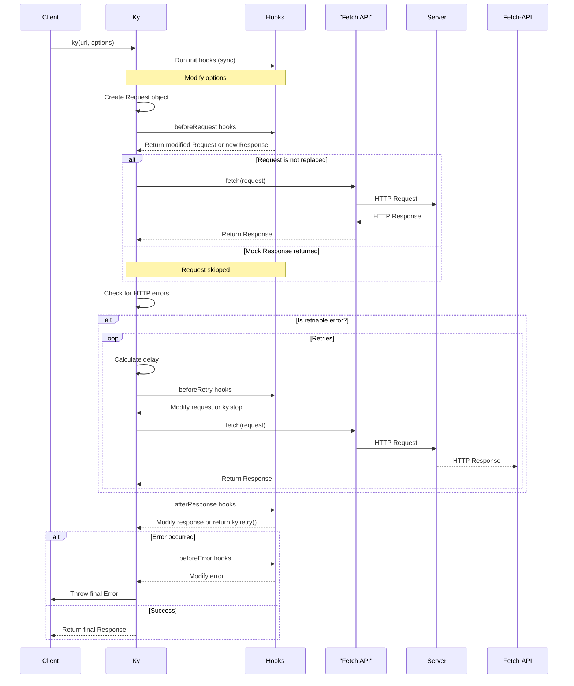

### Hook Summary

| Hook | Trigger | Parameters | Can Return |
|---|---|---|---|
| `init` | Before request construction. | `options` | `void` (mutates options) |
| `beforeRequest` | Before the request is sent. | `request`, `options`, `retryCount` | `Request` (replace), `Response` (short-circuit) |
| `beforeRetry` | Before a retry attempt. | `request`, `options`, `error`, `retryCount` | `Request` (replace), `Response` (short-circuit), `ky.stop` (abort) |
| `beforeError` | Before an error is thrown. | `request`, `options`, `error`, `retryCount` | `Error` (replace error) |
| `afterResponse` | After a response is received. | `request`, `options`, `response`, `retryCount` | `Response` (replace), `ky.retry()` (force retry) |

Sources: [readme.md:442-718](https://github.com/sindresorhus/ky/blob/e0fcf780de2bd69af2528e4b7b87ccae6bb727b1/readme.md#L442-L718)

## Instance Management

Ky allows creating customized instances with default options, which is useful for creating API clients.

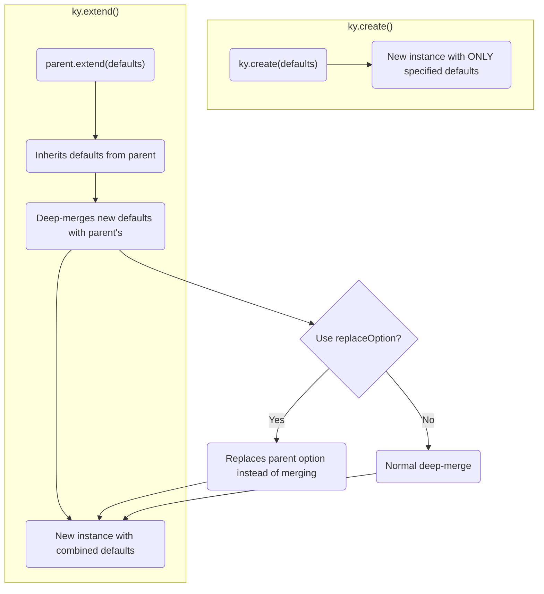

- **`ky.create(defaultOptions)`**: Creates a new, isolated `ky` instance. It does not inherit any defaults from the global `ky` object.
- **`ky.extend(defaultOptions)`**: Creates a new `ky` instance that inherits and deep-merges defaults from its parent instance. This is useful for creating specialized clients from a base client.
- **`replaceOption(value)`**: A helper function used with `ky.extend()` to completely replace a deep-merged option (like `headers` or `hooks`) instead of merging with the parent's value.

Sources: [readme.md:940-1042](https://github.com/sindresorhus/ky/blob/e0fcf780de2bd69af2528e4b7b87ccae6bb727b1/readme.md#L940-L1042), [readme.md:1344-1360](https://github.com/sindresorhus/ky/blob/e0fcf780de2bd69af2528e4b7b87ccae6bb727b1/readme.md#L1344-L1360)

## Error Handling

Ky defines a set of custom error classes to provide detailed information about request failures.

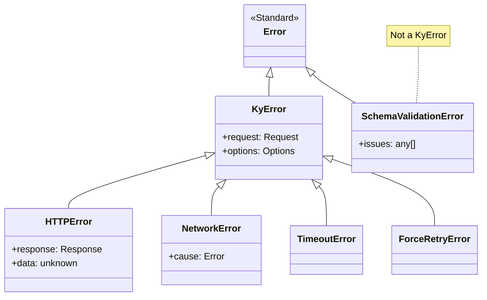

- **`KyError`**: The base class for all errors originating from Ky's HTTP lifecycle.
- **`HTTPError`**: Thrown for non-2xx responses. It contains the `response`, `request`, and `options`. The `data` property holds the pre-parsed response body.
- **`NetworkError`**: Thrown for network-level failures (e.g., DNS error, connection refused). The original error is available in the `cause` property.
- **`TimeoutError`**: Thrown when a request exceeds the configured `timeout` or `totalTimeout`.
- **`SchemaValidationError`**: Thrown by `.json(schema)` when response body validation fails. It is not a subclass of `KyError` because the HTTP request itself was successful.

Sources: [readme.md:1218-1342](https://github.com/sindresorhus/ky/blob/e0fcf780de2bd69af2528e4b7b87ccae6bb727b1/readme.md#L1218-L1342)

## Edge Cases and Gotchas

- **Streaming Bodies and Retries**: When retries are enabled (default), Ky buffers the entire request body in memory. For large streaming uploads, disable retries with `retry: {limit: 0}`.
- **`ky.stop`**: Returning `ky.stop` from a `beforeRetry` hook causes the original `ky` call to resolve with `undefined`. This is incompatible with body parsing methods like `.json()`. Throwing an error is generally preferred.
- **`HTTPError.data`**: Accessing `error.data` on an `HTTPError` instance consumes the response body. You cannot subsequently call methods like `error.response.json()`.
- **`FormData` in Hooks**: To modify a `FormData` body in a hook, you must delete the `Content-Type` header from the request before returning a new `Request` object to allow the browser to set it correctly with a new boundary.
- **`SchemaValidationError`**: This error does not extend `KyError` and will not be caught by `isKyError()`. This is by design, as it represents a data validation failure, not an HTTP transport failure.

Sources: [readme.md:404-406](https://github.com/sindresorhus/ky/blob/e0fcf780de2bd69af2528e4b7b87ccae6bb727b1/readme.md#L404-L406), [readme.md:1052-1054](https://github.com/sindresorhus/ky/blob/e0fcf780de2bd69af2528e4b7b87ccae6bb727b1/readme.md#L1052-L1054), [readme.md:1247-1248](https://github.com/sindresorhus/ky/blob/e0fcf780de2bd69af2528e4b7b87ccae6bb727b1/readme.md#L1247-L1248), [readme.md:1392-1414](https://github.com/sindresorhus/ky/blob/e0fcf780de2bd69af2528e4b7b87ccae6bb727b1/readme.md#L1392-L1414), [readme.md:1224-1226](https://github.com/sindresorhus/ky/blob/e0fcf780de2bd69af2528e4b7b87ccae6bb727b1/readme.md#L1224-L1226)

# Page: Quick Start Guide

<details>
<summary>Relevant source files</summary>

The following files were used as context for generating this wiki page:

- [source/index.ts](https://github.com/sindresorhus/ky/blob/e0fcf780de2bd69af2528e4b7b87ccae6bb727b1/source/index.ts)
- [readme.md](https://github.com/sindresorhus/ky/blob/e0fcf780de2bd69af2528e4b7b87ccae6bb727b1/readme.md)
</details>

# Quick Start Guide

Ky is a lightweight and elegant HTTP client built on the native Fetch API, designed for modern environments like browsers, Node.js, Bun, and Deno. It provides a streamlined API that simplifies common tasks, enhances error handling, and adds powerful features like request retries, timeouts, and hooks, which are not available in the standard `fetch` implementation.

Key benefits over plain `fetch` include a simpler API with method shortcuts, automatic handling of non-2xx status codes as errors, request retries, timeout support, progress events, and a flexible system of hooks for modifying the request lifecycle.

Sources: [readme.md:34-57](https://github.com/sindresorhus/ky/blob/e0fcf780de2bd69af2528e4b7b87ccae6bb727b1/readme.md#L34-L57)

## Basic Usage

Making requests with Ky is designed to be intuitive. For example, sending a JSON payload with a POST request can be done in a single, chained line of code.

```javascript
import ky from 'ky';

const json = await ky.post('https://example.com', {json: {foo: true}}).json();

console.log(json);
//=> {data: '🦄'}
```

This snippet demonstrates the use of a method shortcut (`.post()`), the `json` option for automatic serialization and header setting, and the chained `.json()` method for parsing the response body.

Sources: [readme.md:75-82](https://github.com/sindresorhus/ky/blob/e0fcf780de2bd69af2528e4b7b87ccae6bb727b1/readme.md#L75-L82)

## Core API

The main export of the library is a `ky` instance, which can be used as a function for basic requests or with method shortcuts for specific HTTP verbs.

Sources: [source/index.ts:34-36](https://github.com/sindresorhus/ky/blob/e0fcf780de2bd69af2528e4b7b87ccae6bb727b1/source/index.ts#L34-L36)

### `ky(input, options?)`

The primary `ky` function mirrors the standard `fetch` API, accepting an `input` (URL, string, or `Request` object) and an `options` object. It returns a `ResponsePromise`, which is a `Promise` that resolves to a `Response` object but is enhanced with convenience methods for parsing the body.

These body shortcuts (`.json()`, `.text()`, `.blob()`, etc.) can be called directly on the returned promise, and they will throw an `HTTPError` if the response status is not in the 200-299 range.

```typescript
import ky from 'ky';

// The return type of .json() defaults to `unknown`
const user1 = await ky('/api/users/1').json();

// You can provide a generic type to ky()
const user2 = await ky<User>('/api/users/2').json();

// Or to the body method
const user3 = await ky('/api/users/3').json<User>();
```

Sources: [readme.md:115-144](https://github.com/sindresorhus/ky/blob/e0fcf780de2bd69af2528e4b7b87ccae6bb727b1/readme.md#L115-L144)

### Method Shortcuts

For convenience, Ky provides shortcuts for common HTTP methods. These functions set the `method` option automatically.

*   `ky.get(input, options?)`
*   `ky.post(input, options?)`
*   `ky.put(input, options?)`
*   `ky.patch(input, options?)`
*   `ky.head(input, options?)`
*   `ky.delete(input, options?)`

These methods are dynamically attached to the `ky` instance during its creation.

Sources: [readme.md:170-175](https://github.com/sindresorhus/ky/blob/e0fcf780de2bd69af2528e4b7b87ccae6bb727b1/readme.md#L170-L175), [source/index.ts:14-17](https://github.com/sindresorhus/ky/blob/e0fcf780de2bd69af2528e4b7b87ccae6bb727b1/source/index.ts#L14-L17)

## Request Lifecycle and Hooks

Ky provides a powerful hook system to intercept and modify requests and responses at various stages of their lifecycle. Hooks are defined as arrays of functions within the `hooks` option.

The following diagram illustrates the complete request lifecycle, including hooks, retries, and error handling.

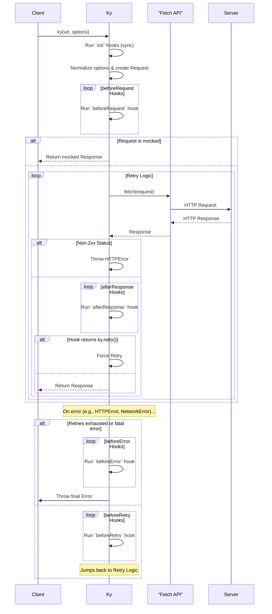

Sources: [readme.md:442-448](https://github.com/sindresorhus/ky/blob/e0fcf780de2bd69af2528e4b7b87ccae6bb727b1/readme.md#L442-L448)

### Hook Reference

| Hook              | Trigger                                                                 | Description -
| `init`            | Before the request is constructed.                                      | Synchronously modify the `options` object in place. Any error thrown will propagate synchronously. -
| `beforeRequest`   | Right before the request is sent.                                       | Modify the `Request` object. Can return a new `Request` to replace the outgoing one, or a `Response` to mock the request entirely. -
| `beforeRetry`     | Before a failed request is retried.                                     | Modify the `Request` before the next attempt. Can return a new `Request`, a `Response` to skip the retry, or `ky.stop` to abort. -
| `beforeError`     | Right before an error is thrown.                                        | Modify the error object before it is thrown to the caller. Useful for augmenting error messages with context. -
| `afterResponse`   | After a response is received, before it's returned to the caller.       | Read or modify the `Response`. Can return a new `Response` to replace the original, or `ky.retry()` to force a retry even on a successful status code. -

Sources: [readme.md:442-718](https://github.com/sindresorhus/ky/blob/e0fcf780de2bd69af2528e4b7b87ccae6bb727b1/readme.md#L442-L718)

## Configuration Options

Ky extends the standard `fetch` options with several powerful additions.

| Option             | Type                                                              | Default -
| `json`             | `object`                                                          | `undefined` -
| `searchParams`     | `string \| object \| URLSearchParams`                             | `''` -
| `baseUrl`          | `string \| URL`                                                   | `undefined` -
| `prefix`           | `string \| URL`                                                   | `undefined` -
| `retry`            | `object \| number`                                                | `{ limit: 2, methods: [...], statusCodes: [...] }` -
| `timeout`          | `number \| false`                                                 | `10000` (10 seconds) -
| `totalTimeout`     | `number \| false`                                                 | `false` -
| `hooks`            | `object`                                                          | `{init: [], beforeRequest: [], ...}` -
| `throwHttpErrors`  | `boolean \| (status: number) => boolean`                          | `true`                                                                                                                                                           -
| `onDownloadProgress` | `Function`                                                        | `undefined` -
| `fetch`            | `Function`                                                        | `globalThis.fetch` -
| `context`          | `object`                                                          | `{}` -

Sources: [readme.md:193-938](https://github.com/sindresorhus/ky/blob/e0fcf780de2bd69af2528e4b7b87ccae6bb727b1/readme.md#L193-L938)

## Error Handling

Ky improves on `fetch` by providing a structured error handling system. All Ky-specific errors extend from the `KyError` base class.

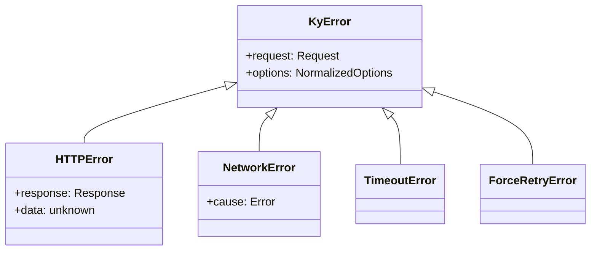

Sources: [readme.md:1218-1226](https://github.com/sindresorhus/ky/blob/e0fcf780de2bd69af2528e4b7b87ccae6bb727b1/readme.md#L1218-L1226), [source/index.ts:71-76](https://github.com/sindresorhus/ky/blob/e0fcf780de2bd69af2528e4b7b87ccae6bb727b1/source/index.ts#L71-L76)

### Error Types

-   **`KyError`**: The base class for all errors originating from Ky. You can check for this with `isKyError()`.
-   **`HTTPError`**: Thrown for non-2xx responses. It contains the `response`, `request`, and `options` objects. The pre-parsed response body is available on the `error.data` property.
-   **`NetworkError`**: Thrown for network-level failures (e.g., DNS resolution failed). These are automatically retried by default.
-   **`TimeoutError`**: Thrown when a request exceeds the configured `timeout` or `totalTimeout`.
-   **`SchemaValidationError`**: Thrown by `.json(schema)` when response body validation fails. This error does *not* extend `KyError`.
-   **`ForceRetryError`**: The internal error passed to `beforeRetry` hooks when a retry is triggered from an `afterResponse` hook via `ky.retry()`.

Sources: [readme.md:1218-1342](https://github.com/sindresorhus/ky/blob/e0fcf780de2bd69af2528e4b7b87ccae6bb727b1/readme.md#L1218-L1342), [source/index.ts:71-83](https://github.com/sindresorhus/ky/blob/e0fcf780de2bd69af2528e4b7b87ccae6bb727b1/source/index.ts#L71-L83)

## Creating Instances

Ky allows you to create new instances with custom default options, which is useful for creating specialized API clients.

### `ky.create(defaultOptions)`

Creates a completely new `ky` instance with its own set of defaults. It does not inherit any configuration from the original `ky` object.

```javascript
import ky from 'ky';

const api = ky.create({baseUrl: 'https://example.com/api/'});

// Makes a request to https://example.com/api/users/123
const response = await api.get('users/123');
```

Sources: [readme.md:1026-1039](https://github.com/sindresorhus/ky/blob/e0fcf780de2bd69af2528e4b7b87ccae6bb727b1/readme.md#L1026-L1039), [source/index.ts:19](https://github.com/sindresorhus/ky/blob/e0fcf780de2bd69af2528e4b7b87ccae6bb727b1/source/index.ts#L19)

### `ky.extend(defaultOptions)`

Creates a new `ky` instance that *inherits* and merges its defaults with the parent instance. This is useful for creating more specific clients from a base client.

```javascript
import ky from 'ky';

const api = ky.create({prefix: 'https://example.com/api'});

// Inherits the prefix from `api`
const usersApi = api.extend({prefix: `${api.defaults.options.prefix}/users`});

// Makes a request to https://example.com/api/users/123
const response = await usersApi.get('123');
```

Options like `hooks`, `headers`, and `searchParams` are deep-merged by default. To replace an option instead of merging, use the `replaceOption` helper.

Sources: [readme.md:940-1024](https://github.com/sindresorhus/ky/blob/e0fcf780de2bd69af2528e4b7b87ccae6bb727b1/readme.md#L940-L1024), [source/index.ts:20-26](https://github.com/sindresorhus/ky/blob/e0fcf780de2bd69af2528e4b7b87ccae6bb727b1/source/index.ts#L20-L26), [source/index.ts:84](https://github.com/sindresorhus/ky/blob/e0fcf780de2bd69af2528e4b7b87ccae6bb727b1/source/index.ts#L84)

## Advanced Features

### Forcing a Retry: `ky.retry(options?)`

From within an `afterResponse` hook, you can return `ky.retry()` to force a request to be retried, even if it was successful (e.g., status 200). This is useful for handling API-specific logic where the body of a successful response indicates a transient state.

The retry respects the `retry.limit` and is observable in `beforeRetry` hooks.

Sources: [readme.md:1079-1084](https://github.com/sindresorhus/ky/blob/e0fcf780de2bd69af2528e4b7b87ccae6bb727b1/readme.md#L1079-L1084), [source/index.ts:29](https://github.com/sindresorhus/ky/blob/e0fcf780de2bd69af2528e4b7b87ccae6bb727b1/source/index.ts#L29)

### Stopping Retries: `ky.stop`

From within a `beforeRetry` hook, you can return the `ky.stop` symbol to prevent any further retry attempts for the current request. This will cause the original `ky` call to resolve with `undefined`.

Sources: [readme.md:1048-1055](https://github.com/sindresorhus/ky/blob/e0fcf780de2bd69af2528e4b7b87ccae6bb727b1/readme.md#L1048-L1055), [source/index.ts:28](https://github.com/sindresorhus/ky/blob/e0fcf780de2bd69af2528e4b7b87ccae6bb727b1/source/index.ts#L28)

# Page: Comparison with Fetch and Axios

<details>
<summary>Relevant source files</summary>

The following files were used as context for generating this wiki page:

- [readme.md](https://github.com/sindresorhus/ky/blob/e0fcf780de2bd69af2528e4b7b87ccae6bb727b1/readme.md)
</details>

# Comparison with Fetch and Axios

Ky is a lightweight and elegant HTTP client built upon the native Fetch API. Its primary goal is to provide a more convenient and user-friendly interface for making HTTP requests compared to using `fetch` directly, while also offering a modern alternative to older libraries like Axios. Ky is designed for modern environments, targeting up-to-date browsers, Node.js, Bun, and Deno.

Sources: [readme.md:34](https://github.com/sindresorhus/ky/blob/e0fcf780de2bd69af2528e4b7b87ccae6bb727b1/readme.md#L34), [readme.md:39](https://github.com/sindresorhus/ky/blob/e0fcf780de2bd69af2528e4b7b87ccae6bb727b1/readme.md#L39)

## Ky vs. Native Fetch

While Ky uses the Fetch API under the hood, it introduces a layer of abstraction that simplifies common tasks and adds powerful features that are not available in the native implementation.

Sources: [readme.md:34](https://github.com/sindresorhus/ky/blob/e0fcf780de2bd69af2528e4b7b87ccae6bb727b1/readme.md#L34)

### Key Advantages

Ky offers numerous benefits over using the plain `fetch` function. The following table summarizes the key features that enhance the developer experience.

| Feature | Description |
| :--- | :--- |
| **Simpler API** | Provides a more concise and intuitive API for making requests. |
| **Method Shortcuts** | Includes convenience methods like `ky.post()`, `ky.get()`, etc. |
| **Error Handling** | Automatically treats non-2xx status codes as errors by throwing an `HTTPError`. |
| **Retries** | Natively supports retrying failed requests with configurable backoff strategies. |
| **JSON Handling** | Offers a dedicated `json` option for sending JSON data, automatically setting headers. |
| **Timeout Support** | Implements request timeouts, a feature missing from the Fetch standard. |
| **Progress Events** | Supports both upload and download progress tracking. |
| **URL Options** | Provides `baseUrl` and `prefix` options for simplifying URL construction. |
| **Custom Instances** | Allows creating instances with custom default options using `ky.create()` and `ky.extend()`. |
| **Hooks** | Exposes a lifecycle hook system (`beforeRequest`, `afterResponse`, etc.) for deep customization. |
| **Response Validation** | Integrates with Standard Schema libraries (like Zod) for response validation. |
| **TypeScript Support** | Offers strong typing, with generics for response bodies and defaulting to `unknown` instead of `any`. |

Sources: [readme.md:43-57](https://github.com/sindresorhus/ky/blob/e0fcf780de2bd69af2528e4b7b87ccae6bb727b1/readme.md#L43-L57)

### API Simplicity: A Code Comparison

The verbosity of native `fetch` for a simple JSON POST request is significantly reduced when using Ky. The example below highlights the difference.

#### Ky Implementation

With Ky, sending a JSON object and parsing the JSON response is a single, chained command.

```js
import ky from 'ky';

const json = await ky.post('https://example.com', {json: {foo: true}}).json();

console.log(json);
//=> {data: '🦄'}
```

Sources: [readme.md:76-82](https://github.com/sindresorhus/ky/blob/e0fcf780de2bd69af2528e4b7b87ccae6bb727b1/readme.md#L76-L82)

#### Native Fetch Implementation

The same operation with native `fetch` requires manual method specification, body stringification, header configuration, and explicit error handling for non-successful status codes.

```js
class HTTPError extends Error {}

const response = await fetch('https://example.com', {
	method: 'POST',
	body: JSON.stringify({foo: true}),
	headers: {
		'content-type': 'application/json'
	}
});

if (!response.ok) {
	throw new HTTPError(`Fetch error: ${response.statusText}`);
}

const json = await response.json();

console.log(json);
//=> {data: '🦄'}
```

Sources: [readme.md:87-105](https://github.com/sindresorhus/ky/blob/e0fcf780de2bd69af2528e4b7b87ccae6bb727b1/readme.md#L87-L105)

### Request Flow Comparison

The following diagram illustrates the reduced number of steps a developer needs to take when making a JSON POST request with Ky versus native Fetch.

```mermaid
sequenceDiagram
    participant Dev as Developer
    participant Ky
    participant Fetch as "Native Fetch"

    box Ky Flow
        Dev->>Ky: ky.post(url, {json: ...}).json()
        Ky-->>Dev: Returns parsed JSON or throws HTTPError
    end

    box Native Fetch Flow
        Dev->>Fetch: fetch(url, {method, body, headers})
        Fetch-->>Dev: Returns Response promise
        Dev->>Dev: Check response.ok
        alt Not OK
            Dev->>Dev: throw new Error()
        end
        Dev->>Fetch: response.json()
        Fetch-->>Dev: Returns parsed JSON promise
    end
```
*This diagram is an abstraction based on the code examples.*
Sources: [readme.md:75-105](https://github.com/sindresorhus/ky/blob/e0fcf780de2bd69af2528e4b7b87ccae6bb727b1/readme.md#L75-L105)

## Ky vs. Axios

Axios is a popular HTTP client that predates the widespread adoption of the Fetch API. While it has a rich feature set, Ky presents a more modern alternative built on web standards.

The primary difference is that Ky is a wrapper around the Fetch API, whereas Axios has its own request implementation based on `XMLHttpRequest` in browsers and Node's native `http` module. This makes Ky smaller, more standards-compliant, and universally compatible with any environment that supports `fetch`.

Sources: [readme.md:1840-1843](https://github.com/sindresorhus/ky/blob/e0fcf780de2bd69af2528e4b7b87ccae6bb727b1/readme.md#L1840-L1843)

### Feature Comparison

| Aspect | Ky | Axios |
| :--- | :--- | :--- |
| **Core API** | Built on the modern, standard [Fetch API](https://developer.mozilla.org/en-US/docs/Web/API/WindowOrWorkerGlobalScope/fetch). | Custom implementation (XMLHttpRequest / Node.js `http`). |
| **Size** | Tiny with no dependencies. | Larger due to its custom implementation and legacy support. |
| **Standards** | Follows the Fetch API standard for `Request` and `Response` objects. | Has its own request and response object structure. |
| **Environments**| Works in all modern environments with `fetch` support (browsers, Node.js, Deno, Bun). | Works in browsers and Node.js. |
| **API Design** | Modern Promise-based API with async/await in mind. | Promise-based API that predates modern JS features. |
| **TypeScript** | Strong TypeScript support with modern features like `unknown` default. | Has TypeScript support, but can carry legacy patterns. |

Sources: [readme.md:34](https://github.com/sindresorhus/ky/blob/e0fcf780de2bd69af2528e4b7b87ccae6bb727b1/readme.md#L34), [readme.md:41](https://github.com/sindresorhus/ky/blob/e0fcf780de2bd69af2528e4b7b87ccae6bb727b1/readme.md#L41), [readme.md:1840-1843](https://github.com/sindresorhus/ky/blob/e0fcf780de2bd69af2528e4b7b87ccae6bb727b1/readme.md#L1840-L1843)

## Related Libraries: Got

Got is another HTTP client from the same maintainers as Ky. It is primarily designed for Node.js. The documentation recommends Ky over Got, as Ky is smaller, works in both browser and server environments, and is more stable due to its foundation on the standardized Fetch API.

Sources: [readme.md:1836-1839](https://github.com/sindresorhus/ky/blob/e0fcf780de2bd69af2528e4b7b87ccae6bb727b1/readme.md#L1836-L1839)

## Conclusion

Ky positions itself as a modern, lightweight, and powerful HTTP client by enhancing the native Fetch API. It offers a significantly simpler and more robust alternative to using `fetch` directly, particularly by providing built-in error handling, retries, and timeouts. When compared to older libraries like Axios, Ky's adherence to the Fetch standard makes it a smaller, more future-proof choice for projects targeting modern JavaScript environments.

# Page: Architecture Overview

<details>
<summary>Relevant source files</summary>

The following files were used as context for generating this wiki page:

- [source/core/Ky.ts](https://github.com/sindresorhus/ky/blob/e0fcf780de2bd69af2528e4b7b87ccae6bb727b1/source/core/Ky.ts)
- [source/index.ts](https://github.com/sindresorhus/ky/blob/e0fcf780de2bd69af2528e4b7b87ccae6bb727b1/source/index.ts)
- [source/core/constants.ts](https://github.com/sindresorhus/ky/blob/e0fcf780de2bd69af2528e4b7b87ccae6bb727b1/source/core/constants.ts)
</details>

# Architecture Overview

The `ky` library is a lightweight, modern HTTP client built on top of the native `fetch` API. Its architecture is centered around the `Ky` class, which encapsulates the entire lifecycle of a single HTTP request, including option processing, hooks, retries, and timeouts. A singleton `ky` instance is exported, providing convenient shortcut methods (`.get()`, `.post()`, etc.) and the ability to create extended instances with default options.

The core design philosophy is to provide a powerful and flexible API while maintaining a small footprint. This is achieved through a modular system of hooks that allow developers to intercept and modify the request/response flow at various stages. The retry mechanism is robust, handling network errors, specific HTTP status codes, and timeouts, with configurable backoff strategies.

## Core Components

The library's functionality is primarily driven by a few key components that work together to manage HTTP requests.

| Component | File | Description |
| :--- | :--- | :--- |
| **`ky` instance** | `source/index.ts` | The main export and entry point. It's a function that creates a request and also holds shortcut methods (`.get`, `.post`, etc.) and utilities (`.extend`, `.create`, `.stop`, `.retry`). |
| **`Ky` class** | `source/core/Ky.ts` | The engine that processes a single request. An instance of this class is created for every `ky()` call. It manages state like retry count, options, and the `Request` object. |
| **Options** | `source/types/options.ts` | Type definitions for all configurable options. These are merged and normalized within the `Ky` constructor. |
| **Constants** | `source/core/constants.ts` | Contains shared constants, feature detection flags (e.g., stream support), and exported symbols/classes like `stop` and `retry`. |

The primary entry point is the `ky` object created by `createInstance`. This function generates the main `ky` callable and attaches the HTTP method shortcuts.

*Sources: [source/index.ts:10-34](https://github.com/sindresorhus/ky/blob/e0fcf780de2bd69af2528e4b7b87ccae6bb727b1/source/index.ts#L10-L34), [source/core/Ky.ts:142-1042](https://github.com/sindresorhus/ky/blob/e0fcf780de2bd69af2528e4b7b87ccae6bb727b1/source/core/Ky.ts#L142-L1042)*

## Request Lifecycle

A `ky` request goes through a well-defined lifecycle, from initiation to final response or error. This process involves option merging, hook execution, fetching, and potential retries.

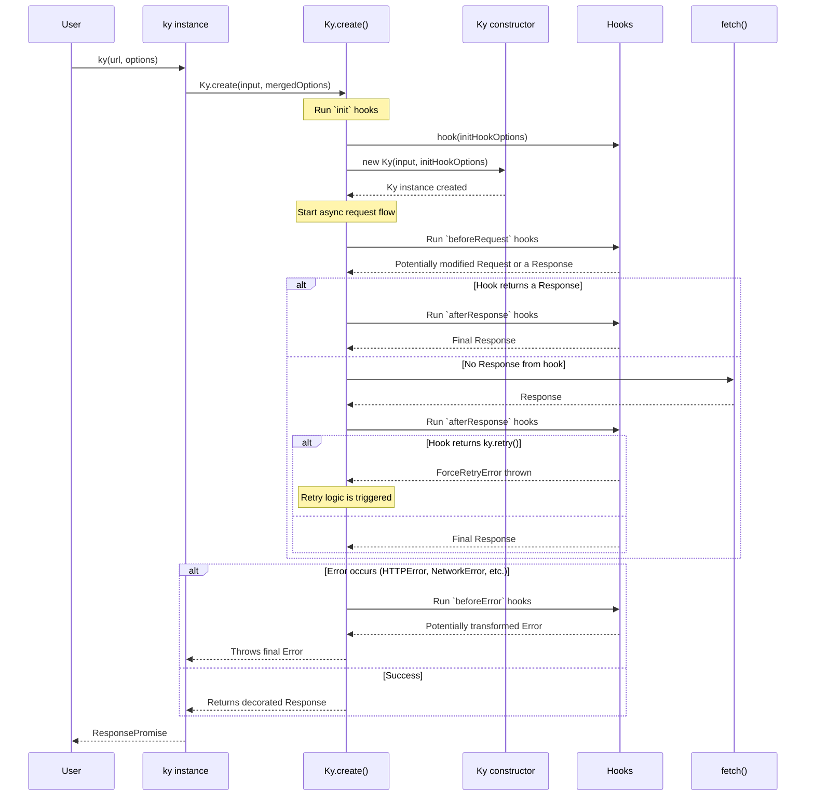

### 1. Initiation and Option Processing

When a request is initiated (e.g., `ky.get(...)`), the following steps occur:
1.  **Option Merging**: Defaults from an extended instance (if any) are merged with the per-request options using `validateAndMerge`.
    *Sources: [source/index.ts:12](https://github.com/sindresorhus/ky/blob/e0fcf780de2bd69af2528e4b7b87ccae6bb727b1/source/index.ts#L12), [source/index.ts:16](https://github.com/sindresorhus/ky/blob/e0fcf780de2bd69af2528e4b7b87ccae6bb727b1/source/index.ts#L16), [source/index.ts:25](https://github.com/sindresorhus/ky/blob/e0fcf780de2bd69af2528e4b7b87ccae6bb727b1/source/index.ts#L25)*
2.  **`init` Hooks**: The static `Ky.create` method is called. It first clones mutable options (`json`, `context`, `headers`, `searchParams`, `retry`) to prevent state leakage between requests. Then, it executes all `init` hooks, which can modify these cloned options.
    *Sources: [source/core/Ky.ts:143-149](https://github.com/sindresorhus/ky/blob/e0fcf780de2bd69af2528e4b7b87ccae6bb727b1/source/core/Ky.ts#L143-L149), [source/core/Ky.ts:96-110](https://github.com/sindresorhus/ky/blob/e0fcf780de2bd69af2528e4b7b87ccae6bb727b1/source/core/Ky.ts#L96-L110)*
3.  **`Ky` Instantiation**: A new `Ky` class instance is created. Its constructor:
    *   Normalizes options, setting defaults for `method`, `timeout` (10,000ms), `throwHttpErrors` (true), etc.
    *   Processes URL-related options like `prefix` and `baseUrl`.
    *   Sets up an `AbortController` to manage timeouts and user-provided abort signals.
    *   Serializes the `json` option into the request `body` and sets the `Content-Type` header.
    *   Builds the final `Request` object, applying all processed `searchParams`.
    *Sources: [source/core/Ky.ts:364-485](https://github.com/sindresorhus/ky/blob/e0fcf780de2bd69af2528e4b7b87ccae6bb727b1/source/core/Ky.ts#L364-L485)*

### 2. Pre-flight and Fetching

1.  **`beforeRequest` Hooks**: These hooks are executed in order. They can modify the `Request` object or return a `Response` instance to bypass the actual fetch operation entirely.
    *Sources: [source/core/Ky.ts:164](https://github.com/sindresorhus/ky/blob/e0fcf780de2bd69af2528e4b7b87ccae6bb727b1/source/core/Ky.ts#L164), [source/core/Ky.ts:767-784](https://github.com/sindresorhus/ky/blob/e0fcf780de2bd69af2528e4b7b87ccae6bb727b1/source/core/Ky.ts#L767-L784)*
2.  **Fetch Execution**: The `#fetch` method is called, wrapped in the `#retry` logic.
    *   It calculates the effective timeout, considering both `timeout` and the remaining `totalTimeout`.
    *   It calls the underlying `fetch` function, using a `timeout` utility to race it against a timer.
    *   If retries are enabled, the request is cloned before being sent to preserve its body for subsequent attempts.
    *Sources: [source/core/Ky.ts:936-984](https://github.com/sindresorhus/ky/blob/e0fcf780de2bd69af2528e4b7b87ccae6bb727b1/source/core/Ky.ts#L936-L984)*

### 3. Post-flight and Response Handling

1.  **`afterResponse` Hooks**: After a response is received, `afterResponse` hooks are executed. These hooks can:
    *   Inspect or modify the `Response`.
    *   Return a new `Response`.
    *   Trigger a forced retry by returning `ky.retry()`, which throws a `ForceRetryError`.
    *Sources: [source/core/Ky.ts:179](https://github.com/sindresorhus/ky/blob/e0fcf780de2bd69af2528e4b7b87ccae6bb727b1/source/core/Ky.ts#L179), [source/core/Ky.ts:786-842](https://github.com/sindresorhus/ky/blob/e0fcf780de2bd69af2528e4b7b87ccae6bb727b1/source/core/Ky.ts#L786-L842), [source/core/constants.ts:162-244](https://github.com/sindresorhus/ky/blob/e0fcf780de2bd69af2528e4b7b87ccae6bb727b1/source/core/constants.ts#L162-L244)*
2.  **Error Handling**:
    *   If `throwHttpErrors` is true and the response status is not `ok` (and not an opaque response), an `HTTPError` is thrown. The error object contains the `request` and `response`, and its `data` property is populated by reading the response body.
    *   This `HTTPError` can trigger the retry mechanism.
    *Sources: [source/core/Ky.ts:200-226](https://github.com/sindresorhus/ky/blob/e0fcf780de2bd69af2528e4b7b87ccae6bb727b1/source/core/Ky.ts#L200-L226)*
3.  **Final Error Processing**: If any error (e.g., `HTTPError`, `NetworkError`, `TimeoutError`) is not handled by a retry, it passes through the `beforeError` hooks. These hooks can inspect the error and return a new `Error` instance to replace the original one before it's thrown to the user.
    *Sources: [source/core/Ky.ts:269-287](https://github.com/sindresorhus/ky/blob/e0fcf780de2bd69af2528e4b7b87ccae6bb727b1/source/core/Ky.ts#L269-L287)*
4.  **Response Decoration**: A successful `Response` is decorated with convenience methods like `.json()`, `.text()`, etc., before the `ResponsePromise` resolves. These methods set the `Accept` header on the original request before awaiting the response.
    *Sources: [source/core/Ky.ts:235](https://github.com/sindresorhus/ky/blob/e0fcf780de2bd69af2528e4b7b87ccae6bb727b1/source/core/Ky.ts#L235), [source/core/Ky.ts:300-334](https://github.com/sindresorhus/ky/blob/e0fcf780de2bd69af2528e4b7b87ccae6bb727b1/source/core/Ky.ts#L300-L334)*

## Retry Mechanism

`ky` provides a sophisticated retry mechanism that can be triggered by various conditions. The logic is primarily handled by the `#retryFromError` and `#calculateRetryDelay` methods.

*Sources: [source/core/Ky.ts:852-928](https://github.com/sindresorhus/ky/blob/e0fcf780de2bd69af2528e4b7b87ccae6bb727b1/source/core/Ky.ts#L852-L928), [source/core/Ky.ts:504-590](https://github.com/sindresorhus/ky/blob/e0fcf780de2bd69af2528e4b7b87ccae6bb727b1/source/core/Ky.ts#L504-L590)*

### Retry Triggers

A retry is attempted if the request fails and all of the following conditions are met:
1.  The retry `limit` has not been exceeded.
2.  The request `method` is one of the allowed methods (e.g., `get`, `put`, `head`, etc.).
3.  The error is a known retriable type (`NetworkError`, `TimeoutError`) or an `HTTPError` with a status code present in `retry.statusCodes`.
4.  A user-provided `shouldRetry` function does not return `false`.

A retry can also be forced from an `afterResponse` hook using `ky.retry()`, which bypasses most of these checks.

*Sources: [source/core/Ky.ts:505-507](https://github.com/sindresorhus/ky/blob/e0fcf780de2bd69af2528e4b7b87ccae6bb727b1/source/core/Ky.ts#L505-L507), [source/core/Ky.ts:518-520](https://github.com/sindresorhus/ky/blob/e0fcf780de2bd69af2528e4b7b87ccae6bb727b1/source/core/Ky.ts#L518-L520), [source/core/Ky.ts:548-551](https://github.com/sindresorhus/ky/blob/e0fcf780de2bd69af2528e4b7b87ccae6bb727b1/source/core/Ky.ts#L548-L551), [source/core/Ky.ts:513-515](https://github.com/sindresorhus/ky/blob/e0fcf780de2bd69af2528e4b7b87ccae6bb727b1/source/core/Ky.ts#L513-L515)*

### Retry Configuration

The retry behavior is configured via the `retry` option.

| Property | Type | Default | Description |
| :--- | :--- | :--- | :--- |
| `limit` | `number` | `2` | Maximum number of retries. |
| `methods` | `string[]` | `['get', 'put', 'head', 'delete', 'options', 'trace']` | HTTP methods to retry on. |
| `statusCodes` | `number[]` | `[408, 413, 429, 500, 502, 503, 504]` | HTTP status codes to retry on. |
| `afterStatusCodes` | `number[]` | `[413, 429, 503]` | Status codes that can have a `Retry-After` header. |
| `delay` | `(retryCount: number) => number` | `retryCount => 0.3 * (2 ** (retryCount - 1)) * 1000` | Calculates the delay before the next retry (exponential backoff). |
| `backoffLimit` | `number` | `Infinity` | The maximum delay between retries. |
| `jitter` | `boolean \| (delay: number) => number` | `true` | If `true`, applies random jitter to the delay. Can be a custom function. |
| `retryOnTimeout` | `boolean` | `true` | Whether to retry on `TimeoutError`. |
| `shouldRetry` | `(state: ShouldRetryState) => boolean \| Promise<boolean>` | `undefined` | A function to determine if a retry should occur. Takes precedence over default checks. |

*Sources: [source/core/Ky.ts:377](https://github.com/sindresorhus/ky/blob/e0fcf780de2bd69af2528e4b7b87ccae6bb727b1/source/core/Ky.ts#L377), [source/utils/normalize.ts](https://github.com/sindresorhus/ky/blob/e0fcf780de2bd69af2528e4b7b87ccae6bb727b1/source/utils/normalize.ts) (not provided, but referenced)*

### `beforeRetry` Hooks

Before each retry attempt, `beforeRetry` hooks are executed. They receive the `request`, `options`, `error`, and `retryCount`. These hooks can:
-   Log the retry attempt.
-   Modify the `request` for the next attempt (e.g., change endpoint, add headers).
-   Return a `Response` to stop retrying and resolve the promise with that response.
-   Return the `ky.stop` symbol to stop retrying and reject the promise with the current error.

*Sources: [source/core/Ky.ts:886-922](https://github.com/sindresorhus/ky/blob/e0fcf780de2bd69af2528e4b7b87ccae6bb727b1/source/core/Ky.ts#L886-L922), [source/core/constants.ts:66](https://github.com/sindresorhus/ky/blob/e0fcf780de2bd69af2528e4b7b87ccae6bb727b1/source/core/constants.ts#L66)*

## Hooks System

Hooks are a central part of `ky`'s architecture, providing extensibility at key points in the request lifecycle.

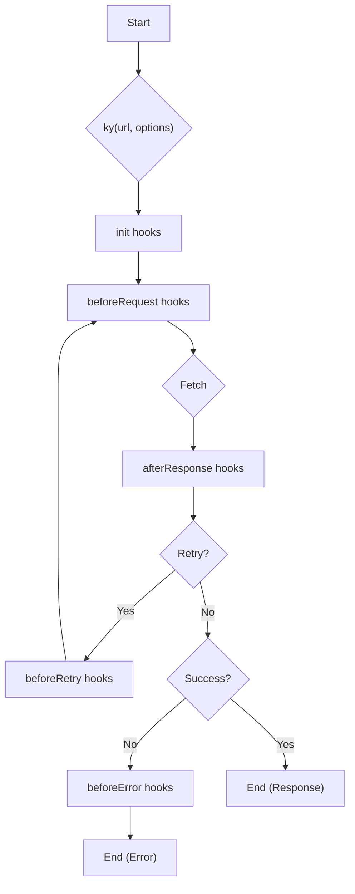

| Hook | Trigger | Purpose | Can Return |
| :--- | :--- | :--- | :--- |
| `init` | Before the `Ky` instance is created. | Modify options for a single request. | `void` |
| `beforeRequest` | Before the request is sent. | Modify the `Request` object. | `Request`, `Response`, `void` |
| `afterResponse` | After a response is received. | Modify the `Response` object. | `Response`, `ky.retry()`, `void` |
| `beforeRetry` | Before a retry attempt. | Modify the `Request` for the retry. | `Request`, `Response`, `ky.stop`, `void` |
| `beforeError` | Before an error is thrown to the user. | Transform the final `Error` object. | `Error`, `void` |

*Sources: [source/core/Ky.ts:144-149](https://github.com/sindresorhus/ky/blob/e0fcf780de2bd69af2528e4b7b87ccae6bb727b1/source/core/Ky.ts#L144-L149), [source/core/Ky.ts:767-784](https://github.com/sindresorhus/ky/blob/e0fcf780de2bd69af2528e4b7b87ccae6bb727b1/source/core/Ky.ts#L767-L784), [source/core/Ky.ts:786-842](https://github.com/sindresorhus/ky/blob/e0fcf780de2bd69af2528e4b7b87ccae6bb727b1/source/core/Ky.ts#L786-L842), [source/core/Ky.ts:886-922](https://github.com/sindresorhus/ky/blob/e0fcf780de2bd69af2528e4b7b87ccae6bb727b1/source/core/Ky.ts#L886-L922), [source/core/Ky.ts:269-287](https://github.com/sindresorhus/ky/blob/e0fcf780de2bd69af2528e4b7b87ccae6bb727b1/source/core/Ky.ts#L269-L287)*

## Timeout Management

`ky` manages two types of timeouts using `AbortController`.
1.  **`timeout`**: A per-request timeout. If a single fetch attempt takes longer than this value, it's aborted, and a `TimeoutError` is thrown, which may trigger a retry. The default is 10,000ms.
    *Sources: [source/core/Ky.ts:379](https://github.com/sindresorhus/ky/blob/e0fcf780de2bd69af2528e4b7b87ccae6bb727b1/source/core/Ky.ts#L379), [source/core/Ky.ts:963-974](https://github.com/sindresorhus/ky/blob/e0fcf780de2bd69af2528e4b7b87ccae6bb727b1/source/core/Ky.ts#L963-L974)*
2.  **`totalTimeout`**: A timeout for the entire operation, including all hooks, delays, and retry attempts. It starts when the `Ky` instance is created. If this time is exceeded, a `TimeoutError` is thrown, and no further retries are attempted. The default is `false` (disabled).
    *Sources: [source/core/Ky.ts:380](https://github.com/sindresorhus/ky/blob/e0fcf780de2bd69af2528e4b7b87ccae6bb727b1/source/core/Ky.ts#L380), [source/core/Ky.ts:484](https://github.com/sindresorhus/ky/blob/e0fcf780de2bd69af2528e4b7b87ccae6bb727b1/source/core/Ky.ts#L484), [source/core/Ky.ts:986-993](https://github.com/sindresorhus/ky/blob/e0fcf780de2bd69af2528e4b7b87ccae6bb727b1/source/core/Ky.ts#L986-L993)*

A managed `AbortSignal` is created by combining the internal `AbortController`'s signal with any user-provided signal via `AbortSignal.any()`. This ensures that either a timeout or a user cancellation will abort the request.

*Sources: [source/core/Ky.ts:408-412](https://github.com/sindresorhus/ky/blob/e0fcf780de2bd69af2528e4b7b87ccae6bb727b1/source/core/Ky.ts#L408-L412), [source/core/Ky.ts:754-758](https://github.com/sindresorhus/ky/blob/e0fcf780de2bd69af2528e4b7b87ccae6bb727b1/source/core/Ky.ts#L754-L758)*

## Edge Cases and Gotchas

-   **Renamed Option**: The `prefixUrl` option was renamed to `prefix` in v2. Using `prefixUrl` will throw an error.
    *Sources: [source/core/Ky.ts:45](https://github.com/sindresorhus/ky/blob/e0fcf780de2bd69af2528e4b7b87ccae6bb727b1/source/core/Ky.ts#L45), [source/core/Ky.ts:366-368](https://github.com/sindresorhus/ky/blob/e0fcf780de2bd69af2528e4b7b87ccae6bb727b1/source/core/Ky.ts#L366-L368)*
-   **Timeout Limit**: The `timeout` and `totalTimeout` options cannot be greater than `2_147_483_647` (the maximum value of a 32-bit signed integer).
    *Sources: [source/core/constants.ts:58](https://github.com/sindresorhus/ky/blob/e0fcf780de2bd69af2528e4b7b87ccae6bb727b1/source/core/constants.ts#L58), [source/core/Ky.ts:154-160](https://github.com/sindresorhus/ky/blob/e0fcf780de2bd69af2528e4b7b87ccae6bb727b1/source/core/Ky.ts#L154-L160)*
-   **Stream-Dependent Features**: Features like `onDownloadProgress` and `onUploadProgress` require a `ReadableStream`-compatible environment. `ky` performs feature detection, and using these options in an unsupported environment will throw an error.
    *Sources: [source/core/constants.ts:4-32](https://github.com/sindresorhus/ky/blob/e0fcf780de2bd69af2528e4b7b87ccae6bb727b1/source/core/constants.ts#L4-L32), [source/core/constants.ts:36](https://github.com/sindresorhus/ky/blob/e0fcf780de2bd69af2528e4b7b87ccae6bb727b1/source/core/constants.ts#L36), [source/core/Ky.ts:243-245](https://github.com/sindresorhus/ky/blob/e0fcf780de2bd69af2528e4b7b87ccae6bb727b1/source/core/Ky.ts#L243-L245)*
-   **Streaming Body and Retries**: When retries are enabled, the request body is cloned. For streaming bodies, this can cause the entire stream to be buffered in memory, which can be problematic for large uploads.
    *Sources: [source/core/Ky.ts:950-951](https://github.com/sindresorhus/ky/blob/e0fcf780de2bd69af2528e4b7b87ccae6bb727b1/source/core/Ky.ts#L950-L951)*
-   **Opaque Responses**: Responses from `no-cors` requests are "opaque". They always have a status of `0` and `ok: false`, but this does not trigger an `HTTPError`, as the actual status is inaccessible.
    *Sources: [source/core/Ky.ts:199-204](https://github.com/sindresorhus/ky/blob/e0fcf780de2bd69af2528e4b7b87ccae6bb727b1/source/core/Ky.ts#L199-L204)*
-   **`beforeRetry` Error Propagation**: If a `beforeRetry` hook throws an error, that new error is tracked and will bypass subsequent `beforeError` hooks to avoid unintended transformations of hook-level errors.
    *Sources: [source/core/Ky.ts:265-267](https://github.com/sindresorhus/ky/blob/e0fcf780de2bd69af2528e4b7b87ccae6bb727b1/source/core/Ky.ts#L265-L267), [source/core/Ky.ts:896-902](https://github.com/sindresorhus/ky/blob/e0fcf780de2bd69af2528e4b7b87ccae6bb727b1/source/core/Ky.ts#L896-L902)*

# Page: The Request Lifecycle (End-to-End)

<details>
<summary>Relevant source files</summary>

The following files were used as context for generating this wiki page:

- [source/core/Ky.ts](https://github.com/sindresorhus/ky/blob/e0fcf780de2bd69af2528e4b7b87ccae6bb727b1/source/core/Ky.ts)
</details>

# The Request Lifecycle (End-to-End)

The `ky` request lifecycle is a comprehensive, promise-based process that manages an HTTP request from its creation to the final response. It incorporates a powerful system of hooks, a robust retry mechanism, and detailed error handling. This lifecycle provides developers with multiple points of intervention to inspect, modify, and control the request and response flow. The entire process is encapsulated within the `Ky` class.

The lifecycle begins when a request is initiated. `Ky.create` serves as the static entry point, which then instantiates the `Ky` class. The instance proceeds through a sequence of steps: option initialization, running `beforeRequest` hooks, executing the fetch call (potentially with retries), processing the response through `afterResponse` hooks, and finally, handling any errors via `beforeError` hooks before the promise resolves or rejects.

## 1. Initialization Phase

The lifecycle starts with the `Ky.create` static method, which prepares the options and creates a `Ky` instance.

Sources: [source/core/Ky.ts:143-152](https://github.com/sindresorhus/ky/blob/e0fcf780de2bd69af2528e4b7b87ccae6bb727b1/source/core/Ky.ts#L143-L152)

### 1.1. `init` Hooks

Before the `Ky` instance is created, `init` hooks are executed. These hooks can modify the request `Options`. To prevent state leakage between requests, a shallow clone of mutable options like `json`, `context`, `headers`, `searchParams`, and `retry` is created and passed to the hooks.

-   **Purpose**: To modify request options at the earliest stage.
-   **Execution**: Synchronously, in the order they are defined.
-   **Input**: A clone of the `Options` object.

Sources: [source/core/Ky.ts:144-149](https://github.com/sindresorhus/ky/blob/e0fcf780de2bd69af2528e4b7b87ccae6bb727b1/source/core/Ky.ts#L144-L149), [source/core/Ky.ts:96-110](https://github.com/sindresorhus/ky/blob/e0fcf780de2bd69af2528e4b7b87ccae6bb727b1/source/core/Ky.ts#L96-L110)

### 1.2. `Ky` Constructor

The `Ky` constructor is responsible for normalizing and merging all options, resolving the final request URL, and creating the initial `Request` object.

-   **URL Resolution**: It handles `prefix` and `baseUrl` options to construct the final URL from the provided `input`.
    Sources: [source/core/Ky.ts:390-406](https://github.com/sindresorhus/ky/blob/e0fcf780de2bd69af2528e4b7b87ccae6bb727b1/source/core/Ky.ts#L390-L406)
-   **Option Normalization**: It sets defaults for options like `method` ('GET'), `timeout` (10,000ms), and `throwHttpErrors` (true). It also normalizes the `retry` configuration.
    Sources: [source/core/Ky.ts:370-383](https://github.com/sindresorhus/ky/blob/e0fcf780de2bd69af2528e4b7b87ccae6bb727b1/source/core/Ky.ts#L370-L383)
-   **Body & Headers**: If the `json` option is provided, it stringifies the body and sets the `Content-Type` header to `application/json`. It also handles `searchParams`.
    Sources: [source/core/Ky.ts:419-422](https://github.com/sindresorhus/ky/blob/e0fcf780de2bd69af2528e4b7b87ccae6bb727b1/source/core/Ky.ts#L419-L422), [source/core/Ky.ts:437-476](https://github.com/sindresorhus/ky/blob/e0fcf780de2bd69af2528e4b7b87ccae6bb727b1/source/core/Ky.ts#L437-L476)
-   **Abort Signal**: It sets up an `AbortController` to manage timeouts and user-provided abort signals.
    Sources: [source/core/Ky.ts:408-412](https://github.com/sindresorhus/ky/blob/e0fcf780de2bd69af2528e4b7b87ccae6bb727b1/source/core/Ky.ts#L408-L412)
-   **Request Object Creation**: Finally, it creates a `Request` instance which is stored as `this.request`.
    Sources: [source/core/Ky.ts:435](https://github.com/sindresorhus/ky/blob/e0fcf780de2bd69af2528e4b7b87ccae6bb727b1/source/core/Ky.ts#L435), [source/core/Ky.ts:475](https://github.com/sindresorhus/ky/blob/e0fcf780de2bd69af2528e4b7b87ccae6bb727b1/source/core/Ky.ts#L475)

## 2. Execution Flow

After initialization, the main asynchronous execution function begins. This flow is orchestrated to handle hooks, retries, and the final response processing.

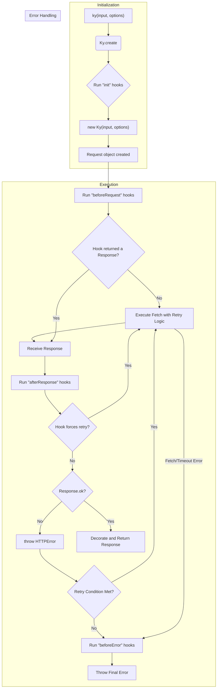
*A high-level overview of the request lifecycle.*
Sources: [source/core/Ky.ts:153-298](https://github.com/sindresorhus/ky/blob/e0fcf780de2bd69af2528e4b7b87ccae6bb727b1/source/core/Ky.ts#L153-L298)

### 2.1. `beforeRequest` Hooks

Before the request is sent, `beforeRequest` hooks are executed. They can be used to modify the `Request` object or even short-circuit the request by returning a `Response` object directly.

-   **Purpose**: To inspect or modify the final `Request` before it is sent, or to provide a cached/mock `Response`.
-   **Execution**: Asynchronously, in series.
-   **Return Value**:
    -   `Request`: Replaces the current request object.
    -   `Response`: Skips the actual fetch and proceeds directly to the `afterResponse` hooks.
    -   `undefined` (or nothing): The lifecycle continues with the current request.

Sources: [source/core/Ky.ts:164](https://github.com/sindresorhus/ky/blob/e0fcf780de2bd69af2528e4b7b87ccae6bb727b1/source/core/Ky.ts#L164), [source/core/Ky.ts:767-784](https://github.com/sindresorhus/ky/blob/e0fcf780de2bd69af2528e4b7b87ccae6bb727b1/source/core/Ky.ts#L767-L784)

### 2.2. Fetch and Timeouts

The core of the execution is the `#fetch` method, which performs the network request.

-   **Request Cloning**: If retries are enabled, the request is cloned before being sent. This is necessary because a `Request` body can only be consumed once. Note that this can cause high memory usage for large streaming uploads.
    Sources: [source/core/Ky.ts:946](https://github.com/sindresorhus/ky/blob/e0fcf780de2bd69af2528e4b7b87ccae6bb727b1/source/core/Ky.ts#L946), [source/core/Ky.ts:950-951](https://github.com/sindresorhus/ky/blob/e0fcf780de2bd69af2528e4b7b87ccae6bb727b1/source/core/Ky.ts#L950-L951)
-   **Timeouts**: `ky` manages two types of timeouts:
    -   `timeout`: An individual request timeout. If it's exceeded, a `TimeoutError` is thrown, which may trigger a retry.
        Sources: [source/core/Ky.ts:379](https://github.com/sindresorhus/ky/blob/e0fcf780de2bd69af2528e4b7b87ccae6bb727b1/source/core/Ky.ts#L379), [source/core/Ky.ts:963-974](https://github.com/sindresorhus/ky/blob/e0fcf780de2bd69af2528e4b7b87ccae6bb727b1/source/core/Ky.ts#L963-L974)
    -   `totalTimeout`: A timeout for the entire lifecycle, including delays between retries and time spent in hooks. It starts when the `Ky` instance is created.
        Sources: [source/core/Ky.ts:380](https://github.com/sindresorhus/ky/blob/e0fcf780de2bd69af2528e4b7b87ccae6bb727b1/source/core/Ky.ts#L380), [source/core/Ky.ts:482-484](https://github.com/sindresorhus/ky/blob/e0fcf780de2bd69af2528e4b7b87ccae6bb727b1/source/core/Ky.ts#L482-L484), [source/core/Ky.ts:986-993](https://github.com/sindresorhus/ky/blob/e0fcf780de2bd69af2528e4b7b87ccae6bb727b1/source/core/Ky.ts#L986-L993)
-   **Error Wrapping**: Raw network errors are caught and wrapped in a `NetworkError` instance.
    Sources: [source/core/Ky.ts:978-980](https://github.com/sindresorhus/ky/blob/e0fcf780de2bd69af2528e4b7b87ccae6bb727b1/source/core/Ky.ts#L978-L980)

### 2.3. `afterResponse` Hooks

After a response is received (either from the network or a `beforeRequest` hook), `afterResponse` hooks are executed. These hooks can inspect the `Response`, modify it, or trigger a retry.

-   **Purpose**: To inspect or transform the `Response`.
-   **Execution**: Asynchronously, in series. Each hook receives a clone of the response.
-   **Return Value**:
    -   `Response`: Replaces the current response.
    -   `ky.retry`: A special marker that throws a `ForceRetryError`, triggering the retry mechanism. Custom delay and request options can be provided.
    -   `undefined` (or nothing): The lifecycle continues with the original response.

Sources: [source/core/Ky.ts:179](https://github.com/sindresorhus/ky/blob/e0fcf780de2bd69af2528e4b7b87ccae6bb727b1/source/core/Ky.ts#L179), [source/core/Ky.ts:786-842](https://github.com/sindresorhus/ky/blob/e0fcf780de2bd69af2528e4b7b87ccae6bb727b1/source/core/Ky.ts#L786-L842)

## 3. Retry Mechanism

`ky` features a sophisticated retry mechanism that can be triggered by network errors, specific HTTP status codes, timeouts, or explicitly from an `afterResponse` hook.

The retry logic is primarily handled in `#retryFromError` and `#calculateRetryDelay`.

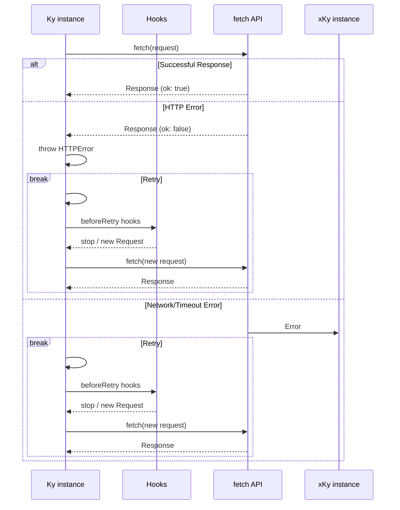
*A sequence diagram illustrating the retry flow for different error types.*
Sources: [source/core/Ky.ts:844-928](https://github.com/sindresorhus/ky/blob/e0fcf780de2bd69af2528e4b7b87ccae6bb727b1/source/core/Ky.ts#L844-L928)

### 3.1. Retry Conditions

A retry is attempted if all the following conditions are met:
1.  The number of retries has not exceeded the configured `limit`.
    Sources: [source/core/Ky.ts:505-507](https://github.com/sindresorhus/ky/blob/e0fcf780de2bd69af2528e4b7b87ccae6bb727b1/source/core/Ky.ts#L505-L507)
2.  The request `method` is in the list of allowed methods (e.g., `get`, `put`, `head`).
    Sources: [source/core/Ky.ts:518-520](https://github.com/sindresorhus/ky/blob/e0fcf780de2bd69af2528e4b7b87ccae6bb727b1/source/core/Ky.ts#L518-L520)
3.  The error type is retriable:
    -   `ForceRetryError`: Always retried.
        Sources: [source/core/Ky.ts:513-515](https://github.com/sindresorhus/ky/blob/e0fcf780de2bd69af2528e4b7b87ccae6bb727b1/source/core/Ky.ts#L513-L515)
    -   `TimeoutError`: Retried if `retryOnTimeout` is `true`.
        Sources: [source/core/Ky.ts:540-543](https://github.com/sindresorhus/ky/blob/e0fcf780de2bd69af2528e4b7b87ccae6bb727b1/source/core/Ky.ts#L540-L543)
    -   `HTTPError`: Retried if the response status code is in the configured `statusCodes` list (e.g., `408`, `413`, `429`, `5xx`).
        Sources: [source/core/Ky.ts:548-551](https://github.com/sindresorhus/ky/blob/e0fcf780de2bd69af2528e4b7b87ccae6bb727b1/source/core/Ky.ts#L548-L551)
    -   `NetworkError`: Always retried.
        Sources: [source/core/Ky.ts:585-587](https://github.com/sindresorhus/ky/blob/e0fcf780de2bd69af2528e4b7b87ccae6bb727b1/source/core/Ky.ts#L585-L587)
4.  A custom `shouldRetry` function, if provided, does not return `false`.
    Sources: [source/core/Ky.ts:523-528](https://github.com/sindresorhus/ky/blob/e0fcf780de2bd69af2528e4b7b87ccae6bb727b1/source/core/Ky.ts#L523-L528)

### 3.2. Retry Delay

The delay before the next attempt is calculated based on several factors:
-   **`Retry-After` Header**: If the response has a `Retry-After` header and the status code is in `afterStatusCodes`, its value is used.
    Sources: [source/core/Ky.ts:553-575](https://github.com/sindresorhus/ky/blob/e0fcf780de2bd69af2528e4b7b87ccae6bb727b1/source/core/Ky.ts#L553-L575)
-   **Backoff**: A calculated delay based on the `delay` function in the retry options.
    Sources: [source/core/Ky.ts:487-488](https://github.com/sindresorhus/ky/blob/e0fcf780de2bd69af2528e4b7b87ccae6bb727b1/source/core/Ky.ts#L487-L488)
-   **Jitter**: A random factor can be applied to the backoff delay to prevent thundering herd problems.
    Sources: [source/core/Ky.ts:491-499](https://github.com/sindresorhus/ky/blob/e0fcf780de2bd69af2528e4b7b87ccae6bb727b1/source/core/Ky.ts#L491-L499)
-   **Limits**: The delay is capped by `backoffLimit` and `maxRetryAfter`.
    Sources: [source/core/Ky.ts:501](https://github.com/sindresorhus/ky/blob/e0fcf780de2bd69af2528e4b7b87ccae6bb727b1/source/core/Ky.ts#L501), [source/core/Ky.ts:574](https://github.com/sindresorhus/ky/blob/e0fcf780de2bd69af2528e4b7b87ccae6bb727b1/source/core/Ky.ts#L574)

### 3.3. `beforeRetry` Hooks

If a retry is determined to be necessary, `beforeRetry` hooks are executed just before the delay.

-   **Purpose**: To log retry attempts, modify the request for the next attempt, or to stop the retry process.
-   **Execution**: Asynchronously, in series.
-   **Return Value**:
    -   `Request`: Replaces the request for the next attempt.
    -   `Response`: Short-circuits the retry and resolves the main promise with this response.
    -   `ky.stop`: A special symbol that cancels the retry process. The original error is then processed by `beforeError` hooks.
    -   `undefined` (or nothing): The retry continues with the current request.

Sources: [source/core/Ky.ts:886-922](https://github.com/sindresorhus/ky/blob/e0fcf780de2bd69af2528e4b7b87ccae6bb727b1/source/core/Ky.ts#L886-L922)

## 4. Response and Error Handling

### 4.1. Successful Response

If a request completes successfully (and is not retried), the final `Response` object is processed.
-   **HTTP Errors**: If `throwHttpErrors` is `true` (the default) and `response.ok` is `false`, an `HTTPError` is thrown, which may trigger a retry. The body of the error response is read (up to a limit of 10MB) and attached to the error object.
    Sources: [source/core/Ky.ts:200-226](https://github.com/sindresorhus/ky/blob/e0fcf780de2bd69af2528e4b7b87ccae6bb727b1/source/core/Ky.ts#L200-L226), [source/core/Ky.ts:44](https://github.com/sindresorhus/ky/blob/e0fcf780de2bd69af2528e4b7b87ccae6bb727b1/source/core/Ky.ts#L44)
-   **Response Decoration**: The `Response` object is decorated with convenience methods like `.json()`, `.text()`, etc. These methods set the `Accept` header on the original request before the promise is awaited.
    Sources: [source/core/Ky.ts:235](https://github.com/sindresorhus/ky/blob/e0fcf780de2bd69af2528e4b7b87ccae6bb727b1/source/core/Ky.ts#L235), [source/core/Ky.ts:300-334](https://github.com/sindresorhus/ky/blob/e0fcf780de2bd69af2528e4b7b87ccae6bb727b1/source/core/Ky.ts#L300-L334), [source/core/Ky.ts:592-607](https://github.com/sindresorhus/ky/blob/e0fcf780de2bd69af2528e4b7b87ccae6bb727b1/source/core/Ky.ts#L592-L607)
-   **Download Progress**: If `onDownloadProgress` is provided, the response body is consumed as a stream to report progress.
    Sources: [source/core/Ky.ts:238-250](https://github.com/sindresorhus/ky/blob/e0fcf780de2bd69af2528e4b7b87ccae6bb727b1/source/core/Ky.ts#L238-L250)

### 4.2. `beforeError` Hooks

If any error is thrown during the lifecycle and is not handled by the retry mechanism, it is passed to the `beforeError` hooks before the main promise is rejected.

-   **Purpose**: To log errors or transform an error into a different one.
-   **Execution**: Asynchronously, in series.
-   **Return Value**:
    -   `Error`: Replaces the error that will be thrown.
    -   Any other value: The original error is kept.

Sources: [source/core/Ky.ts:270-285](https://github.com/sindresorhus/ky/blob/e0fcf780de2bd69af2528e4b7b87ccae6bb727b1/source/core/Ky.ts#L270-L285)

## 5. Lifecycle Hooks Summary

| Hook | Trigger | Can Return | Purpose |
| :--- | :--- | :--- | :--- |
| `init` | Before `Ky` instance creation. | `void` | Modify initial `Options`. |
| `beforeRequest` | Before the request is sent. | `Request`, `Response`, `void` | Modify the `Request` or short-circuit with a `Response`. |
| `afterResponse` | After a response is received. | `Response`, `ky.retry`, `void` | Modify the `Response` or force a retry. |
| `beforeRetry` | Before a retry attempt. | `Request`, `Response`, `ky.stop`, `void` | Modify the next request, stop retrying, or resolve with a `Response`. |
| `beforeError` | Before an unhandled error is thrown. | `Error`, any | Log or transform the final error. |

Sources: [source/core/Ky.ts](https://github.com/sindresorhus/ky/blob/e0fcf780de2bd69af2528e4b7b87ccae6bb727b1/source/core/Ky.ts)

## 6. Edge Cases and Gotchas

-   **Renamed Option**: The `prefixUrl` option was renamed to `prefix` in v2. Using `prefixUrl` will throw an error.
    Sources: [source/core/Ky.ts:45](https://github.com/sindresorhus/ky/blob/e0fcf780de2bd69af2528e4b7b87ccae6bb727b1/source/core/Ky.ts#L45), [source/core/Ky.ts:366-368](https://github.com/sindresorhus/ky/blob/e0fcf780de2bd69af2528e4b7b87ccae6bb727b1/source/core/Ky.ts#L366-L368)
-   **Timeout Limits**: The `timeout` and `totalTimeout` options cannot be greater than `2147483647` (max safe integer for `setTimeout`).
    Sources: [source/core/Ky.ts:154-160](https://github.com/sindresorhus/ky/blob/e0fcf780de2bd69af2528e4b7b87ccae6bb727b1/source/core/Ky.ts#L154-L160), [source/core/Ky.ts:36](https://github.com/sindresorhus/ky/blob/e0fcf780de2bd69af2528e4b7b87ccae6bb727b1/source/core/Ky.ts#L36)
-   **Opaque Responses**: For `no-cors` requests, opaque responses have `status: 0` and `ok: false`, but `ky` correctly does not treat this as an error.
    Sources: [source/core/Ky.ts:200](https://github.com/sindresorhus/ky/blob/e0fcf780de2bd69af2528e4b7b87ccae6bb727b1/source/core/Ky.ts#L200)
-   **Streaming and Retries**: When retries are enabled (`retry.limit > 0`), the request body is cloned. For streaming bodies, this uses `ReadableStream.tee()`, which buffers the entire stream in memory and can lead to excessive memory usage for large uploads.
    Sources: [source/core/Ky.ts:950-951](https://github.com/sindresorhus/ky/blob/e0fcf780de2bd69af2528e4b7b87ccae6bb727b1/source/core/Ky.ts#L950-L951)
-   **`beforeRetry` Hook Errors**: Errors thrown from a `beforeRetry` hook are treated specially. They are not passed to `beforeError` hooks to avoid masking the original request error. They are re-thrown directly.
    Sources: [source/core/Ky.ts:265](https://github.com/sindresorhus/ky/blob/e0fcf780de2bd69af2528e4b7b87ccae6bb727b1/source/core/Ky.ts#L265), [source/core/Ky.ts:896-902](https://github.com/sindresorhus/ky/blob/e0fcf780de2bd69af2528e4b7b87ccae6bb727b1/source/core/Ky.ts#L896-L902)
-   **Body Cancellation**: `ky` attempts to cancel request and response bodies that are no longer needed (e.g., after a hook returns a new `Response`) to prevent memory leaks.
    Sources: [source/core/Ky.ts:292-296](https://github.com/sindresorhus/ky/blob/e0fcf780de2bd69af2528e4b7b87ccae6bb727b1/source/core/Ky.ts#L292-L296), [source/core/Ky.ts:803-808](https://github.com/sindresorhus/ky/blob/e0fcf780de2bd69af2528e4b7b87ccae6bb727b1/source/core/Ky.ts#L803-L808), [source/core/Ky.ts:827-836](https://github.com/sindresorhus/ky/blob/e0fcf780de2bd69af2528e4b7b87ccae6bb727b1/source/core/Ky.ts#L827-L836)

# Page: Options Merging and Normalization

<details>
<summary>Relevant source files</summary>

The following files were used as context for generating this wiki page:

- [source/utils/merge.ts](https://github.com/sindresorhus/ky/blob/e0fcf780de2bd69af2528e4b7b87ccae6bb727b1/source/utils/merge.ts)
- [source/utils/options.ts](https://github.com/sindresorhus/ky/blob/e0fcf780de2bd69af2528e4b7b87ccae6bb727b1/source/utils/options.ts)
- [source/utils/normalize.ts](https://github.com/sindresorhus/ky/blob/e0fcf780de2bd69af2528e4b7b87ccae6bb727b1/source/utils/normalize.ts)
- [source/utils/is-network-error.ts](https://github.com/sindresorhus/ky/blob/e0fcf780de2bd69af2528e4b7b87ccae6bb727b1/source/utils/is-network-error.ts)
- [source/utils/is.ts](https://github.com/sindresorhus/ky/blob/e0fcf780de2bd69af2528e4b7b87ccae6bb727b1/source/utils/is.ts)
- [source/utils/type-guards.ts](https://github.com/sindresorhus/ky/blob/e0fcf780de2bd69af2528e4b7b87ccae6bb727b1/source/utils/type-guards.ts)
- [source/utils/types.ts](https://github.com/sindresorhus/ky/blob/e0fcf780de2bd69af2528e4b7b87ccae6bb727b1/source/utils/types.ts)
</details>

# Options Merging and Normalization

The options merging and normalization system in Ky is responsible for consolidating request options from multiple sources (e.g., `ky.create`, `ky.extend`, and individual requests) into a single, coherent configuration. This process involves deep-merging objects, handling special cases for properties like `headers`, `hooks`, and `searchParams`, and normalizing values like retry settings and HTTP methods to ensure consistent behavior.

The primary entry point for this process is `validateAndMerge`, which first ensures all provided options are valid objects before passing them to the `deepMerge` function for processing. This system also provides a `replaceOption` utility to override the default deep-merging behavior for specific properties.

Sources: [source/utils/merge.ts:54-62](https://github.com/sindresorhus/ky/blob/e0fcf780de2bd69af2528e4b7b87ccae6bb727b1/source/utils/merge.ts#L54-L62)

## Core Merging Logic

The `deepMerge` function is the central component for combining options. It iterates through multiple source objects and merges their properties into a new object. It includes specialized logic for handling certain keys to accommodate their unique requirements.

Sources: [source/utils/merge.ts:207-312](https://github.com/sindresorhus/ky/blob/e0fcf780de2bd69af2528e4b7b87ccae6bb727b1/source/utils/merge.ts#L207-L312)

### General Merging Flow

The following diagram illustrates the high-level logic within the `deepMerge` function.

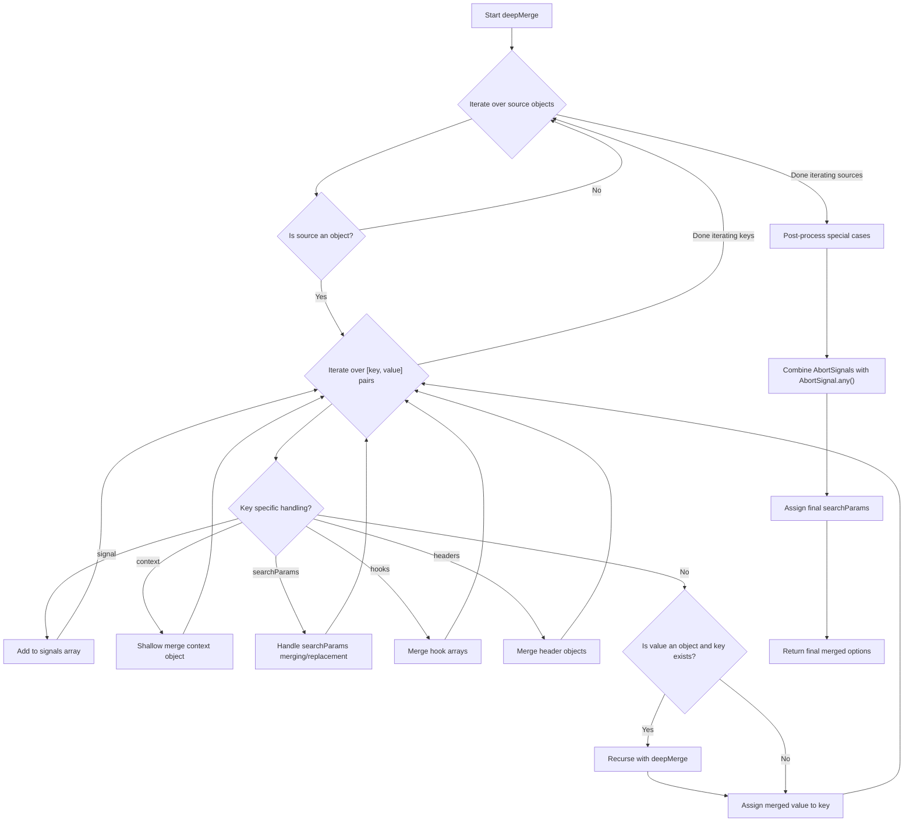
Sources: [source/utils/merge.ts:207-312](https://github.com/sindresorhus/ky/blob/e0fcf780de2bd69af2528e4b7b87ccae6bb727b1/source/utils/merge.ts#L207-L312)

### Validation

Before merging, `validateAndMerge` checks each source to ensure it is a valid object. It throws a `TypeError` if a source is not an object (and not `undefined`), or if it's an array.

```typescript
// source/utils/merge.ts:55-59
for (const source of sources) {
    if ((!isObject(source) || Array.isArray(source)) && source !== undefined) {
        throw new TypeError('The `options` argument must be an object');
    }
}
```
Sources: [source/utils/merge.ts:54-59](https://github.com/sindresorhus/ky/blob/e0fcf780de2bd69af2528e4b7b87ccae6bb727b1/source/utils/merge.ts#L54-L59), [source/utils/is.ts:2](https://github.com/sindresorhus/ky/blob/e0fcf780de2bd69af2528e4b7b87ccae6bb727b1/source/utils/is.ts#L2)

## Replacing vs. Appending Options

By default, `ky.extend()` deep-merges options. For properties like `hooks`, `headers`, and `searchParams`, this means new values are appended or merged with existing ones. The `replaceOption` utility allows developers to completely replace a parent's option instead of merging.

Sources: [source/utils/merge.ts:29-48](https://github.com/sindresorhus/ky/blob/e0fcf780de2bd69af2528e4b7b87ccae6bb727b1/source/utils/merge.ts#L29-L48)

### Implementation

`replaceOption` wraps the provided value in an object with a unique symbol, `replaceSymbol`.

```typescript
// source/utils/merge.ts:6, 49-52
const replaceSymbol: unique symbol = Symbol('replaceOption');

export const replaceOption = <T>(value: T): T => {
	const markedValue: ReplaceMarked<T> = {[replaceSymbol]: true, value};
	return markedValue as unknown as T;
};
```

During the merge process, the `getReplaceState` function checks for this symbol. If present, the `isReplace` flag is set to `true`, signaling to the `deepMerge` logic to replace the existing value instead of merging.

```typescript
// source/utils/merge.ts:18-27
const getReplaceState = <T>(value: T): ReplaceState<T> =>
	isObject(value) && (value as any)[replaceSymbol] === true
		? {
			isReplace: true,
			value: (value as unknown as ReplaceMarked<T>).value,
		}
		: {
			isReplace: false,
			value,
		};
```
Sources: [source/utils/merge.ts:6-27, 49-52, 229-231]()

## Specialized Merging Strategies

Several options have custom merging logic to handle their specific data structures and behaviors.

### `headers`

Headers can be provided as a `Headers` object, a plain object, or an array of tuples.
- If both sources are plain objects, they are merged, and any headers with `undefined` values are removed via `normalizeHeaderObject`.
- Otherwise, they are converted to `Headers` instances and merged using `mergeHeaders`. A value of `'undefined'` or `undefined` in the source headers will cause that header to be deleted from the result.

Sources: [source/utils/merge.ts:64-78, 117-128, 283-290]()

### `hooks`

Hook arrays are merged by concatenating them. The `mergeHooks` function ensures that all hook types (`init`, `beforeRequest`, etc.) are initialized as arrays and that hooks from incoming options are appended to the existing ones. If an incoming hook property is explicitly `undefined`, it clears that hook array.

```typescript
// source/utils/merge.ts:130-134
function newHookValue<K extends keyof Hooks>(original: Hooks, incoming: Hooks, property: K): Required<Hooks>[K] {
	return (Object.hasOwn(incoming, property) && incoming[property] === undefined)
		? []
		: deepMerge<Required<Hooks>[K]>(original[property] ?? [], incoming[property] ?? []);
}
```
Sources: [source/utils/merge.ts:130-144, 274-281]()

### `searchParams`

Search parameters are merged cumulatively. The `appendSearchParameters` function handles various input formats: `URLSearchParams`, object literals, string, or an array of `[key, value]` pairs.
- The final merged result is always a `URLSearchParams` object.
- A special symbol, `deletedParametersSymbol`, is used internally to track parameters that were explicitly deleted by setting their value to `undefined` in an object source. This ensures deletions are preserved across merges.

Sources: [source/utils/merge.ts:146-204, 251-265]()

### `context`

The `context` option is always shallow-merged to prevent deep-merge bugs and unexpected mutations. A new object is created to hold the merged properties.

Sources: [source/utils/merge.ts:234-249](https://github.com/sindresorhus/ky/blob/e0fcf780de2bd69af2528e4b7b87ccae6bb727b1/source/utils/merge.ts#L234-L249)

### `signal`

Multiple `AbortSignal` instances are collected into an array. If the environment supports `AbortSignal.any()`, they are combined into a single signal that aborts when any of the source signals abort. If `AbortSignal.any()` is not available, the last signal provided takes precedence.

Sources: [source/utils/merge.ts:224-227, 298-309]()

## Options Normalization

After merging, some options are normalized to a standard format.

Sources: [source/utils/normalize.ts](https://github.com/sindresorhus/ky/blob/e0fcf780de2bd69af2528e4b7b87ccae6bb727b1/source/utils/normalize.ts)

### Request Method

The `normalizeRequestMethod` function converts standard HTTP method names (like 'get', 'post') to their uppercase equivalents ('GET', 'POST'). Custom methods are passed through unchanged.

Sources: [source/utils/normalize.ts:5-7](https://github.com/sindresorhus/ky/blob/e0fcf780de2bd69af2528e4b7b87ccae6bb727b1/source/utils/normalize.ts#L5-L7)

### Retry Options

The `retry` option can be a number (specifying the limit) or an object with detailed settings. The `normalizeRetryOptions` function merges the user-provided configuration with a set of defaults.

| Option | Default Value | Description |
| --- | --- | --- |
| `limit` | `2` | Maximum number of retries. |
| `methods` | `['get', 'put', 'head', 'delete', 'options', 'trace']` | HTTP methods to retry on. |
| `statusCodes` | `[408, 413, 429, 500, 502, 503, 504]` | HTTP status codes to retry on. |
| `afterStatusCodes` | `[413, 429, 503]` | Status codes that respect the `Retry-After` header. |
| `maxRetryAfter` | `Infinity` | Maximum time to wait for a `Retry-After` header. |
| `backoffLimit` | `Infinity` | Maximum backoff delay in milliseconds. |
| `delay` | `attemptCount => 0.3 * (2 ** (attemptCount - 1)) * 1000` | Function to calculate delay before retry. |
| `retryOnTimeout` | `false` | Whether to retry on a `TimeoutError`. |

Sources: [source/utils/normalize.ts:8-26, 28-53]()

## Ancillary Utilities

Several utility functions support the merging and normalization process by providing type checking and classification of options and errors.

| Function/File | Description | Source File |
| --- | --- | --- |
| `findUnknownOptions` | Identifies options not native to Ky and forwards them to the underlying `fetch` call. | `source/utils/options.ts` |
| `hasSearchParameters` | Checks if a `searchParams` option is provided and non-empty. | `source/utils/options.ts` |
| `isObject` | A simple type guard to check if a value is a non-null object. | `source/utils/is.ts` |
| `isRawNetworkError` | Detects low-level network errors by checking `TypeError` messages from different JavaScript runtimes. | `source/utils/is-network-error.ts` |
| `isKyError`, `isHTTPError`, etc. | A suite of type guards to identify specific error types thrown by Ky, such as `HTTPError` or `NetworkError`. | `source/utils/type-guards.ts` |

Sources: [source/utils/options.ts](https://github.com/sindresorhus/ky/blob/e0fcf780de2bd69af2528e4b7b87ccae6bb727b1/source/utils/options.ts), [source/utils/is.ts](https://github.com/sindresorhus/ky/blob/e0fcf780de2bd69af2528e4b7b87ccae6bb727b1/source/utils/is.ts), [source/utils/is-network-error.ts](https://github.com/sindresorhus/ky/blob/e0fcf780de2bd69af2528e4b7b87ccae6bb727b1/source/utils/is-network-error.ts), [source/utils/type-guards.ts](https://github.com/sindresorhus/ky/blob/e0fcf780de2bd69af2528e4b7b87ccae6bb727b1/source/utils/type-guards.ts)

## Edge Cases and Gotchas

- **Shallow `context` Merge**: The `context` option is only merged one level deep. Nested objects within `context` will be overwritten, not merged.
  Sources: [source/utils/merge.ts:234-249](https://github.com/sindresorhus/ky/blob/e0fcf780de2bd69af2528e4b7b87ccae6bb727b1/source/utils/merge.ts#L234-L249)
- **`searchParams` Deletion**: Providing `undefined` or `null` as the value for `searchParams` will remove all search parameters from the request. In an object source, a key with an `undefined` value will remove that specific parameter.
  Sources: [source/utils/merge.ts:181-184, 253-256]()
- **`AbortSignal` Fallback**: In older environments without `AbortSignal.any`, if multiple signals are provided, only the *last* one in the options list will be used.
  Sources: [source/utils/merge.ts:304-308](https://github.com/sindresorhus/ky/blob/e0fcf780de2bd69af2528e4b7b87ccae6bb727b1/source/utils/merge.ts#L304-L308)
- **Header Normalization**: When headers are provided as a plain object, any key with an `undefined` value will be filtered out and not included in the final request.
  Sources: [source/utils/merge.ts:117-120](https://github.com/sindresorhus/ky/blob/e0fcf780de2bd69af2528e4b7b87ccae6bb727b1/source/utils/merge.ts#L117-L120)
- **Hook Clearing**: To remove all hooks for a specific event that were defined in a parent instance, you must explicitly set that hook property to `undefined` in the extended options.
  Sources: [source/utils/merge.ts:131-132](https://github.com/sindresorhus/ky/blob/e0fcf780de2bd69af2528e4b7b87ccae6bb727b1/source/utils/merge.ts#L131-L132)

## Other files in this area

### source/utils/types.ts

This file provides TypeScript utility types that are likely used when handling options objects.

-   **`Mutable<T>`**: A generic type that takes a type `T` and removes the `readonly` modifier from all of its properties. This is useful for creating a writable version of an options object for internal modification. `Sources: [source/utils/types.ts:1-3](https://github.com/sindresorhus/ky/blob/e0fcf780de2bd69af2528e4b7b87ccae6bb727b1/source/utils/types.ts#L1-L3)`
-   **`ObjectEntries<T>`**: A generic type that provides a more specific, type-safe return type for `Object.entries()`. It correctly infers the key and value types for both objects and array-like structures, resulting in an array of key-value tuples. `Sources: [source/utils/types.ts:5-7](https://github.com/sindresorhus/ky/blob/e0fcf780de2bd69af2528e4b7b87ccae6bb727b1/source/utils/types.ts#L5-L7)`

A new engineer might be surprised that a custom `Mutable<T>` type is needed, which implies that the base option types are `readonly` by design. The `ObjectEntries<T>` type is a sophisticated TypeScript construct to improve upon the default `Object.entries` typings. `Sources: [source/utils/types.ts:1-7](https://github.com/sindresorhus/ky/blob/e0fcf780de2bd69af2528e4b7b87ccae6bb727b1/source/utils/types.ts#L1-L7)`


# Page: Retry Mechanism

<details>
<summary>Relevant source files</summary>

The following files were used as context for generating this wiki page:

- [source/core/Ky.ts](https://github.com/sindresorhus/ky/blob/e0fcf780de2bd69af2528e4b7b87ccae6bb727b1/source/core/Ky.ts)
- [source/types/retry.ts](https://github.com/sindresorhus/ky/blob/e0fcf780de2bd69af2528e4b7b87ccae6bb727b1/source/types/retry.ts)
- [source/utils/delay.ts](https://github.com/sindresorhus/ky/blob/e0fcf780de2bd69af2528e4b7b87ccae6bb727b1/source/utils/delay.ts)
- [source/types/common.ts](https://github.com/sindresorhus/ky/blob/e0fcf780de2bd69af2528e4b7b87ccae6bb727b1/source/types/common.ts)
- [source/types/ky.ts](https://github.com/sindresorhus/ky/blob/e0fcf780de2bd69af2528e4b7b87ccae6bb727b1/source/types/ky.ts)
- [source/types/request.ts](https://github.com/sindresorhus/ky/blob/e0fcf780de2bd69af2528e4b7b87ccae6bb727b1/source/types/request.ts)
- [source/types/response.ts](https://github.com/sindresorhus/ky/blob/e0fcf780de2bd69af2528e4b7b87ccae6bb727b1/source/types/response.ts)
</details>

# Retry Mechanism

The `ky` library includes a powerful and configurable retry mechanism to automatically handle transient failures, such as network errors or specific server responses. This enhances the reliability of requests by re-attempting failed operations according to a defined strategy. The retry behavior is controlled through the `retry` option in a `ky` request.

The core logic resides within the `Ky` class, which manages the request lifecycle. When a request fails, it enters a retry loop orchestrated by the `#retryFromError` method. This method consults the `retry` options to determine whether to proceed with a retry, calculates the appropriate delay, and executes hooks that allow for modifying the retry behavior.

## Configuration

The retry mechanism is configured via the `retry` property in the `Options` object. It can be a number (specifying the retry limit) or an object with detailed settings.

Sources: [source/core/Ky.ts:377](https://github.com/sindresorhus/ky/blob/e0fcf780de2bd69af2528e4b7b87ccae6bb727b1/source/core/Ky.ts#L377), [source/types/retry.ts](https://github.com/sindresorhus/ky/blob/e0fcf780de2bd69af2528e4b7b87ccae6bb727b1/source/types/retry.ts)

| Option | Description | Default Value |
| --- | --- | --- |
| `limit` | The maximum number of retry attempts. | `2` |
| `methods` | An array of HTTP methods that are allowed to be retried. | `['get', 'put', 'head', 'delete', 'options', 'trace']` |
| `statusCodes` | An array of HTTP status codes that should trigger a retry. | `[408, 413, 429, 500, 502, 503, 504]` |
| `afterStatusCodes` | An array of HTTP status codes for which the `Retry-After` header should be respected. | `[413, 429, 503]` |
| `maxRetryAfter` | The maximum delay (in ms) to wait when respecting a `Retry-After` header. | `Infinity` |
| `backoffLimit` | The maximum backoff delay (in ms) between retries. | `Infinity` |
| `delay` | A function that calculates the delay (in ms) for a given attempt count. | `attemptCount => 0.3 * (2 ** (attemptCount - 1)) * 1000` |
| `jitter` | If `true`, applies full random jitter to the delay. Can also be a custom function. Jitter is not applied if `Retry-After` is used. | `undefined` (no jitter) |
| `retryOnTimeout` | A boolean indicating whether to retry on a `TimeoutError`. | `false` |
| `shouldRetry` | A function to programmatically decide if a retry should be attempted, overriding default logic. | `undefined` |

## Retry Process Flow

When a request initiated by `ky` fails, it enters the retry process. The flow is managed internally by the `Ky` class, primarily through the `#retry`, `#retryFromError`, and `#calculateRetryDelay` methods.

The following diagram illustrates the high-level decision flow for retrying a request.

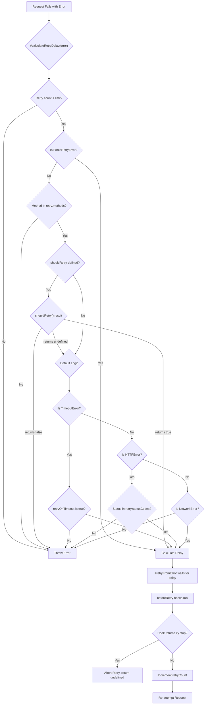
Sources: [source/core/Ky.ts:504-590](https://github.com/sindresorhus/ky/blob/e0fcf780de2bd69af2528e4b7b87ccae6bb727b1/source/core/Ky.ts#L504-L590), [source/core/Ky.ts:852-928](https://github.com/sindresorhus/ky/blob/e0fcf780de2bd69af2528e4b7b87ccae6bb727b1/source/core/Ky.ts#L852-L928)

### Sequence of Operations

The sequence diagram below shows the interaction between different components during a single retry attempt.

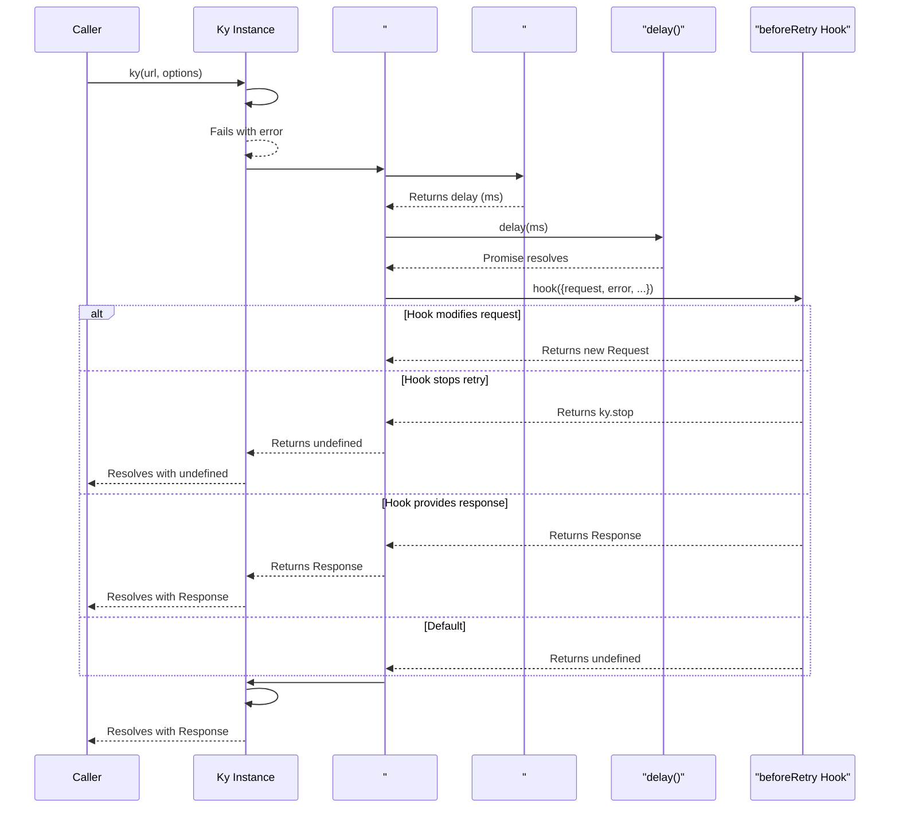
Sources: [source/core/Ky.ts:844-928](https://github.com/sindresorhus/ky/blob/e0fcf780de2bd69af2528e4b7b87ccae6bb727b1/source/core/Ky.ts#L844-L928)

## Core Components

### `Ky` Class Methods

-   **`#retry(function_)`**: A wrapper that executes a function and catches any errors, passing them to `#retryFromError`.
    Sources: [source/core/Ky.ts:844-850](https://github.com/sindresorhus/ky/blob/e0fcf780de2bd69af2528e4b7b87ccae6bb727b1/source/core/Ky.ts#L844-L850)
-   **`#retryFromError(error, function_)`**: The main orchestrator of the retry logic. It calculates the delay, waits, runs `beforeRetry` hooks, and then re-invokes the fetch function via `#retry`. It also handles the `totalTimeout` logic, ensuring retries do not exceed the overall time budget.
    Sources: [source/core/Ky.ts:852-928](https://github.com/sindresorhus/ky/blob/e0fcf780de2bd69af2528e4b7b87ccae6bb727b1/source/core/Ky.ts#L852-L928)
-   **`#calculateRetryDelay(error)`**: This method contains the core decision logic. It checks against the `limit`, `methods`, `statusCodes`, and other conditions to determine if a retry is warranted. If so, it calculates and returns the delay; otherwise, it re-throws the error.
    Sources: [source/core/Ky.ts:504-590](https://github.com/sindresorhus/ky/blob/e0fcf780de2bd69af2528e4b7b87ccae6bb727b1/source/core/Ky.ts#L504-L590)
-   **`#calculateDelay()`**: Computes the exponential backoff delay based on the current retry count, applying jitter if configured. The result is capped by `backoffLimit`.
    Sources: [source/core/Ky.ts:487-502](https://github.com/sindresorhus/ky/blob/e0fcf780de2bd69af2528e4b7b87ccae6bb727b1/source/core/Ky.ts#L487-L502)

### `delay` Utility

A simple promise-based delay function that pauses execution for a specified number of milliseconds. It can be aborted via an `AbortSignal`.

Sources: [source/utils/delay.ts](https://github.com/sindresorhus/ky/blob/e0fcf780de2bd69af2528e4b7b87ccae6bb727b1/source/utils/delay.ts)

### Relevant Error Types

-   **`HTTPError`**: Thrown for non-successful HTTP responses (when `throwHttpErrors` is true). The retry logic checks `error.response.status` against `retry.statusCodes`.
    Sources: [source/core/Ky.ts:548-582](https://github.com/sindresorhus/ky/blob/e0fcf780de2bd69af2528e4b7b87ccae6bb727b1/source/core/Ky.ts#L548-L582)
-   **`NetworkError`**: Thrown for network-level errors (e.g., DNS resolution failure, no internet connection). These are generally considered retriable.
    Sources: [source/core/Ky.ts:585-587](https://github.com/sindresorhus/ky/blob/e0fcf780de2bd69af2528e4b7b87ccae6bb727b1/source/core/Ky.ts#L585-L587), [source/core/Ky.ts:978-980](https://github.com/sindresorhus/ky/blob/e0fcf780de2bd69af2528e4b7b87ccae6bb727b1/source/core/Ky.ts#L978-L980)
-   **`TimeoutError`**: Thrown if a request exceeds its `timeout` or `totalTimeout`. Retries for this error are controlled by the `retry.retryOnTimeout` option.
    Sources: [source/core/Ky.ts:540-546](https://github.com/sindresorhus/ky/blob/e0fcf780de2bd69af2528e4b7b87ccae6bb727b1/source/core/Ky.ts#L540-L546)
-   **`ForceRetryError`**: A special error thrown internally when an `afterResponse` hook returns `ky.retry()`. This bypasses most of the standard retry checks (`shouldRetry`, method, status code) and forces a new attempt.
    Sources: [source/core/Ky.ts:513-515](https://github.com/sindresorhus/ky/blob/e0fcf780de2bd69af2528e4b7b87ccae6bb727b1/source/core/Ky.ts#L513-L515), [source/core/Ky.ts:820](https://github.com/sindresorhus/ky/blob/e0fcf780de2bd69af2528e4b7b87ccae6bb727b1/source/core/Ky.ts#L820)

## Hooks Integration

Hooks provide powerful customization points for the retry mechanism.

### `afterResponse` Hook

This hook can inspect a successful or unsuccessful response and decide to trigger a retry. By returning `ky.retry()`, the hook causes a `ForceRetryError` to be thrown, initiating the retry process. This is useful for cases where the server indicates a transient failure within a 2xx response body.

```typescript
// Example of forcing a retry from afterResponse
const api = ky.extend({
    hooks: {
        afterResponse: [
            async ({response}) => {
                if (response.status === 200) {
                    const data = await response.json();
                    if (data.status === 'PENDING') {
                        // Force a retry
                        return ky.retry();
                    }
                }
            }
        ]
    }
});
```
Sources: [source/core/Ky.ts:812-821](https://github.com/sindresorhus/ky/blob/e0fcf780de2bd69af2528e4b7b87ccae6bb727b1/source/core/Ky.ts#L812-L821), [source/types/ky.ts:146-177](https://github.com/sindresorhus/ky/blob/e0fcf780de2bd69af2528e4b7b87ccae6bb727b1/source/types/ky.ts#L146-L177)

### `beforeRetry` Hook

This hook runs after a retry has been approved and the delay has passed, but *before* the next request is made. It receives the `request`, `options`, `error`, and `retryCount`.

The hook can have several outcomes:
1.  **Return `undefined` (or nothing)**: The retry proceeds with the existing request.
2.  **Return a new `Request` instance**: The retry will use the new `Request` object.
    Sources: [source/core/Ky.ts:905-909](https://github.com/sindresorhus/ky/blob/e0fcf780de2bd69af2528e4b7b87ccae6bb727b1/source/core/Ky.ts#L905-L909)
3.  **Return a `Response` instance**: The retry is aborted, and the returned `Response` is passed to the original caller.
    Sources: [source/core/Ky.ts:912-916](https://github.com/sindresorhus/ky/blob/e0fcf780de2bd69af2528e4b7b87ccae6bb727b1/source/core/Ky.ts#L912-L916)
4.  **Return `ky.stop`**: The retry is aborted, and the original `ky()` promise resolves to `undefined`.
    Sources: [source/core/Ky.ts:918-921](https://github.com/sindresorhus/ky/blob/e0fcf780de2bd69af2528e4b7b87ccae6bb727b1/source/core/Ky.ts#L918-L921), [source/types/ky.ts:113-144](https://github.com/sindresorhus/ky/blob/e0fcf780de2bd69af2528e4b7b87ccae6bb727b1/source/types/ky.ts#L113-L144)
5.  **Throw an error**: The retry is aborted, and the thrown error propagates to the caller.
    Sources: [source/core/Ky.ts:896-903](https://github.com/sindresorhus/ky/blob/e0fcf780de2bd69af2528e4b7b87ccae6bb727b1/source/core/Ky.ts#L896-L903)

## Edge Cases and Gotchas

-   **`totalTimeout` Precedence**: The `totalTimeout` option defines a deadline for the entire operation, including all retries and delays. If a calculated retry delay would exceed the remaining `totalTimeout`, the request will fail with a `TimeoutError` immediately instead of waiting.
    Sources: [source/core/Ky.ts:858-869](https://github.com/sindresorhus/ky/blob/e0fcf780de2bd69af2528e4b7b87ccae6bb727b1/source/core/Ky.ts#L858-L869)
-   **`ky.stop` Behavior**: Returning `ky.stop` from a `beforeRetry` hook causes the `ResponsePromise` to resolve with `undefined`. This means you cannot chain body methods like `.json()` or `.text()` and must handle the `undefined` case explicitly. Throwing an error is often a safer alternative.
    Sources: [source/types/ky.ts:116-118](https://github.com/sindresorhus/ky/blob/e0fcf780de2bd69af2528e4b7b87ccae6bb727b1/source/types/ky.ts#L116-L118)
-   **`shouldRetry` vs. `beforeRetry`**: `shouldRetry` decides *if* a retry should happen. `beforeRetry` is executed *after* the decision is made and allows for modification of the upcoming request.
    Sources: [source/types/retry.ts:133-136](https://github.com/sindresorhus/ky/blob/e0fcf780de2bd69af2528e4b7b87ccae6bb727b1/source/types/retry.ts#L133-L136)
-   **Status 413 (Payload Too Large)**: Even though `413` is a default `statusCode` for retries, there is a specific check to prevent retrying on this status. This avoids resending a large, rejected payload.
    Sources: [source/core/Ky.ts:577-579](https://github.com/sindresorhus/ky/blob/e0fcf780de2bd69af2528e4b7b87ccae6bb727b1/source/core/Ky.ts#L577-L579)
-   **Request Body Cloning**: For a request with a body to be retriable, the body must be cloneable. `ky` automatically clones the request if `retry.limit` is greater than 0. For streaming bodies, this can buffer the entire stream in memory.
    Sources: [source/core/Ky.ts:946-955](https://github.com/sindresorhus/ky/blob/e0fcf780de2bd69af2528e4b7b87ccae6bb727b1/source/core/Ky.ts#L946-L955)
-   **`Retry-After` and Jitter**: When a server provides a `Retry-After` header and the status code is in `afterStatusCodes`, the specified delay is used. Jitter is not applied in this case to respect the server's directive.
    Sources: [source/types/retry.ts:83-84](https://github.com/sindresorhus/ky/blob/e0fcf780de2bd69af2528e4b7b87ccae6bb727b1/source/types/retry.ts#L83-L84), [source/core/Ky.ts:553-575](https://github.com/sindresorhus/ky/blob/e0fcf780de2bd69af2528e4b7b87ccae6bb727b1/source/core/Ky.ts#L553-L575)

## Source File Summary

| File | Description |
| --- | --- |
| `source/core/Ky.ts` | Contains the primary `Ky` class and the core implementation of the request lifecycle, including the retry logic in methods like `#retryFromError` and `#calculateRetryDelay`. |
| `source/types/retry.ts` | Defines the `RetryOptions` type and related interfaces, documenting all available configuration for the retry mechanism. |
| `source/utils/delay.ts` | Provides the `delay` utility function used to wait between retry attempts. |
| `source/types/ky.ts` | Defines the public `KyInstance` type, including the `retry` and `stop` symbols used in hooks. |
| `source/types/common.ts` | Contains common utility types used across the project. |
| `source/types/request.ts` | Defines the `KyRequest` type. |
| `source/types/response.ts` | Defines the `KyResponse` type. |

## Other files in this area

### source/types/common.ts

This file provides common, reusable TypeScript utility types for the `ky` library. These types do not implement any retry logic themselves but are foundational types that could be used in the configuration or implementation of the retry mechanism.

-   **`Primitive`**: A type alias for `null | undefined | string | number | boolean | symbol | bigint`. `Sources: [source/types/common.ts:2-2](https://github.com/sindresorhus/ky/blob/e0fcf780de2bd69af2528e4b7b87ccae6bb727b1/source/types/common.ts#L2-L2)`.
-   **`Required<T, K extends keyof T = keyof T>`**: A utility type that makes the properties `K` of type `T` required. By default, it makes all properties of `T` required. `Sources: [source/types/common.ts:4-4](https://github.com/sindresorhus/ky/blob/e0fcf780de2bd69af2528e4b7b87ccae6bb727b1/source/types/common.ts#L4-L4)`.
-   **`LiteralUnion<LiteralType, BaseType>`**: A type that allows for a specific set of literal values (`LiteralType`) while also accepting any value of a base primitive type (`BaseType`). This is achieved by creating a union of `LiteralType` and `(BaseType & {_?: never})`. `Sources: [source/types/common.ts:6-8](https://github.com/sindresorhus/ky/blob/e0fcf780de2bd69af2528e4b7b87ccae6bb727b1/source/types/common.ts#L6-L8)`.

A new engineer might find the `LiteralUnion` implementation `(BaseType & {_?: never})` confusing; this is a common TypeScript pattern to improve autocompletion for the literal types while still allowing any value of the base type. The `eslint-disable-next-line` comment on line 1 is present to allow the use of `symbol` and `bigint` in the `Primitive` type, which are sometimes disallowed by linting rules. `Sources: [source/types/common.ts:1-1](https://github.com/sindresorhus/ky/blob/e0fcf780de2bd69af2528e4b7b87ccae6bb727b1/source/types/common.ts#L1-L1)`.

### source/types/request.ts

This file defines the `KyRequest` type, which represents a `ky`-enhanced `Request` object. The retry mechanism would handle instances of `Request` or `KyRequest` when re-issuing a failed network request.

-   **`KyRequest<T = unknown>`**: This is an intersection type that extends the standard `Request` interface. `Sources: [source/types/request.ts:1-3](https://github.com/sindresorhus/ky/blob/e0fcf780de2bd69af2528e4b7b87ccae6bb727b1/source/types/request.ts#L1-L3)`. It adds a `json` method.
    -   **`json`**: A generic method, `<J = T>() => Promise<J>`, that returns a promise resolving to the JSON-parsed body of the request. The return type `J` defaults to the generic type `T` of `KyRequest`. `Sources: [source/types/request.ts:2-2](https://github.com/sindresorhus/ky/blob/e0fcf780de2bd69af2528e4b7b87ccae6bb727b1/source/types/request.ts#L2-L2)`.

It may be surprising that a `json()` method is added to the `Request` type, as this method is typically found on `Response` objects. This suggests that `ky` may use this for accessing the original object that was serialized into the request body.

### source/types/response.ts

This file defines the `KyResponse` type, an augmented version of the standard `Response` object. The retry mechanism inspects properties of the `Response` (like its status code) to determine if a request should be retried, so it would operate on objects of this type.

-   **`KyResponse<T = unknown>`**: An intersection type that extends the standard `Response` interface. `Sources: [source/types/response.ts:1-3](https://github.com/sindresorhus/ky/blob/e0fcf780de2bd69af2528e4b7b87ccae6bb727b1/source/types/response.ts#L1-L3)`. It augments the `Response` with a more strongly typed `json` method.
    -   **`json`**: A generic method, `<J = T>() => Promise<J>`, that returns a promise resolving to the JSON-parsed body of the response. The return type `J` defaults to the generic type `T` of `KyResponse`. `Sources: [source/types/response.ts:2-2](https://github.com/sindresorhus/ky/blob/e0fcf780de2bd69af2528e4b7b87ccae6bb727b1/source/types/response.ts#L2-L2)`.

A new engineer might wonder why the `json()` method is redefined here, as the standard `Response` object already has one. This is a common TypeScript practice to provide stronger, more specific typing over the default `any` or `unknown` type returned by the standard library's `response.json()`.


# Page: Hooks System

<details>
<summary>Relevant source files</summary>

The following files were used as context for generating this wiki page:

- [source/core/Ky.ts](https://github.com/sindresorhus/ky/blob/e0fcf780de2bd69af2528e4b7b87ccae6bb727b1/source/core/Ky.ts)
- [source/types/hooks.ts](https://github.com/sindresorhus/ky/blob/e0fcf780de2bd69af2528e4b7b87ccae6bb727b1/source/types/hooks.ts)
</details>

# Hooks System

The Ky hooks system provides a powerful mechanism to intercept and modify the request/response lifecycle at various stages. Hooks allow for a wide range of custom behaviors, such as dynamically adding authentication headers, logging requests, implementing custom caching, refreshing tokens, or modifying error responses before they are thrown.

The system is organized into five distinct hook types, each executing at a specific point in the request flow: `init`, `beforeRequest`, `afterResponse`, `beforeRetry`, and `beforeError`. These hooks are defined as arrays of functions within the `hooks` property of the Ky options object.

Sources: [source/types/hooks.ts:88-365](https://github.com/sindresorhus/ky/blob/e0fcf780de2bd69af2528e4b7b87ccae6bb727b1/source/types/hooks.ts#L88-L365)

## Hook Execution Order

The hooks are executed in a specific sequence that follows the lifecycle of an HTTP request, including potential retry attempts. The `init` hook runs first, followed by `beforeRequest`. If the request is successful, `afterResponse` hooks are executed. If the request fails and is eligible for a retry, `beforeRetry` hooks run before the next attempt. Finally, if an error is to be thrown to the caller, `beforeError` hooks are executed.

The following diagram illustrates the complete flow:

```mermaid
sequenceDiagram
    participant User
    participant Ky_create as Ky.create
    participant init_hooks as "init Hooks"
    participant Ky_instance as "Ky Instance"
    participant beforeRequest_hooks as "beforeRequest Hooks"
    participant fetch as "fetch()"
    participant afterResponse_hooks as "afterResponse Hooks"
    participant beforeRetry_hooks as "beforeRetry Hooks"
    participant beforeError_hooks as "beforeError Hooks"

    User->>Ky_create: Call ky(input, options)
    Ky_create->>init_hooks: Run sync hooks on options
    init_hooks-->>Ky_create: Modified options
    Ky_create->>Ky_instance: new Ky(input, modifiedOptions)
    Ky_create->>Ky_instance: Start async request flow
    Ky_instance->>beforeRequest_hooks: #runBeforeRequestHooks()
    alt Hook returns Response
        beforeRequest_hooks-->>Ky_instance: Response
        Note right of Ky_instance: Skips fetch, proceeds to afterResponse
    else Hook returns Request
        beforeRequest_hooks-->>Ky_instance: New Request
    else Hook returns void
        beforeRequest_hooks-->>Ky_instance: void
    end

    Ky_instance->>fetch: #fetch()
    fetch-->>Ky_instance: Response

    Ky_instance->>afterResponse_hooks: #runAfterResponseHooks(response)
    alt Hook returns RetryMarker
        afterResponse_hooks-->>Ky_instance: ky.retry()
        Note right of Ky_instance: Throws ForceRetryError, triggers retry logic
    else Hook returns new Response
        afterResponse_hooks-->>Ky_instance: New Response
    else Hook returns void
        afterResponse_hooks-->>Ky_instance: void
    end
    Ky_instance-->>User: Final Response

    alt Request fails (HTTPError, NetworkError, etc.)
        Ky_instance->>Ky_instance: #retryFromError(error)
        Ky_instance->>Ky_instance: #calculateRetryDelay(error)
        opt Retry is possible
            Ky_instance->>beforeRetry_hooks: Run hooks
            alt Hook returns Response
                beforeRetry_hooks-->>Ky_instance: Response
                Note right of Ky_instance: Skips retry fetch, proceeds to afterResponse
            else Hook returns Request
                beforeRetry_hooks-->>Ky_instance: New Request
            else Hook returns ky.stop
                beforeRetry_hooks-->>Ky_instance: ky.stop
                Ky_instance-->>User: Returns undefined
            else Hook throws error
                beforeRetry_hooks->>xKy_instance: Error
                Note right of Ky_instance: Propagates error, may skip beforeError
            end
            Ky_instance->>Ky_instance: Loop back to fetch()
        else No more retries
            Ky_instance->>beforeError_hooks: Run hooks
            beforeError_hooks-->>Ky_instance: Modified Error
            Ky_instance->>xUser: Throw final Error
        end
    end
```

### Hooks Summary

| Hook            | Trigger                                                     | Purpose                                        | Can Stop Flow? |
| --------------- | ----------------------------------------------------------- | ---------------------------------------------- | -------------- |
| `init`          | Before request construction (`Ky.create`)                   | Modify options object synchronously.           | No             |
| `beforeRequest` | Before the `fetch` call.                                    | Modify the `Request` or short-circuit.         | Yes            |
| `afterResponse` | After a successful response is received.                    | Modify the `Response` or force a retry.        | Yes            |
| `beforeRetry`   | After a retriable error, before the next attempt.           | Modify the `Request` for retry or stop retrying. | Yes            |
| `beforeError`   | Before any error is thrown to the user.                     | Modify the final `Error` object.               | No             |

Sources: [source/core/Ky.ts:143-298](https://github.com/sindresorhus/ky/blob/e0fcf780de2bd69af2528e4b7b87ccae6bb727b1/source/core/Ky.ts#L143-L298), [source/types/hooks.ts:88-365](https://github.com/sindresorhus/ky/blob/e0fcf780de2bd69af2528e4b7b87ccae6bb727b1/source/types/hooks.ts#L88-L365)

## Hook Types

### `init`

The `init` hooks are the first to run. They are unique in that they are synchronous and operate directly on the user-provided `options` object before the `Request` is even constructed.

-   **Purpose**: To modify the configuration options for a request. Common use cases include adding default `searchParams` or `headers`.
-   **State**: The hook receives the mutable `options` object.
-   **Return Value**: The hook should not return a value (`void`). It modifies the `options` object in place.
-   **Execution**: Executed within `Ky.create`. To prevent hooks from one request from affecting another, Ky performs a shallow clone of mutable options like `json`, `context`, `headers`, and `searchParams` before passing them to `init` hooks.

Any error thrown from an `init` hook will propagate synchronously and will not be caught by `beforeError` hooks.

Sources: [source/core/Ky.ts:96-110](https://github.com/sindresorhus/ky/blob/e0fcf780de2bd69af2528e4b7b87ccae6bb727b1/source/core/Ky.ts#L96-L110), [source/core/Ky.ts:144-149](https://github.com/sindresorhus/ky/blob/e0fcf780de2bd69af2528e4b7b87ccae6bb727b1/source/core/Ky.ts#L144-L149), [source/types/hooks.ts:28](https://github.com/sindresorhus/ky/blob/e0fcf780de2bd69af2528e4b7b87ccae6bb727b1/source/types/hooks.ts#L28), [source/types/hooks.ts:89-116](https://github.com/sindresorhus/ky/blob/e0fcf780de2bd69af2528e4b7b87ccae6bb727b1/source/types/hooks.ts#L89-L116)

### `beforeRequest`

These hooks run asynchronously just before the request is sent over the network. They provide the last opportunity to modify the `Request` object.

-   **Purpose**: To inspect or modify the final `Request` object.
-   **State**: The hook receives a state object containing `request`, `options` (normalized), and `retryCount` (which is always `0`).
-   **Return Values**:
    -   `void`: The request proceeds as is.
    -   `Request`: Replaces the original request with the one returned.
    -   `Response`: Skips the network request entirely and moves to the `afterResponse` phase with the returned `Response`.
-   **Execution**: Called by `#runBeforeRequestHooks`. Errors thrown here are fatal and will not trigger retries.

Sources: [source/core/Ky.ts:767-784](https://github.com/sindresorhus/ky/blob/e0fcf780de2bd69af2528e4b7b87ccae6bb727b1/source/core/Ky.ts#L767-L784), [source/types/hooks.ts:40](https://github.com/sindresorhus/ky/blob/e0fcf780de2bd69af2528e4b7b87ccae6bb727b1/source/types/hooks.ts#L40), [source/types/hooks.ts:118-167](https://github.com/sindresorhus/ky/blob/e0fcf780de2bd69af2528e4b7b87ccae6bb727b1/source/types/hooks.ts#L118-L167)

### `afterResponse`

These hooks run after a network response is received but before it's processed as a success or failure (based on `ok` status).

-   **Purpose**: To inspect, modify, or replace the response. It can also be used to trigger a retry based on the response content.
-   **State**: The hook receives a state object with `request`, `options`, `response` (a clone of the original), and `retryCount`.
-   **Return Values**:
    -   `void`: The original response is used.
    -   `Response`: Replaces the original response.
    -   `RetryMarker`: A special symbol returned from `ky.retry()` that triggers a `ForceRetryError`, initiating the retry process.
-   **Execution**: Called by `#runAfterResponseHooks`. To prevent resource leaks, Ky attempts to cancel the body of any response that is replaced or discarded by a hook.

Sources: [source/core/Ky.ts:786-842](https://github.com/sindresorhus/ky/blob/e0fcf780de2bd69af2528e4b7b87ccae6bb727b1/source/core/Ky.ts#L786-L842), [source/types/hooks.ts:86](https://github.com/sindresorhus/ky/blob/e0fcf780de2bd69af2528e4b7b87ccae6bb727b1/source/types/hooks.ts#L86), [source/types/hooks.ts:293-364](https://github.com/sindresorhus/ky/blob/e0fcf780de2bd69af2528e4b7b87ccae6bb727b1/source/types/hooks.ts#L293-L364)

### `beforeRetry`

When a request fails with a retriable error (e.g., network error or a specific HTTP status code), `beforeRetry` hooks are executed after the calculated delay but before the next attempt.

-   **Purpose**: To take action before a retry, such as refreshing an expired token and adding it to the request headers.
-   **State**: The hook receives a state object with `request`, `options`, the `error` that caused the failure, and `retryCount` (which is always `>= 1`).
-   **Return Values**:
    -   `void`: The retry proceeds with the existing request.
    -   `Request`: Replaces the request for the retry attempt. This skips remaining `beforeRetry` hooks.
    -   `Response`: Skips the retry and uses the provided `Response` instead.
    -   `stop`: A special symbol that cancels the retry process, causing the promise to resolve with `undefined`.
-   **Execution**: Called within `#retryFromError`. Throwing an error from this hook will also stop the retry process and propagate the new error.

Sources: [source/core/Ky.ts:886-922](https://github.com/sindresorhus/ky/blob/e0fcf780de2bd69af2528e4b7b87ccae6bb727b1/source/core/Ky.ts#L886-L922), [source/types/hooks.ts:53](https://github.com/sindresorhus/ky/blob/e0fcf780de2bd69af2528e4b7b87ccae6bb727b1/source/types/hooks.ts#L53), [source/types/hooks.ts:169-249](https://github.com/sindresorhus/ky/blob/e0fcf780de2bd69af2528e4b7b87ccae6bb727b1/source/types/hooks.ts#L169-L249)

### `beforeError`

This is the final hook in the lifecycle, executed just before an error is thrown to the caller. It runs for any unhandled error, including `HTTPError`, `NetworkError`, `TimeoutError`, or errors from other hooks.

-   **Purpose**: To modify or replace an error. This is useful for logging or wrapping errors in custom types.
-   **State**: The hook receives a state object with `request`, `options`, the `error`, and the final `retryCount`.
-   **Return Value**: The hook must return an `Error` instance. If it returns anything else, the original error is used.
-   **Execution**: Called in the final `catch` block of the main request promise.

Sources: [source/core/Ky.ts:270-285](https://github.com/sindresorhus/ky/blob/e0fcf780de2bd69af2528e4b7b87ccae6bb727b1/source/core/Ky.ts#L270-L285), [source/types/hooks.ts:71](https://github.com/sindresorhus/ky/blob/e0fcf780de2bd69af2528e4b7b87ccae6bb727b1/source/types/hooks.ts#L71), [source/types/hooks.ts:251-291](https://github.com/sindresorhus/ky/blob/e0fcf780de2bd69af2528e4b7b87ccae6bb727b1/source/types/hooks.ts#L251-L291)

## Controlling Request Flow

Hooks can return specific values to alter the standard request-response flow.

| Return Value      | From Hook(s)                | Effect                                                                                             |
| ----------------- | --------------------------- | -------------------------------------------------------------------------------------------------- |
| `Request`         | `beforeRequest`, `beforeRetry` | Replaces the outgoing `Request` object.                                                            |
| `Response`        | `beforeRequest`, `beforeRetry` | Skips the network call (or retry) and proceeds as if this `Response` was received.                 |
| `RetryMarker`     | `afterResponse`             | Throws a `ForceRetryError` to trigger the retry mechanism.                                         |
| `stop`            | `beforeRetry`               | Halts the retry process. The main `ky` promise resolves with `undefined`.                          |
| `Error`           | `beforeError`               | Replaces the error object that will be thrown.                                                     |

Sources: [source/core/Ky.ts:776-780](https://github.com/sindresorhus/ky/blob/e0fcf780de2bd69af2528e4b7b87ccae6bb727b1/source/core/Ky.ts#L776-L780), [source/core/Ky.ts:812-821](https://github.com/sindresorhus/ky/blob/e0fcf780de2bd69af2528e4b7b87ccae6bb727b1/source/core/Ky.ts#L812-L821), [source/core/Ky.ts:905-921](https://github.com/sindresorhus/ky/blob/e0fcf780de2bd69af2528e4b7b87ccae6bb727b1/source/core/Ky.ts#L905-L921), [source/core/Ky.ts:282-284](https://github.com/sindresorhus/ky/blob/e0fcf780de2bd69af2528e4b7b87ccae6bb727b1/source/core/Ky.ts#L282-L284), [source/types/hooks.ts](https://github.com/sindresorhus/ky/blob/e0fcf780de2bd69af2528e4b7b87ccae6bb727b1/source/types/hooks.ts)

## Edge Cases and Gotchas

-   **`init` Hook Synchronicity**: `init` hooks are synchronous. Any error they throw is not handled by Ky's `beforeError` hooks and will propagate immediately.
    Sources: [source/types/hooks.ts:8](https://github.com/sindresorhus/ky/blob/e0fcf780de2bd69af2528e4b7b87ccae6bb727b1/source/types/hooks.ts#L8)
-   **State Leakage Prevention**: To prevent hooks from one request from affecting others, Ky shallow-clones mutable options (`json`, `context`, `headers`, `searchParams`, `retry`) before passing them to `init` hooks.
    Sources: [source/core/Ky.ts:96-110](https://github.com/sindresorhus/ky/blob/e0fcf780de2bd69af2528e4b7b87ccae6bb727b1/source/core/Ky.ts#L96-L110)
-   **Fatal Hook Errors**: Errors thrown from `beforeRequest` or `afterResponse` hooks (that are not a `ForceRetryError`) are considered fatal and will not trigger Ky's built-in retry logic. They will, however, be processed by `beforeError` hooks.
    Sources: [source/core/Ky.ts:180-183](https://github.com/sindresorhus/ky/blob/e0fcf780de2bd69af2528e4b7b87ccae6bb727b1/source/core/Ky.ts#L180-L183), [source/types/hooks.ts:125](https://github.com/sindresorhus/ky/blob/e0fcf780de2bd69af2528e4b7b87ccae6bb727b1/source/types/hooks.ts#L125), [source/types/hooks.ts:300](https://github.com/sindresorhus/ky/blob/e0fcf780de2bd69af2528e4b7b87ccae6bb727b1/source/types/hooks.ts#L300)
-   **`beforeRetry` Error Handling**: If a `beforeRetry` hook throws an error, Ky adds it to a `WeakSet` (`#beforeRetryHookErrors`) to ensure it bypasses the standard error processing and propagates directly, preventing it from being processed by `beforeError` hooks.
    Sources: [source/core/Ky.ts:265](https://github.com/sindresorhus/ky/blob/e0fcf780de2bd69af2528e4b7b87ccae6bb727b1/source/core/Ky.ts#L265), [source/core/Ky.ts:896-902](https://github.com/sindresorhus/ky/blob/e0fcf780de2bd69af2528e4b7b87ccae6bb727b1/source/core/Ky.ts#L896-L902)
-   **Response Body Cancellation**: When a hook in the `afterResponse` chain returns a new `Response` object, Ky attempts to cancel the body of the previous `Response` to prevent memory leaks and resource exhaustion. This is done with `void body.cancel().catch(() => undefined)` to ignore errors from already-consumed streams.
    Sources: [source/core/Ky.ts:827-836](https://github.com/sindresorhus/ky/blob/e0fcf780de2bd69af2528e4b7b87ccae6bb727b1/source/core/Ky.ts#L827-L836)

# Page: Timeouts

<details>
<summary>Relevant source files</summary>

The following files were used as context for generating this wiki page:

- [source/utils/timeout.ts](https://github.com/sindresorhus/ky/blob/e0fcf780de2bd69af2528e4b7b87ccae6bb727b1/source/utils/timeout.ts)
- [source/core/Ky.ts](https://github.com/sindresorhus/ky/blob/e0fcf780de2bd69af2528e4b7b87ccae6bb727b1/source/core/Ky.ts)
- [source/errors/TimeoutError.ts](https://github.com/sindresorhus/ky/blob/e0fcf780de2bd69af2528e4b7b87ccae6bb727b1/source/errors/TimeoutError.ts)
- [source/errors/NonError.ts](https://github.com/sindresorhus/ky/blob/e0fcf780de2bd69af2528e4b7b87ccae6bb727b1/source/errors/NonError.ts)
</details>

# Timeouts

The `ky` library provides robust timeout handling to prevent requests from hanging indefinitely. It features two primary mechanisms: `timeout` for individual network requests and `totalTimeout` for the entire lifecycle of a request, including hooks, delays, and retries. These options ensure that both single attempts and the overall operation complete within a specified duration. When a timeout is exceeded, a `TimeoutError` is thrown, providing clear context about the failed request.

## Configuration

Timeout behavior is controlled through two main options provided during `ky` instance creation.

| Option | Type | Default | Description |
|---|---|---|---|
| `timeout` | `number` \| `false` | `10_000` | Timeout in milliseconds for each individual request attempt. Set to `false` to disable. |
| `totalTimeout` | `number` \| `false` | `false` | Timeout in milliseconds for the entire operation, including hooks, delays, and all retries. Disabled by default. |

`Sources: [source/core/Ky.ts:379-380](https://github.com/sindresorhus/ky/blob/e0fcf780de2bd69af2528e4b7b87ccae6bb727b1/source/core/Ky.ts#L379-L380)`

Both `timeout` and `totalTimeout` values are validated against a maximum safe value (2,147,483,647ms). If a larger value is provided, a `RangeError` is thrown.
`Sources: [source/core/Ky.ts:154-160](https://github.com/sindresorhus/ky/blob/e0fcf780de2bd69af2528e4b7b87ccae6bb727b1/source/core/Ky.ts#L154-L160)`

## Timeout Implementation

The core per-request timeout logic is encapsulated in the `timeout` utility function. This function wraps the native `fetch` call and races it against a `setTimeout` timer. If the timer finishes before the `fetch` call resolves, it aborts the request using the provided `AbortController` and rejects the promise with a `TimeoutError`.

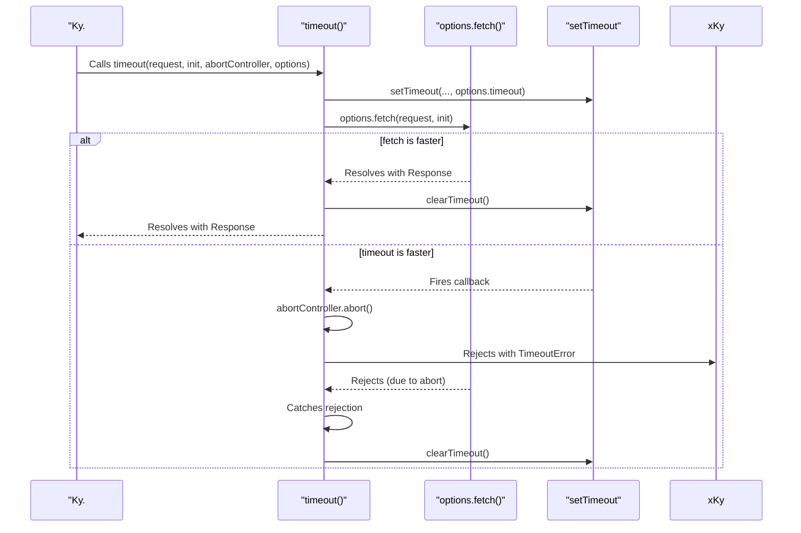
`Sources: [source/utils/timeout.ts:9-32](https://github.com/sindresorhus/ky/blob/e0fcf780de2bd69af2528e4b7b87ccae6bb727b1/source/utils/timeout.ts#L9-L32)`

## Timeout Types

### `timeout`: Per-Request Timeout

This option controls the time limit for a single `fetch` operation, from sending the request to receiving the response headers.

-   **Default Value**: `10_000` milliseconds.
    `Sources: [source/core/Ky.ts:379](https://github.com/sindresorhus/ky/blob/e0fcf780de2bd69af2528e4b7b87ccae6bb727b1/source/core/Ky.ts#L379)`
-   **Disabling**: The timeout can be disabled by setting the option to `false`.
    `Sources: [source/core/Ky.ts:963](https://github.com/sindresorhus/ky/blob/e0fcf780de2bd69af2528e4b7b87ccae6bb727b1/source/core/Ky.ts#L963)`
-   **Execution**: Within the `#fetch` method, an `effectiveTimeout` is calculated. If a `totalTimeout` is also active, the per-request timeout is the lesser of the configured `timeout` and the remaining `totalTimeout`.
    `Sources: [source/core/Ky.ts:963-967](https://github.com/sindresorhus/ky/blob/e0fcf780de2bd69af2528e4b7b87ccae6bb727b1/source/core/Ky.ts#L963-L967)`
-   **Error**: If triggered, the `timeout` utility aborts the underlying request and throws a `TimeoutError`.
    `Sources: [source/utils/timeout.ts:17-21](https://github.com/sindresorhus/ky/blob/e0fcf780de2bd69af2528e4b7b87ccae6bb727b1/source/utils/timeout.ts#L17-L21)`

### `totalTimeout`: Total Pipeline Timeout

The `totalTimeout` option enforces a time limit on the entire request pipeline, starting from the creation of the `Ky` instance. This includes time spent in hooks, calculating retry delays, and the network requests themselves.

-   **Default Value**: `false` (disabled).
    `Sources: [source/core/Ky.ts:380](https://github.com/sindresorhus/ky/blob/e0fcf780de2bd69af2528e4b7b87ccae6bb727b1/source/core/Ky.ts#L380)`
-   **Timer Start**: The timer starts in the `Ky` constructor if `totalTimeout` is a number.
    `Sources: [source/core/Ky.ts:482-484](https://github.com/sindresorhus/ky/blob/e0fcf780de2bd69af2528e4b7b87ccae6bb727b1/source/core/Ky.ts#L482-L484)`
-   **Lifecycle Checks**: `ky` checks the remaining `totalTimeout` at several key points:
    1.  **Before a fetch call**: In `#fetch`, if the remaining time is zero or less, it throws a `TimeoutError` immediately.
        `Sources: [source/core/Ky.ts:958-961](https://github.com/sindresorhus/ky/blob/e0fcf780de2bd69af2528e4b7b87ccae6bb727b1/source/core/Ky.ts#L958-L961)`
    2.  **During retry delays**: In `#retryFromError`, it checks if the remaining time is sufficient for the calculated delay. If not, it waits for the remaining time and then throws a `TimeoutError`.
        `Sources: [source/core/Ky.ts:858-868](https://github.com/sindresorhus/ky/blob/e0fcf780de2bd69af2528e4b7b87ccae6bb727b1/source/core/Ky.ts#L858-L868)`
    3.  **After a retry delay**: A final check is performed after the delay completes, just before the next attempt.
        `Sources: [source/core/Ky.ts:874](https://github.com/sindresorhus/ky/blob/e0fcf780de2bd69af2528e4b7b87ccae6bb727b1/source/core/Ky.ts#L874), [source/core/Ky.ts:924](https://github.com/sindresorhus/ky/blob/e0fcf780de2bd69af2528e4b7b87ccae6bb727b1/source/core/Ky.ts#L924)`
    4.  **When parsing error response bodies**: Reading the body of an error response is also limited by the remaining `totalTimeout`.
        `Sources: [source/core/Ky.ts:614](https://github.com/sindresorhus/ky/blob/e0fcf780de2bd69af2528e4b7b87ccae6bb727b1/source/core/Ky.ts#L614), [source/core/Ky.ts:628](https://github.com/sindresorhus/ky/blob/e0fcf780de2bd69af2528e4b7b87ccae6bb727b1/source/core/Ky.ts#L628), [source/core/Ky.ts:760-764](https://github.com/sindresorhus/ky/blob/e0fcf780de2bd69af2528e4b7b87ccae6bb727b1/source/core/Ky.ts#L760-L764)`

The following diagram illustrates where timeout checks occur in the request lifecycle.

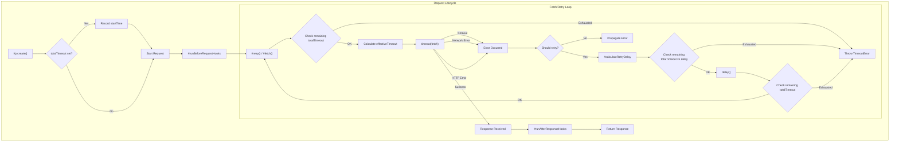
`Sources: [source/core/Ky.ts](https://github.com/sindresorhus/ky/blob/e0fcf780de2bd69af2528e4b7b87ccae6bb727b1/source/core/Ky.ts)`

## Error Handling and Retries

### The `TimeoutError` Class

When a request exceeds its time limit, `ky` throws an instance of `TimeoutError`. This custom error class extends `KyError` and includes a `request` property holding the `Request` object that timed out. The error message clearly indicates the method and URL of the failed request.
`Sources: [source/errors/TimeoutError.ts:7-15](https://github.com/sindresorhus/ky/blob/e0fcf780de2bd69af2528e4b7b87ccae6bb727b1/source/errors/TimeoutError.ts#L7-L15)`

### Timeouts and Retry Logic

The interaction between timeouts and retries is handled within the `#calculateRetryDelay` method.

-   When an error occurs, the method checks if it's a `TimeoutError`.
    `Sources: [source/core/Ky.ts:540](https://github.com/sindresorhus/ky/blob/e0fcf780de2bd69af2528e4b7b87ccae6bb727b1/source/core/Ky.ts#L540)`
-   A retry is attempted only if the `retry.retryOnTimeout` option is `true`. Otherwise, the `TimeoutError` is re-thrown, and the request fails.
    `Sources: [source/core/Ky.ts:541-542](https://github.com/sindresorhus/ky/blob/e0fcf780de2bd69af2528e4b7b87ccae6bb727b1/source/core/Ky.ts#L541-L542)`
-   If a retry is triggered by a timeout, the `AbortController` for the request is replaced with a new one for the next attempt. This ensures the new request has a fresh, non-aborted signal.
    `Sources: [source/core/Ky.ts:937-943](https://github.com/sindresorhus/ky/blob/e0fcf780de2bd69af2528e4b7b87ccae6bb727b1/source/core/Ky.ts#L937-L943)`
-   The `NonError` class is used to wrap non-`Error` values that might be thrown, ensuring consistent handling within the retry logic.
    `Sources: [source/errors/NonError.ts:6-28](https://github.com/sindresorhus/ky/blob/e0fcf780de2bd69af2528e4b7b87ccae6bb727b1/source/errors/NonError.ts#L6-L28), [source/core/Ky.ts:510](https://github.com/sindresorhus/ky/blob/e0fcf780de2bd69af2528e4b7b87ccae6bb727b1/source/core/Ky.ts#L510)`

## Timeouts for Response Body Parsing

To prevent the entire process from stalling while reading a large or slow error response body, `ky` implements a timeout specifically for this operation. This logic resides in `#getResponseData`, which calls `#readResponseText` and `#parseJson`.
`Sources: [source/core/Ky.ts:609-633](https://github.com/sindresorhus/ky/blob/e0fcf780de2bd69af2528e4b7b87ccae6bb727b1/source/core/Ky.ts#L609-L633)`

-   The duration for this timeout is determined by `#getErrorDataTimeout`. It uses the value of the `timeout` option. If `timeout` is set to `false`, it defaults to `10_000`ms.
    `Sources: [source/core/Ky.ts:635-636](https://github.com/sindresorhus/ky/blob/e0fcf780de2bd69af2528e4b7b87ccae6bb727b1/source/core/Ky.ts#L635-L636)`
-   This timeout is also constrained by any remaining `totalTimeout`. The smaller of the two values is used.
    `Sources: [source/core/Ky.ts:637-646](https://github.com/sindresorhus/ky/blob/e0fcf780de2bd69af2528e4b7b87ccae6bb727b1/source/core/Ky.ts#L637-L646)`
-   A special symbol, `timedOutResponseData`, is used internally to signal that reading or parsing the body timed out. If this occurs, `ky` checks if the `totalTimeout` was the cause and throws accordingly; otherwise, it returns `undefined` for the response data.
    `Sources: [source/core/Ky.ts:46](https://github.com/sindresorhus/ky/blob/e0fcf780de2bd69af2528e4b7b87ccae6bb727b1/source/core/Ky.ts#L46), [source/core/Ky.ts:613](https://github.com/sindresorhus/ky/blob/e0fcf780de2bd69af2528e4b7b87ccae6bb727b1/source/core/Ky.ts#L613), [source/core/Ky.ts:627](https://github.com/sindresorhus/ky/blob/e0fcf780de2bd69af2528e4b7b87ccae6bb727b1/source/core/Ky.ts#L627), [source/core/Ky.ts:711-712](https://github.com/sindresorhus/ky/blob/e0fcf780de2bd69af2528e4b7b87ccae6bb727b1/source/core/Ky.ts#L711-L712)`

## Source Files Overview

| File | Role |
|---|---|
| `source/utils/timeout.ts` | Contains the core `timeout` function that races `fetch` against a `setTimeout` to implement per-request timeouts. |
| `source/core/Ky.ts` | The main class that orchestrates requests. It integrates the `timeout` utility and implements the `totalTimeout` logic, along with handling retries on timeout. |
| `source/errors/TimeoutError.ts` | Defines the custom `TimeoutError` class that is thrown when a request exceeds its time limit. |
| `source/errors/NonError.ts` | Defines a wrapper for non-Error values that are thrown, used in the retry logic to ensure consistent error handling. |

## Edge Cases and Gotchas

-   **Maximum Timeout Value**: Both `timeout` and `totalTimeout` options cannot be set to a value greater than `2147483647`. Doing so will throw a `RangeError`.
    `Sources: [source/core/Ky.ts:154-160](https://github.com/sindresorhus/ky/blob/e0fcf780de2bd69af2528e4b7b87ccae6bb727b1/source/core/Ky.ts#L154-L160)`
-   **Error Body Read Timeout**: Even if you disable per-request timeouts with `timeout: false`, reading the body of a failed response (for inclusion in an `HTTPError`) is still subject to a 10-second timeout.
    `Sources: [source/core/Ky.ts:636](https://github.com/sindresorhus/ky/blob/e0fcf780de2bd69af2528e4b7b87ccae6bb727b1/source/core/Ky.ts#L636)`
-   **`totalTimeout` Start Time**: The `totalTimeout` timer starts when the `Ky` instance is created (e.g., via `ky()`), not when the first `fetch` call is made. This means time spent in `init` hooks or other synchronous setup code counts towards the total.
    `Sources: [source/core/Ky.ts:482-484](https://github.com/sindresorhus/ky/blob/e0fcf780de2bd69af2528e4b7b87ccae6bb727b1/source/core/Ky.ts#L482-L484)`
-   **Aborted Signal on Retry**: When a request times out and is retried, the internal `AbortController` is replaced. This is necessary because the signal from the previous attempt is in an `aborted` state and cannot be reused.
    `Sources: [source/core/Ky.ts:937-943](https://github.com/sindresorhus/ky/blob/e0fcf780de2bd69af2528e4b7b87ccae6bb727b1/source/core/Ky.ts#L937-L943)`

# Page: Request & Response Body Handling

<details>
<summary>Relevant source files</summary>

The following files were used as context for generating this wiki page:

- [source/utils/body.ts](https://github.com/sindresorhus/ky/blob/e0fcf780de2bd69af2528e4b7b87ccae6bb727b1/source/utils/body.ts)
- [source/core/Ky.ts](https://github.com/sindresorhus/ky/blob/e0fcf780de2bd69af2528e4b7b87ccae6bb727b1/source/core/Ky.ts)
- [source/types/ResponsePromise.ts](https://github.com/sindresorhus/ky/blob/e0fcf780de2bd69af2528e4b7b87ccae6bb727b1/source/types/ResponsePromise.ts)
</details>

# Request & Response Body Handling

The `ky` library provides a sophisticated and user-friendly layer for handling HTTP request and response bodies. It automates common tasks like JSON serialization and deserialization, supports various body types through the native Fetch API, and offers advanced features for tracking upload and download progress. This system is designed to simplify body management while providing powerful hooks for customization and monitoring.

Body handling is primarily managed within the `Ky` class, which processes options to construct a `Request` object. For progress tracking, it leverages streaming capabilities, wrapping request and response bodies in `TransformStream` to report progress. For convenience, the returned `ResponsePromise` is augmented with methods like `.json()` and `.text()` that streamline response body consumption.

## Request Body Management

`ky` simplifies the process of setting the request body by handling serialization and header configuration automatically based on the provided options.

### JSON Body

When the `json` option is provided in a request, `ky` automatically serializes the value into a JSON string. It then sets this string as the request body and adds the `Content-Type: application/json` header, unless a different content type is already specified.

-   The `json` object is stringified using `JSON.stringify` by default, but this can be customized with the `stringifyJson` option (`source/core/Ky.ts:420`).
-   The `Content-Type` header is set to `application/json` if not already present (`source/core/Ky.ts:421`).

Sources: [source/core/Ky.ts:419-422](https://github.com/sindresorhus/ky/blob/e0fcf780de2bd69af2528e4b7b87ccae6bb727b1/source/core/Ky.ts#L419-L422)

### FormData and URLSearchParams

For `FormData` and `URLSearchParams` bodies, `ky` leverages the browser's native `fetch` behavior. A crucial enhancement is the automatic removal of the `Content-Type` header if it was not explicitly provided by the user. This allows the browser to correctly set the `Content-Type` with the appropriate `boundary` parameter for multipart form data.

Sources: [source/core/Ky.ts:424-433](https://github.com/sindresorhus/ky/blob/e0fcf780de2bd69af2528e4b7b87ccae6bb727b1/source/core/Ky.ts#L424-L433)

### Upload Progress Tracking

`ky` can report upload progress via the `onUploadProgress` callback option. This feature is enabled when a function is provided for this option and the environment supports request streams.

The core logic involves wrapping the request body in a stream that monitors the data flow.

1.  The `Ky` constructor checks for a valid `onUploadProgress` function (`source/core/Ky.ts:478-480`).
2.  During the fetch operation, `#wrapRequestWithUploadProgress` is called (`source/core/Ky.ts:947`).
3.  This method calls `streamRequest` from `source/utils/body.ts` if progress tracking is enabled and a request body exists (`source/core/Ky.ts:1035-1041`).
4.  `streamRequest` calculates the total body size using `getBodySize` and then wraps the request body stream with the `withProgress` utility (`source/utils/body.ts:99-112`).
5.  `withProgress` uses a `TransformStream` to intercept chunks of data, calculate the percentage complete, and invoke the `onUploadProgress` callback (`source/utils/body.ts:46-77`).

The following diagram illustrates this flow:

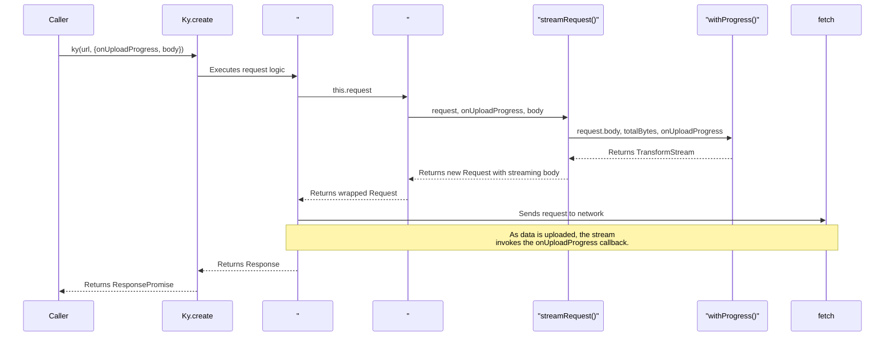

#### Body Size Calculation

To calculate upload progress, `ky` needs the total size of the request body. The `getBodySize` utility function determines this for various body types.

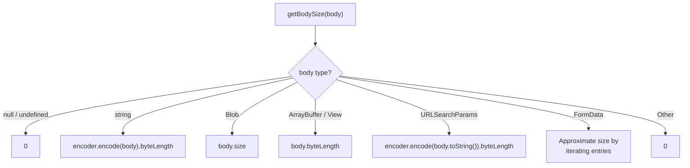

The size calculation for each type is summarized below:

| Body Type | Size Calculation Method | Source |
| :--- | :--- | :--- |
| `null`, `undefined` | Returns `0`. | `source/utils/body.ts:8-10` |
| `FormData` | Approximated by summing the byte length of keys, values, and standard boundary sizes. | `source/utils/body.ts:12-25` |
| `Blob` | `body.size` | `source/utils/body.ts:27-29` |
| `ArrayBuffer`, `ArrayBufferView` | `body.byteLength` | `source/utils/body.ts:31-33` |
| `string` | Byte length of the UTF-8 encoded string. | `source/utils/body.ts:35-37` |
| `URLSearchParams` | Byte length of the stringified search parameters. | `source/utils/body.ts:39-41` |

Sources: [source/utils/body.ts:7-44](https://github.com/sindresorhus/ky/blob/e0fcf780de2bd69af2528e4b7b87ccae6bb727b1/source/utils/body.ts#L7-L44)

## Response Body Consumption

`ky` enhances the standard `Response` object by returning a `ResponsePromise`, which includes convenient methods for parsing the response body directly.

### `ResponsePromise` Methods

The `ResponsePromise` is a `Promise<KyResponse>` that is also decorated with methods for consuming the body in various formats. When one of these methods is called, `ky` automatically sets the `Accept` header on the request to the corresponding MIME type.

| Method | `Accept` Header | Description | Source |
| :--- | :--- | :--- | :--- |
| `.arrayBuffer()` | `*/*` | Resolves with an `ArrayBuffer`. | `source/types/ResponsePromise.ts:8` |
| `.blob()` | `*/*` | Resolves with a `Blob`. | `source/types/ResponsePromise.ts:10` |
| `.formData()` | `*/*` | Resolves with `FormData`. | `source/types/ResponsePromise.ts:12` |
| `.bytes()` | `*/*` | Resolves with a `Uint8Array`. Only available if the runtime supports it. | `source/types/ResponsePromise.ts:19` |
| `.json()` | `application/json` | Resolves with the parsed JSON object. | `source/types/ResponsePromise.ts:23-66` |
| `.text()` | `text/*` | Resolves with a `string`. | `source/types/ResponsePromise.ts:68` |

The implementation for these methods awaits the `Response` and then calls the native body consumption method. For `.json()`, it includes additional logic for custom parsing and schema validation.

Sources: [source/core/Ky.ts:300-334](https://github.com/sindresorhus/ky/blob/e0fcf780de2bd69af2528e4b7b87ccae6bb727b1/source/core/Ky.ts#L300-L334), [source/types/ResponsePromise.ts](https://github.com/sindresorhus/ky/blob/e0fcf780de2bd69af2528e4b7b87ccae6bb727b1/source/types/ResponsePromise.ts)

### Custom JSON Parsing and Validation

The `.json()` method has extended functionality:

-   **Custom Parser**: If an `options.parseJson` function is provided, it will be used to parse the response text instead of `JSON.parse` (`source/core/Ky.ts:328-330`). This same custom parser is also used to decorate the `response.json` method itself (`source/core/Ky.ts:595-604`).
-   **Schema Validation**: An optional `schema` argument can be passed to `.json(schema)`. If provided, `ky` will validate the parsed JSON against the schema. If validation fails, a `SchemaValidationError` is thrown. This works with any Standard Schema v1 compatible validator.

Sources: [source/core/Ky.ts:112-140](https://github.com/sindresorhus/ky/blob/e0fcf780de2bd69af2528e4b7b87ccae6bb727b1/source/core/Ky.ts#L112-L140), [source/core/Ky.ts:332](https://github.com/sindresorhus/ky/blob/e0fcf780de2bd69af2528e4b7b87ccae6bb727b1/source/core/Ky.ts#L332)

### Download Progress Tracking

Similar to upload progress, download progress can be monitored with the `onDownloadProgress` option.

1.  If `onDownloadProgress` is provided, `Ky.create` checks for stream support and validates that the option is a function (`source/core/Ky.ts:238-245`).
2.  After the response is received, it is cloned, and the original response body is cancelled (`source/core/Ky.ts:247-248`).
3.  The `streamResponse` utility is called with the cloned response and the progress callback (`source/core/Ky.ts:249`).
4.  `streamResponse` reads the `content-length` header to get the total download size and wraps the response body with the `withProgress` stream transformer, which invokes the callback as data is received (`source/utils/body.ts:79-96`).

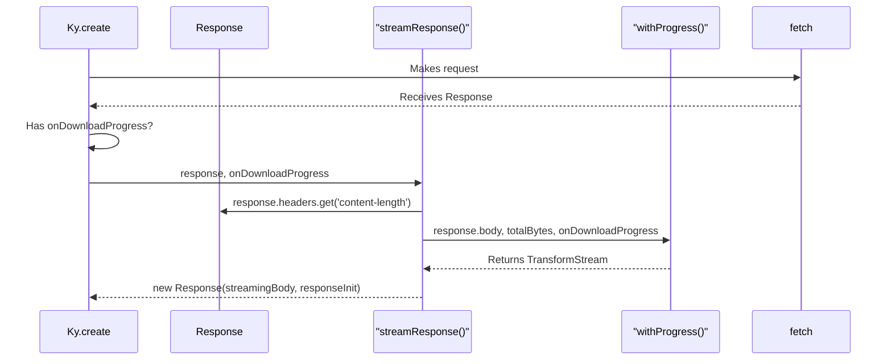

## Error Body Handling

When a request results in a non-2xx response and `throwHttpErrors` is enabled, `ky` creates an `HTTPError`. As part of this process, it attempts to read and parse the response body of the error, attaching it to the `error.data` property.

This process is handled by the `#getResponseData` method:

1.  The method first attempts to read the response body as text using `#readResponseText` (`source/core/Ky.ts:612`).
2.  `#readResponseText` reads the stream in chunks, with two important limits:
    *   **Size Limit**: It will stop reading if the body exceeds `maxErrorResponseBodySize` (10MB) to prevent excessive memory usage (`source/core/Ky.ts:44`, `source/core/Ky.ts:687`).
    *   **Time Limit**: The read operation is subject to a timeout, determined by `#getErrorDataTimeout` (`source/core/Ky.ts:612`, `source/core/Ky.ts:655-717`).
3.  If the response `Content-Type` header indicates JSON (`#isJsonContentType`), the text is parsed into a JavaScript object using `#parseJson` (`source/core/Ky.ts:622-626`). This parsing is also subject to a timeout.
4.  The resulting text or parsed object is returned and later assigned to `httpError.data` (`source/core/Ky.ts:211`).

Sources: [source/core/Ky.ts:208-211](https://github.com/sindresorhus/ky/blob/e0fcf780de2bd69af2528e4b7b87ccae6bb727b1/source/core/Ky.ts#L208-L211), [source/core/Ky.ts:609-633](https://github.com/sindresorhus/ky/blob/e0fcf780de2bd69af2528e4b7b87ccae6bb727b1/source/core/Ky.ts#L609-L633)

## Edge Cases and Gotchas

-   **FormData Size**: The size calculation for `FormData` bodies is an approximation, as a precise calculation is complex. This may lead to slight inaccuracies in upload progress reporting.
    -   Sources: [source/utils/body.ts:13](https://github.com/sindresorhus/ky/blob/e0fcf780de2bd69af2528e4b7b87ccae6bb727b1/source/utils/body.ts#L13)
-   **Progress Reporting Precision**: The `withProgress` stream deliberately avoids reporting exactly 100% until the final `flush` event. This prevents the progress from appearing to go backward if the `content-length` header was inaccurate.
    -   Sources: [source/utils/body.ts:58-63](https://github.com/sindresorhus/ky/blob/e0fcf780de2bd69af2528e4b7b87ccae6bb727b1/source/utils/body.ts#L58-L63)
-   **Empty JSON Response**: Calling `.json()` on a response with an empty body (e.g., from a 204 No Content status) will throw a `JSON.parse` error. If an empty body is expected, you must provide a schema to `.json(schema)` that can validate `undefined` as a valid value.
    -   Sources: [source/core/Ky.ts:320-325](https://github.com/sindresorhus/ky/blob/e0fcf780de2bd69af2528e4b7b87ccae6bb727b1/source/core/Ky.ts#L320-L325)
-   **Stream Support**: The `onDownloadProgress` and `onUploadProgress` features require an environment that supports `ReadableStream` and `TransformStream`. If not supported, `ky` will throw an error.
    -   Sources: [source/core/Ky.ts:243-245](https://github.com/sindresorhus/ky/blob/e0fcf780de2bd69af2528e4b7b87ccae6bb727b1/source/core/Ky.ts#L243-L245), [source/core/Ky.ts:1036](https://github.com/sindresorhus/ky/blob/e0fcf780de2bd69af2528e4b7b87ccae6bb727b1/source/core/Ky.ts#L1036)
-   **Error Body Size Limit**: The body of an error response will only be read up to 10MB. If the body is larger, it will be truncated.
    -   Sources: [source/core/Ky.ts:44](https://github.com/sindresorhus/ky/blob/e0fcf780de2bd69af2528e4b7b87ccae6bb727b1/source/core/Ky.ts#L44), [source/core/Ky.ts:687-689](https://github.com/sindresorhus/ky/blob/e0fcf780de2bd69af2528e4b7b87ccae6bb727b1/source/core/Ky.ts#L687-L689)
-   **Streaming and Retries**: When retries are disabled (`retry: { limit: 0 }`), the request body is not cloned. This is an optimization to avoid buffering large streaming uploads entirely in memory.
    -   Sources: [source/core/Ky.ts:950-951](https://github.com/sindresorhus/ky/blob/e0fcf780de2bd69af2528e4b7b87ccae6bb727b1/source/core/Ky.ts#L950-L951)

# Page: Upload and Download Progress

<details>
<summary>Relevant source files</summary>

The following files were used as context for generating this wiki page:

- [source/utils/body.ts](https://github.com/sindresorhus/ky/blob/e0fcf780de2bd69af2528e4b7b87ccae6bb727b1/source/utils/body.ts)
- [source/core/Ky.ts](https://github.com/sindresorhus/ky/blob/e0fcf780de2bd69af2528e4b7b87ccae6bb727b1/source/core/Ky.ts)
</details>

# Upload and Download Progress

The `ky` library provides functionality to monitor the progress of both uploads and downloads. This is accomplished through the `onUploadProgress` and `onDownloadProgress` options, which accept callback functions. The underlying mechanism leverages native `ReadableStream` and `TransformStream` to intercept data chunks as they are being sent or received, calculate the progress, and invoke the user-provided callbacks.

This feature requires an environment that supports streams. Specifically, `onDownloadProgress` depends on `ReadableStream` being available on the `Response` object, and `onUploadProgress` requires `ReadableStream` support for `Request` bodies. The library performs checks for these features and will throw an error if they are not supported.

## Download Progress

Download progress monitoring is enabled by providing a callback function to the `onDownloadProgress` option in a `ky` request.

### Activation and Flow

When the `onDownloadProgress` option is present, `ky` modifies its response handling flow.

1.  **Option Check**: Inside the main request function, `ky` checks if `onDownloadProgress` is a function. If not, it throws a `TypeError`.
    `Sources: [source/core/Ky.ts:238-241](https://github.com/sindresorhus/ky/blob/e0fcf780de2bd69af2528e4b7b87ccae6bb727b1/source/core/Ky.ts#L238-L241)`
2.  **Stream Support Check**: It verifies that the environment supports response streams (`supportsResponseStreams`). If not, an `Error` is thrown.
    `Sources: [source/core/Ky.ts:243-245](https://github.com/sindresorhus/ky/blob/e0fcf780de2bd69af2528e4b7b87ccae6bb727b1/source/core/Ky.ts#L243-L245)`
3.  **Response Cloning**: The original `Response` is cloned to allow the progress stream to be attached while preserving the original response. The body of the original response is then cancelled.
    `Sources: [source/core/Ky.ts:247-248](https://github.com/sindresorhus/ky/blob/e0fcf780de2bd69af2528e4b7b87ccae6bb727b1/source/core/Ky.ts#L247-L248)`
4.  **Stream Wrapping**: The `streamResponse` utility is called with the cloned response and the progress callback.
    `Sources: [source/core/Ky.ts:249](https://github.com/sindresorhus/ky/blob/e0fcf780de2bd69af2528e4b7b87ccae6bb727b1/source/core/Ky.ts#L249)`
5.  **Total Size Determination**: `streamResponse` attempts to get the total download size from the `content-length` header. If the header is absent or invalid, `totalBytes` defaults to 0.
    `Sources: [source/utils/body.ts:94](https://github.com/sindresorhus/ky/blob/e0fcf780de2bd69af2528e4b7b87ccae6bb727b1/source/utils/body.ts#L94)`
6.  **Progress Stream Creation**: A new `Response` is created, with its body piped through the `withProgress` transform stream, which reports progress back to the `onDownloadProgress` callback.
    `Sources: [source/utils/body.ts:95](https://github.com/sindresorhus/ky/blob/e0fcf780de2bd69af2528e4b7b87ccae6bb727b1/source/utils/body.ts#L95)`

The following diagram illustrates the download progress flow:

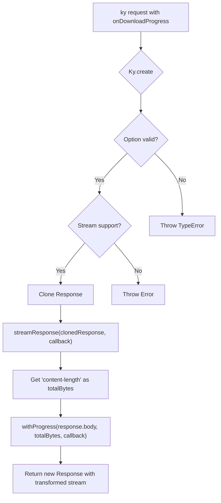
*Sources: [source/core/Ky.ts:238-252](https://github.com/sindresorhus/ky/blob/e0fcf780de2bd69af2528e4b7b87ccae6bb727b1/source/core/Ky.ts#L238-L252), [source/utils/body.ts:79-96](https://github.com/sindresorhus/ky/blob/e0fcf780de2bd69af2528e4b7b87ccae6bb727b1/source/utils/body.ts#L79-L96)*

## Upload Progress

Upload progress is enabled by providing an `onUploadProgress` callback function in the request options.

### Activation and Flow

1.  **Option Check**: In the `Ky` constructor, a check ensures that if `onUploadProgress` is provided, it is a function. A `TypeError` is thrown otherwise.
    `Sources: [source/core/Ky.ts:478-480](https://github.com/sindresorhus/ky/blob/e0fcf780de2bd69af2528e4b7b87ccae6bb727b1/source/core/Ky.ts#L478-L480)`
2.  **Stream Wrapping**: During the `#fetch` call, the request is passed to `#wrapRequestWithUploadProgress`.
    `Sources: [source/core/Ky.ts:947](https://github.com/sindresorhus/ky/blob/e0fcf780de2bd69af2528e4b7b87ccae6bb727b1/source/core/Ky.ts#L947)`
3.  **Pre-conditions Check**: `#wrapRequestWithUploadProgress` checks for the `onUploadProgress` callback, the presence of a request body, and support for request streams (`supportsRequestStreams`). If any condition is not met, it returns the original request without modification.
    `Sources: [source/core/Ky.ts:1036-1038](https://github.com/sindresorhus/ky/blob/e0fcf780de2bd69af2528e4b7b87ccae6bb727b1/source/core/Ky.ts#L1036-L1038)`
4.  **Stream Request Creation**: If conditions are met, `streamRequest` is called.
    `Sources: [source/core/Ky.ts:1040](https://github.com/sindresorhus/ky/blob/e0fcf780de2bd69af2528e4b7b87ccae6bb727b1/source/core/Ky.ts#L1040)`
5.  **Total Size Calculation**: `streamRequest` calls `getBodySize` on the original request body to determine the `totalBytes` for the upload.
    `Sources: [source/utils/body.ts:105](https://github.com/sindresorhus/ky/blob/e0fcf780de2bd69af2528e4b7b87ccae6bb727b1/source/utils/body.ts#L105)`
6.  **Progress Stream Creation**: A new `Request` is created, cloning the original but replacing its body with the stream returned by `withProgress`. This new request is then used for the fetch operation. The `duplex: 'half'` option is also set.
    `Sources: [source/utils/body.ts:107-111](https://github.com/sindresorhus/ky/blob/e0fcf780de2bd69af2528e4b7b87ccae6bb727b1/source/utils/body.ts#L107-L111)`

The following diagram illustrates the upload progress flow:

```mermaid
sequenceDiagram
    participant User
    participant Ky as "Ky.create()"
    participant Fetch as "Ky.#fetch()"
    participant Wrapper as "#wrapRequestWithUploadProgress()"
    participant Streamer as "streamRequest()"
    participant Sizer as "getBodySize()"
    participant Progress as "withProgress()"

    User->>Ky: ky(url, {onUploadProgress})
    Ky->>Fetch: Executes fetch logic
    Fetch->>Wrapper: wrapRequestWithUploadProgress(request)
    Wrapper->>Streamer: streamRequest(request, callback)
    Streamer->>Sizer: getBodySize(originalBody)
    Sizer-->>Streamer: totalBytes
    Streamer->>Progress: withProgress(request.body, totalBytes, callback)
    Progress-->>Streamer: transformedStream
    Streamer-->>Wrapper: new Request({body: transformedStream})
    Wrapper-->>Fetch: new Request
    Fetch-->>Ky: Executes fetch with new Request
    Ky-->>User: ResponsePromise
```
*Sources: [source/core/Ky.ts:947](https://github.com/sindresorhus/ky/blob/e0fcf780de2bd69af2528e4b7b87ccae6bb727b1/source/core/Ky.ts#L947), [source/core/Ky.ts:1035-1041](https://github.com/sindresorhus/ky/blob/e0fcf780de2bd69af2528e4b7b87ccae6bb727b1/source/core/Ky.ts#L1035-L1041), [source/utils/body.ts:99-112](https://github.com/sindresorhus/ky/blob/e0fcf780de2bd69af2528e4b7b87ccae6bb727b1/source/utils/body.ts#L99-L112)*

### Body Size Calculation

The `getBodySize` function is crucial for determining the total size of an upload. It supports several body types:

| Body Type | Size Calculation Method | Source |
| --- | --- | --- |
| `FormData` | Approximated by summing boundary sizes, header lengths, and the size of each value (string length or file size). | `[source/utils/body.ts:12-25](https://github.com/sindresorhus/ky/blob/e0fcf780de2bd69af2528e4b7b87ccae6bb727b1/source/utils/body.ts#L12-L25)` |
| `Blob` | Uses `body.size`. | `[source/utils/body.ts:27-29](https://github.com/sindresorhus/ky/blob/e0fcf780de2bd69af2528e4b7b87ccae6bb727b1/source/utils/body.ts#L27-L29)` |
| `ArrayBuffer` / `ArrayBufferView` | Uses `body.byteLength`. | `[source/utils/body.ts:31-33](https://github.com/sindresorhus/ky/blob/e0fcf780de2bd69af2528e4b7b87ccae6bb727b1/source/utils/body.ts#L31-L33)` |
| `string` | Encodes the string to UTF-8 and uses the resulting `byteLength`. | `[source/utils/body.ts:35-37](https://github.com/sindresorhus/ky/blob/e0fcf780de2bd69af2528e4b7b87ccae6bb727b1/source/utils/body.ts#L35-L37)` |
| `URLSearchParams` | Converts to a string, encodes to UTF-8, and uses the `byteLength`. | `[source/utils/body.ts:39-41](https://github.com/sindresorhus/ky/blob/e0fcf780de2bd69af2528e4b7b87ccae6bb727b1/source/utils/body.ts#L39-L41)` |
| `null` / `undefined` | Returns `0`. | `[source/utils/body.ts:8-10](https://github.com/sindresorhus/ky/blob/e0fcf780de2bd69af2528e4b7b87ccae6bb727b1/source/utils/body.ts#L8-L10)` |

## Core Progress Logic: `withProgress`

Both upload and download progress rely on the `withProgress` utility function, which wraps a `ReadableStream` in a `TransformStream` to monitor data flow.

`Sources: [source/utils/body.ts:46-77](https://github.com/sindresorhus/ky/blob/e0fcf780de2bd69af2528e4b7b87ccae6bb727b1/source/utils/body.ts#L46-L77)`

### Implementation Details

-   **`TransformStream`**: The function pipes the original stream through a new `TransformStream`.
    `Sources: [source/utils/body.ts:50](https://github.com/sindresorhus/ky/blob/e0fcf780de2bd69af2528e4b7b87ccae6bb727b1/source/utils/body.ts#L50)`
-   **`transform(chunk, controller)`**: For each `chunk` of data that passes through:
    1.  The chunk is immediately enqueued to the output, ensuring the data flow is not blocked.
        `Sources: [source/utils/body.ts:52](https://github.com/sindresorhus/ky/blob/e0fcf780de2bd69af2528e4b7b87ccae6bb727b1/source/utils/body.ts#L52)`
    2.  The size of the *previous* chunk is added to `transferredBytes`.
        `Sources: [source/utils/body.ts:55](https://github.com/sindresorhus/ky/blob/e0fcf780de2bd69af2528e4b7b87ccae6bb727b1/source/utils/body.ts#L55)`
    3.  The completion `percent` is calculated as `transferredBytes / totalBytes`.
        `Sources: [source/utils/body.ts:57](https://github.com/sindresorhus/ky/blob/e0fcf780de2bd69af2528e4b7b87ccae6bb727b1/source/utils/body.ts#L57)`
    4.  To prevent reporting 100% before the stream is fully flushed, if `percent` is `1` or more, it is capped at `1 - Number.EPSILON`. This handles cases where `totalBytes` might be slightly inaccurate.
        `Sources: [source/utils/body.ts:59-63](https://github.com/sindresorhus/ky/blob/e0fcf780de2bd69af2528e4b7b87ccae6bb727b1/source/utils/body.ts#L59-L63)`
    5.  The `onProgress` callback is invoked with the progress state and the previous chunk.
        `Sources: [source/utils/body.ts:65](https://github.com/sindresorhus/ky/blob/e0fcf780de2bd69af2528e4b7b87ccae6bb727b1/source/utils/body.ts#L65)`
-   **`flush()`**: When the stream is closed:
    1.  The size of the final chunk is added to `transferredBytes`.
    2.  The `onProgress` callback is invoked one last time with `percent: 1` to signal completion.
        `Sources: [source/utils/body.ts:70-75](https://github.com/sindresorhus/ky/blob/e0fcf780de2bd69af2528e4b7b87ccae6bb727b1/source/utils/body.ts#L70-L75)`

### Progress Callback Object

The `onUploadProgress` and `onDownloadProgress` callbacks receive an object with the following properties:

| Property | Type | Description |
| --- | --- | --- |
| `percent` | `number` | A value from 0 to 1 representing the fraction of data transferred. |
| `transferredBytes` | `number` | The number of bytes transferred so far. |
| `totalBytes` | `number` | The total number of bytes to be transferred. |

The callback also receives the chunk of data that was just processed as a second argument.

## Edge Cases and Gotchas

-   **`FormData` Size Approximation**: The size calculation for `FormData` is an approximation. The actual size of the multipart body sent by the browser may differ slightly.
    `Sources: [source/utils/body.ts:13](https://github.com/sindresorhus/ky/blob/e0fcf780de2bd69af2528e4b7b87ccae6bb727b1/source/utils/body.ts#L13)`
-   **Inaccurate `content-length`**: For downloads, if the server provides an incorrect `content-length` header, the `percent` calculation may be skewed. The `totalBytes` reported in the progress object will be adjusted upwards if more bytes are received than initially reported (`Math.max(totalBytes, transferredBytes)`).
    `Sources: [source/utils/body.ts:65, 73]()`
-   **Zero `totalBytes`**: If the upload body size cannot be determined or the download `content-length` is missing/zero, `totalBytes` will be `0`. In this case, `percent` will also be `0` in all progress events until the final one, which will report `1`.
    `Sources: [source/utils/body.ts:57](https://github.com/sindresorhus/ky/blob/e0fcf780de2bd69af2528e4b7b87ccae6bb727b1/source/utils/body.ts#L57)`
-   **Environment Support**: If the environment does not support `Request` or `Response` streams, using `onUploadProgress` or `onDownloadProgress` respectively will result in a runtime `Error`.
    `Sources: [source/core/Ky.ts:243-245](https://github.com/sindresorhus/ky/blob/e0fcf780de2bd69af2528e4b7b87ccae6bb727b1/source/core/Ky.ts#L243-L245), [source/core/Ky.ts:1036](https://github.com/sindresorhus/ky/blob/e0fcf780de2bd69af2528e4b7b87ccae6bb727b1/source/core/Ky.ts#L1036)`
-   **Callback Type**: The `onUploadProgress` and `onDownloadProgress` options must be functions. Providing any other type will throw a `TypeError`.
    `Sources: [source/core/Ky.ts:239-241](https://github.com/sindresorhus/ky/blob/e0fcf780de2bd69af2528e4b7b87ccae6bb727b1/source/core/Ky.ts#L239-L241), [source/core/Ky.ts:478-480](https://github.com/sindresorhus/ky/blob/e0fcf780de2bd69af2528e4b7b87ccae6bb727b1/source/core/Ky.ts#L478-L480)`
-   **Premature 100%**: The progress `percent` is intentionally clamped to just under `1` until the stream is fully flushed. This prevents the UI from indicating 100% completion before the final data chunk has been processed.
    `Sources: [source/utils/body.ts:58-63](https://github.com/sindresorhus/ky/blob/e0fcf780de2bd69af2528e4b7b87ccae6bb727b1/source/utils/body.ts#L58-L63)`

# Page: Response Schema Validation

<details>
<summary>Relevant source files</summary>

The following files were used as context for generating this wiki page:

- [source/core/Ky.ts](https://github.com/sindresorhus/ky/blob/e0fcf780de2bd69af2528e4b7b87ccae6bb727b1/source/core/Ky.ts)
- [source/errors/SchemaValidationError.ts](https://github.com/sindresorhus/ky/blob/e0fcf780de2bd69af2528e4b7b87ccae6bb727b1/source/errors/SchemaValidationError.ts)
- [source/types/standard-schema.ts](https://github.com/sindresorhus/ky/blob/e0fcf780de2bd69af2528e4b7b87ccae6bb727b1/source/types/standard-schema.ts)
</details>

# Response Schema Validation

Ky provides a mechanism to validate the JSON response body against a user-provided schema. This is accomplished by passing a schema object to the `.json()` method, which is available on the `ResponsePromise` returned by a `ky` request. The validation leverages the [Standard Schema](https://github.com/standard-schema/standard-schema) specification, allowing for integration with various validation libraries like Zod, Yup, or Joi, provided they have an adapter.

If the JSON data successfully passes validation, the `.json()` method resolves with the (potentially transformed) value. If validation fails, the promise rejects with a `SchemaValidationError`, which contains detailed information about the validation issues. This feature enables developers to ensure that API responses conform to expected data structures, enhancing type safety and robustness.

## The Standard Schema Interface

To be used with `ky`, a schema object must conform to the `StandardSchemaV1` interface. This interface acts as a contract that `ky` uses to perform the validation.

Sources: [source/types/standard-schema.ts](https://github.com/sindresorhus/ky/blob/e0fcf780de2bd69af2528e4b7b87ccae6bb727b1/source/types/standard-schema.ts)

### `StandardSchemaV1` Structure

The core of the schema is a property named `~standard`, which contains metadata and the validation logic.

```mermaid
classDiagram
    direction TD
    class StandardSchemaV1 {
        +~standard: StandardSchemaV1Details
    }
    class StandardSchemaV1Details {
        +version: 1
        +vendor: string
        +validate(value: unknown): StandardSchemaV1Result
        +types: StandardSchemaV1Types
    }
    class StandardSchemaV1Result {
        <<Union>>
        +StandardSchemaV1SuccessResult
        +StandardSchemaV1FailureResult
    }
    class StandardSchemaV1SuccessResult {
        +value: OutputType
    }
    class StandardSchemaV1FailureResult {
        +issues: StandardSchemaV1Issue[]
    }
    class StandardSchemaV1Issue {
        +message: string
        +path: (PropertyKey | object)[]
    }

    StandardSchemaV1 --> StandardSchemaV1Details
    StandardSchemaV1Details --> StandardSchemaV1Result
    StandardSchemaV1Result --|> StandardSchemaV1SuccessResult
    StandardSchemaV1Result --|> StandardSchemaV1FailureResult
    StandardSchemaV1FailureResult --> StandardSchemaV1Issue

```
*A diagram illustrating the relationships between the core types of the Standard Schema interface.*

The `~standard` object must contain the following properties:

| Property | Type | Description |
|---|---|---|
| `version` | `1` | The version of the Standard Schema specification. Currently must be `1`. |
| `vendor` | `string` | A string identifying the validation library (e.g., "zod"). |
| `validate` | `(value: unknown) => StandardSchemaV1Result \| Promise<StandardSchemaV1Result>` | An async or sync function that performs the validation. |
| `types` | `object` | (Optional) An object containing the inferred `input` and `output` types of the schema. |

Sources: [source/types/standard-schema.ts:27-37](https://github.com/sindresorhus/ky/blob/e0fcf780de2bd69af2528e4b7b87ccae6bb727b1/source/types/standard-schema.ts#L27-L37)

### Validation Result

The `validate` function must return a result object that is either a success or a failure.

*   **Success (`StandardSchemaV1SuccessResult`)**: Contains a `value` property with the validated (and possibly transformed) data. The `issues` property must be `undefined`.
    Sources: [source/types/standard-schema.ts:6-9](https://github.com/sindresorhus/ky/blob/e0fcf780de2bd69af2528e4b7b87ccae6bb727b1/source/types/standard-schema.ts#L6-L9)
*   **Failure (`StandardSchemaV1FailureResult`)**: Contains an `issues` property, which is a read-only array of `StandardSchemaV1Issue` objects detailing the validation errors. The `value` property must be `undefined`.
    Sources: [source/types/standard-schema.ts:11-14](https://github.com/sindresorhus/ky/blob/e0fcf780de2bd69af2528e4b7b87ccae6bb727b1/source/types/standard-schema.ts#L11-L14)

### Validation Issue

Each issue in the `issues` array provides details about a specific validation failure.

| Property | Type | Description |
|---|---|---|
| `message` | `string` | A human-readable error message describing the validation failure. |
| `path` | `(PropertyKey \| object)[]` | (Optional) An array representing the path to the invalid property within the data. |

Sources: [source/types/standard-schema.ts:1-4](https://github.com/sindresorhus/ky/blob/e0fcf780de2bd69af2528e4b7b87ccae6bb727b1/source/types/standard-schema.ts#L1-L4)

## Validation Execution Flow

The schema validation process is initiated when the `.json(schema)` method is called on a `ResponsePromise`.

The following diagram illustrates the sequence of events:

```mermaid
sequenceDiagram
    participant User
    participant ResponsePromise
    participant Ky_ts as Ky.ts
    participant Schema

    User->>ResponsePromise: .json(schema)
    ResponsePromise->>ResponsePromise: await response
    ResponsePromise->>Ky_ts: response.text()
    Ky_ts-->>ResponsePromise: text
    ResponsePromise->>Ky_ts: JSON.parse(text) or options.parseJson(text)
    Ky_ts-->>ResponsePromise: jsonValue
    ResponsePromise->>Ky_ts: validateJsonWithSchema(jsonValue, schema)
    Ky_ts->>Ky_ts: Validate schema object structure
    alt Schema structure is invalid
        Ky_ts->>xUser: throw TypeError
    else Schema structure is valid
        Ky_ts->>Schema: schema['~standard'].validate(jsonValue)
        Schema-->>Ky_ts: validationResult
        alt validationResult has issues
            Ky_ts->>xUser: throw new SchemaValidationError(issues)
        else validationResult is successful
            Ky_ts-->>ResponsePromise: validationResult.value
            ResponsePromise-->>User: validatedValue
        end
    end
```
*Sequence diagram of the schema validation process.*

The key steps are:
1.  The `.json()` method is invoked with a schema. It first awaits the `Response` object.
2.  The response body is read as text using `response.text()`.
3.  The text is parsed into a JavaScript value. This uses the custom `options.parseJson` function if provided, otherwise it defaults to `JSON.parse`.
4.  The `validateJsonWithSchema` function is called with the parsed value and the schema.
5.  If validation is successful, the resulting value is returned to the caller.
6.  If validation fails, a `SchemaValidationError` is thrown.

Sources: [source/core/Ky.ts:309-333](https://github.com/sindresorhus/ky/blob/e0fcf780de2bd69af2528e4b7b87ccae6bb727b1/source/core/Ky.ts#L309-L333)

### The `validateJsonWithSchema` Helper

This internal async function orchestrates the validation. It is responsible for both verifying the schema's integrity and executing the validation logic.

```mermaid
graph TD
    A["Start: validateJsonWithSchema(jsonValue, schema)"] --> B{"Is schema an object/function and not null?"};
    B -- No --> C[Throw TypeError];
    B -- Yes --> D{"Is schema['~standard'] an object with a validate function?"};
    D -- No --> C;
    D -- Yes --> E["await schema['~standard'].validate(jsonValue)"];
    E --> F[validationResult];
    F --> G{"Does validationResult have 'issues'?"};
    G -- Yes --> H["Throw new SchemaValidationError(issues)"];
    G -- No --> I["Return validationResult.value"];
    I --> J[End];
    H --> J;
    C --> J;
```
*Flowchart of the `validateJsonWithSchema` function's logic.*

1.  **Schema Integrity Check**: It first checks if the provided `schema` argument is a non-null object or function. If not, it throws a `TypeError`.
    Sources: [source/core/Ky.ts:113-121](https://github.com/sindresorhus/ky/blob/e0fcf780de2bd69af2528e4b7b87ccae6bb727b1/source/core/Ky.ts#L113-L121)
2.  **Standard Schema Contract Check**: It then verifies that `schema['~standard']` is an object and contains a `validate` function. If not, it throws a `TypeError`.
    Sources: [source/core/Ky.ts:125-131](https://github.com/sindresorhus/ky/blob/e0fcf780de2bd69af2528e4b7b87ccae6bb727b1/source/core/Ky.ts#L125-L131)
3.  **Execution**: It calls the `schema['~standard'].validate()` function with the parsed JSON value.
    Sources: [source/core/Ky.ts:133](https://github.com/sindresorhus/ky/blob/e0fcf780de2bd69af2528e4b7b87ccae6bb727b1/source/core/Ky.ts#L133)
4.  **Result Handling**:
    - If the result contains an `issues` property, it creates and throws a `SchemaValidationError`.
      Sources: [source/core/Ky.ts:135-137](https://github.com/sindresorhus/ky/blob/e0fcf780de2bd69af2528e4b7b87ccae6bb727b1/source/core/Ky.ts#L135-L137)
    - Otherwise, it returns the `value` from the result.
      Sources: [source/core/Ky.ts:139](https://github.com/sindresorhus/ky/blob/e0fcf780de2bd69af2528e4b7b87ccae6bb727b1/source/core/Ky.ts#L139)

## Error Handling with `SchemaValidationError`

When validation fails, `ky` throws a `SchemaValidationError`. This error is specifically designed to represent a data validation failure, not an HTTP or network failure.

Sources: [source/errors/SchemaValidationError.ts](https://github.com/sindresorhus/ky/blob/e0fcf780de2bd69af2528e4b7b87ccae6bb727b1/source/errors/SchemaValidationError.ts)

### Properties

| Property | Type | Description |
|---|---|---|
| `name` | `'SchemaValidationError'` | The name of the error class. |
| `message`| `string` | A generic error message: "Response schema validation failed". |
| `issues` | `readonly StandardSchemaV1Issue[]` | An array of issue objects from the schema's `validate` function, detailing each validation failure. |

Sources: [source/errors/SchemaValidationError.ts:26-32](https://github.com/sindresorhus/ky/blob/e0fcf780de2bd69af2528e4b7b87ccae6bb727b1/source/errors/SchemaValidationError.ts#L26-L32)

### Usage Example

It's important to distinguish `SchemaValidationError` from other errors that `ky` might throw, such as `HTTPError`.

```typescript
import ky, {SchemaValidationError} from 'ky';
import {z} from 'zod';

const userSchema = z.object({name: z.string()});

try {
	const user = await ky('/api/user').json(userSchema);
	console.log(user.name);
} catch (error) {
	if (error instanceof SchemaValidationError) {
		console.error(error.issues);
	}
}
```
*This example demonstrates how to catch a `SchemaValidationError` and access its `issues` property.*

Sources: [source/errors/SchemaValidationError.ts:9-23](https://github.com/sindresorhus/ky/blob/e0fcf780de2bd69af2528e4b7b87ccae6bb727b1/source/errors/SchemaValidationError.ts#L9-L23)

## Edge Cases and Gotchas

### Empty Response Body

If the server returns an empty response body (`''`), the behavior of `.json(schema)` is as follows:
- The `validateJsonWithSchema` function is called with `undefined` as the `jsonValue`.
- It is the responsibility of the schema's `validate` function to handle an `undefined` input correctly. For example, a schema for an optional value might pass, while a schema for a required object would fail.

Sources: [source/core/Ky.ts:320-323](https://github.com/sindresorhus/ky/blob/e0fcf780de2bd69af2528e4b7b87ccae6bb727b1/source/core/Ky.ts#L320-L323)

### Invalid Schema Object

If the object passed to `.json()` does not conform to the `StandardSchemaV1` interface (e.g., it's `null`, or `~standard.validate` is not a function), `ky` will throw a `TypeError` with the message: `The \`schema\` argument must follow the Standard Schema specification`. This happens before any network request is made or validation is attempted.

Sources: [source/core/Ky.ts:60](https://github.com/sindresorhus/ky/blob/e0fcf780de2bd69af2528e4b7b87ccae6bb727b1/source/core/Ky.ts#L60), [source/core/Ky.ts:112-131](https://github.com/sindresorhus/ky/blob/e0fcf780de2bd69af2528e4b7b87ccae6bb727b1/source/core/Ky.ts#L112-L131)

### Not a `KyError`

The `SchemaValidationError` intentionally does not extend `KyError`. This is because a schema validation failure is not considered a failure of the HTTP request itself—the request succeeded and returned a response, but the response's content did not match the expected format. Consequently, type guards like `isKyError()` will not match this error type.

Sources: [source/errors/SchemaValidationError.ts:6-7](https://github.com/sindresorhus/ky/blob/e0fcf780de2bd69af2528e4b7b87ccae6bb727b1/source/errors/SchemaValidationError.ts#L6-L7)

# Page: API: ky() and Method Shortcuts

<details>
<summary>Relevant source files</summary>

The following files were used as context for generating this wiki page:

- [source/index.ts](https://github.com/sindresorhus/ky/blob/e0fcf780de2bd69af2528e4b7b87ccae6bb727b1/source/index.ts)
- [source/core/Ky.ts](https://github.com/sindresorhus/ky/blob/e0fcf780de2bd69af2528e4b7b87ccae6bb727b1/source/core/Ky.ts)
- [source/types/options.ts](https://github.com/sindresorhus/ky/blob/e0fcf780de2bd69af2528e4b7b87ccae6bb727b1/source/types/options.ts)
</details>

# API: ky() and Method Shortcuts

The `ky` object is the primary export and entry point for making HTTP requests. It functions as a powerful, modern wrapper around the native Fetch API. The main `ky()` function can be used for any type of request, and it is augmented with convenience method shortcuts for common HTTP verbs (e.g., `ky.get()`, `ky.post()`).

The library also provides mechanisms to create new `ky` instances with customized default options using `ky.create()` and `ky.extend()`, making it easy to build specialized API clients. All request-making functions return a `ResponsePromise`, which is a `Promise<Response>` enhanced with methods to parse the response body directly, such as `.json()` or `.text()`.

Sources: [source/index.ts:34-36](https://github.com/sindresorhus/ky/blob/e0fcf780de2bd69af2528e4b7b87ccae6bb727b1/source/index.ts#L34-L36), [source/core/Ky.ts:143](https://github.com/sindresorhus/ky/blob/e0fcf780de2bd69af2528e4b7b87ccae6bb727b1/source/core/Ky.ts#L143)

## Core `ky()` Function

The main `ky` function provides a flexible way to make any HTTP request. It accepts the request URL and an optional `options` object.

**Signature:**
```typescript
(input: Input, options?: Options) => ResponsePromise
```
- `input`: The request resource, which can be a `string`, `URL`, or `Request` object. `Sources: [source/types/options.ts:14](https://github.com/sindresorhus/ky/blob/e0fcf780de2bd69af2528e4b7b87ccae6bb727b1/source/types/options.ts#L14)`
- `options`: An object containing custom `ky` options and standard `RequestInit` properties. `Sources: [source/types/options.ts:399](https://github.com/sindresorhus/ky/blob/e0fcf780de2bd69af2528e4b7b87ccae6bb727b1/source/types/options.ts#L399)`

When called, it invokes the internal `Ky.create` static method, passing the input and a merged configuration of default and per-request options. The `validateAndMerge` utility is responsible for combining these options.

Sources: [source/index.ts:12](https://github.com/sindresorhus/ky/blob/e0fcf780de2bd69af2528e4b7b87ccae6bb727b1/source/index.ts#L12)

## Method Shortcuts

For convenience, `ky` comes with shortcut methods for common HTTP verbs. These methods have the same signature as the main `ky()` function but automatically set the `method` option.

The following shortcuts are available:
- `ky.get(input, options?)`
- `ky.post(input, options?)`
- `ky.put(input, options?)`
- `ky.patch(input, options?)`
- `ky.head(input, options?)`
- `ky.delete(input, options?)`

These methods are dynamically created by iterating over a `requestMethods` array and attaching a corresponding function to the `ky` object. Each shortcut calls `Ky.create` with the `method` option pre-filled.

Sources: [source/index.ts:14-17](https://github.com/sindresorhus/ky/blob/e0fcf780de2bd69af2528e4b7b87ccae6bb727b1/source/index.ts#L14-L17), [source/types/options.ts:11](https://github.com/sindresorhus/ky/blob/e0fcf780de2bd69af2528e4b7b87ccae6bb727b1/source/types/options.ts#L11)

The diagram below illustrates how a call to `ky.post()` is handled.

```mermaid
graph TD
    A["ky.post('url', {json: ...})"] --> B{index.ts};
    B --> C["ky[method] = (input, options) => ..."];
    C --> D["Ky.create(input, validateAndMerge(defaults, options, {method: 'post'}))"];
    D --> E{core/Ky.ts};
    E --> F["new Ky(input, mergedOptions)"];
    F --> G["Request Lifecycle"];
    G --> H["ResponsePromise"];

    subgraph source/index.ts
        B
        C
    end

    subgraph source/core/Ky.ts
        D
        E
        F
        G
    end
```
Sources: [source/index.ts:14-17](https://github.com/sindresorhus/ky/blob/e0fcf780de2bd69af2528e4b7b87ccae6bb727b1/source/index.ts#L14-L17), [source/core/Ky.ts:143](https://github.com/sindresorhus/ky/blob/e0fcf780de2bd69af2528e4b7b87ccae6bb727b1/source/core/Ky.ts#L143)

## Instance Management

`ky` provides two methods for creating new instances with customized default options, which is useful for creating reusable API clients.

### `ky.create(defaultOptions)`

Creates a completely new `ky` instance with its own set of `defaultOptions`. It does not inherit any defaults from the instance it was called on.

Sources: [source/index.ts:19](https://github.com/sindresorhus/ky/blob/e0fcf780de2bd69af2528e4b7b87ccae6bb727b1/source/index.ts#L19)

### `ky.extend(newDefaults)`

Creates a new `ky` instance that inherits and merges defaults from its parent. The `newDefaults` can be an object or a function that receives the parent's defaults and returns a new defaults object.

Sources: [source/index.ts:20-26](https://github.com/sindresorhus/ky/blob/e0fcf780de2bd69af2528e4b7b87ccae6bb727b1/source/index.ts#L20-L26)

The following diagram shows the relationship between these methods.

```mermaid
graph TD
    A["Default ky instance"] -- "ky.extend(...)" --> B["Extended ky instance (inherits defaults)"];
    A -- "ky.create(...)" --> C["New ky instance (isolated defaults)"];
    B -- "ky.extend(...)" --> D["Further extended instance"];
```
Sources: [source/index.ts:19-26](https://github.com/sindresorhus/ky/blob/e0fcf780de2bd69af2528e4b7b87ccae6bb727b1/source/index.ts#L19-L26)

## Request Lifecycle

When `ky()` or a method shortcut is called, it triggers a comprehensive request lifecycle managed by the `Ky` class.

```mermaid
sequenceDiagram
    participant User
    participant ky
    participant KyClass as "Ky Instance"
    participant Hooks
    participant FetchAPI

    User->>ky: ky.post(url, options)
    ky->>KyClass: Ky.create(url, mergedOptions)
    Note over KyClass: Constructor runs, normalizes options
    KyClass->>Hooks: Run `init` hooks
    KyClass->>Hooks: Run `beforeRequest` hooks
    loop Retry Loop
        KyClass->>FetchAPI: #fetch()
        FetchAPI-->>KyClass: Response
        alt Unsuccessful Response (e.g. 503) or Network Error
            KyClass->>Hooks: Run `beforeRetry` hooks
            opt Hook returns `stop`
                KyClass-->>ky: Abort retries
            end
            Note over KyClass: Calculates and waits for retry delay
        else Successful Response
            break
        end
    end
    KyClass->>Hooks: Run `afterResponse` hooks
    KyClass-->>ky: Decorated Response
    ky-->>User: ResponsePromise
    alt Error during lifecycle
        ky->>Hooks: Run `beforeError` hooks
        Hooks-->>ky: Potentially new Error
        ky->>User: Throws final Error
    end
```
This diagram shows the sequence of events from the initial call to the final response or error, including the execution of various hooks (`init`, `beforeRequest`, `beforeRetry`, `afterResponse`, `beforeError`) and the retry mechanism.

Sources: [source/core/Ky.ts:153-298](https://github.com/sindresorhus/ky/blob/e0fcf780de2bd69af2528e4b7b87ccae6bb727b1/source/core/Ky.ts#L153-L298)

## `ResponsePromise` and Body Methods

All `ky` API calls return a `ResponsePromise`. This is a standard `Promise` that resolves with a `Response` object, but it is augmented with convenience methods for parsing the response body.

| Method      | Description                                                                                                                                                            |
|-------------|------------------------------------------------------------------------------------------------------------------------------------------------------------------------|
| `.json()`   | Parses the response body as JSON. Automatically sets the `Accept` header to `application/json` if not already present. Can use a custom `parseJson` function from options. Supports optional schema validation. `Sources: [source/core/Ky.ts:309-333](https://github.com/sindresorhus/ky/blob/e0fcf780de2bd69af2528e4b7b87ccae6bb727b1/source/core/Ky.ts#L309-L333)` |
| `.text()`   | Returns the response body as a string. `Sources: [source/core/Ky.ts:316](https://github.com/sindresorhus/ky/blob/e0fcf780de2bd69af2528e4b7b87ccae6bb727b1/source/core/Ky.ts#L316)`                                                                                             |
| `.blob()`   | Returns the response body as a `Blob`. `Sources: [source/core/Ky.ts:316](https://github.com/sindresorhus/ky/blob/e0fcf780de2bd69af2528e4b7b87ccae6bb727b1/source/core/Ky.ts#L316)`                                                                                             |
| `.formData()`| Returns the response body as `FormData`. `Sources: [source/core/Ky.ts:316](https://github.com/sindresorhus/ky/blob/e0fcf780de2bd69af2528e4b7b87ccae6bb727b1/source/core/Ky.ts#L316)`                                                                                         |
| `.arrayBuffer()`| Returns the response body as an `ArrayBuffer`. `Sources: [source/core/Ky.ts:316](https://github.com/sindresorhus/ky/blob/e0fcf780de2bd69af2528e4b7b87ccae6bb727b1/source/core/Ky.ts#L316)`                                                                                |
| `.bytes()`  | Returns the response body as an `ArrayBuffer` using the native `.bytes()` method if available. `Sources: [source/core/Ky.ts:302-307](https://github.com/sindresorhus/ky/blob/e0fcf780de2bd69af2528e4b7b87ccae6bb727b1/source/core/Ky.ts#L302-L307)`                                  |

These methods are attached to the `ResponsePromise` in a loop within the `Ky.create` static method.

Sources: [source/core/Ky.ts:300-334](https://github.com/sindresorhus/ky/blob/e0fcf780de2bd69af2528e4b7b87ccae6bb727b1/source/core/Ky.ts#L300-L334)

## Utility Exports

In addition to the request functions, the `ky` package exports several utilities and error classes.

| Export      | Description                                                                                                                                                            |
|-------------|------------------------------------------------------------------------------------------------------------------------------------------------------------------------|
| `ky.stop`   | A special symbol that can be returned from a `beforeRetry` hook to prevent further retries. `Sources: [source/index.ts:28](https://github.com/sindresorhus/ky/blob/e0fcf780de2bd69af2528e4b7b87ccae6bb727b1/source/index.ts#L28), [source/core/Ky.ts:919](https://github.com/sindresorhus/ky/blob/e0fcf780de2bd69af2528e4b7b87ccae6bb727b1/source/core/Ky.ts#L919)`                |
| `ky.retry`  | A special symbol that can be returned from an `afterResponse` hook to force a retry. `Sources: [source/index.ts:29](https://github.com/sindresorhus/ky/blob/e0fcf780de2bd69af2528e4b7b87ccae6bb727b1/source/index.ts#L29), [source/core/Ky.ts:812](https://github.com/sindresorhus/ky/blob/e0fcf780de2bd69af2528e4b7b87ccae6bb727b1/source/core/Ky.ts#L812)`                       |
| `HTTPError` | An error thrown for non-2xx responses when `throwHttpErrors` is `true`. Contains the `request` and `response` objects. `Sources: [source/index.ts:72](https://github.com/sindresorhus/ky/blob/e0fcf780de2bd69af2528e4b7b87ccae6bb727b1/source/index.ts#L72), [source/core/Ky.ts:208](https://github.com/sindresorhus/ky/blob/e0fcf780de2bd69af2528e4b7b87ccae6bb727b1/source/core/Ky.ts#L208)` |
| `TimeoutError`| An error thrown when a request exceeds the configured `timeout` or `totalTimeout`. `Sources: [source/index.ts:75](https://github.com/sindresorhus/ky/blob/e0fcf780de2bd69af2528e4b7b87ccae6bb727b1/source/index.ts#L75), [source/core/Ky.ts:643](https://github.com/sindresorhus/ky/blob/e0fcf780de2bd69af2528e4b7b87ccae6bb727b1/source/core/Ky.ts#L643)`                         |
| `NetworkError`| An error thrown for network-level issues, such as DNS failures or dropped connections. `Sources: [source/index.ts:74](https://github.com/sindresorhus/ky/blob/e0fcf780de2bd69af2528e4b7b87ccae6bb727b1/source/index.ts#L74), [source/core/Ky.ts:979](https://github.com/sindresorhus/ky/blob/e0fcf780de2bd69af2528e4b7b87ccae6bb727b1/source/core/Ky.ts#L979)`                    |

Sources: [source/index.ts:28-30, 71-84]()

## Edge Cases and Gotchas

- **Renamed Option**: The `prefixUrl` option has been renamed to `prefix`. Using `prefixUrl` will throw an error. `Sources: [source/core/Ky.ts:45, 366-368]()`
- **Timeout Limits**: The `timeout` and `totalTimeout` options cannot be set to a value greater than `2147483647` (`maxSafeTimeout`). Doing so will throw a `RangeError`. `Sources: [source/core/Ky.ts:154-160](https://github.com/sindresorhus/ky/blob/e0fcf780de2bd69af2528e4b7b87ccae6bb727b1/source/core/Ky.ts#L154-L160)`
- **`Content-Type` with `FormData`**: When creating a `Request` from another `Request` instance that has a `FormData` or `URLSearchParams` body, the `content-type` header is automatically deleted to allow the browser to set it correctly with the proper boundary. This behavior can be prevented by explicitly setting a `content-type` header in the options. `Sources: [source/core/Ky.ts:424-433](https://github.com/sindresorhus/ky/blob/e0fcf780de2bd69af2528e4b7b87ccae6bb727b1/source/core/Ky.ts#L424-L433)`
- **Opaque Responses**: Responses with `type: 'opaque'` (typically from `no-cors` requests) will not trigger an `HTTPError`, even if their status is `0` and `ok` is `false`, because the actual status is hidden by the browser. `Sources: [source/core/Ky.ts:200](https://github.com/sindresorhus/ky/blob/e0fcf780de2bd69af2528e4b7b87ccae6bb727b1/source/core/Ky.ts#L200)`
- **Empty JSON Response**: An empty string in a response body will be parsed as `undefined` by `.json(schema)` or will throw an error with `.json()` without a schema, consistent with `JSON.parse('')`. `Sources: [source/core/Ky.ts:320-326](https://github.com/sindresorhus/ky/blob/e0fcf780de2bd69af2528e4b7b87ccae6bb727b1/source/core/Ky.ts#L320-L326)`

# Page: API: ky.extend() and ky.create()

<details>
<summary>Relevant source files</summary>

The following files were used as context for generating this wiki page:

- [source/index.ts](https://github.com/sindresorhus/ky/blob/e0fcf780de2bd69af2528e4b7b87ccae6bb727b1/source/index.ts)
- [source/core/Ky.ts](https://github.com/sindresorhus/ky/blob/e0fcf780de2bd69af2528e4b7b87ccae6bb727b1/source/core/Ky.ts)
</details>

# API: ky.extend() and ky.create()

The `ky` library provides two powerful factory methods, `ky.extend()` and `ky.create()`, for generating new `ky` instances with pre-configured default options. This allows developers to create specialized API clients from a base configuration, promoting code reuse and simplifying request logic. The default `ky` object exported by the library is itself a base instance created using this mechanism (`source/index.ts:34`).

## The `createInstance` Factory

At the core of instance creation is the internal `createInstance` function. Both `ky.extend()` and `ky.create()` are wrappers around this function.

`createInstance` performs the following steps:
1.  It accepts an optional `defaults` object of type `Partial<Options>` (`source/index.ts:10`).
2.  It creates the main `ky` function. When this function is called, it invokes the static `Ky.create` method, which executes the actual HTTP request. The defaults are merged with any call-specific options using `validateAndMerge` (`source/index.ts:12`).
3.  It attaches shortcut methods for all standard HTTP request methods (e.g., `get`, `post`, `put`) to the `ky` object. These shortcuts also call `Ky.create` with the method pre-filled (`source/index.ts:14-17`).
4.  It attaches the `create` and `extend` methods to the new instance, allowing for further chaining of instance creation (`source/index.ts:19-26`).
5.  It attaches the `stop` and `retry` exports for use in hooks (`source/index.ts:28-29`).
6.  Finally, it returns the fully-formed `KyInstance` (`source/index.ts:31`).

The following diagram illustrates the instance creation flow:

```mermaid
graph TD
    subgraph User API
        A["ky.extend(newDefaults)"]
        B["ky.create(newDefaults)"]
    end

    subgraph "Internal Factory (source/index.ts)"
        C["validateAndMerge(parentDefaults, newDefaults)"]
        D["validateAndMerge(newDefaults)"]
        E["createInstance(mergedDefaults)"]
        F["Create main ky function"]
        G["Attach HTTP methods (.get, .post, etc.)"]
        H["Attach .extend() and .create()"]
    end

    I[New KyInstance]

    A --> C
    B --> D
    C --> E
    D --> E
    E --> F
    F --> G
    G --> H
    H --> I
```
*Sources: [source/index.ts:10-32](https://github.com/sindresorhus/ky/blob/e0fcf780de2bd69af2528e4b7b87ccae6bb727b1/source/index.ts#L10-L32)*

## `ky.extend()`

The `ky.extend()` method creates a new `ky` instance that inherits and merges defaults from its parent instance. This is ideal for creating specialized clients that build upon a base configuration.

### Signature
```typescript
ky.extend(newDefaults?: Partial<Options> | ((parentDefaults: Partial<Options>) => Partial<Options>))
```
*Sources: [source/index.ts:20](https://github.com/sindresorhus/ky/blob/e0fcf780de2bd69af2528e4b7b87ccae6bb727b1/source/index.ts#L20)*

### Behavior
`extend` can be called in two ways:
1.  **With an object**: Pass a `newDefaults` object. These options will be merged with the parent instance's defaults.
2.  **With a function**: Pass a function that receives the parent's `defaults` as an argument and returns a new defaults object. This is useful for dynamically modifying existing defaults, such as appending a header instead of replacing it. The implementation checks if `newDefaults` is a function and executes it if so (`source/index.ts:21-23`).

In both cases, `extend` uses `validateAndMerge` to combine the parent's defaults with the new ones and then calls `createInstance` to generate the new `KyInstance` (`source/index.ts:25`).

## `ky.create()`

The `ky.create()` method creates a new, standalone `ky` instance with its own set of defaults, completely independent of the instance it was called on. It does not inherit any defaults.

### Signature
```typescript
ky.create(newDefaults?: Partial<Options>)
```
*Sources: [source/index.ts:19](https://github.com/sindresorhus/ky/blob/e0fcf780de2bd69af2528e4b7b87ccae6bb727b1/source/index.ts#L19)*

### Behavior
This method simply calls `createInstance` with the `newDefaults` provided. The `validateAndMerge` function is used to process these defaults before they are passed to the factory (`source/index.ts:19`). This is useful for creating a client for a completely different API that does not share any configuration with the original `ky` instance.

## Comparison

| Feature             | `ky.extend()`                                                                                             | `ky.create()`                                                                |
| :------------------ | :-------------------------------------------------------------------------------------------------------- | :--------------------------------------------------------------------------- |
| **Purpose**         | Creates a new instance inheriting and merging defaults from a parent.                                     | Creates a new, independent instance with its own defaults.                   |
| **Inherits Defaults** | Yes                                                                                                       | No                                                                           |
| **Argument**        | `Partial<Options>` or `(parentDefaults) => Partial<Options>`                                              | `Partial<Options>`                                                           |
| **Typical Use Case**  | Creating a specialized client from a base client (e.g., adding auth headers for a specific API section). | Creating a client for a completely different service or API.                 |

*Sources: [source/index.ts:19-26](https://github.com/sindresorhus/ky/blob/e0fcf780de2bd69af2528e4b7b87ccae6bb727b1/source/index.ts#L19-L26)*

## Relationship to Static `Ky.create()`

It is important to distinguish the instance method `ky.create()` from the static class method `Ky.create()`.

-   **`ky.create()` (Instance Method)**: A factory that returns a new `KyInstance` with a fresh set of default options.
    *Sources: [source/index.ts:19](https://github.com/sindresorhus/ky/blob/e0fcf780de2bd69af2528e4b7b87ccae6bb727b1/source/index.ts#L19)*
-   **`Ky.create()` (Static Method)**: The internal entry point that executes a single HTTP request. Every request made through a `ky` instance (e.g., `ky(url)`, `ky.get(url)`) ultimately calls this static method to manage the request lifecycle, including hooks, retries, and response parsing.
    *Sources: [source/index.ts:12](https://github.com/sindresorhus/ky/blob/e0fcf780de2bd69af2528e4b7b87ccae6bb727b1/source/index.ts#L12), [source/index.ts:16](https://github.com/sindresorhus/ky/blob/e0fcf780de2bd69af2528e4b7b87ccae6bb727b1/source/index.ts#L16), [source/core/Ky.ts:143-337](https://github.com/sindresorhus/ky/blob/e0fcf780de2bd69af2528e4b7b87ccae6bb727b1/source/core/Ky.ts#L143-L337)*

# Page: API: ky.stop and ky.retry()

<details>
<summary>Relevant source files</summary>

The following files were used as context for generating this wiki page:

- [source/core/Ky.ts](https://github.com/sindresorhus/ky/blob/e0fcf780de2bd69af2528e4b7b87ccae6bb727b1/source/core/Ky.ts)
- [source/errors/ForceRetryError.ts](https://github.com/sindresorhus/ky/blob/e0fcf780de2bd69af2528e4b7b87ccae6bb727b1/source/errors/ForceRetryError.ts)
</details>

# API: ky.stop and ky.retry()

The `ky` library includes a sophisticated, hook-based retry mechanism that allows for fine-grained control over how and when failed requests are re-attempted. This system is primarily controlled through two special exports: `ky.retry()`, used in `afterResponse` hooks to force a retry, and `ky.stop`, used in `beforeRetry` hooks to prevent a retry from occurring.

This mechanism enables developers to implement complex logic, such as refreshing an authentication token upon receiving a `401 Unauthorized` response and then re-issuing the original request. The `ky.retry()` function provides options to customize the subsequent retry attempt, including setting a custom delay or even providing a completely new `Request` object.

## Triggering a Retry with `ky.retry()`

A retry can be programmatically initiated from an `afterResponse` hook by returning the result of `ky.retry()`. This signals to `ky` that the current request should be attempted again, regardless of the global retry settings.

When an `afterResponse` hook returns a `RetryMarker` (the object created by `ky.retry()`), `ky` internally throws a `ForceRetryError`. This specific error bypasses some of the standard retry condition checks, ensuring the retry is attempted.

Sources: [source/core/Ky.ts:812-821](https://github.com/sindresorhus/ky/blob/e0fcf780de2bd69af2528e4b7b87ccae6bb727b1/source/core/Ky.ts#L812-L821)

### `ky.retry()` Options

The `ky.retry()` function accepts an options object to customize the retry attempt. These options are used to construct the `ForceRetryError`.

| Option | Type | Description |
| :--- | :--- | :--- |
| `delay` | `number` | A custom delay in milliseconds to wait before the next retry attempt. Sources: [source/errors/ForceRetryError.ts:12, 28]() |
| `code` | `string` | An optional string code to identify the reason for the forced retry. This is included in the error message. Sources: [source/errors/ForceRetryError.ts:13, 24, 29]() |
| `request` | `Request` | A new `Request` object to use for the subsequent attempt. This allows for modifying the request (e.g., adding an auth header) before retrying. Sources: [source/errors/ForceRetryError.ts:14, 30]() |
| `cause` | `unknown` | The original error or reason that prompted the retry. If not an `Error` instance, it will be wrapped in a `NonError`. Sources: [source/errors/ForceRetryError.ts:19-22](https://github.com/sindresorhus/ky/blob/e0fcf780de2bd69af2528e4b7b87ccae6bb727b1/source/errors/ForceRetryError.ts#L19-L22) |

### Internal Flow for Forced Retries

The following diagram illustrates how returning `ky.retry()` from an `afterResponse` hook triggers the internal retry process.

```mermaid
sequenceDiagram
    participant Ky as Ky Main Logic
    participant Hook as afterResponse Hook
    participant Retry as #retryFromError Logic

    Ky->>Hook: hook(response)
    Hook-->>Ky: return ky.retry() (RetryMarker)
    Note over Ky: Detects RetryMarker instance
    Ky->>Ky: throw new ForceRetryError()
    break Error Handling
        Ky->>Retry: #retryFromError(ForceRetryError, fetchFn)
        Note over Retry: ForceRetryError is caught
        Retry-->>Ky: Promise<Response | void>
    end
```
Sources: [source/core/Ky.ts:180-186](https://github.com/sindresorhus/ky/blob/e0fcf780de2bd69af2528e4b7b87ccae6bb727b1/source/core/Ky.ts#L180-L186), [source/core/Ky.ts:812-821](https://github.com/sindresorhus/ky/blob/e0fcf780de2bd69af2528e4b7b87ccae6bb727b1/source/core/Ky.ts#L812-L821)

## The Retry Process

Whether a retry is triggered automatically (e.g., by a network error or a 5xx status code) or manually with `ky.retry()`, the core logic resides within the `#retryFromError` and `#calculateRetryDelay` methods.

### Deciding to Retry: `#calculateRetryDelay`

This method is the control center for all retry decisions. It determines if a retry should happen and calculates the delay until the next attempt.

```mermaid
graph TD
    A["Start #calculateRetryDelay(error)"] --> B{Retry limit exceeded?};
    B -->|Yes| C[Throw error];
    B -->|No| D{error is ForceRetryError?};
    D -->|Yes| E[Return custom or calculated delay];
    D -->|No| F{Request method is retriable?};
    F -->|No| C;
    F -->|Yes| G{shouldRetry hook exists?};
    G -->|Yes| H{hook returns false?};
    H -->|Yes| C;
    H -->|No| I{hook returns true?};
    I -->|Yes| E;
    I -->|No| J[Continue with default checks];
    G -->|No| J;
    J --> K{Timeout, HTTP, or Network Error?};
    K -->|Yes| L[Check status codes, etc.];
    L -->|Retryable| E;
    L -->|Not Retryable| C;
    K -->|No| C;
```
Sources: [source/core/Ky.ts:504-590](https://github.com/sindresorhus/ky/blob/e0fcf780de2bd69af2528e4b7b87ccae6bb727b1/source/core/Ky.ts#L504-L590)

A `ForceRetryError` bypasses the method and `shouldRetry` checks, proceeding directly to delay calculation.

Sources: [source/core/Ky.ts:513-515](https://github.com/sindresorhus/ky/blob/e0fcf780de2bd69af2528e4b7b87ccae6bb727b1/source/core/Ky.ts#L513-L515)

If `ky.retry({request: ...})` was used, the provided `Request` object is assigned before the `beforeRetry` hooks are executed.

Sources: [source/core/Ky.ts:878-884](https://github.com/sindresorhus/ky/blob/e0fcf780de2bd69af2528e4b7b87ccae6bb727b1/source/core/Ky.ts#L878-L884)

## Stopping a Retry with `ky.stop`

The `beforeRetry` hook provides a final opportunity to cancel a retry before it happens. By returning the special `ky.stop` symbol from this hook, the entire retry process is aborted, and the original `ky()` promise resolves to `undefined`.

```javascript
import ky, {HTTPError} from 'ky';

const api = ky.extend({
    hooks: {
        beforeRetry: [
            async ({request, options, error, retryCount}) => {
                const token = await ky.get('https://example.com/refresh-token').text();
                options.headers.set('Authorization', `Bearer ${token}`);

                // Stop retrying if the second attempt fails.
                if (retryCount === 2) {
                    return ky.stop;
                }
            }
        ]
    }
});
```

### `beforeRetry` Hook Behavior

The `beforeRetry` hook can return several different values to control the retry flow:

| Return Value | Behavior | Source |
| :--- | :--- | :--- |
| `ky.stop` | Aborts the retry process. The main promise resolves with `undefined`. | [source/core/Ky.ts:919-921](https://github.com/sindresorhus/ky/blob/e0fcf780de2bd69af2528e4b7b87ccae6bb727b1/source/core/Ky.ts#L919-L921) |
| `Request` instance | The retry proceeds using the returned `Request` object instead of the original one. | [source/core/Ky.ts:905-909](https://github.com/sindresorhus/ky/blob/e0fcf780de2bd69af2528e4b7b87ccae6bb727b1/source/core/Ky.ts#L905-L909) |
| `Response` instance | Aborts the retry process and resolves the main promise with the returned `Response` object. | [source/core/Ky.ts:912-916](https://github.com/sindresorhus/ky/blob/e0fcf780de2bd69af2528e4b7b87ccae6bb727b1/source/core/Ky.ts#L912-L916) |
| `undefined` (or any other value) | The retry proceeds as scheduled with the current request. | |

### Internal Flow for Stopping Retries

This diagram shows how `ky.stop` interrupts the retry flow within the `#retryFromError` method.

```mermaid
sequenceDiagram
    participant Retry as #retryFromError Logic
    participant Hook as beforeRetry Hook

    Retry->>Retry: Calculates delay and waits
    Retry->>Hook: hook({request, error, ...})
    Hook-->>Retry: return ky.stop
    Note over Retry: Detects ky.stop symbol
    Retry-->>Retry: return undefined
```
Sources: [source/core/Ky.ts:886-922](https://github.com/sindresorhus/ky/blob/e0fcf780de2bd69af2528e4b7b87ccae6bb727b1/source/core/Ky.ts#L886-L922)

## Key Objects and Classes

| Name | Type | Description |
| :--- | :--- | :--- |
| `ky.retry()` | `(options?: ForceRetryOptions) => RetryMarker` | A function called within an `afterResponse` hook to signal a forced retry. It creates a `RetryMarker` instance. |
| `ky.stop` | `unique symbol` | A special symbol returned from a `beforeRetry` hook to prevent a scheduled retry from executing. Sources: [source/core/Ky.ts:35](https://github.com/sindresorhus/ky/blob/e0fcf780de2bd69af2528e4b7b87ccae6bb727b1/source/core/Ky.ts#L35) |
| `ForceRetryError` | `class extends KyError` | An internal error class thrown when `ky.retry()` is used. It is caught by the retry handler to initiate the retry process. Sources: [source/errors/ForceRetryError.ts:10](https://github.com/sindresorhus/ky/blob/e0fcf780de2bd69af2528e4b7b87ccae6bb727b1/source/errors/ForceRetryError.ts#L10) |
| `RetryMarker` | `class` | An internal marker class. The `instanceof` check for this class is how `ky` detects that `ky.retry()` was returned. Sources: [source/core/Ky.ts:36, 812]() |

# Page: Error Handling Overview

<details>
<summary>Relevant source files</summary>

The following files were used as context for generating this wiki page:

- [source/core/Ky.ts](https://github.com/sindresorhus/ky/blob/e0fcf780de2bd69af2528e4b7b87ccae6bb727b1/source/core/Ky.ts)
- [source/errors/HTTPError.ts](https://github.com/sindresorhus/ky/blob/e0fcf780de2bd69af2528e4b7b87ccae6bb727b1/source/errors/HTTPError.ts)
</details>

# Error Handling Overview

The `ky` library provides a robust error handling and request retry mechanism. It distinguishes between different failure modes by throwing specific, typed errors. The core logic resides within the `Ky` class, which orchestrates the request lifecycle, including error detection, retry attempts, and user-defined hooks. This system is designed to be resilient to transient network issues and server errors while giving developers fine-grained control over the process.

## Custom Error Types

`ky` uses a set of custom error classes that inherit from a base `KyError` to provide detailed context about failures.

| Error Class             | Description                                                                                             | Source File                                                                                                   |
| ----------------------- | ------------------------------------------------------------------------------------------------------- | ------------------------------------------------------------------------------------------------------------- |
| `HTTPError`             | Thrown for non-2xx responses when `throwHttpErrors` is `true`. Contains the `Request` and `Response`.     | [source/errors/HTTPError.ts](https://github.com/sindresorhus/ky/blob/e0fcf780de2bd69af2528e4b7b87ccae6bb727b1/source/errors/HTTPError.ts)                                                                                |
| `NetworkError`          | Thrown for network-level failures where a response was not received (e.g., DNS, TCP errors).            | [source/errors/NetworkError.ts](https://github.com/sindresorhus/ky/blob/e0fcf780de2bd69af2528e4b7b87ccae6bb727b1/source/errors/NetworkError.ts)                                                                             |
| `TimeoutError`          | Thrown when a request exceeds the configured `timeout` or `totalTimeout`.                               | [source/errors/TimeoutError.ts](https://github.com/sindresorhus/ky/blob/e0fcf780de2bd69af2528e4b7b87ccae6bb727b1/source/errors/TimeoutError.ts)                                                                             |
| `SchemaValidationError` | Thrown when a response body fails validation against a provided schema.                                 | [source/errors/SchemaValidationError.ts](https://github.com/sindresorhus/ky/blob/e0fcf780de2bd69af2528e4b7b87ccae6bb727b1/source/errors/SchemaValidationError.ts)                                                                    |
| `ForceRetryError`       | An internal error used by `afterResponse` hooks to programmatically trigger a retry.                    | [source/errors/ForceRetryError.ts](https://github.com/sindresorhus/ky/blob/e0fcf780de2bd69af2528e4b7b87ccae6bb727b1/source/errors/ForceRetryError.ts)                                                                          |
| `NonError`              | A wrapper for exceptions that are not instances of `Error`, ensuring consistent handling in retry logic. | [source/errors/NonError.ts](https://github.com/sindresorhus/ky/blob/e0fcf780de2bd69af2528e4b7b87ccae6bb727b1/source/errors/NonError.ts)                                                                                 |

### HTTPError

`HTTPError` is thrown when a response is received with a non-2xx status code and the `throwHttpErrors` option is enabled (which it is by default). It provides access to the `Request`, the `Response`, and the normalized `Options` used for the request.

Key properties include:
*   `response`: The `Response` object.
*   `request`: The `Request` object that led to the error.
*   `options`: The normalized options for the request.
*   `data`: The pre-parsed response body. For JSON content types, it's parsed JSON; otherwise, it's plain text. This property is populated before `beforeError` hooks run.

The response body is consumed to populate `error.data`, so methods like `error.response.json()` will not work.

Sources: [source/errors/HTTPError.ts:6-34](https://github.com/sindresorhus/ky/blob/e0fcf780de2bd69af2528e4b7b87ccae6bb727b1/source/errors/HTTPError.ts#L6-L34), [source/core/Ky.ts:200-212](https://github.com/sindresorhus/ky/blob/e0fcf780de2bd69af2528e4b7b87ccae6bb727b1/source/core/Ky.ts#L200-L212)

### NetworkError

A `NetworkError` is thrown when a raw network error occurs during the fetch operation, meaning no response was received from the server. This is determined by the `isRawNetworkError` utility. The original error is preserved in the `cause` property.

Sources: [source/core/Ky.ts:978-980](https://github.com/sindresorhus/ky/blob/e0fcf780de2bd69af2528e4b7b87ccae6bb727b1/source/core/Ky.ts#L978-L980)

### TimeoutError

A `TimeoutError` is thrown if a request does not complete within the specified duration. This can be triggered by two separate options:
1.  `timeout`: A per-request timeout, which defaults to 10,000 ms. It is reset for each retry attempt.
2.  `totalTimeout`: A total timeout for the entire operation, including all retries and delays. It starts when the `ky` instance is created.

Sources: [source/core/Ky.ts:379-380](https://github.com/sindresorhus/ky/blob/e0fcf780de2bd69af2528e4b7b87ccae6bb727b1/source/core/Ky.ts#L379-L380), [source/core/Ky.ts:958-961](https://github.com/sindresorhus/ky/blob/e0fcf780de2bd69af2528e4b7b87ccae6bb727b1/source/core/Ky.ts#L958-L961), [source/core/Ky.ts:761-764](https://github.com/sindresorhus/ky/blob/e0fcf780de2bd69af2528e4b7b87ccae6bb727b1/source/core/Ky.ts#L761-L764)

### SchemaValidationError

If the `schema` option is used with a response-parsing method like `.json()`, and the response body does not conform to the schema, a `SchemaValidationError` is thrown. This error contains the validation issues reported by the schema's `validate` function.

Sources: [source/core/Ky.ts:135-137](https://github.com/sindresorhus/ky/blob/e0fcf780de2bd69af2528e4b7b87ccae6bb727b1/source/core/Ky.ts#L135-L137)

### ForceRetryError

This is a special-purpose internal error that is not intended to be caught by the end-user. It is thrown from an `afterResponse` hook to signal that the request should be retried, bypassing some of the standard retry checks. It can optionally include a custom delay or a new `Request` object to use for the retry.

Sources: [source/core/Ky.ts:812-821](https://github.com/sindresorhus/ky/blob/e0fcf780de2bd69af2528e4b7b87ccae6bb727b1/source/core/Ky.ts#L812-L821), [source/core/Ky.ts:513-515](https://github.com/sindresorhus/ky/blob/e0fcf780de2bd69af2528e4b7b87ccae6bb727b1/source/core/Ky.ts#L513-L515)

### NonError

If a value that is not an `Error` instance is thrown during the request process (e.g., `throw 'some string'`), it is wrapped in a `NonError` instance within the retry logic to ensure consistent error handling. However, if such a non-error is thrown and not caught by the retry logic, it propagates to the caller unchanged.

Sources: [source/core/Ky.ts:510](https://github.com/sindresorhus/ky/blob/e0fcf780de2bd69af2528e4b7b87ccae6bb727b1/source/core/Ky.ts#L510), [source/core/Ky.ts:259-262](https://github.com/sindresorhus/ky/blob/e0fcf780de2bd69af2528e4b7b87ccae6bb727b1/source/core/Ky.ts#L259-L262)

## Error Handling Lifecycle

The main error handling logic is contained within the `Ky.create` static method and the `Ky` class instance methods it calls. The process involves executing the request, catching potential errors, running them through the retry logic, and finally passing them through `beforeError` hooks before re-throwing.

The following diagram illustrates the high-level flow of a request, including error handling and retries.

```mermaid
sequenceDiagram
    participant User
    participant Ky_create as Ky.create
    participant Ky_instance as Ky instance
    participant beforeRequest_hooks as beforeRequest hooks
    participant fetch as fetch()
    participant afterResponse_hooks as afterResponse hooks

    User->>Ky_create: Call ky(input, options)
    Ky_create->>Ky_instance: new Ky(input, options)
    Ky_instance-->>Ky_create: 
    Ky_create->>Ky_instance: #runBeforeRequestHooks()
    Ky_instance->>beforeRequest_hooks: Execute hooks
    beforeRequest_hooks-->>Ky_instance: Return void, Request, or Response
    alt Hook returns a Response
        Ky_instance->>Ky_instance: #runAfterResponseHooks(response)
        Note right of Ky_instance: Skips fetch() and retries
    else Hook returns a Request or void
        Ky_instance->>Ky_instance: #retry(async () => #fetch())
        Ky_instance->>fetch: Attempt fetch
        fetch-->>Ky_instance: Response
        Ky_instance->>afterResponse_hooks: #runAfterResponseHooks(response)
        afterResponse_hooks-->>Ky_instance: Return Response or throw ForceRetryError
        Ky_instance-->>Ky_create: Final Response
    end

    Ky_create-->>User: ResponsePromise

    box "Error & Retry Flow"
        participant retryFromError as #retryFromError
        participant calculateRetryDelay as #calculateRetryDelay
        participant beforeRetry_hooks as beforeRetry hooks
        participant beforeError_hooks as beforeError hooks

        critical "Error Occurs"
            fetch ->>x Ky instance: Throws Error (e.g., NetworkError)
            Ky_instance ->>+ #retryFromError: Catch error
            retryFromError ->>+ #calculateRetryDelay: Should retry?
            calculateRetryDelay -->>- #retryFromError: Delay duration or throws error
            
            alt Retry is allowed
                retryFromError ->> delay(retryDelay)
                retryFromError ->>beforeRetry_hooks: Execute hooks
                beforeRetry_hooks-->>- #retryFromError: Return void, Request, Response, or stop
                retryFromError ->>Ky_instance: Re-run fetch()
            else No more retries
                retryFromError -->>x Ky instance: Propagate error
            end
        end

        Ky_instance ->>beforeError_hooks: #runBeforeErrorHooks(error)
        beforeError_hooks -->>Ky_instance: Return original or new Error
        Ky_instance -->>x Ky.create: Throws final Error
        Ky_create -->>x User: Promise rejects with Error
    end
```
Sources: [source/core/Ky.ts:153-298](https://github.com/sindresorhus/ky/blob/e0fcf780de2bd69af2528e4b7b87ccae6bb727b1/source/core/Ky.ts#L153-L298)

### HTTP Error Creation

When a response has a non-2xx status, and `throwHttpErrors` is true, an `HTTPError` is created. The `throwHttpErrors` option can be a boolean or a function that returns a boolean based on the status code.

Before the error is passed to the retry logic or `beforeError` hooks, `ky` attempts to read and parse the response body to populate the `error.data` property.

1.  The method `#getResponseData` is called.
2.  It reads the response body as text using `#readResponseText`. This read operation is bounded by a timeout and a maximum size of 10MB (`maxErrorResponseBodySize`).
3.  If the `Content-Type` header indicates JSON, the text is parsed into a JavaScript object.
4.  The resulting text or object is attached to `httpError.data`.

This ensures that error handlers have immediate access to the response payload without needing to handle body streams.

Sources: [source/core/Ky.ts:200-212](https://github.com/sindresorhus/ky/blob/e0fcf780de2bd69af2528e4b7b87ccae6bb727b1/source/core/Ky.ts#L200-L212), [source/core/Ky.ts:609-633](https://github.com/sindresorhus/ky/blob/e0fcf780de2bd69af2528e4b7b87ccae6bb727b1/source/core/Ky.ts#L609-L633), [source/core/Ky.ts:44](https://github.com/sindresorhus/ky/blob/e0fcf780de2bd69af2528e4b7b87ccae6bb727b1/source/core/Ky.ts#L44)

## Retry Mechanism

Retries are handled by the `#retryFromError` method, which delegates the decision-making to `#calculateRetryDelay`.

The logic for determining whether to retry and for how long is visualized below.

```mermaid
graph TD
    A["Error caught in #retryFromError"] --> B{"#calculateRetryDelay(error)"};
    B --> C{"Retry count < limit?"};
    C -- No --> Z[Throw error];
    C -- Yes --> D{error is ForceRetryError?};
    D -- Yes --> E[Return custom or calculated delay];
    D -- No --> F{Request method in retry.methods?};
    F -- No --> Z;
    F -- Yes --> G{retry.shouldRetry hook defined?};
    G -- Yes --> H{"await shouldRetry()"};
    H -- Returns false --> Z;
    H -- Returns true --> I[Calculate & return delay];
    H -- Returns other --> J{error is TimeoutError?};
    G -- No --> J;
    J -- Yes --> K{retry.retryOnTimeout?};
    K -- Yes --> I;
    K -- No --> Z;
    J -- No --> L{error is HTTPError?};
    L -- Yes --> M{Status in retry.statusCodes?};
    M -- No --> Z;
    M -- Yes --> N{Status in retry.afterStatusCodes AND Retry-After header present?};
    N -- Yes --> O[Return delay from header];
    N -- No --> P{Status is 413?};
    P -- Yes --> Z;
    P -- No --> I;
    L -- No --> Q{error is NetworkError?};
    Q -- Yes --> I;
    Q -- No --> Z;
```
Sources: [source/core/Ky.ts:504-590](https://github.com/sindresorhus/ky/blob/e0fcf780de2bd69af2528e4b7b87ccae6bb727b1/source/core/Ky.ts#L504-L590)

### Retry Triggers

A retry can be triggered by the following conditions, provided the retry limit has not been reached and the request method is retriable:

*   **`ForceRetryError`**: A retry is always attempted when this error is caught.
*   **`shouldRetry` hook**: If this hook returns `true`, a retry is forced. If it returns `false`, retries are aborted. Otherwise, default logic proceeds.
*   **`TimeoutError`**: Retries if `retry.retryOnTimeout` is `true`.
*   **`HTTPError`**: Retries if the response status code is in the `retry.statusCodes` array. It will also respect the `Retry-After` header if the status code is in `retry.afterStatusCodes`.
*   **`NetworkError`**: Always retries, as these are considered transient failures.

Sources: [source/core/Ky.ts:513-515](https://github.com/sindresorhus/ky/blob/e0fcf780de2bd69af2528e4b7b87ccae6bb727b1/source/core/Ky.ts#L513-L515), [source/core/Ky.ts:523-534](https://github.com/sindresorhus/ky/blob/e0fcf780de2bd69af2528e4b7b87ccae6bb727b1/source/core/Ky.ts#L523-L534), [source/core/Ky.ts:540-543](https://github.com/sindresorhus/ky/blob/e0fcf780de2bd69af2528e4b7b87ccae6bb727b1/source/core/Ky.ts#L540-L543), [source/core/Ky.ts:548-582](https://github.com/sindresorhus/ky/blob/e0fcf780de2bd69af2528e4b7b87ccae6bb727b1/source/core/Ky.ts#L548-L582), [source/core/Ky.ts:585-587](https://github.com/sindresorhus/ky/blob/e0fcf780de2bd69af2528e4b7b87ccae6bb727b1/source/core/Ky.ts#L585-L587)

### Retry Configuration

The retry behavior is configured via the `retry` option. It can be a number (specifying the limit) or an object with the following properties:

| Option           | Description                                                              | Default                                                               |
| ---------------- | ------------------------------------------------------------------------ | --------------------------------------------------------------------- |
| `limit`          | Maximum number of retries.                                               | `2`                                                                   |
| `methods`        | HTTP methods to retry on.                                                | `['get', 'put', 'head', 'delete', 'options', 'trace']`                |
| `statusCodes`    | HTTP status codes to retry on.                                           | `[408, 413, 429, 500, 502, 503, 504]`                                 |
| `afterStatusCodes` | HTTP status codes that can have a `Retry-After` header.                  | `[413, 429, 503]`                                                     |
| `delay`          | A function to calculate the delay before the next retry.                 | `attemptCount => 0.3 * (2 ** (attemptCount - 1)) * 1000` (exponential backoff) |
| `backoffLimit`   | The maximum delay between retries, in milliseconds.                      | `Infinity`                                                            |
| `maxRetryAfter`  | The maximum allowed value for the `Retry-After` header, in milliseconds. | `options.timeout`                                                     |
| `retryOnTimeout` | Whether to retry on `TimeoutError`.                                      | `true`                                                                |
| `shouldRetry`    | A function to determine if a retry should occur.                         | `undefined`                                                           |
| `jitter`         | A boolean or function to apply jitter to the retry delay.                | `true`                                                                |

Sources: [source/core/Ky.ts:377](https://github.com/sindresorhus/ky/blob/e0fcf780de2bd69af2528e4b7b87ccae6bb727b1/source/core/Ky.ts#L377) (via `normalizeRetryOptions`), [source/core/Ky.ts:487-502](https://github.com/sindresorhus/ky/blob/e0fcf780de2bd69af2528e4b7b87ccae6bb727b1/source/core/Ky.ts#L487-L502)

## Error-Related Hooks

`ky` provides hooks to intercept and modify the error and retry process.

### `beforeError`

This hook runs just before an error is thrown to the user, after all retry attempts have been exhausted or aborted. It receives an object containing the `error`, `request`, `options`, and `retryCount`. This hook can be used for logging or to transform the error into a different one.

```typescript
const ky = ky.create({
    hooks: {
        beforeError: [
            async ({error, request, options, retryCount}) => {
                console.error(`Request failed after ${retryCount} retries`);
                // Can return a new error to be thrown instead
                return new MyCustomError('Request failed', {cause: error});
            }
        ]
    }
});
```
Sources: [source/core/Ky.ts:270-285](https://github.com/sindresorhus/ky/blob/e0fcf780de2bd69af2528e4b7b87ccae6bb727b1/source/core/Ky.ts#L270-L285)

### `beforeRetry`

This hook runs before a retry attempt is made. It can be used to modify the next request, stop the retry process, or even provide a fallback `Response`. It receives the `error` that triggered the retry.

If the hook:
*   Returns `stop`, the retry process is aborted and the original error is thrown.
*   Returns a `Request` instance, that request will be used for the next attempt.
*   Returns a `Response` instance, the retry process is aborted and that response is used as the final result.

Sources: [source/core/Ky.ts:886-922](https://github.com/sindresorhus/ky/blob/e0fcf780de2bd69af2528e4b7b87ccae6bb727b1/source/core/Ky.ts#L886-L922)

### `afterResponse`

While not strictly an error hook, `afterResponse` can initiate a retry. If this hook throws a `ForceRetryError`, it triggers the retry mechanism. This is useful for scenarios like refreshing an expired authentication token and then re-trying the original request.

```typescript
import {ky, RetryMarker} from 'ky';

const ky = ky.create({
    hooks: {
        afterResponse: [
            async ({request, options, response, retryCount}) => {
                if (response.status === 401) {
                    // Refresh token, then retry the request.
                    await refreshToken();
                    // Throwing this special error triggers a retry.
                    throw new RetryMarker();
                }
            }
        ]
    }
});
```
Sources: [source/core/Ky.ts:812-821](https://github.com/sindresorhus/ky/blob/e0fcf780de2bd69af2528e4b7b87ccae6bb727b1/source/core/Ky.ts#L812-L821)

## Edge Cases and Gotchas

*   **`prefixUrl` Renamed**: The `prefixUrl` option was renamed to `prefix` in v2. Using `prefixUrl` will throw an error.
    Sources: [source/core/Ky.ts:45](https://github.com/sindresorhus/ky/blob/e0fcf780de2bd69af2528e4b7b87ccae6bb727b1/source/core/Ky.ts#L45), [source/core/Ky.ts:366-368](https://github.com/sindresorhus/ky/blob/e0fcf780de2bd69af2528e4b7b87ccae6bb727b1/source/core/Ky.ts#L366-L368)
*   **Opaque Responses**: Responses with `type: 'opaque'` (from `no-cors` requests) are never considered errors, even though their `status` is `0` and `ok` is `false`.
    Sources: [source/core/Ky.ts:200](https://github.com/sindresorhus/ky/blob/e0fcf780de2bd69af2528e4b7b87ccae6bb727b1/source/core/Ky.ts#L200)
*   **Error Body Limits**: Parsing of the response body for `HTTPError.data` is limited to 10MB and is constrained by the request timeout to prevent hangs.
    Sources: [source/core/Ky.ts:44](https://github.com/sindresorhus/ky/blob/e0fcf780de2bd69af2528e4b7b87ccae6bb727b1/source/core/Ky.ts#L44), [source/core/Ky.ts:609-612](https://github.com/sindresorhus/ky/blob/e0fcf780de2bd69af2528e4b7b87ccae6bb727b1/source/core/Ky.ts#L609-L612)
*   **`beforeRetry` Hook Errors**: If a `beforeRetry` hook throws an error, that error is thrown to the user directly, bypassing any remaining `beforeRetry` and all `beforeError` hooks.
    Sources: [source/core/Ky.ts:264-267](https://github.com/sindresorhus/ky/blob/e0fcf780de2bd69af2528e4b7b87ccae6bb727b1/source/core/Ky.ts#L264-L267), [source/core/Ky.ts:896-903](https://github.com/sindresorhus/ky/blob/e0fcf780de2bd69af2528e4b7b87ccae6bb727b1/source/core/Ky.ts#L896-L903)
*   **Non-Error Throws**: If a non-`Error` object (e.g., a string) is thrown, it bypasses the `beforeError` hooks and is re-thrown as-is.
    Sources: [source/core/Ky.ts:259-262](https://github.com/sindresorhus/ky/blob/e0fcf780de2bd69af2528e4b7b87ccae6bb727b1/source/core/Ky.ts#L259-L262)
*   **Stream Support**: Using `onDownloadProgress` requires `ReadableStream` support in the environment. An error will be thrown if it's not available.
    Sources: [source/core/Ky.ts:243-245](https://github.com/sindresorhus/ky/blob/e0fcf780de2bd69af2528e4b7b87ccae6bb727b1/source/core/Ky.ts#L243-L245)
*   **413 Payload Too Large**: By default, `ky` does not retry on a 413 status code, even though it's in the default `statusCodes` list. This is a hardcoded exception to prevent retrying a request that is guaranteed to fail again with the same large payload.
    Sources: [source/core/Ky.ts:577-579](https://github.com/sindresorhus/ky/blob/e0fcf780de2bd69af2528e4b7b87ccae6bb727b1/source/core/Ky.ts#L577-L579)

# Page: Custom Error Types

<details>
<summary>Relevant source files</summary>

The following files were used as context for generating this wiki page:

- [source/errors/KyError.ts](https://github.com/sindresorhus/ky/blob/e0fcf780de2bd69af2528e4b7b87ccae6bb727b1/source/errors/KyError.ts)
- [source/errors/HTTPError.ts](https://github.com/sindresorhus/ky/blob/e0fcf780de2bd69af2528e4b7b87ccae6bb727b1/source/errors/HTTPError.ts)
- [source/errors/NetworkError.ts](https://github.com/sindresorhus/ky/blob/e0fcf780de2bd69af2528e4b7b87ccae6bb727b1/source/errors/NetworkError.ts)
- [source/errors/TimeoutError.ts](https://github.com/sindresorhus/ky/blob/e0fcf780de2bd69af2528e4b7b87ccae6bb727b1/source/errors/TimeoutError.ts)
- [source/errors/SchemaValidationError.ts](https://github.com/sindresorhus/ky/blob/e0fcf780de2bd69af2528e4b7b87ccae6bb727b1/source/errors/SchemaValidationError.ts)
- [source/errors/ForceRetryError.ts](https://github.com/sindresorhus/ky/blob/e0fcf780de2bd69af2528e4b7b87ccae6bb727b1/source/errors/ForceRetryError.ts)
</details>

# Custom Error Types

The `ky` library provides a set of custom error classes to give developers detailed, actionable information when requests fail. These errors are designed to distinguish between different failure modes, such as HTTP status code errors, network issues, or timeouts.

All errors related to the HTTP request lifecycle inherit from a common `KyError` base class, making it easy to catch any error originating from `ky`. A special error, `SchemaValidationError`, is provided for data validation failures and intentionally does not inherit from `KyError`, as it represents a data-level issue rather than a request failure.

## Error Class Hierarchy

The following diagram illustrates the inheritance structure of the custom error types in `ky`.

```mermaid
classDiagram
    direction TD
    class Error {
        <<Built-in>>
    }
    class KyError {
        +name: string = "KyError"
        +isKyError: true
    }
    class HTTPError {
        +name: string = "HTTPError"
        +response: KyResponse
        +request: KyRequest
        +options: NormalizedOptions
        +data: T | string | undefined
    }
    class NetworkError {
        +name: string = "NetworkError"
        +request: KyRequest
    }
    class TimeoutError {
        +name: string = "TimeoutError"
        +request: KyRequest
    }
    class ForceRetryError {
        +name: string = "ForceRetryError"
        +customDelay: number | undefined
        +code: string | undefined
        +customRequest: Request | undefined
    }
    class SchemaValidationError {
        +name: string = "SchemaValidationError"
        +issues: readonly StandardSchemaV1Issue[]
    }

    Error <|-- KyError
    Error <|-- SchemaValidationError
    KyError <|-- HTTPError
    KyError <|-- NetworkError
    KyError <|-- TimeoutError
    KyError <|-- ForceRetryError
```
*Sources: [source/errors/KyError.ts](https://github.com/sindresorhus/ky/blob/e0fcf780de2bd69af2528e4b7b87ccae6bb727b1/source/errors/KyError.ts), [source/errors/HTTPError.ts](https://github.com/sindresorhus/ky/blob/e0fcf780de2bd69af2528e4b7b87ccae6bb727b1/source/errors/HTTPError.ts), [source/errors/NetworkError.ts](https://github.com/sindresorhus/ky/blob/e0fcf780de2bd69af2528e4b7b87ccae6bb727b1/source/errors/NetworkError.ts), [source/errors/TimeoutError.ts](https://github.com/sindresorhus/ky/blob/e0fcf780de2bd69af2528e4b7b87ccae6bb727b1/source/errors/TimeoutError.ts), [source/errors/SchemaValidationError.ts](https://github.com/sindresorhus/ky/blob/e0fcf780de2bd69af2528e4b7b87ccae6bb727b1/source/errors/SchemaValidationError.ts), [source/errors/ForceRetryError.ts](https://github.com/sindresorhus/ky/blob/e0fcf780de2bd69af2528e4b7b87ccae6bb727b1/source/errors/ForceRetryError.ts)*

## KyError: The Base Class

`KyError` is the base class for all errors originating from the `ky` HTTP lifecycle. It extends the built-in `Error` class.

You can check if an error originated from `ky` by using `instanceof KyError` or the `isKyError` type guard. This is useful for distinguishing `ky` failures from other exceptions in your application.

Key properties:
- `name`: Set to `'KyError'` (`source/errors/KyError.ts:9`).
- `isKyError`: A getter that always returns `true`, useful for cross-realm compatibility (`source/errors/KyError.ts:11-13`).

*Sources: [source/errors/KyError.ts:2-14](https://github.com/sindresorhus/ky/blob/e0fcf780de2bd69af2528e4b7b87ccae6bb727b1/source/errors/KyError.ts#L2-L14)*

## HTTP Lifecycle Errors

These errors extend `KyError` and represent failures that occur during the request-response cycle.

### HTTPError

This is the most common error, thrown when a response is received with a non-2xx status code and the `throwHttpErrors` option is enabled.

- **`response`**: The `Response` object. Note that the body is already consumed to populate the `data` property, so methods like `response.json()` will not work.
- **`request`**: The `Request` object that was sent.
- **`options`**: The normalized `ky` options used for the request.
- **`data`**: The pre-parsed response body. For JSON responses, it's parsed with `JSON.parse` (or a custom `parseJson` function). For other types, it's plain text. It will be `undefined` if the body is empty or parsing fails. Population of this property is bounded by the request timeout and a 10 MiB size limit.

The error message is constructed using the response status code and text, for example: `Request failed with status code 404 Not Found: GET https://example.com`.

*Sources: [source/errors/HTTPError.ts:7-34](https://github.com/sindresorhus/ky/blob/e0fcf780de2bd69af2528e4b7b87ccae6bb727b1/source/errors/HTTPError.ts#L7-L34)*

### NetworkError

This error is thrown for network-level failures, such as DNS resolution errors, TCP connection issues (`connection refused`), or if the client is offline.

- **`request`**: The `Request` object that failed.
- **`cause`**: The original, underlying error that caused the network failure is available via the standard `cause` property on the error instance.

By default, `ky` automatically retries requests that fail with a `NetworkError` if the HTTP method is retriable (e.g., `GET`, `PUT`).

*Sources: [source/errors/NetworkError.ts:5-19](https://github.com/sindresorhus/ky/blob/e0fcf780de2bd69af2528e4b7b87ccae6bb727b1/source/errors/NetworkError.ts#L5-L19)*

### TimeoutError

This error is thrown when a request does not complete within the specified `timeout` duration.

- **`request`**: The `Request` object that timed out.

The error message is `Request timed out: ${request.method} ${request.url}`.

*Sources: [source/errors/TimeoutError.ts:5-15](https://github.com/sindresorhus/ky/blob/e0fcf780de2bd69af2528e4b7b87ccae6bb727b1/source/errors/TimeoutError.ts#L5-L15)*

### ForceRetryError

This is a special-purpose error used to programmatically trigger a retry from within an `afterResponse` hook by returning `ky.retry()`. It is not typically thrown directly by `ky`'s core logic but is used as an internal signal.

- **`customDelay`**: An optional delay in milliseconds to wait before the next retry attempt.
- **`code`**: An optional string code to identify the reason for the retry.
- **`customRequest`**: An optional new `Request` object to use for the retry attempt.

This error can be observed in `beforeRetry` and `beforeError` hooks.

*Sources: [source/errors/ForceRetryError.ts:6-32](https://github.com/sindresorhus/ky/blob/e0fcf780de2bd69af2528e4b7b87ccae6bb727b1/source/errors/ForceRetryError.ts#L6-L32)*

## SchemaValidationError

This error is thrown by the `.json(schema)` method when the response body is successfully received and parsed, but it fails validation against the provided [Standard Schema](https://github.com/standard-schema/standard-schema).

- **`issues`**: A read-only array of validation issues reported by the schema validator.

Crucially, `SchemaValidationError` extends the base `Error` class but **does not** extend `KyError`. This is an intentional design choice because a schema validation failure is not considered an HTTP lifecycle failure; the request itself was successful.

*Sources: [source/errors/SchemaValidationError.ts:4-33](https://github.com/sindresorhus/ky/blob/e0fcf780de2bd69af2528e4b7b87ccae6bb727b1/source/errors/SchemaValidationError.ts#L4-L33)*

### Example Usage

```typescript
import ky, {SchemaValidationError} from 'ky';
import {z} from 'zod';

const userSchema = z.object({name: z.string()});

try {
	const user = await ky('/api/user').json(userSchema);
	console.log(user.name);
} catch (error) {
	if (error instanceof SchemaValidationError) {
		console.error(error.issues);
	}
}
```
*Sources: [source/errors/SchemaValidationError.ts:9-23](https://github.com/sindresorhus/ky/blob/e0fcf780de2bd69af2528e4b7b87ccae6bb727b1/source/errors/SchemaValidationError.ts#L9-L23)*

## Error Type Summary

| Error Class | Extends | When Thrown | Key Properties | Source File |
| :--- | :--- | :--- | :--- | :--- |
| `KyError` | `Error` | Base class, not thrown directly. | `isKyError` | `source/errors/KyError.ts` |
| `HTTPError` | `KyError` | Non-2xx response status. | `response`, `request`, `options`, `data` | `source/errors/HTTPError.ts` |
| `NetworkError` | `KyError` | Network-level failures (e.g., DNS, connection refused). | `request`, `cause` | `source/errors/NetworkError.ts` |
| `TimeoutError` | `KyError` | Request exceeds the configured timeout. | `request` | `source/errors/TimeoutError.ts` |
| `ForceRetryError` | `KyError` | When `ky.retry()` is returned from an `afterResponse` hook. | `customDelay`, `code`, `customRequest` | `source/errors/ForceRetryError.ts` |
| `SchemaValidationError` | `Error` | Response body fails validation against a user-provided schema. | `issues` | `source/errors/SchemaValidationError.ts` |

## Edge Cases and Gotchas

- **`SchemaValidationError` is not a `KyError`**: As mentioned, this error does not inherit from `KyError` and will not be caught by `catch (error) { if (error instanceof KyError) ... }`. This is because the HTTP request succeeded, but the response data did not match the expected format.
    *Sources: [source/errors/KyError.ts:6](https://github.com/sindresorhus/ky/blob/e0fcf780de2bd69af2528e4b7b87ccae6bb727b1/source/errors/KyError.ts#L6), [source/errors/SchemaValidationError.ts:6-7](https://github.com/sindresorhus/ky/blob/e0fcf780de2bd69af2528e4b7b87ccae6bb727b1/source/errors/SchemaValidationError.ts#L6-L7)*
- **`HTTPError` Consumes the Response Body**: When an `HTTPError` is thrown, its `data` property is populated by reading the response stream to completion. This means you cannot subsequently read the body from `error.response` (e.g., via `error.response.json()`). You must use `error.data` instead.
    *Sources: [source/errors/HTTPError.ts:11](https://github.com/sindresorhus/ky/blob/e0fcf780de2bd69af2528e4b7b87ccae6bb727b1/source/errors/HTTPError.ts#L11)*
- **Network Error Detection is Heuristic**: The detection of network errors relies on runtime-specific heuristics. In unrecognized JavaScript runtimes, some network errors might not be correctly wrapped in a `NetworkError`. The `shouldRetry` option can be used to handle such cases.
    *Sources: [source/errors/NetworkError.ts:9](https://github.com/sindresorhus/ky/blob/e0fcf780de2bd69af2528e4b7b87ccae6bb727b1/source/errors/NetworkError.ts#L9)*
- **`ForceRetryError` Cause Wrapping**: If a non-`Error` object is passed as the `cause` when creating a `ForceRetryError`, it will be wrapped in a `NonError` instance for runtime safety.
    *Sources: [source/errors/ForceRetryError.ts:17-21](https://github.com/sindresorhus/ky/blob/e0fcf780de2bd69af2528e4b7b87ccae6bb727b1/source/errors/ForceRetryError.ts#L17-L21)*

# Page: Development Workflow

<details>
<summary>Relevant source files</summary>

The following files were used as context for generating this wiki page:

- [package.json](https://github.com/sindresorhus/ky/blob/e0fcf780de2bd69af2528e4b7b87ccae6bb727b1/package.json)
- [.github/workflows/main.yml](https://github.com/sindresorhus/ky/blob/e0fcf780de2bd69af2528e4b7b87ccae6bb727b1/.github/workflows/main.yml)
- [tsconfig.json](https://github.com/sindresorhus/ky/blob/e0fcf780de2bd69af2528e4b7b87ccae6bb727b1/tsconfig.json)
- [tsconfig.dist.json](https://github.com/sindresorhus/ky/blob/e0fcf780de2bd69af2528e4b7b87ccae6bb727b1/tsconfig.dist.json)
- [.github/funding.yml](https://github.com/sindresorhus/ky/blob/e0fcf780de2bd69af2528e4b7b87ccae6bb727b1/.github/funding.yml)
</details>

# Development Workflow

The development workflow for the `ky` project is built around TypeScript, Node.js, and a set of modern development tools to ensure code quality, consistency, and automated processes for testing, building, and releasing. The project is configured as an ES Module (`"type": "module"`) and requires a minimum Node.js version of 22. The entire process, from local development to continuous integration, is defined through configuration files and npm scripts.

Sources: [package.json:13](https://github.com/sindresorhus/ky/blob/e0fcf780de2bd69af2528e4b7b87ccae6bb727b1/package.json#L13), [package.json:22](https://github.com/sindresorhus/ky/blob/e0fcf780de2bd69af2528e4b7b87ccae6bb727b1/package.json#L22)

## Project Structure and Configuration

The project's structure is centered around a `source` directory for TypeScript files and a `distribution` directory for the compiled JavaScript output. This is defined by the TypeScript configuration.

*   **`source`**: Contains all the raw TypeScript source code.
    Sources: [tsconfig.json:6-8](https://github.com/sindresorhus/ky/blob/e0fcf780de2bd69af2528e4b7b87ccae6bb727b1/tsconfig.json#L6-L8), [tsconfig.dist.json:9-11](https://github.com/sindresorhus/ky/blob/e0fcf780de2bd69af2528e4b7b87ccae6bb727b1/tsconfig.dist.json#L9-L11)
*   **`distribution`**: Contains the compiled JavaScript and TypeScript declaration files, which are the final package contents.
    Sources: [package.json:31-33](https://github.com/sindresorhus/ky/blob/e0fcf780de2bd69af2528e4b7b87ccae6bb727b1/package.json#L31-L33), [tsconfig.dist.json:7](https://github.com/sindresorhus/ky/blob/e0fcf780de2bd69af2528e4b7b87ccae6bb727b1/tsconfig.dist.json#L7)

### TypeScript Configuration

The project uses two main TypeScript configuration files.

*   **`tsconfig.json`**: The base configuration file. It extends a shared configuration (`@sindresorhus/tsconfig`) and specifies that only files within the `source` directory should be included in the compilation context. It also enables `exactOptionalPropertyTypes` for stricter type checking.
    Sources: [tsconfig.json:1-9](https://github.com/sindresorhus/ky/blob/e0fcf780de2bd69af2528e4b7b87ccae6bb727b1/tsconfig.json#L1-L9)
*   **`tsconfig.dist.json`**: This configuration extends the base `tsconfig.json` and is used specifically for creating the final distribution files. It sets the `rootDir` to `source` and the `outDir` to `distribution`. It also enables source maps (`sourceMap`) and embeds the source code directly into the maps (`inlineSources`) for easier debugging.
    Sources: [tsconfig.dist.json:1-12](https://github.com/sindresorhus/ky/blob/e0fcf780de2bd69af2528e4b7b87ccae6bb727b1/tsconfig.dist.json#L1-L12)

## Dependencies

The project relies on several development dependencies for its workflow.

| Package                 | Description                                                              |
| ----------------------- | ------------------------------------------------------------------------ |
| `@sindresorhus/tsconfig`| Base TypeScript configuration.                                           |
| `ava`                   | The test runner used for executing tests.                                |
| `del-cli`               | Used to delete the `distribution` directory before a new build.          |
| `np`                    | Handles the automated release process.                                   |
| `playwright`            | Used for end-to-end testing in real browsers.                            |
| `tsx`                   | A TypeScript execution environment used by `ava` to run `.ts` test files.|
| `typescript`            | The TypeScript compiler.                                                 |
| `xo`                    | A linter to enforce code style and catch potential bugs.                 |

Sources: [package.json:56-72](https://github.com/sindresorhus/ky/blob/e0fcf780de2bd69af2528e4b7b87ccae6bb727b1/package.json#L56-L72)

## Scripts and Commands

The core development tasks are managed through npm scripts defined in `package.json`.

| Script      | Command                                                  | Description                                                                                             |
| ----------- | -------------------------------------------------------- | ------------------------------------------------------------------------------------------------------- |
| `test`      | `xo && npm run build && ava`                             | Runs the linter, builds the project, and then executes the test suite. This is the main quality check command. |
| `debug`     | `PWDEBUG=1 ava --timeout=2m`                             | Runs tests in debug mode using Playwright's debugger with an extended timeout.                          |
| `release`   | `np`                                                     | Starts the interactive release process using the `np` package.                                          |
| `build`     | `del-cli distribution && tsc --project tsconfig.dist.json` | Cleans the `distribution` directory and then compiles the TypeScript source using `tsconfig.dist.json`. |
| `prepare`   | `npm run build`                                          | An npm lifecycle script that automatically runs the `build` command before the package is packed.       |

Sources: [package.json:24-30](https://github.com/sindresorhus/ky/blob/e0fcf780de2bd69af2528e4b7b87ccae6bb727b1/package.json#L24-L30)

### `npm test` Workflow

The `test` script orchestrates the primary validation steps in a specific sequence.

```mermaid
graph TD
    A[npm test] --> B{xo};
    B -- Success --> C{npm run build};
    B -- Failure --> F[Exit with error];
    C -- Success --> D{ava};
    C -- Failure --> F;
    D -- Success --> E[Exit successfully];
    D -- Failure --> F;
```
Sources: [package.json:25](https://github.com/sindresorhus/ky/blob/e0fcf780de2bd69af2528e4b7b87ccae6bb727b1/package.json#L25)

## Linting and Testing

### Linting with `xo`

Code quality and style are enforced using `xo`. The configuration in `package.json` disables several rules to fit the project's specific needs, such as rules related to filename casing, TypeScript type safety, and promise handling.

Sources: [package.json:73-89](https://github.com/sindresorhus/ky/blob/e0fcf780de2bd69af2528e4b7b87ccae6bb727b1/package.json#L73-L89)

### Testing with `ava`

The project uses `ava` as its test runner. The configuration in `package.json` specifies how to handle TypeScript files and sets Node.js arguments.

*   **TypeScript Support**: It uses `tsx` to execute `.ts` test files as ES modules.
    Sources: [package.json:91-96](https://github.com/sindresorhus/ky/blob/e0fcf780de2bd69af2528e4b7b87ccae6bb727b1/package.json#L91-L96)
*   **Worker Threads**: `workerThreads` are explicitly disabled.
    Sources: [package.json:97](https://github.com/sindresorhus/ky/blob/e0fcf780de2bd69af2528e4b7b87ccae6bb727b1/package.json#L97)
*   **Browser Testing**: The inclusion of `playwright` as a dev dependency and the `npx playwright install` step in the CI workflow indicate that tests involving browser environments are part of the suite.
    Sources: [package.json:68](https://github.com/sindresorhus/ky/blob/e0fcf780de2bd69af2528e4b7b87ccae6bb727b1/package.json#L68), [.github/workflows/main.yml:22-23](https://github.com/sindresorhus/ky/blob/e0fcf780de2bd69af2528e4b7b87ccae6bb727b1/.github/workflows/main.yml#L22-L23)

## Continuous Integration (CI)

The CI process is managed by GitHub Actions and is defined in `.github/workflows/main.yml`.

*   **Triggers**: The workflow runs on every `push` and `pull_request` to the repository.
    Sources: [.github/workflows/main.yml:2-4](https://github.com/sindresorhus/ky/blob/e0fcf780de2bd69af2528e4b7b87ccae6bb727b1/.github/workflows/main.yml#L2-L4)
*   **Environment**: Tests are executed on `macos-latest`.
    Sources: [.github/workflows/main.yml:8](https://github.com/sindresorhus/ky/blob/e0fcf780de2bd69af2528e4b7b87ccae6bb727b1/.github/workflows/main.yml#L8)
*   **Node.js Version Matrix**: The test job runs against multiple versions of Node.js to ensure compatibility. The `fail-fast` strategy is set to `false`, allowing all jobs in the matrix to complete regardless of individual failures.
    *   `latest`
    *   `24`
    *   `22`
    Sources: [.github/workflows/main.yml:9-15](https://github.com/sindresorhus/ky/blob/e0fcf780de2bd69af2528e4b7b87ccae6bb727b1/.github/workflows/main.yml#L9-L15)

### CI Job Flow

The CI job follows a sequence of steps to set up the environment and run the tests.

```mermaid
graph TD
    A[Start CI Job] --> B["actions/checkout@v6"];
    B --> C["actions/setup-node@v6"];
    C --> D["npm install"];
    D --> E["Install Playwright Browsers"];
    E --> F["npm test"];
    F --> G[End Job];
```
Sources: [.github/workflows/main.yml:16-24](https://github.com/sindresorhus/ky/blob/e0fcf780de2bd69af2528e4b7b87ccae6bb727b1/.github/workflows/main.yml#L16-L24)

## Release Process

The project uses `np` for publishing new versions. The `release` script in `package.json` simply invokes `np`, which provides an interactive command-line interface to guide the developer through the release steps, including version bumping, tagging, and publishing to npm.

Sources: [package.json:27](https://github.com/sindresorhus/ky/blob/e0fcf780de2bd69af2528e4b7b87ccae6bb727b1/package.json#L27)

## Project Funding

The project is supported through GitHub Sponsors. The `.github/funding.yml` file lists the GitHub usernames of the maintainers who can be sponsored.

*   sindresorhus
*   szmarczak
*   sholladay

Sources: [.github/funding.yml:1](https://github.com/sindresorhus/ky/blob/e0fcf780de2bd69af2528e4b7b87ccae6bb727b1/.github/funding.yml#L1)

# Page: Testing Strategy

<details>
<summary>Relevant source files</summary>

The following files were used as context for generating this wiki page:

- [test/main.ts](https://github.com/sindresorhus/ky/blob/e0fcf780de2bd69af2528e4b7b87ccae6bb727b1/test/main.ts)
- [test/browser.ts](https://github.com/sindresorhus/ky/blob/e0fcf780de2bd69af2528e4b7b87ccae6bb727b1/test/browser.ts)
- [test/helpers/create-http-test-server.ts](https://github.com/sindresorhus/ky/blob/e0fcf780de2bd69af2528e4b7b87ccae6bb727b1/test/helpers/create-http-test-server.ts)
- [test/base-url.ts](https://github.com/sindresorhus/ky/blob/e0fcf780de2bd69af2528e4b7b87ccae6bb727b1/test/base-url.ts)
- [test/body-size.ts](https://github.com/sindresorhus/ky/blob/e0fcf780de2bd69af2528e4b7b87ccae6bb727b1/test/body-size.ts)
- [test/bytes.ts](https://github.com/sindresorhus/ky/blob/e0fcf780de2bd69af2528e4b7b87ccae6bb727b1/test/bytes.ts)
- [test/context.ts](https://github.com/sindresorhus/ky/blob/e0fcf780de2bd69af2528e4b7b87ccae6bb727b1/test/context.ts)
- [test/fetch.ts](https://github.com/sindresorhus/ky/blob/e0fcf780de2bd69af2528e4b7b87ccae6bb727b1/test/fetch.ts)
</details>

# Testing Strategy

The `ky` library employs a robust testing strategy that combines Node.js-based integration tests with comprehensive cross-browser testing. This ensures that core HTTP functionality, advanced features, and environment-specific behaviors are reliable and consistent. The strategy relies on the `ava` test runner for test execution and a custom Express-based server for mocking HTTP responses. For browser testing, `playwright` is used to automate tests across Chromium, Firefox, and WebKit.

Tests are organized by feature into separate files, allowing for focused and maintainable test suites. Core functionality is covered in `test/main.ts`, while browser-specific features like progress events are handled in `test/browser.ts`. Other files are dedicated to specific options like `baseUrl`, `context`, and custom `fetch` implementations.

## Core Components

The testing infrastructure is built upon a few key components that work together to create a realistic and controllable testing environment.

### Test Runner

-   **Node.js:** The primary test runner is `ava`, which is used for all tests executed in the Node.js environment.
    `Sources: [test/main.ts:3](https://github.com/sindresorhus/ky/blob/e0fcf780de2bd69af2528e4b7b87ccae6bb727b1/test/main.ts#L3)`
-   **Browser:** Browser tests also use `ava` as the orchestrator, which then drives `playwright` to execute test logic within a real browser instance.
    `Sources: [test/browser.ts:1](https://github.com/sindresorhus/ky/blob/e0fcf780de2bd69af2528e4b7b87ccae6bb727b1/test/browser.ts#L1), [test/browser.ts:5-9](https://github.com/sindresorhus/ky/blob/e0fcf780de2bd69af2528e4b7b87ccae6bb727b1/test/browser.ts#L5-L9)`

### HTTP Test Server

A crucial part of the testing setup is a helper function, `createHttpTestServer`, which spins up a local HTTP server for tests to make requests against. This provides full control over response status, headers, and body.

`Sources: [test/helpers/create-http-test-server.ts](https://github.com/sindresorhus/ky/blob/e0fcf780de2bd69af2528e4b7b87ccae6bb727b1/test/helpers/create-http-test-server.ts)`

**Key Features:**

-   **Framework:** Built on `express`.
    `Sources: [test/helpers/create-http-test-server.ts:5](https://github.com/sindresorhus/ky/blob/e0fcf780de2bd69af2528e4b7b87ccae6bb727b1/test/helpers/create-http-test-server.ts#L5)`
-   **Lifecycle Management:** Integrates with `ava`'s `t.teardown` to automatically close the server after each test, preventing resource leaks.
    `Sources: [test/helpers/create-http-test-server.ts:54-56](https://github.com/sindresorhus/ky/blob/e0fcf780de2bd69af2528e4b7b87ccae6bb727b1/test/helpers/create-http-test-server.ts#L54-L56)`
-   **Dynamic Port:** The server listens on a random, available port to avoid conflicts during parallel test execution. The full URL is exposed via a `server.url` property.
    `Sources: [test/helpers/create-http-test-server.ts:43-46](https://github.com/sindresorhus/ky/blob/e0fcf780de2bd69af2528e4b7b87ccae6bb727b1/test/helpers/create-http-test-server.ts#L43-L46)`
-   **Body Parsing:** Includes configurable middleware for parsing JSON, text, URL-encoded, and raw request bodies. This can be disabled for tests that need to inspect the raw request stream.
    `Sources: [test/helpers/create-http-test-server.ts:36-41](https://github.com/sindresorhus/ky/blob/e0fcf780de2bd69af2528e4b7b87ccae6bb727b1/test/helpers/create-http-test-server.ts#L36-L41)`

The following diagram illustrates the lifecycle of the test server within a typical test case:

```mermaid
graph TD
    A[Test Case in `test/main.ts`] -- calls --> B["createHttpTestServer(t)"];
    B -- creates --> C[Express App];
    B -- creates --> D[HTTP Server];
    D -- wraps --> C;
    B -- listens on random port --> D;
    B -- registers cleanup --> E["ava's `t.teardown`"];
    B -- returns --> A;
    A -- makes ky request to --> F["server.url"];
    F -- handled by --> C;
    C -- sends response --> A;
    G[Test Ends] -- triggers --> E;
    E -- calls --> H["server.close()"];
```
`Sources: [test/helpers/create-http-test-server.ts:19-59](https://github.com/sindresorhus/ky/blob/e0fcf780de2bd69af2528e4b7b87ccae6bb727b1/test/helpers/create-http-test-server.ts#L19-L59), [test/main.ts:50](https://github.com/sindresorhus/ky/blob/e0fcf780de2bd69af2528e4b7b87ccae6bb727b1/test/main.ts#L50)`

### Browser Testing Setup

Browser tests use `playwright` to ensure `ky` works correctly in modern browsers.

`Sources: [test/browser.ts](https://github.com/sindresorhus/ky/blob/e0fcf780de2bd69af2528e4b7b87ccae6bb727b1/test/browser.ts)`

-   **Environment:** A specialized test server (`createEsmTestServer`) serves the compiled `ky` distribution files.
    `Sources: [test/browser.ts:24-32](https://github.com/sindresorhus/ky/blob/e0fcf780de2bd69af2528e4b7b87ccae6bb727b1/test/browser.ts#L24-L32)`
-   **Execution Context:** The `addKyScriptToPage` helper injects the `ky` library into the browser page, making it available on the `globalThis` object for test execution.
    `Sources: [test/browser.ts:34-44](https://github.com/sindresorhus/ky/blob/e0fcf780de2bd69af2528e4b7b87ccae6bb727b1/test/browser.ts#L34-L44)`
-   **Test Logic:** Test logic is executed within the browser's context using `page.evaluate()`, which allows running client-side JavaScript and returning the results to the `ava` test runner.
    `Sources: [test/browser.ts:71](https://github.com/sindresorhus/ky/blob/e0fcf780de2bd69af2528e4b7b87ccae6bb727b1/test/browser.ts#L71), [test/browser.ts:97](https://github.com/sindresorhus/ky/blob/e0fcf780de2bd69af2528e4b7b87ccae6bb727b1/test/browser.ts#L97)`

## Test Coverage by Feature

The tests are modularized into files that correspond to specific features or areas of functionality.

| Feature Area | Description | Source File(s) |
| --- | --- | --- |
| Core Functionality | Covers all basic HTTP methods (GET, POST, etc.), JSON handling, custom headers, timeouts, and error types like `HTTPError` and `TimeoutError`. | `test/main.ts` |
| Browser-Specific Behavior | Tests features like `onDownloadProgress`, `onUploadProgress`, and cross-browser compatibility for `AbortController` and timeouts. | `test/browser.ts` |
| URL Handling | Focuses on `baseUrl` and `prefix` options, ensuring correct URL resolution with various combinations of absolute and relative paths. | `test/base-url.ts`, `test/browser.ts` |
| Request/Response Body | Includes unit tests for body size calculation (`getBodySize`) and integration tests for handling binary data with the `.bytes()` method. | `test/body-size.ts`, `test/bytes.ts` |
| Request Context | Verifies that the `context` option is correctly passed through all hooks, `ky.extend` calls, and retries. | `test/context.ts` |
| Custom Fetch | Ensures the `fetch` option allows overriding the underlying fetch implementation and that all standard and custom options are passed correctly. | `test/fetch.ts` |

## Key Testing Patterns

Several patterns are consistently used across the test suites to validate `ky`'s behavior.

### JSON Handling and Schema Validation

A significant portion of the tests is dedicated to JSON processing, especially the response schema validation feature.

-   **Sending JSON:** Tests confirm that using the `json` option correctly sets the `Content-Type` header to `application/json` and stringifies the body.
    `Sources: [test/main.ts:116-132](https://github.com/sindresorhus/ky/blob/e0fcf780de2bd69af2528e4b7b87ccae6bb727b1/test/main.ts#L116-L132)`
-   **Receiving JSON:** The `.json()` method is tested against valid, invalid, and empty response bodies to ensure it parses correctly or throws appropriate errors.
    `Sources: [test/main.ts:269-310](https://github.com/sindresorhus/ky/blob/e0fcf780de2bd69af2528e4b7b87ccae6bb727b1/test/main.ts#L269-L310)`
-   **Schema Validation:** The `.json(schema)` feature is extensively tested. This includes verifying that valid data passes, invalid data throws a `SchemaValidationError`, and the schema's `validate` function receives the correct input.
    `Sources: [test/main.ts:350-446](https://github.com/sindresorhus/ky/blob/e0fcf780de2bd69af2528e4b7b87ccae6bb727b1/test/main.ts#L350-L446)`

The following diagram shows the sequence for a successful schema validation:

```mermaid
sequenceDiagram
    participant Test as Test Code
    participant Ky as ky
    participant Server as Test HTTP Server
    participant Schema as Validation Schema

    Test->>Ky: ky.get(url).json(schema)
    Ky->>Server: GET /
    Server-->>Ky: Response (200 OK, body: '{"value": 1}')
    Ky->>Ky: Parse JSON body
    Ky->>Schema: validate(parsedJson)
    Schema-->>Ky: {value: {value: 1}}
    Ky-->>Test: Returns validated output: {value: 1}
```
`Sources: [test/main.ts:350-371](https://github.com/sindresorhus/ky/blob/e0fcf780de2bd69af2528e4b7b87ccae6bb727b1/test/main.ts#L350-L371)`

In contrast, a validation failure results in a `SchemaValidationError`:

```mermaid
sequenceDiagram
    participant Test as Test Code
    participant Ky as ky
    participant Server as Test HTTP Server
    participant Schema as Validation Schema

    Test->>Ky: ky.get(url).json(schema)
    Ky->>Server: GET /
    Server-->>Ky: Response (200 OK, body: '{"value": "invalid"}')
    Ky->>Ky: Parse JSON body
    Ky->>Schema: validate(parsedJson)
    Schema-->>Ky: {issues: [...]}
    Ky->>Ky: Create SchemaValidationError
    Ky-->>Test: throw SchemaValidationError
```
`Sources: [test/main.ts:430-446](https://github.com/sindresorhus/ky/blob/e0fcf780de2bd69af2528e4b7b87ccae6bb727b1/test/main.ts#L430-L446)`

### Search Parameter Merging

The `searchParams` option has complex merging logic that is thoroughly tested.

-   **Multiple Input Types:** Tests cover all supported types: objects, strings, `URLSearchParams` instances, and arrays of tuples.
    `Sources: [test/main.ts:796-822](https://github.com/sindresorhus/ky/blob/e0fcf780de2bd69af2528e4b7b87ccae6bb727b1/test/main.ts#L796-L822)`
-   **Merging Logic:** Tests verify the correct merging of parameters from the input URL, `ky.create` defaults, and the per-request options.
    `Sources: [test/main.ts:851-973](https://github.com/sindresorhus/ky/blob/e0fcf780de2bd69af2528e4b7b87ccae6bb727b1/test/main.ts#L851-L973)`
-   **Parameter Deletion:** A key behavior tested is the use of `undefined` as a value in an object to remove a search parameter that may have been defined in a base instance or the input URL.
    `Sources: [test/main.ts:866-882](https://github.com/sindresorhus/ky/blob/e0fcf780de2bd69af2528e4b7b87ccae6bb727b1/test/main.ts#L866-L882), [test/main.ts:975-992](https://github.com/sindresorhus/ky/blob/e0fcf780de2bd69af2528e4b7b87ccae6bb727b1/test/main.ts#L975-L992)`

### Hooks and Instance Extension

The extensibility of `ky` through `ky.create`, `ky.extend`, and hooks is a core feature with dedicated test coverage.

-   **Hook Execution:** Tests ensure that all hook types (`beforeRequest`, `afterResponse`, `beforeError`, `beforeRetry`) are called with the correct arguments, including the request `context`.
    `Sources: [test/context.ts:6-61](https://github.com/sindresorhus/ky/blob/e0fcf780de2bd69af2528e4b7b87ccae6bb727b1/test/context.ts#L6-L61)`
-   **Option Merging:** When `ky.extend` is used, options like `headers` and `searchParams` are deeply merged. This behavior is verified by creating multi-layered instances.
    `Sources: [test/main.ts:1509-1560](https://github.com/sindresorhus/ky/blob/e0fcf780de2bd69af2528e4b7b87ccae6bb727b1/test/main.ts#L1509-L1560)`
-   **Option Replacement:** The `replaceOption` utility is tested to confirm it completely replaces mergeable options (like `hooks` or `headers`) instead of appending to them.
    `Sources: [test/main.ts:1647-1701](https://github.com/sindresorhus/ky/blob/e0fcf780de2bd69af2528e4b7b87ccae6bb727b1/test/main.ts#L1647-L1701)`
-   **Context Propagation:** Tests confirm that the `context` object is correctly merged and passed through all layers of `ky.extend` and is available in all hooks, even during retries.
    `Sources: [test/context.ts:63-134](https://github.com/sindresorhus/ky/blob/e0fcf780de2bd69af2528e4b7b87ccae6bb727b1/test/context.ts#L63-L134)`

### Error and Timeout Handling

-   **HTTP Errors:** Tests confirm that non-2xx responses throw an `HTTPError` by default, and that `throwHttpErrors: false` successfully suppresses this behavior.
    `Sources: [test/main.ts:1281-1297](https://github.com/sindresorhus/ky/blob/e0fcf780de2bd69af2528e4b7b87ccae6bb727b1/test/main.ts#L1281-L1297)`
-   **Timeouts:** The `timeout` option is tested by using a server endpoint that intentionally delays its response, ensuring a `TimeoutError` is thrown.
    `Sources: [test/main.ts:713-729](https://github.com/sindresorhus/ky/blob/e0fcf780de2bd69af2528e4b7b87ccae6bb727b1/test/main.ts#L713-L729)`
-   **Aborting Requests:** `AbortSignal` functionality is tested in both Node.js and browser environments to ensure requests can be cancelled and that they throw an `AbortError`.
    `Sources: [test/main.ts:2100-2151](https://github.com/sindresorhus/ky/blob/e0fcf780de2bd69af2528e4b7b87ccae6bb727b1/test/main.ts#L2100-L2151), [test/browser.ts:111-133](https://github.com/sindresorhus/ky/blob/e0fcf780de2bd69af2528e4b7b87ccae6bb727b1/test/browser.ts#L111-L133)`

## Edge Cases and Gotchas

The test suites cover many subtle behaviors and potential edge cases.

-   **`json` vs. `body` Precedence:** If both `json` and `body` options are provided, `json` takes precedence, and its value is used as the request body.
    `Sources: [test/main.ts:174-195](https://github.com/sindresorhus/ky/blob/e0fcf780de2bd69af2528e4b7b87ccae6bb727b1/test/main.ts#L174-L195)`
-   **GET/HEAD with Body:** An error is thrown if `body` or `json` is used with a `GET` or `HEAD` request, as these methods should not have a body.
    `Sources: [test/main.ts:134-172](https://github.com/sindresorhus/ky/blob/e0fcf780de2bd69af2528e4b7b87ccae6bb727b1/test/main.ts#L134-L172)`
-   **Opaque Responses:** `ky` does not throw an `HTTPError` for `opaque` responses (typically from `no-cors` requests), even if `response.ok` is false. This is to accommodate service worker caches. However, it does throw for `opaqueredirect` responses.
    `Sources: [test/main.ts:1343-1356](https://github.com/sindresorhus/ky/blob/e0fcf780de2bd69af2528e4b7b87ccae6bb727b1/test/main.ts#L1343-L1356), [test/main.ts:1374-1388](https://github.com/sindresorhus/ky/blob/e0fcf780de2bd69af2528e4b7b87ccae6bb727b1/test/main.ts#L1374-L1388)`
-   **Custom Fetch Options:** Unknown options provided to `ky` are passed directly to the underlying `fetch` call. This allows for platform-specific extensions (e.g., Next.js's `next` object or Node.js's `dispatcher`). Ky-specific options like `retry` or `hooks` are filtered out.
    `Sources: [test/fetch.ts:125-136](https://github.com/sindresorhus/ky/blob/e0fcf780de2bd69af2528e4b7b87ccae6bb727b1/test/fetch.ts#L125-L136), [test/fetch.ts:153-164](https://github.com/sindresorhus/ky/blob/e0fcf780de2bd69af2528e4b7b87ccae6bb727b1/test/fetch.ts#L153-L164)`
-   **Empty JSON Body:** Calling `.json()` on a response with an empty body or a 204 status will result in a JSON parsing error. If a schema is provided, the `validate` function is called with `undefined` as the value.
    `Sources: [test/main.ts:281-296](https://github.com/sindresorhus/ky/blob/e0fcf780de2bd69af2528e4b7b87ccae6bb727b1/test/main.ts#L281-L296), [test/main.ts:542-562](https://github.com/sindresorhus/ky/blob/e0fcf780de2bd69af2528e4b7b87ccae6bb727b1/test/main.ts#L542-L562)`

## Other files in this area

### test/base-url.ts

This file is an integration test suite for the `baseUrl` option in `ky`. It uses the `ava` test framework and a custom HTTP test server to verify that `ky` correctly resolves request URLs when a `baseUrl` is provided in various formats and in combination with other options. This contributes to the testing strategy by ensuring a core feature for API client creation works as expected across many use cases.

The file contains two main tests:

1.  **`'baseUrl option'`**: This test verifies the URL resolution logic with different inputs.
    *   It makes requests with the `baseUrl` option set to a `string`, an empty string, `false`, and a `URL` object (`Sources: [test/base-url.ts:26-45]`).
    *   It tests against various request `input` types, including a full URL `string`, a `URL` object, a `Request` object, and relative paths (`Sources: [test/base-url.ts:26-45]`).
    *   It confirms that a full URL provided as the main `input` argument overrides the `baseUrl` option (`Sources: [test/base-url.ts:29-33]`).
    *   It checks the interaction between `baseUrl` and the `prefix` option (`Sources: [test/base-url.ts:36-36]`).
2.  **`'baseUrl is exposed on normalized hook options'`**: This test ensures that the `baseUrl` option is available within the `options` object passed to `beforeRequest` hooks.
    *   It defines a `beforeRequest` hook that captures `options.baseUrl` into a variable (`Sources: [test/base-url.ts:61-65]`).
    *   It asserts that the captured value is identical to the `baseUrl` string passed in the original request (`Sources: [test/base-url.ts:69-69]`).

A new engineer might be surprised by the following behaviors:

*   The handling of trailing slashes in `baseUrl` significantly affects URL resolution. For example, with an input of `'/bar'`:
    *   `baseUrl: '.../foo/'` resolves to `/foo/bar` (`Sources: [test/base-url.ts:38-38]`).
    *   `baseUrl: '.../foo'` resolves to `/bar` (`Sources: [test/base-url.ts:39-39]`).
*   A `baseUrl` value of `false` is tested to disable the `baseUrl` logic, but a comment notes that this is not an officially supported feature (`Sources: [test/base-url.ts:25-26]`).

### test/body-size.ts

This file provides unit tests for the internal `getBodySize` utility function using the `ava` test framework. Its purpose within the testing strategy is to ensure this helper function, likely used for determining the `Content-Length` of a request body, behaves correctly for all supported body types.

The file exports no functions; it consists entirely of test cases for `getBodySize`. Each test asserts the function's output for a different type of input.

*   **Returns `0` for:** `undefined`, `null`, empty string, zero-length `ArrayBuffer`, `ReadableStream`, and empty `FormData` (`Sources: [test/body-size.ts:4-10](https://github.com/sindresorhus/ky/blob/e0fcf780de2bd69af2528e4b7b87ccae6bb727b1/test/body-size.ts#L4-L10), [test/body-size.ts:22-24](https://github.com/sindresorhus/ky/blob/e0fcf780de2bd69af2528e4b7b87ccae6bb727b1/test/body-size.ts#L22-L24), [test/body-size.ts:59-61](https://github.com/sindresorhus/ky/blob/e0fcf780de2bd69af2528e4b7b87ccae6bb727b1/test/body-size.ts#L59-L61), [test/body-size.ts:88-91](https://github.com/sindresorhus/ky/blob/e0fcf780de2bd69af2528e4b7b87ccae6bb727b1/test/body-size.ts#L88-L91), [test/body-size.ts:93-96]`).
*   **Returns byte length for:**
    *   Strings (correctly handling multi-byte UTF-8 characters) (`Sources: [test/body-size.ts:12-20]`).
    *   `ArrayBuffer` and `DataView` (`Sources: [test/body-size.ts:26-29](https://github.com/sindresorhus/ky/blob/e0fcf780de2bd69af2528e4b7b87ccae6bb727b1/test/body-size.ts#L26-L29), [test/body-size.ts:46-50]`).
    *   Typed Arrays like `Uint8Array`, `Uint16Array`, and `Float64Array`, including subarrays (`Sources: [test/body-size.ts:31-44](https://github.com/sindresorhus/ky/blob/e0fcf780de2bd69af2528e4b7b87ccae6bb727b1/test/body-size.ts#L31-L44), [test/body-size.ts:52-57]`).
    *   `Blob` and `File` objects (`Sources: [test/body-size.ts:63-76]`).
    *   `URLSearchParams` (based on its string representation) (`Sources: [test/body-size.ts:78-86]`).
*   **For `FormData`:**
    *   Returns a size greater than `0` for non-empty `FormData` (`Sources: [test/body-size.ts:98-103]`).
    *   The tests confirm that the size increases as more fields are added and that it accounts for the size of `Blob` values, but they do not assert an exact size (`Sources: [test/body-size.ts:105-125]`).

A surprising detail for a new engineer is that `getBodySize` returns `0` for a `ReadableStream` (`Sources: [test/body-size.ts:88-91]`). This is because the total size of a stream is unknown until it has been fully consumed. Additionally, the tests for `FormData` do not check for an exact size, implying its calculation is complex and may not be perfectly predictable.

### test/bytes.ts

This file tests the `.bytes()` method on the `ky` response object, which is expected to return the response body as a `Uint8Array`. This is part of the feature testing strategy, verifying a specific response-parsing convenience method. The tests are conditional and will only perform their main assertions in environments where `Response.prototype.bytes` is available.

The file's tests are wrapped in a feature-detection check:

```typescript
const supportsBytes = typeof (globalThis.Response?.prototype as unknown as {bytes?: unknown})?.bytes === 'function';
```
(`Sources: [test/bytes.ts:6-6]`)

The file contains two tests:

1.  **`'.bytes() returns Uint8Array when supported'`**: This test verifies the successful parsing of a binary response.
    *   It sets up a server that responds with raw bytes (`Buffer.from([0, 1, 2, 255])`) (`Sources: [test/bytes.ts:14-14]`).
    *   If `supportsBytes` is true, it calls `.bytes()` and asserts that the result is an instance of `Uint8Array` with the correct content (`Sources: [test/bytes.ts:23-25]`).
    *   If `supportsBytes` is false, the test makes a request but skips the assertions, effectively passing without verification (`Sources: [test/bytes.ts:17-21]`).
2.  **`'.bytes() throws on HTTP errors when supported'`**: This test verifies error handling.
    *   The server is configured to respond with a `400 Bad Request` status (`Sources: [test/bytes.ts:32-32]`).
    *   If `supportsBytes` is true, it asserts that the call to `.bytes()` rejects with an `HTTPError` (`Sources: [test/bytes.ts:41-41]`).
    *   If `supportsBytes` is false, the test makes a request with `throwHttpErrors: false` and passes, skipping the error assertion (`Sources: [test/bytes.ts:35-39]`).

The most important thing for a new engineer to understand is that these tests are conditional. If run in an environment that lacks `Response.prototype.bytes()`, the tests will pass but will not actually be testing the functionality (`Sources: [test/bytes.ts:17-21](https://github.com/sindresorhus/ky/blob/e0fcf780de2bd69af2528e4b7b87ccae6bb727b1/test/bytes.ts#L17-L21), [test/bytes.ts:35-39]`). This could be misleading if the test environment is not configured as expected.


# Page: Contribution Guide

<details>
<summary>Relevant source files</summary>

The following files were used as context for generating this wiki page:

- [.github/security.md](https://github.com/sindresorhus/ky/blob/e0fcf780de2bd69af2528e4b7b87ccae6bb727b1/.github/security.md)
- [readme.md](https://github.com/sindresorhus/ky/blob/e0fcf780de2bd69af2528e4b7b87ccae6bb727b1/readme.md)
</details>

# Contribution Guide

This guide provides information for developers who wish to contribute to the `ky` project. `ky` is a tiny and elegant HTTP client based on the Fetch API, designed for modern browsers, Node.js, Bun, and Deno. It aims to provide a simpler, more powerful API over the standard `fetch`.

Contributions can range from reporting bugs, suggesting new features, improving documentation, or submitting code changes via pull requests.

Sources: [readme.md:34-41](https://github.com/sindresorhus/ky/blob/e0fcf780de2bd69af2528e4b7b87ccae6bb727b1/readme.md#L34-L41)

## Understanding the Project

Before contributing, it's important to understand the core goals and features of `ky`. The primary benefit of `ky` is to simplify the usage of the Fetch API while adding powerful features.

### Core Philosophy

`ky` is built as a tiny package with no dependencies. It enhances the native Fetch API by providing a more convenient and robust interface for making HTTP requests.

Sources: [readme.md:34](https://github.com/sindresorhus/ky/blob/e0fcf780de2bd69af2528e4b7b87ccae6bb727b1/readme.md#L34), [readme.md:41](https://github.com/sindresorhus/ky/blob/e0fcf780de2bd69af2528e4b7b87ccae6bb727b1/readme.md#L41)

### Key Features over `fetch`

The following table summarizes the main advantages `ky` offers compared to using the standard `fetch` API directly. Contributors should keep these features in mind when proposing changes or adding new functionality.

| Feature | Description |
| :--- | :--- |
| **Simpler API** | Provides a more concise and intuitive API. |
| **Method shortcuts** | Includes convenience methods like `ky.post()`, `ky.get()`, etc. |
| **Error Handling** | Automatically treats non-2xx status codes as errors after redirects. |
| **Retries** | Natively supports retrying failed requests with configurable backoff. |
| **JSON option** | Simplifies sending JSON data with a dedicated `json` option. |
| **Timeout Support** | Implements request timeouts, a feature missing from `fetch`. |
| **Progress Events** | Supports both upload and download progress tracking. |
| **URL Options** | Offers `baseUrl` and `prefix` options for easier URL management. |
| **Custom Instances** | Allows creating instances with custom default configurations. |
| **Hooks** | Provides a lifecycle hook system to intercept and modify requests/responses. |
| **Response Validation** | Integrates with Standard Schema for response validation. |
| **TypeScript Niceties** | Offers improved TypeScript support, like generic JSON parsing. |

Sources: [readme.md:43-57](https://github.com/sindresorhus/ky/blob/e0fcf780de2bd69af2528e4b7b87ccae6bb727b1/readme.md#L43-L57)

## Reporting Issues

### Security Vulnerabilities

If you discover a security vulnerability, it is crucial to report it privately to ensure it can be addressed before being publicly disclosed.

The official procedure is:
1.  Use the [Tidelift security contact](https://tidelift.com/security) to report the vulnerability.
2.  Tidelift will then coordinate the fix and the subsequent disclosure process.

Do **not** create a public GitHub issue for security-related concerns.

Sources: [.github/security.md:3](https://github.com/sindresorhus/ky/blob/e0fcf780de2bd69af2528e4b7b87ccae6bb727b1/.github/security.md#L3)

### Bug Reports and Feature Requests

For non-security-related bugs or to suggest new features, please use the GitHub Issues tab in the repository. While specific templates were not available in the provided context, a good bug report typically includes:
*   A clear and descriptive title.
*   A description of the problem or suggested enhancement.
*   Steps to reproduce the issue.
*   Expected behavior vs. actual behavior.
*   Information about your environment (e.g., Node.js version, browser, `ky` version).

## Contribution Workflow

The following diagram illustrates the general workflow for contributing code changes to the `ky` project.

```mermaid
graph TD
    subgraph "Preparation"
        A[Find an issue or have an idea] --> B{Is it a security vulnerability?};
        B -- Yes --> C["Follow the Security Policy"];
        B -- No --> D[Discuss in a GitHub Issue];
    end

    subgraph "Development"
        E[Fork the repository] --> F[Create a feature branch];
        F --> G["Implement changes & add tests"];
        G --> H["Run linter and tests"];
    end

    subgraph "Submission & Review"
        I[Commit and push to your fork] --> J[Open a Pull Request];
        J --> K[Code review by maintainers];
        K --> L{Changes requested?};
        L -- Yes --> G;
        L -- No --> M[PR is merged! 🎉];
    end

    C --> M;
```

This process ensures that all contributions are discussed, reviewed, and properly integrated into the project.

## Project Maintainers

The project is actively maintained by a team of developers. You can find them on GitHub:

*   Sindre Sorhus
*   Seth Holladay
*   Szymon Marczak

Sources: [readme.md:1865-1867](https://github.com/sindresorhus/ky/blob/e0fcf780de2bd69af2528e4b7b87ccae6bb727b1/readme.md#L1865-L1867)

# Page: test: module reference (part 1)

<details>
<summary>Relevant source files</summary>

The following files were used as context for generating this wiki page:

- [test/formdata-searchparams.ts](https://github.com/sindresorhus/ky/blob/e0fcf780de2bd69af2528e4b7b87ccae6bb727b1/test/formdata-searchparams.ts)
- [test/headers.ts](https://github.com/sindresorhus/ky/blob/e0fcf780de2bd69af2528e4b7b87ccae6bb727b1/test/headers.ts)
- [test/helpers/create-large-file.ts](https://github.com/sindresorhus/ky/blob/e0fcf780de2bd69af2528e4b7b87ccae6bb727b1/test/helpers/create-large-file.ts)
- [test/helpers/index.ts](https://github.com/sindresorhus/ky/blob/e0fcf780de2bd69af2528e4b7b87ccae6bb727b1/test/helpers/index.ts)
- [test/helpers/parse-body.ts](https://github.com/sindresorhus/ky/blob/e0fcf780de2bd69af2528e4b7b87ccae6bb727b1/test/helpers/parse-body.ts)
- [test/helpers/with-page.ts](https://github.com/sindresorhus/ky/blob/e0fcf780de2bd69af2528e4b7b87ccae6bb727b1/test/helpers/with-page.ts)
- [test/helpers/with-performance.ts](https://github.com/sindresorhus/ky/blob/e0fcf780de2bd69af2528e4b7b87ccae6bb727b1/test/helpers/with-performance.ts)
- [test/hooks.ts](https://github.com/sindresorhus/ky/blob/e0fcf780de2bd69af2528e4b7b87ccae6bb727b1/test/hooks.ts)
</details>

# test: module reference (part 1)

This document provides a technical overview of the testing infrastructure and key feature test suites for the `ky` library. The tests utilize the `ava` test runner, a custom HTTP test server for mocking responses, and `playwright` for cross-browser testing. The primary areas covered by these tests are HTTP header management, `FormData` handling, and the extensive request/response lifecycle hooks system.

## Test Helpers

The `test/helpers` directory contains a suite of utility functions to support the test cases, including creating mock servers, running browser-based tests, and parsing request bodies.

Sources: [test/helpers/index.ts](https://github.com/sindresorhus/ky/blob/e0fcf780de2bd69af2528e4b7b87ccae6bb727b1/test/helpers/index.ts)

### Browser Testing

The `with-page.ts` module provides functionality to run tests within a real browser environment using `playwright`.

*   **`browserTest(title, browserTypes, run)`**: A function that creates a serial `ava` test for each specified `BrowserType` (e.g., `chromium`, `firefox`, `webkit`). It launches the browser, creates a new page, and executes the provided `run` function with the test context and page object. It also includes robust timeout handling and teardown logic to close the browser and page.
*   **`defaultBrowsersTest(title, run)`**: A convenience wrapper around `browserTest` that runs a given test against the default set of browsers: `chromium`, `firefox`, and `webkit`.
*   **`promiseWithTimeout`**: A utility to wrap a promise with a timeout, rejecting with a custom error message if the promise does not resolve or reject within the specified time.

The timeouts are configured with constants:
*   `BROWSER_TEST_TIMEOUT_MS`: 20,000ms
*   `BROWSER_CLEANUP_TIMEOUT_MS`: 20,000ms on CI, 5000ms otherwise.

Sources: [test/helpers/with-page.ts:11-78](https://github.com/sindresorhus/ky/blob/e0fcf780de2bd69af2528e4b7b87ccae6bb727b1/test/helpers/with-page.ts#L11-L78)

```mermaid
graph TD
    A[defaultBrowsersTest] --> B["browserTest(title, [chromium, firefox, webkit], run)"];
    B --> C{"Loop over browser types"};
    C --> D["test.serial()"];
    D --> E["promiseWithTimeout(browserType.launch())"];
    E --> F["promiseWithTimeout(browser.newPage())"];
    F --> G["run(t, page)"];
    G --> H["t.teardown()"];
    H --> I["promiseWithTimeout(page.close())"];
    I --> J["promiseWithTimeout(browser.close())"];
```
<center>Browser Test Execution Flow</center>

### Performance Testing

The `with-performance.ts` module offers a helper to measure the execution time of a test function.

*   **`withPerformance({ expectedDuration, t, test })`**: This async function records the start and end time around the execution of the `test` function using `performance.now()`. It then asserts that the actual duration is within an allowed offset of the `expectedDuration`. The offset is configurable and larger on CI environments to account for slower runners.

| Environment | Node Version | Allowed Offset (ms) |
| :---------- | :----------- | :------------------ |
| Local       | Any          | 400                 |
| CI          | < 22         | 500                 |
| CI          | >= 22        | 700                 |

Sources: [test/helpers/with-performance.ts:12-15](https://github.com/sindresorhus/ky/blob/e0fcf780de2bd69af2528e4b7b87ccae6bb727b1/test/helpers/with-performance.ts#L12-L15)

### Request Body Parsing

The `parse-body.ts` module provides helpers used by the mock HTTP server to consume request bodies.

*   **`parseJsonBody<T>(request)`**: Asynchronously reads the request stream to text and then parses it as JSON.
*   **`parseRawBody(request)`**: Asynchronously reads the request stream and returns it as a raw text string.

Sources: [test/helpers/parse-body.ts](https://github.com/sindresorhus/ky/blob/e0fcf780de2bd69af2528e4b7b87ccae6bb727b1/test/helpers/parse-body.ts)

### Miscellaneous Helpers

*   **`createLargeBlob(sizeInMB)`**: Creates a `Blob` of a specified size in megabytes, filled with repeating characters, for use in upload tests.
    Sources: [test/helpers/create-large-file.ts](https://github.com/sindresorhus/ky/blob/e0fcf780de2bd69af2528e4b7b87ccae6bb727b1/test/helpers/create-large-file.ts)
*   **`index.ts`**: Acts as a barrel file, re-exporting all helpers from the other modules in the directory for convenient importing.
    Sources: [test/helpers/index.ts](https://github.com/sindresorhus/ky/blob/e0fcf780de2bd69af2528e4b7b87ccae6bb727b1/test/helpers/index.ts)

## Header Management Tests

The `test/headers.ts` file contains a comprehensive suite of tests for verifying the behavior of HTTP headers in `ky`.

### Default Headers

`ky` automatically sets several headers if they are not provided by the user.

| Header              | Default Value   | Test Case                                                              |
| :------------------ | :-------------- | :--------------------------------------------------------------------- |
| `user-agent`        | `node`          | Asserts the `user-agent` header is set correctly in a Node.js environment. |
| `accept-encoding`   | `gzip, deflate` | Verifies the default `accept-encoding` value.                          |
| `accept`            | `application/json` | Set when the `.json()` method is called on the response promise.       |
| `host`              | `localhost:<port>` | Confirms the `host` header includes the non-standard port of the test server. |
| `content-length`    | `0`             | Set for `PUT` requests with an empty body.                             |

Sources: [test/headers.ts:40-55](https://github.com/sindresorhus/ky/blob/e0fcf780de2bd69af2528e4b7b87ccae6bb727b1/test/headers.ts#L40-L55), [test/headers.ts:89-105](https://github.com/sindresorhus/ky/blob/e0fcf780de2bd69af2528e4b7b87ccae6bb727b1/test/headers.ts#L89-L105), [test/headers.ts:107-113](https://github.com/sindresorhus/ky/blob/e0fcf780de2bd69af2528e4b7b87ccae6bb727b1/test/headers.ts#L107-L113), [test/headers.ts:146-153](https://github.com/sindresorhus/ky/blob/e0fcf780de2bd69af2528e4b7b87ccae6bb727b1/test/headers.ts#L146-L153)

### Header Overrides and Modifications

The tests confirm that user-provided headers take precedence and that `ky` correctly handles various header formats and values.

*   **Case-Insensitivity**: Header names are transformed to lowercase (`ACCEPT-ENCODING` becomes `accept-encoding`).
    Sources: [test/headers.ts:115-125](https://github.com/sindresorhus/ky/blob/e0fcf780de2bd69af2528e4b7b87ccae6bb727b1/test/headers.ts#L115-L125)
*   **User-Provided Precedence**: A user-defined `accept-encoding` header is not overridden by the default.
    Sources: [test/headers.ts:57-69](https://github.com/sindresorhus/ky/blob/e0fcf780de2bd69af2528e4b7b87ccae6bb727b1/test/headers.ts#L57-L69)
*   **`undefined` Values**: Headers with `undefined` values are omitted from the request, which is useful for conditionally setting headers or removing default headers via `ky.extend`.
    Sources: [test/headers.ts:294-309](https://github.com/sindresorhus/ky/blob/e0fcf780de2bd69af2528e4b7b87ccae6bb727b1/test/headers.ts#L294-L309), [test/headers.ts:359-380](https://github.com/sindresorhus/ky/blob/e0fcf780de2bd69af2528e4b7b87ccae6bb727b1/test/headers.ts#L359-L380)
*   **Nullish Headers**: `ky` handles `null` or `undefined` header objects gracefully by treating them as empty, preventing errors in older browser environments.
    Sources: [test/headers.ts:16-38](https://github.com/sindresorhus/ky/blob/e0fcf780de2bd69af2528e4b7b87ccae6bb727b1/test/headers.ts#L16-L38)
*   **Host Port Stripping**: The port is stripped from the `Host` header for standard ports (80 for HTTP, 443 for HTTPS), whether implicit or explicit.
    Sources: [test/headers.ts:319-357](https://github.com/sindresorhus/ky/blob/e0fcf780de2bd69af2528e4b7b87ccae6bb727b1/test/headers.ts#L319-L357)

### Content-Type and Content-Length

The `Content-Type` and `Content-Length` headers are handled automatically based on the request body.

*   **JSON**: When using the `json` option, `Content-Type` defaults to `application/json`, but can be overridden.
    Sources: [test/headers.ts:155-171](https://github.com/sindresorhus/ky/blob/e0fcf780de2bd69af2528e4b7b87ccae6bb727b1/test/headers.ts#L155-L171)
*   **FormData**: When the `body` is a `FormData` instance, `Content-Type` is automatically set to `multipart/form-data` with a boundary, and `Content-Length` is calculated. Both can be manually overridden.
    Sources: [test/headers.ts:173-261](https://github.com/sindresorhus/ky/blob/e0fcf780de2bd69af2528e4b7b87ccae6bb727b1/test/headers.ts#L173-L261)
*   **Buffer**: When the `body` is a `Buffer`, `Content-Length` is set to the buffer's length.
    Sources: [test/headers.ts:263-275](https://github.com/sindresorhus/ky/blob/e0fcf780de2bd69af2528e4b7b87ccae6bb727b1/test/headers.ts#L263-L275)
*   **`content-length: 0`**: Explicitly setting `content-length: '0'` while providing a non-empty body results in a `UND_ERR_REQ_CONTENT_LENGTH_MISMATCH` error.
    Sources: [test/headers.ts:127-144](https://github.com/sindresorhus/ky/blob/e0fcf780de2bd69af2528e4b7b87ccae6bb727b1/test/headers.ts#L127-L144)

## FormData and Search Parameters Tests

The `test/formdata-searchparams.ts` file tests interactions between `FormData` bodies, URL search parameters, and hooks.

*   **`FormData` with `searchParams`**: A test confirms that when a `FormData` body is sent along with the `searchParams` option, the search parameters are correctly appended to the URL, the body is sent as `multipart/form-data`, and the `onUploadProgress` callback is invoked.
    Sources: [test/formdata-searchparams.ts:5-55](https://github.com/sindresorhus/ky/blob/e0fcf780de2bd69af2528e4b7b87ccae6bb727b1/test/formdata-searchparams.ts#L5-L55)
*   **Retry with `FormData`**: A critical test ensures that when a request with a `FormData` body is retried (e.g., via an `afterResponse` hook), the `Content-Type` header's `boundary` parameter remains consistent with the boundary used in the actual request body. This prevents multipart parsing errors on the server after a retry.
    Sources: [test/formdata-searchparams.ts:57-111](https://github.com/sindresorhus/ky/blob/e0fcf780de2bd69af2528e4b7b87ccae6bb727b1/test/formdata-searchparams.ts#L57-L111)

```mermaid
sequenceDiagram
    participant Client
    participant Ky
    participant Server

    Client->>Ky: post(url, {body: formData, hooks})
    Ky->>Server: POST / (Content-Type: multipart/form-data; boundary=XYZ)
    Server-->>Ky: 401 Unauthorized
    Ky->>Ky: Execute afterResponse hook
    Note over Ky: Hook logic detects 401 and decides to retry
    Ky->>Server: POST / (Content-Type: multipart/form-data; boundary=XYZ)
    Note over Server: Verifies header boundary matches body boundary
    Server-->>Ky: 200 OK {success: true}
    Ky-->>Client: Resolves with success response
```
<center>FormData Retry Flow</center>

## Hooks System Tests

The `test/hooks.ts` file provides extensive coverage of the lifecycle hooks system, which allows for powerful interception and modification of requests and responses.

### Hook Execution Order

The hooks are executed at specific points in the request lifecycle.

```mermaid
graph TD
    subgraph Request Initiation
        A["ky(url, options)"] --> B(init hooks);
        B --> C(beforeRequest hooks);
    end

    C --> D{Return Response?};
    D -- Yes --> F[End];
    D -- No --> E["fetch(request)"];

    subgraph Response Handling
        E --> G(afterResponse hooks);
        G --> H{"Return ky.retry()?"};
        H -- Yes --> K(beforeRetry hooks);
        H -- No --> I[Process Response];
    end

    subgraph Error Handling
        E -- Throws Error --> J(Retry Logic);
        J -- Retrying --> K(beforeRetry hooks);
        K --> E;
        J -- Not Retrying --> L(beforeError hooks);
        L --> M[Throw Error];
    end

    I --> F;
```
<center>Simplified Hook Execution Flow</center>

### Hook Types and Behavior

| Hook              | Parameters                                         | Description - |
| `init`            | `options: Options`                                 | Runs synchronously at the very beginning. Can modify the initial `Options` object. Throws are not caught by `beforeError`. Runs only once per request, even with retries. In-place mutations to options do not leak between requests. Sources: [test/hooks.ts:4550-5296](https://github.com/sindresorhus/ky/blob/e0fcf780de2bd69af2528e4b7b87ccae6bb727b1/test/hooks.ts#L4550-L5296) - |
| `beforeRequest`   | `{request, options, retryCount}`                   | Runs before the request is sent. Can modify the `Request` by returning a new one. Can bypass the fetch by returning a `Response`. Runs only once, before the initial attempt, and is not re-run on retries. Sources: [test/hooks.ts:181-207](https://github.com/sindresorhus/ky/blob/e0fcf780de2bd69af2528e4b7b87ccae6bb727b1/test/hooks.ts#L181-L207), [test/hooks.ts:752-788](https://github.com/sindresorhus/ky/blob/e0fcf780de2bd69af2528e4b7b87ccae6bb727b1/test/hooks.ts#L752-L788), [test/hooks.ts:1429-1441](https://github.com/sindresorhus/ky/blob/e0fcf780de2bd69af2528e4b7b87ccae6bb727b1/test/hooks.ts#L1429-L1441) - |
| `afterResponse`   | `{request, options, response, retryCount}`         | Runs after a response is received. Can return a new `Response`. Can trigger a retry by returning `ky.retry()`, which bypasses `shouldRetry` checks and works for non-idempotent methods. Sources: [test/hooks.ts:209-310](https://github.com/sindresorhus/ky/blob/e0fcf780de2bd69af2528e4b7b87ccae6bb727b1/test/hooks.ts#L209-L310), [test/hooks.ts:2573-2607](https://github.com/sindresorhus/ky/blob/e0fcf780de2bd69af2528e4b7b87ccae6bb727b1/test/hooks.ts#L2573-L2607) - |
| `beforeRetry`     | `{request, options, error, retryCount}`            | Runs before a retry attempt. Can modify the `Request` for the next attempt. Can prevent the retry by returning `ky.stop`. Can also return a `Response` to stop the retry loop and use that response instead. Sources: [test/hooks.ts:790-819](https://github.com/sindresorhus/ky/blob/e0fcf780de2bd69af2528e4b7b87ccae6bb727b1/test/hooks.ts#L790-L819), [test/hooks.ts:1013-1041](https://github.com/sindresorhus/ky/blob/e0fcf780de2bd69af2528e4b7b87ccae6bb727b1/test/hooks.ts#L1013-L1041), [test/hooks.ts:2420-2442](https://github.com/sindresorhus/ky/blob/e0fcf780de2bd69af2528e4b7b87ccae6bb727b1/test/hooks.ts#L2420-L2442) - |
| `beforeError`     | `{request, options, error, retryCount}`            | Runs just before an error is thrown. Allows for modification or replacement of the error. It receives the final `retryCount` after all retries are exhausted. It is not called if `throwHttpErrors` is `false`. Sources: [test/hooks.ts:1466-1496](https://github.com/sindresorhus/ky/blob/e0fcf780de2bd69af2528e4b7b87ccae6bb727b1/test/hooks.ts#L1466-L1496), [test/hooks.ts:2125-2146](https://github.com/sindresorhus/ky/blob/e0fcf780de2bd69af2528e4b7b87ccae6bb727b1/test/hooks.ts#L2125-L2146) - |

#### Token Refresh Pattern with `afterResponse`

A common use case for hooks is to handle token refreshing for authenticated APIs. The `afterResponse` hook can detect a 401 Unauthorized response, request a new token, and then retry the original request with the new token.

```mermaid
sequenceDiagram
    participant Client
    participant Ky
    participant ProtectedAPI
    participant AuthAPI

    Client->>Ky: GET /protected (with expired token)
    Ky->>ProtectedAPI: GET /protected
    ProtectedAPI-->>Ky: 401 Unauthorized
    Ky->>Ky: Run afterResponse hook
    Note over Ky: Detects 401, retryCount is 0
    Ky->>AuthAPI: POST /auth/refresh
    AuthAPI-->>Ky: 200 OK (new token)
    Note over Ky: Returns ky.retry() with new request containing fresh token
    Ky->>ProtectedAPI: GET /protected (with fresh token)
    ProtectedAPI-->>Ky: 200 OK (success data)
    Ky-->>Client: Resolves with success data
```
<center>Token Refresh and Retry Flow</center>

This pattern is implemented and tested to ensure it only attempts to refresh the token once to avoid infinite loops, and correctly handles failures in the token refresh endpoint.

Sources: [test/hooks.ts:3510-3621](https://github.com/sindresorhus/ky/blob/e0fcf780de2bd69af2528e4b7b87ccae6bb727b1/test/hooks.ts#L3510-L3621)

## Edge Cases and Gotchas

The test suite covers several non-obvious behaviors that are important for developers to understand.

*   **`init` Hook is Synchronous**: Unlike other hooks, `init` is not async. If it throws an error, it does so synchronously, and the `ky()` call itself will throw immediately rather than returning a promise that rejects.
    Sources: [test/hooks.ts:4721-4736](https://github.com/sindresorhus/ky/blob/e0fcf780de2bd69af2528e4b7b87ccae6bb727b1/test/hooks.ts#L4721-L4736)
*   **`beforeRequest` Hook Runs Only Once**: This hook is executed only before the *initial* request attempt. It does not run again for any subsequent retries. Modifications for retries must be done in the `beforeRetry` hook.
    Sources: [test/hooks.ts:4136-4167](https://github.com/sindresorhus/ky/blob/e0fcf780de2bd69af2528e4b7b87ccae6bb727b1/test/hooks.ts#L4136-L4167)
*   **Hook Errors are Fatal**: An error thrown from within a `beforeRequest` or `afterResponse` hook is considered fatal. It will immediately reject the main promise and will *not* trigger the standard retry mechanism, even if retries are configured. The error can, however, be caught and modified by the `beforeError` hook.
    Sources: [test/hooks.ts:3734-3759](https://github.com/sindresorhus/ky/blob/e0fcf780de2bd69af2528e4b7b87ccae6bb727b1/test/hooks.ts#L3734-L3759), [test/hooks.ts:4067-4097](https://github.com/sindresorhus/ky/blob/e0fcf780de2bd69af2528e4b7b87ccae6bb727b1/test/hooks.ts#L4067-L4097)
*   **`ky.retry()` Bypasses `shouldRetry`**: When an `afterResponse` hook returns `ky.retry()`, it forces a retry attempt regardless of the `retry.methods` configuration or the return value of a `shouldRetry` function.
    Sources: [test/hooks.ts:2798-2836](https://github.com/sindresorhus/ky/blob/e0fcf780de2bd69af2528e4b7b87ccae6bb727b1/test/hooks.ts#L2798-L2836)
*   **`throwHttpErrors: false` Affects Hooks**: If `throwHttpErrors` is set to `false`, `ky` will not throw for non-ok responses, even if those responses are generated and returned from within a `beforeRequest` or `beforeRetry` hook.
    Sources: [test/hooks.ts:4169-4203](https://github.com/sindresorhus/ky/blob/e0fcf780de2bd69af2528e4b7b87ccae6bb727b1/test/hooks.ts#L4169-L4203)
*   **Options Cloning**: To prevent mutations from leaking between requests, `ky` performs a deep clone of the options object when `init` hooks are present. This ensures that in-place mutations inside a hook (e.g., `options.headers.authorization = ...`) do not affect subsequent requests made with the same `ky` instance.
    Sources: [test/hooks.ts:4876-5209](https://github.com/sindresorhus/ky/blob/e0fcf780de2bd69af2528e4b7b87ccae6bb727b1/test/hooks.ts#L4876-L5209)

# Page: test: module reference (part 2)

<details>
<summary>Relevant source files</summary>

The following files were used as context for generating this wiki page:

- [test/http-error.ts](https://github.com/sindresorhus/ky/blob/e0fcf780de2bd69af2528e4b7b87ccae6bb727b1/test/http-error.ts)
- [test/memory-leak.ts](https://github.com/sindresorhus/ky/blob/e0fcf780de2bd69af2528e4b7b87ccae6bb727b1/test/memory-leak.ts)
- [test/methods.ts](https://github.com/sindresorhus/ky/blob/e0fcf780de2bd69af2528e4b7b87ccae6bb727b1/test/methods.ts)
- [test/prefix.ts](https://github.com/sindresorhus/ky/blob/e0fcf780de2bd69af2528e4b7b87ccae6bb727b1/test/prefix.ts)
- [test/retry.ts](https://github.com/sindresorhus/ky/blob/e0fcf780de2bd69af2528e4b7b87ccae6bb727b1/test/retry.ts)
- [test/stream.ts](https://github.com/sindresorhus/ky/blob/e0fcf780de2bd69af2528e4b7b87ccae6bb727b1/test/stream.ts)
- [test/with-page.ts](https://github.com/sindresorhus/ky/blob/e0fcf780de2bd69af2528e4b7b87ccae6bb727b1/test/with-page.ts)
</details>

# test: module reference (part 2)

This document details the testing strategies for several core features of the `ky` library, including advanced error handling with `HTTPError`, the request retry mechanism, request configuration, and data streaming. The tests ensure robustness, correctness, and performance across various network conditions and configurations. They also serve as a practical reference for the library's behavior in edge cases.

## HTTPError Handling

The `test/http-error.ts` file provides comprehensive tests for the `HTTPError` class, which is thrown for non-2xx responses when `throwHttpErrors` is `true`.

### Error Message Construction

`HTTPError` messages are dynamically constructed based on the `Response` object.

-   If `response.status` is defined, the message is `Request failed with status code {status}: {method} {url}`.
    -   `status` 500: `Request failed with status code 500: GET invalid:foo` (`Sources: [test/http-error.ts:17-29]`)
    -   `status` 0: `Request failed with status code 0: GET invalid:foo` (`Sources: [test/http-error.ts:43-52]`)
-   If `response.status` is `undefined`, the message falls back to `Request failed with an unknown error: {method} {url}`. (`Sources: [test/http-error.ts:31-41]`)
-   If `response.statusText` is `undefined`, it is omitted from the message, ensuring compatibility with browsers that do not define it. (`Sources: [test/http-error.ts:17-29]`)

### `HTTPError.data` Property

The `data` property on an `HTTPError` instance contains the parsed body of the error response. The parsing logic depends on the `Content-Type` header.

```mermaid
graph TD
    A[HTTPError is created with Response] --> B{Response has a body?};
    B -->|No| C[data is undefined];
    B -->|Yes| D{Is Content-Type JSON-like?};
    D -->|Yes| E{Attempt to parse JSON};
    E -->|Success| F[data = parsed JSON object];
    E -->|Failure| C;
    D -->|No| G[data = response text];
    F --> H{Is `parseJson` option provided?};
    H -->|Yes| I["data = result of custom `parseJson(text, context)`"];
    H -->|No| J["data = standard JSON.parse(text)"];
    I -->|Success| K[data is set];
    I -->|Failure or Timeout| C;
```
*Diagram illustrating the logic for populating the `HTTPError.data` property.*
`Sources: [test/http-error.ts:71-333](https://github.com/sindresorhus/ky/blob/e0fcf780de2bd69af2528e4b7b87ccae6bb727b1/test/http-error.ts#L71-L333)`

The following table summarizes how `data` is populated based on the response's `Content-Type`.

| Content-Type Header | `data` Content | Source |
| :--- | :--- | :--- |
| `application/json` | Parsed JSON object | `[test/http-error.ts:71-80](https://github.com/sindresorhus/ky/blob/e0fcf780de2bd69af2528e4b7b87ccae6bb727b1/test/http-error.ts#L71-L80)` |
| `application/problem+json` | Parsed JSON object | `[test/http-error.ts:269-278](https://github.com/sindresorhus/ky/blob/e0fcf780de2bd69af2528e4b7b87ccae6bb727b1/test/http-error.ts#L269-L278)` |
| `Application/JSON; Charset=UTF-8` (case-insensitive) | Parsed JSON object | `[test/http-error.ts:280-289](https://github.com/sindresorhus/ky/blob/e0fcf780de2bd69af2528e4b7b87ccae6bb727b1/test/http-error.ts#L280-L289)` |
| `text/plain` | Plain text string | `[test/http-error.ts:82-90](https://github.com/sindresorhus/ky/blob/e0fcf780de2bd69af2528e4b7b87ccae6bb727b1/test/http-error.ts#L82-L90)` |
| `text/html` | HTML string | `[test/http-error.ts:313-322](https://github.com/sindresorhus/ky/blob/e0fcf780de2bd69af2528e4b7b87ccae6bb727b1/test/http-error.ts#L313-L322)` |
| `application/json-seq` | Plain text string (not parsed) | `[test/http-error.ts:302-311](https://github.com/sindresorhus/ky/blob/e0fcf780de2bd69af2528e4b7b87ccae6bb727b1/test/http-error.ts#L302-L311)` |
| `text/plain; note=json` | Plain text string (not parsed) | `[test/http-error.ts:291-300](https://github.com/sindresorhus/ky/blob/e0fcf780de2bd69af2528e4b7b87ccae6bb727b1/test/http-error.ts#L291-L300)` |
| Not present | Plain text string | `[test/http-error.ts:324-333](https://github.com/sindresorhus/ky/blob/e0fcf780de2bd69af2528e4b7b87ccae6bb727b1/test/http-error.ts#L324-L333)` |
| Empty body | `undefined` | `[test/http-error.ts:92-100](https://github.com/sindresorhus/ky/blob/e0fcf780de2bd69af2528e4b7b87ccae6bb727b1/test/http-error.ts#L92-L100)` |

### Custom JSON Parsing

A custom `parseJson` function can be provided in the options.

-   This function receives the response text and a context object containing the `request` and `response`. (`Sources: [test/http-error.ts:129-148]`)
-   It can be synchronous or asynchronous. Asynchronous functions are awaited. (`Sources: [test/http-error.ts:172-188]`)
-   If the custom `parseJson` function rejects or throws an error, `error.data` will be `undefined`. (`Sources: [test/http-error.ts:190-204]`)
-   The `parseJson` function is only called for JSON-like content types. (`Sources: [test/http-error.ts:226-243]`)

### Body Consumption and Timeouts

-   Once an `HTTPError` is thrown, the response body is marked as used (`bodyUsed` is `true`), and subsequent attempts to read it will fail. (`Sources: [test/http-error.ts:416-434]`)
-   If reading the error body hangs, the request's `timeout` will abort the read, and `error.data` will be `undefined`. This also cancels the underlying stream reader. (`Sources: [test/http-error.ts:436-490]`)
-   If `timeout` is set to `false`, `ky` will wait indefinitely for the error body to be read. (`Sources: [test/http-error.ts:382-397]`)
-   If an error response body exceeds a maximum size (10 MiB), reading is aborted and `error.data` is `undefined`. (`Sources: [test/http-error.ts:492-514]`)

## Request Retry Mechanism

`ky` implements a sophisticated retry mechanism, extensively tested in `test/retry.ts`. Retries are triggered by specific conditions and can be heavily customized.

### Default Retry Behavior

By default, `ky` will retry a failed request up to 2 times (`limit: 2`). A retry is triggered by:
-   A `NetworkError`, which wraps `fetch` failures like `TypeError: Failed to fetch`. (`Sources: [test/retry.ts:2022-2040]`, `[test/retry.ts:2084-2104]`)
-   A timeout (`TimeoutError`) if `retryOnTimeout` is `true`. (`Sources: [test/retry.ts:1067-1094]`)
-   Responses with the following status codes: `408`, `413`, `429`, `500`, `502`, `503`, `504`. (`Sources: [test/retry.ts:36-52]`, `[test/retry.ts:270-289]`)
-   Retries are only performed for idempotent HTTP methods by default: `GET`, `PUT`, `HEAD`, `DELETE`, `OPTIONS`, `TRACE`. `POST` requests are not retried by default. (`Sources: [test/retry.ts:72-90]`)

### Retry Configuration

The retry behavior can be configured via the `retry` option, which can be a number (for the limit) or an object with the following properties:

| Option | Description | Default | Source |
| :--- | :--- | :--- | :--- |
| `limit` | Maximum number of retries. `0` disables retries. | `2` | `[test/retry.ts:270-289]`, `[test/retry.ts:558-579](https://github.com/sindresorhus/ky/blob/e0fcf780de2bd69af2528e4b7b87ccae6bb727b1/test/retry.ts#L558-L579)` |
| `methods` | Array of HTTP methods to retry on. | `['get', 'put', 'head', 'delete', 'options', 'trace']` | `[test/retry.ts:292-333](https://github.com/sindresorhus/ky/blob/e0fcf780de2bd69af2528e4b7b87ccae6bb727b1/test/retry.ts#L292-L333)` |
| `statusCodes` | Array of HTTP status codes to retry on. | `[408, 413, 429, 500, 502, 503, 504]` | `[test/retry.ts:534-556](https://github.com/sindresorhus/ky/blob/e0fcf780de2bd69af2528e4b7b87ccae6bb727b1/test/retry.ts#L534-L556)` |
| `delay` | A function `(attemptCount) => delayMs` to calculate the delay before the next retry. | `(n) => 0.3 * (2 ** (n - 1)) * 1000` (exponential backoff) | `[test/retry.ts:794-823](https://github.com/sindresorhus/ky/blob/e0fcf780de2bd69af2528e4b7b87ccae6bb727b1/test/retry.ts#L794-L823)` |
| `backoffLimit` | The maximum delay between retries, in milliseconds. | `Infinity` | `[test/retry.ts:716-759](https://github.com/sindresorhus/ky/blob/e0fcf780de2bd69af2528e4b7b87ccae6bb727b1/test/retry.ts#L716-L759)` |
| `maxRetryAfter` | The maximum allowed `Retry-After` header value. If the header exceeds this, the request is not retried. | `options.timeout` | `[test/retry.ts:335-385](https://github.com/sindresorhus/ky/blob/e0fcf780de2bd69af2528e4b7b87ccae6bb727b1/test/retry.ts#L335-L385)` |
| `jitter` | If `true`, applies full jitter. Can also be a function `(delay) => jitteredDelay`. | `false` | `[test/retry.ts:825-976](https://github.com/sindresorhus/ky/blob/e0fcf780de2bd69af2528e4b7b87ccae6bb727b1/test/retry.ts#L825-L976)` |
| `retryOnTimeout` | Whether to retry on `TimeoutError`. | `false` | `[test/retry.ts:1016-1040](https://github.com/sindresorhus/ky/blob/e0fcf780de2bd69af2528e4b7b87ccae6bb727b1/test/retry.ts#L1016-L1040)` |
| `shouldRetry` | A function `({error, retryCount}) => boolean \| undefined` for custom retry logic. | `undefined` | `[test/retry.ts:1151-1291](https://github.com/sindresorhus/ky/blob/e0fcf780de2bd69af2528e4b7b87ccae6bb727b1/test/retry.ts#L1151-L1291)` |

### Retry Flow Sequence Diagram

```mermaid
sequenceDiagram
    participant Client
    participant Ky
    participant Server

    Client->>Ky: ky.get(url, {retry: {limit: 2}})
    Ky->>Server: GET /
    Server-->>Ky: 500 Internal Server Error
    Ky->>Ky: Error matches retryable status code (500)
    Ky->>Ky: Calculate delay (e.g., 300ms)
    Note over Ky: Waits for delay
    Ky->>Server: GET / (Retry 1)
    Server-->>Ky: 500 Internal Server Error
    Ky->>Ky: Error matches retryable status code (500)
    Ky->>Ky: Calculate delay (e.g., 600ms)
    Note over Ky: Waits for delay
    Ky->>Server: GET / (Retry 2)
    Server-->>Ky: 200 OK
    Ky-->>Client: Response Promise resolves
```
*This diagram shows a typical retry sequence for a 500 error.*
`Sources: [test/retry.ts:36-52](https://github.com/sindresorhus/ky/blob/e0fcf780de2bd69af2528e4b7b87ccae6bb727b1/test/retry.ts#L36-L52)`

### Advanced Retry Logic

-   **`Retry-After` Header**: If a response has a `Retry-After` or `RateLimit-Reset` header, `ky` will use its value for the delay, ignoring the calculated backoff. This works for both seconds and HTTP-date timestamps. (`Sources: [test/retry.ts:92-230]`)
-   **`shouldRetry` Hook**: This powerful hook allows for custom, dynamic retry logic.
    -   It receives the `error` and the current `retryCount` (starting at 1).
    -   Returning `true` forces a retry.
    -   Returning `false` prevents a retry.
    -   Returning `undefined` falls back to the default retry logic.
    -   It can be an `async` function.
    -   It takes precedence over other retry rules like `retryOnTimeout`. (`Sources: [test/retry.ts:1151-1624]`)
-   **Timeouts**:
    -   `timeout`: This is a per-attempt timeout. Each retry gets the full timeout budget. (`Sources: [test/retry.ts:1325-1354]`)
    -   `totalTimeout`: This is a global timeout for the entire operation, including all retries and delays. It takes precedence over `limit` and `timeout`. If the budget is exceeded, a `TimeoutError` is thrown. (`Sources: [test/retry.ts:1096-1122]`, `[test/retry.ts:1879-1906]`)

## Request and Response Streaming

`ky` supports streaming for both uploads and downloads, with progress reporting hooks. These features are tested in `test/stream.ts`.

### Upload Progress (`onUploadProgress`)

The `onUploadProgress` hook is called with a `progress` object (`{percent, transferredBytes, totalBytes}`) and the `chunk` of data being sent.

-   It works with `json`, `body` (Blob, FormData, etc.), and `ReadableStream`. (`Sources: [test/stream.ts:7-70]`, `[test/stream.ts:841-907]`)
-   The `totalBytes` is determined from the `Content-Length` header or the known size of the body (e.g., `blob.size`).
-   When using `beforeRequest` hooks that modify the request, `ky` ensures progress is calculated correctly based on the final request body.
    -   If a hook returns a new `Request` with a new body, the progress tracking is updated to reflect the new body's size. (`Sources: [test/stream.ts:212-248]`)
    -   Progress events remain monotonic even if the body size changes between hooks. (`Sources: [test/stream.ts:334-372]`)
-   During retries, `onUploadProgress` is triggered for each attempt, tracking the progress of that specific attempt's body. (`Sources: [test/stream.ts:109-163]`, `[test/stream.ts:418-476]`)

```mermaid
sequenceDiagram
    participant Client
    participant Ky
    participant Server

    Client->>Ky: ky.post(url, {body, onUploadProgress})
    Ky->>Ky: Start streaming body
    loop For each chunk in body
        Ky->>Server: Send chunk
        Ky->>Client: onUploadProgress({percent, ...}, chunk)
    end
    Server-->>Ky: Response
    Ky-->>Client: Return Response
```
*Sequence of events for an upload with progress reporting.*
`Sources: [test/stream.ts:19-23](https://github.com/sindresorhus/ky/blob/e0fcf780de2bd69af2528e4b7b87ccae6bb727b1/test/stream.ts#L19-L23)`

### Download Progress (`onDownloadProgress`)

The `onDownloadProgress` hook works by wrapping the original response's `body` in a new `ReadableStream` that reports progress as chunks are read. This process consumes the original body, making `originalResponse.bodyUsed` true. (`Sources: [test/stream.ts:520-556]`)

## Request Configuration

Tests in `test/methods.ts` and `test/prefix.ts` cover basic request configuration.

### HTTP Methods

-   The `method` option defaults to `GET` if not specified. (`Sources: [test/methods.ts:25-44]`)
-   Common method names are normalized to uppercase (e.g., `'get'` becomes `'GET'`). (`Sources: [test/methods.ts:5-23]`)
-   Custom methods (e.g., `'REPORT'`) are passed through as-is. (`Sources: [test/methods.ts:46-67]`)

### URL Prefixing

The `prefix` option is used to prepend a base URL to the request input.

-   It can be a string or a `URL` object. (`Sources: [test/prefix.ts:27-28]`)
-   `ky` handles joining the prefix and the input, correctly managing slashes. For example, `ky('/bar', {prefix: '.../foo'})` resolves to `.../foo/bar`. (`Sources: [test/prefix.ts:29-35]`)
-   An empty string or `false` for `prefix` disables it. (`Sources: [test/prefix.ts:21-26]`)

## Test Infrastructure and Quality Assurance

The test suite includes specific checks to ensure library quality.

-   **Memory Leak Detection**: `test/memory-leak.ts` uses `jest-leak-detector` to verify that `ky` does not leak memory.
    -   It confirms that shared `AbortSignal` instances do not cause leaks. (`Sources: [test/memory-leak.ts:7-32]`)
    -   It ensures that failed requests with streaming bodies do not leak the stream object. (`Sources: [test/memory-leak.ts:34-52]`)
-   **Test Helpers**:
    -   `createHttpTestServer`: A helper to quickly spin up an `express` server for testing requests against a live server. (`Sources: [test/http-error.ts:5]`, `[test/methods.ts:3]`, `[test/prefix.ts:3]`, `[test/retry.ts:9]`, `[test/stream.ts:4]`)
    -   `promiseWithTimeout`: A utility in `test/with-page.ts` that wraps a promise and rejects it with a custom error if it doesn't resolve within a specified time. This is used to prevent tests from hanging. (`Sources: [test/with-page.ts:3-28]`)

## Edge Cases and Gotchas

-   **`prefixUrl` is Deprecated**: The `prefixUrl` option has been renamed to `prefix`. Using `prefixUrl` will throw an error with a helpful message. (`Sources: [test/prefix.ts:49-89]`)
-   **Invalid `Retry-After` Header**: If a `Retry-After` header contains an invalid value (e.g., non-numeric), `ky` falls back to the standard calculated retry delay instead of failing. (`Sources: [test/retry.ts:387-419]`)
-   **`shouldRetry` Errors**: If the `shouldRetry` function itself throws an error or returns a rejected promise, the entire request fails with that error, and no further retries are attempted. (`Sources: [test/retry.ts:1272-1291]`, `[test/retry.ts:1606-1624]`)
-   **`totalTimeout` Precedence**: The `totalTimeout` option acts as a hard deadline. It can interrupt requests, delays between retries, and even long-running `HTTPError` body parsing, taking precedence over all other timing configurations. (`Sources: [test/retry.ts:1096-1122]`, `[test/retry.ts:1852-1877]`)
-   **Non-Network `TypeError`**: By default, only `TypeError`s with messages indicating a network failure (like "Failed to fetch") are wrapped in `NetworkError` and retried. Other `TypeError`s are not retried unless `shouldRetry` forces it. (`Sources: [test/retry.ts:2042-2061]`)
-   **Locked Streams**: If an `afterResponse` hook reads the body of an error response (`response.text()`), the stream becomes locked. `ky` handles this gracefully and does not throw a `TypeError`, but `error.data` will be `undefined` as the body cannot be re-read. (`Sources: [test/http-error.ts:516-546]`)

## Other files in this area
### test/memory-leak.ts
This file contains tests to verify that `ky` does not cause memory leaks under specific conditions, using the `jest-leak-detector` library. It is part of the test suite ensuring the library's stability and performance.

The file contains two main tests:
- **`shared abort signal must not cause memory leak of input`**: This test verifies that using a shared `AbortController.signal` across multiple extended `ky` instances does not cause the request URL object to be retained in memory after the request is complete. It defines a helper `isKyLeaking` which uses `LeakDetector` to track a URL object during a `ky` request. The test asserts that no leak is detected both for a `ky` instance without a shared signal and for one with a shared signal. Sources: `test/memory-leak.ts:7-32`
- **`failed stream request must not cause memory leak`**: This test ensures that when a request using a `ReadableStream` as its body fails (e.g., due to an invalid URL), the stream object itself is not leaked. It creates a `ReadableStream`, uses `LeakDetector` to track it, and then triggers a `ky.post` request that is designed to fail with a `NetworkError`. The test asserts that the stream object is not detected as leaking after the error is thrown. Sources: `test/memory-leak.ts:34-52`

A new engineer might be surprised by the use of `jest-leak-detector`, which requires a specific pattern of creating an object, making a request, nullifying the reference to the object, and then checking if it was garbage collected. Sources: `test/memory-leak.ts:13-22`

### test/methods.ts
This file contains tests for how `ky` handles the `method` option for HTTP requests.

The tests verify the following behaviors:
- **`common method is normalized`**: Asserts that common HTTP method names provided in lowercase (e.g., `'get'`) are normalized to uppercase (`'GET'`) within the request options. This is checked using a `beforeRequest` hook. Sources: `test/methods.ts:5-23`
- **`method defaults to "GET"`**: Confirms that if no `method` is specified in the options, it defaults to `'GET'`. This is also verified with a `beforeRequest` hook. Sources: `test/methods.ts:25-44`
- **`custom method remains identical`**: A failing test (`test.failing`) intended to verify that non-standard HTTP methods (e.g., `'report'`) are passed through without modification. The test is marked as failing, and a comment questions if the resulting 400 status code is the correct behavior. Sources: `test/methods.ts:46-67`
- **`shortcut headers have correct accept headers set`**: Checks that convenience methods set appropriate `Accept` headers. Specifically, it verifies that `ky.get(url).text()` sets the `accept` header to `'text/*'`. Sources: `test/methods.ts:69-77`

A new engineer might be confused by the `test.failing` test, which indicates a known issue or an area of undefined behavior regarding custom HTTP methods. Sources: `test/methods.ts:46, 55`

### test/prefix.ts
This file tests the functionality of the `prefix` option, which is used to prepend a base URL to requests. It also verifies the deprecation of the older `prefixUrl` option.

The tests cover several scenarios for the `prefix` option:
- It can be disabled with `prefix: false` or an empty string `prefix: ''`. Sources: `test/prefix.ts:20-26`
- It correctly combines a `prefix` (as a string or `URL` object) with a request path, handling various leading and trailing slashes. Sources: `test/prefix.ts:27-35`
- It handles an empty string as the request input. Sources: `test/prefix.ts:36-38`
- The `prefix` option takes precedence over a `prefixUrl` option inherited via the prototype chain. Sources: `test/prefix.ts:40-48`

The file also includes tests to ensure that using the old `prefixUrl` option throws an error.
- The error message is specific, stating: `'The \`prefixUrl\` option has been renamed \`prefix\` in v2 and enhanced to allow slashes in input. See also the new \`baseUrl\` option for improved flexibility with standard URL resolution: https://github.com/sindresorhus/ky#baseurl'`. Sources: `test/prefix.ts:54-55`
- This error is thrown when `prefixUrl` is set to an empty string, `undefined`, or a valid URL string. Sources: `test/prefix.ts:49-89`

A surprising detail is the test for `prefix: false`, which is explicitly marked with `@ts-expect-error` and a comment stating it isn't officially supported, yet its behavior is verified. Sources: `test/prefix.ts:21`

### test/with-page.ts
This file contains tests for the `promiseWithTimeout` test helper function. This function is not part of the `ky` library itself but is used within the test suite to prevent tests from hanging.

The file contains two tests for the helper:
- **`promiseWithTimeout returns result when promise resolves in time`**: Verifies that if the wrapped promise resolves before the timeout period, `promiseWithTimeout` resolves with the same value. Sources: `test/with-page.ts:5-13`
- **`promiseWithTimeout throws when promise does not resolve in time`**: Verifies that if the wrapped promise does not resolve within the timeout period, `promiseWithTimeout` rejects with an error. The test confirms that the error message matches the one provided to the helper and that the rejection occurs before the original promise would have resolved. Sources: `test/with-page.ts:15-28`

A new engineer should be aware that this file is testing a utility for the test suite, not a feature of the `ky` library. The existence of this helper implies that some tests involve asynchronous operations that have a risk of timing out.

